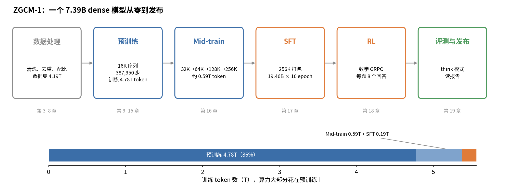
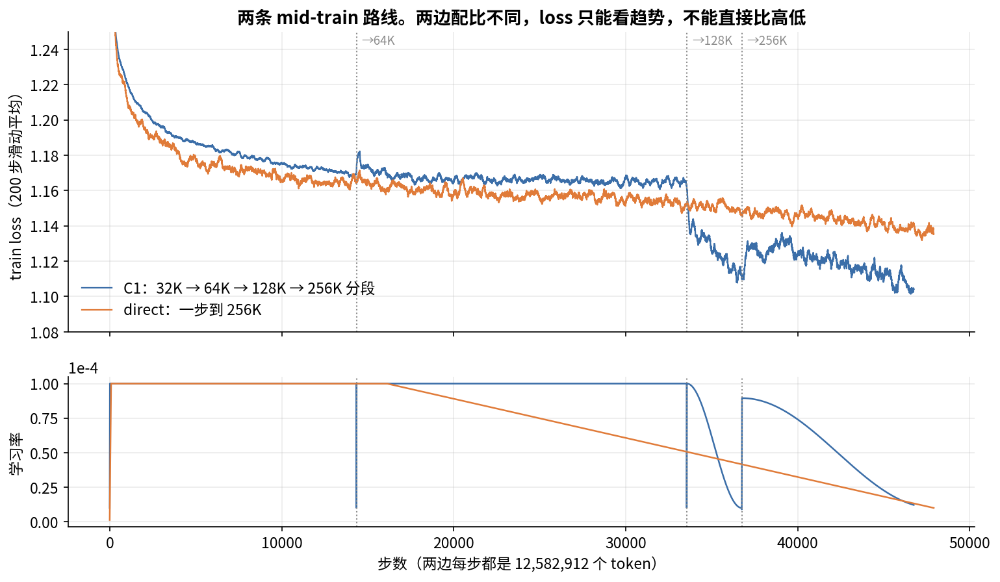

# 从零训练大模型：以 ZGCM-1 为例



很多人懂深度学习，大模型和 DeepSpeed 这些东西也大概知道，可每次有人问"一个模型从零训出来到底要经过哪些步骤、每一步为什么这么做"，却讲不连贯。原因不复杂：大多数模型只发最终权重和一份报告，中间的数据怎么洗、batch 多大、学习率怎么走、loss 实际长什么样，外人看不到，只能拼凑。

ZGCM-1 是个例外。这个 7.39B 的 dense 模型把各阶段的中间权重、训练代码和配置、数据配方、W&B 全量曲线和技术报告都公开了。于是我拿它当案例，把从零训练一个大模型的过程从原始网页一路写到最终评测，写成了这本书。书里 ZGCM 的数字基本都给了出处，报告、代码和曲线互相矛盾的地方也照实写出来，并说明我按什么顺序取信。

ZGCM 没用、但业界常用的做法，比如 MinHash-LSH、ZeRO-3、YaRN、PPO、z-loss，书里也讲了，并单独标出来。所以读完以后，你不只是了解一个模型，也能面对"给你 N 张卡、训一个 xB 模型"这样的任务，说出每一步要做哪些决定。

## 适合谁读

适合知道神经网络怎么训练（前向、loss、反向、梯度下降），但对大模型训练的全过程讲不清楚的人。Transformer 不熟没关系，第 2 章从头讲。不需要会 Megatron，也不需要读过 ZGCM 的报告。

全书不要求动手跑代码，读文字、表格和算式就够了。每章末尾有一段约 3 分钟的示范讲稿和 10–15 道习题，答案折叠在题目下面。我建议读完一章先合上书，按开头列的问题自己讲一遍，再对照讲稿。讲不出来的地方，就是还没懂的地方。

## 怎么读

直接在 GitHub 上点开 [docs/](docs/) 里的 markdown 就能读。

想要带侧边栏和搜索的网页版，可以直接打开 <https://pengtaoma00.github.io/how-llms-are-trained/>，也可以在本地起一个静态服务：

```bash
git clone https://github.com/pengtaoma00/how-llms-are-trained.git
cd how-llms-are-trained
python3 -m http.server 3000 -d docs
# 浏览器打开 http://localhost:3000
```

网页版用的是 [docsify](https://docsify.js.org/)，不需要构建，GitHub Pages 直接发布 `main` 分支的 `/docs` 目录。

第一遍最好按顺序读，后面的章节会直接用前面算出的数。时间紧的话，先读第 1、2 章打底，再读第 3–8 章的数据部分，这是全书的重点。

## 目录

| 章 | 讲什么 |
|---|---|
| [0　导读](docs/00_导读.md) | 全书怎么读，出处怎么查，数字对不上时信谁 |
| [1　全景与算力估算](docs/01_全景与算力估算.md) | 训练算力约 $6ND$；ZGCM 每步 token 从头到尾固定在 12,582,912 |
| [2　Transformer 到能讲的程度](docs/02_Transformer到能讲的程度.md) | Pre-LN 注意力加 SwiGLU FFN；把 7.39B 参数逐项数出来 |
| [3　Tokenizer](docs/03_Tokenizer.md) | 字节级 BPE；ZGCM 直接用 GLM-5.1 的 tokenizer；第一步 loss 应接近 $\ln V$ |
| [4　数据一：来源与获取](docs/04_数据一_来源与获取.md) | 在已清洗的公开数据集上二次筛选；约 21% 的记录只能 index_only 发布 |
| [5　数据二：清洗流水线](docs/05_数据二_清洗流水线.md) | 每篇文档独立判 keep/review/drop；规整步骤删掉了代码缩进，计数却全都正常 |
| [6　数据三：去重、质量、去污染](docs/06_数据三_去重质量去污染.md) | 精确去重、SimHash、MinHash-LSH；跨阶段去重和去污染代码没公开 |
| [7　数据四：配比与课程](docs/07_数据四_配比与课程.md) | 用 0.3B 代理模型试配比；stage 1 按词汇复杂度排课程；数据量 4.19T，训练量 4.78T |
| [8　数据五：从文本到训练样本](docs/08_数据五_从文本到训练样本.md) | 文档首尾相接切成 16,385 token；照仓库原样跑会悄悄打乱课程 |
| [9　模型架构](docs/09_模型架构.md) | 27 层 128 窗口滑窗加 5 层全局；256K 时 KV cache 从 32 GiB 降到约 5 GiB |
| [10　优化器与学习率](docs/10_优化器与学习率.md) | 矩阵参数用 Muon，其余用 Adam；预训练 LR 恒定 2e-4，不退火 |
| [11　数值精度](docs/11_数值精度.md) | BF16 计算、FP32 保存与累加；FP8 的缩放因子；TWEO 压激活离群值 |
| [12　分布式并行](docs/12_分布式并行.md) | TP2 × CP2 × DP48 = 192 卡；GBS 768 是怎么拼出来的 |
| [13　启动、检查点、续训](docs/13_启动检查点续训.md) | 检查点要存到"恢复后和没停过一样"；吞吐从 585 掉到 554 的事故 |
| [14　训练监控与稳定性](docs/14_训练监控与稳定性.md) | 对不对、稳不稳、快不快三类信号；哪些 loss 不能放在一起比 |
| [15　基座评测](docs/15_基座评测.md) | 早期看 BPB，准确率离开随机线后再看准确率 |
| [16　Mid-train 与长上下文](docs/16_MidTrain与长上下文.md) | 报告写三段，实际跑了 32K、64K、128K、256K 四段 |
| [17　SFT](docs/17_SFT.md) | 只对助手回复算 loss；第 1 步 loss 35；第 10 个 epoch 已过拟合 |
| [18　RL](docs/18_RL.md) | GRPO 的组内基线；报告结果用的模型很可能没经过 RL |
| [19　最终评测与读报告](docs/19_最终评测与读报告.md) | 采样和题目两层噪声；基线分数来源不一；读报告要四方对照 |
| [20　总复习与讲出来](docs/20_总复习与讲出来.md) | 从零训一个 7B 的决策清单，10 道大题和示范讲稿 |
| [附录 A　术语表](docs/附录A_术语表.md) | 全书术语的中英对照和定义 |
| [附录 B　数字速查](docs/附录B_数字速查.md) | ZGCM 的关键数字和出处 |
| [附录 C　W&B 与数据配比统计](docs/附录C_W&B与数据配比统计.md) | 我从公开 W&B 记录和 HF 数据集里统计出来的数字 |

## 书里的图

书里有 42 张图。一部分是示意图，比如数据流水线、packing、并行切分、显存构成、MinHash 的 S 形曲线，图里的数字都来自正文。另一部分是从 ZGCM 公开的 W&B 记录直接画的训练曲线，比如 mid-train 分段扩长和一步到 256K 的对比：



## 出处和版本

书里引用的材料都是公开的，版本固定如下：

| 材料 | 版本 |
|---|---|
| 技术报告 | arXiv [2609.13356](https://arxiv.org/abs/2609.13356) v2，书里写作"报告 §节号 第 N 页" |
| 训练代码 | [zgcagi/ZGCM-1](https://github.com/zgcagi/ZGCM-1)，commit `369f5ba`，行号以这个版本为准 |
| 训练曲线 | W&B 公开项目 `zgcagi/zgcm-1-reports` |
| 权重和数据卡 | Hugging Face 上的 [zgcagi](https://huggingface.co/zgcagi)，2026 年 10 月的版本 |

上游更新后行号可能偏移，按引文里的关键词搜一下就能找到。数字的取信顺序是：实际运行留下的记录（W&B、`checkpoint_info.json`）优先，其次是代码和配置，最后是报告正文。原因和例子在[导读](docs/00_导读.md)里。

书里把说法分成三类：直接写在材料里的是事实，只给出处；用事实算出来的标"推算"，算式写在正文里；没有直接证据、只是能解释现象的标"推断"。转述的时候请别把推断当事实。

## 声明

这是一本个人写的学习材料，不是 ZGCM-1 的官方文档，与 zgcagi 团队没有任何关系。书中对报告、代码和训练曲线的解读，包括指出的不一致和代码问题，都是我自己的理解，可能有错。如果你是 ZGCM-1 的作者，发现哪里说错了，非常欢迎指出来。

## 参与

发现事实错误、出处不对、算错的数或者读不懂的地方，请开一个 [issue](../../issues)，写清楚是哪一章哪一节。改错字或者补出处可以直接提 PR。提到数字时请附上出处，方便核对。

## 许可

正文和图片采用 [CC BY-NC-SA 4.0](LICENSE) 许可：可以转载和改编，但要署名、不能商用，改编后也要用同样的许可发布。

ZGCM-1 的报告、代码、权重和数据遵循它们各自的许可（代码仓库是 MIT 许可）。本仓库没有复制这些材料，正文里只有引用和十几到几十行的代码摘录，摘录都注明了文件路径。
