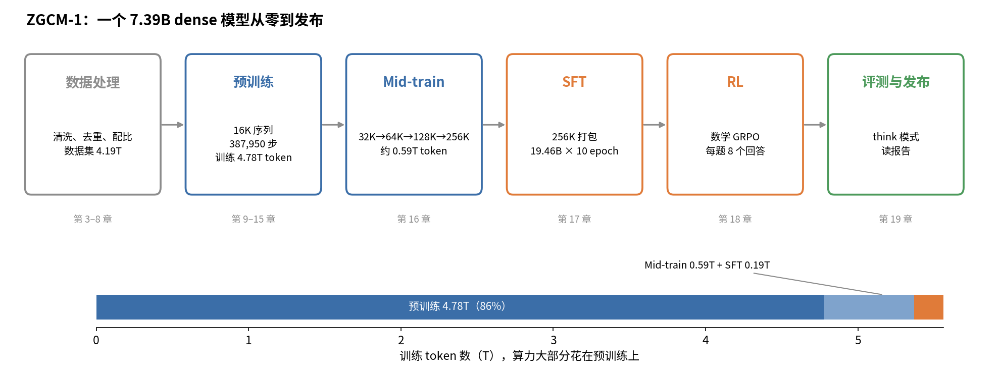
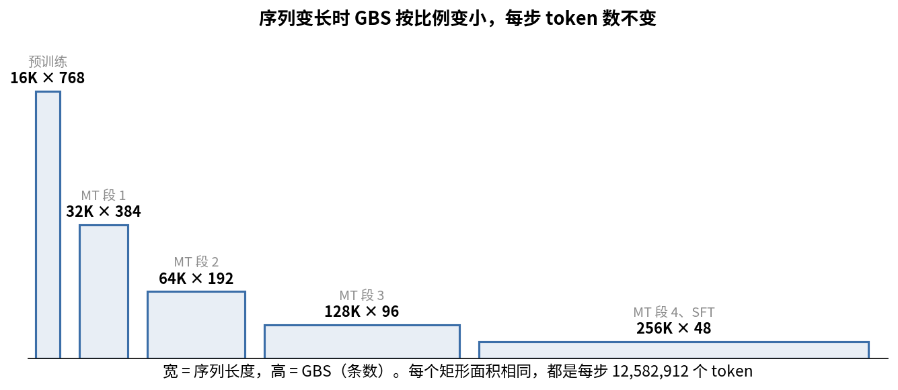

# 第 1 章　全景：一个模型从零到发布，要花多少算力

> 这一章先不讲细节，只搭一个骨架。读完以后，你脑子里应该有一张流水线的地图，后面每一章都是在给地图上的某一格填内容。

## 这一章要回答的问题

读完这一章，你应该能回答下面这些问题。

1. 从零训练一个大模型，要经过哪几个阶段？每个阶段的输入、输出、目标分别是什么？
2. ZGCM-1 每个阶段用了多少数据、多长序列、多少步、多少卡？
3. "训练一个 7B 模型要多少算力"怎么估算？6ND 公式是怎么来的？
4. MFU 是什么？ZGCM 说的 "585 TFLOP/s/GPU，约 60% MFU" 怎么算出来？
5. 报告说的"4.2× time-to-loss 提升"是怎么得到的？这个数字该怎么理解？
6. 为什么公开材料（报告、代码、HF、W&B）的数字经常对不上？读的时候怎么处理？

---

## 1.1 训练一个大模型，是在做什么

一个语言模型就是一个函数：输入一串 token（文字切成的小块），输出"下一个 token 是词表里每个词的概率"。训练就是调整这个函数的几十亿个参数，让它在海量文本上"猜下一个词"猜得越来越准。

衡量猜得准不准的数叫 **loss（损失）**，具体是交叉熵：模型给正确答案的概率越高，loss 越低。第 2 章会推导它，眼下有个印象就够了。整个预训练，就是在几万亿个 token 上一步一步把这个 loss 往下压。

猜下一个词听起来很简单，模型却能借此学到知识和推理能力。要把下一个词猜准，它必须理解前文：要猜对数学题的下一步，得会算；要猜对代码的下一行，得懂程序逻辑。语料越多、越好，模型被迫学会的东西就越多。

光会续写还不够好用。一个只做过预训练的模型叫 **base 模型**，你问它问题，它可能接着编出另一个问题，而不是回答你。所以后面还要教它对话的格式，以及什么样的回答才算好，这就是后训练（SFT、RL）。

## 1.2 流水线全图

上面一排是六个阶段，每个框里写着 ZGCM 在这一阶段的几个关键数字，框下是本书讲它的章节。下面的横条是各阶段训练用的 token 数。数据集 4.19T 和预训练 4.78T 不相等，原因在 [§1.5](#s1-5)。

下表列出每个阶段的输入、训练目标和输出，最后一列是本书讲它的章节。

| 阶段 | 输入 | 训练目标 | 输出 | 本书章节 |
|---|---|---|---|---|
| 数据处理 | 原始网页、PDF、代码仓库、数学语料 | 不训练，只做筛选和加工 | 干净、去重、有配比的文本 | 第 4–8 章 |
| Tokenizer | 文本 | 不训练模型（tokenizer 可以复用现成的） | 文本到整数的映射 | 第 3 章 |
| General Pre-Training（通用预训练） | 万亿级 token | 预测下一个 token，所有 token 都算 loss | base 模型 | 第 9–15 章 |
| Mid-Training（中期训练） | 几千亿 token，推理、代码、agent 更多，序列更长 | 还是预测下一个 token | 长上下文、能力更强的 base | 第 16 章 |
| SFT（监督微调） | 对话数据（问题加标准回答） | 只在"回答"部分算 loss | 会按格式对话的模型 | 第 17 章 |
| RL（强化学习） | 题目加自动判分器 | 让答对的回答概率变大 | 推理更强的模型 | 第 18 章 |
| 评测 | 各阶段 checkpoint | 不训练 | 能力报告，指导下一步怎么调 | 第 15、19 章 |

表里有几处关系后面会反复用到。预训练和 mid-train 的训练目标完全一样，都是对所有 token 做下一个词预测，区别只在数据（更偏推理、代码、agent）和序列长度（16K 扩到 256K），所以 mid-train 也叫 continued pre-training（继续预训练）。SFT 的目标形式还是一样，但只对回答算 loss，用户的问题只当作条件，不要求模型学会"生成问题"。到了 RL，就不再有标准答案了：模型自己生成回答，判分器打分，分高的回答被强化。

算力绝大部分花在预训练上。ZGCM 预训练约 4.78T token，mid-train 约 0.59T，SFT 约 0.19T（19.46B × 10 epoch），RL 更少。模型的底子，是由预训练的数据和训练效率决定的。

## 1.3 ZGCM-1 是什么样的模型

ZGCM-1 是中关村人工智能研究院从零训练、完全开源的 7.39B 参数 dense 模型（报告 §1 第 2 页）。"dense"指每个 token 都经过全部参数，和 MoE（每次只激活一部分专家）相对。

它开源的范围很全：权重（各阶段中间 checkpoint 都有）、训练代码和配置、数据配方、W&B 曲线、技术报告（报告 §1 第 3 页）。这本书选它做案例，原因就在这里。大多数模型只发最终权重，ZGCM 能让你看到每一步的真实数字。

它的结构是 32 层 Transformer，其中 27 层是只看前 128 个 token 的"滑动窗口注意力"，5 层是看全文的"全局注意力"，最长上下文 256K。第 9 章会详细讲这个结构。

## 1.4 ZGCM-1 全流程数字总表

下表把 ZGCM-1 各阶段的数字放在一起。表头的"每步 token"指一次参数更新用到的 token 数，等于 GBS（全局 batch，一步多少条序列）× 序列长度。

| 阶段 | 数据量 | 序列长 | GBS | 每步 token | 学习率 | 步数 | 卡数 |
|---|---|---|---|---|---|---|---|
| PT stage 1（课程排序） | 0.99T | 16K | 768 | 12.58M | Muon 2e-4，常数 | 79,473（env） | 192×H100 |
| PT stage 2（全局打乱） | 3.20T | 16K | 768 | 12.58M | 同上 | 累计到 333,787（env） | 192 |
| PT 实际 | 累计 4.78T token | 16K | — | — | — | 387,950（HF） | 192 |
| MT 段 1 | 180B | 32K（实际） | 384 | 12.58M | 1e-4，常数 | 14,344 | 192 |
| MT 段 2 | 240B | 64K | 192 | 12.58M | 1e-4，常数 | 19,206 | 192 |
| MT 段 3（报告没提） | 约 40B | 128K | 96 | 12.58M | 1e-4 cosine 降到 1e-5 | 3,201 | 192 |
| MT 段 4 | 约 126B（计划约 141B） | 256K | 48 | 12.58M | 8.95e-5 cosine | 10,000（计划 11,173） | 192 |
| SFT | 19.46B × 10 epoch | 256K | 48 | 12.58M | 1e-4 cosine 降到 1e-6，无 warmup | 15,467 | 192 |
| RL（数学 GRPO） | 每步 384 题 × 8 个回答 | 生成 ≤64K | — | — | Adam 1e-6，常数 | 177 | — |

来源：PT 行来自 `pretrain/configs/stages/*.env` 和 HF 各 checkpoint 的 `checkpoint_info.json`；MT 行来自 W&B run `view-midtrain-c1-unfinished-v1`（见附录 C [§C.1](附录C_W&B与数据配比统计.md#sc-1)）；SFT 行来自 `sft/training_launchers/stable_candidate/zgcm.conf`；RL 行来自 `rl/configs/math_grpo_length_shaped.yaml`。

这张表里有一个规律贯穿始终：每步 token 数从头到尾都是 **12,582,912**。

$$768 \times 16384 = 384 \times 32768 = 192 \times 65536 = 96 \times 131072 = 48 \times 262144 = 12{,}582{,}912$$

序列变长时，GBS 按同样的比例变小，每一步看到的信息量就不变，学习率等超参数大体不用重调。不过序列条数变少以后，每步梯度的噪声会变大，第 14 章会看到 grad norm 因此翻倍。

## 1.5 为什么各处数字对不上

上面那张表里，好几格都带着括号注明来源，有的还写着"计划"和"实际"两个数。读 ZGCM 时你会反复遇到"报告说 A、代码写 B、W&B 显示 C"的情况，原因大致有三类。

第一类，报告写的是设计，W&B 和 HF 记录的是实际。例如报告说 mid-train 是 16K→64K→256K 三段，HF checkpoint 的元数据却写着第一段用 32K 窗口训练，256K 之前还有一个 128K 段（`zgcagi/ZGCM-1-7B-Midtrain-Staged-256K` 的 README）。

第二类，开源代码是整理后的配方，和当时实际提交的作业不完全一样。例如仓库 mid-train 的 env 写 LR 2e-5 cosine，W&B 实测是 1e-4 常数，报告正文也写 1e-4（报告 §3.2.5 第 10 页）。

第三类，"数据量"和"训练 token 数"是两回事。报告的 0.99T + 3.20T = 4.19T 是数据集大小。HF 记录的实际训练量是 4.78T：课程数据先顺序过了一遍，又打乱过了一遍（`ZGCM-1-7B-Pretrain-Curriculum` 在第 138,000 步、累计 1634.87B），然后才是 3.2T 新数据。

遇到这种情况，这本书以实际记录为准（W&B 全量 history、HF 元数据），然后是代码，最后才是报告文字。书里每个数字都标了出处，凡是推断都写明"推断"。

还有一个细节对不上。387,950 步 × 12.58M = 4.88T，比 HF 写的 4779.97B 多约 0.1T；138,000 步 × 12.58M = 1.74T，也比 1634.87B 多。报告附录 A.2 第 30 页提到训练早期有 **global-batch-size ramp**，即开头几步 GBS 从小逐步加到 768。这些步每步不到 12.58M token，用"步数 × 12.58M"去算就会多算。报告还说 base checkpoint 的 token 数按"consumed samples × 序列长度"计算，最后一个评到 4.19T（报告附录 A.2 第 30 页），这又和 HF 的 4.78T 对不上。ramp 的具体安排、两个总数谁对，公开材料都没说清。这本书遇到这类地方就直接标"未知"，不替它圆。

## 1.6 估算算力：6ND 公式

知道了每个阶段用多少 token，接下来要问训练这些 token 需要多少算力。业界常用的估算是：

$$C \approx 6 N D$$

$C$ 是总浮点运算次数（FLOPs），$N$ 是参数量，$D$ 是训练 token 数。系数 6 由前向和反向两部分组成。

先看前向。模型的主体是矩阵乘法。一个权重矩阵 $W$（形状 $d_{in}\times d_{out}$）作用在一个 token 的向量上，每个权重参与一次乘法和一次加法，就是 2 次运算。所有权重加起来，一个 token 前向一次约 $2N$ FLOPs。

反向要算两类梯度。一类是对输入激活的梯度，链式法则要靠它往前传；另一类是对权重本身的梯度，用来更新参数。每类都是一次和前向同规模的矩阵乘，所以反向约 $2 \times 2N = 4N$。前向加反向，每个 token 约 $6N$ FLOPs，乘以 token 数 $D$ 就是 $6ND$。

拿一个最小的例子数一遍（示意数字，和 ZGCM 无关）。设一层只有一个 $2\times3$ 的权重矩阵 $W$，共 6 个参数，输入是一个 token 的 2 维向量 $x$，输出 $y = xW$ 是 3 维。前向时每个输出 $y_j = x_1W_{1j} + x_2W_{2j}$，6 个权重各做一次乘加，共 12 FLOPs，正好是 $2N$。反向时，上游传回 3 维的梯度 $g = \partial L/\partial y$：对输入的梯度 $\partial L/\partial x_i = \sum_j W_{ij}g_j$ 要把 6 个权重再各用一次乘加，12 FLOPs；对权重的梯度 $\partial L/\partial W_{ij} = x_ig_j$，每个 token 算出这一项后要累加到整个 batch 的梯度上，也是每个权重一次乘加，又是 12 FLOPs。反向合计 24 FLOPs，即 $4N$，前向加反向 36 FLOPs，即 $6N$。

6ND 只数了和参数有关的运算。注意力里 $QK^\top$ 和"注意力权重乘 $V$"这两步不涉及参数，计算量随上下文长度增长。按标准估算，每个 token、每层前向约 $4 \cdot T_{ctx} \cdot d$，其中 $T_{ctx}$ 是这个 token 平均看到的上下文长度，$d$ 是隐藏维度。系数 4 是这样来的：这个 token 的 query 要和 $T_{ctx}$ 个 key 各做一次 $d$ 维点积，约 $2T_{ctx}d$ 次运算；再用得到的 $T_{ctx}$ 个权重对同样多的 $d$ 维 value 加权求和，又是约 $2T_{ctx}d$。

拿 ZGCM 在 16K 下算一遍。5 个全局层在因果注意力下平均看到 8K 个 token，每层前向 $4 \times 8192 \times 4096 \approx 1.34\times10^8$，5 层约 $6.7\times10^8$。27 个滑窗层每层只看 128 个 token，加起来可以忽略。训练时乘 3（反向约是前向的 2 倍，道理和上面的线性层一样），得到约 $2.0\times10^9$ FLOPs/token。参数部分是 $6N = 6\times7.39\times10^9 = 4.43\times10^{10}$，所以注意力只多出约 4.5%。

如果 32 层全是全局注意力，这个比例会变成约 29%（$1.34\times10^8\times32\times3 / 4.43\times10^{10}$）。到 256K 时，全局层平均看到 128K 个 token，同样的算法给出每个全局层每 token 训练约 $6.4\times10^9$ FLOPs。32 层都是全局层的话，注意力的计算量是参数部分的 4.6 倍。序列越长，注意力占得越多，这是 ZGCM 选滑窗的原因之一（第 9 章）。

## 1.7 ZGCM 花了多少算力

把 ZGCM 的数代进 6ND（$N = 7.39\times10^9$），按两种口径各算一遍：

| 口径 | D | C = 6ND |
|---|---|---|
| 报告的数据量 | 4.19T | $1.86\times10^{23}$ |
| HF 记录的实际训练量 | 4.78T | $2.12\times10^{23}$ |

报告说 16K 训练时每卡跑到约 585 TFLOP/s（报告 §3.1.3 第 7 页），192 张卡总吞吐 $585\times10^{12}\times192 = 1.12\times10^{17}$ FLOP/s。按 4.78T 算：

$$t = \frac{2.12\times10^{23}}{1.12\times10^{17}} \approx 1.89\times10^6\ \text{s} \approx 21.8\ \text{天} \approx 10\ \text{万 GPU 小时}$$

GPU 小时数是把秒数乘 192 张卡再除以 3600：$1.89\times10^6\times192/3600\approx1.0\times10^5$。这是纯计算时间的下限，真实的墙钟时间还要加上故障重启、存 checkpoint、评测和排队，通常再多 10%–30%。这个估算是本书自己算的，报告没有给。

这种估算最好自己会做。以后你提出"训一个 xB 模型、y T token"的计划时，第一件事就是用 6ND 除以"卡数 × 单卡实际吞吐"，估出要几天，再判断资源够不够。

## 1.8 MFU：衡量卡用得好不好

上面用到的 585 TFLOP/s 是单卡的实际吞吐。它和硬件峰值一比，就得到 **MFU**（Model FLOPs Utilization，模型算力利用率），即实际完成的模型 FLOPs 除以硬件峰值 FLOPs。

H100 的 BF16 dense 峰值是 989 TFLOP/s（报告 §3.1.3 第 7 页），ZGCM 实际 585：

$$\text{MFU} = 585 / 989 \approx 59\%$$

算 MFU 时有几处容易混。分母用的是 dense 峰值，也就是不考虑稀疏加速的峰值。H100 宣传的 1979 TFLOP/s 是 2:4 稀疏的数字，不能拿来算 MFU。

ZGCM 的矩阵乘用 FP8，而 FP8 峰值是 BF16 的 2 倍，所以报告特意写"BF16-equivalent MFU"，分母用 BF16 峰值。如果按 FP8 峰值算，利用率只有约 30%。

分子里的 model FLOPs 只算模型本身需要的运算。开了激活重算（recompute，第 12 章）的话，重算多出来的那部分不算进去，因此 MFU 衡量的是有效工作占硬件能力的比例。打个比方，一台复印机铭牌上写每分钟 100 页，一天下来平均每分钟交出 59 页合格的复印件，利用率就是 59%，卡纸、换纸、等原稿的时间都摊在里面。同一页如果印了两遍，第二遍不算产量。激活重算就是这种情况：为了省显存先把前向的中间结果扔掉，反向时再算一遍。这个比方有一处不贴切：复印机的铭牌速度是真能跑到的，GPU 的峰值却是理论上限，训练里除了矩阵乘还有通信、访存和非矩阵运算，实际作业到不了 100%。另外别忘了上一段说的口径：ZGCM 的 59% 是按 BF16 峰值折算的，FP8 在里面帮了多少，报告没有单独拆开，拿它和纯 BF16 训练的 MFU 比要小心。

## 1.9 显存：为什么 7B 一张卡装不下

算力决定要跑多久，显存决定能不能跑起来。训练时，每个参数在显存里不只存一份：

| 内容 | 混合精度加 AdamW | 说明 |
|---|---|---|
| bf16 权重 | 2 字节 | 前向和反向用 |
| 梯度 | 2–4 字节 | bf16 或 fp32 |
| fp32 主权重 | 4 字节 | 更新时用，避免精度损失 |
| Adam 的 m 和 v | 8 字节 | 两个 fp32 动量 |
| 合计 | 约 16 字节/参数 | |

7.39B × 16 字节 ≈ 118GB，已经超过一张 H100 的 80GB，而且这还没算激活值。所以必须把优化器状态和梯度切到多张卡上（ZeRO 或 distributed optimizer，第 12 章）。Muon 只有一个动量，比 AdamW 省 4 字节/参数（第 10 章）。

## 1.10 "4.2× time-to-loss"该怎么理解

最后回到报告里最显眼的那个数字。**time-to-loss** 指训练到同一个 loss 要花多少时间，它由两件事共同决定：每秒能处理多少 token（吞吐），以及每个 token 能让 loss 降多少（样本效率）。

报告把提速拆成 4 个因子相乘（报告 §3.1.3 第 7 页）：

| 因子 | 倍数 | 属于哪一类 | 证据 |
|---|---|---|---|
| SWA 5:1 vs 全注意力 | 1.4× | 吞吐 | 16K 下实测吞吐（第 9 章） |
| FP8 精度加系统优化 | 约 1.5× | 吞吐 | 报告给的估计 |
| Muon vs AdamW | 约 1.8× | 样本效率（step-to-loss） | 报告给的估计 |
| Pre-LN | 约 1.1× | 样本效率 | "来自探索性 7B 证据" |

$1.4\times1.5\times1.8\times1.1 \approx 4.16$，报告取整写成 4.2×。基线是"OLMo 3 风格的 7B BF16/AdamW"。

这个数要打折扣看。四个因子是分别测量再相乘的，报告没有做过一次端到端对比，而只有因子之间互不影响时才能直接相乘。比如 FP8 和 Muon 叠加后各自的收益是否还在，报告没有验证。报告也没有逐项给出 Pre-LN 1.1× 和 Muon 1.8× 的实验细节。比较稳妥的说法是："ZGCM 估计相对一个标准基线快约 4 倍，主要来自注意力结构、FP8 和 Muon。"不要把 4.2 当成精确测量值。

不过这种拆法本身值得学。提升训练效率有两条路：一条是让每秒处理更多 token，靠系统侧的精度、并行、kernel 和架构；另一条是让每个 token 更值钱，靠算法侧的优化器、数据质量和课程。做规划时把两条路分开评估，最后相乘看总收益。

## 1.11 试着讲给别人听

下面是一段大约 3 分钟的讲法。建议你先合上书自己讲一遍，再对照。

> 从零训练一个大模型，可以分成五步：准备数据、预训练、mid-train、SFT 和 RL，中间穿插评测。
>
> 预训练是大头。模型在几万亿 token 上做下一个词预测，所有 token 都算 loss。ZGCM-1 用 192 张 H100、16K 序列，每步 12.58M token，训了约 4.78T token。按 6ND 估算约 2×10²³ FLOPs，纯算力约 22 天。
>
> 6ND 是说每个 token 前向 2N、反向 4N。对 7B 模型，注意力那部分额外开销在 16K 下不大，到 256K 就会超过参数部分，所以 ZGCM 用了 27 层 128 窗口的滑动窗口注意力，加 5 层全局注意力。
>
> mid-train 的目标和预训练一样，只是换成更偏推理、代码、agent 的数据，并把上下文一路扩到 256K。ZGCM 在这一步用了约 590B token。全程每步 token 数都固定在 12.58M，序列变长时 batch 按比例缩小。
>
> SFT 教模型对话格式，只对回答部分算 loss。RL 让模型自己生成答案，由判分器打分，强化答对的回答。
>
> 系统效率看 MFU，就是实际 FLOPs 除以峰值。ZGCM 是 585/989，约 59%。报告声称相对标准基线快 4.2 倍，这是四个因子分别估计再相乘得到的，要打折扣听。
>
> 最后，读这类开源项目时要分清设计和实际。ZGCM 的报告、代码、W&B 有不少对不上的地方，以实际记录为准。

## 1.12 习题

1. 预训练、mid-train、SFT 三者的训练目标有什么相同、什么不同？
2. 为什么说"算力大部分花在预训练"？用 ZGCM 的 token 数说明。
3. 推导 6ND 中的 6。
4. 一个 13B 模型训 2T token，用 256 张卡，每卡实际 400 TFLOP/s，大约要多少天？
5. ZGCM 序列从 16K 变到 256K 时，GBS 怎么变？为什么这样安排？
6. 为什么 ZGCM 写"BF16-equivalent MFU"？如果按 FP8 峰值算，MFU 大约是多少？
7. 7B 模型用 AdamW 加混合精度，每个参数大约占多少字节？为什么单卡放不下？
8. 4.2× 由哪 4 个因子组成？哪些属于吞吐，哪些属于样本效率？
9. 为什么不能完全相信 4.2× 这个数字？
10. 报告的 4.19T 和 HF 的 4.78T 为什么不同？
11. 序列从 16K 变到 256K，6ND 估算的误差会怎么变？为什么？

参考答案

1. 相同：都是下一个 token 预测的交叉熵。不同：预训练和 mid-train 对所有 token 算 loss，mid-train 的数据更偏推理和长文、序列更长；SFT 只对回答部分算 loss（[§1.2](#s1-2)）。
2. 预训练约 4.78T token，mid-train 约 0.59T，SFT 约 0.19T。按 6ND，算力和 token 数成正比，预训练约占 86%（4.78 / 5.56，RL 忽略不计）（[§1.2](#s1-2)）。
3. 前向时每个参数一次乘加，共 2 次运算，即 2N。反向要算对激活的梯度和对权重的梯度两次矩阵乘，即 4N。合计 6N 每 token（[§1.6](#s1-6)）。
4. $6\times13\times10^9\times2\times10^{12} = 1.56\times10^{23}$。除以 $256\times4\times10^{14} = 1.02\times10^{17}$，得约 $1.52\times10^6$ 秒，约 17.6 天，实际还要再加 10%–30%（[§1.7](#s1-7)）。
5. 768 → 384 → 192 → 96 → 48，每步 token 数保持 12.58M 不变。这样每步信息量不变，LR 等超参数基本不用重调。不过序列条数少了，梯度噪声会变大（[§1.4](#s1-4)）。
6. 矩阵乘用的是 FP8，而 FP8 峰值约是 BF16 的 2 倍。分母用 BF16 峰值，是为了和别人的 BF16 训练直接可比。按 FP8 峰值算约 30%（[§1.8](#s1-8)）。
7. 约 16 字节：bf16 权重 2、梯度 2–4、fp32 主权重 4、Adam 两个动量 8。7.39B × 16 ≈ 118GB，大于 80GB，还没算激活值（[§1.9](#s1-9)）。
8. SWA 1.4×、FP8 1.5× 属于吞吐；Muon 1.8×、Pre-LN 1.1× 属于样本效率（[§1.10](#s1-10)）。
9. 4 个因子是分别估计再相乘的，没有端到端验证它们是否独立。其中两个因子报告没有给出实验细节（[§1.10](#s1-10)）。
10. 4.19T 是两阶段数据集的大小。4.78T 是 HF 记录的实际训练 token 数：课程数据过了两遍（一遍顺序、一遍打乱）。报告自己的 checkpoint 横轴也写到 4.19T，两个口径的矛盾公开材料没有解释（[§1.5](#s1-5)）。
11. 误差变大。6ND 不含注意力的 $QK^\top$ 和"权重乘 V"这部分，它随上下文长度线性增长。16K 时 ZGCM 只多约 4.5%，全局注意力模型到 256K 时会超过参数部分（[§1.6](#s1-6)）。

---

上一章：[第 0 章　导读](00_导读.md)　下一章：[第 2 章　Transformer 到能讲的程度](02_Transformer到能讲的程度.md)
