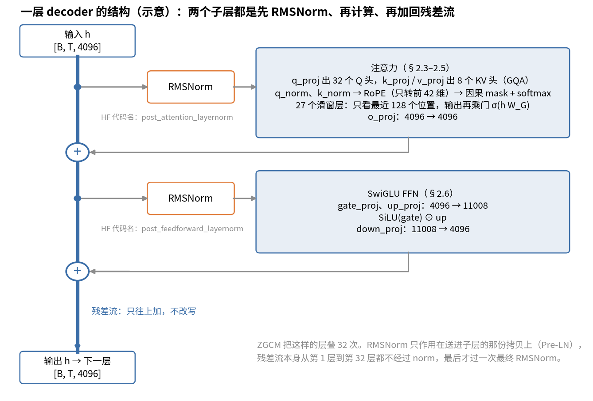
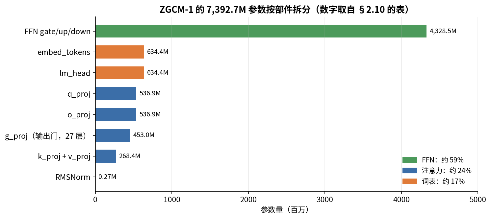

# 第 2 章　Transformer：讲到能讲清楚的程度

> 你大概知道 Transformer 是什么。这一章的目标是让你能拿着 ZGCM-1 的真实代码，从输入一个 token 讲到输出 loss，每一步都说清楚张量形状、参数量和"为什么这样设计"。后面讲优化器、并行、FP8，都要用到这里的细节。

## 这一章要回答的问题

读完这一章，你应该能回答下面这些问题。

1. 一个 token 从输入到输出 logits，中间经过哪些运算？每一步张量是什么形状？
2. 注意力为什么要除以 $\sqrt{d}$？因果 mask 是做什么的？
3. GQA 是什么？为什么 KV 头可以比 Q 头少？
4. SwiGLU FFN 和最早的 ReLU FFN 有什么不同？为什么中间维度是 11008？
5. Pre-LN 和 Post-LN 有什么区别？为什么现在都用 Pre-LN？
6. 交叉熵 loss、perplexity、BPB 分别是什么，怎么互相换算？
7. ZGCM-1 的 7.39B 参数，逐项是怎么来的？
8. 为什么一条长 T 的序列在训练时能同时产生 T 个预测？推理时为什么需要 KV cache？

---

<a id="s2-1" name="s2-1"></a>
## 2.1 总图：一条序列走过模型

我们直接用 ZGCM 的真实尺寸来讲：词表 $V = 154{,}880$，隐藏维度 $d = 4096$，32 层。设 batch 为 $B$、序列长 $T$，一条序列从输入走到 loss 的路径如下。

```
input_ids            [B, T]          整数，每个是词表里的编号
  │ embed_tokens（查表）
hidden               [B, T, 4096]
  │ × 32 层，每层：
  │   h = h + Attn(RMSNorm(h))       注意力：token 之间交换信息
  │   h = h + FFN(RMSNorm(h))        前馈网络：每个 token 自己做非线性变换
  │ 最后一个 RMSNorm
hidden               [B, T, 4096]
  │ lm_head（线性层 4096 → V）
logits               [B, T, 154880]   每个位置对"下一个 token"的打分
  │ softmax + 交叉熵（和右移一位的真实 token 比）
loss                 标量
```

模型的结构就这么多。所谓"架构选择"，都是在改这张图里的某个方块：注意力怎么算、位置怎么编码、norm 放哪、FFN 用什么激活。

这张图在代码里能一一对上。`zgcagi/ZGCM-1-7B` 里的 `modeling_zgcm.py` 是 ZGCM 发布的 HF 实现，只有 438 行，建议你读完本章后把它从头到尾读一遍。其中 `ZgcmModel.forward`（L289-L357）就是上面这张图，`ZgcmDecoderLayer.forward`（L228-L253）对应图里"每层"那两行。

<a id="s2-2" name="s2-2"></a>
## 2.2 Embedding：把编号变成向量

图的第一步是查表。`nn.Embedding(V, d)` 就是一张 $V \times d$ 的表，第 $i$ 行是编号 $i$ 的 token 对应的向量。查表本身不做乘法，所以前一章说"embedding 的前向几乎不花算力"。在数学上，查第 $i$ 行等于拿一个只有第 $i$ 位是 1 的 one-hot 向量去乘这张表，结果正好是第 $i$ 行。所以 embedding 也可以看成一个线性层，实现时直接取那一行，把乘法省掉了。

这张表有 $154{,}880 \times 4096 = 6.34$ 亿个参数，占全模型的 8.6%。

图的最后一步 `lm_head` 是另一张同样大小的矩阵，它把 4096 维向量变成 $V$ 个打分。ZGCM 没有让这两张表共享参数（untied，`config.json` 里 `tie_word_embeddings: false`），所以又多了 6.34 亿参数。小模型常把两张表共享（tied）来省参数。7B 以上的开源模型多数不共享，比如 Llama 2 7B 和 OLMo 2 7B。常见的解释是输入和输出这两张表承担的角色不同，而且模型大了以后，共享省下的参数只占很小一部分。

<a id="s2-3" name="s2-3"></a>
## 2.3 注意力：从零推一遍

查完表以后，每个 token 的向量只知道"我是谁"，还不知道上下文。注意力要解决的就是这件事：让每个位置去"看"其他位置，按相关程度加权汇总信息。

先看单头注意力。对每个位置的向量 $h$（4096 维），用三个矩阵分别投影：

$$q = h W_Q,\quad k = h W_K,\quad v = h W_V$$

三个向量各有分工：$q$（query）表示"我在找什么"，$k$（key）表示"我能提供什么"，$v$（value）是被选中时我交出去的内容。位置 $i$ 对位置 $j$ 的打分是点积 $q_i \cdot k_j$。打分经过 softmax 变成权重，再对所有 $v_j$ 加权求和：

$$\text{out}_i = \sum_j \text{softmax}_j\!\left(\frac{q_i\cdot k_j}{\sqrt{d_h}}\right) v_j$$

拿一个小例子手算一遍。下面的数是示意用的，和 ZGCM 无关。设序列只有 3 个 token，头维 $d_h=2$，三个位置的 key 是 $k_1=(1,0)$、$k_2=(0,1)$、$k_3=(1,1)$，为了少写几个数，value 取得和 key 一样（实际模型里两者来自不同矩阵）。第 3 个位置的 query 是 $q_3=(2,1)$，它能看到全部 3 个位置。点积打分是 2、1、3，除以 $\sqrt2$ 得 1.41、0.71、2.12，softmax 后权重约为 0.28、0.14、0.58，加起来是 1。输出是 $0.28\,v_1+0.14\,v_2+0.58\,v_3=(0.86,\ 0.72)$。和 $q_3$ 最"对得上"的 $k_3$ 拿到了一多半的权重，但另外两个位置的信息也按比例混了进来。

公式里除以 $\sqrt{d_h}$ 是为了控制打分的大小。设 $q$、$k$ 每维是均值 0、方差 1 的随机数，那么 $d_h$ 维点积的方差是 $d_h$。ZGCM 的 $d_h=128$，点积的标准差就是 11.3。这么大的数进 softmax，会让一个位置的权重接近 1、其余接近 0，梯度几乎消失。代三个相差一个标准差的打分进去看看：11.3、0、−11.3 经过 softmax，权重约为 0.99999、0.00001、0；先除以 11.3，变成 1、0、−1，权重就是 0.67、0.24、0.09。softmax 对输入的导数由 $p_i(1-p_i)$ 和 $-p_ip_j$ 这样的乘积组成，第一种情况下最大的一项只有约 0.00001，第二种是 0.22，梯度差了四个数量级。除以 $\sqrt{d_h}$ 正好把方差拉回 1。代码里对应的是 `self.scaling = self.head_dim**-0.5`（L131）。

还有一个约束来自语言模型本身。预测第 $i+1$ 个 token 时，模型不能偷看 $i$ 之后的内容，所以要把 $j>i$ 的打分设为 $-\infty$，softmax 后这些位置的权重就是 0，这就是**因果 mask**。代码 `build_causal_mask`（L92-L116）里的 `allowed = k_positions <= q_positions` 做的就是这件事。滑动窗口在此基础上再加一个条件 `k_positions >= q_positions - window + 1`（L104），只允许看最近 128 个位置。

实际模型里用的是多头注意力：把 4096 维拆成 32 个头，每头 128 维，各自独立做注意力，最后拼起来，再用 $W_O$（4096×4096）混合。这样不同的头可以关注不同的关系，比如有的看语法、有的看指代。

ZGCM 在多头的基础上又省了一步，用的是 **GQA**（分组查询注意力）：32 个 Q 头只配 8 个 K/V 头，每 4 个 Q 头共享一组 K/V。代码里的 `repeat_kv`（L81-L89）把 8 组 K/V 复制成 32 份。这样做是为了推理，因为推理时要缓存所有历史位置的 K 和 V（KV cache，[§2.9](#s2-9)），K/V 头少 4 倍，缓存就小 4 倍。GQA 的原论文（Ainslie 等，2023）报告，分组数适中时质量接近完整的多头注意力，速度接近只有一组 K/V 的做法。按 KV 头的数量，这几种做法各有名字：Q 头数等于 KV 头数的叫 MHA，只有 1 组 KV 的叫 MQA，GQA 介于两者之间。

参数量也跟着变：$W_K$、$W_V$ 都只有 $4096 \times (8\times128) = 4096\times1024$。

<a id="s2-4" name="s2-4"></a>
## 2.4 位置信息：RoPE 的简版

到这里注意力还缺一样东西。点积 $q_i\cdot k_j$ 本身不知道 $i$ 和 $j$ 隔了多远。如果什么都不加，"猫追狗"和"狗追猫"在注意力眼里没有区别。

ZGCM 用 **RoPE**（旋转位置编码）补上位置信息。它把 $q$ 和 $k$ 的维度两两配对，每一对看成二维平面上的一个点，按位置 $p$ 转一个角度 $p\cdot\theta_m$，第 $m$ 对的转速是 $\theta_m = \text{base}^{-2m/d_{rot}}$。两个旋转过的向量做点积，结果只依赖角度差 $(i-j)\theta_m$，因为把两个向量同时转同一个角度，点积不变，能留下来的只有两者之间相差的那部分角度。于是注意力打分自然带上了相对距离。

ZGCM 的 RoPE 有两个特别之处，第 9 章和第 16 章会详细讲。一是 partial RoPE，只旋转前 42 维（$\lfloor128\times0.334\rfloor=42$），后 86 维不加位置信息（代码 L32-L33、L61-L66）。二是 base 很大，预训练用 5M，256K 阶段用 10M。base 越大，转得越慢，越适合长距离。

<a id="s2-5" name="s2-5"></a>
## 2.5 QK-Norm 和输出门（先打个照面）

注意力部分还有两个部件，这里先提一下，后面的章节再展开。第一个是 QK-Norm。ZGCM 在算点积之前，对每个头的 $q$ 和 $k$ 各做一次 RMSNorm（`q_norm`、`k_norm`，L145-L146、L171-L172），目的是防止 $q\cdot k$ 越训越大、softmax 饱和，属于稳定性手段（第 14 章）。

第二个是 27 个滑窗层上的输出门：注意力输出逐元素乘以 $\sigma(h W_G)$ 后再进 $W_O$（L213-L216）。$W_G$ 也是 4096×4096。为什么要加门，第 9 章讲。

<a id="s2-6" name="s2-6"></a>
## 2.6 FFN：SwiGLU

注意力让 token 之间交换信息，每层的第二个子层 FFN 则让每个 token 自己消化这些信息。FFN 对每个位置独立计算，位置之间不交互。

原始 Transformer 里的 FFN 是 $\text{FFN}(x) = W_2\,\text{ReLU}(W_1 x)$，中间维度一般是 $4d$。它有两个矩阵，参数 $2\times d\times4d = 8d^2$。

ZGCM、LLaMA、Qwen 用的都是 **SwiGLU**：

$$\text{FFN}(x) = W_{down}\big(\text{SiLU}(W_{gate}x)\odot W_{up}x\big)$$

代码就一行：`self.down_proj(F.silu(self.gate_proj(x)) * self.up_proj(x))`（L78）。其中 $\text{SiLU}(z) = z\cdot\sigma(z)$，是一个平滑版的 ReLU；$\odot$ 是逐元素相乘。输入分两路投影，一路先过激活，另一路不过激活，两路相乘，这种结构叫"门控线性单元"（GLU）。Shazeer 2020 年的论文《GLU Variants Improve Transformer》做过对比：参数量和计算量对齐时，SwiGLU 的困惑度比 ReLU FFN 低。

中间维度 11008 和矩阵的个数有关。SwiGLU 有三个矩阵，为了和 $4d$ 的 ReLU FFN 参数量持平，中间维度取 $\frac{2}{3}\times4d = \frac{2}{3}\times16384 \approx 10923$，再向上取整到 256 的倍数，就是 $11008 = 43\times256$。取整是为了让矩阵乘在 GPU 上对齐，跑得更快。这个惯例是 LLaMA-7B 定下的，ZGCM 沿用了。

一层 FFN 的参数是 $3\times4096\times11008 = 1.35$ 亿，是每层最大的一块。在全模型参数里，FFN 约占 59%。

<a id="s2-7" name="s2-7"></a>
## 2.7 RMSNorm、残差、Pre-LN

两个子层都讲完了，剩下的是把它们串起来的部分：残差连接和 norm。

每个子层都写成 $h \leftarrow h + f(h)$，而不是直接 $h \leftarrow f(h)$。你可以把 $h$ 想成一条贯穿 32 层的"残差流"，每个子层往上面加一点修改。打个比方，64 个子层轮流在同一块白板上补充内容：每个人先抄一份白板的内容来读，把自己的补充写回白板，原来的字不擦，最后 `lm_head` 读的是这块写满了的白板。这个比方有一处不准：子层的"补充"是向量加法，会和原有内容叠在同一组维度上，不像白板上的字各自分开。加法对梯度的好处是，$h + f(h)$ 对 $h$ 的导数里有一项恒等于 1，梯度可以沿着加号直接传回底层，不必每层都乘一次子层的导数，深网络才训得动。

norm 用的是 RMSNorm：

$$\text{RMSNorm}(x) = \frac{x}{\sqrt{\text{mean}(x^2)+\epsilon}}\odot g$$

它把向量缩放到均方根为 1，再乘一个可学习的逐维系数 $g$。和 LayerNorm 相比，它不减均值、没有偏置，计算更省，效果相当。ZGCM 的 $\epsilon = 10^{-6}$。代码 L18-L26 里先转成 fp32 再算，因为平方求均值在 bf16 下容易损失精度。

norm 放在哪里，有两种做法：

| | 公式 | 特点 |
|---|---|---|
| Post-LN（原始 Transformer） | $h \leftarrow \text{Norm}(h + f(h))$ | 残差流每层都被归一化。深了以后梯度不稳，需要很小心的 warmup |
| Pre-LN（现在的主流） | $h \leftarrow h + f(\text{Norm}(h))$ | 只归一化子层的输入，残差流本身不动。梯度路径干净，好训 |

两者的差别落在残差流上。Post-LN 每层都把加完的结果重新归一化，底层的信号和梯度每经过一层都要穿过一次 norm，32 层就穿 32 次。Pre-LN 的残差流上只有加法，从 loss 端到任何一层，中间只隔着最后那一个 norm。

ZGCM 用 **Pre-LN**。报告在 4.2× 的分解里给 Pre-LN 记了 1.1×（第 1 章）。

代码里这个地方容易读错。HF 实现把两个 norm 命名为 `post_attention_layernorm` 和 `post_feedforward_layernorm`（L224-L225），但看 forward（L238-L252），它们是在子层之前调用的，所以是 Pre-LN。这两个名字沿用了别的模型的命名习惯。判断一个 norm 属于哪种，要看计算顺序，不能只看名字。

32 层之后还有一个最终的 RMSNorm（`self.norm`，L278），然后才进 `lm_head`。

把这一节和前面几节拼起来，一层的样子如下图。看图时顺着左边那条粗线走：两个 RMSNorm 都挂在分岔出去的支路上，主线上只有两个加号。



<a id="s2-8" name="s2-8"></a>
## 2.8 Loss：交叉熵、perplexity、BPB

模型的输出端到这里就齐了，接下来看 loss 怎么算。在位置 $t$，模型输出 logits $z\in\mathbb{R}^V$，softmax 后得到概率 $p = \text{softmax}(z)$。真实的下一个 token 是 $y_{t+1}$，这个位置的交叉熵 loss 是

$$\ell_t = -\log p_{y_{t+1}}$$

代几个数就能感受到它的尺度。模型给正确答案的概率是 1，loss 就是 0；概率是 0.5，loss 是 0.693；概率是 1/V（完全瞎猜），loss 是 $\ln 154880 \approx 11.95$。所以随机初始化的模型，第一步 loss 应该在 12 左右。这是检查训练有没有接对的第一个信号。

标签和输入之间错开一位。输入是 $x_1\dots x_T$，标签是 $x_2\dots x_{T+1}$。HF 代码 L410-L412 用 `logits[..., :-1]` 对齐 `labels[..., 1:]`，丢掉最后一个位置。Megatron 的做法不同：每个样本取 $T+1$ 个 token，前 $T$ 个当输入，后 $T$ 个当标签，一个位置都不浪费（第 8 章）。

一个 batch 的 loss 通常是所有有效 token 的 $\ell_t$ 求平均，但平均有两种算法。一种是先在每条样本内部求平均，再对样本求平均；另一种是把整个 global batch 的所有有效 token 放在一起平均，即 per-token loss。预训练里每条样本都是满长、全部 token 有效，两种平均没有区别。SFT 里只有回答部分算 loss，每条样本的有效 token 数差别很大，两种平均就不一样了，第一种会让短回答的每个 token 权重更高。ZGCM 预训练和 SFT 都开了 `--calculate-per-token-loss`，用的是第二种。

loss 取指数就是 perplexity（困惑度）：$\text{PPL} = e^{\text{loss}}$，直观意思是"模型平均在多少个候选里犹豫"。这个说法可以直接验证：如果模型每一步都把概率平均分给 $k$ 个候选，正确答案的概率是 $1/k$，loss 是 $\ln k$，PPL 正好是 $k$。loss 1.6 对应 PPL 约 5。

不过 loss 依赖 tokenizer。同一段文本，词表大的 tokenizer 切出的 token 少，每个 token 的 loss 自然高。要比较不同 tokenizer 的模型，就得换算成"每个原始字节需要多少比特"，也就是 **BPB**（bits per byte，每字节比特数）：

$$\text{BPB} = \frac{\sum_t \ell_t}{\ln 2 \times \text{字节数}}$$

分子是整段文本的总 nats，除以 $\ln2$ 换成比特，再除以 UTF-8 字节数。BPB 和 tokenizer 无关，ZGCM 的课程学习实验（第 7 章）和 bench 曲线（第 15 章）都用 BPB。

同样的道理，loss 的绝对值只在"同一个 tokenizer、同一份数据、同一个序列长度"下才能比较。ZGCM 预训练结束时 W&B 显示 loss 约 1.616，mid-train 末期约 1.1。这个差距不能读成 mid-train 让模型"强了 0.5"，因为数据换了、序列长了，题目本身变简单了（第 14、16 章）。

<a id="s2-9" name="s2-9"></a>
## 2.9 训练时并行，推理时逐个

每个位置都有一个 loss，这件事决定了 Transformer 训练为什么快。训练时用的是 teacher forcing：一条长 $T$ 的序列一次性送进模型，因果 mask 保证位置 $t$ 只看到 $\le t$ 的内容，所以 $T$ 个位置的预测可以在一次前向里同时算出来，产生 $T$ 个 loss。一条 16K 的序列因此等于 16384 个训练样本，这是 Transformer 训练效率高的根本原因。

推理（自回归生成）就没法这样做了。生成时不知道下一个 token，只能一个一个生成。生成第 $t$ 个 token 时，需要前面所有位置的 $k$、$v$。如果每次都把整段重新算一遍，生成第 $t$ 个 token 就要处理 $t$ 个位置，生成 $T$ 个 token 一共要处理约 $T^2/2$ 个位置，是 $O(T^2)$ 量级。**KV cache** 把每层算过的 $k$、$v$ 存下来，新 token 只算自己的 $q$、$k$、$v$。

按 bf16 每个数 2 字节，KV cache 的大小是：

$$\text{每层每 token} = 2(\text{K和V}) \times 8(\text{KV头}) \times 128(\text{头维}) \times 2(\text{字节}) = 4096\ \text{字节} = 4\ \text{KiB}$$

如果 32 层都是全局注意力，每 token 要 128 KiB，256K 上下文需要 32 GiB。ZGCM 只有 5 层全局，每 token 约 20 KiB（5 × 4 KiB）；27 层滑窗每层只需存最近 128 个位置，总量固定，不随上下文变长。256K 时约 5 GiB。这和报告 §2.3 第 5 页的数字一致，也是第 9 章"为什么用滑窗"在推理侧的理由。

推理本身又分两个阶段。prefill 把 prompt 一次性算完，和训练一样并行，受算力限制。decode 每次生成一个 token，每步要把整个 KV cache 和全部权重从显存读一遍，受显存带宽限制。所以 KV cache 越小，decode 越快。

另外要注意，HF 版 `modeling_zgcm.py` 没有实现 KV cache。它在 L166 把 `past_key_value` 直接删掉，`prepare_inputs_for_generation` 里写死 `use_cache=False`（L437）。这只是参考实现，正式推理走 vLLM。

<a id="s2-10" name="s2-10"></a>
## 2.10 逐项数出 7.39B

前面几节顺带算过各部件的参数，现在把它们汇总到一张表里。

| 部件 | 形状 | 每层参数 | 层数 | 合计 |
|---|---|---|---|---|
| embed_tokens | 154880 × 4096 | — | 1 | 634.4M |
| q_proj | 4096 × 4096（32 头 × 128） | 16.78M | 32 | 536.9M |
| k_proj、v_proj | 4096 × 1024（8 头 × 128），两个 | 8.39M | 32 | 268.4M |
| o_proj | 4096 × 4096 | 16.78M | 32 | 536.9M |
| g_proj（输出门） | 4096 × 4096 | 16.78M | 27（只有滑窗层） | 453.0M |
| FFN gate/up/down | 3 × 4096 × 11008 | 135.27M | 32 | 4328.5M |
| RMSNorm（两个层 norm 加 q/k norm） | 2×4096 + 2×128 | 8.4K | 32 | 0.27M |
| 最终 norm | 4096 | — | 1 | 4K |
| lm_head | 4096 × 154880 | — | 1 | 634.4M |
| **总计** | | | | **7,392.7M** |

合计和报告的 7.39B 吻合。如果用 HF 发布版 config 的词表 155136 来算，是 7,394.8M。词表多出的 256 行是填充，第 3 章解释。

把表画成条形图，比例一眼就能看出来，FFN 一项比其余部件加起来还多。



这张表里有几个比例值得记住。FFN 约占 59%，注意力（含门）约 24%，两张词表约 17%。不含 embedding 的参数（non-embedding params）约 6.12B，研究 scaling law 时常用这个数，因为 embedding 的计算量几乎为 0。输出门让 7B 多了 4.5 亿参数，约 6%，所以 ZGCM 的结构比同尺寸 LLaMA "胖"一点。

<a id="s2-11" name="s2-11"></a>
## 2.11 训练一步发生了什么

最后把上面的内容串成一个完整的训练步。这里用 ZGCM 预训练的配置，细节在第 10、12 章。

一步从取数据开始：从数据集取 768 条长 16384+1 的 token 序列（第 8 章）。一个数据并行组一次只放得下 2 条（MBS=2），而 48 个数据并行组每组要处理 768/48 = 16 条，所以要分 8 次做前向和反向，这叫**梯度累积**。这里按仓库预训练 env 的配置讲；报告 Table 6 写的是 MBS 1、DP 96，累积步数同样是 8，第 12 章对比了两者。每次前向走的就是本章开头那张图：embedding → 32 层 → norm → lm_head → 每个位置的交叉熵。反向从 loss 开始，用链式法则算出每个参数的梯度，累加到梯度缓冲区。

8 个 micro-batch 都做完后，各卡之间同步梯度（all-reduce 或 reduce-scatter，第 12 章）。接着做梯度裁剪：如果所有梯度合起来的 L2 范数（grad norm）超过 1.0，就整体缩小到 1.0（第 10 章）。然后是优化器更新，Muon 更新矩阵参数，Adam 更新其余参数（第 10 章），学习率由调度器给出。最后把 loss、grad norm、LR、吞吐等指标写入日志和 W&B（第 14 章）。

这样的一步重复 38 万多次，就是 ZGCM 的预训练。

<a id="s2-12" name="s2-12"></a>
## 2.12 试着讲给别人听

下面是一段示范讲法。建议你先合上书自己讲一遍，再对照。

> 一个 decoder-only Transformer，输入是 token 编号。先查 embedding 表变成 4096 维向量，然后过 32 层，每层两个子层，都是"先 RMSNorm，再计算，再加回残差"，也就是 Pre-LN。
>
> 第一个子层是注意力。每个位置投影出 q、k、v，q 和所有可见位置的 k 做点积，除以根号头维度，过 softmax 得到权重，再对 v 加权求和。因果 mask 保证看不到未来。ZGCM 用 GQA：32 个 Q 头共享 8 组 KV，这样 KV cache 小 4 倍。位置信息靠 RoPE，把 q、k 按位置旋转，点积就只依赖相对距离。
>
> 第二个子层是 SwiGLU FFN：两路投影，一路过 SiLU，两路相乘，再投影回来。中间维度 11008 大约是 4d 的三分之二，这样参数量和传统 4d FFN 持平。FFN 占了将近六成参数。
>
> 最后一层 norm 之后接 lm_head，得到每个位置对下一个 token 的打分。和右移一位的真实 token 算交叉熵，就是 loss。训练时一条序列的所有位置一次并行算完。推理时要逐个生成，靠 KV cache 避免重复计算。
>
> 参数量这样数：两张词表各 6.3 亿，每层注意力加 FFN 约 1.77 亿乘 32，再加 27 个门各 1678 万，合计约 7.39B。

<a id="s2-13" name="s2-13"></a>
## 2.13 习题

1. 写出 ZGCM 一层的计算公式（两行），并说明每个 norm 在哪。
2. 为什么点积要除以 $\sqrt{d_h}$？$d_h=128$ 时不除会怎样？
3. GQA 中 32 个 Q 头、8 个 KV 头，$W_K$ 的形状是多少？相比 MHA 省了多少 KV cache？
4. 解释 11008 这个数的来历。
5. Pre-LN 和 Post-LN 的区别是什么？为什么 Pre-LN 更好训？
6. 随机初始化的 ZGCM 第一步 loss 大约是多少？为什么？
7. 什么是 BPB？为什么比较不同 tokenizer 的模型时要用它？
8. 什么情况下"按样本平均"和"按 token 平均"的 loss 不同？ZGCM 用哪种？
9. 把 ZGCM 的参数分成词表、注意力、FFN 三大块，各占多少？
10. 为什么一条 16K 序列在训练时相当于 16384 个训练样本？
11. 计算 ZGCM 在 256K 上下文下的 KV cache 大小，并说明为什么只有约 5 GiB。
12. HF 代码里的 `post_attention_layernorm` 是 Post-LN 吗？你怎么判断？

<details><summary>参考答案</summary>

1. $h \leftarrow h + \text{Attn}(\text{RMSNorm}_1(h))$；$h \leftarrow h + \text{FFN}(\text{RMSNorm}_2(h))$。norm 都在子层输入处。另外注意力内部对 q、k 各有一个 RMSNorm（[§2.5](#s2-5)、[§2.7](#s2-7)）。
2. 点积的方差约等于 $d_h$，标准差 11.3。softmax 输入太大会饱和成接近 one-hot，梯度很小。除以 $\sqrt{d_h}$ 把方差归一（[§2.3](#s2-3)）。
3. 4096 × 1024。KV cache 只和 KV 头数有关，比 MHA 的 32 头小 4 倍（[§2.3](#s2-3)）。
4. SwiGLU 有三个矩阵。要和两个矩阵的 4d ReLU FFN 参数相同，中间维度取 $\frac{2}{3}\times4d\approx10923$，再向上取整到 256 的倍数得 11008（[§2.6](#s2-6)）。
5. Post-LN 在加完残差后再归一化，Pre-LN 只归一化子层输入。Pre-LN 的残差流是一条干净的加法通路，梯度能直接传回底层，深网络更稳定（[§2.7](#s2-7)）。
6. 约 $\ln V = \ln154880 \approx 11.95$，因为随机模型的输出近似均匀分布（[§2.8](#s2-8)）。
7. 总 loss（nats）除以 $\ln2$ 再除以原文字节数。它和切分方式无关，所以能跨 tokenizer 比较（[§2.8](#s2-8)）。
8. 当每条样本的有效 token 数不同时，比如 SFT 只对回答算 loss。ZGCM 用 `--calculate-per-token-loss`，按整个 batch 的所有有效 token 平均（[§2.8](#s2-8)）。
9. 词表 2×634M ≈ 1.27B（17%）；注意力 q/k/v/o 加门约 1.80B（24%）；FFN 约 4.33B（59%）（[§2.10](#s2-10)）。
10. 因果 mask 让每个位置只依赖前文，一次前向能同时得到全部 16384 个位置的预测和 loss（[§2.9](#s2-9)）。
11. 每层每 token 4 KiB。5 个全局层 × 262144 × 4 KiB = 5 GiB；27 个滑窗层每层只存 128 个位置，合计约 13.5 MiB，可以忽略（[§2.9](#s2-9)）。
12. 不是。看 forward：它在注意力之前对输入调用，属于 Pre-LN。名字是沿用别的模型的命名（[§2.7](#s2-7)）。
</details>

---

上一章：[第 1 章　全景与算力估算](01_全景与算力估算.md)　下一章：[第 3 章　Tokenizer](03_Tokenizer.md)

