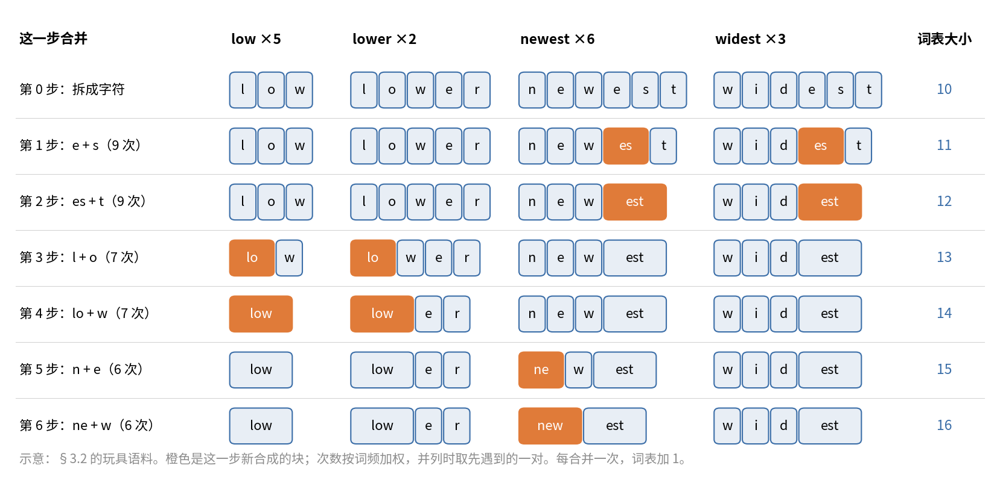

# 第 3 章　Tokenizer：文字怎么变成整数

> 模型只认整数。tokenizer（分词器）负责把文字切成小块（token），再把每块换成词表里的编号。这一步看着简单，后面很多数字却由它决定：同一段中文要切成多少个 token，词表那两张大矩阵占多少参数，一条 256K 的序列算 loss 要多少显存，数据文件用 2 字节还是 4 字节存一个 token。这一章先从零讲 BPE 怎么训练、怎么切，再拆开 ZGCM 实际用的 GLM-5.1 tokenizer，用真实文件测它的压缩率，最后讲词表填充、特殊 token 和对话模板。

## 这一章要回答的问题

读完这一章，你应该能回答下面这些问题。

1. 为什么不按字切、也不按词切，而要切成"子词"？
2. BPE 是怎么从语料里学出词表的？切一个新词时又是怎么用这张表的？
3. "字节级"BPE 和普通 BPE 有什么区别？为什么它永远不会遇到"不认识的字"？
4. 切分之前的那条正则表达式在做什么？为什么数字被切成三位一组？
5. ZGCM 的词表有多少个 token？里面中文、英文各占多少？有哪些特殊 token？
6. 一个 token 平均对应几个汉字、几个英文字母？"字符数除以 4"估 token 数，在中文上差多少？
7. 词表大一点好还是小一点好？大词表在参数、算力、显存、存储上各要付什么代价？
8. 154,856、154,880、155,136 这三个"词表大小"分别是什么？
9. 对话模板长什么样？`<think>` 在训练和推理时怎么用？
10. tokenizer 定下来以后，为什么整个项目都不能再换？

---

<a id="s3-1" name="s3-1"></a>
## 3.1 为什么要切成子词

模型的输入是一串整数，输出是"下一个整数是词表里每一个的概率"（第 2 章）。所以第一件事是定一张**词表**（vocabulary），也就是一个"文字块 ↔ 编号"的对照表，表里的文字块叫 **token**。

文字怎么切，最朴素的有三种选法。

最直接的是按字符切。英文只要几十个字母，中文常用字几千个，词表很小，也不会遇到不认识的字符。毛病是序列太长：一篇 3,000 词的英文文章大约 1.8 万个字符，切出来就是 1.8 万个 token。注意力的计算量随序列长度平方增长，同样的上下文窗口能装下的内容也少得多。而且单个字母几乎不带意思，模型要花很多层去把字母拼成词。

反过来按词切，英文按空格一分，序列短，每个 token 都有意思。可它有两个毛病。一是词太多：英文加上各种变形、人名、地名、拼写错误，几百万个都不止；中文没有空格，得先分词，分词本身就会出错。二是总有没见过的词（OOV，out of vocabulary，词表外的词），只能统一换成一个 `[UNK]`（unknown）记号，信息就丢了。代码里的变量名、新出现的网络用语，都会变成 `[UNK]`。

子词（subword）是两者的折中：常见的词整个当一个 token，少见的词拆成几块常见的片段。例如 `tokenization` 拆成 `token` + `ization`，`unbelievable` 拆成 `un` + `belie` + `vable`（这是用 ZGCM 的 tokenizer 实测的结果，[§3.6](#s3-6)）。这样常见词的序列短，罕见词也能表示，不会出现 `[UNK]`。

现在的大模型几乎都用子词，最常用的算法是 **BPE**（Byte Pair Encoding，字节对编码），GPT 系列、Llama 3、Qwen、GLM 都用它。另外两种是 WordPiece（BERT 用）和 Unigram（SentencePiece 里的默认算法，T5 用），[§3.11](#s3-11) 会简单对比。

还要分清一点：tokenizer 不是神经网络，不参与梯度训练。它是在训练模型之前用一份语料统计出来的一张表，之后就固定不变。ZGCM 没有自己训 tokenizer，直接用了 GLM-5.1 的（报告 §3.1.1 第 6 页）。

<a id="s3-2" name="s3-2"></a>
## 3.2 BPE 怎么训练：手算一遍

BPE 的做法是从单个字符开始，反复把"最常一起出现的两个相邻块"合并成一个新块，直到词表够大。下面用一个玩具语料手算一遍。假设语料里只有四个词，出现次数如下：

| 词 | 次数 |
|---|---|
| low | 5 |
| lower | 2 |
| newest | 6 |
| widest | 3 |

一开始（第 0 步），每个词拆成字符，初始词表就是出现过的字符 `l o w e r n s t i d`，共 10 个。

第 1 步数每一对相邻块出现了多少次。一个词出现几次，它里面的每一对就算几次。`e s` 出现在 newest 和 widest 里，6 + 3 = 9 次；`s t` 同样是 9 次；`w e` 来自 lower 和 newest，2 + 6 = 8 次；`l o` 来自 low 和 lower，5 + 2 = 7 次。最多的是 `e s` 和 `s t`，并列 9 次。并列时按某个固定规则取一个，这里取先遇到的 `e s`，合并成新块 `es` 加入词表。于是 newest 变成 `n e w es t`，widest 变成 `w i d es t`。

第 2 步重新数，`es t` 有 9 次，最多，合并成 `est`。第 3、4 步先把 `l o`（7 次）合并成 `lo`，再把 `lo w`（7 次）合并成 `low`。第 5、6 步同理，`n e`（6 次）合并成 `ne`，`ne w`（6 次）合并成 `new`。你自己数的时候会发现，第 3 步的 `o w` 也是 7 次，第 5 步的 `e w` 和 `w est` 也是 6 次，这些并列都照第 1 步的约定取先遇到的那一对。取法不同，学出来的块也会不同，比如第 5 步先合 `w est`，newest 最后就会切成 `ne` `west`。

下图把六步排在一起，每一行是合并一次之后四个词的样子。留意橙色的块：每一步词表只多出一个新块（它可能同时出现在几个词里），而它一旦合成，后面的行里就一直作为整体参与计数。



六步之后，四个词分别切成：

| 词 | 切分 |
|---|---|
| low | `low` |
| lower | `low` `e` `r` |
| newest | `new` `est` |
| widest | `w` `i` `d` `est` |

词表从 10 个变成 16 个，多出来的是 `es est lo low ne new`。同时我们得到一张**合并规则表**（merges），按学到的先后顺序排列：

```
1. e  + s   → es
2. es + t   → est
3. l  + o   → lo
4. lo + w   → low
5. n  + e   → ne
6. ne + w   → new
```

真实的 tokenizer 就是把这个过程在几十 GB 语料上跑十几万步。每合并一次，词表加 1，所以词表大小等于基础符号数加合并次数。合并次数也是你控制词表大小的唯一旋钮：想要 15 万个 token，就合并到 15 万为止。

这个过程有几处要留意。合并的依据只有频率，不看意思。`est` 被学出来，是因为它在这份语料里常见，跟它是不是英语后缀无关。由此推下去，训练语料的构成决定了词表的构成：语料里中文多，中文词就会被大量合并成整块；代码多，`def`、`self`、四个空格这样的块就会进词表。反过来，用英文语料训出来的 tokenizer 切中文会很碎，[§3.7](#s3-7) 会用 Llama-2 的实测数字说明。另外，每一步都要重新统计，朴素写法很慢，工程实现只更新受这次合并影响的那几对的计数。

<a id="s3-3" name="s3-3"></a>
## 3.3 BPE 怎么切新文本

词表和合并表训好以后，切一个新词的规则是：先拆成字符，然后按合并表的顺序，能合并的就合并。拿一个训练时没见过的词 `lowest` 试试：

```
初始：      l  o  w  e  s  t
规则 1 e+s：l  o  w  es t
规则 2 es+t：l  o  w  est
规则 3 l+o：lo w  est
规则 4 lo+w：low est
规则 5、6：没有可合并的
结果：      low  est
```

语料里从来没有 `lowest`，但它被切成了两个见过的块。子词的好处就在这里，新词也能用老零件拼出来。

真实实现里，"按顺序"的意思是每一轮在当前序列的所有相邻对里，找合并表里排名最靠前的那一对先合并，重复到没有可合并的为止。结果和逐条扫规则表一样，但快得多。还有一个常见的优化开关叫 `ignore_merges`：如果整个片段本身就在词表里，就直接用它，跳过逐步合并。ZGCM 的 tokenizer 打开了这个开关（[§3.6](#s3-6)）。

切分的结果是确定的，同一段文本永远切成同一串 token。所以训练数据、评测、推理必须用同一个 tokenizer 文件，否则同一段话会变成不同的整数序列，模型就像在读一门陌生的语言。

<a id="s3-4" name="s3-4"></a>
## 3.4 字节级 BPE：永远没有"不认识的字"

[§3.2](#s3-2) 的玩具例子从"字符"起步。可真实世界的字符有十几万种（Unicode），还有 emoji 和各种符号。从字符起步，初始词表就很大，而且总会碰到训练语料里没出现过的生僻字。

**字节级 BPE**（byte-level BPE，GPT-2 引入）换了一个起点：先把文本编码成 UTF-8 字节，从 256 个可能的字节值起步。任何文本都是字节序列，所以任何文本都能切，永远不需要 `[UNK]`。

UTF-8 里，英文字母和数字每个 1 字节，常用汉字每个 3 字节，大多数 emoji 4 字节。例如"你好"是 6 个字节：`E4 BD A0 E5 A5 BD`。BPE 在这些字节上学合并，中文语料够多的话，这 6 个字节会被一路合并成一个 token `你好`。

拿一个生僻字试一下。"biángbiáng 面"的那个 biáng 字写作 𰻞（Unicode 编号 U+30EDE，很多字体里显示不出来），它的 UTF-8 是 4 个字节 `F0 B0 BB 9E`。如果词表里没有为它合并出任何块，切的时候就退回这 4 个基础字节，变成 4 个 token；我用本机的 GLM-5.1 tokenizer 试过，结果正是 4 个。emoji 😀 的 UTF-8 同样是 4 个字节 `F0 9F 98 80`，在同一个 tokenizer 里却已经合成了一个 token，说明它在训练语料里足够常见。两者都能表示，差别只在花几个 token。

看 tokenizer 文件时，你一定会碰到一个怪现象。字节里有很多不可打印的值（比如空格 0x20、换行 0x0A），直接存进 JSON 不方便，GPT-2 的做法是把 256 个字节一一映射成 256 个可打印的 Unicode 字符。最常见的是空格，它映射成 `Ġ`，所以 ` world`（前面带空格）在词表里写作 `Ġworld`；换行则映射成 `Ċ`。中文字节也会被映射成一串拉丁字母。用 ZGCM 的 tokenizer 切"你好，世界"，词表里看到的是 `ä½łå¥½`、`ï¼Į`、`ä¸ĸçķĮ` 三个 token，它们就是"你好"、"，"、"世界"的 UTF-8 字节换了个写法。看到这种乱码不用慌，编码并没有出错。

字节级还带来一个副作用：有些 token 不是完整的字符。BPE 只看频率，可能把一个汉字的前两个字节合并成一个 token，第三个字节留给别的 token。这种合并会被优先选中，是因为前两个字节是很多字共用的。比如 `E4 BD` 是 64 个汉字共同的开头，"你""但""位""体""作""何"都在其中，这一对字节的出现次数是这些字加起来的次数，比其中任何一个整字都多。ZGCM 的词表里有 1,095 个这样的"半个字"token（[§3.6](#s3-6)）。单独解码这种 token 得到的是不合法的 UTF-8，所以流式输出时，推理框架要先攒够字节，再把完整的字吐给用户，否则屏幕上会闪一下乱码。

避免 `[UNK]` 还有另一种方法，叫 byte fallback（字节回退），Llama-2 用的 SentencePiece 就是这样：词表以字符为主，遇到不认识的字符时，再拆成 `<0xE4>` 这样的字节 token。ZGCM 的 tokenizer 本来就是字节级的，所以 `byte_fallback` 是 False。

<a id="s3-5" name="s3-5"></a>
## 3.5 切分之前先用正则预切

到这里还剩一个问题。如果直接在整段文本的字节上跑 BPE，频率最高的合并可能跨越词的边界，比如把 `.` 和下一句的开头 `ĠThe` 合成一个 token。这样的 token 浪费词表，也让模型更难学。

所以真实的 tokenizer 会先用一条正则表达式把文本预切分（pre-tokenize）成片段，BPE 只在每个片段内部合并，不跨片段。ZGCM 的预切分正则如下（从 `tokenizer.json` 原样取出）：

```
(?i:'s|'t|'re|'ve|'m|'ll|'d)|[^\r\n\p{L}\p{N}]?\p{L}+|\p{N}{1,3}| ?[^\s\p{L}\p{N}]+[\r\n]*|\s*[\r\n]+|\s+(?!\S)|\s+
```

其中 `\p{L}` 表示任何语言的字母，包括汉字；`\p{N}` 表示任何数字。下表逐段解释：

| 片段 | 匹配什么 | 例子 |
|---|---|---|
| `(?i:'s\|'t\|'re\|…)` | 英文缩写，不区分大小写 | `it's` 里的 `'s` |
| `[^\r\n\p{L}\p{N}]?\p{L}+` | 一串字母，前面可以带一个非字母非数字的字符（通常是空格） | ` world`、`中华人民共和国` |
| `\p{N}{1,3}` | 1 到 3 位数字 | `123` |
| ` ?[^\s\p{L}\p{N}]+[\r\n]*` | 一串标点符号，前面可带一个空格，后面可带换行 | `):`、`，` |
| `\s*[\r\n]+` | 换行（连同前面的空白） | 段落之间的空行 |
| `\s+(?!\S)` | 后面不紧跟非空白字符的空白 | 行尾空格；缩进里除最后一个以外的空格 |
| `\s+` | 剩下的空白 | |

我把它和本机上的两个 tokenizer 逐字比过。它和 Llama-3.1 的正则完全相同，这条正则最早来自 OpenAI 的 cl100k；Qwen3 只差一处，把 `\p{N}{1,3}` 换成了 `\p{N}`，即数字一位一切。这条正则带来三个效果，后面会反复碰到。

第一，汉字连成一片算一个片段。汉字都属于 `\p{L}`，中间没有空格，所以一整句没有标点的中文就是一个片段，BPE 在里面自由合并。`中华人民共和国` 在 ZGCM 的词表里就是一个 token。标点也不一定自成一段。第二个分支允许字母前面带一个非字母非数字的字符，全角逗号符合这个条件，所以"你好，世界"按这条正则预切成 `你好` 和 `，世界` 两段，BPE 再把后一段切成 `，` 和 `世界`，最后得到 [§3.4](#s3-4) 里看到的三个 token。

第二，数字三位一组。`\p{N}{1,3}` 让长数字从左往右每三位切一刀，实测 `12345678` 先被预切成 `123`、`456`、`78`。然后 BPE 在每段内合并。ZGCM 词表里 1 位和 2 位的数字串全都有（10 个和 100 个），3 位的 1,000 个里只有 177 个。`456` 不在词表里，于是又被切成 `45` + `6`，最终是 4 个 token。日期 `2026-10-30` 切成 `202`、`6`、`-`、`10`、`-`、`30`，共 6 个 token。数字切法会影响算术能力，[§3.11](#s3-11) 再讲。

第三，空格跟着后面的词走。代码 `  def forward(self, x):`（两个空格缩进）切成 `Ġ`、`Ġdef`、`Ġforward`、`(self`、`,`、`Ġx`、`):`。`\s+(?!\S)` 让最后一个空格留下来和 `def` 合成 `Ġdef`，前面多出的空格单独成块。所以有没有前导空格，在 tokenizer 眼里是两个不同的 token：句首的 `Hello` 和句中的 `ĠHello` 编号不同。

<a id="s3-6" name="s3-6"></a>
## 3.6 ZGCM 的 tokenizer：拆开 GLM-5.1 的词表

原理讲完，接下来看 ZGCM 实际用的那一份。

### 它从哪来

报告对 tokenizer 的来源交代得很简略，只说数据分片"用 GLM-5.1 tokenizer 做 tokenize 和建索引"（报告 §3.1.1 第 6 页）。SFT 数据筛选时也用它做过长度和监督边界的预检（报告附录 B.2.2 第 36 页）。训练配置里的路径指向一个叫 `glm51-tokenizer` 的目录（`pretrain/configs/stages/02_pretrain_3p2t_global_shuffle.env:11`），这个目录没有公开。

公开的是 HF 发布版模型 `zgcagi/ZGCM-1-7B` 里的 `tokenizer.json`（约 20 MB），下面的数字都是我下载这个文件后直接统计的。它和训练时用的是不是同一份，报告没说，所以我做了一个核对：从 HF 数据集 `midtrain-16k` 配比里抽了 2,971 条有正文的记录（一个 agent 轨迹来源，一个中文问答来源），用这个文件重新 tokenize，和数据集自带的 `token_count` 字段比。结果 2,942 条（99.0%）完全相等，其余 29 条相差 −7 到 +10 个 token。由此看，训练用的 tokenizer 和公开的这份是同一份，或者几乎一样（推断，差的那 1% 原因不明）。

### 文件的结构

`tokenizer.json` 由几个部件串起来，依次处理文本：

| 部件 | ZGCM 的设置 | 含义 |
|---|---|---|
| normalizer | 无 | 不做 Unicode 规范化，全角半角、大小写原样保留 |
| pre_tokenizer | [§3.5](#s3-5) 的正则（Isolated 模式，匹配到的每一段单独成为一个片段），再接 ByteLevel | 先按正则切片段，再把每段转成字节的可打印写法 |
| model | BPE，`ignore_merges=True`，`byte_fallback=False`，无 `unk_token` | 字节级 BPE，整段在词表里就直接用 |
| decoder | ByteLevel | 把 `Ġ` 等映射回原始字节再解码成文字 |

### 词表里有什么

BPE 部分有 154,820 个 token，编号 0 到 154,819。编号 0–255 是 256 个基础字节，其余 154,564 个是合并出来的。

我把每个 token 还原成原始文字后粗分了一下，含汉字的归"中文"，纯 ASCII 且含字母的归"英文/代码"：

| 类别 | 个数 | 占比 |
|---|---|---|
| 英文/代码（ASCII 字母） | 95,412 | 61.6% |
| 中文（含汉字） | 28,603 | 18.5% |
| 其他（数字、标点、空白、其他语言） | 29,710 | 19.2% |
| 不完整的 UTF-8（"半个字"） | 1,095 | 0.7% |

token 的长度（还原成字符后）集中在 2–6 个字符，其中 2 个字符的最多（22,172 个）；16 个字符以上的有 1,039 个，主要是长串空格和代码里的重复符号。

### 合并表比词表还长

按 [§3.2](#s3-2) 的算法，合并次数应该等于词表大小减 256，即 154,564。但这个文件的合并表有 321,649 条。

我数了一下，这 32 万条合并的结果正好是那 154,564 个 token，不多不少；但其中 96,840 个 token 有不止一条"合成路径"，最多的一个有 80 条。这是从 OpenAI tiktoken 格式转换成 HF 格式时的常见产物。tiktoken 只存"token 和它的排名"，不存合并表，转换脚本会把"两个都在词表里、拼起来也在词表里"的所有拆法都列成合并规则（推断，GLM 没有公开它的转换过程）。这对切分结果没有影响，只是文件大了点。

### 36 个追加 token

BPE 词表之后，又追加了 36 个 token（added tokens），编号 154,820 到 154,855。追加 token 在预切分之前就被整体识别，永远不会被拆开。按 special 属性分，它们有两类：

| 编号 | token | special | 用途 |
|---|---|---|---|
| 154820 | `<\|endoftext\|>` | 是 | 文档结束（EOD）、eos、pad 都用它 |
| 154821–154825 | `[MASK]` `[gMASK]` `[sMASK]` `<sop>` `<eop>` | 是 | GLM 早期"空白填充"预训练留下的记号；`[gMASK]<sop>` 现在仍是对话模板的开头 |
| 154826–154829 | `<\|system\|>` `<\|user\|>` `<\|assistant\|>` `<\|observation\|>` | 是 | 对话里的角色标记；observation 是工具返回结果 |
| 154830–154837 | 图像、视频、音频、转写的 begin/end | 是 | 多模态占位，ZGCM 是纯文本模型，用不上 |
| 154838–154840 | `<\|code_prefix\|>` `<\|code_middle\|>` `<\|code_suffix\|>` | 否 | 代码补全（FIM，fill in the middle） |
| 154841–154842 | `<think>` `</think>` | 否 | 思考过程的起止 |
| 154843–154850 | `<tool_call>` `</tool_call>` `<tool_response>` `</tool_response>` `<arg_key>` `</arg_key>` `<arg_value>` `</arg_value>` | 否 | 工具调用的格式 |
| 154851 | `/nothink` | 否 | 关闭思考的开关词 |
| 154852–154855 | `<\|begin_of_box\|>` `<\|end_of_box\|>` `<\|image\|>` `<\|video\|>` | 否 | 多模态 |

"special"这一列影响解码。`decode(..., skip_special_tokens=True)` 会删掉 special=是 的 token，但保留 `<think>`、`<tool_call>` 这些 special=否 的，所以用户看到的输出里会留着 `<think>…</think>`，要由上层程序自己处理。

BPE 部分加上追加部分，一共 154,820 + 36 = **154,856** 个有实际意义的编号。这个数 [§3.9](#s3-9) 还要用。

<a id="s3-7" name="s3-7"></a>
## 3.7 压缩率：一个 token 是多少字

有了词表，就可以问它切文字切得有多省。**压缩率**指平均一个 token 对应多少原文，常用"字符/token"或"字节/token"表示。它决定了同样多的文字要花多少 token，也就决定了训练要多少步、上下文窗口能装下多少内容。也有人用它的倒数，叫 fertility（生育率），即平均一个词或一个字被切成几个 token。

### 四个 tokenizer 的实测

我在本机上用同样四段文本测了四个 tokenizer。中文散文是从本书各章里抽出的纯中文段落，约 1.3 万字；英文是 ZGCM 技术报告正文，10 万字符，含不少数字和表格；Python 是 Megatron 的 `training.py` 前 10 万字符；LaTeX 公式是第 2 章里所有 `$...$` 公式拼在一起，约 1,800 字符。下表的单位是"字符/token"，越大越省：

| tokenizer | 词表 | 中文散文 | 英文 | Python | LaTeX 公式 |
|---|---|---|---|---|---|
| ZGCM（GLM-5.1） | 154,856 | **1.58** | 3.80 | 4.72 | 1.91 |
| Qwen3 | 151,669 | 1.49 | 3.53 | 4.70 | — |
| Llama-3.1 | 128,256 | 1.28 | 3.82 | 4.72 | 1.92 |
| Llama-2 | 32,000 | 0.76 | 3.10 | 3.27 | 1.73 |

差别最大的是中文。同一段中文，Llama-2 要用的 token 数是 ZGCM 的 2.08 倍（1.58 / 0.76），Llama-3.1 是 1.23 倍。Llama-2 的 3.2 万词表几乎没有中文词，很多汉字被拆成 2–3 个字节 token，所以平均不到 1 个字一个 token。

英文和代码的情况不一样。词表过了 12 万以后差别就很小，Llama-3.1 和 ZGCM 在英文和 Python 上几乎一样；词表从 3.2 万涨到 12.8 万，英文省了约 20%，代码省了约 30%。公式则对谁都费 token：LaTeX 里全是 `\`、`{`、`}` 和单个字母，每个 token 不到 2 个字符，几个 tokenizer 都差不多。如果按字节算，ZGCM 在中文上约 4.3 字节/token。一个汉字占 3 字节，但这段中文里夹着数字和半角符号，平均每个字符约 2.7 字节，1.58 × 2.7 ≈ 4.3（推算：我从本书各章另取了约 7,600 字带数字的中文段落测过，平均每字 2.72 字节）。在英文上约 3.8 字节/token。

这些数字只针对这几段文本。网页、小说、论文的压缩率会有差别，但量级是对的。

### "字符数除以 4"在中文上差多少

第 5 章讲过，ZGCM 清洗流水线里有一个估 token 数的默认公式 `max(1, (字符数 + 3) // 4)`（`data-process/src/zgcm_data_pipeline/steps/common.py:123`）。拿上面的实测数字检验一下：

| 文本 | 实际字符/token | 公式假设 | 公式的误差 |
|---|---|---|---|
| 英文 | 3.80 | 4 | 少估约 5% |
| Python | 4.72 | 4 | 多估约 18% |
| 中文 | 1.58 | 4 | **少估约 60%**（实际是估计的 2.5 倍） |
| LaTeX 公式 | 1.91 | 4 | 少估约 52% |

一篇 3 万字的中文长文，实际约 19,000 个 token，公式只估 7,500 个。按默认的长度桶边界（2048、8192、32768、65536），它会被分进 `2049_8192` 桶，实际应该在 `8193_32768` 桶。所以这个公式只能当占位用。ZGCM 数据集里的 `token_count` 字段是用真实 tokenizer 算的（[§3.6](#s3-6) 的核对），长度分桶和配比都用它，不用这个估计值。

### 用压缩率做粗算

平时粗估，记住两个数就够用：英文约 4 字符/token，中文约 1.5 字/token。照这两个数，一本 30 万字的中文书约 20 万 token，ZGCM 的 256K 上下文（262,144 token）大约能装 40 万汉字。1T token 的中英混合语料，按 4 字节/token 粗算约 4 TB 的 UTF-8 文本，第 4 章用的就是这个粗算。

粗算只适合估量级。训练前一定要用真实 tokenizer 在每个数据来源上抽样测一次压缩率，因为配比是按 token 数定的（第 7 章），压缩率估错了，配比就跟着错。

<a id="s3-8" name="s3-8"></a>
## 3.8 词表大小的权衡

压缩率高，靠的是词表大，可词表本身也要花钱。打个比方，词表像两个人事先约定的一本缩写本。本子越厚，常说的长短语越能用一个缩写代替，同样一段话要写的符号就越少。可本子本身占地方，每写一个符号都要从整本里挑出一个，翻得少的那些缩写也记不牢。这三样分别对应下面的参数、lm_head 的算力和罕见 token 学不好。比方不成立的地方在于，缩写本是人按意思编的，BPE 的条目只按频率统计出来（[§3.2](#s3-2)）。

下面把好处和代价逐项算出来，用 ZGCM 的尺寸：词表 $V = 154{,}880$（含填充，[§3.9](#s3-9)），隐藏维度 $d = 4096$。

### 好处：序列变短

最直接的好处是训练更省。训练算力约等于 $6ND$（第 1 章），$D$ 是 token 数，而同一份中文语料，ZGCM 的 token 数只有 Llama-2 的 48%（[§3.7](#s3-7)）。在"按 token 计费"的世界里，这就是省了一半。窗口长度也按 token 算，压缩率高，同样 256K 窗口就能装下更多原文。推理也更快，生成一个汉字要的步数少，KV cache（第 9 章）也小。

这里有一个陷阱："训了多少 T token"在不同 tokenizer 之间不能直接比。 ZGCM 预训练 4.19T token，换成 Llama-2 的 tokenizer，同样的文字会是更多的 token。比较两个模型见过多少数据，要换算成字节。loss 也一样，要换成 BPB（第 2 章 [§2.8](02_Transformer到能讲的程度.md#s2-8)）。

### 代价一：参数

输入嵌入表（embedding）和输出层（lm_head）各是一个 $V \times d$ 的矩阵，ZGCM 的两张表不共享（untied，第 9 章）：

$$V \times d = 154{,}880 \times 4096 = 634{,}388{,}480 \approx 6.34\text{ 亿}$$

两张合计约 12.7 亿，占 7.39B 的 17%（第 2 章 [§2.10](02_Transformer到能讲的程度.md#s2-10)）。7B 模型能接受这个比例。如果是 0.5B 的小模型，同样的词表会占掉一大半参数，这时通常选小一点的词表，或者让两张表共享。

### 代价二：算力

嵌入表只是查表，不花算力。lm_head 是一次矩阵乘，每个 token 前向要 $2dV$ 次浮点运算：

$$2 \times 4096 \times 154{,}880 \approx 1.27 \times 10^9$$

前向总量约 $2N = 2 \times 7.39 \times 10^9$，lm_head 占其中约 8.6%。反过来，嵌入表的 6.34 亿参数也算在 $N$ 里，但它不做乘法，所以 $6ND$ 对大词表模型会略微高估算力。

### 代价三：显存

显存这一项最容易被忽视。算 loss 前要得到每个位置对整个词表的 logits，形状是 $[T, V]$。一条 256K 的序列就有：

$$262{,}144 \times 154{,}880 \approx 4.06 \times 10^{10} \text{ 个数}$$

用 bf16 存是 81 GB，用 fp32 存是 162 GB，比一张 H100 的 80 GB 还大。ZGCM 的 256K 段把它拆开了：张量并行 TP=2 把词表维切成两半，上下文并行 CP=4 把序列切成四段（`midtrain/configs/stages/03_seq256k.env:95,97`，第 12 章），每张卡只有 $\frac{262144}{4} \times \frac{154880}{2}$ 个数，fp32 约 20 GB。同时打开了融合交叉熵（`ENABLE_CROSS_ENTROPY_LOSS_FUSION=1`，`CROSS_ENTROPY_FUSION_IMPL="te"`，同文件 L77、L111），在一个算子里算完 softmax 和 loss，不额外存一份 fp32 的概率。词表越大，这一项越大，做长上下文训练时尤其要先把它算清楚。

### 代价四：存储

第 8 章讲过，tokenize 后的数据文件按词表大小选整数类型：词表小于 65,536 用 2 字节（uint16），否则用 4 字节（int32）。ZGCM 的词表过了这条线，4.19T token 要存约 16.8 TB，读数据的带宽也跟着翻倍；如果词表在 65,536 以内，只要 8.4 TB。

### 代价五：罕见 token 学不好

词表越大，排在后面的 token 越罕见。一个只在语料里出现几百次的 token，它的嵌入向量几乎得不到训练，因为嵌入表的一行只在这个 token 出现在输入里时才被查到、才有梯度。这样的 token 被称作"欠训练 token"（under-trained tokens），在推理时可能触发奇怪的输出。字节级 BPE 的"半个字"token 和训练语料里的怪字符串是重灾区。

### 业界怎么选

| 模型 | 词表 |
|---|---|
| Llama-2 | 32,000 |
| Llama-3 | 128,256 |
| Qwen2/3 | 约 151,000 |
| GLM-4 以后（ZGCM 用的这一系） | 约 151,000–155,000 |

趋势是越来越大，12.8 万到 15 万是现在中英双语 7B 模型的主流。原因就是上面算过的这些：在 7B 这个规模上，大词表多花的参数和算力换回了更短的序列，划算。

<a id="s3-9" name="s3-9"></a>
## 3.9 词表填充：154,856、154,880、155,136

上一节计算用的是 154,880，[§3.6](#s3-6) 数出来的却是 154,856。翻 ZGCM 的各种文件，你还会看到第三个"词表大小"：

| 数字 | 出现在哪 | 是什么 |
|---|---|---|
| 154,856 | `tokenizer.json`（[§3.6](#s3-6)） | tokenizer 真正用到的编号数：154,820 + 36 |
| 154,880 | 训练配置 `VOCAB_SIZE`（`pretrain/configs/stages/01_pretrain_1t_sequential.env:38`、`02_...env:35`，midtrain 三个 env 的 L38）；HF 检查点 Pretrain、Pretrain-Curriculum、Midtrain-64K、Midtrain-256K 的 `checkpoint_info.json` | 模型里嵌入表的行数 |
| 155,136 | 发布版 `zgcagi/ZGCM-1-7B` 里 `config.json` 的 `vocab_size`；HF 检查点 Midtrain-16K 的 `checkpoint_info.json` | 也是嵌入表的行数，但多了 256 行 |

### 为什么要填充

嵌入表和 lm_head 的行数不必正好等于 tokenizer 的编号数，可以多出几行永远用不到的"空位"。多出这几行，一是为了对 GPU 友好：矩阵乘的维度是 64 或 128 的倍数时，Tensor Core 跑得最快，而 154,856 不是 128 的倍数。二是为了能被张量并行整除：TP 把 lm_head 按词表维平均切给几张卡（第 12 章），行数必须能被 TP 整除，而且每张卡分到的行数最好也是 128 的倍数。

Megatron 的填充规则只有一行（`pretrain/Megatron-LM/megatron/core/tokenizers/utils/build_tokenizer.py:98-111`）：

$$V_{\text{padded}} = \left\lceil \frac{V_{\text{tokenizer}}}{128 \times \text{TP}} \right\rceil \times 128 \times \text{TP}$$

128 来自启动脚本的 `--make-vocab-size-divisible-by 128`（`pretrain/scripts/launch_train.sh:109`）。$V_{\text{tokenizer}}$ 取的是 `len(tokenizer)`（`huggingface_tokenizer.py:291-293`），也就是 154,856。代入不同的 TP：

| TP | 倍数 | 填充后 | 多出的行 |
|---|---|---|---|
| 1 或 2 | 128 或 256 | 154,880 | 24 |
| 4 | 512 | 155,136 | 280 |
| 8 | 1,024 | 155,648 | 792 |

ZGCM 预训练和 mid-train 的配置都是 TP=2（各 env 的 `TP_SIZE=2`），正好得到 154,880。配置里写的 `VOCAB_SIZE=154880` 会通过 `--vocab-size` 传进去（`launch_train.sh:183`），但对 HuggingFace 类型的 tokenizer，Megatron 不读这个参数（`build_tokenizer.py:49-59` 这一支没有用到 `args.vocab_size`），实际行数完全由上面的公式决定。配置里写的数和公式算出来的恰好相同，所以没出问题。

### 155,136 从哪来

155,136 正好是 TP=4 时的结果。由此推断：Midtrain-16K 检查点和最终发布模型，在某个环节用 TP=4 跑过或导出过。但这和公开的配置对不上。mid-train 的三个 env 都写 TP=2。SFT 配置写的是 TP=8（`sft/training_launchers/stable_candidate/zgcm.conf:44`），按公式应该得到 155,648，不是 155,136，除非 SFT 直接沿用了检查点里存的行数。再往后看，16K 段之后的 64K 段又回到了 154,880。同一条训练链上嵌入表的行数一会儿多一会儿少，只能靠导出或转换时裁剪、补齐来解释。

仓库里没有 HF 转换脚本，这个问题查不下去，列在 [§3.13](#s3-13)。

### 多出的行有影响吗

基本没有。154,856 以后的行没有对应的文字，训练数据里永远不会出现这些编号，所以它们的嵌入向量从不被查到。它们在 lm_head 里的那一行，在每一步 softmax 里都是"错误答案"，梯度一直把它们的 logit 往下压，模型几乎不会生成这些编号，推理框架一般也会屏蔽它们。

但它们确实算参数。第 2 章用 154,880 算出 7.39B，用 155,136 算是 7,394.8M，差的 256 行 × 4096 × 2 张表 ≈ 210 万参数，就是这么来的。

<a id="s3-10" name="s3-10"></a>
## 3.10 特殊 token 与对话模板

[§3.6](#s3-6) 的追加 token 表里列了一长串特殊 token。它们在训练的不同阶段用法不同，预训练其实只用到其中一个。

### 预训练只用 EOD

预训练时，每篇文档 tokenize 后在末尾加一个 `<|endoftext|>`（154820），作为文档结束标记 EOD（第 8 章 [§8.2](08_数据五_从文本到训练样本.md#s8-2)）。Megatron 的 HF tokenizer 包装把 `eos_token` 当 EOD 用（`huggingface_tokenizer.py:315-319`）。ZGCM 没有 BOS（文档开头标记），`tokenizer_config.json` 和 `config.json` 里 `bos_token` 都是空的。Llama 系列在每篇文档开头加 BOS，ZGCM 只在结尾加 EOD。两种做法都行，只要训练和推理一致。

### 对话模板：把多轮对话拼成一串 token

预训练模型只会续写。要让它当助手，SFT 阶段（第 17 章）要把对话按固定格式拼成一个字符串再 tokenize。这个格式叫**对话模板**（chat template），存在发布仓库 `zgcagi/ZGCM-1-7B` 的 `chat_template.jinja` 里。我用 jinja2 把它渲染了一遍，输入是"系统提示 + 一轮问答（带思考）+ 第二个问题"，得到：

```
[gMASK]<sop><|system|>你是助手<|user|>1+1=?<|assistant|></think>等于2<|user|>再加1?<|assistant|><think>
```

开头固定是 `[gMASK]<sop>`，这是 GLM 系列的习惯。之后每条消息前面是角色标记 `<|system|>`、`<|user|>`、`<|assistant|>`；工具返回的结果前面是 `<|observation|>`，内容包在 `<tool_response>…</tool_response>` 里。角色标记和内容之间没有换行，消息之间也没有"本轮结束"的标记，下一个角色标记出现，就意味着上一条结束了。

细看第一轮回答会发现，历史轮次的思考被删掉了。它原来是 `<think>算一下</think>等于2`，渲染后只剩一个 `</think>` 加 `等于2`。模板默认只保留最后一个用户问题之后的思考，之前的都清空（可以用 `clear_thinking=False` 关掉），这样多轮对话不会被旧的思考过程撑长。

结尾的 `<|assistant|><think>` 是"生成提示"（`add_generation_prompt=True`），告诉模型轮到助手了，先开始思考。如果传 `enable_thinking=False`，结尾就变成 `<|assistant|></think>`，等于直接告诉模型"思考已结束"，它就直接回答。think 和 no-think 两种模式就靠这里切换。

工具调用的格式是 `<tool_call>函数名<arg_key>参数名</arg_key><arg_value>参数值</arg_value>…</tool_call>`。这些标记都在 [§3.6](#s3-6) 的追加 token 表里，每个都是一个整 token，模型不会把它们拼错。

### 一个待查的问题：模型怎么知道该停

推理时，生成到 `generation_config.json` 里的 `eos_token_id` 就停。ZGCM 的这个字段只有 154820（`<|endoftext|>`）。但在模板里，助手回答结束后并没有 `<|endoftext|>`，下一个 token 是下一轮的 `<|user|>`。

我读了 SFT 的数据代码，发现两件事。第一，SFT 只对助手回答的那一段算 loss，范围是从 `<think>` 或 `</think>` 之后到回答内容的最后一个 token（`sft/megatron/core/tokenizers/text/libraries/sft_tokenizer.py:195-209`），回答之后的那个 token 不在里面。第二，打包时把所有标签等于 pad 的位置都屏蔽了（`sft/megatron/training/datasets/sft_dataset.py:334`），而 pad 就是 154820。按代码读下来，SFT 里没有哪个位置在学"回答完了输出结束符"。

那发布的模型是怎么停下来的？可能是预训练里学到的 EOD 习惯起了作用，也可能 RL 阶段补上了，也可能推理时另外设了停止词。报告和仓库都没说，这里只能标待查。第 17 章讲 loss mask 时会再细看这段代码。

### 用 ln V 做一个快速检查

最后说一个和词表大小直接相关的检查。随机初始化时权重很小，每个位置的 logits 都接近 0，softmax 之后每个 token 的概率都接近 $1/V$。正确答案的概率也是 $1/V$，交叉熵 $-\ln(1/V)$ 就是 $\ln V$，所以 loss 应该接近

$$\ln V = \ln 154{,}880 \approx 11.95$$

训练第 1 步的 loss 如果明显偏离这个数，先查初始化和 loss 的算法。这个数还能帮你读懂一个怪现象：ZGCM 的 SFT 第 1 步 loss 是 35.01（附录 C [§C.6](附录C_W&B与数据配比统计.md#sc-6)），比"完全瞎猜"的 11.95 还高得多。如果这个 35 真是"每个 token 的平均交叉熵"，就说明模型在那些位置上很有把握地猜错了，概率几乎全压在了错误的 token 上，问题比"不会"更严重。但 W&B 没说明它的归一化口径，这个数偏高也可能是算法不同造成的。一个可能的解释是，`[gMASK]<sop>`、`<|assistant|>` 这些对话标记在预训练里几乎没出现过，模型在它们后面的预测严重偏离（推断，第 17 章再讨论）。

<a id="s3-11" name="s3-11"></a>
## 3.11 ZGCM 没用的其他做法

前面讲的都是 ZGCM 实际的做法。下面几件事 ZGCM 没做，但做自己的项目时可能用得上。

### 自己训一个 tokenizer

ZGCM 直接复用了 GLM-5.1 的 tokenizer。如果你要自己训，第一步是抽训练语料：从你计划的预训练配比里按比例抽几十 GB 文本。语料的语言、领域比例要和预训练一致，否则词表会偏（[§3.2](#s3-2)）；代码、数学占比高，就要多抽一些。

接着定预切分正则和词表大小。正则一般直接用 [§3.5](#s3-5) 那一类，词表大小按 [§3.8](#s3-8) 的权衡定，再留出几百个位置给以后要加的特殊 token。训练本身用 HF `tokenizers` 库或 SentencePiece，几十 GB 语料在一台多核机器上要几小时到一天。

训完要评估。在每个数据来源上测压缩率（[§3.7](#s3-7)），检查数字、空格、缩进、常见专有名词的切法，再看有没有奇怪的长 token，比如训练语料里某个网站的模板文字被整个学成了一个 token。最后是冻结：一旦开始 tokenize 预训练数据，tokenizer 就不能再改。

### 另外两种子词算法

WordPiece（BERT 用）和 BPE 一样自底向上合并，区别在每轮选哪一对：BPE 选出现次数最多的，WordPiece 选合并后让语料似然提高最多的，大致是 $\frac{\text{count}(ab)}{\text{count}(a)\,\text{count}(b)}$ 最大的那一对。Unigram（SentencePiece 的默认算法）方向相反，先给一个很大的候选词表，每轮删掉"删了以后语料似然下降最少"的那批 token，直到剩下目标大小。切分时它用动态规划找概率最大的切法，同一个词可以有多种切法。

现在的大语言模型以字节级 BPE 为主。SentencePiece 本身也支持 BPE，Llama-2 用的就是 SentencePiece 的 BPE 加 byte fallback。

### 数字怎么切

数字的切法会影响算术能力，主流做法有三种。Llama-2 和 Qwen 系列一位一切（[§3.5](#s3-5) 比过 Qwen3 的正则），`12345` 是 5 个 token，每一位对齐清楚，加减法容易学。GPT-4 的 cl100k、Llama-3 和 ZGCM 三位一组、从左往右切，序列短，但 `12345` 切成 `123`+`45`，而 `1234` 切成 `123`+`4`，位数不同时"个位"落在不同的 token 里，对齐比较乱。第三种也是三位一组，但从右往左切，和人写千分位一样，有研究表明它比从左往右更利于算术（推断：效果大小因模型而异）。

### 扩充词表

已有模型想加强某种语言（比如给英文模型加中文），可以往词表里追加新 token，再用新语料继续训。新 token 的嵌入向量需要初始化，常见做法是取它原来被切成的那几个旧 token 的嵌入均值。加多了，前期 loss 会明显升高，需要一段时间恢复。

### 其他几项

很多 tokenizer 会做 Unicode 规范化，用 NFKC 把全角字符转成半角、合并等价的字符写法。ZGCM 不做规范化（[§3.6](#s3-6)），全角逗号 `，` 和半角 `,` 是不同的 token。BPE-dropout 在训练时随机跳过一部分合并，让同一个词有时被切得碎一点，以增强鲁棒性，大模型预训练很少用。还有一类模型干脆不用 tokenizer，直接在字节上建模（如 ByT5），或者让模型自己学着把字节分组。这类做法目前在大规模上还不是主流，主要障碍是序列太长。

<a id="s3-12" name="s3-12"></a>
## 3.12 读代码

ZGCM 仓库里没有训练 tokenizer 的代码，也没有 tokenize 预训练数据的脚本（第 4 章、第 8 章）。和 tokenizer 有关的代码只有 Megatron 里的几处，下面挨个看。

### 词表填充

`pretrain/Megatron-LM/megatron/core/tokenizers/utils/build_tokenizer.py:98-117`：

```python
def vocab_size_with_padding(orig_vocab_size, args, logging_enabled=True):
    after = orig_vocab_size
    multiple = args.make_vocab_size_divisible_by * args.tensor_model_parallel_size
    after = int(math.ceil(after / multiple) * multiple)
    ...
    return after

def _set_padded_vocab_size(args, tokenizer):
    if getattr(args, "padded_vocab_size", None) is None:
        args.padded_vocab_size = vocab_size_with_padding(tokenizer.vocab_size, args)
```

第 3 行算倍数，等于 128 × TP，ZGCM 的 TP=2，倍数就是 256。第 4 行向上取整到这个倍数：154,856 / 256 = 604.9，取 605，乘回去得 154,880。函数的输入是 `tokenizer.vocab_size`，它不读命令行的 `--vocab-size`。

`_set_padded_vocab_size` 里还有一个条件：只有 `padded_vocab_size` 还没被设置时才算。注释说的"if not already set from a checkpoint"指的是从检查点读参数的情况。[§3.9](#s3-9) 推断"SFT 可能沿用了检查点的行数"，依据就是这个条件。

### tokenizer 包装

`pretrain/Megatron-LM/megatron/core/tokenizers/text/libraries/huggingface_tokenizer.py:290-319`（节选）：

```python
@property
def vocab_size(self) -> int:
    return len(self.tokenizer)

@property
def eod(self) -> int:
    if getattr(self, 'eos_token') is None:
        return None
    return self.tokens_to_ids([getattr(self, 'eos_token')])[0]
```

`len(self.tokenizer)` 包含追加 token，所以得到 154,856，而 BPE 部分只有 154,820。`eod` 直接取 `eos_token` 的编号，HF 配置里 eos 是 `<|endoftext|>`，所以 EOD 是 154820。如果你换一个 eos 为空的 tokenizer，`eod` 会返回 None，数据管线拼文档时就会出错，所以换 tokenizer 时要先检查这一项。

### 生成提示里的 think 开关

`chat_template.jinja` 的最后三行：

```jinja

    <|assistant|>{{- '</think>' if (enable_thinking is defined and not enable_thinking) else '<think>' -}}

```

这一段只在 `add_generation_prompt=True`（推理时）才加。默认没传 `enable_thinking` 时加 `<think>`，模型从思考开始写；传 `enable_thinking=False` 时加 `</think>`，相当于替模型写好了"思考结束"，模型直接回答。所以 think 和 no-think 用的是同一个模型、同一套权重，区别只在提示的最后一个 token。

<a id="s3-13" name="s3-13"></a>
## 3.13 坑和对不上的地方

下面这些问题彼此独立，大多在前面各节提到过，这里集中列出来，方便查。

1. 同一条训练链上，嵌入表的行数不一样。Pretrain、64K、256K 检查点是 154,880，Midtrain-16K 检查点和发布版是 155,136（[§3.9](#s3-9)）。155,136 对应 TP=4，但公开配置里预训练和 mid-train 都是 TP=2，SFT 是 TP=8。仓库里没有 HF 转换脚本，没法查清是哪一步改的行数。拿到 ZGCM 的检查点做续训或转换时，先读 `checkpoint_info.json` 里的 `padded_vocabulary_size`，不要假设它是 154,880。
2. 配置里的 `VOCAB_SIZE` 只是摆设。对 HuggingFace 类型的 tokenizer，Megatron 不读 `--vocab-size`，行数只由 `len(tokenizer)` 和 TP 决定（[§3.9](#s3-9)、[§3.12](#s3-12)）。把 `VOCAB_SIZE` 改成别的数，训练不会报错，也不会生效。反过来，改 TP 会悄悄改变嵌入表行数，旧检查点就加载不上。
3. 训练用的 tokenizer 目录没公开。配置指向 `glm51-tokenizer`，公开的只有发布版里的 `tokenizer.json`。我用它重算数据集的 `token_count`，99.0% 完全一致，剩下 1% 差几个 token，原因不明（[§3.6](#s3-6)）。可能是 tokenize 时文本有细小差别（比如首尾空白、拼接方式），也可能 tokenizer 版本有小改动。
4. 默认的 token 估算公式对中文错得很远。`(字符数 + 3) // 4` 在中文上少估约 60%（[§3.7](#s3-7)）。如果有人只用开源的清洗代码、手里没有真实 tokenizer，长度分桶就会系统性地把中文长文分进短桶。
5. SFT 里没有哪个位置在学"停止"。loss 范围不包含回答之后的那个 token，pad（也是 eos）的位置又全部被屏蔽（[§3.10](#s3-10)）。发布的模型是怎么学会停的，待查。
6. 合并表有 321,649 条，是词表的两倍多。这不影响切分，但如果你写的代码假设"合并数 = 词表大小 − 256"，就会出错（[§3.6](#s3-6)）。
7. 仓库里没有 tokenizer 的训练代码，也没有 tokenize 预训练数据的脚本。从清洗好的 parquet 到 `.bin/.idx` 这一步怎么做的（加不加 EOD、怎么处理超长文档），只能从 Megatron 的数据格式反推（第 8 章）。
8. FIM 的 token 有，FIM 的格式没有。清洗流水线会识别 `prefix`/`middle`/`suffix` 三段式的代码样本并打上 `fim` 标签（`data-process/src/zgcm_data_pipeline/steps/code.py:44-47`），词表里也有 `<|code_prefix|>` 等三个 token。但这些样本最后怎么拼成 token 序列、FIM 样本占多少，报告和仓库都没写。
9. 有三分之一的追加 token 用不上。多模态的 12 个（图像、视频、音频、box）在纯文本的 ZGCM 里从没出现过。它们和填充行一样，在 lm_head 里一直被压低，不影响训练，但会让人误以为模型支持多模态。

按性质，这些条目可以归成三类：

| 类别 | 条目 |
|---|---|
| 公开材料不全，没法核实 | 1、3、5、7、8 |
| 容易读错或用错 | 2、6、9 |
| 代码问题 | 4 |

<a id="s3-14" name="s3-14"></a>
## 3.14 试着讲给别人听

下面是一段讲法。建议你先合上书自己讲一遍，再对照。

> 模型只认整数，tokenizer 负责把文字切成小块、每块换成一个编号。按字切，词表小但序列太长；按词切，词表无穷大、新词不认识。现在都用子词，常用的词是一整块，罕见的词拆成几块。
>
> 子词词表用 BPE 训出来。从单个字节开始，统计语料里哪两个相邻的块一起出现得最多，就把它们合成一个新块，记下这条合并规则，重复几十万次。切新文本时按同样的顺序套合并规则。因为起点是 256 个字节，任何文字最差也能拆回字节，所以永远没有"不认识的字"。切之前还会先用一个正则把文本按单词、数字、标点、空白预切一遍，合并不会跨过这些边界。ZGCM 的正则和 Llama-3 一样，数字三位一组，空格跟着后面的词走。
>
> ZGCM 没有自己训 tokenizer，直接用了 GLM-5.1 的。BPE 部分 154,820 个，后面追加 36 个特殊 token，一共 154,856 个。追加的有文档结束符、对话角色标记、`<think>`、工具调用标记，还有一批用不上的多模态标记。训练时用的 tokenizer 目录没公开，我拿公开的那份重算了数据集里的 token 数，99% 一模一样，所以基本可以确定是同一份。
>
> 词表大小是一个权衡。词表大，同样的文字 token 少，中文尤其明显：同一段中文，ZGCM 一个 token 约 1.6 个字，Llama-2 只有 0.76 个字，序列长一倍多。代价是嵌入表和输出层变大。ZGCM 每张表 6.3 亿参数，两张占了 7.39B 的 17%；输出层每个 token 要 12.7 亿次浮点运算；256K 长度的 logits 用 fp32 存要 162 GB，比一张卡的显存还大，所以 ZGCM 把它按词表和序列切到 8 张卡上，再用融合交叉熵免掉额外的 fp32 副本。
>
> 还有一个容易糊涂的地方：模型的嵌入表比 tokenizer 多几行。Megatron 会把 154,856 向上补到 128 乘 TP 的倍数，TP=2 时是 154,880。发布版是 155,136，正好对应 TP=4，但公开配置里没有用 TP=4 的地方，转换脚本也没公开，这个差别解释不了。多出的行从来不会被用到，只是多了两百来万参数。
>
> 预训练只用一个特殊 token：每篇文档结尾加 `<|endoftext|>`，没有开头标记。SFT 时用对话模板把多轮对话拼成一串：`[gMASK]<sop>` 开头，每条消息前面一个角色标记。think 和 no-think 是同一个模型，区别只是生成提示的最后一个 token 是 `<think>` 还是 `</think>`。
>
> 最后一个实用的检查：随机初始化的模型，第一步 loss 应该接近 ln V，ZGCM 是 11.95。明显偏离就要先查初始化和 loss 的算法。

<a id="s3-15" name="s3-15"></a>
## 3.15 习题

1. 按字切、按词切、按子词切，各自的主要毛病是什么？子词是怎么折中的？

<details><summary>答案</summary>

按字（或字节）切：词表小，但序列很长，注意力的算力和显存跟着涨，每个 token 携带的信息也少。按词切：词表无穷大，新词、拼写错误、罕见词都不认识。子词：高频的词保留成一整块，低频的拆成几块常见片段，词表大小可控，又不会有不认识的输入。见 [§3.1](#s3-1)。

</details>

2. （计算）语料里有 `low`×5、`lower`×2、`newest`×6、`widest`×3。第一轮 BPE 合并哪一对？为什么？

<details><summary>答案</summary>

统计所有相邻字符对的出现次数（按词频加权）。`e`+`s` 出现在 newest 和 widest 里，6 + 3 = 9 次；`s`+`t` 同样 9 次；`l`+`o` 是 5 + 2 = 7 次。并列最多时按约定取先遇到的一对，第一轮合并 `e s → es`。见 [§3.2](#s3-2)。

</details>

3. 字节级 BPE 为什么永远不会遇到"不认识的字"？代价是什么？

<details><summary>答案</summary>

词表的起点是全部 256 个字节，任何 UTF-8 文本最差都能拆回字节，所以不需要 unk。代价是罕见字可能被拆成"半个字"的字节 token，ZGCM 词表里有 1,095 个这种不完整的 UTF-8 token；生成时如果停在半个字上，解码会出乱码。见 [§3.4](#s3-4)。

</details>

4. 预切分正则起什么作用？ZGCM 的 `12345678` 为什么切成 `123|45|6|78`，而不是 `123|456|78`？

<details><summary>答案</summary>

正则先把文本切成单词、数字、标点、空白等片段，BPE 只在片段内部合并，不会把"词尾 + 空格 + 下个词"合成怪 token。`\p{N}{1,3}` 让数字三位一组，预切成 `123`、`456`、`78`。ZGCM 词表里 3 位数字串只有 177 个，`456` 不在其中，所以它在片段内部被 BPE 切成 `45` + `6`。见 [§3.5](#s3-5)。

</details>

5. 句首的 `Hello` 和句中的 ` Hello` 是同一个 token 吗？两个空格缩进的 `  def` 怎么切？

<details><summary>答案</summary>

不是同一个。空格跟着后面的词走，句中的是 `ĠHello`，编号不同。`  def` 切成 `Ġ` 和 `Ġdef`：`\s+(?!\S)` 让最后一个空格留给后面的词，前面多出的空格单独成块。见 [§3.5](#s3-5)。

</details>

6. ZGCM 的 tokenizer 一共有多少个有意义的编号？怎么构成的？训练用的 tokenizer 和公开的是同一份吗，证据是什么？

<details><summary>答案</summary>

154,856 = BPE 的 154,820 + 追加的 36 个。训练配置指向的 `glm51-tokenizer` 目录没公开。用公开的 `tokenizer.json` 重算 2,971 条数据的 `token_count`，2,942 条（99.0%）完全一致，所以基本是同一份，剩下 1% 的差别原因不明（推断）。见 [§3.6](#s3-6)。

</details>

7. （计算）同一段 1 万字的中文，用 ZGCM 和 Llama-2 的 tokenizer 各要多少 token？清洗流水线默认的 `(字符数 + 3) // 4` 会估成多少？

<details><summary>答案</summary>

ZGCM 约 1.58 字/token，约 6,300 个 token；Llama-2 约 0.76 字/token，约 13,200 个，是 ZGCM 的 2.08 倍。默认公式估 (10000 + 3) // 4 = 2,500，只有实际值（ZGCM）的四成，少估约 60%。见 [§3.7](#s3-7)。

</details>

8. （计算）ZGCM 的 $d = 4096$，$V = 154{,}880$。嵌入表和 lm_head 各多少参数？占 7.39B 的多少？lm_head 每个 token 的前向 FLOPs 是多少？

<details><summary>答案</summary>

每张表 $V \times d = 634{,}388{,}480 \approx 6.34$ 亿。两张表（不共享）共约 12.7 亿，占 7.39B 的约 17%。lm_head 前向每 token $2dV \approx 1.27 \times 10^9$ FLOPs，约占前向总量 $2N$ 的 8.6%。见 [§3.8](#s3-8)。

</details>

9. （计算）一条 256K 序列的 logits 有多少个数？fp32 要多少显存？ZGCM 在 TP=2、CP=4 下每张卡还剩多少？

<details><summary>答案</summary>

$262{,}144 \times 154{,}880 \approx 4.06 \times 10^{10}$ 个数，fp32 约 162 GB（bf16 81 GB）。TP 切词表维一半、CP 切序列四分之一，每卡 $\frac{1}{8}$，fp32 约 20 GB。再加上融合交叉熵，不额外存 fp32 概率。见 [§3.8](#s3-8)。

</details>

10. （计算）Megatron 的词表填充公式是什么？154,856 在 TP=2、4、8 下分别填成多少？配置里写 `VOCAB_SIZE=200000` 会怎样？

<details><summary>答案</summary>

$V_{\text{padded}} = \lceil V / (128 \cdot \text{TP}) \rceil \times 128 \cdot \text{TP}$。TP=2 得 154,880，TP=4 得 155,136，TP=8 得 155,648。对 HuggingFace 类型的 tokenizer，Megatron 不读 `--vocab-size`，所以写 200,000 不生效，行数仍由 `len(tokenizer)` 和 TP 决定。见 [§3.9](#s3-9)、[§3.12](#s3-12)。

</details>

11. 发布版的 `vocab_size` 是 155,136，和训练配置的 154,880 不同。这说明了什么？多出的行会影响模型吗？

<details><summary>答案</summary>

155,136 正好是 TP=4 的填充结果，推断 Midtrain-16K 检查点和发布版在某个环节按 TP=4 跑过或导出过，但公开配置里预训练、mid-train 是 TP=2，SFT 是 TP=8，转换脚本也没公开，查不清。多出的行没有对应的文字，嵌入从不被查到，在 lm_head 里一直被压低，基本没影响，只多了约 210 万参数。见 [§3.9](#s3-9)、[§3.13](#s3-13)。

</details>

12. 对话模板里 think 和 no-think 模式是怎么切换的？为什么说它们是同一个模型？

<details><summary>答案</summary>

生成提示是 `<|assistant|>` 加一个 token：默认是 `<think>`，模型从思考开始写；传 `enable_thinking=False` 时是 `</think>`，等于替模型写好"思考结束"，它直接回答。权重完全相同，区别只在提示的最后一个 token。见 [§3.10](#s3-10)、[§3.12](#s3-12)。

</details>

13. （判断）一个随机初始化的 ZGCM 结构模型，第一步 loss 是 25。你先怀疑什么？ZGCM SFT 第 1 步 loss 35 又说明什么？

<details><summary>答案</summary>

均匀猜的 loss 应约为 $\ln 154{,}880 \approx 11.95$。25 明显偏高，先查初始化尺度（logits 太大、太自信）和 loss 的归一化（比如没除以 token 数）。SFT 第 1 步 35 也远高于 11.95，如果它是每 token 平均交叉熵，说明模型在某些位置很有把握地猜错了，可能和对话标记在预训练里几乎没出现有关；但 W&B 没说明口径，属于推断。见 [§3.10](#s3-10)。

</details>

14. （判断）你要从零训一个中英双语 7B 模型。词表选 3.2 万还是 15 万？说出至少两条理由和一条代价。

<details><summary>答案</summary>

选 15 万左右。理由：中文压缩率差两倍（0.76 对 1.58 字/token），同样的上下文窗口能装下的中文多一倍，同样的训练 token 数覆盖的文字也多一倍；英文和代码也省 20%–30%。代价：嵌入表和 lm_head 合计十几亿参数、lm_head 多占约 8.6% 前向算力、长序列的 logits 显存大，数据文件要用 4 字节存。7B 的规模下好处大于代价。见 [§3.7](#s3-7)、[§3.8](#s3-8)。

</details>

---

上一章：[第 2 章　Transformer：讲到能讲清楚的程度](02_Transformer到能讲的程度.md)　下一章：[第 4 章　数据一：来源与获取](04_数据一_来源与获取.md)
