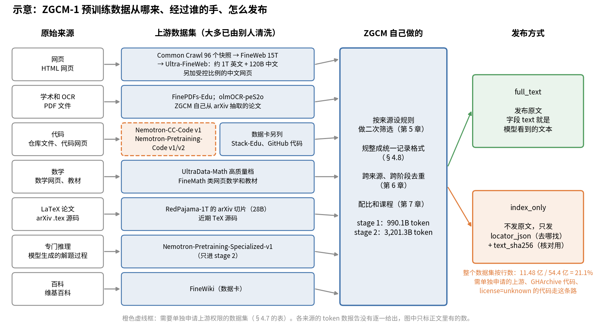

# 第 4 章　数据一：来源与获取

> 数据决定模型的上限，训练只是去逼近这个上限。数据部分一共五章：这一章讲原料从哪来，第 5 章讲怎么洗，第 6 章讲怎么去重、打分、防泄题，第 7 章讲怎么配比、按什么顺序喂，第 8 章讲洗好的文本怎么变成一条条训练样本。

## 这一章要回答的问题

读完这一章，你应该能回答下面这些问题。

1. 预训练用的文本有哪几大类？每一类原始长什么样，难点在哪？
2. ZGCM-1 的预训练数据具体用了哪些公开数据集？两个 stage 各类占多少？
3. 为什么 ZGCM 几乎不自己爬网页，而是站在别人清洗好的数据集上？这样做有什么代价？
4. 从 Common Crawl 原始网页做起，一条完整的流水线长什么样？（ZGCM 没用）
5. 许可证为什么会影响数据怎么发布？`full_text` 和 `index_only` 是什么？
6. 为什么每条数据都要带"出处"字段？出处在后续哪些步骤里会用到？
7. 4.2T token 的数据，磁盘上有多大、多少条文档？

---

<a id="s4-1" name="s4-1"></a>
## 4.1 预训练数据是什么

预训练数据就是海量的纯文本。每条记录是一篇文档，可能是一个网页的正文、一篇论文、一个代码文件，也可能是一道数学题和它的解答。训练时不需要标签，因为文本本身就是标签，这就是第 2 章讲的"右移一位"。

既然不用标注，数据工作的量就落在另外三件事上：先找到足够多的文本，再从中挑出质量高的那部分，最后决定各类文本各放多少、按什么顺序放。

这三件事都只能交给程序，原因在规模。7B 模型现在动辄训 2T 到 15T token。1T token 的中英文混合文本，大约是 4TB 的 UTF-8 字节（按每 token 约 4 字节粗算，第 3 章会讲更准的压缩率）。这个量级不可能靠人看，所有步骤都必须是程序化的规则或者模型打分。

<a id="s4-2" name="s4-2"></a>
## 4.2 六大类数据，各有各的难点

要找文本，先得知道文本分哪几类。按原始形态，预训练数据大致可以分成下面六类，每类要解决的问题都不一样。

| 类别 | 原始形态 | 主要难点 |
|---|---|---|
| 网页 | HTML 页面（Common Crawl 每月一批快照） | 正文抽取；导航栏、广告、版权声明等模板文字；大量低质和重复页面；语言识别 |
| 学术和 OCR | PDF 文件 | 有文字层的 PDF 要解析版面（双栏顺序、页眉页脚、脚注）；扫描件要 OCR，会有识别错误和乱码；公式和表格最难 |
| 代码 | Git 仓库里的文件 | 第三方库（vendor）、自动生成的文件、压缩过的 js、lock 文件、二进制文件都要去掉；许可证各不相同 |
| 数学 | 网页上的数学内容、教材、题库 | 公式在 HTML 里有 MathJax、图片、MathML 多种写法，抽取时很容易丢；要保证公式和推理文字在一起 |
| LaTeX 论文 | arXiv 的 .tex 源码 | 宏定义、`\input` 多文件拼接、注释、图表环境；要留下正文和公式，丢掉排版噪声 |
| 推理和合成数据 | 模型生成的解题过程、改写文本 | 正确性没保证；风格单一；可能混入评测题 |

表里没列的还有百科（如维基百科），量小但干净，事实密度高。

这几类数据里，每个 token 的价值差别很大。粗略地说，网页量最大，但平均质量最低；代码和数学量小，对推理能力却很关键；百科和教材最干净，量也最少。第 7 章讲的配比，就是在这些类之间分配有限的 token 预算。

<a id="s4-3" name="s4-3"></a>
## 4.3 ZGCM-1 预训练用了哪些数据

知道了有哪几类，再看 ZGCM 每一类具体用了什么。它的预训练数据几乎全部来自已经公开、已经清洗过的数据集，团队自己只在这些数据集上按自己的标准再筛一遍（下文叫二次筛选，[§4.5](#s4-5)），再把格式规整统一。下表按报告 §3.1.1（第 6 页）和 HF 数据卡（`zgcagi/ZGCM-1-Data`，L121-L125）整理：

| 类别 | 用了什么 | 出处 |
|---|---|---|
| 网页 | Ultra-FineWeb（英文为主），加上"受控比例"的中文网页 | 报告 §3.1.1 第 6 页 |
| 学术和 OCR | FinePDFs-Edu（HuggingFace 做的 PDF 教育类子集）；Ai2 用 olmOCR 流水线识别的科学论文（olmOCR-peS2o）；自己从 arXiv 抽取的论文 | 报告 §3.1.1 第 6 页 |
| 代码 | NVIDIA 的 Nemotron-CC-Code-v1（含代码的网页）和 Nemotron-Pretraining-Code v1/v2（仓库文件）；数据卡还列了 Stack-Edu 和 GitHub 代码 | 报告 §3.1.1 第 6 页 |
| 数学 | UltraData-Math 的高质量档；按 SmolLM2 配方做的分类器筛选的网页数学（FineMath）和教材；数据卡还列了 OpenWebMath、Proof-Pile | 报告 §3.1.1 第 6 页 |
| LaTeX 论文 | RedPajama-1T 的 arXiv 切片（参考文献注明 28B token），加上近期 TeX 源码 | 报告 §3.1.1 第 6 页、参考文献第 25 页 |
| 专门的推理数据 | Nemotron-Pretraining-Specialized-v1 的高质量子集，只进 stage 2 | 报告 §3.1.1 第 6 页 |
| 百科 | FineWiki | 数据卡 L125 |

网页这一行值得多看一眼。Ultra-FineWeb 是 OpenBMB 用一个轻量 fastText 分类器从 FineWeb 和 Chinese FineWeb 里再筛一遍得到的，约 1T 英文 token 和 120B 中文 token（[Ultra-FineWeb 论文摘要](https://arxiv.org/abs/2505.05427)）。FineWeb 本身是 HuggingFace 从 96 个 Common Crawl 快照处理出的 15T token。这样算下来，ZGCM 用的网页数据在上游已经被过滤了两轮。

<a id="s4-4" name="s4-4"></a>
## 4.4 两个 stage 的类别配比

上一节说的是用了哪些数据，这一节看各用了多少。报告 Figure 6 上排的两个环形图（报告 §3.2.1 第 8 页）给了各类的百分比。把百分比乘上 HF 数据卡的总量（stage 1 990.1B，stage 2 3,201.3B），就能换算成 token 数。换算是本书做的：

| 类别 | Stage 1 占比 | Stage 1 token | Stage 2 占比 | Stage 2 token |
|---|---|---|---|---|
| 网页 | 54.6% | 541B | 54.0% | 1,729B |
| 代码 | 21.0% | 208B | 23.6% | 756B |
| 学术和 OCR | 13.7% | 136B | 10.8% | 346B |
| 数学 | 8.0% | 79B | 9.0% | 288B |
| LaTeX 论文 | 1.7% | 17B | 2.0% | 64B |
| 百科 | 1.0% | 10B | — | — |
| 专门推理 | — | — | 0.6% | 19B |

网页在两个 stage 里都占一半以上，始终是大头。stage 2 把代码和数学各提了 1–2.6 个百分点，学术 OCR 降了约 3 个点。stage 2 的百科没有单独列出来，可能并入了别的类，报告没说。

表里有两处和上游的大小对不上。先看网页。两个 stage 的网页合计约 2.27T token，而 Ultra-FineWeb 只有约 1.12T。报告 §3.1.1 第 6 页又说，stage 2 选数据时排除了 stage 1 的全部内容（跨阶段去重），所以多出来的部分不能用"同一批网页用了两次"来解释。合理的推断是：网页类还包括别的来源（数据卡列出的 Nemotron 系列里有 Nemotron-CC 网页数据），或者在 stage 内部做了重复采样（同一篇文档在一个 stage 里被喂了不止一次）。报告没有逐来源给出 token 数，这里只能标"推断"。

LaTeX 的情况类似。RedPajama 的 arXiv 切片是 28B，两个 stage 的 LaTeX 合计却约有 81B，多出的部分来自报告说的"近期 TeX 源码"，或者有重复。

还要提醒一点，这些百分比是最终配方，和原始数据池的比例是两回事。原始池子里各类各占多少，报告没有给。网页类上游数据集的体量最大，所以我推断网页在原始池子里的比例高于 54%，是第 7 章要讲的配比搜索把它定在了这个数（推断）。

<a id="s4-5" name="s4-5"></a>
## 4.5 为什么站在别人的数据集上

看完前两节的表，你可能会奇怪 ZGCM 为什么几乎不自己处理网页。原因是自己从头做的成本太高。从 Common Crawl 原始快照开始做一份 15T 的网页数据，需要几千 CPU 核跑数周，还要做大量实验去调过滤规则：FineWeb 论文里每改一条规则，都要训一个 1.8B 的小模型来比。

ZGCM 团队于是直接复用 Ultra-FineWeb、FinePDFs、Nemotron 这些已经处理好的数据集，把精力放在下游。他们按上游给的质量分重新设阈值，做二次筛选（第 5 章的 FinePDFs、OLMOCR 规则）；把所有来源规整成同一套字段（[§4.8](#s4-8)）；做跨来源、跨阶段的去重（第 6 章）；最后做配比和课程（第 7 章）。

打个比方，上游数据集像菜场里已经洗净、择好的菜。ZGCM 买回来后按自己的菜谱再挑一遍，把嫌老的叶子再摘掉几片，这就是二次筛选。下地收菜、冲洗泥土这些最费力的活，摊主已经替你干了。

这条路省下了大量算力，但也带来几个问题。最麻烦的是上游的过滤偏好被一起继承了，就像摊主择掉的菜帮子不会再装进你的袋子。比如 Ultra-FineWeb 的分类器偏好"教育类"文本，那么闲聊、新闻、小说类网页本来就少，你在下游没法把它们找回来。上游的版本也会变，同一个数据集名字，不同 revision 内容不同，所以数据卡要求每条记录写 `upstream_revision`（[§4.8](#s4-8)）。另外，上游一般不保证没有混入评测题，用之前得自己查一遍，去污染这一步省不掉（第 6 章）。许可证同样随上游走，有的来源要单独申请权限，不能直接再发布（[§4.7](#s4-7)）。

报告 §3.1.1 第 6 页是这样概括这个思路的："每个来源家族都经过针对来源的语言和质量过滤，必要时做文本抽取或仓库清洗"。重点在"针对来源"四个字：不同来源用不同规则，没有一套通用规则。

<a id="s4-6" name="s4-6"></a>
## 4.6 ZGCM 没用的其他做法：从原始网页做起的流水线

ZGCM 跳过了从原始网页做起的这一段。但你自己做数据或者面试时，最常被问的就是"从 Common Crawl 开始，你会怎么做"。FineWeb、RefinedWeb、DCLM 这些公开工作的流程大同小异，下面按顺序走一遍。

第 1 步是下载快照。Common Crawl 每个快照有三种格式：WARC 是原始 HTTP 响应，含完整 HTML；WAT 是元数据；WET 是 CC 自己抽的纯文本。WET 的抽取质量差，模板文字多，所以质量好的数据集都从 WARC 自己抽。

拿到快照后，第 2 步按 URL 过滤，用黑名单去掉成人、赌博、垃圾站点。第 3 步是正文抽取，用 trafilatura 之类的工具从 HTML 里找出正文块，丢掉导航、侧栏、页脚，这一步对质量影响很大。第 4 步做语言识别，用 fastText 的语言识别模型给每篇打上语言和置信度，比如只留英文置信度大于 0.65 的。

第 5 步是启发式质量规则，常用的是 Gopher 规则和 C4 规则。它们检查文档词数是否在范围内、平均词长、符号与词的比例、以省略号结尾的行占比、重复行和重复 n-gram 占比，以及有没有"lorem ipsum"或"javascript"之类的字样。

规则过完，第 6 步去重：先精确去重，再做 MinHash 模糊去重（第 6 章详讲）。FineWeb 的经验是按快照单独去重比全局去重效果好。第 7 步用一个分类器给每篇打"教育价值"或"质量"分，只留高分，FineWeb-Edu、DCLM 都这么做（第 6 章）。第 8 步是 PII 处理，把邮箱、电话、IP 地址替换成占位符。

走完这一串流程，原始网页的大部分都会被丢掉。按 token 算，Ultra-FineWeb 的英文部分（约 1T）只有 FineWeb（15T）的 7% 左右。

ZGCM 拿到的已经是第 8 步之后的产物，所以 data-process 仓库里没有 HTML 抽取、语言识别、PII 替换的代码。仓库 README 第 5 行写得很清楚：大规模抽取、分片、tokenize、写索引都由"训练环境提供"。

PDF 的流程也值得知道。有文字层的 PDF 可以直接读文字，但顺序常常是乱的；扫描件只能 OCR。近两年的做法是用视觉语言模型做 OCR，比如 Ai2 的 olmOCR 直接让 VLM 读页面图像、输出 Markdown，公式和表格保留得比传统 OCR 好得多。FinePDFs 则先尝试抽文字层，抽不好的再走 OCR。

<a id="s4-7" name="s4-7"></a>
## 4.7 许可证和发布方式：full_text 与 index_only

拿到数据能训练，和能把数据公开发布，是两回事。有些上游数据集允许你训练，但不允许你把原文再发出去；有些要求使用者先在 HuggingFace 上点同意，或者申请审批。

所以 ZGCM 的数据分两种发布方式（数据卡 L211-L230）。`full_text` 记录发布原文，字段 `text` 里就是模型看到的文本。`index_only` 记录不发原文，只告诉你去哪找：`locator_json` 里存上游的记录 ID，或者文件路径加行号，再加一个原文的 `text_sha256`，用来核对你找回来的文本对不对；`content_withheld_reason` 写为什么不发，比如 `upstream_access_required`。

打个比方，full_text 是把书直接交给你，index_only 只给你一张借书条：哪家图书馆、哪个版次、第几排第几本，再附上这本书的指纹。书要你自己去那家图书馆办证借出来，指纹用来确认借到的就是那一本。这里的指纹就是 `text_sha256`，原文哪怕改一个字符，算出的哈希也会完全不同。借书条上的版次不能省，因为上游数据集会出新 revision，同一个行号在新版本里可能指向另一条记录，所以每条索引都锁定一个固定的上游版本。

数据卡列出了必须单独申请的上游（数据卡 L236-L243）：

| 上游 | 用在哪 |
|---|---|
| NVIDIA Nemotron-CC v2 / v2.1 | mid-train |
| Nemotron-CC-Code v1、Nemotron-Pretraining-Code v1/v2 | 预训练和 mid-train |
| Nemotron-CC-Math v1 | 预训练和 mid-train |
| BigCode The Stack v2 | 预训练和 mid-train replay |
| GAIR daVinci-Dev | mid-train |
| OpenBMB UltraData-SFT-2605 | SFT |

还有两类代码也只发索引（数据卡 L245-L250）。一类是 GitGud 上检测不到许可证（`license=unknown`）的代码。另一类是从 GHArchive 来的代码，它按"仓库 + 完整 commit SHA + 文件相对路径"定位，代码本身要去 GitHub 原仓库取，索引放在 `indexes/gharchive-clean-v6-core/`。

这部分数据的占比不小。`dataset_manifest.json` 的 totals 里，54.4 亿行中有 11.48 亿行是 index_only，占 21.1%。按 token 算，mid-train 三个配比里 index_only 占 38–41%（附录 C [§C.7.2](附录C_W&B与数据配比统计.md#sc-7-2)）。因此**只用公开原文复现不了 ZGCM 的数据**，你要自己去各个上游申请、下载，再按 locator 找回原文。

把 [§4.3](#s4-3) 到这里的内容串起来，就是下面这张图。看图时留意两件事：大部分数据到 ZGCM 手里之前已经被上游处理过至少一轮，报告里明确说由 ZGCM 自己抽取的只有 arXiv 论文；一条数据走 full_text 还是 index_only，看的是它的上游许可证和访问条款，和它在 ZGCM 这里筛得多严无关。



另外有两个许可证字段容易搞混。`licenses` 是每条记录自己的上游许可证，属于条目级；`database_license: odc-by-1.0` 是整个数据集"作为数据库"的许可证，它不替代条目级许可证。上游没声明许可证的，`license_status` 写 `not_declared_upstream`。

<a id="s4-8" name="s4-8"></a>
## 4.8 统一记录格式与出处

发布方式和许可证最后都要落到每条记录的字段上。报告 §3.1.1 第 6 页说，所有被接受的文档都规整成"统一的记录 schema"，写成带版本的分片（versioned shards），登记到来源清单（source manifest）里，然后才 tokenize。

HF 发布版的记录长这样（数据卡 L172-L184）：

```json
{
  "text": "Model-visible training text.",
  "source": "source-name",
  "source_group": "normalized-source-group",
  "upstream_repos": ["organization/dataset"],
  "upstream_revision": "revision",
  "licenses": ["upstream-license-identifier"],
  "release_mode": "full_text",
  "category": "web",
  "token_count": 1024,
  "metadata_json": "{...}"
}
```

这些字段里只有 `text` 进训练，它就是模型看到的文本，其余字段都是给数据流水线和人看的。`source` 和 `source_group` 分别是细粒度来源名和归一后的来源组，配比按它们算，出了问题也按它们回查。`upstream_repos` 和 `upstream_revision` 记录上游仓库和固定版本，保证"同一个名字"指的是同一份内容。`licenses` 和 `release_mode` 是许可证和发布方式（[§4.7](#s4-7)）。`category` 是 web、code、math 这样的类别，也是配比的第一层维度。`token_count` 是用 GLM-5.1 tokenizer 算出的真实 token 数，长度分桶和配比配额都用它。`metadata_json` 装其他上游信息，比如上游质量分、重复采样次数（数据卡 L266）。

出处字段在后面好几个环节都要用到。第 7 章做配比时，要按来源和类别数 token；第 6 章做跨阶段去重，要知道一条数据是不是 stage 1 用过；去污染时发现某个来源混了评测题，要能把这个来源整体删掉；训练中 loss 突然异常，要能定位到是哪个来源的哪批数据（第 14 章）；合规上，有人要求删除某类数据时，也要能找得到。

最后看一下规模。按 `dataset_manifest.json`：

| config | 文件数 | 行数 | parquet 大小 | 平均每行 token |
|---|---|---|---|---|
| pretrain-stage1 | 895 | 9.73 亿 | 1.30 TB | 约 1,018 |
| pretrain-stage2 | 2,539 | 28.2 亿 | 3.65 TB | 约 1,135 |

平均每篇文档只有一千来个 token，大约是一个中等网页的长度。训练序列是 16K，所以一条训练样本平均要拼十几篇文档（第 8 章讲怎么拼）。parquet 是 zstd 压缩的，而且 index_only 的行没有正文，所以文件大小不能直接换算成"每 token 几个字节"。

<a id="s4-9" name="s4-9"></a>
## 4.9 读代码：把各种来源接进同一条流水线

统一格式要靠代码来保证。data-process 仓库不负责下载和抽取，但它规定了任何来源进来时要变成什么样。入口是 `DatasetAdapter`（`data-process/src/zgcm_data_pipeline/adapters.py:28-45`）：

```python
def adapt(self, raw, index=0):
    mapped = dict(raw)
    if self.field_map:
        for source_name, canonical_name in self.field_map.items():
            if source_name in mapped and canonical_name not in mapped:
                mapped[canonical_name] = mapped[source_name]
    source_id = str(mapped.get(self.id_field) or f"{self.dataset}:{index}")
    sample = Sample(dataset=self.dataset, source_id=source_id,
                    stage=self.stage, category=self.category,
                    data=mapped, text_fields=self.text_fields)
    for hook in self.hooks:
        sample = hook(sample)
    return sample
```

`field_map` 把上游的字段名映射到统一名字，比如把 `content` 映射成 `text`。注意它只在统一名字还不存在时才填，不会覆盖已有字段。原始记录整份留在 `data` 里，一个字段都不丢。后面的步骤只往上加东西（metrics、flags、buckets），不删原始信息，这样出了问题还能回查原始值。

`source_id` 优先用上游自带的 ID，没有 ID 时退化成 `数据集名:行号`。这里有个隐患：行号依赖文件读取顺序，上游重新分片后，同一条数据的 ID 就变了，跨版本去重和回查都会对不上。所以接入新来源时，要先确认上游有稳定 ID。

最后的 `hooks` 是针对单个数据集的修补函数，比如修某个版本的坏字段。仓库文档（`docs/category_cleaning_pipelines.md` 第 15-21 行）明确说，这类一次性修补不进主流水线。

PDF/OCR 这类来源在通用适配之外，还有一层"来源家族"的规整（`stages/pretrain/source_cleaning.py:21-32`）：

```python
def normalize_pdf_ocr(sample, context):
    if "text" not in sample.data:
        for key in ("content", "ocr_text", "document"):
            if isinstance(sample.data.get(key), str):
                sample.data["text"] = sample.data[key]
                break
    sample.text_fields = ("text",)
    sample.buckets["source_family"] = "pdf_ocr"
    if not sample.data.get("text"):
        sample.mark(Decision.DROP, "missing_extracted_text")
    return sample
```

这个函数依次尝试 `content`、`ocr_text`、`document` 三个常见字段名，找到第一个字符串就当正文，然后打上 `source_family=pdf_ocr` 的标签，后面统计和配比会用到。抽不出正文的记录直接 drop，原因写 `missing_extracted_text`。每次 drop 都带一个原因字符串，最后汇总时就能看出每种原因各丢了多少。

通用文本（`source_cleaning.py:51-62`）的处理方式相同，只是尝试的字段换成 `content`、`document`、`body`、`raw_text`。代码来源（`source_cleaning.py:65-71`）则走五个代码专用步骤，第 5 章再讲。

<a id="s4-10" name="s4-10"></a>
## 4.10 坑和对不上的地方

下面这些是读 ZGCM 数据来源时会碰到的空白和矛盾。

1. 仓库里没有抽取代码。HTML 抽取、PDF 解析、OCR、arXiv LaTeX 清洗、语言识别都不在 data-process 里。`data-process/src/zgcm_data_pipeline/stages/pretrain/README.md` 第 3 行写明 OCR 抽取、分片、tokenize 等由调用方提供，data-process 里也搜不到 HTML 抽取、PDF 解析和语言识别用的库。报告说 arXiv 论文是用"in-house pipeline"抽取的（报告 §3.1.1 第 6 页），这个 pipeline 没有公开。
2. 中文网页的比例没给。报告只说"受控比例"（报告 §3.1.1 第 6 页），Figure 6 也没有把中英文分开。
3. 网页和 LaTeX 的 token 数超过了已知上游的大小（[§4.4](#s4-4)），报告没有逐来源列出 token 数。
4. 预训练数据的逐来源组成，本书没有统计。附录 C [§C.7](附录C_W&B与数据配比统计.md#sc-7) 只扫了 mid-train 和 SFT 的 552 个 parquet，预训练两个 config 共 3,434 个文件、4.95TB，没有扫。所以本章预训练的类别比例只能用报告的百分比。
5. 数据卡和报告列的来源不完全一致。数据卡列了 Stack-Edu、OpenWebMath、Proof-Pile、FineWiki，报告正文没有逐一提到；报告提到的 UltraData-Math、Nemotron-Pretraining-Specialized，数据卡只笼统写了"Nemotron"。本书按两者的并集来理解。
6. 数据量和训练量是两个数。4,191.4B 是这份数据的大小，实际训练了约 4.78T token（第 1 章 [§1.5](01_全景与算力估算.md#s1-5)）。

<a id="s4-11" name="s4-11"></a>
## 4.11 试着讲给别人听

下面是一段大约三分钟的讲法。建议你先合上书自己讲一遍，再对照。

> 预训练数据就是海量纯文本，不需要标注。工作量在三件事上：找到文本，挑出好的，决定各类放多少。
>
> 文本大致分六类：网页、PDF 和 OCR、代码、数学、LaTeX 论文、合成的推理数据，再加少量百科。每类难点不同。网页要抽正文、去模板；PDF 要处理版面顺序和 OCR 错误；代码要去掉第三方库和自动生成的文件；数学和 LaTeX 要保住公式。
>
> 如果从 Common Crawl 自己做，标准流程是从 WARC 抽正文，做语言识别，过 Gopher 和 C4 那类启发式规则，再精确加 MinHash 去重，用分类器打质量分，最后处理隐私信息。大部分原始网页都会被丢掉。
>
> ZGCM 没走这条路。它直接用 Ultra-FineWeb、FinePDFs、olmOCR、Nemotron 代码和数学、UltraData-Math、RedPajama 的 arXiv 这些已经清洗过的公开数据集，自己做二次筛选、统一格式、跨阶段去重和配比。这样省掉了大量算力和调规则的工作，但也继承了上游的过滤偏好，去污染和许可证也得自己处理。
>
> 最终配方里网页占 54% 左右，代码 21% 到 24%，学术 OCR 11% 到 14%，数学 8% 到 9%。stage 1 是 0.99T，stage 2 是 3.2T。stage 2 加大了代码和数学，还加了一点专门的推理数据。
>
> 每条记录都带来源、上游版本、许可证、类别和真实 token 数。配比、跨阶段去重、去污染和事后排查都靠这些出处字段。有些上游不允许再发布原文，ZGCM 就只发 index_only 记录，写明去哪找原文，并附上原文的哈希。按行数约 21% 是这种记录，所以只靠公开原文复现不了完整数据。

<a id="s4-12" name="s4-12"></a>
## 4.12 习题

1. 预训练数据为什么不需要标注？那数据工作的工作量在哪？
2. 列出六类预训练数据，并各说一个主要难点。
3. Common Crawl 的 WARC 和 WET 有什么区别？质量好的数据集为什么从 WARC 抽？
4. 从原始网页到可用数据，标准流程有哪几步？
5. ZGCM 预训练的网页、学术 OCR、代码、数学各来自哪些数据集？
6. Stage 1 和 Stage 2 的配比有什么变化？stage 2 新加了哪一类？
7. 两个 stage 的网页合计约 2.27T token，而 Ultra-FineWeb 只有约 1.12T。为什么不能用"stage 2 又用了一遍 stage 1 的网页"来解释？
8. 直接复用上游清洗好的数据集，有哪些代价？
9. `full_text` 和 `index_only` 的区别是什么？`locator_json` 里为什么要存 `text_sha256`？
10. `licenses` 和 `database_license` 有什么区别？
11. 统一记录格式里的出处字段，在后续哪些环节会用到？至少说四个。
12. `DatasetAdapter` 在上游没有 ID 时用什么当 `source_id`？这有什么隐患？
13. ZGCM 预训练数据平均每篇文档约多少 token？对 16K 的训练序列意味着什么？
14. data-process 仓库里缺了哪些处理环节？

<details><summary>参考答案</summary>

1. 预训练的目标是预测下一个 token，文本本身就是标签。工作量在找文本、挑质量、定配比和顺序（[§4.1](#s4-1)）。
2. 网页：正文抽取和模板文字；PDF/OCR：版面顺序、识别错误、公式表格；代码：vendor、生成文件、许可证；数学：公式抽取容易丢；LaTeX：宏和多文件拼接；合成推理：正确性和泄题风险（[§4.2](#s4-2)）。
3. WARC 是原始 HTTP 响应，含完整 HTML；WET 是 CC 自己抽的纯文本，模板文字多、质量差。从 WARC 自己抽正文质量更高（[§4.6](#s4-6)）。
4. 下载快照、URL 过滤、正文抽取、语言识别、启发式规则（Gopher/C4）、精确和 MinHash 去重、分类器打分、PII 处理（[§4.6](#s4-6)）。
5. 网页：Ultra-FineWeb 加中文网页；学术 OCR：FinePDFs-Edu、olmOCR-peS2o、自己抽的 arXiv；代码：Nemotron-CC-Code、Nemotron-Pretraining-Code，数据卡另列 Stack-Edu 和 GitHub；数学：UltraData-Math、FineMath 类网页数学和教材，数据卡另列 OpenWebMath、Proof-Pile（[§4.3](#s4-3)）。
6. 网页 54.6% 到 54.0%，代码 21.0% 到 23.6%，学术 OCR 13.7% 到 10.8%，数学 8.0% 到 9.0%，LaTeX 1.7% 到 2.0%；stage 2 新加了 0.6% 的专门推理数据，百科不再单列（[§4.4](#s4-4)）。
7. 报告 §3.1.1 第 6 页说 stage 2 选数据时排除了 stage 1 的全部内容。所以合理的推断是还有别的网页来源（如 Nemotron-CC）或 stage 内部重复采样，报告没说清（[§4.4](#s4-4)）。
8. 继承上游的过滤偏好、上游版本会变、要自己去污染、许可证随上游走（[§4.5](#s4-5)）。
9. full_text 发原文；index_only 只发定位信息，不发原文。`text_sha256` 用来核对按 locator 找回来的文本和训练时用的是不是同一份（[§4.7](#s4-7)）。
10. `licenses` 是每条记录的上游许可证；`database_license` 是整个数据集作为数据库的许可证，不替代条目级许可证（[§4.7](#s4-7)）。
11. 配比按来源和类别算 token、跨阶段去重、去污染时整体删除某来源、训练异常时回查、合规删除（[§4.8](#s4-8)）。
12. 用 `数据集名:行号`。行号依赖读取顺序，上游重新分片后 ID 会变，去重和回查会对不上（[§4.9](#s4-9)）。
13. stage 1 约 1,018，stage 2 约 1,135。一条 16K 序列平均要拼十几篇文档（[§4.8](#s4-8)）。
14. HTML 抽取、PDF 解析和 OCR、arXiv LaTeX 清洗、语言识别、PII 处理、tokenize 和写索引都不在仓库里（[§4.6](#s4-6)、[§4.10](#s4-10)）。
</details>

---

上一章：[第 3 章　Tokenizer](03_Tokenizer.md)　下一章：[第 5 章　数据二：清洗流水线](05_数据二_清洗流水线.md)
