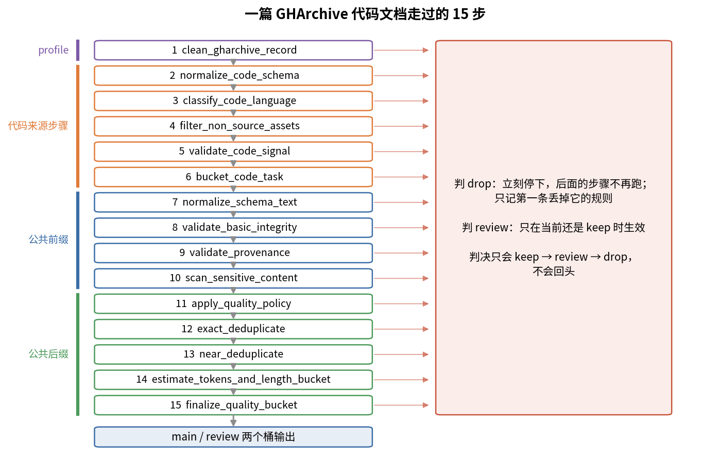

# 第 5 章　数据二：清洗流水线

> 上一章讲了原料从哪来，这一章讲原料进门以后的事：每一篇文档要经过哪些检查，怎样被判成"留下""待审""丢掉"。我们会逐个函数读 ZGCM 公开的 data-process 仓库，看它做了什么、阈值是多少、哪里有坑，最后再补上它没做、但业界常用的规则。

## 这一章要回答的问题

读完这一章，你应该能回答下面这些问题。

1. 清洗流水线的基本单位是什么？一篇文档在流水线里带着哪些信息？
2. 为什么要有 keep / review / drop 三档，而不是"留"和"丢"两档？
3. 怎么统计"每条规则丢了多少数据"？为什么这件事很重要？
4. 公共步骤有哪些？各自的阈值是多少？
5. 步骤的先后顺序为什么会影响结果？ZGCM 的代码因为顺序问题出了什么 bug？
6. 代码仓库文件（GHArchive）、PDF（FinePDFs）、OCR 论文（olmOCR）三种来源各用什么规则？
7. olmOCR 的"压缩率 ≥ 0.08"这条规则为什么有效？
8. Gopher、C4、FineWeb 这些公开工作的启发式规则长什么样？

---

<a id="s5-1" name="s5-1"></a>
## 5.1 清洗到底在做什么

清洗是对每篇文档独立做判断，判断时要回答三个问题。第一个问题是它是不是正常文本：空的、乱码、二进制、截断的，丢掉。第二个问题是它是不是我们要的那类文本，比如代码数据里混进了 lock 文件、压缩过的 js，也要丢掉。第三个问题是质量够不够：上游给了质量分，低于阈值的丢掉，或者先放一边。

为了回答这些问题，流水线里的操作分成三种。规整会改写文本本身，比如统一换行符、统一全角半角；过滤负责做出留或丢的判断；打标签则给文档加上语言、长度桶、质量桶之类的标签，供后面的配比和统计用。

清洗规则会以两种方式出错，代价并不一样。一种是**误丢**，好数据被丢了。你看不到它，也就不会发现，损失是静悄悄的。另一种是**误留**，坏数据进了训练。少量通常无害，大量就会拉低模型，比如满屏的 cookie 声明会让模型学会生成 cookie 声明。

所以每条规则都要回答"它丢了多少、丢的是不是真的坏"。要回答这个问题，需要两样东西：每次丢弃都写明原因，以及按原因汇总的计数。data-process 的骨架就是围绕这两样东西设计的，我们从骨架读起。

<a id="s5-2" name="s5-2"></a>
## 5.2 骨架：Sample、三档决策、Step、Pipeline

### Sample：一篇文档在流水线里的样子

流水线处理的基本单位是 `Sample`，定义在 `models.py:44-63`，字段如下：

| 字段 | 含义 |
|---|---|
| `dataset`、`source_id` | 来自哪个数据集、上游 ID（第 4 章 [§4.9](04_数据一_来源与获取.md#s4-9)） |
| `stage`、`category` | 阶段（pretrain / midtrain / posttrain / sft）和类别（code、web、math、pdf_ocr 等 8 类） |
| `data` | 原始记录整份保留，规整后的字段也写在这里 |
| `text_fields` | 哪些字段算"训练文本"，默认只有 `text` |
| `decision` | 当前判决，初始是 keep |
| `reasons` | 所有被记下的原因，按出现顺序 |
| `flags`、`buckets`、`metrics` | 标记、分桶标签、数值指标 |

其中 `text_fields` 决定了规则看到的是什么。`text()`（L65-71）把 `text_fields` 里非空的字段用换行拼起来，所有规则都对这个拼出来的文本做判断。

### 三档决策和 mark()

判决怎么变，由 `Sample` 的 `mark()` 方法决定：

```python
def mark(self, decision: Decision, reason: str) -> None:        # models.py:73-79
    if decision == Decision.DROP or (
        decision == Decision.REVIEW and self.decision == Decision.KEEP
    ):
        self.decision = decision
    if reason and reason not in self.reasons:
        self.reasons.append(reason)
```

这几行规定了判决的走向。要判 drop，无条件生效。要判 review，只有当前还是 keep 时才生效，已经 drop 的不会被"降级"成 review。所以判决只会往严的方向走：keep → review → drop，不会回头。这样设计的道理是，每条规则只看自己那部分证据，后面的规则没发现问题，并不能说明前面那条规则的疑点已经排除，所以后面的步骤无权把判决改回去。另一方面，原因无论判决变没变都会记下，因此一篇文档可能同时带着"太长"和"疑似密钥"两个原因。

review 这一档是给没有把握的规则准备的。比如"开头 4096 字符里出现 do not edit"，可能是自动生成的文件，也可能是一个正常文件的注释里恰好写了这句。直接丢，会误丢；直接留，会误留。review 的意思是"先放一边，等更贵的判断"：人工抽查、LLM 打分，或者等配比时再决定要不要用。仓库给 review 单独一个输出桶（[§5.5](#s5-5) 的 `finalize_quality_bucket`），不和 main 混在一起。

### Step：每一步都自动计数

有了判决，还要能统计。每个步骤是一个 `Step`，有名字、函数和一句中文说明，调用时会自动计数：

```python
def __call__(self, sample, context):                            # core.py:32-38
    before = sample.decision
    sample = self.fn(sample, context)
    context.count(f"step.{self.name}.seen")
    if sample.decision != before:
        context.count(f"step.{self.name}.{sample.decision.value}")
    return sample
```

每处理一篇，计数器 `step.<名字>.seen` 加 1。只有判决被这一步改变时，才给 `step.<名字>.drop` 或 `.review` 加 1。

拿两篇一模一样的文档走一遍，可以把 `mark()` 和计数放在一起看。这是示意数据，我按仓库代码跑过：正文约 300 万字符，第一行是 `password = abcdefghijklmn`，带 `source` 字段，走预训练的 general_text 流水线。第一篇在 `validate_basic_integrity` 因为超过 200 万字符，从 keep 变成 review，原因记 `too_long`；到 `scan_sensitive_content` 又命中密钥正则，原因追加 `possible_secret`，但判决本来就是 review，没有变，所以这一步的 `.review` 计数不加；它最后以 review 进了输出。第二篇前面的经历相同，到 `exact_deduplicate` 发现哈希已经见过，判 drop，原因列表变成 `too_long`、`possible_secret`、`exact_duplicate` 三项。跑完以后，计数器里只有 `step.validate_basic_integrity.review: 2`、`step.exact_deduplicate.drop: 1`、`output.review: 1`、`output.drop: 1`。两次密钥命中在计数里看不到，只留在各自的 `reasons` 里。想知道某条规则一共命中了多少篇，要去数 `reasons`，光看 `step.*` 计数会少算。

### Pipeline：遇到 drop 就停

把步骤串起来的是 `Pipeline`：

```python
for sample in samples:                                          # core.py:54-62
    context.count("input")
    for step in self.steps:
        sample = step(sample, context)
        if sample.decision == Decision.DROP:
            break
    context.count(f"output.{sample.decision.value}")
    if include_dropped or sample.decision != Decision.DROP:
        yield sample
```

文档一旦被 drop，后面的步骤都不跑了。这样可以省算力，去重、算 token 这些步骤不会浪费在要丢的文档上。副作用是 `step.X.drop` 记的是**第一个**把它丢掉的规则。一篇文档可能同时违反三条规则，但只有排在最前的那条被计数，所以看汇总时，排在前面的规则天然显得"丢得多"。调规则时别忘了这一点。

流水线是流式的（generator），一次只在内存里放一篇文档，适合大数据。被丢掉的文档要不要输出，由 `include_dropped` 控制：`Pipeline.run` 默认是 True，预训练入口 `run_jsonl`（`stages/pretrain/pipeline.py:53`）默认是 False。也就是说，预训练的输出文件里没有被丢的文档，但计数器里有。

跑完以后，`run_jsonl` 返回的 summary 里有 `counters`（L79）。一次运行的计数大概长这样：`input: 1000, step.clean_gharchive_record.drop: 212, step.validate_basic_integrity.drop: 9, step.exact_deduplicate.drop: 41, output.keep: 701, output.review: 37`（示意数字）。从这里能直接看出哪条规则丢得最多，该去抽查哪一类。

<a id="s5-3" name="s5-3"></a>
## 5.3 步骤怎么排：两种拼法

骨架定下来以后，剩下的问题是哪些步骤、按什么顺序放进流水线。步骤分三层。最底下是公共步骤，所有类别都跑，分成前缀 `COMMON_PREFIX`（4 步）和后缀 `COMMON_SUFFIX`（5 步），定义在 `steps/common.py:168-181`。中间是类别步骤，code、web、math 等各有一组（`steps/*.py`）。最上面是数据集 profile，只针对一个具体数据集，目前预训练有 gharchive、finepdfs、olmocr 三个（`stages/pretrain/datasets/`）。

这三层在仓库里有两种拼法：

| 入口 | 拼法 | 出处 |
|---|---|---|
| 通用流水线 | 类别第 1 步 + 前缀 + 类别其余步骤 + 后缀 | `pipelines.py:33` |
| 预训练流水线 | profile 步骤 + 来源步骤 + 前缀 + 后缀 | `stages/pretrain/pipeline.py:39` |

通用拼法把类别的第 1 步放在最前，因为这一步负责把上游字段名映射成统一字段（比如把 `content` 改成 `text`）。不先做映射，前缀里的"文本是否为空"就找不到文本。

预训练拼法则把所有类别和 profile 步骤都放在前缀之前。用 GHArchive 代码数据跑一遍，实际顺序是下面这 15 步：

| # | 步骤 | 层 |
|---|---|---|
| 1 | clean_gharchive_record | profile |
| 2–6 | normalize_code_schema、classify_code_language、filter_non_source_assets、validate_code_signal、bucket_code_task | 代码来源步骤 |
| 7–10 | normalize_schema_text、validate_basic_integrity、validate_provenance、scan_sensitive_content | 公共前缀 |
| 11–15 | apply_quality_policy、exact_deduplicate、near_deduplicate、estimate_tokens_and_length_bucket、finalize_quality_bucket | 公共后缀 |



把这 15 步竖着画出来，再配上 [§5.2](#s5-2) 讲的判决规则，就能看出这条流水线的形状：每一步都可能把文档从右边的出口丢掉，能走到底的才进 main 或 review 桶。

排顺序时有几条通用的考虑。便宜的、丢得多的放前面：路径黑名单只看文件名，比读全文便宜，所以 GHArchive 先查路径。规整要放在依赖它的规则之前，比如去重前要先统一换行和空白，不然只差一个 `\r` 的两份文本会被当成不同。去重放在过滤之后，因为被丢掉的文档不进哈希表，哈希表只装留下的，内存更省；而且同一段文字可能带着不同的元数据出现多次（比如不同来源、不同质量分），先过滤能保证占住哈希的是合格的那份。

还有一条容易被忽略：规整也要考虑类别。对网页正文合理的规整，对代码可能是破坏。下一节会看到，ZGCM 恰好在这里出了 bug。

<a id="s5-4" name="s5-4"></a>
## 5.4 公共前缀：规整、完整性、出处、敏感信息

下面按执行顺序读公共步骤，先看前缀的 4 步。

### normalize_schema_text：统一文本

规整的主体是 `normalize_text_value`：

```python
def normalize_text_value(value: str) -> str:                   # steps/common.py:27-31
    value = unicodedata.normalize("NFKC", value.replace("\r\n", "\n").replace("\r", "\n"))
    value = _CONTROL.sub("", value)
    value = "\n".join(_WHITESPACE.sub(" ", line).strip() for line in value.splitlines())
    return _BLANK_LINES.sub("\n\n", value).strip()
```

函数体一共 4 行。第 1 行先把 Windows 的 `\r\n` 和老 Mac 的 `\r` 都改成 `\n`，再做 **NFKC**。NFKC 是 Unicode 的"兼容性规范化"，它把长得不一样但意思相同的字符折成一种写法，比如全角字母变半角。第 2 行删掉控制字符（`\x00-\x08`、`\x0b`、`\x0c`、`\x0e-\x1f`、`\x7f`），保留 `\t` 和 `\n`。第 3 行逐行处理，每行里连续的空格、制表符（`[\t\f\v ]+`）压成一个空格，然后 `.strip()` 去掉行首行尾的空白。第 4 行把连续 3 个以上换行压成 2 个，也就是最多保留一个空行。

NFKC 的实测效果如下：

| 输入 | 输出 | 评价 |
|---|---|---|
| `ＡＢＣ１２３，全角` | `ABC123,全角` | 全角字母、数字、逗号都变半角，汉字不变。合理 |
| `file` | `file` | 连字拆开。合理 |
| `① ㎏` | `1 kg` | 带圈数字、单位符号展开。基本合理 |
| `x²` | `x2` | 上标丢了，`x²` 和 `x2` 意思完全不同。会损坏数学文本 |
| 零宽空格 `\u200b` | 原样保留 | 它不在控制字符范围里，也不是 NFKC 的对象 |

第 3 行对网页正文是合理的，网页抽取出来的文本常有大量行首空格。但它对代码是破坏性的：Python 靠缩进表达代码块，YAML 靠缩进表达层级，`.strip()` 会把所有缩进删光。[§5.9](#s5-9) 会用一条真实记录演示。

### validate_basic_integrity：空、短、长

规整之后，`steps/common.py:42-53` 检查文本长度。拼出来的文本为空，drop，原因 `empty_training_text`；少于 `min_chars`（默认 16 个字符），drop，原因 `too_short`；多于 `max_chars`（默认 2,000,000 个字符），只进 review，原因 `too_long`。

太长的文档不丢，是因为长文档在 mid-train 的长上下文阶段是稀缺资源（第 16 章）。两百万字符按每 token 4 字符粗算约 50 万 token，已经超过 ZGCM 最长的 256K 上下文，需要人看一眼，判断它是正常的长书还是拼接出错的垃圾。

### validate_provenance：出处

`steps/common.py:70-82` 查许可证和来源两样东西。许可证先找 `license` 字段，找不到就去 `metadata.license` 找。只有配置 `require_license=True` 时，没有许可证才进 review，而这个配置默认是 False，所以默认不检查许可证。来源则一定会查：没有 `source` 字段，进 review。第 4 章 [§4.8](04_数据一_来源与获取.md#s4-8) 讲过，来源是配比和回查的基础，没有来源的数据不能直接用。

### scan_sensitive_content：密钥和敏感词

前缀的最后一步扫描敏感内容，代码在 `steps/common.py:56-67`，密钥的正则在 L18-20：

```python
_SECRET = re.compile(
    r"(?i)(?:api[_-]?key|secret|password|access[_-]?token)\s*[:=]\s*[\"']?[A-Za-z0-9_\-/.]{12,}"
)
```

这个正则匹配的是关键词（api_key、secret、password、access_token，不分大小写），后面跟冒号或等号，再跟至少 12 个字母数字字符。实测 `api_key = "sk-abcdefghijklmnop"` 会命中；`password: hunter2` 不命中，因为值只有 7 个字符；`AKIA` 开头的 AWS 密钥、`ghp_` 开头的 GitHub token，如果前面没有这几个关键词，也不会命中。

命中后只打 `possible_secret` 标记、进 review，不会把密钥替换掉。另外可以在配置里给一组 `sensitive_terms`，文本里出现任意一个（不分大小写）就进 review。

这一步的覆盖面很窄。仓库里没有邮箱、电话、身份证号、IP 地址这类 PII（个人身份信息）的识别和替换，[§5.10](#s5-10) 会补上业界做法。

<a id="s5-5" name="s5-5"></a>
## 5.5 公共后缀：质量阈值、去重、长度、分桶

过了前缀，文档进入后缀的 5 步。

### apply_quality_policy：按来源设阈值

ZGCM 不自己训练质量分类器，用的是上游已经打好的分（比如 Ultra-FineWeb 的分类器分数、FinePDFs 的教育分）。这一步只负责按分数设阈值，阈值写在配置里，不写死在代码里。

每条策略（`quality.py:10-19`）先用 `score_field` 指明分数在哪个字段，默认 `quality_score`。分数不低于 `keep_min` 才 keep，低于 `review_min` 直接 drop，介于两者之间进 review。有的数据还带一个"错误分"，由 `hard_error_field` / `hard_error_max` 指定，超过上限就 drop，数学数据用它来标"有硬伤的解答"。最后，`require_score` 决定没分数时要不要进 review，默认不要。

一篇文档用哪条策略，由 `quality.py:44-58` 决定。它先算一个 key，依次取 `source_key`、`source`、数据集名、类别名里第一个非空的；然后在配置里按 key 找，找不到就按类别名找，再找不到就用 `default`。这样可以给同一类别下的不同来源设不同阈值，没有专门设的来源就回退到类别的阈值。

仓库的示例配置（`examples/quality-policies.json`）是这样的：

| 类别 | 分数字段 | keep_min | review_min | 其他 |
|---|---|---|---|---|
| web | quality_mean | 4.0 | 3.0 | |
| math | quality_score | 0.8 | 0.5 | hard_error_score > 3 drop |

以 web 为例：分数 ≥ 4.0 留下，3.0 到 4.0 之间待审，< 3.0 丢掉。两个类别的分数量纲不同，一个是 0–5 分，一个是 0–1 的概率，所以阈值只能按来源各设各的。

还有一个细节：`_number`（L33-41）把布尔值当成"没分数"。Python 里 `True` 是整数 1，如果不排除，一个写成 `true` 的字段会被当成 1 分。

### exact_deduplicate：精确去重

```python
def exact_deduplicate(sample, context):                         # steps/common.py:85-93
    normalized = normalize_text_value(sample.text()).casefold()
    digest = stable_hash(normalized)
    sample.data.setdefault("text_sha256", digest)
    if digest in context.seen_hashes:
        sample.mark(Decision.DROP, "exact_duplicate")
    else:
        context.seen_hashes.add(digest)
    return sample
```

函数先规整，再 `casefold()`（比 `lower()` 更彻底的大小写折叠），再算 SHA-256，所以只差大小写、空白、换行的两篇会被当成重复。哈希写进 `text_sha256`，已有就不覆盖。第 4 章 [§4.7](04_数据一_来源与获取.md#s4-7) 的 index_only 记录的 `locator_json` 里也有一个 `text_sha256`，但数据卡没写它怎么算。如果它就是这里的值，那它是对"规整并转小写后"的文本算的，拿上游原文直接算 SHA-256 会对不上，要先做同样的规整和 casefold（推断，第 6 章 [§6.2](06_数据三_去重质量去污染.md#s6-2) 再提）。

这一步能去重的范围很有限。`seen_hashes` 是 `PipelineContext` 里的一个 Python `set`（`core.py:19`），只活在一次运行里。不同分片、不同来源、不同阶段之间的去重，这一步做不了。

内存也是硬约束。实测 Python `set` 里每个 64 位十六进制哈希串约占 147 字节。stage 1 的 9.73 亿行全放进一个 set 要约 143 GB，stage 2 的 28.2 亿行要约 413 GB。所以全量去重不会用这种写法，一般是按哈希前缀分桶、分机器去重，或者写到磁盘上排序后去重。仓库没有这部分代码，报告说的跨阶段去重（报告 §3.1.1 第 6 页）也不在仓库里。

### near_deduplicate：模糊去重（默认关闭）

`steps/common.py:96-114` 实现了模糊去重，只有配置 `near_dedup=True` 才运行。默认参数是 SimHash 64 位、词级 5-gram、汉明距离 ≤ 3 算重复、分 4 段查找。代码的 docstring 写了为什么默认关：阈值要按类别调。不过示例配置里是打开的。原理和参数怎么选放在第 6 章讲。

### estimate_tokens_and_length_bucket：估 token、分长度桶

`steps/common.py:117-145` 先估 token 数。配置里给了 `token_estimator` 函数就用它；没给就用 `max(1, (字符数 + 3) // 4)`，也就是每 4 个字符算 1 个 token，向上取整。然后按长度分桶，边界默认是 2048、8192、32768、65536，标签形如 `1_2048`、`2049_8192`、`gt_65536`。

"4 字符 1 token"是英文的经验值。中文的常见 tokenizer 平均每个 token 只对应 1–2 个汉字，用这个公式估中文会少算好几倍（第 3 章用 GLM tokenizer 实测）。仓库文档自己也说，训练前必须用真实 tokenizer 重算长度（`docs/category_cleaning_pipelines.md:51`）。第 4 章说的 `token_count` 字段就是用 GLM-5.1 tokenizer 重算过的，并非这里的估计值。

### finalize_quality_bucket 和 release_record

最后两步给文档定桶，并留下校验和。`finalize_quality_bucket`（L148-156）把 keep 记成 `main`，review 记成 `review`，drop 记成 `drop`，写进 `buckets["quality"]`。下游只取 main，review 另行处理。`release_record`（L159-165）在输出前把整条 `data` 按键排序序列化成 JSON，算一个 `record_sha256`。这样一来，`text_sha256` 校验正文，`record_sha256` 校验整条记录（含元数据），发布后有人改了任何字段都能发现。

<a id="s5-6" name="s5-6"></a>
## 5.6 三类来源的来源步骤

公共步骤对所有数据都一样，各类数据的差别体现在排在前面的来源步骤和 profile 上。预训练只认三类来源（`stages/pretrain/pipeline.py:19-23`）：code、pdf_ocr、general_text。每类有一组来源步骤（`stages/pretrain/source_cleaning.py`）：

| 来源 | 步骤 | 规则 |
|---|---|---|
| pdf_ocr | normalize_pdf_ocr（L21-32） | 依次找 content / ocr_text / document 当正文；找不到 drop（第 4 章 [§4.9](04_数据一_来源与获取.md#s4-9)） |
| | filter_pdf_ocr_quality（L35-48） | 少于 `pdf_min_chars`（默认 32 字符）进 review，原因 `short_ocr_text`；`ocr_quality` 低于 `pdf_min_ocr_quality`（默认 0.0）进 review |
| general_text | normalize_general_text（L51-62） | 依次找 content / document / body / raw_text；找不到 drop，原因 `missing_text` |
| code | PRETRAIN_CODE_STEPS（L65-71） | 5 个通用代码步骤，见下 |

`pdf_min_ocr_quality` 默认 0.0，等于这条规则默认不起作用。实际筛 PDF 的是下一节的 FinePDFs 和 olmOCR profile。

code 类用的是 `steps/code.py` 里的 5 个通用代码步骤，按顺序执行。第 1 步 `normalize_code_schema` 把 `content` 改名为 `text`，`subtype` 默认是 `code`。第 2 步 `classify_code_language` 读 `language` 或 `metadata.language`，都没有就记 `unknown`。第 3 步 `filter_non_source_assets` 查路径和文件开头：路径里含 `node_modules/`、`vendor/`、`.min.js`、`.map`，drop，原因 `non_core_or_vendored_file`；开头 4096 个字符里出现 "generated file"、"do not edit"、"auto-generated"（不分大小写），review。

第 4 步 `validate_code_signal` 看文本像不像代码。如果文本里既没有 `{ } ( ) ;` 这些符号，也没有 `def`、`class`、`function`、`import`、`package`、`SELECT`、`FROM` 这些词，而且少于 3 行，就进 review。FIM（填中间，fill-in-the-middle）样本的 prefix / middle / suffix 三段缺一段就 drop。第 5 步 `bucket_code_task` 给任务分类：有 patch 或 diff 的标 `patch`，有 prompt 和 completion 的标 `code_qa`；有验证结果的标 verified，否则 unverified。

第 3 步是按子串匹配的，会误伤。实测 `src/utils/data.mapping.py` 因为含 `.map` 被 drop，`src/my_vendor/x.py` 因为含 `vendor/` 被 drop。GHArchive profile 按目录名整段匹配（下一节），没有这个问题。

<a id="s5-7" name="s5-7"></a>
## 5.7 三个数据集 profile

profile 是只对一个数据集生效的规则，登记在 `stages/pretrain/datasets/__init__.py`：gharchive 对应 code，finepdfs 和 olmocr 对应 pdf_ocr。profile 和来源对不上（比如拿 finepdfs 去跑 code）会直接报错。仓库 README 说这些规则是从原始处理作业里整理出来的（finepdfs.py 第 1 行："extracted from the collected processing job"）。

### GHArchive：代码仓库文件

`clean_gharchive_record`（`gharchive.py:233-282`）按下面的顺序检查，任何一条不过就 drop 并立刻返回：

| 顺序 | 检查 | 原因名（都带 `gharchive_` 前缀） |
|---|---|---|
| 1 | 没有 text 也没有 content | `missing_text` |
| 2 | 统一换行、去首尾空白后，前 8192 个字符里有 NUL 字节 `\x00` | `binary_nul` |
| 3 | 路径检查 `reject_path_reason`，见下表 | `<路径原因>` |
| 4 | 识别语言；是 notebook 就只留单元格源码 | — |
| 5 | 处理后为空 | `empty_text` |
| 6 | 前 2000 个字符（不分大小写）出现生成标记 | `generated_file` |
| 7 | 判定为压缩代码 | `minified_or_long_line` |

全部通过后，写入 `metadata.blob_id = sha256:<正文哈希>`，打上 `language` 和 `gharchive_bucket=core` 两个桶。

表里第 3 项的路径检查（L176-199）本身又分 8 条，顺序和含义如下：

| 顺序 | 原因 | 规则 |
|---|---|---|
| 1 | minified_asset | 文件名以 `.min.js`、`.min.css`、`.min.html` 结尾 |
| 2 | vendor_or_build_path | 路径中任意一级目录名在 22 个黑名单里：`.git` `.hg` `.svn` `.cache` `.next` `.nuxt` `.venv` `__pycache__` `bin` `build` `coverage` `dependencies` `deps` `dist` `node_modules` `obj` `out` `site-packages` `target` `third_party` `vendor` `vendors` |
| 3 | lockfile | 8 个 lock 文件：`cargo.lock` `composer.lock` `gemfile.lock` `go.sum` `package-lock.json` `pnpm-lock.yaml` `poetry.lock` `yarn.lock` |
| 4 | binary_extension | 41 种二进制扩展名（图片、压缩包、字体、可执行文件等） |
| 5 | fixture_or_snapshot | 路径含 `__snapshot__`、`fixtures`、`golden`、`testdata`、`tests/snapshots` 之类 9 个标记 |
| 6 | machine_report | 路径含 `/html-report/`、`/reports/`、`/test-output/` |
| 7 | configured_size_limit | 文件字节数超过 `gharchive_max_file_bytes`；默认 0，即不限 |
| 8 | unsupported_file_type | 扩展名不在白名单的 38 种里，文件名也不是 Dockerfile、Makefile、CMakeLists.txt、Rakefile、Gemfile |

这些规则去掉的东西有个共同点：**不是人写的，或者人写了但不值得学。** vendor 目录是别人的库，和别的仓库大量重复；lock 文件和测试快照是工具生成的；二进制文件不是文本。白名单是最后一道关，不认识的文件类型一律不要。白名单里除了编程语言，还有 `.md`、`.rst`、`.tex`、`.ipynb`、`.yaml`、`.json`、`.patch`，可见文档和配置也算"代码数据"。

路径检查之后是 notebook 的处理（L202-219）。`.ipynb` 是 JSON，里面有代码、markdown、执行输出（可能是几 MB 的 base64 图片）和元数据。函数只保留每个单元格的源码，markdown 单元格前加 `<!-- markdown cell -->`，代码单元格前加 `# code cell`，输出和元数据全部丢掉。

生成标记有 6 个：`auto-generated`、`autogenerated`、`code generated`、`do not edit`、`do not modify`、`generated by`。注意 GHArchive 命中就 drop，而通用代码步骤（[§5.6](#s5-6) 第 3 步）命中只进 review。同一个信号，两处处理不一致。

压缩代码的判断在 L222-230。文本至少 2000 个字符，并且满足下面任一条，就算压缩代码：最长的一行超过 200,000 个字符；或者总行数少于 10 行，且平均每行超过 1000 个字符。压缩过的 js、css 通常就是一两行很长的字符串，人类写的代码不会这样。

### FinePDFs：PDF 教育类子集

`clean_finepdfs_record`（`finepdfs.py:35-68`）读上游给的三个指标，每个指标都按几个候选字段名去找：

| 指标 | 候选字段名 | 规则 | 原因 |
|---|---|---|---|
| 语言置信度 | lid_score、language_score、language_probability、language_confidence | < 0.85 drop | `finepdfs_low_language_score` |
| MinHash 重复计数 | minhash_count、minhash_matches、minhash_overlap | > 2.0 drop | `finepdfs_excessive_minhash_overlap` |
| 主质量分 | primary_score、quality_score、edu_score、pdf_quality_score | < 0.8 drop | `finepdfs_low_primary_score` |

三个阈值都可以在配置里改（`finepdfs_lid_threshold` 等）。任意一个指标缺失，文档进 review，打标记 `finepdfs_missing_quality_metric`，宁可放一边，也不默认它合格。桶名 `relaxed_lid085_mh2_p08` 里的 relaxed 说明这是一套"放宽版"阈值，报告没说严格版是多少。MinHash 计数的确切含义（和多少篇文档撞车）取决于上游 FinePDFs 的定义，仓库没注释，这里按字面理解（推断）。

函数还会算一个 `finepdfs_dedup_key`：有 id 用 id；没有就用 url、dump、file_path、offset 拼起来；都没有就用正文哈希。但全仓库没有任何地方读这个字段，它算出来没被用上。

### olmOCR：VLM 识别的科学论文

`clean_olmocr_record`（`olmocr.py:16-41`）只有两条规则，第一条要用到压缩率：

```python
def compression_ratio(text: str) -> float:                      # olmocr.py:11-13
    raw = text.encode("utf-8", errors="ignore")
    return len(zlib.compress(raw, 6)) / len(raw) if raw else 0.0
```

压缩率是"zlib 压缩后的字节数 ÷ 原始字节数"。压缩率 < 0.08，drop，原因 `olmocr_low_compression_ratio`。第二条看 edu_score：edu_score < 0.6，drop；edu_score 不是数字，review；没有 edu_score 字段就不检查。

压缩率能抓坏数据，要从 zlib 的原理说起。zlib 把重复出现的片段换成"往前多少字节、复制多少字节"的引用，文本越重复，压得越小。OCR 最常见的故障恰好是重复：模型卡住，同一句输出几百遍；目录页满屏的点线；每页重复的页眉页脚。几种文本的实测压缩率如下：

| 文本 | 压缩率 | 结果 |
|---|---|---|
| 正常英文报告正文 | 0.406 | 通过 |
| 中文（本书第 4 章） | 0.448 | 通过 |
| 英文正文加 400 行重复页脚 | 0.212 | 通过 |
| 目录页的点线（`第一章 .......... 1` 这类重复） | 0.0068 | drop |
| `"repeated "` 重复 2000 次 | 0.0039 | drop |
| 一句 167 字节的短句 | 0.79 | 通过 |

正常文本在 0.2 到 0.5 之间，退化文本在 0.01 以下，0.08 落在两者之间很宽的空档里，误伤正常文本的可能很小。但这条规则只能抓"大段重复"。轻度重复（如上表的重复页脚）抓不到，OCR 的错字、乱序也抓不到。短文本的压缩率天然偏高（zlib 有固定开销），所以这条规则不会误丢短文本，但也对短文本无效。

<a id="s5-8" name="s5-8"></a>
## 5.8 mid-train 用到的类别步骤（简述）

预训练只用 code、pdf_ocr、general_text 三类。web、math、agentic、instruction、reasoning 五类步骤主要服务 mid-train 和后训练数据（第 16、17 章），这里只列主要规则，让你看看"按类别设规则"是什么样子：

| 类别 | 主要规则 | 出处 |
|---|---|---|
| web | 5 种模板短语（cookie policy、accept all cookies、privacy policy、sign in、subscribe now）出现 ≥ 4 次，review；去重后非空行占比 < 0.45，drop（`repetitive_web_text`）；QA 数据问题少于 4 字符或答案为空，drop；答案是"unknown / n/a / 不知道 / 无法回答"之类，drop | `steps/web.py` |
| math | 缺题目或解答，drop；依赖图片（`` 之类控制 token，review | `steps/reasoning.py` |

mid-train 的 web_knowledge profile 还按上游质量分分成 ge4 / ge3 / lt3 三档，第 7 章、第 16 章会用到这些档位（如附录 C [§C.7.5](附录C_W&B与数据配比统计.md#sc-7-5) 的 `nemotron_cc_v2_hq ge4`）。

<a id="s5-9" name="s5-9"></a>
## 5.9 一条记录走完全程

前面各节是一步一步分开读的，现在把它们串起来，拿一个简单的 Python 文件当输入。它用 Windows 换行，中间有 3 个空行：

```python
raw = {"id": "r1", "path": "src/add.py", "license": "mit",
       "content": "def add(a, b):\r\n    if a:\r\n        return a + b\r\n\r\n\r\n\r\n    return b\r\n"}
```

这条记录经过 `DatasetAdapter`（第 4 章 [§4.9](04_数据一_来源与获取.md#s4-9)）变成 Sample，再跑 `build_pipeline("code", "gharchive")` 的 15 步。每一步对它做了什么，见下表：

| # | 步骤 | 对这条记录做了什么 |
|---|---|---|
| 1 | clean_gharchive_record | 从 content 取正文；`\r\n` 改 `\n`，去掉末尾换行；路径 `src/add.py` 通过；语言 Python；无生成标记、不是压缩代码；写入 `source=gharchive_release_zip`、`blob_id`、`language` 桶、`gharchive_bucket=core` |
| 2–6 | 代码来源步骤 | 已有 text，不改名；subtype=code；路径不含 vendor；有 `(`、`def`，代码信号充足；没有验证结果，verified=unverified |
| 7 | normalize_schema_text | 每行 strip，缩进全没了；3 个空行压成 1 个 |
| 8–10 | 完整性、出处、敏感信息 | 43 个字符，在 16 到 2,000,000 之间；有 source；没有密钥 |
| 11 | apply_quality_policy | 没配置策略，跳过 |
| 12 | exact_deduplicate | 算出 `text_sha256`，第一次见，留下 |
| 13 | near_deduplicate | 默认关闭，跳过 |
| 14 | estimate_tokens_and_length_bucket | (43 + 3) // 4 = 11 个 token，长度桶 `1_2048` |
| 15 | finalize_quality_bucket | 判决 keep，质量桶 `main` |

最终正文是：

```
def add(a, b):
if a:
return a + b

return b
```

判决是 keep，原因列表为空，计数器里每一步 `.seen` 都是 1，最后 `output.keep: 1`。

可是数据已经坏了，流水线却没有任何报警。原来的 `return b` 在 `if` 外面，现在看不出来，这段代码已经不是合法的 Python，而所有统计都显示"一切正常"。

问题出在顺序上。profile 和代码步骤都没动缩进，是排在后面的公共规整把它删了。每一步单独看都没错，组合起来就出错了。计数器为什么一点没察觉，回到 [§5.2](#s5-2) 的 `Step` 就能解释：计数只在判决变化时加 1，规整只改文本、从不改判决，所以它在计数器里永远只有一行 `.seen`。

缩进被删光，还会让去重误判。拿两段示意代码试一下（同样按仓库代码实跑过）：两个文件都是 `def f(a):`、`if a:`、`x = 1`、`y = 2`、`return y` 五行，区别只在 `y = 2` 缩进 4 格（在 `if` 外面）还是 8 格（在 `if` 里面）。`a` 为假时，前一个返回 2，后一个会因为 `y` 没赋值而报错，是两个不同的程序。规整以后两段文本一字不差，第二个文件在 `exact_deduplicate` 被判成 `exact_duplicate` 丢掉。计数器里多出的 `step.exact_deduplicate.drop: 1`，和一次正常的去重看起来完全一样。

由此得到一个工作习惯：**要抽样看最终产物。** 计数器只能告诉你丢了多少，告诉不了你留下的东西对不对。每条新流水线上线前，都要从输出里随机抽几十条，用眼睛看。

这个例子里还有一处对不上。`blob_id` 是在第 1 步对"还带缩进的正文"算的哈希，`text_sha256` 是第 12 步对"规整后、转小写的正文"算的哈希，两个哈希对应的文本不同。用 `blob_id` 去核对最终发布的 text，会对不上。

<a id="s5-10" name="s5-10"></a>
## 5.10 ZGCM 没用的其他做法：公开工作的启发式规则

ZGCM 拿到的网页数据已经被上游洗过（第 4 章 [§4.5](04_数据一_来源与获取.md#s4-5)），所以仓库里没有网页质量规则。如果你自己从 Common Crawl 做数据，下面这些规则几乎是标配。数字取自各自论文，用之前以原文为准。

先看 Gopher（DeepMind，2021）的质量规则。它要求文档词数在 50 到 100,000 之间，平均词长在 3 到 10 个字符之间，`#` 和省略号的数量与词数之比 < 0.1。以项目符号开头的行 > 90%，或者以省略号结尾的行 > 30%，文档就丢掉。至少 80% 的词要含字母，而且至少要包含 2 个英文常用停用词（the、be、to、of、and、that、have、with），因为没有停用词的通常是关键词堆砌或者表格碎片。

Gopher 还有一组重复规则。重复行占比 > 30%，或重复段落占比 > 30%，丢。出现最多的 2-gram 占全文字符 > 20%（3-gram 18%、4-gram 16%），丢。重复出现的 5-gram 覆盖的字符 > 15%（逐级放宽到 10-gram 10%），丢。这组规则和 olmOCR 的压缩率是同一个思路，都在抓重复。区别在于 Gopher 分别数行、段落和 n-gram，能看出是哪种重复；压缩率只是一个数，便宜但粗。

C4（Google，2019）的规则更激进。它只保留以句末标点结尾的行；少于 5 个词的行删掉，少于 3 句话的页面丢掉；含"lorem ipsum"、含 `{` 的页面丢掉，含"javascript"的行删掉；含脏词表里任何一个词的页面也丢掉。其中"含 `{` 就丢"会顺带丢掉所有代码和 LaTeX 数学。

FineWeb 的实验发现，C4 "句末标点"这一条会删掉约 30% 的 token，所以没有照搬，换成了自己的三条：以标点结尾的行占比 ≤ 0.12，丢；重复行里的字符占全文 ≥ 10%，丢；短于 30 个字符的行占比 ≥ 67%，丢。

代码数据也有类似的启发式。Codex、StarCoder 的常见做法是平均行长 > 100、最长行 > 1000、字母数字字符占比 < 25%，丢。它和 GHArchive 的 `is_minified` 是同一类判断，阈值严得多。

PII 的常见处理是用正则找邮箱、电话、IP 地址，用 NER 模型（如 StarCoder 的 StarPII）找人名和密钥，然后替换成占位符（如 `<EMAIL>`、`<IP_ADDRESS>`），整篇文档仍然保留。FineWeb 对邮箱和公网 IP 做了替换。对比之下，ZGCM 的 `scan_sensitive_content` 只标记不替换，范围也只有"关键词 + 长串"形式的密钥。

剩下的问题是阈值怎么定。FineWeb 的做法是每加一条规则，就用过滤后的数据训一个小模型（1.8B，约 28B token），看下游评测有没有提升；同时抽查被删掉的样本，看是不是真的坏。规则的价值要用模型效果验证，不能只凭"看起来合理"。

<a id="s5-11" name="s5-11"></a>
## 5.11 坑和对不上的地方

读这个仓库时遇到的问题，集中列在这里，方便回查。

1. 代码缩进会被删光。预训练代码流水线里，公共前缀的 `normalize_text_value` 排在代码步骤之后，逐行 `.strip()` 删掉了所有缩进（[§5.9](#s5-9) 实测）。Python、YAML、Makefile（靠 Tab）、Markdown 嵌套列表都会坏。正确做法是规整按类别区分，代码只统一换行、不动行首空白。光改前缀还不够：`exact_deduplicate` 算哈希前自己又调用了一次 `normalize_text_value`（`steps/common.py:85-93`），去重用的规整也要一起改，否则只差缩进的两个文件仍会被当成重复（[§5.9](#s5-9) 的第二个例子）。我们无法确认 ZGCM 实际训练用的代码数据是否经过了这一步（仓库 README 说大规模处理由训练环境提供），但照仓库跑一定会出这个问题。
2. NFKC 会损坏数学。`x²` 变成 `x2`，`H₂O` 变成 `H2O`。数学和科学文本应该跳过 NFKC，或者只用 NFC（只合并等价写法，不做兼容折叠）。
3. 精确去重只在单次运行内有效。`seen_hashes` 是内存里的 set，全量数据装不下（[§5.5](#s5-5) 算过要几百 GB），跨分片、跨来源、跨阶段的去重仓库里都没有。
4. 模糊去重默认关闭。代码里默认关，示例配置里却是打开的，实际用的是哪个，仓库没说。
5. token 估算用的是字符数 ÷ 4，对中文会低估好几倍。按它分长度桶，中文文档会被分到偏短的桶里。
6. 同一个信号有两种判决。生成标记在通用代码步骤里进 review，在 GHArchive 里直接 drop。
7. 路径规则会误伤。通用代码步骤按子串匹配，`src/utils/data.mapping.py`、`src/my_vendor/x.py` 都会被 drop。GHArchive 按目录名匹配，但 `bin`、`out`、`build`、`target` 都是常见的正常目录名，于是 `scripts/bin/run.sh` 被 drop，`src/reports/build_report.py` 因为含 `/reports/` 被 drop（都已实测）。
8. 有些规则默认不起作用。`require_license` 默认 False，`pdf_min_ocr_quality` 默认 0.0，`gharchive_max_file_bytes` 默认 0。读代码时要看默认值，不能只看规则存在。
9. 有的字段算了却没用上。`finepdfs_dedup_key` 全仓库没有读取方。`blob_id` 和 `text_sha256` 对应的也不是同一份文本（[§5.9](#s5-9)）。
10. agentic 的成功判断有子串 bug。`detect_trajectory_outcome`（`steps/agentic.py:67-76`）用子串匹配 "success"，于是 "unsuccessful" 也算成功；而且只要命中成功标记，失败标记就被忽略。实测文本 `tool error: the build was unsuccessful` 被判成 `outcome=verified`、keep。
11. 计数器只记第一个原因。遇到 drop 就停，排在后面的规则计数偏低（[§5.2](#s5-2)）。
12. 仓库缺了不少环节。语言识别、HTML 和 PDF 抽取、PII 替换、评测集去污染（第 6 章）、真实 tokenizer 计数、配比和课程（第 7 章）都不在 data-process 里。仓库文档列了 8 条"训练就绪"要求（`docs/category_cleaning_pipelines.md:45-58`），代码只覆盖其中一部分：质量阈值、单次运行内的去重、manifest 和校验和，以及 mid-train 的配额采样（`stages/midtrain/mix.py` 的 `prefix_sample_mix`，第 16 章讲）。真实 tokenizer 计数、去污染、写训练用的索引格式都没有。

<a id="s5-12" name="s5-12"></a>
## 5.12 试着讲给别人听

下面是一段示范讲法。建议你先合上书自己讲一遍，再对照。

> 清洗是对每篇文档独立做判断：是不是正常文本、是不是我们要的那类、质量够不够。ZGCM 的 data-process 仓库把每篇文档包成一个 Sample，原始字段全留着，只往上加标签、指标和判决。
>
> 判决有三档：keep、review、drop。review 是给没把握的规则用的，先放一边，等人工或者更贵的模型再判。判决只能往严的方向走，一旦 drop 就不会回到 keep。每次判决都写原因，每个步骤自动计数，遇到 drop 就停。所以跑完一批，能直接看到每条规则丢了多少。
>
> 步骤分三层：数据集专属的 profile、类别步骤、公共步骤。公共前缀做规整（NFKC、统一换行、压空白）、查空和长度、查来源、扫密钥；公共后缀按来源设质量阈值、精确去重、可选的 SimHash 模糊去重、估 token、分质量桶。质量分是上游给的，ZGCM 只设阈值。
>
> 三个预训练 profile 各有侧重。GHArchive 代码先看路径：vendor、build 目录、lock 文件、二进制、测试快照、不认识的扩展名一律丢；再丢自动生成和压缩过的文件；notebook 只留单元格源码。FinePDFs 用上游的三个分：语言置信度 0.85、MinHash 重复计数 2、质量分 0.8。olmOCR 用 zlib 压缩率，低于 0.08 说明大段重复，一般是 OCR 卡住了。
>
> 这个仓库有个值得讲的教训：公共规整排在代码步骤后面，逐行去空白把代码缩进删光了，而所有计数都显示正常。所以每条流水线上线前，都要抽样看最终输出。另外，仓库只做了单次运行内的精确去重，跨来源去重、去污染、PII 替换和真实 tokenizer 计数都不在里面。
>
> 如果从网页原始数据做起，还要加 Gopher、C4、FineWeb 那类启发式规则：词数、平均词长、停用词、重复行和重复 n-gram 比例、以标点结尾的行占比。每条规则都要训小模型验证，不能凭感觉。

<a id="s5-13" name="s5-13"></a>
## 5.13 习题

1. 清洗规则的"误丢"和"误留"，哪个更难发现？为什么？
2. `Sample.mark()` 的判决优先级是什么？一篇已经 drop 的文档再被标 review，结果是什么？原因列表会变吗？
3. 为什么要有 review 这一档？举一个适合进 review 而不是 drop 的例子。
4. 流水线遇到 drop 就停。这对"每条规则丢了多少"的统计有什么影响？
5. 通用流水线和预训练流水线的步骤拼法有什么不同？通用拼法为什么把类别第 1 步放在最前？
6. 写出 `normalize_text_value` 做的 4 件事。它对网页文本和对代码分别是好是坏？
7. NFKC 会把 `x²` 变成什么？对哪类数据有害？
8. 精确去重用的是什么哈希？去重前做了哪些处理？为什么仓库的写法不能直接用在全量预训练数据上？
9. 质量策略按什么顺序找 key？web 示例配置里分数 3.5 的文档会被怎样处理？
10. GHArchive 的路径检查有哪 8 类？为什么最后一条是白名单？
11. 一个只有 3 行、每行 5000 个字符的 js 文件，会被 `is_minified` 判成压缩代码吗？
12. FinePDFs 的三个指标和阈值是什么？指标缺失时怎么处理？
13. olmOCR 的压缩率规则抓的是什么问题？为什么 0.08 这个阈值不太会误伤正常文本？它抓不到什么？
14. 列出 Gopher 规则里至少 4 条。C4 的"含 `{` 就丢"有什么副作用？
15. 在 [§5.9](#s5-9) 的例子里，为什么所有计数都正常，数据却坏了？你从中得到什么工作习惯？

<details><summary>参考答案</summary>

1. 误丢更难发现。被丢的数据你看不到，模型效果的损失也很难归因；误留的数据至少还在输出里，抽样能看到（[§5.1](#s5-1)）。
2. drop 最高，review 次之，keep 最低，判决只往严的方向走。已经 drop 的再标 review，仍是 drop；但新原因会追加到 `reasons` 里（[§5.2](#s5-2)）。
3. 规则没把握时，直接丢会误丢，直接留会误留。例子：开头出现 "do not edit" 的代码文件，可能是生成的，也可能只是注释；文本超过 200 万字符，可能是正常长书，也可能是拼接错误（[§5.2](#s5-2)、[§5.4](#s5-4)）。
4. 只有第一个把它丢掉的规则被计数。排在前面的规则计数偏高，排在后面的偏低（[§5.2](#s5-2)）。
5. 通用：类别第 1 步 + 前缀 + 类别其余步骤 + 后缀。预训练：profile + 来源步骤 + 前缀 + 后缀。类别第 1 步负责把上游字段映射成统一字段，不先做，前缀的空值检查找不到文本（[§5.3](#s5-3)）。
6. 统一换行并做 NFKC；删控制字符；每行压缩空白并去首尾空白；3 个以上换行压成 2 个。对网页正文是好事；对代码会删掉缩进，破坏 Python、YAML 等的语义（[§5.4](#s5-4)、[§5.9](#s5-9)）。
7. 变成 `x2`。对数学和科学文本有害（[§5.4](#s5-4)、[§5.11](#s5-11)）。
8. SHA-256。先做同样的规整，再 casefold。哈希集合放在单次运行的内存 set 里，每条约 147 字节，stage 1 要约 143 GB，stage 2 要约 413 GB；而且跨分片、跨阶段都看不到（[§5.5](#s5-5)）。
9. 依次取 source_key、source、数据集名、类别名；按 key 找不到就按类别找，再找 default。3.5 介于 review_min 3.0 和 keep_min 4.0 之间，进 review（[§5.5](#s5-5)）。
10. 压缩资源、vendor 和构建目录、lock 文件、二进制扩展名、测试快照、机器生成的报告、超过大小限制、不支持的文件类型。前面的黑名单只能列出已知的坏东西，白名单保证没见过的文件类型不会混进来（[§5.7](#s5-7)）。
11. 会。总长 15,000 字符 ≥ 2000；行数 3 < 10，平均每行 5000 > 1000（[§5.7](#s5-7)）。
12. 语言置信度 < 0.85 丢，MinHash 重复计数 > 2.0 丢，主质量分 < 0.8 丢。任一指标缺失进 review，并打 `finepdfs_missing_quality_metric` 标记（[§5.7](#s5-7)）。
13. 抓大段重复：OCR 卡住重复输出、目录点线、重复页眉页脚。正常文本压缩率在 0.2–0.5，退化文本在 0.01 以下，0.08 离两边都远。抓不到轻度重复、OCR 错字和乱序（[§5.7](#s5-7)）。
14. 词数 50–100,000；平均词长 3–10；`#` 和省略号与词数比 < 0.1；项目符号开头的行 > 90% 丢；省略号结尾的行 > 30% 丢；80% 的词含字母；至少 2 个停用词；重复行、重复段落、高频 n-gram 比例上限。"含 `{` 就丢"会把代码和 LaTeX 数学一起丢掉（[§5.10](#s5-10)）。
15. 计数器只记录判决，不检查内容是否被改坏；每一步单独看都没错，是公共规整排在代码步骤之后造成的。习惯：流水线上线前，从最终输出里随机抽样，用眼睛看（[§5.9](#s5-9)）。
</details>

---

上一章：[第 4 章　数据一：来源与获取](04_数据一_来源与获取.md)　下一章：[第 6 章　数据三：去重、质量与去污染](06_数据三_去重质量去污染.md)
