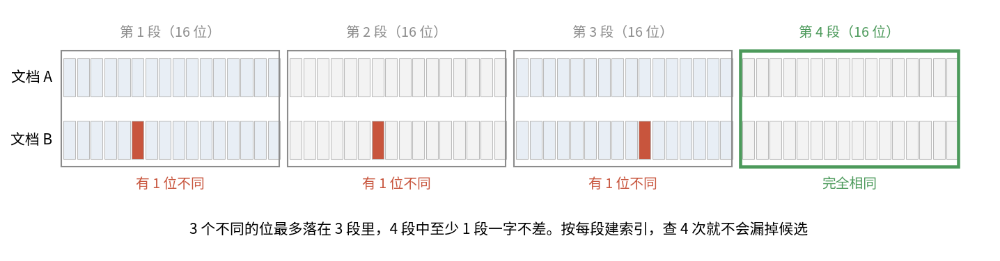
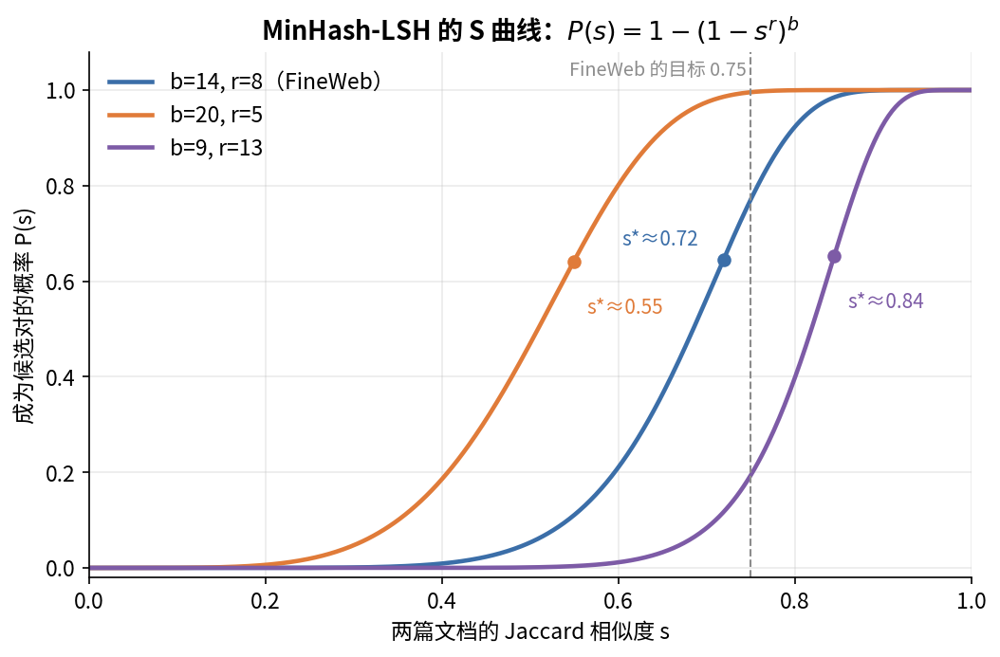

# 第 6 章　数据三：去重、质量打分、去污染

> 第 5 章看的是一条记录自己干不干净。这一章的三件事都要拿记录去跟别的东西比：跟其他训练文档比，看是不是重复，这是去重；跟一个质量标准比，看值不值得训，这是打分；跟评测集比，看有没有泄题，这是去污染。花出去的每个 token 有没有白花，最后的评测分数可不可信，都由这三步决定。

## 这一章要回答的问题

读完这一章，你应该能回答下面这些问题。

1. 重复数据有什么坏处？完全相同、几乎相同、共享长片段，这三种重复各用什么方法去？
2. 精确去重怎么做？数据量上到十亿篇时，内存和机器怎么安排？
3. SimHash 的原理是什么？ZGCM 为什么用 4 个 16 位的分段做索引，鸽笼原理保证了什么？
4. MinHash-LSH 的原理是什么？分段数 $b$ 和每段行数 $r$ 怎么取？
5. ZGCM 的"跨阶段去重"和"全池去重"做了什么？仓库里有没有这部分代码？
6. 质量分类器有哪几种做法？FineWeb-Edu 的分类器是怎么训出来的？ZGCM 的 ge4 / ge3 / lt3 是什么？
7. 什么是评测污染？8-gram 去污染具体怎么算？"重叠超过 50%"的分母是谁？
8. 这几步在流水线里按什么顺序排？顺序不对会出什么问题？

---

<a id="s6-1" name="s6-1"></a>
## 6.1 为什么要去重

网页上的重复比你想的多得多。同一篇新闻被几十个站转载；同一个网站每页都带一样的页脚；同一份开源许可证出现在几百万个代码仓库里。Common Crawl 每个月重新抓一遍，很多页面在不同快照里一字不差。

重复最直接的坏处是浪费算力。同一段文本训 10 遍，第 2 到第 10 遍学到的东西远少于 10 篇不同的文本。

它还会让模型背书。重复次数越多，模型越容易逐字记住并原样吐出来。Lee 等人（2022，ZGCM 报告 §3.2.1 第 7 页引用的就是这篇）发现 C4 里有一句 61 个词的英文句子重复了 6 万多次；在这类数据上训的模型，无提示生成的文本里有超过 1% 是从训练集逐字抄来的。去重之后，背书输出的频率降到原来的约十分之一（[Lee et al. 2022](https://arxiv.org/abs/2107.06499)）。

第三个坏处落在评测上。训练集和测试集里如果有同一段文字，测试分数就会虚高。这件事单独叫"污染"，[§6.8](#s6-8) 再讲。

按粒度分，重复有三种，去的方法各不相同：

| 粒度 | 例子 | 方法 | 本章 |
|---|---|---|---|
| 完全相同 | 同一页面在两个快照里 | 哈希整篇文本，哈希值相同就是重复 | [§6.2](#s6-2) |
| 几乎相同 | 转载时改了标题、加了广告 | SimHash 或 MinHash，比较"指纹"的相似度 | [§6.3](#s6-3)、[§6.4](#s6-4) |
| 共享长片段 | 不同页面带同一大段免责声明 | 后缀数组找重复子串，删掉片段而不是整篇 | [§6.5](#s6-5) |

去重也不意味着每段内容只能出现一次。HF 数据卡（`zgcagi/ZGCM-1-Data`，L264）写到，少数稀缺、经过仔细过滤的来源会有控制地重复采样，次数记在 `metadata_json` 里。去重要去掉的是无意的重复，重复采样是有意的重复，两者并不矛盾。

<a id="s6-2" name="s6-2"></a>
## 6.2 精确去重

先从最简单的情况说起：两篇文档一字不差。做法是对每篇文档的文本算一个哈希（比如 SHA-256，输出 32 字节），用一个集合记下见过的哈希。新文档的哈希如果已经在集合里，就是重复，丢掉；不在就加进集合，保留。

哈希的作用是把任意长的文本压成固定长度的"指纹"。SHA-256 的碰撞概率可以忽略，所以"哈希相同"就等于"文本相同"。

### ZGCM 的代码

ZGCM 的实现在 `data-process/src/zgcm_data_pipeline/steps/common.py:85-93`：

```python
def exact_deduplicate(sample, context):
    normalized = normalize_text_value(sample.text()).casefold()
    digest = stable_hash(normalized)          # SHA-256 的十六进制串
    sample.data.setdefault("text_sha256", digest)
    if digest in context.seen_hashes:
        sample.mark(Decision.DROP, "exact_duplicate")
    else:
        context.seen_hashes.add(digest)
    return sample
```

这几行里有三处要看仔细。哈希之前，文本先做了第 5 章讲的 NFKC 规范化，再 `casefold()`（比 `lower()` 更彻底的大小写折叠）。所以"只差大小写"或"只差全角半角"的两篇也算重复，这里的"精确"是有意放宽过的。

`setdefault` 把哈希写进记录，已经有 `text_sha256` 字段时不覆盖。这个哈希是对"规整并转小写后"的文本算的，和原文的 SHA-256 不是一回事。第 4 章 [§4.7](04_数据一_来源与获取.md#s4-7) 的 `locator_json` 里也有 `text_sha256`，数据卡没说怎么算；如果用的是这个值，拿上游原文直接算 SHA-256 会对不上（推断）。

`seen_hashes` 是 `PipelineContext` 里的 Python `set`（`core.py:19`），只在一次运行里有效。

### 规模上来以后怎么办

单机一个 set 在数据量小的时候够用。第 5 章 [§5.5](05_数据二_清洗流水线.md#s5-5) 算过：Python 的 set 里每个十六进制哈希约占 147 字节，stage 1 的 9.73 亿行就要约 143GB 内存，stage 2 要约 413GB。一台机器放不下，或者放下了也很慢。

工业上的做法是按哈希分桶，分开处理。每篇文档算出哈希后，按哈希的前几位分到 $K$ 个桶里，比如按前 2 个十六进制字符分成 256 个桶。相同的文本一定有相同的哈希，所以一定落进同一个桶，每个桶单独去重就够了。256 个桶可以放到 256 个进程或机器上并行，每个桶只有总量的 1/256。这是 MapReduce 的思路，Spark、datatrove 这类工具都是这么做的。另一种做法是把 (哈希, 文档 ID) 写到磁盘，外部排序后扫一遍，相邻两行哈希相同的就是重复。

存法本身也能省。只存原始的 32 字节哈希、不存十六进制串，stage 1 也要 $9.728\times10^8\times32 \approx 31$GB。[§6.6](#s6-6) 讲跨阶段去重时还会用到这个数。

### 留哪一份

重复的几份里只能留一份。流式处理默认先到先得，留第一个见到的，但第一个不一定最好。更讲究的做法是给每份打一个优先级，比如质量分高的、来源更可信的、更新的版本优先，然后在每组重复里留优先级最高的那份。这要求先把所有重复找出来、分好组，再挑，不能边读边丢。[§6.6](#s6-6) 会看到 ZGCM 的 agent 数据里有一个 `DEDUP_PRIORITY` 字段，就是为这件事准备的。

<a id="s6-3" name="s6-3"></a>
## 6.3 近似去重一：SimHash（ZGCM 仓库用的）

精确去重对稍有改动的副本无能为力。转载时改一个标题、加一行"来源：XX 网"，SHA-256 就完全不同了。我们需要另一种指纹，满足"文本差得少，指纹也差得少"。普通哈希恰好相反，改一个字节，输出的一半位都会翻转。

### 先把文档拆成瓦片

比较两篇文档前，先把每篇拆成一组小片段，叫 **shingle（瓦片）**，最常用的是连续 $n$ 个词，即词 $n$-gram。比如 $n=3$ 时，"the cat sat on the mat" 拆成 {the cat sat, cat sat on, sat on the, on the mat}。

两篇文档共享的 $n$-gram 越多，就越相似。$n$ 取多大要两头权衡：太小（比如 1，就是词袋），两篇无关的文章也会共享大量常用词；太大，改一个词就会破坏 $n$ 个瓦片。业界常用 $n=5$，ZGCM 也是。

### SimHash 怎么算

SimHash 是 Charikar 在 2002 年提出的。对一篇文档，先把每个特征（这里是一个 5-gram）哈希成 64 位，再准备 64 个计数器，初值都是 0。然后逐个看每个特征的哈希：第 $i$ 位是 1，第 $i$ 个计数器加 1；是 0，就减 1。所有特征处理完以后，计数器 $\ge 0$ 的位记 1，否则记 0，得到的就是 64 位的指纹。

可以把这个过程想成投票。每个特征对每一位投一票，指纹记录的是每一位上的多数意见。两篇文档共享大部分特征，就意味着大部分选票相同，大部分位的多数意见也相同。只有那些票数本来就接近平局的位，才会因为少数特征变化而翻转。

比较两个指纹用**汉明距离**：两个 64 位数异或后数有几个 1，也就是有几位不同。

这个直觉有精确的理论支撑。把文档看成"每个特征一维"的向量，两篇文档向量的夹角是 $\theta$，那么随机投影下每一位不同的概率是 $\theta/\pi$。这个概率可以在两个向量所在的平面里看出来：随机投影相当于取一条方向随机的过原点直线，看两个向量落在它的同侧还是异侧；直线的方向总共有 $\pi$ 的范围，只有落进两个向量之间那 $\theta$ 的范围时，才会把它们分到两侧。SimHash 的每一位相当于一次随机投影（用哈希代替随机数，所以是近似），于是汉明距离近似服从 $\text{Binomial}(64,\ \theta/\pi)$。对集合来说，$\cos\theta = |A\cap B| / \sqrt{|A|\,|B|}$。

### ZGCM 的代码

`data-process/src/zgcm_data_pipeline/dedup.py:12-28`：

```python
_TOKEN = re.compile(r"\w+", re.UNICODE)

def simhash64(text, *, ngram=5):
    tokens = _TOKEN.findall(text.casefold())
    if not tokens:
        return 0
    width = max(1, int(ngram))
    features = (" ".join(tokens[i : i + width])
                for i in range(max(1, len(tokens) - width + 1)))
    weights = [0] * 64
    for feature in features:
        digest = int.from_bytes(hashlib.blake2b(
            feature.encode("utf-8"), digest_size=8).digest(), "big")
        for bit in range(64):
            weights[bit] += 1 if digest & (1 << bit) else -1
    result = 0
    for bit, weight in enumerate(weights):
        if weight >= 0:
            result |= 1 << bit
    return result
```

切词用的是 `\w+`，只取"词字符"连续段，标点全部丢掉，再 casefold。所以 "Hello, World!" 和 "hello world" 的指纹完全相同（本书跑过）。特征是 5 个词用空格连起来的字符串，文档不足 5 个词时，`max(1, ...)` 保证至少有一个特征，就是整篇。每个特征用 blake2b 哈希成 8 字节（64 位）。blake2b 是确定性的，同一段文本在任何机器上指纹都一样。经典 SimHash 常按 TF-IDF 给特征加权，这里每个特征权重都是 1。空文本返回 0。

这种切词放到中文上就出问题了。中文词之间没有空格，`\w+` 会把两个标点之间的一整串汉字当成一个"词"。本书试了一段 4 个分句的中文，切出来只有 4 个"词"：`['今天天气很好', '我们去公园散步', '公园里有很多人在锻炼身体', '也有小孩在放风筝']`。不足 5 个词，整段只有 1 个特征。把"很好"改成"不错"，汉明距离就是 30，和两篇无关文档差不多。对中文，这个 SimHash 几乎退化成整篇精确匹配。要用在中文上，得先分词或按字切 $n$-gram。仓库没有做，也没说明它是否只用于英文。

### 阈值 3 有多严

ZGCM 示例配置里的阈值是汉明距离 3。为了看清它能抓住多大的改动，本书用仓库的 `simhash64` 做了一个实验：随机生成一篇文档，随机替换其中 $k$ 个词，看两篇的汉明距离，每组重复 200 次。

| 文档长度 | 替换词数 | 5-gram Jaccard | 平均汉明距离 | 距离 ≤ 3 的比例 |
|---|---|---|---|---|
| 300 词 | 1 | 0.967 | 3.6 | 52% |
| 300 词 | 2 | 0.935 | 5.3 | 22% |
| 300 词 | 5 | 0.851 | 8.1 | 6% |
| 1000 词 | 1 | 0.990 | 2.0 | 88% |
| 1000 词 | 5 | 0.952 | 4.7 | 29% |
| 1000 词 | 20 | 0.825 | 8.4 | 4% |
| 两篇无关文档 | — | 0 | 31.8 | 0% |

表里的 Jaccard 一列可以手算。300 词的文档有 296 个 5-gram，替换 1 个词会改掉包含它的 5 个，于是两篇共享 291 个、并集 301 个，$291/301 \approx 0.967$。替换 2 个相隔较远的词就改掉 10 个，$286/306 \approx 0.935$。

再和理论对一下：$\cos\theta = 0.99$ 时 $\theta/\pi = 0.045$，期望距离 $64\times0.045=2.9$，$P(\text{距离}\le3) = 67\%$；$\cos\theta=0.95$ 时只有 10%；$\cos\theta = 0.9$ 时只有 1.3%。实验和理论吻合。

所以 64 位、阈值 3 的 SimHash 只能抓住"几乎一字不差"的副本，大约是 5-gram 重合 97% 以上。转载时加了一段导语、删了一个段落，大多抓不到。HF 数据卡把 mid-train 的近似去重叫"conservative"（保守的，数据卡 L260），和这个结果一致。

这么严也有来历。64 位加阈值 3 这组参数来自 Google 2007 年的网页去重工作（Manku 等，在 80 亿网页上用的就是这组），它的目标是找"同一网页的不同抓取版本"，本来就是严格去重。

### 不能两两比：分段索引和鸽笼原理

有了指纹，最笨的做法是新文档和所有旧指纹逐个算汉明距离。10 亿篇文档两两比较是 $5\times10^{17}$ 次，做不完。

ZGCM 的 `NearDeduper`（`dedup.py:35-73`）用分段索引绕开两两比较。它把 64 位指纹切成 4 段，每段 16 位，建 4 张表：第 $i$ 张表的键是"第 $i$ 段的 16 位值"，值是指纹编号的集合。新指纹来了，只取出"至少有一段完全相同"的旧指纹当候选，再对候选算汉明距离。

这样做不会漏，依据是**鸽笼原理**。两个指纹最多差 3 位，这 3 个不同的位最多落在 3 个段里，4 段里至少有 1 段一位都不差。所以"距离 ≤ 3"的旧指纹一定会出现在候选里。代码注释（L39-L41）和构造检查（L50）说的就是这个：

```python
def __post_init__(self):
    if 64 % self.bands != 0 or self.threshold >= self.bands:
        raise ValueError("bands must divide 64 and threshold must be smaller than bands")
```



图里文档 B 和 A 差了 3 位（红色），分别落在第 1、2、3 段，第 4 段一位不差。不管这 3 位怎么分布，4 段里总能剩下一段干净的。

推广开来，阈值是 $t$，就至少要分 $t+1$ 段。阈值想放宽到 6，按这个原理至少要 7 段；但上面的检查还要求段数能整除 64，实际只能分 8 段，每段 8 位，候选会多很多。

候选到底有多少，可以算出来。两个无关的指纹，某一段 16 位恰好相同的概率是 $2^{-16}$，4 段里任一段相同的概率约 $4/65536 = 6.1\times10^{-5}$。库里有 $N$ 个指纹时，每来一篇新文档约有 $6.1\times10^{-5}N$ 个无关候选要复查。$N = 10^6$ 时约 61 个，很快；$N=10^9$ 时约 6.1 万个，每篇都要算 6 万次异或。Google 2007 年的做法是把指纹按多种位排列存多份表，用更多内存换来更少的候选。

内存是另一道坎。本书用 `tracemalloc` 量了一下，Python 实现每个指纹约占 560 字节（一个 int 加 4 个 dict 里的 set 项），10 亿篇就是约 0.56 TB。所以这个类适合在单个来源、单个分片内部用，并没有为全量数据设计。

### 流式判重的代码

判重的入口是 `check_and_add`：

```python
def check_and_add(self, text, *, ngram=5):
    fingerprint = simhash64(text, ngram=ngram)
    values = self._band_values(fingerprint)
    candidates = set()
    for band, value in enumerate(values):
        candidates.update(self.indexes[band].get(value, ()))
    duplicate = any(hamming_distance(fingerprint, self.fingerprints[i]) <= self.threshold
                    for i in candidates)
    index = len(self.fingerprints)
    self.fingerprints.append(fingerprint)          # 不管是不是重复，都加进库
    for band, value in enumerate(values):
        self.indexes[band][value].add(index)
    return duplicate
```

看最后三行，判成重复的指纹也被加进了库。这有两个后果。一是内存按"看到的文档数"增长，留下的文档再少，库也不会变小。二是会出现**链式误删**：设 A 和 B 差 3 位，B 和 C 差 3 位，A 和 C 差 6 位。A 先来，留下；B 来了，和 A 距离 3，丢掉，但 B 的指纹进了库；C 来了，和 B 距离 3，也被丢掉。可是留下来的只有 A，C 和 A 差 6 位，本来不算重复。

这算不算 bug，取决于你想要什么。如果目标是"每个相似簇只留一篇"，链式合并是可以接受的，MinHash 去重里常用的"连通分量"也是这个效果（[§6.4](#s6-4)）。如果目标是"每篇被丢的文档都必须和某篇留下的文档足够像"，那就该只把留下的指纹加进库。仓库没说明是哪种意图。

调用它的是 `near_deduplicate`（`steps/common.py:96-114`）。它默认是关的，要在配置里写 `near_dedup=True` 才启用，docstring 给的理由是"阈值必须按类别校准"。`examples/quality-policies.json` 第 2-3 行给的示例配置是打开的，阈值 3。

<a id="s6-4" name="s6-4"></a>
## 6.4 近似去重二：MinHash-LSH（ZGCM 没用）

SimHash 是 ZGCM 仓库的选择，公开数据集更常用的是另一套方法。FineWeb、RefinedWeb、Dolma 这些数据集做近似去重，主流是 MinHash 加 LSH（局部敏感哈希）。面试问"怎么做网页模糊去重"，标准答案就是它。

### Jaccard 相似度

两篇文档的 $n$-gram 集合是 $A$ 和 $B$，Jaccard 相似度定义为

$$J(A,B) = \frac{|A\cap B|}{|A\cup B|}$$

也就是共享的瓦片占全部瓦片的比例。完全相同是 1，毫无交集是 0。

拿 [§6.3](#s6-3) 那个句子算一个小例子。A 是 "the cat sat on the mat"，B 是 "the cat sat on a mat"，按 3-gram 切，A 是 {the cat sat, cat sat on, sat on the, on the mat}，B 是 {the cat sat, cat sat on, sat on a, on a mat}。两者共有 2 个瓦片，并集一共 6 个，$J = 2/6 = 1/3$。只改了一个词，Jaccard 就掉到三分之一，因为短句里每个瓦片的分量都很重。

### MinHash：用一个数估计 Jaccard

取一个哈希函数 $h$，把集合里每个元素都哈希一遍，取最小值 $\min_{x\in A} h(x)$。这个最小值有一个很好用的性质：$P\big[\min_{x\in A}h(x) = \min_{x\in B}h(x)\big] = J(A,B)$。

证明不难。把 $A\cup B$ 的所有元素按哈希值排队，排第一的那个元素在 $A\cup B$ 里是均匀随机的。两个最小值相等，当且仅当这个排第一的元素同时属于 $A$ 和 $B$，即落在 $A\cap B$ 里，概率正好是 $|A\cap B|/|A\cup B|$。本书用两个 Jaccard 为 0.6 的集合模拟了 2 万次，相等的比例是 0.601。

回到上面 cat 和 mat 的例子，用两个哈希函数各试一次（哈希值是随手编的示意数字）。设 $h_1$ 给并集里 6 个瓦片的值依次是 the cat sat 42、cat sat on 7、sat on the 91、on the mat 63、sat on a 18、on a mat 55。A 的最小值是 7，B 的最小值也是 7，都来自共有的 cat sat on，两者相等。再设 $h_2$ 给的值是 30、76、12、88、49、5，这次并集里最小的是只属于 B 的 on a mat（5），B 取到 5，A 只能取自己的 sat on the（12），两者不等。换多少个哈希函数都是这个规律：排第一的瓦片是共有的，就相等，否则不等；6 个瓦片里共有 2 个，所以相等的概率是 1/3。

用 $k$ 个不同的哈希函数，每篇文档得到 $k$ 个最小值，叫 **MinHash 签名**。两篇签名里相同位置相等的比例，就是 Jaccard 的无偏估计。$k$ 越大，估计越准。每个位置相等与否像一次命中概率为 $J$ 的抛硬币，所以 $k$ 个位置给出的估计，标准差是 $\sqrt{J(1-J)/k}$；$J=0.75$、$k=112$（下面 FineWeb 的设置）时约 0.04。

### LSH：分段找候选

签名有了，还是不能两两比。LSH 的做法和 [§6.3](#s6-3) 的分段索引是同一个思路：把 $k = b\times r$ 个最小值切成 $b$ 段，每段 $r$ 个，每段的 $r$ 个值合起来哈希成一个桶号。两篇文档只要有一段的 $r$ 个值全部相同，就成为候选对。

段内和段间的要求方向相反。段内要 $r$ 个值全部相等，是"与"的关系，只有几分像的文档对很难过这一关；段间只要一段命中，是"或"的关系，真正相似的文档对有 $b$ 次机会。下面的 S 形曲线就是这两种要求叠出来的。

成为候选的概率可以一步步推出来。设两篇的 Jaccard 是 $s$，某一段的 $r$ 个值全相等的概率是 $s^r$，这一段不全相等的概率是 $1-s^r$，$b$ 段都不全相等的概率是 $(1-s^r)^b$，所以成为候选的概率是

$$P(s) = 1-(1-s^r)^b$$

这条曲线是 S 形的：$s$ 低时接近 0，$s$ 高时接近 1，中间有一段陡升。陡升点大约在

$$s^* \approx (1/b)^{1/r}$$

拿 FineWeb 的参数手算一遍。FineWeb 用 112 个哈希函数，分成 $b=14$ 段、每段 $r=8$ 个，在词 5-gram 上算，目标是抓住相似度 75% 以上的文档（[FineWeb 论文](https://arxiv.org/abs/2406.17557)）。$s^* = (1/14)^{1/8} \approx 0.72$。逐点代入，再和另外两组参数比较：

| 参数 | $s$=0.5 | 0.6 | 0.7 | 0.75 | 0.8 | 0.85 | 0.9 |
|---|---|---|---|---|---|---|---|
| $b$=14, $r$=8（FineWeb） | 5% | 21% | 57% | 77% | 92% | 99% | 100% |
| $b$=20, $r$=5 | 47% | 80% | 98% | 100% | 100% | 100% | 100% |
| $b$=9, $r$=13 | 0.1% | 1% | 8% | 20% | 40% | 69% | 93% |

从这张表就能看出 $b$ 和 $r$ 怎么取。先定你要的阈值 $s^*$，再选 $b, r$ 让 $(1/b)^{1/r}$ 落在它附近。$r$ 越大，曲线越陡，阈值附近的误判越少，但阈值也往右移；$b$ 越大，阈值往左移，召回更高。总哈希数 $k=b\times r$ 越大，曲线越接近理想的阶跃函数，但计算和存储也越多，每篇文档要存 $b$ 个桶号。

把表里三组参数画成曲线，看得更清楚。按 $(1/b)^{1/r}$ 算，另外两组的陡升点分别约在 0.55（$b$=20, $r$=5）和 0.84（$b$=9, $r$=13）。看图时注意两件事：三条曲线的陡升点随 $b, r$ 左右移动；$r$ 最大的那条（$b$=9, $r$=13）坡最陡。



LSH 两头都会出错。低于阈值也有一定概率进候选（误报），所以候选对一般还要用完整签名估一次 Jaccard 再确认。高于阈值也可能漏（漏报），这是 LSH 的固有代价。[§6.3](#s6-3) 的 SimHash 分段索引不会漏报，是因为它只对"汉明距离 ≤ 3"这个精确条件负责，而汉明距离本身只是相似度的一个带噪估计。

### 候选对之后：聚类再挑一篇

候选对找出来后，把"互为重复"的文档连成图，用并查集（union-find）求连通分量，每个分量就是一个重复簇，簇里只留一篇。这是批处理：先全量算签名、找候选、聚类，最后再决定留谁。批处理的好处是可以按质量分、来源优先级挑留哪篇（[§6.2](#s6-2) 末尾），坏处是要等全部数据算完，不能边读边丢。连通分量也会链式合并（A 像 B、B 像 C，A、B、C 就是一簇），和 [§6.3](#s6-3) 说的情况一样。

### FineWeb 的一个反直觉发现

FineWeb 比较了"把 96 个快照合起来全局去重"和"每个快照内部单独去重"，结果全局去重反而更差。原因是老快照里留下来的多是在别的快照里都没出现过的页面，这些页面平均质量更低；而被删掉的、反复出现的页面，往往是好页面。最后 FineWeb 选了按快照单独去重。

所以去重是为了让训练效果变好，重复率并不是越低越好，去得太狠也会伤数据。

### SimHash 和 MinHash 怎么选

两种方法放在一起比：

| | SimHash（ZGCM 仓库） | MinHash-LSH（FineWeb 等） |
|---|---|---|
| 估计的相似度 | 余弦（向量夹角） | Jaccard（集合重合） |
| 每篇存储 | 64 位，一个数 | $k$ 个最小值或 $b$ 个桶号 |
| 阈值可调范围 | 汉明距离要小，只适合抓近乎一字不差的副本 | 通过 $b, r$ 在 0.5 到 0.9 之间灵活设 |
| 流式处理 | 天然适合，边读边判 | 一般是批处理 |
| 漏报 | 对"距离 ≤ $t$"不漏 | 有，按 S 曲线 |

<a id="s6-5" name="s6-5"></a>
## 6.5 子串去重（ZGCM 没用）

前面几节处理的都是整篇相同或相似的文档。有些重复只是一段话：同一段免责声明、同一段 cookie 提示，出现在成千上万个内容不同的页面里。整篇去重抓不到它们，因为整篇并不相似。

Lee 等人（2022）的 ExactSubstr 方法针对的就是这种情况。它把整个语料拼成一个超长字符串，建**后缀数组**（所有后缀按字典序排好的索引）。重复出现的子串，在后缀数组里会相邻，找相邻后缀的最长公共前缀就能找出所有重复片段。他们把长度达到 50 个 token、出现不止一次的片段删掉。

这个方法很准，但后缀数组的内存是语料大小的好几倍，一般只用在中等规模的数据上。ZGCM 报告 §3.2.1 第 7 页引用了这篇论文，但正文只写了"全池去重"，没说用的是整篇还是子串级别（报告未说明）。

<a id="s6-6" name="s6-6"></a>
## 6.6 跨来源、跨阶段、全池去重：ZGCM 实际做了什么

前面几节讲的都是单个数据集内部的去重。ZGCM 的报告还提到了跨阶段、跨来源的去重，我们先把公开材料里的说法收集在一起：

| 环节 | 原话大意 | 出处 |
|---|---|---|
| 预训练跨阶段 | stage 2 选数据时排除 stage 1 的全部内容 | 报告 §3.1.1 第 6 页；`pretrain/docs/PRETRAIN_PHASES.md` 第 15 行 |
| mid-train 全池 | 对候选池做全池去重，控制重复内容；去重和数学错误过滤后得到约 53 亿条、2.86T token 的候选池 | 报告 §3.2.1 第 7 页、附录 A.5 第 34 页 |
| 数据卡 | 精确去重，mid-train 另加保守的近似去重 | 数据卡 L260 |
| 仓库文档 | mid-train 输出要"在来源内部和来源之间去重" | `data-process/docs/category_cleaning_pipelines.md` 第 50 行 |
| SFT | 规则过滤会去掉重复生成的样本；agent 轨迹在来源内去重 | 报告 §4.1.1 第 11 页、§4.1.2 第 14 页 |

再去仓库里找，能找到的只有 [§6.2](#s6-2) 的单次运行精确去重和 [§6.3](#s6-3) 的可选 SimHash。跨分片、跨来源、跨阶段的去重代码都没有。所以 stage 1 和 stage 2 怎么比对、用的是精确哈希还是近似、留哪一份，都不知道（报告未说明）。

### 跨阶段去重通常怎么做

仓库里没有这部分代码，不过可以按常规做法估一下它的规模。目标很简单：stage 2 里不能有 stage 1 训过的文档。做法是先建 stage 1 的指纹库，再拿 stage 2 的每一篇去查。

指纹库多大，取决于怎么存。stage 1 有 9.728 亿行（第 4 章 [§4.8](04_数据一_来源与获取.md#s4-8)）：

| 存法 | 每条 | stage 1 合计 | 说明 |
|---|---|---|---|
| Python set 存十六进制串 | 约 147 字节 | 约 143 GB | 第 5 章 [§5.5](05_数据二_清洗流水线.md#s5-5) 量过 |
| 原始 32 字节 SHA-256，排序后存数组 | 32 字节 | 约 31 GB | 查询用二分 |
| Bloom 过滤器，误报率 $10^{-6}$ | 约 28.8 位 | 约 3.5 GB | 见下 |

**Bloom 过滤器**是一个长 $m$ 位的位数组加 $k$ 个哈希函数。插入时把 $k$ 个位置都置 1；查询时看 $k$ 个位置是否全是 1，全是 1 就判"见过"。它不会漏报，但会误报，因为几个别的元素可能恰好把这些位都置了 1。给定误报率 $p$，最省的设计是每个元素约 $-\ln p / (\ln 2)^2$ 位。代进去，$p = 10^{-3}$ 时是 14.4 位/条，stage 1 约 1.75 GB；$p = 10^{-6}$ 时是 28.8 位/条，stage 1 约 3.5 GB。

误报在这里的意思是：一篇 stage 2 的新文档被错当成 stage 1 见过的而被丢掉。$10^{-6}$ 的误报率乘 28.2 亿行 stage 2，约丢 2,800 篇，可以接受。DCLM 的去重工具就是用 Bloom 过滤器做的。

如果跨阶段也要近似去重，就得把 stage 1 的 SimHash 或 MinHash 桶号都存下来，量会大很多。

### 一个容易误会的地方：replay

说到 mid-train 的全池去重，有一处容易想错。mid-train 的配比里有 `pretrain_replay`（附录 C [§C.7.2](附录C_W&B与数据配比统计.md#sc-7-2)），就是有意混进去的预训练数据，用来防止模型忘掉预训练学到的东西（第 16 章）。这部分和预训练本来就重复，而且是故意的。所以"全池去重"不可能是"和预训练全部去重"，至少 replay 要排除在外。报告没说 mid-train 去重的范围是只在 mid-train 新数据内部，还是也和预训练比（报告未说明）。

### agent 数据里留下的线索

去重代码虽然没放出来，数据处理脚本里却留下了一些痕迹。mid-train 的 agent 编码轨迹（`stages/midtrain/datasets/agent_coding.py`）给每条记录算了三个跟去重有关的字段，但仓库里没有任何代码读取它们：

```python
DEDUP_PRIORITY = {
    "agent_coding_same_repo_multiissue_pack": 0,
    "agent_coding_trace64k_packed_full": 1,
    "agent_coding_nonzerohero_singletrace": 2,
}

def sampled_text_for_neardup(text, span=12_000):
    if len(text) <= span * 3:
        return text
    middle = max(0, len(text) // 2 - span // 2)
    return text[:span] + "\n" + text[middle : middle + span] + "\n" + text[-span:]
```

第一个字段是 `dedup_priority`（L13-L17、L73）。同一条轨迹出现在多种打包方式里时，数字小的优先保留，这就是 [§6.2](#s6-2) 说的"按优先级留一份"。

第二个是 `near_dedup_sample_sha256`（L45-L49、L74-L76）。文本超过 36,000 字符时，只取开头、中间、结尾各 12,000 字符拼起来算 SHA-256。几十万字符的长轨迹，整篇算 SimHash 太慢，抽三段做哈希是一个省事的近似。它名字里有 near，算的却是"抽样片段的精确哈希"：只有这三段完全相同才算重复，中间别处不同就不管。

第三个是 `source_trace_keys`（L72），即上游的 instance ID 集合。按它去重，就能发现"同一个任务的不同轨迹"。

这些字段说明 ZGCM 实际用的去重逻辑比仓库里的多，只是执行去重的那部分代码没放出来（推断）。

<a id="s6-7" name="s6-7"></a>
## 6.7 质量打分

去完重的数据，每篇都是"不同的"，但不是每篇都值得训。同样是 1,000 个 token，一页教科书和一页商品列表对模型的价值差很多。第 5 章的规则（长度、符号比例、重复行）只能去掉明显的垃圾，分不出"合格"和"优秀"。质量打分要做的是给每篇一个连续的分数，再按分数决定留多少。

### 三种做法

给文档打质量分，常见的有三条路：

| 做法 | 怎么打分 | 代表 | 毛病 |
|---|---|---|---|
| 启发式规则 | 手写特征和阈值 | Gopher、C4 规则（第 4 章 [§4.6](04_数据一_来源与获取.md#s4-6)） | 只能抓明显的坏，抓不住"内容空洞但格式正常" |
| 参考模型困惑度 | 在干净语料（如维基）上训一个小语言模型，算每篇的困惑度，越像维基分越高 | CCNet 用 KenLM（一种 n-gram 语言模型）在维基上训，按困惑度把网页分成头、中、尾三档 | 偏好"像维基"的文本，会压掉口语、代码、对话 |
| 分类器 | 准备"好"和"差"两类样本，训一个分类器，输出"像好样本"的概率或分数 | DCLM、FineWeb-Edu、Ultra-FineWeb | 分类器学到的是"好样本"的风格，好样本怎么选决定了一切 |

现在的主流是分类器，按正例从哪来又分两种。

一种是正例直接拿现成的高质量数据。DCLM 用 fastText（一种很快的线性文本分类器，按词和字符 n-gram 做特征）训二分类：正例是 OpenHermes 2.5 指令数据和 Reddit ELI5（"像对五岁小孩解释"）板块里的高分回答，负例是随机网页。然后只留分数最高的约 10%。fastText 在 CPU 上每秒能处理大量文档，适合给几十亿篇打分。Ultra-FineWeb 也是一个轻量 fastText 分类器（第 4 章 [§4.3](04_数据一_来源与获取.md#s4-3)）。

另一种是先让大模型标注，再蒸馏成小模型，FineWeb-Edu 就是这么做的（[分类器模型卡](https://huggingface.co/HuggingFaceFW/fineweb-edu-classifier)）。他们从 FineWeb 里抽约 45 万篇网页，让 Llama-3-70B-Instruct 按 0 到 5 分打"教育价值"。提示词是加分制：有基本信息加 1 分，和学校教学相关再加 1 分，以此类推。然后用这 45 万条标注训一个小模型：Snowflake-arctic-embed-m 做编码器（参数冻结），上面接一个回归头，学习率 3e-4，训 20 个 epoch。

小模型训好后，用它给 FineWeb 的全部网页打分，分数四舍五入取整后 $\ge 3$ 的留下。以 3 为界做二分类，F1 是 82%。筛出来的就是 FineWeb-Edu，约 1.3T token，只有 FineWeb 15T 的十分之一不到。阈值放到 2 的版本叫 FineWeb-Edu-score-2，约 5.4T。

为什么不直接用 70B 模型给全部网页打分？算一下就知道。FineWeb 15T token，让 70B 模型读一遍，前向约 $2\times70\text{B}\times15\text{T}=2.1\times10^{24}$ FLOPs，大约是 ZGCM 整个预训练 $1.9\times10^{23}$（第 1 章）的 11 倍。小模型读一篇的代价低几个数量级。大模型标注一次、小模型推理全量，是这类方法的固定套路。

打个比方，这像先请一位资深老师按评分细则批 45 万份作文，再让助教照着这些批好的样卷学会打分，最后由助教去批全部作文。这个比方有一处要打折扣：助教只学到了样卷上的打分结果，学不到老师怎么想，样卷里少见的文体它就批不准，和老师的判断也不会完全一致（上面以 3 为界的 F1 是 82%）。本节最后讲的分类器偏好问题，根子就在这里。

### 阈值怎么定

分类器训好了，留多少还要靠阈值。阈值要看"用这批数据训出的模型好不好"来定，光看分类器的准确率不够。FineWeb-Edu 的做法是用不同阈值筛出几份数据，各训一个小模型（1.8B 参数），比较 MMLU、ARC 这类评测，再选阈值。第 7 章用小模型搜配比也是同样的思路：**数据决策靠训练实验验证，不靠肉眼。**

阈值越高，数据越干净，但也越少。数据不够时就得重复训（多个 epoch），重复又有代价（第 7 章）。所以阈值要和总 token 预算一起定：预算 1T 时可以用 1.3T 的高阈值数据，预算 5T 时就得放宽到 score-2。

### ZGCM 的做法：用上游的分，自己定阈值

ZGCM 预训练没有自己训质量分类器。报告 §3.1.1 第 6 页说网页数据"保留上游的文档级质量分和质量分层"；数学数据用"按 SmolLM2 配方做的分类器筛选"的网页数学和教材（§3.1.1 第 6 页），分类器也是上游的。ZGCM 做的是读这些分数，按自己的阈值分档。第 5 章已经讲过几处：

| 来源 | 用的分数 | 阈值 | 出处 |
|---|---|---|---|
| 网页（示例配置） | `quality_mean` | $\ge4.0$ keep，3.0 到 4.0 review，$<3.0$ drop | `examples/quality-policies.json` L5-L10，第 5 章 [§5.5](05_数据二_清洗流水线.md#s5-5) |
| 数学（示例配置） | `quality_score`，另有 `hard_error_score` | $\ge0.8$ keep，$<0.5$ drop；错误分 $>3$ drop | 同上 L11-L17 |
| FinePDFs | 主质量分 | $<0.8$ drop | `finepdfs.py:44-48`，第 5 章 [§5.7](05_数据二_清洗流水线.md#s5-7) |
| olmOCR | `edu_score` | $<0.6$ drop | `olmocr.py:30-39`，第 5 章 [§5.7](05_数据二_清洗流水线.md#s5-7) |

mid-train 的网页和知识类数据另有一个分档函数（`stages/midtrain/datasets/web_knowledge.py:11-16`）：

```python
def quality_band(score):
    if score >= 4.0:
        return "ge4"
    if score >= 3.0:
        return "ge3"
    return "lt3"
```

调用它的是 `clean_web_knowledge_record`（L38-L74）。它先读 `quality_mean`，读不到或不是数字时，分数记成 $-1$，标 `web_knowledge_missing_quality_score`，进 review，而 $-1$ 会落进 lt3 档。算出的档位写进 `buckets["classifier_quality"]`，后面配比要用这个桶：同一个来源按档位拆成几份，各自给权重（第 7 章、第 16 章）。最低档由配置项 `web_knowledge_min_quality_band` 决定，低于它就 drop。它的默认值是 `lt3`（L68），也就是默认一篇都不丢，只分档。

分档而不丢，是想把"留多少低分数据"交给配比去决定，不在清洗阶段一刀切。实际数据也是这样。本书按 mid-train 三段数据的配比文件（附录 C [§C.7](附录C_W&B与数据配比统计.md#sc-7)）统计了带档位后缀（`__ge4` 等）的来源：

| mid-train 配比 | 带档位的 token | ge4 | ge3 | lt3 |
|---|---|---|---|---|
| 16K | 49.5B | 34.4B（69%） | 11.0B（22%） | 4.1B（8%） |
| 64K | 68.4B | 49.8B（73%） | 14.2B（21%） | 4.4B（6%） |
| 256K | 54.2B | 39.6B（73%） | 11.2B（21%） | 3.4B（6%） |

带档位的来源约占每个配比总 token 的三分之一，其余来源（代码、推理、指令等）没有这个档位。lt3 也进了训练，只是少。所以示例配置里"web 低于 3.0 就 drop"的策略，至少在 mid-train 没有照用（推断：要么用的是别的配置，要么 lt3 档用的分数和示例配置不是同一个字段）。

`quality_mean` 这个名字暗示它是几个分数的平均，但谁打的、几个分数、什么尺度，报告和仓库都没说（报告未说明）。从 0 到 5 左右的阈值看，尺度和 FineWeb-Edu 的 0 到 5 分相近（推断）。

### SFT 的质量打分

到了 SFT，做法换了。SFT 数据量小、单条价值高，ZGCM 在这里自己做了模型打分（报告 §4.1.1 第 11–12 页）。第一步用规则去掉结构问题：缺轮次、角色错、重复生成、模板泄漏、推理过程格式坏掉。第二步用一个"按人工标注的试点集校准过的"模型评审，从教育价值、逻辑正确、逐步推理的连贯性、事实一致、安全合规几个维度打分。最后按固定的多指标规则分成几档：高分的优先，边界的送去再验证，低分的丢掉。

结果写在 Finding 4（§4.1.1 第 12 页）：砍掉约一半候选数据，6 项评测平均分从 67.78 升到 68.83，BBH 涨了 10.10，但有一部分任务下降了。可见"数据少一半但更好"整体占优，但并非每项都赢。

### 质量分类器的坑

分类器会继承正例的偏好。FineWeb-Edu 的正例是"有教育价值"，所以它偏爱教科书风格，压低对话、小说、新闻。第 4 章 [§4.5](04_数据一_来源与获取.md#s4-5) 说过，下游没法把上游丢掉的类型找回来。

分类器也可能偏向评测集的风格。如果正例和 MMLU 这类评测题长得像，筛出的数据会让对应评测涨分，但模型的通用能力不一定同比例提高。看评测时心里要有这个数。

另外，分类器跨语言不通用。英文网页上训的分类器，给中文网页打分不可靠，要分语言单独训或单独定阈值。ZGCM 的中文网页用什么分数，报告没说（报告未说明）。

<a id="s6-8" name="s6-8"></a>
## 6.8 去污染

去重和打分管的是训练数据本身，去污染管的是训练数据和评测集之间的关系。

### 什么是污染

评测集的题目或答案出现在训练数据里，就叫**污染**（contamination）。模型在这些题上得分，可能只是记住了答案，并不会做。网页上到处是评测题：有人把 GSM8K 的题贴到博客里讲解，有人把 MMLU 整理成刷题网站。从网页上抓来的数据，不处理一定会混进一些。

污染的程度有轻有重，查起来难度也不同：

| 程度 | 例子 | 容易查吗 |
|---|---|---|
| 题和答案原样都在 | 刷题网站的整页 | 容易 |
| 只有题，没有答案 | 论坛里有人提问 | 容易，但危害小一些 |
| 改写过 | 换了数字、换了说法 | n-gram 查不出来 |
| 翻译过 | 英文题被翻成中文 | n-gram 查不出来 |

**去污染**（decontamination）就是在训练前，把和评测集重合太多的训练样本删掉。

### n-gram 重合法

最常用的方法用到的还是 [§6.3](#s6-3) 的瓦片。先把每道评测题（和参考答案）切成词 $n$-gram，全部放进一个集合 $E$。评测集一般只有几万题，这个集合很小，放得进内存。再对每条训练样本也切 $n$-gram，得到集合 $T$。最后算两者的重合 $|E\cap T|$，超过阈值就删掉这条训练样本。

$n$ 取多大？太小（比如 3），"how many apples"这种常见短语到处都有，会误删大量正常数据；太大（比如 50），短题根本切不出一个 $n$-gram。GPT-3 用的是 13-gram，ZGCM 的 SFT 用 8-gram。

### ZGCM 的规则和"分母"问题

报告 §4.1.1 第 12 页原话大意：用 8-gram 滑动窗口，把整个 SFT 候选集和所有下游评测集、验证集比对，"任何与任一评测 prompt 或参考答案的 8-gram 重合超过 50% 的训练样本，永久删除"。

这里的"重合 50%"是谁的 50%，有两种理解。可以是评测题的 $n$-gram 有一半出现在训练样本里（分母是 $|E_i|$），也可以是训练样本的 $n$-gram 有一半来自评测题（分母是 $|T|$）。报告没说（报告未说明），而两种分母的结果差很多。本书用一道 25 个词的应用题做了计算（小写、按 `\w+` 切词）：

> Tom has 3 boxes of apples. Each box holds 12 apples. He gives 7 apples to his sister. How many apples does Tom have left?

这道题有 18 个 8-gram。拿四种训练样本去比：

| 训练样本 | 样本词数 | 共享 8-gram | 占评测题的比例 | 占训练样本的比例 |
|---|---|---|---|---|
| (a) "Question:" + 原题 + 一句解答 | 42 | 18 | 100% | 51% |
| (b) 改写："Tom owns three crates, each with a dozen apples…" | 22 | 0 | 0% | 0% |
| (c) 一篇 400 词的长文，中间原样嵌了这道题 | 400 | 18 | 100% | 4.6% |
| (d) 一篇 313 词的长文，只嵌了题目前半句（13 个词） | 313 | 6 | 33% | 2.0% |

最麻烦的是 (c)。如果分母选训练样本，长文档里的整道原题会漏掉：(c) 把题原样包含了，但只占全文 4.6%，按"训练样本的 50%"算不会删。网页和长文档里的污染多半是这种。SFT 样本大多短，问题小一些；同样的规则搬到预训练就会漏很多。

(b) 说明改写完全查不出来。意思一样，8-gram 却一个都不共享。

还有一种情况表里没列：短题切不出 8-gram。"What is the capital of France?" 只有 6 个词，一个 8-gram 都没有，任何训练样本都不会和它"重合"。选择题、短问答要单独处理，比如把题干和选项拼起来再切，或者对短题改用整句精确匹配。

所以 n-gram 去污染只能去掉"原样复制"的那部分污染，查不出改写和翻译。业界还会在训练后做污染检测作为补充：比如把评测集分成"和训练数据有重合"和"干净"两部分，比较模型在两部分上的分数，差得多就说明有记忆效应（GPT-3 论文就是这样报告的）。ZGCM 没有报告这类分析。

### ZGCM 各阶段做了什么

把三个阶段放在一起看：

| 阶段 | 去污染 | 出处 |
|---|---|---|
| 预训练 | 报告没提 | 报告未说明 |
| mid-train | 仓库文档把"去掉和留出评测集、验证集的重合"列为训练就绪数据必须做的第 6 步，但仓库里没有实现代码 | `category_cleaning_pipelines.md` L54 |
| SFT | 8-gram、50% 阈值，对所有下游评测集和验证集 | 报告 §4.1.1 第 12 页；流程图 Figure 10（第 12 页）里在"配比选择"之后、"最终 SFT 数据"之前 |

本书在 data-process 仓库里搜过 n-gram 和 contamination 相关的代码，没有找到去污染实现。所以 ZGCM 的去污染具体怎么切词、用哪些评测集、分母是谁，都只能依据报告里的那句描述。

预训练没报告去污染，风险在哪？预训练数据大多来自上游（第 4 章），上游一般也不保证去过污染。mid-train 加了大量推理和合成数据，合成数据如果是用评测题做种子生成的，泄题风险更高。所以读 ZGCM 的评测数字时心里要清楚：SFT 阶段去过污染，但预训练和 mid-train 有没有去，公开材料里看不出来。第 15 章、第 19 章读评测时再回到这一点。

### 规模上来怎么做（ZGCM 没用）

数据量上去以后，比对的方向要想清楚。评测集小，训练集大，所以应该把评测集做成查找表，拿训练集去扫。具体是把所有评测题和答案的 $n$-gram 哈希成 64 位整数，放进一个集合（或 Bloom 过滤器）。几十个评测集合计几十万题，每题几十个 $n$-gram，总共千万级条目，几百 MB 内存。训练数据按分片并行扫：每篇切 $n$-gram、算哈希、查表，这是一次线性扫描，代价和 tokenize 一遍差不多。命中的文档再精确算重合比例，按阈值决定删整篇还是只删命中的那一段。

对预训练的长文档，常见做法是只删命中的片段（加前后一点上下文），不删整篇，否则一篇几万字的教材因为引用了一道题就整个没了。

<a id="s6-9" name="s6-9"></a>
## 6.9 这几步怎么排

去重、打分、去污染各自讲完了，最后要把它们排进一条流水线。顺序不同，结果也会不同。

### 仓库里的顺序

公共后缀 `COMMON_SUFFIX`（`steps/common.py:175-181`）的顺序是：质量策略 → 精确去重 → 近似去重 → 统计 token、分长度桶 → 汇总质量档。

仓库文档给 mid-train 规定的训练就绪顺序（`category_cleaning_pipelines.md` L45-L54）更长，一共 8 步：第 1 步按来源应用质量策略，第 2 步做来源内和来源间去重，第 3 步用真实 tokenizer 算长度，第 4 步按配比权重分配精确的配额，第 5 步确定性地打乱、抽样、交错，第 6 步去掉和评测集的重合，第 7 步写分片、清单、校验和、训练用的索引格式，第 8 步校验文档数、token 数、分布、校验和。

### 为什么质量在去重之前

第 5 章 [§5.3](05_数据二_清洗流水线.md#s5-3) 讲过：先过滤，哈希表只装合格的文档，内存省；同一段文字带着不同的分数出现多次时，占住哈希的是合格的那份。

不过这个道理只对 drop 成立，review 的样本也会进哈希表。本书用仓库代码跑了一个例子：同一段文本出现两次，第一次 `quality_mean=3.5`（review），第二次 4.6（应该 keep）。结果第一份是 review，第二份因为 `exact_duplicate` 被 drop。最后留下的是分数低的那份，而且它还在 review 里，可能根本不进训练。原因是流水线只在 drop 时停止后续步骤（`core.py:56-59`），review 会继续往下走，进入去重。要避免这个问题，就得先全量分组再按 [§6.2](#s6-2) 的优先级挑，不能边读边判。

### 贵的步骤放后面

质量和去重谁先谁后，通用的判断标准是哪个更贵。FineWeb 先做 MinHash 去重，最后才用 FineWeb-Edu 分类器打分，因为分类器要跑一个神经网络，越晚跑，要处理的文档越少。ZGCM 的分数是上游给好的，读一个字段几乎不花时间，所以放前面。同理，精确去重比 SimHash 便宜得多，先用它去掉大部分重复，SimHash 要算的就少了。

### 去污染放在配额之后的问题

回到 mid-train 那 8 步，配额（第 4 步）先定，去污染（第 6 步）后做。去污染删掉的样本不会再补回来，所以最终每个来源的 token 数会比配额少一点。被删得多的来源（比如数学和推理，评测题最多）少得最多，配比就偏了。更稳的做法是先去污染再算配额，或者去污染后按缺额补抽。仓库没有实现这两步，所以实际怎么排的不知道（报告未说明）。

跨阶段去重也有同样的要求。报告 §3.1.1 第 6 页说它在"每个来源按最终配方抽样之前"完成，顺序是对的。

<a id="s6-10" name="s6-10"></a>
## 6.10 坑和对不上的地方

1. 仓库只有两种去重：单次运行内的精确去重（[§6.2](#s6-2)）和默认关闭的 SimHash（[§6.3](#s6-3)）。报告和数据卡说的跨阶段去重、mid-train 全池去重、来源间去重，仓库里都没有代码（[§6.6](#s6-6)）。
2. `text_sha256` 是对规整、casefold 之后的文本算的（[§6.2](#s6-2)）。如果 index_only 记录的 `locator_json` 里那个 `text_sha256` 也这么算，拿上游原文直接算会对不上（推断）。
3. SimHash 对中文几乎无效。`\w+` 把两个标点之间的整串汉字当成一个词，短文本只有一个特征，改两个字汉明距离就到 30（[§6.3](#s6-3)）。
4. SimHash 把判为重复的指纹也加进库，会链式误删，内存也按"见过的"增长（[§6.3](#s6-3)）。
5. review 的样本会占住哈希，同一文本分数更高的那份反而被当成重复丢掉（[§6.9](#s6-9)）。
6. 去污染的"50%"没写分母。分母是训练样本时，长文档里整道原题会漏掉（[§6.8](#s6-8)）。预训练和 mid-train 有没有去污染，报告没说；mid-train 文档列了这一步，仓库没有代码。
7. 示例配置和实际数据对不上。web 示例策略低于 3.0 就 drop，但三个 mid-train 配比里 lt3 档占带档位 token 的 6% 到 8%（[§6.7](#s6-7)）。
8. agent 数据里的去重字段没人读。`dedup_priority`、`near_dedup_sample_sha256`、`source_trace_keys` 都算了，但仓库里没有代码用它们。`near_dedup_sample_sha256` 名字里有 near，实际是三段抽样文本的精确哈希（[§6.6](#s6-6)）。
9. 来源名里有线索，但没有解释。mid-train 的一个网页来源叫 `ultra_fineweb_l3_multistyle_dedup_internal_external_j5ge020`，名字里的 `dedup_internal_external` 说明这份数据做过"内部"和"对外部"两种去重，`j5ge020` 是什么意思没有任何文档说明（报告未说明）。
10. 报告引用了子串去重的论文（§3.2.1 第 7 页引 Lee 等 2022），但没说"全池去重"用的是整篇级还是子串级（[§6.5](#s6-5)）。

<a id="s6-11" name="s6-11"></a>
## 6.11 试着讲给别人听

下面是一段讲法。建议你先合上书自己讲一遍，再对照。

> 数据洗干净以后，还有三件事要和别的数据比：去重、打分、去污染。
>
> 重复有三个坏处：浪费算力，模型会逐字背书，评测会虚高。Lee 等人发现 C4 里有个句子重复了六万多次，去重后背书输出降到十分之一。重复分三种：完全相同用哈希，几乎相同用 SimHash 或 MinHash，共享长片段用后缀数组。
>
> 精确去重就是对规整后的文本算 SHA-256，见过就丢。十亿篇时一台机器放不下哈希表，就按哈希前缀分桶，每桶单独去重。
>
> SimHash 把每个 5-gram 哈希成 64 位，每一位按多数投票，得到一个 64 位指纹，两篇的汉明距离近似反映夹角。ZGCM 用阈值 3，分 4 段各 16 位建索引：差 3 位最多坏 3 段，总有一段完全相同，所以不会漏。问题是阈值 3 很严，只能抓近乎一字不差的副本；而且它按空白切词，对中文几乎无效。
>
> 业界主流是 MinHash-LSH。两个集合的最小哈希相等的概率正好是 Jaccard。签名切成 b 段、每段 r 个，候选概率是 1 减 (1 减 s 的 r 次方) 的 b 次方，阈值大约在 b 分之一的 r 分之一次方。FineWeb 用 14 段乘 8，阈值约 0.72。FineWeb 还发现按快照单独去重比全局去重效果好，去得太狠也伤数据。
>
> ZGCM 的报告说 stage 2 排除了 stage 1 的全部内容，mid-train 做了全池去重，但仓库里只有单次运行的精确去重和可选的 SimHash，跨阶段那部分代码没放出来。如果要做，stage 1 有 9.7 亿行，原始哈希要 31GB，用误报率百万分之一的 Bloom 过滤器只要 3.5GB。
>
> 质量打分现在主流是分类器。FineWeb-Edu 让 70B 模型给 45 万篇网页按 0 到 5 分打教育价值，再蒸馏成一个小模型给全量打分，留 3 分以上，得到 1.3T。阈值要靠训小模型比评测来定。ZGCM 预训练直接用上游给的分，自己定阈值；mid-train 把网页和知识类数据按 4 和 3 分成三档，三档都进了训练，比例交给配比决定。SFT 自己做了模型打分，砍掉一半数据，平均分反而涨了一分。
>
> 去污染就是把和评测集重合太多的训练样本删掉。ZGCM 的 SFT 用 8-gram，重合超过 50% 就删。这里有三处要小心：50% 的分母没写，如果分母是训练样本，长文档里整道原题会漏掉；改写和翻译查不出来；不到 8 个词的短题切不出 8-gram。预训练和 mid-train 有没有去污染，报告没说。
>
> 顺序上，仓库是先质量、再精确去重、再近似去重。贵的步骤放后面，便宜的先把量砍下来。另外 review 的样本也会占住哈希，去污染如果放在配额之后，最后的配比会偏。

<a id="s6-12" name="s6-12"></a>
## 6.12 习题

1. 重复数据有哪三个坏处？三种粒度的重复各用什么方法去？
2. ZGCM 的精确去重在算哈希之前对文本做了什么？这对"精确"意味着什么？
3. stage 1 有 9.728 亿行。用 Python set 存十六进制哈希、存原始 32 字节、用误报率 $10^{-6}$ 的 Bloom 过滤器，各约需要多少内存？
4. 描述 SimHash 的计算步骤。为什么"文本差得少，指纹也差得少"？
5. 64 位指纹、阈值 3，为什么分 4 段各 16 位就不会漏？如果阈值想放宽到 5，至少要分几段？
6. 库里有 $10^9$ 个指纹时，每来一篇新文档大约有多少个无关候选？
7. `NearDeduper.check_and_add` 把判为重复的指纹也加进库，会造成什么现象？举一个三篇文档的例子。
8. 为什么仓库的 SimHash 对中文几乎无效？
9. 证明 $P[\min h(A)=\min h(B)] = J(A,B)$。
10. LSH 取 $b=14, r=8$，相似度 0.7 和 0.85 的文档对成为候选的概率各是多少？阈值大约在哪？
11. FineWeb 为什么最后选择按快照单独去重，而不是全局去重？
12. FineWeb-Edu 的分类器是怎么训出来的？为什么不直接用 70B 模型给全量打分？
13. ZGCM mid-train 的 ge4 / ge3 / lt3 是怎么分的？默认会丢掉 lt3 吗？实际训练数据里有 lt3 吗？
14. ZGCM SFT 的去污染规则是什么？举例说明"50% 的分母"为什么重要，以及这个方法查不出哪些污染。
15. 仓库里同一段文本先以 review 分数出现、再以 keep 分数出现，最后留下哪份？为什么？

<details><summary>参考答案</summary>

1. 浪费算力、模型背书、评测虚高。完全相同用整篇哈希；几乎相同用 SimHash 或 MinHash；共享长片段用后缀数组做子串去重（[§6.1](#s6-1)）。
2. 先做 NFKC 规整，再 casefold。所以只差大小写、全角半角、空白的两篇也算重复，是有意放宽的"精确"（[§6.2](#s6-2)）。
3. 约 143GB、约 31GB、约 3.5GB（每条约 28.8 位）（[§6.2](#s6-2)、[§6.6](#s6-6)）。
4. 每个 5-gram 哈希成 64 位；64 个计数器，每个特征的某一位是 1 就加 1、是 0 就减 1；最后计数非负的位记 1。每一位是所有特征的多数投票，两篇共享大部分特征时多数意见大多相同，只有接近平局的位会翻转（[§6.3](#s6-3)）。
5. 3 个不同的位最多落在 3 段里，4 段中至少有 1 段完全相同，一定会被这段的索引找到（鸽笼原理）。阈值 5 按原理至少要 6 段；ZGCM 的代码还要求段数整除 64，实际得分 8 段（[§6.3](#s6-3)）。
6. 一段 16 位碰巧相同的概率是 $2^{-16}$，4 段约 $6.1\times10^{-5}$，乘 $10^9$ 约 6.1 万个（[§6.3](#s6-3)）。
7. 链式误删。A 和 B 差 3 位，B 和 C 差 3 位，A 和 C 差 6 位。A 留下，B 被删但进了库，C 因为像 B 也被删，可 C 和唯一留下的 A 并不算重复。另外内存按"见过的"文档数增长（[§6.3](#s6-3)）。
8. `\w+` 按非词字符切分，中文没有空格，两个标点之间的整串汉字算一个词。短文本凑不够 5 个词，只有一个特征，改两个字指纹就几乎全变（[§6.3](#s6-3)）。
9. 把 $A\cup B$ 的元素按哈希值排序，最小的那个在 $A\cup B$ 中均匀随机。两个最小值相等当且仅当它属于 $A\cap B$，概率是 $|A\cap B|/|A\cup B|$（[§6.4](#s6-4)）。
10. $1-(1-0.7^8)^{14}\approx57\%$，$1-(1-0.85^8)^{14}\approx99\%$。阈值 $(1/14)^{1/8}\approx0.72$（[§6.4](#s6-4)）。
11. 全局去重后老快照里留下的多是只出现一次的页面，平均质量更低；反复出现的往往是好页面。全局去重训出的模型反而更差（[§6.4](#s6-4)）。
12. 用 Llama-3-70B-Instruct 给约 45 万篇网页按 0 到 5 分打教育价值，用冻结的 Snowflake-arctic-embed-m 加回归头学这些分数，再给全量打分，取整后 $\ge3$ 的留下。70B 模型读一遍 15T token 约 $2\times10^{24}$ FLOPs，比训一个 7B 模型还贵（[§6.7](#s6-7)）。
13. `quality_mean` $\ge4$ 是 ge4，$\ge3$ 是 ge3，其余（含缺分记成 $-1$ 的）是 lt3。最低档配置默认是 lt3，所以默认不丢。实际 mid-train 三个配比里 lt3 占带档位 token 的 6% 到 8%（[§6.7](#s6-7)）。
14. 8-gram 滑动窗口，和任一评测 prompt 或参考答案的重合超过 50% 就删。一篇 400 词的长文原样包含一道 25 词的题，重合占评测题 100%，占训练样本只有 4.6%；分母选训练样本就会漏掉。改写、翻译、不到 8 个词的短题都查不出来（[§6.8](#s6-8)）。
15. 留下 review 那份，keep 那份被当成 `exact_duplicate` 丢掉。流水线只在 drop 时停止后续步骤，review 样本会继续进入去重并占住哈希（[§6.9](#s6-9)）。

</details>

---

上一章：[第 5 章　数据二：清洗流水线](05_数据二_清洗流水线.md)　下一章：[第 7 章　数据四：配比与课程](07_数据四_配比与课程.md)
