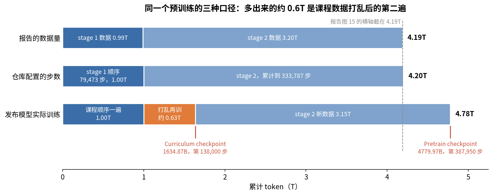
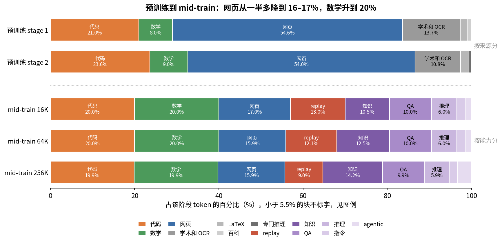

# 第 7 章　数据四：配比与课程

> 前三章把数据洗干净、去了重、打了分。这一章处理剩下的三个问题：各类数据放多少（配比），按什么顺序放（课程和打乱），同一份数据看几遍（重复和 replay）。这三件事都不改变数据本身，只改变模型看到什么、什么时候看到、看几次，但它们对结果的影响不比清洗小。

## 这一章要回答的问题

读完这一章，你应该能回答下面这些问题。

1. 配比为什么没法靠公式算出来？业界常用哪几种办法定配比？
2. ZGCM 用 0.3B 的代理模型搜配比，这一步花的算力和正式训练比是多少？
3. 什么是课程学习？ZGCM 按"词汇复杂度"排序，为什么只排通用文本，不排代码和数学？
4. 表 8 里课程学习让 coding BPB 从 1.99 降到 0.81，这个数能直接当"效果"读吗？
5. 为什么训练数据要打乱？ZGCM 为什么在离线时就打乱好，而不是让加载器在线打乱？
6. 报告说预训练数据是 4.19T，实际训了 4.78T。多出来的 0.6T 是什么？
7. 数据重复几遍还划算？ZGCM 在预训练、mid-train、SFT 各重复了多少？
8. 什么是 replay？mid-train 为什么要混 9–13% 的预训练数据？
9. mid-train 的三个配比怎么按长度分桶采样？`prefix_sample_mix` 保证了什么，没保证什么？

---

<a id="s7-1" name="s7-1"></a>
## 7.1 三个互相牵连的旋钮

假设你手里有洗好的六类数据，总共 10T token，训练预算是 4T token。你要做三个决定：

| 旋钮 | 问题 | 例子 |
|---|---|---|
| 配比（mixture） | 4T 预算里，每类各占多少 | 网页 54%、代码 21%、数学 8% …… |
| 顺序（ordering） | 这些 token 按什么先后喂进去 | 全部随机打乱；或者先易后难 |
| 重复（repetition） | 某类数据不够时，同一条看几遍 | 数学只有 100B，却要占 300B 预算，就得看 3 遍 |

这三个旋钮互相牵连。配比定了某类的预算，如果这类数据的存量不够，就自动带来了重复。顺序决定了某类数据集中在训练的哪一段出现，而训练后段的学习率、数据分布都可能和前段不同，所以配比相同、顺序不同，结果也会不同。

常有人以为配比就是原始数据池的比例，其实两者差得很远。原始池子里网页往往占 90% 以上，最终配方把它压到一半左右，把代码、数学这些量少但对能力关键的类别抬上来。配比是人做出的选择，并不照搬数据的自然分布。

<a id="s7-2" name="s7-2"></a>
## 7.2 为什么配比没法靠公式算

理想情况下，你想要一个函数：输入各类数据的比例，输出训完后的各项能力，然后找出使目标最大的那组比例。麻烦出在这个函数身上。

它没有解析形式。数据类别之间有交互：代码数据会提升数学推理，网页数据里本来也混着代码和数学，所以不能把各类的效果简单相加。目标也是多维的。你想要知识、代码、数学、常识推理都好，可某类数据加多了，往往一项涨、另一项跌，只能在多个目标之间取舍，没有唯一最优。再者，在目标规模上试不起：一次正式训练就用掉全部预算，不可能训十个 7B 来比配比。

所以所有方法都绕回同一个思路：**在小规模上试，再把结论搬到大规模**。各家的区别只在怎么试、怎么搬。

小规模试验有多便宜，可以手算一下。ZGCM 的代理模型是 0.3B 参数、训约 30B token（报告 §3.1.1 第 5 页）。用第 1 章的 $C\approx6ND$：

$$C_{proxy} = 6 \times 0.3\times10^9 \times 30\times10^9 = 5.4\times10^{19}\ \text{FLOPs}$$

正式预算按实际训练的 4.78T token 算：

$$C_{7B} = 6 \times 7.39\times10^9 \times 4.78\times10^{12} = 2.12\times10^{23}\ \text{FLOPs}$$

两者相差约 3,900 倍，花正式训练 1% 的算力就能跑约 39 个代理实验。假设代理实验也用正式训练的 192 张 H100，并且每卡跑到 7B 正式训练时的 585 TFLOP/s，一次代理实验只要约 8 分钟。小模型的 MFU（第 1 章）实际上低得多，会慢几倍，但量级不变，代理实验很便宜。

难处在于结论能不能搬过去。打个比方，饭馆定新菜的配方，先用小锅试十几次，满意了再上大锅。小锅试菜便宜，但大锅的火候、受热和小锅不一样，小锅里正好的盐量，到大锅里未必正好。0.3B 模型在 30B token 上学到的偏好，同样不一定在 7B、4T token 上成立。比如小模型容量有限，可能更偏好简单的网页文本，大模型却能从难的代码和数学里学到更多。这个比方有一处不贴切：厨师尝一口就知道咸淡，代理模型却只能看 loss 和几项评测，这些信号本身也只是能力的近似。所有代理方法都有"搬不过去"的风险，下一节的几种方法都在这上面做文章。

<a id="s7-3" name="s7-3"></a>
## 7.3 定配比的几种常见做法（包括 ZGCM 没用的其他做法）

下面四种做法里，ZGCM 只用了其中一种，但其余几种你也应该知道。

### 做法一：按存量比例，再用温度拉平

最朴素的做法是按每类数据的存量 $n_i$ 定比例：$p_i = n_i / \sum_j n_j$。这样做的毛病是大类会淹没小类。

多语言模型常用**温度采样**来修正：

$$p_i = \frac{n_i^{\alpha}}{\sum_j n_j^{\alpha}},\quad 0<\alpha\le1$$

$\alpha=1$ 就是按存量；$\alpha$ 越小，各类越接近平均。mT5 用的是 $\alpha=0.3$。我们手算一个例子：英文 1000B、中文 100B、代码 50B。

| $\alpha$ | 英文 | 中文 | 代码 |
|---|---|---|---|
| 1.0（按存量） | 87.0% | 8.7% | 4.3% |
| 0.7 | 75.6% | 15.1% | 9.3% |
| 0.3 | 52.4% | 26.3% | 21.3% |

看 $\alpha=0.3$ 那一行：代码只占存量的 4.3%，却拿到 21.3% 的预算。如果总预算等于总存量 1150B，代码要被看 $21.3\%\times1150/50 \approx 4.9$ 遍。配比拉得越平，小类就被重复得越多，[§7.8](#s7-8) 会专门讲重复的问题。

温度采样只有一个参数，用起来简单，但它只看数据有多少，不看数据有多好。

### 做法二：人工经验加小模型消融

大多数团队实际是这么做的：先凭经验定一个初始配方，然后在小模型上逐项改，比如把代码从 15% 提到 20%，看代码评测涨多少、通用评测掉多少，这样迭代几轮。FineWeb、DCLM 定过滤规则也是这个办法（第 6 章）。ZGCM 报告描述的也属于这一类（[§7.4](#s7-4)）。

### 做法三：DoReMi，用小模型学权重

DoReMi（Xie et al., 2023）先训一个参考小模型，再训一个 280M 的代理模型。训练过程中，代理模型在哪个领域的 loss 比参考模型高得多，就调大这个领域的权重，这种做法叫群体分布鲁棒优化（Group DRO）。背后的想法是：参考模型给出了"这个领域正常能学到多低的 loss"，代理模型和它差得多，说明这个领域还有东西没学会，值得多给数据；已经和参考模型差不多的领域，多给数据收益也不大。训完后，把学到的领域权重拿去训 8B 模型。论文在 The Pile 上报告，用学到的权重比用默认权重少用约 2.6 倍的步数，就能达到同样的下游准确率。DoReMi 只看 loss，不需要下游评测。

### 做法四：RegMix，把配比当回归问题

RegMix（Liu et al., 2024，ZGCM 报告参考文献第 24 页引用了它）的流程是这样的。先随机生成几百个配比，每个配比训一个很小的模型，论文训了 512 个 1M 参数的模型，每个 1B token。然后用这 512 组"配比 → 验证 loss"拟合一个回归模型，在回归模型上搜索最优配比，再拿去训大模型（论文训了 1B 参数、25B token）。

RegMix 比做法二系统。做法二一次只改一个旋钮，RegMix 一次性探索整个配比空间，类别之间的交互效应交给回归模型去拟合。论文还有一个发现：网页数据和下游表现的相关性比维基百科更强，这和"维基百科最干净，所以最重要"的直觉正好相反。

还有一类工作叫数据混合律（data mixing laws），试图给"配比 → loss"拟合一个函数形式，再外推到大规模，思路和 scaling law 一样。

这几种做法都在小规模上试，也都假设小规模上的偏好能搬到大规模。它们的差别在试的方式（手调、在线学权重、离线回归）和看的信号（loss 还是下游评测）。

<a id="s7-4" name="s7-4"></a>
## 7.4 ZGCM 怎么定预训练配比

报告 §3.1.1（第 5 页）讲配比只有一段话，我们逐句看。

第一句说"用 0.3B 参数、约 30B token 的代理模型搜配比"。代理模型的规模是 7B 的 1/25，token 是 4.78T 的 1/160。接着说"训练 loss 和知识、代码、数学的评测信号指导对候选配比的迭代调整"，可见看的信号是 loss 加三类下游评测；"迭代调整"说明这是做法二那种人在环里的搜索，并没有做一次性回归。第三句"遵循代理模型配比优化的通行做法（Liu et al., 2024; Team Olmo, 2025）"引了两篇，前者是 RegMix，后者是 OLMo 3。最后一句是"根据搜索结果，在各领域能力和 loss 收敛效率之间平衡，确定最终配方"，所以最终配方是一个折中，并不是某个指标上的最优。

搜出来的结果就是第 4 章 [§4.4](04_数据一_来源与获取.md#s4-4) 的那张表：网页约 54%、代码 21.0% → 23.6%、学术 OCR 13.7% → 10.8%、数学 8.0% → 9.0%、LaTeX 约 2%，stage 2 新加 0.6% 的专门推理数据。

报告没交代的东西更多：试了多少个候选配比、每次怎么调，代理模型的评测信号具体是哪些 benchmark，中文网页占多少（报告 §3.1.1 第 6 页只说"受控比例"），0.3B 上的结论在 7B 上有没有验证过。仓库里也没有配比搜索的代码。所以这一部分只能当作"他们用了什么思路"来理解，没法复现。

<a id="s7-5" name="s7-5"></a>
## 7.5 课程学习：先易后难

配比定的是每类各放多少，接下来的问题是先放什么、后放什么。

### 什么是课程学习

**课程学习**（curriculum learning）的意思是不随机喂数据，先按某种"难度"从易到难排好顺序再喂。这个想法来自人的学习，先学加法再学乘法，语文课本也是先学短小浅显的课文，再学长而难的。

这个类比在两处不成立，后面会用到。一是课本的难易由老师按内容判断，而大规模语料只能用便宜的统计量当"难度"，统计量看的是表面，下面会看到它把代码和数学排错。二是学校里学完加法才学乘法，ZGCM 的课程却让代码和数学从头到尾一直按比例出现，排序只发生在通用文本内部，更像每天的课表里语文、数学、编程都有，只是语文课文由浅入深。

要做课程学习，先得回答什么叫难。对几万亿 token 的语料，难度指标必须便宜，每篇文档几毫秒就能算出来，不能让大模型去打分。常见的便宜指标有三种。压缩率是用 gzip 之类的工具压一下，压得越小说明越重复、越简单；词汇多样性可以用 MTLD 衡量，看不同的词出现得多不多；可读性比如 Flesch Reading Ease，看句子长度和词的音节数。小模型的 perplexity 也能用，它的成本介于这几种和大模型打分之间。

ZGCM 引用的 Zhang et al.（2026，报告参考文献第 26 页）比较过多种指标，结论是压缩率、词汇多样性（MTLD）、可读性（Flesch）这三种最有效。这项工作还发现，课程学习放在训练开头当作 warmup，之后转回随机采样，收益能保持下去。ZGCM 就是这么安排的：stage 1 排序，stage 2 不排。

### ZGCM 的做法

ZGCM 的做法写在报告 §3.1.2（第 6–7 页）和附录 A.4（第 32 页）。课程只用在 stage 1（约 1T token）上，排序的对象是通用语言文本，按"词汇复杂度"（lexical complexity）从低到高排。排序之前先去掉复杂度极高的离群文档，报告说这些"通常是损坏或乱码文本"，内容本身并不难。代码和数学不排序，各自随机打乱后按目标比例穿插进去。stage 2 和之后的阶段都不排序。

"词汇复杂度"具体怎么算，报告没有给公式，仓库里也没有排序代码。

"按目标比例穿插"要解释一下。设 stage 1 的配比是通用文本 70%、代码 21%、数学 9%（示意数字）。把训练流切成很多小段，每段里 70% 的 token 按复杂度顺序从通用文本里取，21% 从打乱的代码里取，9% 从打乱的数学里取。这样从训练的任何一段看，三类的比例都是对的，只有通用文本内部有顺序。如果不穿插，先训完所有通用文本再训代码，那其实是换了配比，算不上课程学习。

### 证据：表 8 怎么读

附录 A.4 做了一个对照：两个 7B 模型，配比相同，各训 10B token，一个用随机顺序，一个用课程顺序。表 8（附录 A.4 第 32 页）是训完后各评测集上的 BPB（越低越好）。BPB 是每字节平均要多少比特（[§2.8](02_Transformer到能讲的程度.md#s2-8)），和 loss 同类，衡量模型对这批文本预测得准不准，不直接等于答题能力：

| 评测 | 随机 | 课程 | 变化 |
|---|---|---|---|
| Coding | 1.99 | 0.81 | −1.18 |
| Math | 0.97 | 0.94 | −0.03 |
| MMLU | 1.03 | 1.12 | +0.09 |
| ARC | 1.05 | 1.09 | +0.04 |
| HellaSwag | 1.05 | 1.08 | +0.03 |

读这张表要小心。先看 Coding 的 −1.18，这个数不能当效果大小读。报告自己说（§3.1.2 第 7 页），数学的比较用了匹配的评测采样，代码的差距却"只说明方向，不是匹配条件下的效应大小"。两组的代码评测样本没有对齐，差值里混着"评的题不一样"的成分。随机组的 1.99 比表里其他数字都高出一截，也提示了这一点。

通用评测则变差了，MMLU、ARC、HellaSwag 的 BPB 升高了 0.03–0.09。报告的解释是课程"以少量通用知识的代价加速了领域学习"。另外，这个对照只训了 10B token，是正式 stage 1 的 1%。课程排序在 1T 规模上的影响是否一样，报告没有给对照。

这组结果还有一处奇怪。课程只排了通用文本，代码和数学都是随机的，最后却是代码和数学变好、通用变差。一个可能的解释是：通用文本从简单到复杂排，前期的通用文本简单、学得快，留给代码和数学的"容量"多了；而前 10B 只看到简单的通用文本，MMLU 这类知识密集的评测自然差一些。这只是推断，报告没解释。

### 为什么代码和数学不排

附录 A.4.1（第 33 页）给了四个例子，说明词汇复杂度放到代码和数学上会排错。表里的百分位都是在单个分片内部重新算的诊断位置：

| 类别 | 排在哪 | 内容 | 实际难度 |
|---|---|---|---|
| 代码 | 最低端（25,000 篇里的前 3 篇） | 一段基于 WFC 算法的网格构建程序 | 有实质的程序结构 |
| 代码 | 最高端（25,000 篇里的最后 3 篇） | 两行 NumPy，`np.loadtxt` 读一个 csv | 极简单 |
| 数学 | 低端（55,743 篇里的前 63 篇） | "Manhattan Wiring"组合题，障碍物间连两条不相交的最短线 | 很难 |
| 数学 | 最高端（55,743 篇里的最后 3 篇） | 一行加法结合律 $(a+b)+c=a+(b+c)$ | 很简单 |

问题出在词汇统计只看表面。代码里 import、路径名、变量名这些"罕见词"会把复杂度推高，算法本身难不难它看不出来；数学也一样，一行公式符号密集就显得"复杂"。所以 ZGCM 的结论（Finding 1，§3.1.2 第 7 页）是：词汇复杂度对通用文本是便宜可用的排序信号，对代码和数学不可靠。

### 课程顺序怎么落到训练里

排好序只是第一步。要让模型真的按这个顺序看到数据，整条链路上每一环都不能打乱。

离线这一环，要按复杂度排序、和代码数学穿插，然后按这个顺序 tokenize，写成索引文件（第 8 章）。到了加载器，Megatron 默认会把文档和样本打乱（[§7.6](#s7-6)），必须关掉，按原样顺序读。ZGCM 的 stage 1 配置写的是 `NO_DATA_SHUFFLE=1`（`pretrain/configs/stages/01_pretrain_1t_sequential.env:94`），启动脚本把它翻译成环境变量 `MEGATRON_GPT_DATASET_SEQUENTIAL=1`（`pretrain/scripts/launch_train.sh:52-56`）。最后是续训，中途断了再接上，必须从断点那条样本继续，既不能从头开始，也不能重新打乱（第 13 章）。

这里有一个坑，第 8 章会细讲。读这个环境变量的代码只在 `sft/` 目录的 Megatron 里有（`sft/megatron/core/datasets/gpt_dataset.py:79,504,690,726,732`），`pretrain/` 目录自带的 Megatron 没有这段代码，环境变量设了也没人读。照仓库原样跑预训练，加载器会照常打乱，课程顺序就没了。

<a id="s7-6" name="s7-6"></a>
## 7.6 打乱：为什么要打乱，在哪里打乱

课程学习故意让数据带着顺序。反过来，不做课程的地方为什么一定要打乱，打乱又发生在哪一步，是接下来要讲清楚的。

### 为什么要打乱

随机梯度下降有一个前提：每个 batch 是从整体分布里**独立同分布**地抽出来的，这样 batch 的梯度才是整体梯度的无偏估计。不打乱，这个前提会在好几处被破坏。数据文件通常按来源存放，不打乱的话，可能连续几千步都在训同一个来源，比如全是 arXiv，模型会被拉向这个来源，换到下一个来源时 loss 跳变。同一个来源内部也常按时间、按网站排列，相邻文档高度相关，batch 里的有效样本数比看起来少。如果训练后段的数据和前段系统性地不同，最终模型还会偏向后段的数据。

课程学习是故意违反这个前提的，它要的就是前后段分布不同。所以课程只在 stage 1 用，之后回到打乱。

### Megatron 默认怎么打乱

Megatron 的 `GPTDataset` 有两次打乱，种子都来自配置里的 `random_seed`（`pretrain/Megatron-LM/megatron/core/datasets/gpt_dataset.py:496`）：

```python
def _build_document_index(documents, num_epochs, numpy_random_state, separate_final_epoch):
    if not separate_final_epoch or num_epochs == 1:
        document_index = numpy.mgrid[0:num_epochs, 0 : len(documents)][1]
        document_index[:] = documents
        document_index = document_index.reshape(-1)
        document_index = document_index.astype(numpy.int32)
        numpy_random_state.shuffle(document_index)      # 第一次：打乱文档顺序
        return document_index
```

（同文件 L640-L667）

`numpy.mgrid[...][1]` 造出一个 `num_epochs × 文档数` 的表，每一行都是 `0, 1, ..., 文档数-1`，拉平以后就是"每个文档出现 num_epochs 次"的列表。接着整体打乱。所以如果数据要过 2 遍，第 1 遍和第 2 遍的文档是混在一起打乱的，并不会先过完一遍再过第二遍。拿三篇文档 A、B、C、过 2 遍来试（示意，不是 ZGCM 的数据）：打乱前的列表是 ABCABC，我用 `numpy.random.RandomState(0)` 按这段代码打乱，得到 CCBAAB。两个 C 紧挨着排在最前面，A 第一次出现已经是第 4 位，"第几遍"在打乱后已经分不出来了。打乱后的文档按顺序首尾相接，切成一条条长 16385 的样本（sample index，第 8 章）。第二次打乱在 `_build_shuffle_index`（L674-L703），把切好的样本编号再打乱一次，决定第几步训哪条样本。

两次打乱管的事不同。第一次决定哪些文档被拼进同一条样本，第二次决定样本按什么顺序出现。如果只做第二次，同一条样本里的文档总是原文件里相邻的那几篇。

`sft/` 版的 Megatron 在这两处各加了一个 `if not sequential_access:`（L690、L726、L732），开关打开就跳过打乱，按文件原顺序读。

### ZGCM 的选择：离线打乱，在线不打乱

stage 2 的配置文件名就叫 `02_pretrain_3p2t_global_shuffle.env`，里面却同样写了 `NO_DATA_SHUFFLE=1`（L92）。原因写在 `pretrain/docs/PRETRAIN_PHASES.md` L22-L24：stage 2 的数据在写成索引文件之前就已经全局打乱好了，加载器保持这个离线顺序，续训时的样本偏移量就能接着同一个样本序列走。配置里的 `GLOBAL_SHUFFLE_SEED=20260603`（L94）记录的是离线打乱用的种子，启动脚本并不读它。

两种方式对比如下：

| | 在线打乱（Megatron 默认） | 离线打乱（ZGCM stage 2） |
|---|---|---|
| 顺序由谁决定 | 加载器按种子现算 | 数据文件本身 |
| 改总样本数、序列长度、数据路径 | 索引按新参数重建，顺序可能全变 | 不受影响 |
| 续训 | 依赖缓存和种子都不变 | 只要知道已经消费了多少条样本 |
| 能不能做课程 | 不能（会被打乱掉） | 能，stage 1 就是这样 |
| 代价 | 无 | 改配比要重新写整份数据 |

ZGCM 预训练两个 stage 都走离线这条路，顺序完全由数据文件决定。这样一来，训练过程可以追溯：任何一步训了哪些文档，都能从文件位置反查出来。

<a id="s7-7" name="s7-7"></a>
## 7.7 数据量不等于训练量：ZGCM 预训练实际走过的路

顺序既然由数据文件决定，我们就可以把 ZGCM 预训练实际走过的路还原出来。报告说预训练数据是 0.99T + 3.20T = 4.19T，HF 上发布的 checkpoint 却写着预训练累计 4779.97B token。多出来的约 0.59T 是什么，要从几个文件里拼出来。

先算每步多少 token。GBS 768、序列长 16384：

$$768 \times 16384 = 12{,}582{,}912 \approx 12.58\text{M token/步}$$

再把各个文件里的数字放在一起：

| 来源 | 步数 | token | 换算 |
|---|---|---|---|
| stage 1 配置 `TRAIN_ITERS`（`01_..._sequential.env`） | 79,473 | — | 79,473 × 12.58M = 1.000T |
| stage 2 配置 `TRAIN_ITERS`（`02_..._global_shuffle.env`） | 333,787（累计） | — | 333,787 × 12.58M = 4.20T |
| HF `ZGCM-1-7B-Pretrain-Curriculum` 的 `checkpoint_info.json` | 138,000 | 1634.87B | 1634.87B ÷ 12.58M = 129,928 步 |
| HF `ZGCM-1-7B-Pretrain` 的 `checkpoint_info.json` | 387,950 | 4779.97B | 4779.97B ÷ 12.58M = 379,878 步 |

把这几个数画在同一条 token 轴上，三种口径差在哪一段就容易看出来。看图时注意最下面一行中间那段橙色，前两行都没有它：



这张表能读出四件事。

第一，课程数据被训了不止一遍。Curriculum checkpoint 的 README（HF 仓库 `zgcagi/ZGCM-1-7B-Pretrain-Curriculum`）写的是"课程数据打乱后第二遍之后、新数据阶段之前"，并说明"1T"只是课程数据的名字，不是累计 token。所以实际的路径是：课程数据按顺序过一遍（约 1.0T）→ 同一份数据打乱再训（约 0.63T）→ stage 2 新数据。

第二，第二遍并不完整。1634.87B − 1000B ≈ 635B，只有课程数据 990.1B 的约 64%。是提前停了、还是只取了一部分，公开材料没说。

第三，stage 2 的量对得上。4779.97B − 1634.87B = 3145.1B，是报告 3.20T 的 98%。

第四，步数和 token 之间差了一个常数。两个 checkpoint 的"步数 − token 换算步数"都是约 8,072 步。差值相同，说明这 8,072 步发生在课程阶段结束之前：如果课程 checkpoint 之后又出现这种多出来的步数，后一个 checkpoint 的差值就会比前一个大。此后步数和 token 同步增长。最可能的解释是早期有一段训练被回滚作废，步数计数器没有回退，但 token 统计扣掉了。这是推断。

把这条路拼出来有两个用处。一是提醒你读报告时分清"数据有多少"和"训了多少"。二是 ZGCM 公开的 stage 2 配置写的累计步数（对应 4.20T）正好是 1T + 3.2T，没有包含第二遍。可见**仓库里的配置是事后整理的配方，和原始作业配置不同**。照它跑，得到的是"课程一遍 + 新数据一遍"，和发布的模型走的路不一样。

报告的图 15（附录 A.2 第 31 页）横轴写的是"累计处理的 token"，截在 4.19T，并在 1.0T 处画虚线表示课程阶段结束。按上面的路径，实际累计是 4.78T。这条横轴更像是按数据量画的，没有按训练 token 画，报告对此没解释。

<a id="s7-8" name="s7-8"></a>
## 7.8 重复：同一份数据看几遍还划算

课程数据的第二遍就是一种重复。数据为什么会不够用，重复一遍又要付出多少，可以用公开的实验结果算一算。

### 背景：数据快不够了

Chinchilla（Hoffmann et al., 2022）给出的算力最优比例是每个参数约 20 个 token。按这个比例，7B 模型只需要约 150B token。现在的做法却是远远超过这个比例去训练，因为训练算力是一次性的，推理算力是长期的，模型小一点、训久一点，部署时更省。

ZGCM 预训练 4.78T token、7.39B 参数：

$$\frac{4.78\times10^{12}}{7.39\times10^9} \approx 647\ \text{token/参数}$$

这是 Chinchilla 比例的 32 倍。到了这个量级，高质量数据就不够用了。网页可以靠 Common Crawl 撑，高质量的数学、代码、教材却很快会见底，于是要么降低质量门槛，要么重复使用。

### 重复的代价有多大

Muennighoff et al.（2023，*Scaling Data-Constrained Language Models*）系统地做过实验。他们发现，同一份数据重复训到约 4 个 epoch，loss 和用等量的全新数据几乎没有差别；再往上，每多一遍的价值越来越小，重复很多遍以后，增加算力几乎不再带来收益。

实践中由此得出几条经验法则。高质量的小类（数学、代码、教材）重复 2–4 遍一般是划算的。低质量的大类（普通网页）宁可多抓新数据，也不要重复。重复的数据最好打乱后穿插，不要连续地"再来一遍"。

### ZGCM 在各阶段重复了多少

| 阶段 | 重复情况 | 出处 |
|---|---|---|
| 预训练 stage 1 课程数据 | 约 1.63 遍（顺序一遍 + 打乱约 0.63 遍） | [§7.7](#s7-7) |
| 预训练 stage 2 | 和 stage 1 跨阶段去重，按报告是新数据 | 报告 §3.1.1 第 6 页 |
| 各阶段的稀缺来源 | "少量经过仔细过滤、容量有限的来源被受控地上采样"，重复采样信息写在 `metadata_json` 里 | HF 数据卡 L266 |
| mid-train | 从 2.86T 去重后的候选池里采 600.51B，只用了约 21% | 报告 §3.2.1 第 7 页 |
| SFT | 10 个 epoch（256K 版） | 报告 §4.1.3 第 14 页，第 17 章 |

预训练数据整体只重复了一小部分，远在 4 个 epoch 以内。SFT 的 10 个 epoch 要另当别论：SFT 数据量小，目的是学格式和行为，它的过拟合问题第 17 章再讲。

数据卡说的"上采样"没有给出具体是哪些来源、重复几遍，要查只能逐条看 `metadata_json`。

<a id="s7-9" name="s7-9"></a>
## 7.9 Replay：继续训练时怎么防遗忘

预训练里的重复是因为数据不够。到了 mid-train，又要故意把预训练数据拿回来混进去，这次是为了防止遗忘。

### 问题：灾难性遗忘

mid-train 是在预训练模型上继续训练（continued pretraining），但换了一套数据：代码、数学、知识、推理、agentic 的比例大大提高，普通网页变少。神经网络有一个老问题叫**灾难性遗忘**（catastrophic forgetting），在新分布上训得越多，旧分布上的能力掉得越多。

最简单的对策叫 **replay**（回放），在新数据里按一定比例混入旧阶段的数据，让模型一直能"复习"。这个比例要权衡：太少，旧能力会掉；太多，新数据的预算被挤占，mid-train 的目的就达不到。

Ibrahim et al.（2024）研究过持续预训练的做法：重新 warmup 学习率、再衰减，加上 replay 旧数据，能接近"把新旧数据合在一起从头训"的效果。replay 的合适比例取决于新旧分布差多远，从几个百分点到四分之一不等。

### ZGCM 的 replay

报告 Figure 6（§3.2.1 第 8 页）的 mid-train 配比里有"pre-training replay"一项：

| 阶段 | 16K | 64K | 256K |
|---|---|---|---|
| replay 占比 | 13.0% | 12.1% | 9.0% |
| replay token（本书按总预算换算） | 23.4B | 29.0B | 16.2B |

报告的解释是：随着高密度数据（长文档、agentic 轨迹）加进来，replay 降低，但一直保留，以维持广泛的覆盖。

HF 上的数据统计可以拿来核对这几个数。附录 C [§C.7.2](附录C_W&B与数据配比统计.md#sc-7-2) 数过 HF 上三个 mid-train 配比的 token：

| 配比 | 报告 | HF 统计 | 差额 |
|---|---|---|---|
| 16K | 180B | 155.75B | 24.25B |
| 64K | 240B | 210.51B | 29.49B |
| 256K | 180.51B | 163.49B | 17.02B |

差额来自 `pretrain_replay` 这一类的行。它们的 `token_count` 字段是 0（16K 有 2,160 万行，64K 有 2,750 万行，256K 有 1,500 万行），而差额和上面按百分比换算的 replay token 量基本吻合。所以 replay 的 token 数在发布数据里没有记录，只能从差额反推。

replay 是从预训练数据里采的哪部分、按什么规则采，报告和仓库都没说。

<a id="s7-10" name="s7-10"></a>
## 7.10 mid-train 配比：按能力分类，按长度分桶

replay 只是 mid-train 配比里的一项。这一节把整份配比摊开看。

### 两层结构

mid-train 的配比有两层。上面一层是能力类别：代码、数学、网页、知识、QA、推理、指令、agentic，再加 replay。下面一层是长度桶：≤16K、16K–64K、>64K，因为长上下文阶段要有足够多的长文档。

能力配比见 Figure 6 下排（图在 §3.2.1 第 8 页，正文说明在第 8 页）。下表后三列是本书按各阶段总预算换算的 token：

| 类别 | 16K | 64K | 256K | 16K token | 64K token | 256K token |
|---|---|---|---|---|---|---|
| 代码 | 20.0% | 20.0% | 19.9% | 36.0B | 48.0B | 35.9B |
| 数学 | 20.0% | 20.0% | 19.9% | 36.0B | 48.0B | 35.9B |
| 网页 | 17.0% | 15.9% | 15.9% | 30.6B | 38.2B | 28.7B |
| replay | 13.0% | 12.1% | 9.0% | 23.4B | 29.0B | 16.2B |
| 知识 | 10.5% | 12.5% | 14.2% | 18.9B | 30.0B | 25.6B |
| QA | 10.0% | 10.0% | 9.9% | 18.0B | 24.0B | 17.9B |
| 推理 | 6.0% | 6.0% | 5.9% | 10.8B | 14.4B | 10.7B |
| 指令 | 2.0% | 2.0% | 2.0% | 3.6B | 4.8B | 3.6B |
| agentic | 1.5% | 1.5% | 3.3% | 2.7B | 3.6B | 6.0B |

和预训练比，代码从 21–24% 降到 20%，数学从 8–9% 提到 20%，网页从 54% 降到 16–17%。预训练配比按来源组织，mid-train 则按能力组织，这是两者最大的区别。

下图把预训练两个 stage（数字取自 [§4.4](04_数据一_来源与获取.md#s4-4) 的表）和上表的三份 mid-train 配比放在一起。代码、数学、网页三类两边都有，用同一种颜色，看这三块的宽度怎么变；其余类别只在一边出现，所以上下两组的分类不能一一对应：



长度构成见表 9（附录 A.5 第 34 页）：

| 阶段 | 总量 | ≤16K | 16K–64K | >64K |
|---|---|---|---|---|
| 16K | 180B | 180B | — | — |
| 64K | 240B | 180.89B | 59.11B | — |
| 256K | 180.51B | 127.81B | 21.72B | 30.98B |

即便在 256K 阶段，超过 64K 的文档也只占约 17%，七成仍是 16K 以内的短文档，拼接成 256K 的长序列来训。原因有两个：超长文档本来就少；只训长文档会损害短上下文的能力。第 16 章会再讲长上下文这部分。

### 读代码：长度分桶和前缀采样

仓库里和 mid-train 配比相关的只有两个小文件。第一个按 token 数分桶（`data-process/src/zgcm_data_pipeline/stages/midtrain/buckets.py:6-17`）：

```python
def assign_length_bucket(token_count, boundaries=(16_384, 65_536, 262_144)):
    value = int(token_count)
    lower = 0
    for upper in boundaries:
        if value <= upper:
            return f"B{upper // 1024}"      # B16 / B64 / B256
        lower = upper
    return f"gt_{lower // 1024}"            # 超过 256K
```

边界是闭区间：16,384 个 token 的文档落在 B16，16,385 落在 B64。超过 262,144 的落在 `gt_256`。

第二个文件从桶里采出三份配比（`mix.py:14-59`，只摘主干）：

```python
DEFAULT_ELIGIBLE = {
    "mix16":  ("B16",),
    "mix64":  ("B16", "B64"),
    "mix256": ("B16", "B64", "B256"),
}

def prefix_sample_mix(base_buckets, final_targets, *, seed="zgcm-midtrain", ...):
    selected = set()
    for final_name in ("mix16", "mix64", "mix256"):
        target = int(final_targets[final_name])
        candidates = {rid for bucket in eligibility[final_name]
                          for rid in base_buckets.get(bucket, ())
                          if rid not in selected}
        if len(candidates) < target:
            raise ValueError(...)
        chosen = sorted(candidates,
                        key=lambda rid: (_rank(rid, f"{seed}:{final_name}"), rid))[:target]
        result[final_name] = chosen
        selected.update(chosen)
```

先看 `DEFAULT_ELIGIBLE`。它规定了"前缀资格"：16K 配比只能用 B16；64K 配比能用 B16 和 B64；256K 配比三个桶都能用。长阶段可以用短文档，短阶段不能用长文档，因为装不下。

主循环按 16K → 64K → 256K 的顺序处理。每处理完一份，就把选中的 ID 放进 `selected`，后面的配比不能再选，所以**三份配比互不重叠**。报告说"更长的阶段保留了更短的数据"，意思是长阶段里也有短长度的文档，同一批文档并没有再训一遍。

排序用的 `_rank` 是 `blake2b(seed + "\0" + id)` 的 16 字节摘要（L21-L22）。按摘要排序取前 `target` 个，等价于一次确定性的随机抽样：同样的输入永远选出同样的结果，和输入顺序无关；往池子里加新 ID，也不会改变旧 ID 之间的相对排名。候选不够时函数直接报错，不会悄悄少采。

本书用一个小例子跑了这段代码：B16 有 10 个 ID，B64 有 4 个，B256 有 2 个，目标是 16K 取 4、64K 取 5、256K 取 5。结果 16K 取了 4 个短文档；64K 取了 3 个短的和 2 个中长的；256K 取了 2 个短的、2 个中长的、1 个长的。把 256K 的目标改成 8，就报错 `mix256 needs 8 samples but only 7 are available`。

读这段代码时，也要注意它没做的事。`target` 是条数，不是 token 数，一篇 200K token 的长文和一篇 500 token 的短文各算一条。它在可选的桶里均匀地抽，不控制每个桶各抽多少，抽出来的长度构成取决于池子里各桶的条数，所以报告表 9 那种精确到 0.01B 的长度构成，这段代码自己给不出来。函数里也没有能力类别，代码、数学这些类别的比例要么是对每个类别分别调用一次，要么在别处控制；仓库里没有调用它的代码，具体怎么用是推断。最后，超过 256K 的文档（`gt_256`）不在任何配比的资格表里，永远不会被选中。

<a id="s7-11" name="s7-11"></a>
## 7.11 配方怎么变成训练时的样本流

配比定好以后，还要让训练按这个比例取数据，办法有两种。

一种是离线物化：按配比把数据实际采出来、打乱好、写成一份文件，训练时顺序读。ZGCM 预训练两个 stage 都这么做（[§7.6](#s7-6)）。

另一种是在线混合：每个来源各自一份文件，给每份一个权重，训练时由加载器按权重轮流取。Megatron 的写法是在数据参数里写 `权重 路径 权重 路径 ...`。加载器把权重归一化，然后每取一条样本，就从实际占比落后目标最多的那个来源取（第 8 章讲这个贪心算法）。

ZGCM 的 mid-train 用的是在线混合。`midtrain/scripts/build_midtrain_data_args.sh:17-28` 生成数据参数文件：

```bash
for shard in $(seq 0 511); do        # 512 个 mix64_v3 分片，每个权重 2
  printf '2 %s\n' ".../mix64_v3_glm51_shuffle512_shard_${id}_text_document"
done
for shard in $(seq 0 255); do        # 256 个 mix16_v4 分片，每个权重 1
  printf '1 %s\n' ".../mix16_v4_glm51_shuffle256_shard_${id}_text_document"
done
```

手算一下权重：mix64_v3 总权重 $512\times2=1024$，mix16_v4 总权重 $256\times1=256$，归一化后是 80% 和 20%。Megatron 的权重按样本条数分配，每条样本都是固定的序列长度，所以 token 也是 80/20。

这里和报告对不上。三个阶段的配置（`midtrain/configs/stages/0{1,2,3}_*.env:13-15`）默认都指向同一对数据目录 mix64_v3 和 mix16_v4，没有 256K 配比的路径。按报告，三个阶段应该各用自己的配比，16K 阶段只有 ≤16K 的数据。这些变量都写成 `${VAR:-默认值}` 的形式，可以在启动时覆盖，所以实际作业多半用了别的路径。但照仓库默认值原样跑，得到的并不是报告里的配比。

<a id="s7-12" name="s7-12"></a>
## 7.12 坑和对不上的地方

1. 配比搜索没法复现。报告只有 §3.1.1 第 5 页一段话，候选配比有多少个、代理模型看的是哪些评测、0.3B 的结论有没有在 7B 上验证，都没给，仓库里也没有搜索代码。
2. "词汇复杂度"没有定义。报告没给公式，仓库里也没有排序代码，离群值按什么阈值去掉同样没说。
3. 表 8 的 coding 差距不能当效应大小。报告自己承认两组代码评测样本没有对齐（§3.1.2 第 7 页），而且整个对照只训了 10B token，1T 规模上没有对照。
4. `pretrain/` 的 Megatron 不认顺序读取开关。配置设了 `NO_DATA_SHUFFLE=1`，启动脚本也导出了 `MEGATRON_GPT_DATASET_SEQUENTIAL=1`，但读这个变量的代码只在 `sft/` 的 Megatron 里。照仓库原样跑，stage 1 的课程顺序会被加载器打乱，第 8 章会展开讲。
5. 数据量和训练量对不上。报告写 4.19T，HF checkpoint 写 4779.97B，差额来自课程数据打乱后的第二遍（约 0.63T，不到完整一遍）。仓库的 stage 2 配置累计 333,787 步，只对应 4.20T，没有包含第二遍。
6. 两个预训练 checkpoint 的"步数 − token/每步 token"都是约 8,072 步。推断是早期有回滚，步数没回退。
7. 图 15 的横轴截在 4.19T，实际累计是 4.78T，横轴的含义报告没解释。
8. replay 的 token 数没有记录。HF 数据里 `pretrain_replay` 行的 `token_count` 都是 0，replay 占比只能从总量差额反推。replay 从哪部分预训练数据里采，也没说。
9. mid-train 三个阶段的默认数据路径相同。三个 env 的 L13-L15 都指向 mix64_v3 加 mix16_v4，按 80/20 混合，没有 256K 配比的路径，和报告"每阶段各用自己的配比"不一致。
10. `prefix_sample_mix` 按条数采，在桶间均匀抽，不认类别，还会丢掉超过 256K 的文档。报告表 9 那种按 token 的长度构成，靠这段代码本身得不到。
11. 上采样了哪些来源，不知道。数据卡 L266 只说"少量来源被受控上采样"，没列名单和倍数。
12. mid-train 的配置写着 `DATA_SPLIT="9999,1,0"`，有万分之一的数据被划进验证集，但 `EVAL_ITERS=0` 不做验证（`01_seq16k.env:82,88`）。影响很小，但说明这份配置没有逐项精调过。

<a id="s7-13" name="s7-13"></a>
## 7.13 试着讲给别人听

下面是一段讲法。建议你先合上书自己讲一遍，再对照。

> 数据洗干净以后，还有三个决定：各类放多少，按什么顺序放，同一份看几遍。
>
> 配比没法用公式算，因为类别之间有交互，目标又是多维的，在 7B 上又试不起，所以大家都在小模型上试。简单的有温度采样，按存量的 α 次方分配；系统一点的有 DoReMi，用代理模型的 loss 在线调权重；还有 RegMix，训几百个小模型拟合一个"配比到 loss"的回归，再搜最优。ZGCM 用的是 0.3B、30B token 的代理模型，看 loss 加知识、代码、数学评测，人工迭代调整。一次代理实验的算力只有正式训练的约四千分之一。
>
> 顺序上，ZGCM 在第一阶段约 1T token 上做了课程学习：通用文本按词汇复杂度从低到高排，代码和数学不排，各自打乱后按比例穿插。代码和数学不排，是因为词汇统计只看表面，两行 import 会被判成"最难"，一道很难的组合题反而排在最前面。10B token 的对照里，课程让代码和数学的 BPB 下降，通用评测的 BPB 升高 0.03 到 0.09。不过代码那组的评测样本没对齐，只能看方向。第二阶段回到全局打乱。ZGCM 的打乱是离线做的，写进数据文件，加载器按原顺序读，这样续训只需要知道消费了多少条样本。
>
> 要分清数据量和训练量。报告说数据 4.19T，实际训了 4.78T，因为课程数据又打乱训了大约 0.63T。7B 模型训 4.78T，是每参数 647 个 token，远超 Chinchilla 的 20。高质量数据会不够，就要重复。经验上重复 4 遍以内和新数据差不多，再多收益就迅速下降。
>
> mid-train 换成按能力组织的配比：代码和数学各 20%，网页降到 16% 左右，还混了 9% 到 13% 的预训练数据做 replay，防止遗忘。长度上，即使是 256K 阶段，七成 token 仍来自 16K 以内的文档。采样代码按长度分桶，长阶段可以用短文档，但三份配比互不重叠。

<a id="s7-14" name="s7-14"></a>
## 7.14 习题

1. 配比、顺序、重复三个旋钮之间是什么关系？举一个"定了配比就自动带来重复"的例子。
2. 为什么配比没法靠公式直接算出来？列三个原因。
3. 计算 ZGCM 一次 0.3B×30B 代理实验和 7B×4.78T 正式训练的 FLOPs 之比。
4. 温度采样中 α 变小意味着什么？英文 1000B、中文 100B、代码 50B，α=0.3 时代码占多少？代价是什么？
5. DoReMi 和 RegMix 各自看什么信号、怎么得到配比？
6. ZGCM 的课程学习只排了哪类数据？代码和数学怎么处理？为什么？
7. 表 8 里 coding BPB 从 1.99 降到 0.81，为什么不能说"课程让代码能力提升了一倍多"？
8. "按目标比例穿插"和"先训完通用文本再训代码"有什么区别？
9. Megatron 的 `GPTDataset` 有哪两次打乱？各决定什么？
10. ZGCM stage 2 文件名叫 global_shuffle，配置却写 `NO_DATA_SHUFFLE=1`，为什么不矛盾？
11. 报告说预训练数据 4.19T，HF checkpoint 写 4779.97B。差额是怎么来的？仓库的 stage 2 配置能复现这条路径吗？
12. ZGCM 预训练每参数多少 token？是 Chinchilla 比例的多少倍？这对数据意味着什么？
13. mid-train 为什么要 replay？ZGCM 三个阶段 replay 占多少？在 HF 数据统计里为什么看不到 replay 的 token 数？
14. `prefix_sample_mix` 怎么保证三份配比互不重叠？它在哪几个方面控制不了报告表 9 里的长度构成？
15. mid-train 数据参数文件里 512 个分片权重 2、256 个分片权重 1，两部分各占多少样本？

<details><summary>参考答案</summary>

1. 配比决定每类拿多少预算；某类存量不够时就要重复；顺序决定这些 token 出现在训练哪一段。例子：数学只有 100B，配比却给它 300B 预算，就要看 3 遍（[§7.1](#s7-1)）。
2. 类别之间有交互效应，不能简单相加；目标是多维的，有取舍没有唯一最优；在目标规模上试不起（[§7.2](#s7-2)）。
3. $6\times0.3\text{e}9\times30\text{e}9=5.4\times10^{19}$；$6\times7.39\text{e}9\times4.78\text{e}12=2.12\times10^{23}$；比值约 3,900（[§7.2](#s7-2)）。
4. α 越小各类越接近平均，小类被抬高。α=0.3 时代码占 21.3%。如果总预算等于总存量 1150B，代码要被重复约 4.9 遍（[§7.3](#s7-3)）。
5. DoReMi 只看 loss：代理模型在哪个领域比参考模型的 loss 高得多就加大哪个领域的权重，训练中在线调整。RegMix 训几百个小模型，用"配比 → 验证 loss"拟合回归模型，再在回归模型上搜最优配比（[§7.3](#s7-3)）。
6. 只排通用语言文本，按词汇复杂度从低到高，并去掉极端离群值。代码和数学各自打乱，按目标比例穿插。因为词汇统计反映的是 import、符号这些表面特征，不反映算法和推理难度，附录 A.4.1 的四个例子都是反例（[§7.5](#s7-5)）。
7. 报告说代码的比较没有用匹配的评测采样，只能说明方向。BPB 也不是能力指标。而且只训了 10B token（[§7.5](#s7-5)）。
8. 穿插保证训练的任何一段里三类比例都对，只有通用文本内部有顺序。先训完通用再训代码，等于每一段的配比都变了，不是课程学习（[§7.5](#s7-5)）。
9. 第一次打乱文档顺序（`_build_document_index`），决定哪些文档被拼进同一条样本；第二次打乱样本编号（`_build_shuffle_index`），决定样本出现的先后（[§7.6](#s7-6)）。
10. 数据在写索引文件之前就离线全局打乱好了，加载器只需按原顺序读，续训时样本偏移才能对上同一个序列（[§7.6](#s7-6)）。
11. 课程数据先按顺序训约 1.0T，再打乱训约 0.63T（不到一整遍），然后 stage 2 约 3.15T。仓库 stage 2 配置累计 333,787 步，只对应 4.20T，没有第二遍，复现不了（[§7.7](#s7-7)）。
12. 约 647 token/参数，是 20 的约 32 倍。高质量数据会不够，要么放宽质量门槛，要么重复使用（[§7.8](#s7-8)）。
13. 继续训练换了数据分布，会灾难性遗忘，replay 让模型持续复习旧分布。16K/64K/256K 分别是 13.0%/12.1%/9.0%。HF 数据里 `pretrain_replay` 行的 `token_count` 是 0，只能从总量差额反推（[§7.9](#s7-9)）。
14. 按 16K→64K→256K 顺序采，选过的 ID 放进 `selected`，后面的配比排除它们。控制不了的地方：目标是条数不是 token；在可选桶里均匀抽，不控制各桶比例；不分能力类别；超过 256K 的文档永远选不上（[§7.10](#s7-10)）。
15. $512\times2=1024$ 和 $256\times1=256$，归一化后 80% 和 20%。样本定长，所以 token 也是 80/20（[§7.11](#s7-11)）。
</details>

---

上一章：[第 6 章　数据三：去重、质量与去污染](06_数据三_去重质量去污染.md)　下一章：[第 8 章　数据五：从文本到训练样本](08_数据五_从文本到训练样本.md)
