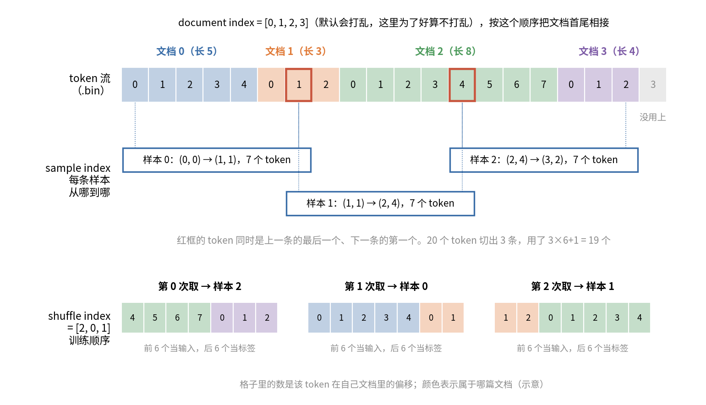
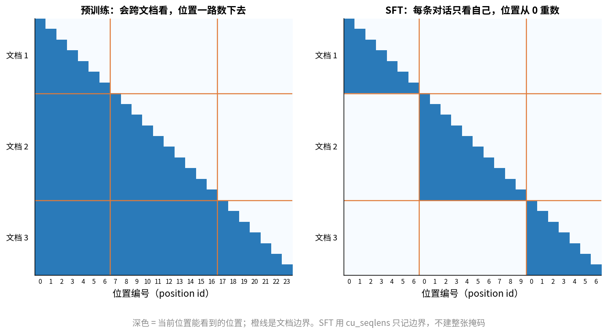

# 第 8 章　数据五：从文本到训练样本

> 前四章得到的是洗好、去重、配好比例、排好顺序的文档。这一章讲最后一段路：这些文档怎么变成磁盘上的二进制文件，加载器怎么把它们切成一条条长 16384 的样本，样本怎么分到几百张卡上，断了以后又怎么从同一个位置接着读。这一段代码量不大，出了错却最难查：loss 看起来正常，模型却在重复看某些数据，或者课程顺序早就被打乱了。

## 这一章要回答的问题

读完这一章，你应该能回答下面这些问题。

1. tokenize 之后文本存成什么格式？`.bin` 和 `.idx` 里各有什么？4.19T token 占多大磁盘？
2. Megatron 的 document index、sample index、shuffle index 各是什么？为什么每条样本取 16385 个 token，而不是 16384？
3. 把多篇文档拼进一条样本（packing）时，后一篇能"看到"前一篇吗？位置编号从 0 重新数吗？ZGCM 怎么设的？
4. 多个数据来源按权重混合时，加载器每一步怎么决定从哪个来源取？
5. 一个 global batch 的 768 条样本，怎么分到 48 个数据并行组、8 个 micro batch 上？context parallel 又怎么切一条样本？
6. 断点续训时，加载器怎么知道从第几条样本接着读？`consumed_samples` 和 sample offset 是什么关系？
7. 为什么照 ZGCM 仓库原样跑预训练，stage 1 的课程顺序会丢，stage 2 会跳过一大段数据？

---

<a id="s8-1" name="s8-1"></a>
## 8.1 从一堆文档到一格一格的样本

到这一步，手里是几十亿篇长短不一的文档，平均每篇一千来个 token（第 4 章 [§4.8](04_数据一_来源与获取.md#s4-8)）。训练要的却是整整齐齐的矩形：每一步 768 条样本，每条恰好 16384 个 token。从前者走到后者，中间要做四件事。

第一件是 tokenize，把每篇文档变成 token id 序列，末尾加一个"文档结束"标记。第二件是写成二进制：所有 token 首尾相接写进一个大文件，另写一个小文件，记下第几篇文档从哪个字节开始、有多长。第三件是切样本，把首尾相接的 token 流按 16384 一段切开。一段里通常装着十几篇文档，也常常把一篇文档切成两半。第四件是分发，按已经训了多少条，决定下一步取哪 768 条，再把它们分给不同的卡。

可以把这件事想成装箱。文档是长短不一的货物，样本是固定长度的箱子。Megatron 的做法最简单：货物排成一列，按箱子长度一刀一刀切，切到哪算哪，货物被切断也不管。这种做法叫 **packing**（拼接，把多条短序列拼成一条长序列），它没有一个 token 浪费在填充上。但一条样本里会混着几篇互不相关的文档，[§8.5](#s8-5) 会讲这带来的问题。

<a id="s8-2" name="s8-2"></a>
## 8.2 tokenize 与文档结束标记

tokenizer 把文本切成 token id，原理第 3 章讲过。ZGCM 预训练用 GLM-5.1 的 tokenizer（报告 §3.1.1 第 6 页），词表 154,880（`pretrain/configs/stages/02_pretrain_3p2t_global_shuffle.env:35`）。

每篇文档 tokenize 之后，末尾要加一个 **EOD**（end of document，文档结束标记）。它有两个用处。packing 以后多篇文档首尾相接，没有 EOD，模型分不清哪里是一篇的结尾、哪里是下一篇的开头。另外，推理时模型要学会说完了就停，它停下来的方式就是输出这个结束 token。预训练里每篇文档结尾都有它，模型才学得会。

Megatron 自带的预处理脚本 `pretrain/Megatron-LM/tools/preprocess_data.py` 里，加 EOD 只有两行（L103-L104）：

```python
if len(doc_ids) > 0 and self.args.append_eod:
    doc_ids[-1].append(self.tokenizer.eod)
```

`doc_ids` 是这篇文档的 token 列表。如果开了按句切分，它就是多个句子的列表，EOD 加在最后一句末尾。只有命令行传了 `--append-eod`（L215 定义）才会加。忘了传这个开关是常见事故：数据照样能训，loss 也正常，但模型不会停，生成时一直往下写。

### ZGCM 的 EOD 是哪个 token

HF 发布的配置里，`eos_token` 和 `pad_token` 都是 `<|endoftext|>`，id 是 154820；没有 `bos_token`（`zgcagi/ZGCM-1-7B` 的 `tokenizer_config.json:5,10` 和 `config.json:95-97`）。Megatron 的 HuggingFace tokenizer 包装把 eos 当 EOD 用，所以 ZGCM 每篇文档末尾应该是 154820。ZGCM 的 tokenize 脚本没有公开（仓库 README 写的是"由训练环境提供"），这一条是推断。

pad 和 EOD 用的是同一个 id，这会触发 Megatron 的一个保护逻辑，[§8.5](#s8-5) 再讲。

### 规模和两条约束

tokenize 本身是纯 CPU 的活，按文档并行，几千核跑几天的量级。活不难，但有两件事要注意。一是 tokenizer 定了就不能换。换了 tokenizer，所有数据都要重新 tokenize，已经训的模型也作废，所以第 3 章的 tokenizer 选择要在一切开始之前定下来。二是 token 数要记下来。第 4 章说过每条记录都带 `token_count`，配比、长度分桶、算 epoch 都靠它，它必须和训练时真正用的 tokenizer 算出来的一致。

<a id="s8-3" name="s8-3"></a>
## 8.3 磁盘格式：`.bin` 和 `.idx`

### 为什么不直接读 jsonl 或 parquet

有了 token，下一个问题是怎么存。训练时每一步要随机取 768 条样本，每条可能跨十几篇文档。如果数据是 jsonl，要找"第 3 亿篇文档的第 500 个 token"，只能从头扫。parquet 好一些，但还要解压、再 tokenize。几百张卡每秒都在要数据，这条路太慢。

Megatron 的办法是 **IndexedDataset**（索引数据集），由两个文件组成。`.bin` 把所有文档的 token id 首尾相接，裸写成一个大数组，没有任何分隔，也不压缩。`.idx` 是一张小表，记每篇文档的长度和它在 `.bin` 里的起始字节。

读的时候用 mmap（内存映射，把文件当成内存数组来访问，操作系统按需把用到的页读进来）。"第 i 篇文档从第 k 个 token 起取 n 个"，就变成"从字节 `指针[i] + k×每 token 字节数` 处读 n 个数"，一次寻址就到。

### `.idx` 里有什么

按 `pretrain/Megatron-LM/megatron/core/datasets/indexed_dataset.py` 的写入顺序（L146-L151 写头部，`_IndexWriter.write` L175-L211 写正文），`.idx` 依次存着下面这些内容：

| 顺序 | 内容 | 类型 | 说明 |
|---|---|---|---|
| 1 | 魔数 `MMIDIDX\x00\x00` | 9 字节 | 标明文件格式（L47） |
| 2 | 版本号 1 | uint64 | |
| 3 | dtype 代码 | uint8 | `.bin` 里每个 token 用什么类型存（L50-L60） |
| 4 | sequence 数 | uint64 | |
| 5 | document 数 | uint64 | |
| 6 | 每个 sequence 的长度 | int32 数组 | |
| 7 | 每个 sequence 的起始字节 | int64 数组 | 长度 × 每 token 字节数的前缀和（L213-L229） |
| 8 | 每个 document 从第几个 sequence 开始 | int64 数组 | |

表里的 sequence 和 document 是两个概念。preprocess 脚本可以把一篇文档按句子切成多个 sequence，document 数组记的是哪几个 sequence 属于同一篇。预训练一般不按句切，一篇文档就是一个 sequence，所以下文不再区分，统称"文档"。

读取接口是 `get(idx, offset, length)`（L843-L869）：

```python
sequence_pointer, sequence_length, sequence_mode = self.index[idx]
if length is None:
    length = sequence_length - offset
sequence_pointer += offset * DType.size(self.index.dtype)
sequence = self.bin_reader.read(
    dtype=self.index.dtype, count=length, offset=sequence_pointer
)
```

它先从 `.idx` 查出第 `idx` 篇文档的起始字节和长度。`offset` 表示从这篇的第几个 token 开始，乘上每 token 字节数，加到起始字节上，然后从 `.bin` 的这个位置读 `length` 个数。后面切样本时，"从某篇文档中间开始取"靠的就是这个 `offset`。

### 每个 token 占几个字节

dtype 由词表大小决定。写入时，`DType.optimal_dtype`（`indexed_dataset.py:116`）在词表小于 65,500 时选 uint16（2 字节），否则选 int32（4 字节）；读取侧的 `GPTDatasetConfig`（`gpt_dataset.py:89-93`）也按词表是否超过 65,536 推断出同样的类型。

ZGCM 的词表是 154,880，超过 65,536，只能用 int32，每个 token 4 字节。据此可以手算磁盘占用：

$$4.19 \times 10^{12} \text{ token} \times 4 \text{ 字节} \approx 16.8 \text{ TB}$$

其中 stage 1 约 0.99T × 4 = 4.0 TB，stage 2 约 3.20T × 4 = 12.8 TB。这还只是 `.bin`。

`.idx` 每篇文档占 20 字节：长度 4 字节，起始字节 8 字节，document 数组 8 字节。stage 2 按 parquet 的 28.2 亿行算，约 56 GB；stage 1 的 9.73 亿行约 19.5 GB。`.idx` 要被每个进程 mmap，小一点更好，不过这个量级还能接受。

拿第 4 章的数对比一下：同样的数据，zstd 压缩的 parquet 一共约 4.95 TB，token 化以后反而大了三倍多。原因主要是 `.bin` 不压缩。4 字节存一个 token 本身和 UTF-8 原文差不多大：按第 3 章 [§3.7](03_Tokenizer.md#s3-7) 测的压缩率，英文一个 token 约 3.8 个字符，也就是约 3.8 字节，比 4 字节略小；中文一个 token 约 1.58 个字、约 4.3 字节，int32 反而更省。这是拿空间换随机读取的速度。

反过来，如果词表小于 65,536，`.bin` 能缩一半。第 3 章讨论词表大小时，这是一个不常被提到的成本：词表一过 65,536，存储和读取带宽都翻倍。

### 写入

`IndexedDatasetBuilder`（L937 起）提供三个方法：`add_item` 写一个 sequence，`end_document` 标记文档结束，`finalize`（L1029）写 `.idx`。preprocess 脚本每个 worker 写一个分片，最后合并。ZGCM 的 midtrain 数据就是一个个分片，比如 `shard_00000/mix64_v3_glm51_shuffle512_shard_00000_text_document.{bin,idx}`（`midtrain/scripts/build_midtrain_data_args.sh:20`）。名字里的 `_text_document` 是 preprocess 脚本按"字段名_document"自动加的后缀，`shuffle512` 表示离线打乱时分成了 512 份。

<a id="s8-4" name="s8-4"></a>
## 8.4 三个 index：怎么从文档流切出样本

`.bin/.idx` 只回答"第 i 篇文档是什么"，训练要问的却是"第 j 条样本是什么"。Megatron 的 `GPTDataset`（`pretrain/Megatron-LM/megatron/core/datasets/gpt_dataset.py`）用三个数组把两者连起来。看这三个数组之前，先弄清一个小问题：每条样本到底取多少个 token。

### 为什么每条样本取 16385 个 token

语言模型的输入和标签错开一位（第 2 章）：输入是第 0 到 16383 个 token，标签是第 1 到 16384 个 token。要得到 16384 个"输入-标签"对，需要 16385 个 token。

`GPTDatasetConfig` 里 `add_extra_token_to_sequence=True` 是默认值（L45），`__getitem__` 里这样拆（L241-L243）：

```python
if self.config.add_extra_token_to_sequence:
    tokens = text[:-1].contiguous()   # 前 16384 个当输入
    labels = text[1:].contiguous()    # 后 16384 个当标签
```

所以相邻两条样本共用一个 token：第 j 条的最后一个 token 也是第 j+1 条的第一个。这样整条 token 流里的每个 token 都恰好当一次标签，不重不漏。

### 三个数组

第一个数组是 document index（文档顺序表），一维，列出按什么顺序读文档。数据要过 2 遍的话，每篇文档在里面出现 2 次。它默认会用种子打乱（第 7 章 [§7.6](07_数据四_配比与课程.md#s7-6) 讲过）。

第二个是 sample index（样本切分表），形状 `[样本数+1, 2]`。第 j 行是 `(在 document index 里的位置, 在这篇文档里的偏移)`，表示第 j 条样本从哪里开始，第 j+1 行就是它的结束位置。它由 C++ 函数 `build_sample_idx` 生成（`helpers.cpp:144-249`）。

第三个是 shuffle index（样本顺序表），是一个排列，表示第几次取样本时实际取 sample index 的哪一行。它默认也打乱。

为什么要打乱两次？两次管的事不同。文档顺序表决定哪些文档首尾相接、被装进同一条样本；样本顺序表决定切好的样本按什么顺序被训到。只打乱文档的话，相邻编号的样本还是来自 token 流里相邻的位置，一篇长文档切出来的几条样本会挨着出现在同一个 batch 里。

取第 `idx` 条样本时，三个数组依次查一遍（`_query_document_sample_shuffle_indices`，L298-L379）：

```python
idx = self.shuffle_index[idx]                       # 第一步：查顺序表
doc_index_beg, doc_index_beg_offset = self.sample_index[idx]
doc_index_end, doc_index_end_offset = self.sample_index[idx + 1]
```

查到开头和结尾以后分两种情况。开头和结尾在同一篇文档里时（L331-L345），直接 `get(文档, offset=开头偏移, length=结尾偏移-开头偏移+1)`。跨了多篇时（L347-L362），第一篇从开头偏移读到末尾，中间几篇整篇读，最后一篇从 0 读到结尾偏移再多 1 个，多的这个就是共用的 token。几段拼起来正好 16385 个。

如果数据读到头不够 16385 个，就用 pad 补齐（L369-L374）。正常情况下 `drop_last` 会丢掉最后不完整的一条，走不到这里。

### 一个小例子

光看代码不容易想清楚切出来是什么样子，我们拿一个小例子算一遍。4 篇文档，长度分别是 5、3、8、4，共 20 个 token。为了好算，序列长度取 6，每条取 7 个 token，不打乱。

样本数 = ⌊(20 − 1) / 6⌋ = 3。减 1 是因为最后一条样本还要多取一个 token。用 `build_sample_idx` 的逻辑跑一遍，结果如下（本书用 Python 照着 C++ 代码复现的结果）：

| 样本 | 开始 (文档, 偏移) | 结束 (文档, 偏移) | 内容 | token 数 |
|---|---|---|---|---|
| 0 | (0, 0) | (1, 1) | 文档 0 的全部 5 个 + 文档 1 的前 2 个 | 7 |
| 1 | (1, 1) | (2, 4) | 文档 1 的后 2 个 + 文档 2 的前 5 个 | 7 |
| 2 | (2, 4) | (3, 2) | 文档 2 的后 4 个 + 文档 3 的前 3 个 | 7 |

这张表里有三处值得看。每条样本的最后一个 token 就是下一条的第一个：样本 0 结束在 (1, 1)，样本 1 也从 (1, 1) 开始。文档 1 被切成了两半，分在样本 0 和样本 1 里，文档 2 也一样。文档 3 的最后一个 token 没用上，20 个 token 里，3 条样本一共用了 3×6+1=19 个。

上表没有打乱。把三个数组放在一起看，再假设 shuffle index 是 [2, 0, 1]（示意），训练时第 0 次取的就是样本 2，第 1 次取样本 0，第 2 次取样本 1。下图从上到下依次是文档顺序表拼出的 token 流、样本切分表切出的三条样本、样本顺序表排出的训练顺序。看图时留意红框里那两个 token 各被两条样本用到。



C++ 里推进偏移的是这一行：

```cpp
doc_offset += (remaining_seq_length + document_length - add_extra_token_to_sequence);
```

此时 `remaining_seq_length` 是负数或 0，表示这篇文档还剩多少没用。下一条样本从这篇的 `用到的位置 - 1` 开始，那个 `- 1` 就是共用的 token。

### 要过几遍：num_epochs

数据集要提供多少条样本，由训练步数决定：`训练样本数 = TRAIN_ITERS × GBS`（`megatron/training/training.py:3544-3575`）。`_get_num_epochs`（L617-L637）从 1 开始往上加，直到 `epochs × 每遍 token 数 ≥ 样本数 × 16384 + 1`。

拿 stage 1 手算一下。79,473 步 × 768 = 61,035,264 条样本，需要 61,035,264 × 16384 + 1 ≈ 1.0000T 个 token。stage 1 数据是 990.1B（数据卡），一遍不够，所以 num_epochs = 2，最后约 10B token（1%）要从第二遍里取。

当最后一遍只用到不足 80% 时（L457-L480），Megatron 把最后一遍单独打乱再接在后面（`separate_final_epoch`），免得第二遍里的一小部分文档被打散到第一遍里提前出现。stage 1 正是这种情况。

### 缓存

三个数组只由 rank 0 构建，存成 `{hash}-GPTDataset-train-document_index.npy` 这类文件（L417-L423），其他 rank 等它写完再读。`hash` 由数据路径、序列长度、样本数、种子等配置算出来，其中任何一个变了都会重新构建，顺序也可能完全不同。缓存目录由 `--data-cache-path` 指定（启动脚本 `pretrain/scripts/launch_train.sh:61` 的 `DATA_CACHE_DIR`）。

这些文件不小。stage 2 要 333,787 × 768 = 2.56 亿条样本。shuffle index 在总数小于 2³² 时用 uint32 存（L691-L693），2.56 亿 × 4 字节 ≈ 1 GB；sample index 每行两个数，还要再大一到三倍。这些 `.npy` 也要 mmap，应该放在快的存储上。

<a id="s8-5" name="s8-5"></a>
## 8.5 packing 的副作用：跨文档注意力和位置编号

### 问题在哪

回到 [§8.4](#s8-4) 的例子。样本 1 装着文档 1 的后半和文档 2 的前半。在因果注意力下，文档 2 的每个 token 都能看到前面文档 1 的 token。两篇文档毫无关系，模型却在用文档 1 的内容预测文档 2。这叫 **跨文档注意力**（cross-document attention）。

位置编号也有问题。不做处理的话，位置是 0 到 16383 一路数下去，文档 2 的第一个 token 位置是 2，不是 0。在一条 16384 长的样本里，一篇文档可能从位置 9000 开始。

### Megatron 提供的三个开关

针对这两个问题，Megatron 提供了三个开关，都在 `_get_ltor_masks_and_position_ids`（`gpt_dataset.py:706-780`）里，命令行开关定义在 `megatron/training/arguments.py:2896-2902`，默认全关：

```python
loss_mask = torch.ones(seq_length, dtype=torch.float)
if eod_mask_loss:
    loss_mask[data == eod_token] = 0.0

position_ids = torch.arange(seq_length, dtype=torch.long)
...
for j in range(eod_index.numel()):
    i = eod_index[j]
    if reset_attention_mask and attention_mask is not None:
        attention_mask[0, (i + 1) :, : (i + 1)] = 0
    if reset_position_ids:
        position_ids[(i + 1) :] -= i + 1 - prev_index
        prev_index = i + 1
```

`--eod-mask-loss` 管的是 loss。代码里的 `data` 是输入 token。输入是 EOD 的那个位置，标签是下一篇文档的第一个 token，这个开关让这个位置不算 loss。理由是看到"上一篇结束了"再去猜下一篇的第一个字，根本没法猜，只是噪声。注意它不屏蔽"预测 EOD"本身，模型照样能学会什么时候结束。

另外两个开关管注意力和位置。`--reset-attention-mask` 找到每个 EOD 的位置 i，把 i 之后的行对 i 及之前的列清零，效果是后一篇文档看不到前一篇。`--reset-position-ids` 把 EOD 之后的位置编号减掉前面的长度，让每篇文档从 0 重新数。

### 稠密 mask 的代价

`reset_attention_mask` 只在数据加载器生成稠密 mask 时生效，也就是代码里的 `attention_mask is not None`。算一下这个 mask 多大：

$$16384 \times 16384 = 2.68 \times 10^8 \text{ 个元素}$$

用 bool 存约 268 MB，这还只是一条样本；用 float32 存是 1 GB。每张卡 micro batch 2 条，还要从 CPU 传到 GPU。而且 FlashAttention 这类融合算子根本不接受稠密 mask，只接受"因果"标志或者 `cu_seqlens`（每段的起止位置）。所以长序列训练基本都关掉加载器里的 mask。ZGCM 的启动脚本传了 `--no-create-attention-mask-in-dataloader`（`pretrain/scripts/launch_train.sh:182-196`），注意力只用算子内部的因果 mask。

### ZGCM 的设置

ZGCM 的启动脚本没有传 `--reset-position-ids`、`--reset-attention-mask`、`--eod-mask-loss` 中的任何一个，所以它的预训练是下面这样：

| 项 | 设置 | 后果 |
|---|---|---|
| 注意力 | 跨文档 | 后一篇能看到同一样本里前面的文档 |
| 位置 | 不重置 | 一篇文档可能从任意位置开始 |
| EOD 后一位的 loss | 计算 | 有少量"猜下一篇开头"的噪声 |



左图就是 ZGCM 预训练的样子：三篇文档拼在一条样本里，下三角整块可见，位置编号一路往下数。右图是 SFT 的做法，每篇只看自己、位置从 0 重数，第 17 章再细讲。

这是业界早期最常见的做法，GPT-2、GPT-3 都是这样。它仍然能训得好，大致有三个原因。一般认为模型能学会把 EOD 当成"前面不用看了"的信号，注意力会自己少看前一篇。位置不重置，反而让模型见过文档从各种位置开始的情况，而相对位置编码（RoPE）本来也只关心距离。损失的只是少量 token 的质量，换来的是零填充和简单的实现。

ZGCM 的架构还让这个问题变小了（第 9 章）。32 层里有 27 层是窗口 128 的滑动窗口注意力（SWA，每个 token 只看前 128 个），在这些层里，后一篇文档只有前 128 个 token 能看到前一篇。能大范围跨文档的只有 5 个全局层。

### pad 和 EOD 撞号的保护

[§8.2](#s8-2) 说过，ZGCM 的 pad 和 EOD 都是 154820。`__getitem__` 里有这样一行（L272）：

```python
loss_mask[labels == self._pad_token_id] = 0.0
```

如果 pad id 真是 154820，所有标签是 EOD 的位置都会被屏蔽，模型永远学不会结束。Megatron 防了这一手（`megatron_dataset.py:73-114`）：发现 pad 和别的特殊 token 撞号，就把 pad 改成 −1（L20 的 `_PAD_TOKEN_ID`），这是数据里不可能出现的值，同时打一条警告。只有显式传了 `--allow-ambiguous-pad-tokens` 才不这么改。

所以 ZGCM 的 EOD 照常算 loss。这是按 HF 发布版 tokenizer 的配置推出来的，训练时用的 `glm51-tokenizer` 目录（`02_...env:11`）没有公开，所以属于推断。

自己训练时，如果日志里出现 "The pad token id in the tokenizer collides with another special token id" 这条警告，要明白它在说什么，别随手忽略。

<a id="s8-6" name="s8-6"></a>
## 8.6 多来源混合：按"最大缺额"贪心取样

### 什么时候用

前面讲的都是加载器只读一个数据前缀的情况。第 7 章 [§7.11](07_数据四_配比与课程.md#s7-11) 讲过配方落地的两种方式。离线混合是把所有来源事先写进同一份文件，ZGCM 预训练两个 stage 都是这样，加载器只看到一个数据前缀。在线混合是每个来源各一份文件，给定权重，由加载器现场混。ZGCM 的 mid-train 用的是在线混合：`midtrain/scripts/build_midtrain_data_args.sh:17-31` 生成一个 768 行的列表，512 个长文分片每个写权重 2，256 个短文分片每个写权重 1。

### 算法

Megatron 先把权重归一化（`blended_dataset.py:48-55`）。mid-train 的总权重是 512×2 + 256×1 = 1280，所以每个长文分片的权重是 2/1280，每个短文分片是 1/1280，长文合计 1024/1280 = 80%。

然后对每一个要生成的样本位置，算每个来源的"缺额"：

$$\text{缺额}_k = w_k \times \max(\text{已生成样本数}, 1) - \text{来源 } k \text{ 已出的样本数}$$

谁缺得最多就从谁取。代码是 `build_blending_indices`（`helpers.cpp:77-142`）：

```cpp
for (int64_t sample_idx = 0; sample_idx < size; ++sample_idx) {
  auto sample_idx_double = std::max(static_cast<double>(sample_idx), 1.0);
  int64_t max_error_index = 0;
  double max_error = weights_ptr[0] * sample_idx_double - current_samples[0];
  for (int64_t dataset_idx = 1; dataset_idx < num_datasets; ++dataset_idx) {
    double error = weights_ptr[dataset_idx] * sample_idx_double
                   - current_samples[dataset_idx];
    if (error > max_error) { max_error = error; max_error_index = dataset_idx; }
  }
  dataset_index_ptr[sample_idx] = max_error_index;               // 这一条来自哪个来源
  dataset_sample_index_ptr[sample_idx] = current_samples[max_error_index]; // 是该来源的第几条
  current_samples[max_error_index] += 1;
}
```

它输出两个数组：第 i 条样本来自哪个来源，以及是那个来源的第几条。取样时 `BlendedDataset.__getitem__`（L106-L108）查这两个数组，再去对应的子数据集里取。

### 手算一个例子

两个来源，权重 0.8 和 0.2，生成 10 条：

| 第 i 条 | 来源 A 缺额 | 来源 B 缺额 | 选 | A 累计 | B 累计 |
|---|---|---|---|---|---|
| 0 | 0.8×1−0 = 0.8 | 0.2×1−0 = 0.2 | A | 1 | 0 |
| 1 | 0.8×1−1 = −0.2 | 0.2×1−0 = 0.2 | B | 1 | 1 |
| 2 | 0.8×2−1 = 0.6 | 0.2×2−1 = −0.6 | A | 2 | 1 |
| 3 | 2.4−2 = 0.4 | 0.6−1 = −0.4 | A | 3 | 1 |
| 4 | 3.2−3 = 0.2 | 0.8−1 = −0.2 | A | 4 | 1 |
| 5 | 4.0−4 = 0 | 1.0−1 = 0 | A（相等取前一个） | 5 | 1 |
| 6 | 4.8−5 = −0.2 | 1.2−1 = 0.2 | B | 5 | 2 |
| 7–9 | | | A、A、A | 8 | 2 |

得到的序列是 A B A A A A B A A A，正好 8:2。用 Python 照 C++ 逻辑跑一遍，结果相同。

### 和随机采样比

另一种做法是每条样本按权重掷骰子。贪心和它比有三处不同。贪心是确定的，不用种子，同样的权重永远得到同样的顺序，续训时也不需要恢复随机状态。贪心在任何一段窗口里都接近目标比例：掷骰子的话，一个 768 条的 batch 里 B 的条数会在 154 上下浮动约 ±11（二项分布标准差 $\sqrt{768 \times 0.2 \times 0.8} \approx 11$），贪心每个 batch 都是 153 或 154 条。另外，每个来源内部的顺序不变：`current_samples` 一条一条往上数，来源内部按它自己的 shuffle index 走。

### 每个来源要准备多少条

混合数据集要 N 条样本，来源 k 就得至少提供 $N \times w_k$ 条。Megatron 会多要一点余量（`blended_megatron_dataset_builder.py:553` 起）：

$$\text{来源 } k \text{ 的样本数} = \lceil \lceil N \times w_k \rceil \times (1 + 0.005) \rceil$$

0.005 是 `--mid-level-dataset-surplus` 的默认值（`arguments.py:2910`）。如果某个来源还是不够，`blended_dataset.py:184-195` 会报 IndexError，提示调大这个余量。来源数据本身不够时则不会报错，子数据集会自己过多遍（[§8.4](#s8-4) 的 num_epochs）。所以权重设高了的小来源会被悄悄重复很多遍，要自己算一下（第 7 章 [§7.8](07_数据四_配比与课程.md#s7-8) 讲重复的代价）。

还有两条限制：来源数要少于 32767（`dataset_index` 用 int16 存），权重必须都大于 0。

<a id="s8-7" name="s8-7"></a>
## 8.7 从样本到 GPU：sampler、数据并行、micro batch、context parallel

到这里，数据集已经能回答"第 j 条样本是什么"。剩下的问题是这一步该训第几条到第几条，以及每张卡拿哪几条。

### ZGCM 的并行布局

ZGCM 预训练是 TP2、PP1、CP2（`02_...env:79-81`），24 个节点 × 每节点 8 卡 = 192 张卡（`02_...env:15-16`），所以 DP = 192 ÷ (2×2) = 48（第 12 章细讲）。micro batch 是 2，global batch 是 768（`02_...env:83-84`）。

$$\text{micro batch 个数} = \frac{\text{GBS}}{\text{MBS} \times \text{DP}} = \frac{768}{2 \times 48} = 8$$

每张卡一步要做 8 次前向反向，每次 2 条样本，梯度累加以后才更新一次参数。

### sampler 怎么切

决定每一步取哪些编号的是 `MegatronPretrainingSampler`（`sft/megatron/training/datasets/data_samplers.py:127-194`；pretrain 版在同名文件 L112 起，逻辑相同）：

```python
def __iter__(self):
    batch = []
    for idx in range(self.consumed_samples, self.total_samples):
        batch.append(idx)
        if len(batch) == self.micro_batch_times_data_parallel_size:
            start_idx, end_idx = self.get_start_end_idx()   # rank*mbs, rank*mbs+mbs
            yield batch[start_idx:end_idx]
            batch = []
```

sampler 从 `consumed_samples` 开始按编号往后数，每凑够 MBS × DP = 96 条，第 r 个数据并行组拿其中第 2r 和 2r+1 条。一步 8 个 micro batch，就是连续 8 组 96 条，共 768 条，所以第 s 步训的是编号 `[768s, 768s+768)` 的样本（续训偏移另算，见 [§8.8](#s8-8)）。`drop_last=True`，凑不满 96 条的尾巴会丢掉。

要注意这里的编号是混合/打乱之后的编号。"第 j 条"实际是哪段文本，由 [§8.4](#s8-4) 的 shuffle index 和 sample index 决定。

### 张量并行组和 context parallel 组

数据并行组之内还有 TP 和 CP，两者拿数据的方式不同。TP 组的两张卡拿同一份数据，它们算的是同一批 token，只是把每层的矩阵切开。Megatron 只在 TP rank 0 上读数据，再广播给组里另一张卡（`megatron/training/utils.py:523` 的 `get_batch_on_this_tp_rank`）。CP 组的两张卡拿的是同一条样本的不同片段：16384 个 token 在序列维度上切开，每张卡只算一部分。

CP 的切法有讲究。因果注意力下，越靠后的 token 要看的前文越多，计算量越大。如果简单切成前后两半，拿后半的卡活要多一倍以上。Megatron 的做法（`megatron/core/utils.py:1982-2022` 的 `get_batch_on_this_cp_rank`）是切成 2×CP = 4 块，每块 4096 个 token：

| 块 | 位置 | 相对计算量（看的前文块数） | 分给 |
|---|---|---|---|
| 0 | 0–4095 | 1 | GPU 0 |
| 1 | 4096–8191 | 2 | GPU 1 |
| 2 | 8192–12287 | 3 | GPU 1 |
| 3 | 12288–16383 | 4 | GPU 0 |

GPU 0 拿第 0 和第 3 块，合计 1 + 4 = 5；GPU 1 拿第 1 和第 2 块，2 + 3 = 5。一般规律是 rank r 拿第 r 块和第 2CP−r−1 块。tokens、labels、loss_mask、position_ids 都按同样的方式切，所以每个 token 的位置编号还是它在原样本里的位置。

ZGCM 的 CP 用的是 a2a 通信（`CP_COMM_TYPE=a2a`，`02_...env:82`）：算注意力前用 all-to-all 把"按序列切"换成"按注意力头切"，每张卡拿到完整序列的一半头。它和 ring 方式的区别在第 12 章讲。

<a id="s8-8" name="s8-8"></a>
## 8.8 consumed_samples：续训时从哪里接着读

上一节的 sampler 从 `consumed_samples` 开始数。训练中断再接上时，这个起点从哪里来，决定了数据能不能接得严丝合缝。

### 计数器

训练循环每走一步，`consumed_train_samples` 就加上这一步的样本数 DP × MBS × micro batch 个数 = 768（`megatron/training/training.py:3098-3105`）。保存 checkpoint 时它跟着存进去，加载时恢复（`checkpointing.py:1856-1860`）。重建 dataloader 时把它传给 sampler（`training.py:3641`），sampler 就从这个编号接着往后数。

所以续训要精确接上，有两个前提。第一，样本编号到文本的映射不能变。数据文件、序列长度、种子、样本总数都不能改，[§8.4](#s8-4) 的三个 index 才会和上次一样；改了任何一个，缓存 hash 就变了，三个 index 重建，同一个编号对应的文本就不同了。第二，计数器要正确恢复。如果 checkpoint 里没有这个值（比如是从别处转换来的），`training.py:3599-3604` 会退而用 `iteration × GBS` 估算。

### 换数据的时候：sample offset

stage 1 训完 79,473 步，`consumed_train_samples` = 79,473 × 768 = 61,035,264。stage 2 从这个 checkpoint 续训，但换了一份全新的数据。

这时计数器的含义就不对了。它说已经用了 6100 万条，可那是 stage 1 数据的 6100 万条。sampler 不知道换了数据，会从 stage 2 数据的第 61,035,264 条开始读，前面 6100 万条（约 1T token）永远不会被训到。

打个比方，`consumed_samples` 像一枚只记页码的书签。读完第一本书的第 6100 万页，换成第二本书时，书签上的页码原样带了过来，于是直接翻到第二本的第 6100 万页往下读。书签本身没错，错在它不知道书换了。这个比方有一处不贴切：书签记的是样本编号，编号对应哪段文本要看 [§8.4](#s8-4) 的三个数组，如果加载器打乱了顺序，被跳过的就不是数据文件开头的那些文档（[§8.9](#s8-9)）。

ZGCM 用一个环境变量解决这个问题，代码在 `sft/` 版的 `build_pretraining_data_loader`（`data_samplers.py:26-28`）：

```python
sample_offset = int(os.getenv("MEGATRON_DATASET_SAMPLE_OFFSET", "0"))
if sample_offset:
    consumed_samples = max(0, consumed_samples - sample_offset)
```

stage 2 配置把它设成 61,035,264（`02_...env:96-97`）。减完是 0，sampler 从 stage 2 数据的第 0 条开始读。checkpoint 里的计数器和步数照常往上加，学习率调度这些依赖步数的东西不受影响。

再手算 stage 2 要读多少。总步数 333,787，减去已训的 79,473，还剩 254,314 步：

$$254{,}314 \times 768 = 195{,}313{,}152 \text{ 条} \quad \times 16384 \approx 3.200 \times 10^{12} \text{ token}$$

正好是 stage 2 数据的 3.20T，一条不多一条不少。可见配置里的步数是按"stage 2 数据恰好走一遍"倒推出来的（推断）。

### 续训前的检查

`launch_train.sh:65-75` 还加了一道检查。配置设了 `REQUIRE_LOAD_CHECKPOINT=1` 时，脚本先读加载目录里的 `latest_checkpointed_iteration.txt`，要求它等于 `RESUME_ITER`（stage 2 设的是 79,473，`02_...env:95`），不等就退出。它防的是加载了错的 checkpoint 自己却浑然不觉。比如 stage 1 后来又多存了几个 checkpoint，自动加载了最新的那个，偏移量就全对不上了。

<a id="s8-9" name="s8-9"></a>
## 8.9 照仓库原样跑会出的两个问题

上一节的样本偏移，和 stage 1 课程要用的顺序读取，都要靠 Megatron 里额外的代码。第 7 章 [§7.12](07_数据四_配比与课程.md#s7-12) 提过，`pretrain/` 目录自带的 Megatron 恰好缺了这两个功能。这里把后果算清楚。

### 先确认缺了什么

`pretrain/docs/SOURCE_PROVENANCE.md` L10-L11 写着，ZGCM 的训练代码提供"早期预训练用的确定性顺序读取"和"全局打乱后的顺序数据加 consumed-sample 偏移"。但在仓库里 grep 这两个环境变量，结果是这样的：

| | 读 `MEGATRON_GPT_DATASET_SEQUENTIAL` | 读 `MEGATRON_DATASET_SAMPLE_OFFSET` |
|---|---|---|
| `sft/` 的 Megatron | `pretrain_gpt.py:335` → `gpt_dataset.py:79,690,726,732` | `data_samplers.py:26-28` |
| `pretrain/` 的 Megatron | 没有 | 没有 |

`pretrain/scripts/launch_train.sh:52-56` 照样导出了顺序读取变量，配置也照样设了偏移。变量设了却没有代码读，也不报错。

### 问题一：stage 1 的课程被打乱

stage 1 的数据按词汇复杂度从易到难排好（第 7 章 [§7.5](07_数据四_配比与课程.md#s7-5)），配置写了 `NO_DATA_SHUFFLE=1`。但 `pretrain/` 的 `GPTDataset` 不认这个开关，照常做两次打乱，种子是 `SEED=6198`（`01_...env:59`，stage 2 的 `02_...env:55` 相同）。先是文档顺序表被打乱，易和难的文档混在一起；然后样本顺序表再打乱一次。

开关在哪里断掉，顺着链路走一遍就能看出来。`NO_DATA_SHUFFLE=1` 不是 Megatron 的命令行参数，`launch_train.sh:52-56` 把它转成环境变量 `MEGATRON_GPT_DATASET_SEQUENTIAL=1`。在 `sft/` 版里，`pretrain_gpt.py:335` 读这个变量，写进数据集配置的 `sequential_access`，`_build_document_index` 和 `_build_shuffle_index` 看到它为真就跳过打乱。`pretrain/` 版的 `pretrain_gpt.py` 没有读变量这一步，`_build_document_index` 里的 `numpy_random_state.shuffle(document_index)`（`gpt_dataset.py:666`）前面也没有任何条件，每次都执行。变量导出了，链路在"有人读它"这一环断了。

拿一个小例子看打乱的效果。6 篇文档按难度编号 0 到 5，用同样的 `numpy.random.RandomState(6198)` 打乱，顺序变成 0、4、1、5、3、2，最难的 5 号排到了第 4 个（示意，不是 ZGCM 的文档）。stage 1 的数据有 9.73 亿行，打乱以后，训练开头和结尾见到的难易分布基本一样。

结果是一份打乱了的 stage 1 数据。训练能正常跑，loss 也正常下降，但这已经不是课程学习了。报告用来支撑课程学习的 BPB 对比（第 7 章）在这种跑法下复现不出来。

### 问题二：stage 2 跳过约 1T token，又重复约 1T token

stage 2 从 stage 1 的 checkpoint 续训，计数器恢复成 61,035,264。没有偏移变量，sampler 就从 stage 2 数据集的第 61,035,264 条开始读（[§8.8](#s8-8)）。

再看 stage 2 数据集被建成多大。样本总数 = 333,787 × 768 = 256,348,416 条。stage 2 数据一遍约 1.953 亿条（3.2T ÷ 16384），不够，所以 num_epochs = 2。sampler 读的是第 6100 万到第 2.56 亿条：

| 区间 | 条数 | 是什么 |
|---|---|---|
| 0 – 6100 万 | 约 6100 万 | 从没被训到，约 1.0T token |
| 6100 万 – 1.953 亿 | 约 1.34 亿 | 第一遍的其余部分 |
| 1.953 亿 – 2.56 亿 | 约 6100 万 | 第二遍，约 1.0T token 的数据被训第二次 |

步数一样，总 token 一样，loss 曲线大体也正常，但约三成的 stage 2 数据没见过，另有约 1T token 是重复的。sampler 的断言只检查 `consumed < total`（6100 万 < 2.56 亿），拦不住。

上表按样本编号算，假设加载器保持原顺序。照仓库原样跑时还叠加了问题一：`pretrain/` 版会打乱，被跳过的 6100 万条是第一遍里随机的一部分，第二遍又按新的随机顺序取文档，其中一部分恰好落在被跳过的数据上，补上了一些。按期望推算，被跳过的比例是 61,035,264 ÷ 195,313,152 = 31.25%，第二遍抽到的也是随机的 31.25%。从没见过的是第一遍被跳过、第二遍也没抽到的部分，约 31.25% × (1 − 31.25%) ≈ 21.5%；见了两次的是第一遍读过、第二遍又抽到的部分，约 (1 − 31.25%) × 31.25%，也是 21.5%。两者各约 0.69T token（推算，具体数随种子变）。按编号算和考虑打乱后算，得出的量不同，但两种情况都有几千亿 token 被跳过、几千亿 token 被重复。

两个问题有一个共同点：它们都是**静默**的，没有报错，loss 也看不出明显异常。本章开头说这一段出错最难查，指的就是这种情况。

### 怎么自己发现这类问题

有几个办法可以提前发现。先看日志。`sft/` 版开启顺序读取时会打一行 "GPTDataset sequential_access enabled: preserving document/sample order"（`sft/.../gpt_dataset.py:504-509`），该有的日志没出现，就说明开关没生效。再看缓存目录里的 `description.txt`，它记录了构建 index 时用的全部配置；`sft/` 版把 `sequential_access` 也算进了缓存 hash（L199-L202），所以开关不同，缓存不会混用。还可以把第一个 batch 解码回文本，和数据文件里应该排第一的文档对比，续训后的第一个 batch 也做一次。最后，配置里出现的每个环境变量，都去代码里 grep 一遍是谁在读。

<a id="s8-10" name="s8-10"></a>
## 8.10 ZGCM 没用的其他做法

### 文档内注意力（document masking）

[§8.5](#s8-5) 说过，ZGCM 预训练允许跨文档注意力。Meta 的 Llama 3 走了另一条路：报告说他们在同一序列的不同文档之间屏蔽注意力，并指出这在标准预训练里影响有限，但在超长序列的继续预训练里很重要（[The Llama 3 Herd of Models，2024](https://arxiv.org/abs/2407.21783)）。

实现上不用稠密 mask，而是把一条样本的文档边界写成 `cu_seqlens`（每段的累计起止位置，例如 `[0, 5, 8, 16]`），交给 FlashAttention 的变长接口，每段只在段内做因果注意力。Megatron 把这种排布叫 THD 格式。ZGCM 的 SFT 就是这么做的（第 17 章），`pretrain/Megatron-LM/pretrain_gpt.py` 的 `get_batch`（L65 起）也带了这条路径，只是预训练没用。和它配套的还有位置重置，每篇文档从位置 0 开始。

### 减少截断的打包（best-fit packing）

Megatron 的切法会把很多文档切成两半，一半在这条样本，一半在下一条。对短文档影响不大，但长文档（论文、代码文件）被切开后，后半截就失去了开头的上下文。Ding 等人 2024 年的 [Fewer Truncations Improve Language Modeling](https://arxiv.org/abs/2404.10830)（ICML 2024）把文档当成装箱问题，用 best-fit 把文档尽量完整地装进样本，只在不得已时截断，报告在多个任务上有提升。这样做要先对全部文档做一遍装箱，样本里也会有少量填充。

### BOS

很多模型在每篇文档开头加一个 BOS（begin of sequence）token，比如 Llama。ZGCM 的配置里 `bos_token_id` 是 null，只在结尾加 EOD。两种做法都行，但要和推理时的模板一致（第 3 章、第 17 章）。

### 在线 tokenize 和流式读取

本章的做法是离线 tokenize、写死索引。另一类做法是数据以压缩分片放在对象存储上，训练时边下载、边解码、边 tokenize，例如 MosaicML 的 StreamingDataset。这样不用占十几 TB 的 `.bin`，改配比也不用重写数据。但续训时要保存加载器自己的状态（读到哪个分片的哪一行），确定性也更难保证。

<a id="s8-11" name="s8-11"></a>
## 8.11 坑和对不上的地方

1. `pretrain/` 的 Megatron 缺顺序读取和样本偏移。文档说有，代码里没有，后果见 [§8.9](#s8-9)。合理的推断是：ZGCM 实际训练用的是和 `sft/` 同源、带这两个补丁的 Megatron，公开时 `pretrain/` 放进了一份没打补丁的版本。
2. `GLOBAL_SHUFFLE_SEED=20260603` 没有代码读。它只是记录离线打乱用过的种子（第 7 章 [§7.6](07_数据四_配比与课程.md#s7-6)）。离线打乱的脚本没有公开，所以 stage 2 的样本顺序没法从仓库重新生成。
3. 文档数可能超出 int32。`_build_document_index` 把文档顺序表转成 int32（`gpt_dataset.py:665`），C++ 的 `build_sample_idx` 也按 int32 接收它，而 int32 最大约 21.5 亿。HF 发布的 stage 2 有 28.2 亿行，配置里却只有一个数据前缀。按这份代码，单个前缀超过 21.5 亿篇文档会溢出，所以实际写索引时，要么把文档合并成了更长的条目，要么用的代码不同。仓库和报告都没说（推断）。自己做数据时，单个前缀的文档数要控制在这个范围内，或者拆成多个前缀。
4. stage 1 的步数比数据多一点。79,473 步需要 1.000T token，数据卡写 stage 1 是 990.1B，所以要过第二遍的前约 1%。按 `sft/` 版顺序读取的逻辑，第二遍也按原顺序走，也就是在课程最难的部分之后，又回到最容易的那批文档。量很小，但这是按代码推出来的，报告没提。
5. tokenize 脚本和 EOD 设置没有公开。仓库 README 写"由训练环境提供"。EOD 是否每篇都加、用的是哪个 id，只能从 HF tokenizer 配置推断（[§8.2](#s8-2)）。
6. 报告没讲预训练的 packing。报告里 packing 只出现在 SFT 部分（§4.1 第 11 页、§4.1.1 第 12 页、§4.1.3 第 14 页、附录 B.3 的第 37 页）。预训练"跨文档、不重置位置"是从启动脚本没传那三个开关推出来的。
7. 预训练没有验证集。`--split 100,0,0`（`02_...env:99`）把全部数据都划给训练集，`EVAL_ITERS=0`（L106）也关掉了训练中的验证。所以 W&B 上没有预训练的 validation loss，只有训练 loss，训练中途的能力判断全靠单独的评测（第 15 章）。

<a id="s8-12" name="s8-12"></a>
## 8.12 试着讲给别人听

下面是一段示范讲法。建议你先合上书自己讲一遍，再对照。

> 洗好的文档要变成训练样本，分四步。
>
> 第一步 tokenize，每篇文档末尾加一个 EOD，让模型知道一篇在哪里结束，也学会生成时停下来。
>
> 第二步写成 Megatron 的 IndexedDataset。`.bin` 是所有 token 首尾相接的裸数组，`.idx` 记每篇文档的长度和起始字节，训练时用 mmap 随机读。词表超过 65536 就得用 4 字节存一个 token，ZGCM 的 4.19T token 光 `.bin` 就约 16.8TB。
>
> 第三步切样本。Megatron 建三个数组：document index 决定文档顺序，sample index 记每条样本从哪篇文档的哪个位置开始，shuffle index 决定样本出现的顺序。每条样本取 16385 个 token，错一位得到 16384 对输入和标签，相邻样本共用一个 token。文档首尾相接，一刀刀切，不填充，这叫 packing。默认情况下，后一篇文档能看到同一条样本里的前一篇，位置也不重置，ZGCM 预训练就是这样。Llama 3 则用文档内注意力，靠 cu_seqlens 让每篇只看自己。
>
> 多个来源在线混合时，Megatron 每一步从"实际占比落后目标最多"的来源取。这是确定性的贪心，任何一个 batch 里比例都很准。
>
> 第四步分发。sampler 从 consumed_samples 开始，每 96 条分给 48 个数据并行组，每组 2 条，8 个 micro batch 凑成 768。CP 组再把一条样本切成 4 块，首尾两块给一张卡、中间两块给另一张，让因果注意力的计算量平衡。
>
> 续训靠 checkpoint 里的 consumed_samples。换数据续训时，这个计数器要减掉一个偏移，否则会跳过新数据的开头。ZGCM 的 stage 2 就设了 6100 万的偏移。但公开的 pretrain 目录里的 Megatron 不认这个偏移，也不认顺序读取开关。照原样跑，stage 1 的课程会被打乱，stage 2 会有几千亿 token 被跳过、差不多同样多被重复，而且都不报错。所以配置里的每个开关，都要去代码里确认确实有人在读。

<a id="s8-13" name="s8-13"></a>
## 8.13 习题

1. 为什么训练不直接读 jsonl 或 parquet？`.bin` 和 `.idx` 各存什么？
2. ZGCM 的 `.bin` 每个 token 几个字节？为什么？4.19T token 大约占多少磁盘？
3. 每条样本为什么取 16385 个 token？相邻两条样本有什么关系？
4. document index、sample index、shuffle index 各回答什么问题？
5. 4 篇文档长 5、3、8、4，序列长 6，不打乱。能切出几条样本？每条从哪里开始？
6. stage 1 训 79,473 步、GBS 768、序列长 16384，数据 990.1B token。num_epochs 是几？为什么？
7. `--eod-mask-loss` 屏蔽的是哪个位置的 loss？它会不会让模型学不会结束？
8. `--reset-attention-mask` 为什么在长序列训练里几乎没法直接用？业界用什么替代？
9. ZGCM 预训练的跨文档注意力和位置编号是怎么设的？为什么它的架构让跨文档注意力的影响变小？
10. pad 和 EOD 是同一个 id 时会出什么问题？Megatron 怎么处理？
11. 两个来源权重 0.8 和 0.2，按 Megatron 的贪心算法，前 10 条样本依次来自哪个来源？它和按权重随机抽有什么区别？
12. DP 48、MBS 2、GBS 768，一步有几个 micro batch？第 r 个数据并行组拿哪几条？
13. CP=2 时一条 16384 的样本怎么切给两张卡？为什么不直接切成前后两半？
14. stage 2 为什么要设 `MEGATRON_DATASET_SAMPLE_OFFSET=61035264`？不设会怎样？
15. 照 ZGCM 仓库原样跑预训练会出哪两个问题？你怎么在训练开始前发现它们？

<details><summary>参考答案</summary>

1. 随机取"某篇文档第 k 个 token 起的 n 个"时，jsonl 要从头扫，parquet 要解压再 tokenize，太慢。`.bin` 是全部 token 首尾相接的裸数组；`.idx` 存每篇文档的长度、起始字节和文档边界，用 mmap 一次寻址就能读到（[§8.3](#s8-3)）。
2. 4 字节（int32）。词表 154,880 超过 uint16 能表示的 65,536。4.19T × 4 ≈ 16.8TB，比 zstd 压缩的 parquet（约 4.95TB）大三倍多（[§8.3](#s8-3)）。
3. 输入和标签错开一位，16385 个 token 才能得到 16384 对。第 j 条的最后一个 token 也是第 j+1 条的第一个，这样每个 token 恰好当一次标签（[§8.4](#s8-4)）。
4. document index：文档按什么顺序读（含多遍）；sample index：每条样本从哪篇文档的哪个偏移开始；shuffle index：第几次取样本时取哪一条（[§8.4](#s8-4)）。
5. ⌊(20−1)/6⌋ = 3 条。分别从 (文档 0, 偏移 0)、(文档 1, 偏移 1)、(文档 2, 偏移 4) 开始，结束于 (文档 3, 偏移 2)（[§8.4](#s8-4) 的表）。
6. 需要 61,035,264 × 16384 + 1 ≈ 1.000T token，一遍 990.1B 不够，所以是 2。第二遍只用到约 1%，低于 80% 阈值，最后一遍单独处理（[§8.4](#s8-4)、[§8.11](#s8-11) 第 4 条）。
7. 屏蔽"输入是 EOD"的位置，那里的标签是下一篇文档的第一个 token。它不屏蔽"预测 EOD"本身，所以模型照样学会结束（[§8.5](#s8-5)）。
8. 它需要加载器生成 16384×16384 的稠密 mask，一条样本 bool 就约 268MB，而且 FlashAttention 不接受稠密 mask。替代做法是把文档边界写成 cu_seqlens，用变长注意力（THD 格式）（[§8.5](#s8-5)、[§8.10](#s8-10)）。
9. 允许跨文档注意力，位置不重置，EOD 后一位也算 loss，三个开关都没传。32 层里 27 层是窗口 128 的滑动窗口注意力，后一篇只有前 128 个 token 能在这些层里看到前一篇（[§8.5](#s8-5)）。
10. `loss_mask[labels == pad] = 0` 会把所有"标签是 EOD"的位置屏蔽掉，模型学不会结束。Megatron 检测到撞号后把 pad 改成 −1 并警告，除非显式允许（[§8.5](#s8-5)）。
11. A B A A A A B A A A。贪心是确定的，不需要种子，任何窗口里比例都接近目标；随机抽在 768 条的 batch 里 B 的条数会有约 ±11 的波动（[§8.6](#s8-6)）。
12. 768 ÷ (2 × 48) = 8 个。每凑够 96 条，第 r 组拿其中第 2r 和 2r+1 条，一步连续 8 组（[§8.7](#s8-7)）。
13. 切成 4 块各 4096，GPU 0 拿第 0、3 块，GPU 1 拿第 1、2 块。因果注意力下越靠后的块计算量越大，前后两半分会让一张卡的活多一倍以上，首尾配对后两边都是 1+4 = 2+3 = 5（[§8.7](#s8-7)）。
14. checkpoint 里的 consumed_samples 是 stage 1 的 61,035,264 条。换了新数据后，减掉这个偏移才能从 stage 2 的第 0 条读起。不设的话从第 6100 万条读起，约 1T token 从没被训，样本总数又要求读到第二遍，约 1T token 被重复（[§8.8](#s8-8)、[§8.9](#s8-9)）。
15. stage 1 的课程顺序被默认的两次打乱破坏；stage 2 跳过并重复几千亿 token（按样本编号各约 1T，考虑打乱后各约 0.69T）。原因是 `pretrain/` 的 Megatron 不读顺序读取和样本偏移这两个环境变量。发现方法：grep 每个环境变量是谁在读，检查 "sequential_access enabled" 日志和缓存目录的 `description.txt`，把首个 batch 解码对照数据文件（[§8.9](#s8-9)）。
</details>

---

上一章：[第 7 章　数据四：配比与课程](07_数据四_配比与课程.md)　下一章：[第 9 章　模型架构](09_模型架构.md)


