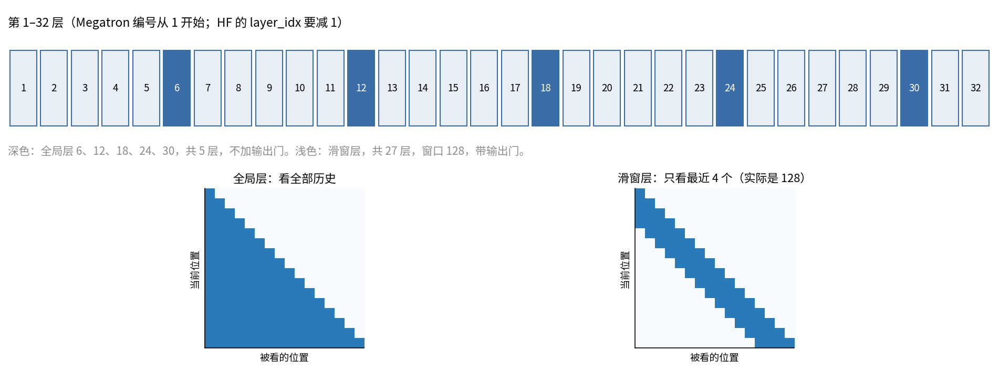
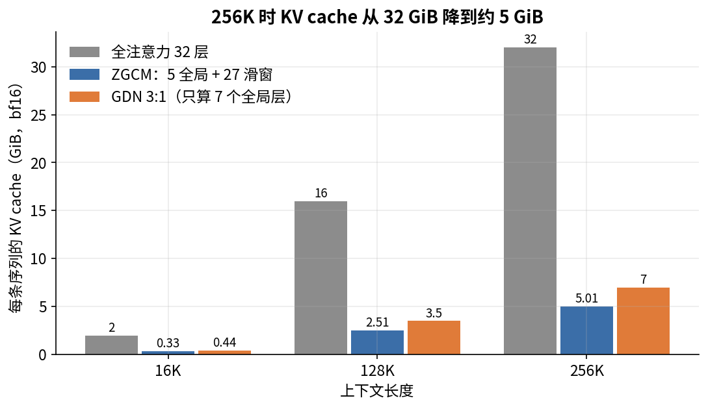
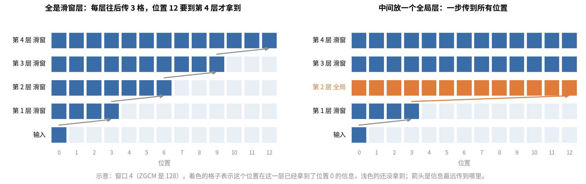

# 第 9 章　模型架构：每个零件为什么这样选

> 第 2 章讲了 Transformer 每一步在算什么。这一章换个角度看 ZGCM-1：它在标准 LLaMA 式结构上改了哪几处，每一处要解决什么问题，为此付出了什么，证据有多硬。读完以后，你应该能回答"为什么不直接用 LLaMA 结构"。

## 这一章要回答的问题

读完这一章，你应该能回答下面这些问题。

1. ZGCM-1 的 32 层是怎么排的？哪几层是全局注意力？为什么最后两层是滑窗层？
2. 注意力的计算量和 KV cache 随序列长度怎么涨？在 16K 和 256K 时，注意力占总计算的多少？
3. 降低注意力成本有哪几条路（GQA、MLA、滑窗、线性注意力、稀疏注意力）？各自省的是什么？
4. 滑窗只看 128 个 token，模型怎么获取长距离信息？5:1 这个比例是怎么选出来的？
5. 输出门（output gate）是什么？它解决了什么问题？为什么全局层不加门？
6. QK-Norm 防的是什么？它为什么放在 RoPE 之前？
7. partial RoPE 只旋转 42 维，另外 86 维干什么？RoPE base 取 5M 意味着什么？
8. Megatron 里 QKV 和门是怎么拼在一个矩阵里的？转成 HF 格式时要注意什么？
9. 报告里的架构实验能证明什么，不能证明什么？

---

<a id="s9-1" name="s9-1"></a>
## 9.1 先看全图：一层里有什么，32 层怎么排

ZGCM-1 的每一层都是 Pre-LN 结构：先过 RMSNorm，再做注意力，加回残差；再过一次 RMSNorm，进 SwiGLU FFN，再加回残差（第 2 章 [§2.7](02_Transformer到能讲的程度.md#s2-7)）。32 层之间只有一处不同，就是注意力是**滑窗**的还是**全局**的。

| 层（1 起编号） | 类型 | 注意力范围 | 有输出门 |
|---|---|---|---|
| 1–5 | 滑窗（SWA） | 最近 128 个 token | 有 |
| 6 | 全局 | 前面所有 token | 无 |
| 7–11 | 滑窗 | 128 | 有 |
| 12 | 全局 | 全部 | 无 |
| …… | 每 6 层重复 | | |
| 30 | 全局 | 全部 | 无 |
| 31–32 | 滑窗 | 128 | 有 |

合计 27 个滑窗层、5 个全局层（报告 §2.1 第 3 页）。



上半是 32 层的排布，深色是全局层。下半是两种掩码：每一行是一个当前位置，深色格子是它能看到的位置。为了画得清楚，右图的窗口画成 4，ZGCM 实际是 128。

这个排法由一条公式算出来。Megatron fork 里判断一层是否为滑窗层的函数是这样写的（`pretrain/Megatron-LM/megatron/core/transformer/utils.py:453-469`）：

```python
# layer_number is 1-indexed
if isinstance(window_attn_skip_freq, int):
    return layer_number % window_attn_skip_freq != 0
```

`WINDOW_ATTN_SKIP_FREQ=6`（stage 2 env L41）。层号能被 6 整除的是全局层，其余都是滑窗层。32 除以 6 余 2，第 30 层之后还剩 31、32 两层，自然就是滑窗层。报告 §2.1 第 4 页专门交代了这一点："最后一个全局层是第 29 层（0 起编号），后面跟两个滑窗层"。

这里有两套编号，别搞混。Megatron 的 `layer_number` 从 1 开始，全局层是 6、12、18、24、30。HF 的 `layer_idx` 从 0 开始，`config.json` 的 `layer_types` 里 `full_attention` 出现在下标 5、11、17、23、29。两者说的是同一组层。

最后两层是滑窗层，会不会有坏处？报告没讨论。直觉上，最后一个全局层（第 30 层）已经把长距离信息汇总进了每个位置的残差流，后面两个滑窗层只做局部加工，问题不大。Gemma 3 也用"每 6 层一个全局层"的同一条公式（HF 实现里是 `(i+1) % 6`），它的 27B 版有 62 层，同样剩下两个尾巴。ZGCM 很可能直接沿用了这个公式（推断）。

按报告 Figure 3（§2.1 第 4 页）的画法，一个滑窗层的注意力模块是这样算的：

```
h = RMSNorm(x)
q, k, v, g = q_proj(h), k_proj(h), v_proj(h), g_proj(h)    # 四个投影并行
q, k = RMSNorm_head(q), RMSNorm_head(k)                    # QK-Norm，按头做
q, k = PartialRoPE(q), PartialRoPE(k)                      # 只转前 42 维
o = SlidingWindowGQA(q, k, v)                              # 窗口 128
o = o ⊙ sigmoid(g)                                         # 输出门
x = x + o_proj(o)
```

全局层去掉 `g_proj` 和门，窗口换成全部历史。报告把滑窗层写成

$$\text{GatedSWA}(h) = o_{proj}\big(A_{SWA}(q,k,v) \odot \sigma(g_{proj}(h))\big)$$

（报告 §2.1 第 4 页）。后面几节把这些零件逐个拆开讲。ZGCM 改动的地方都在注意力上，所以先从注意力的成本算起。

<a id="s9-2" name="s9-2"></a>
## 9.2 注意力的成本从哪来

要理解 ZGCM 为什么改注意力，得先算清楚注意力贵在哪里。它的成本有两笔：训练和 prefill（推理时先把整段提示一次算完）时的计算量，decode（之后逐个生成 token）时的 KV cache。

### 计算量：一个 token 的前向要多少 FLOPs

一个 token 的前向计算分两类。

第一类是和权重相乘的矩阵乘，每个参数做一次乘加，算 2 FLOPs。ZGCM 每层的矩阵参数是：q、o 各 $4096^2$，k、v 各 $4096\times1024$，FFN 三个 $4096\times11008$，合计 177.2M。27 个滑窗层还要再加 $g_{proj}$ 的 16.8M，最后还有 lm_head 的 $4096\times154880$。这部分和序列长度无关。

第二类是注意力的打分和加权求和。位置 $i$ 要和它能看到的 $n_i$ 个位置各做一次 $q\cdot k$（128 维），再对这 $n_i$ 个 $v$ 加权求和。32 个头合起来，每层每 token 是

$$2 \times 2 \times n_i \times 4096 \text{ FLOPs}$$

第一个 2 是乘加，第二个 2 是"打分"和"加权求和"两步。全局层的因果注意力里，位置 $i$ 看 $i$ 个位置，平均 $n_i = S/2$。滑窗层的 $n_i$ 最多 128，和 $S$ 无关。

用这两个式子就能算出一个 token 的前向 FLOPs。下表是本书算的。GQA 不改变打分的计算量，因为 32 个 Q 头都要算。

| 序列长度 S | 全注意力 GFLOPs/token | 其中注意力占比 | ZGCM 混合 GFLOPs/token | 理论加速 |
|---|---|---|---|---|
| 4K | 13.7 | 7.8% | 13.7 | 1.00× |
| 16K | 16.9 | 25.4% | 14.2 | 1.19× |
| 32K | 21.2 | 40.5% | 14.9 | 1.42× |
| 64K | 29.8 | 57.7% | 16.3 | 1.83× |
| 128K | 47.0 | 73.2% | 18.9 | 2.48× |
| 256K | 81.3 | 84.5% | 24.3 | 3.35× |

从表里能看出注意力的份量怎样随长度变化。4K 时注意力只占 8%，换成滑窗几乎省不了计算，门还多出一点矩阵乘。到了 16K，也就是 ZGCM 预训练的长度，注意力占四分之一，换成 5:1 混合，理论上省 16%。到 256K，注意力占 85%，全注意力的成本几乎全花在注意力上。所以要做长上下文，就必须在注意力上动手。

报告实测的加速比这个理论值大：16K 是 1.40×，256K 是 3.94×（报告 §2.2 第 5 页，Figure 4b）。一个可能的解释是，ZGCM 的矩阵乘走 FP8（第 11 章），比 bf16 快约一倍，而 FlashAttention 仍是 bf16。矩阵乘变快以后，注意力在总时间里的比重就比它在 FLOPs 里的比重更大。按"矩阵乘提速 2 倍"重算，16K 的理论加速是 1.42×，和实测的 1.40× 很接近（推断，报告没说 Figure 4b 用的什么精度）。

### KV cache：decode 时要存多少

第 2 章 [§2.9](02_Transformer到能讲的程度.md#s2-9) 算过：一层、一个 token 的 K 和 V 是 $2\times8\times128\times2$ 字节 $=4$ KiB。全注意力的 32 层都要存全部历史，每 token 128 KiB。ZGCM 的混合结构里，5 个全局层存全部历史，每 token 20 KiB；27 个滑窗层每层只存最近 128 个位置，合计固定 $27\times128\times4\text{ KiB}=13.5$ MiB，与长度无关。代进几个长度：

| 上下文 | 全注意力 | ZGCM 混合 | GDN 3:1（7 个全局层） |
|---|---|---|---|
| 16K | 2.0 GiB | 0.33 GiB | 0.44 GiB |
| 128K | 16.0 GiB | 2.51 GiB | 3.5 GiB |
| 256K | 32.0 GiB | 5.01 GiB | 7.0 GiB |

256K 时两者差 6.4 倍，和报告 §2.3 第 5 页一致。GDN 那列只算了它的 7 个全局层；线性注意力层还有一个固定大小的状态，报告没给这部分，数值上很小。



全注意力随长度线性涨，16K 到 256K 涨了 16 倍。ZGCM 也随长度涨，但斜率只有全注意力的 5/32。

KV cache 小了，decode 就快。decode 每生成一个 token，都要把全部权重和全部 KV cache 从显存读一遍。ZGCM 的 bf16 权重约 14.8 GB，而 256K 时全注意力的 KV cache 是 32 GiB，比权重还大一倍多，读 KV 成了主要开销。混合结构只有 5 GiB，每步要读的数据从约 49 GB 降到约 20 GB。另外，KV cache 小了，同一张卡还能并发更多请求。

<a id="s9-3" name="s9-3"></a>
## 9.3 降低注意力成本的几条路

注意力的两笔成本算清楚了，再看业界怎么压低它。常见的做法有五类，它们省的东西不一样，很多可以叠加。

| 做法 | 改了什么 | 省计算 | 省 KV cache | 代表模型 |
|---|---|---|---|---|
| GQA / MQA | 多个 Q 头共用一组 K/V | 否 | 是（ZGCM 32:8，省 4 倍） | LLaMA 2 70B、Llama 3、Qwen |
| MLA（多头潜在注意力） | K/V 先压成一个低维向量再缓存，用时再展开 | 否（还略增） | 是，省得很多 | DeepSeek-V2/V3 |
| 滑动窗口 SWA | 每个位置只看最近 $w$ 个 | 是 | 是 | Mistral 7B、Gemma 2/3、gpt-oss |
| 线性注意力 / 状态空间 | 用固定大小的状态代替全部历史 | 是 | 是 | Mamba 混合模型、Qwen3-Next（Gated DeltaNet） |
| 稀疏注意力（按内容选） | 每个 query 只挑一部分 key 算 | 是 | 否（仍要存全部，只是少读） | DeepSeek NSA、DeepSeek-V3.2 的 DSA |

GQA 和其他几类是正交的，几乎所有现代模型都用，ZGCM 也是在 GQA 的基础上再加滑窗。MLA（[DeepSeek-V2](https://arxiv.org/abs/2405.04434)）每层每 token 缓存 512 维潜在向量加 64 维 RoPE 部分，bf16 下约 1.1 KiB，比 ZGCM 一层 GQA 的 4 KiB 还小。但它不省计算，实现也复杂，在 ZGCM 的实验里吞吐最低（[§9.5](#s9-5)）。

SWA 和线性注意力都只能对付近处，或者压缩过的远处，所以实际都做成**混合结构**：大部分层用便宜的注意力，隔几层放一个全注意力层兜底。ZGCM 选的就是 GQA + SWA 混合。下一节讲它为什么能工作。

<a id="s9-4" name="s9-4"></a>
## 9.4 滑窗加全局层：怎么既便宜又能看远

### 滑窗层自己看不了多远

在一个滑窗层里，位置 $i$ 只能直接看到 $[i-127, i]$。但层是叠起来的：第 1 层让位置 $i$ 拿到 $i-127$ 的信息；到第 2 层，位置 $i$ 再看 $i-127$ 时，那个位置已经带着 $i-254$ 的信息了。所以叠 $L$ 个滑窗层，信息最远能传 $L\times127$ 个位置，这叫**感受野**（receptive field）。ZGCM 第一个全局层之前有 5 个滑窗层，感受野是 635 个 token；27 个滑窗层全叠起来，感受野也只有 3,429 个 token。

拿 [§9.1](#s9-1) 图里那个窗口 4 的小例子算一遍（示意，ZGCM 的窗口是 128）。窗口 4 包含自己，所以每个位置往前只能多看 3 格。位置 0 的信息过第 1 层后到达位置 3，过第 2 层到位置 6，过第 3 层到位置 9。位置 12 要等到第 4 层才拿得到它。把窗口换成 128，每层推进 127 格，就是上面的 $L\times127$。



看左右两图的第 2 层：全是滑窗时信息只走到位置 6，换成全局层后一步就到了位置 12。

3,429 离 256K 还很远。而且信息一层层接力传过去，会越传越模糊，因为每接力一次，远处的信息都要和沿途那个位置自己的内容挤在同一个 4096 维的残差向量里。Mistral 7B 那种全部是滑窗的设计，在需要精确找回远处细节的任务上就会吃亏。

### 全局层负责长距离

所以每 6 层要放一个全局层，它能直接看到全部历史。长距离的信息检索都靠这 5 层完成，滑窗层负责局部的语法、搭配和近处指代。

两种层是通过残差流配合的。第 6 层的全局注意力从远处取到的东西，加回到当前位置的残差向量里；之后第 7–11 层的滑窗层读这个向量时，远处的信息已经在"手边"了，不用再自己去够。反过来，第 6 层去远处查找时，每个位置的 key 是从它的残差向量算出来的，而这个向量经过前 5 个滑窗层，已经依赖于它前面 635 个 token。所以全局层查到的每个位置，带的都是那一片的上下文。

比例越稀疏越省成本，但长距离能力也越可能吃亏，所以比例要靠实验来选（[§9.5](#s9-5)）。

### 窗口 128 是很小的选择

把 ZGCM 和几个用滑窗的模型放在一起比：

| 模型 | 局部:全局 | 窗口 |
|---|---|---|
| Mistral 7B | 全部是滑窗 | 4096 |
| Gemma 2 | 1:1 | 4096 |
| Gemma 3（[报告](https://arxiv.org/abs/2503.19786)） | 5:1 | 1024 |
| gpt-oss（[模型卡](https://arxiv.org/abs/2508.10925)） | 1:1 | 128 |
| ZGCM-1 | 5:1 | 128 |

ZGCM 的比例和 Gemma 3 一样，窗口和 gpt-oss 一样小。窗口小，滑窗层的计算和 KV cache 都几乎为零；反过来，滑窗层能做的事也更少，更多工作压到了全局层上。报告没有比较不同的窗口大小（[§9.13](#s9-13)）。

### 配置里的 "127,0"

env 里写的是 `WINDOW_SIZE="127,0"`（stage 2 env L40）。这是 FlashAttention 的 `(left, right)` 约定：向左看 127 个，向右看 0 个，加上自己一共 128 个位置。HF 实现里的条件是 `k_positions >= q_positions - sliding_window + 1`，`sliding_window=128`（`modeling_zgcm.py` L104），也是包含自己在内的 128 个位置。两边一致。

### 和第 8 章的 packing 有关系

第 8 章说过，ZGCM 预训练把多篇文档拼进一条 16K 序列，注意力不在文档边界截断。滑窗层最多只会"看过界" 127 个 token，影响很小；5 个全局层则能看到同一条序列里前面所有的文档。这算是滑窗结构的一个附带好处。

<a id="s9-5" name="s9-5"></a>
## 9.5 ZGCM 的架构实验：证明了什么，没证明什么

5:1 这个比例是怎么定下来的，报告给了一组对比实验。

### 实验设置（报告 §2.2 第 4 页）

实验比较了 6 种注意力：全注意力（Full Attn）、GQA 加 FlashAttention-2（Flash-GQA）、MLA、SWA 1:1、SWA 3:1、SWA 5:1。每种都是 7B 规模，训 10B token，序列长度 4096，用 8 张 H100，训练预算相同。质量看最后 50 步的平均 loss（tail-50 loss），效率看每卡每秒处理的 token 数。要注意，Figure 4 的图注说这些配置的参数量没有对齐（non-parameter-matched，§2.2 第 5 页）。

### 结果（Figure 4a）

| 配置 | tail-50 loss | 吞吐（tok/s/GPU） |
|---|---|---|
| 全注意力 | 1.93 | 正文未给 |
| SWA 5:1 | 1.93 | 9,566（最高） |
| SWA 3:1 | 1.92（最低） | 略低于 5:1 |
| MLA | 无改善 | 7,645（最低） |

正文只给了这几个数，其余配置只能从图上读，这里不编。

### 吞吐随长度的变化（Figure 4b，§2.2 第 5 页）

在同一个 7B 骨架上，保持每步 token 数不变，SWA 5:1 相对全注意力的加速是：

| 长度 | 4K | 16K | 32K | 64K | 128K | 256K |
|---|---|---|---|---|---|---|
| 加速 | 1.13× | 1.40× | 1.63× | 2.13× | 2.79× | 3.94× |

SWA 3:1 介于两者之间。第 1 章 4.2× 分解里的"SWA 1.4×"，就是这张表 16K 那一格。

### 怎么读这组实验

先说它能说明什么。在 4K、10B token 的尺度上，5:1 混合的 loss 没有比全注意力差，吞吐更高。长度越长，混合结构的速度优势越大，这和 [§9.2](#s9-2) 的 FLOPs 分析方向一致。MLA 在这个实现下明显更慢，又没带来 loss 收益，所以没选它。

它说明不了的地方有四处。

第一，0.01 的 loss 差可能是噪声。每个配置只跑了一次，没有报多个随机种子，所以"3:1 最好"和"5:1 与全注意力打平"都应该理解成"差不多"（推断）。

第二，4K 的实验测不出长距离能力。序列只有 4096，全局层和滑窗层的差别本来就小。长上下文能力要看第 16 章的 mid-train 和长文评测。

第三，最终结构里有几样东西没进这组实验。报告 §2.2 第 4 页说生产模型"另外"加了 128 窗口、QK-Norm、GQA 和局部输出门。这意味着实验里的 SWA 配置不一定是 128 窗口，也不一定有门。窗口大小、门、QK-Norm、partial RoPE 各自的贡献，报告都没有单独消融。

第四，10B token 很短。正式训练是 4.2T，相差 400 多倍，小规模打平不保证大规模也打平。

读技术报告时，这是一个通用的习惯：分清"实验测了什么"和"结论说了什么"，看两者之间差了多少。第 19 章会专门练这个。

<a id="s9-6" name="s9-6"></a>
## 9.6 输出门：在注意力后面加一个开关

除了滑窗和全局的排法，ZGCM 还在注意力模块里加了几样零件。第一样是输出门，它只加在滑窗层上。

### 它是什么

滑窗层的注意力输出 $o$（32 个头拼起来，4096 维）在进入 $o_{proj}$ 之前，要逐元素乘上一个 0 到 1 之间的系数：

$$o' = o \odot \sigma(h\,W_G),\qquad W_G\in\mathbb{R}^{4096\times4096}$$

$h$ 是这一层注意力的输入（已经过 RMSNorm），和算 $q$、$k$、$v$ 用的是同一个向量，$\sigma$ 是 sigmoid。每个头的每一维都有自己的门值，而且门值随 token 变化。这种做法来自 Qiu et al. 2025（[论文](https://arxiv.org/abs/2505.06708)，NeurIPS 2025），报告 §2.1 第 3 页引用了它。

### 为什么要加门

Qiu et al. 比较了门放在不同位置、取不同形式的几十种变体，结论是"放在 SDPA（缩放点积注意力）输出之后、逐头逐元素的 sigmoid 门"效果最好。他们把收益归到两点。

一是补上一段非线性。没有门时，从 $v$ 到输出是 $o_{proj}(\text{softmax}(\cdot)\,V)$，对 $V$ 来说是两个线性映射连在一起，中间夹着按头切分的低维瓶颈（每头 128 维）。两个线性映射相乘还是线性的，表达能力受限，门在中间插进了一个依赖输入的非线性。二是门值稀疏。训练后很多门值接近 0，相当于每个 token 可以按需关掉某些头的输出。

门还有一个副作用，就是消除**注意力汇聚（attention sink）**。不加门的模型里，很多头会把大量注意力权重放在序列的第一个 token 上。原因是 softmax 的权重和必须为 1，一个头在这一步不想取任何信息时，只能把权重堆到一个没什么内容的位置上。有了门，这个头可以直接把门关小，不必借第一个 token "停车"。

拿一个只看 3 个位置的头算一下（示意数字）。这一步它什么都不想取，可权重加起来必须是 1，它能做的是把权重摆成 (0.9, 0.05, 0.05)，0.9 压在内容空洞的第一个 token 上，另外两个位置仍各漏进 5% 的 $v$。有了门，只要这个头的门输入学到 $-4$，$\sigma(-4)\approx0.018$，不管注意力权重怎么分，输出都只剩不到 2%。门又是逐维的，同一个头也可以只放行其中几维。

论文报告，第一个 token 拿到的平均注意力从约 47% 降到约 5%，训练也更稳，能用更大的学习率。

### 为什么只给滑窗层加门

报告没有解释（报告未说明）。Qiu et al. 的原始做法是所有层都加。可能的考虑有两点（推断）：全局层负责长距离检索，设计者不想让门削弱它的输出；另外，5 个全局层不加门能省参数和计算，少了 84M 参数。

### 加门要花多少

参数上，27 层 × 16.8M = 453M，占全模型 6.1%（第 2 章 [§2.10](02_Transformer到能讲的程度.md#s2-10)）。计算上，每个滑窗层每 token 多一次 $4096\times4096$ 的矩阵乘，约 33.6 MFLOPs，27 层共 0.91 GFLOPs，约占 16K 下前向的 6%。

还要看门在训练开始时的状态。Megatron 把 $W_G$ 和 QKV 放在同一个矩阵里，用同样的 $N(0, 0.02^2)$ 初始化（[§9.10](#s9-10)）。$h$ 经过 RMSNorm 后每维均方根约为 1，所以门的输入 $hW_G$ 每维的标准差约 $0.02\times\sqrt{4096}=1.28$，sigmoid 之后集中在 0.5 附近。这样看，训练刚开始时门大约把滑窗层的输出减半，然后再学着开关（推断，按代码推算）。

<a id="s9-7" name="s9-7"></a>
## 9.7 QK-Norm：防止注意力打分越训越大

### 要防的问题

注意力打分是 $q\cdot k/\sqrt{128}$，其中 $q = hW_Q$，$k = hW_K$。训练中 $W_Q$、$W_K$ 的尺度可能慢慢变大，打分也跟着变大。打分大了，softmax 会接近 one-hot，一个位置拿走几乎全部权重。到了这一步，softmax 的梯度接近 0，这个头就学不动了；打分稍有变化，输出就会跳变，loss 容易出现尖峰，甚至发散。

Dehghani et al. 2023 训练 ViT-22B 时遇到了这个问题，用 QK-Norm 解决（报告 §2.1 第 3 页引用）。Wortsman et al. 2023（[论文](https://arxiv.org/abs/2309.14322)）在小模型上用大学习率复现了"注意力打分增长导致发散"，也证明 QK-Norm 能修好。

### 做法

在算点积之前，对每个头的 $q$ 和 $k$ 各做一次 RMSNorm，在 128 维上做：

$$\hat q = \text{RMSNorm}(q)\odot g_q,\qquad \hat k = \text{RMSNorm}(k)\odot g_k$$

$g_q$、$g_k$ 是 128 维的可学习系数，32 个头共用一份（HF 里 `q_norm`、`k_norm` 的权重形状是 `[128]`，`modeling_zgcm.py` L145-L146）。

归一化之后，$\hat q$ 和 $\hat k$ 的长度都固定在 $\sqrt{128}$ 附近（$g=1$ 时）。点积除以 $\sqrt{128}$ 后，绝对值不超过 $\sqrt{128}\approx11.3$。打分有了上界，要让注意力更尖锐，只能让 $g$ 变大，而 $g$ 只有 256 个参数，变化慢，也容易控制。

### 为什么放在 RoPE 之前

代码里的顺序是：投影 → QK-Norm → RoPE（HF L171-L176；Megatron 在 `get_query_key_value_tensors` 里做 norm，`attention.py:1500-1504`，RoPE 到 forward 里的 L1120-L1133 才做）。

反过来就不行。RoPE 把每一对维度 $(x_1, x_2)$ 转一个角度，点积只依赖角度差，"相对位置"的性质就是从这里来的。RMSNorm 的 $g$ 是逐维缩放，如果放在 RoPE 之后，同一对里的两维会被乘上不同的系数 $(g_1, g_2)$，旋转就不再是纯旋转，点积也不再只依赖相对距离。先 norm 再转，旋转保持长度，上界也保住了。

### 其他模型怎么做

Gemma 3 用 QK-Norm 替换了 Gemma 2 的 logit soft-capping（对打分做 tanh 截断），OLMo 2 也用了 QK-Norm。Kimi K2 的情况不同。它用的是 MLA，K 是从压缩向量展开的，不方便做 QK-Norm，所以改成了 QK-Clip：发现某个头的最大打分超过阈值，就直接缩小这个头的 $W_Q$、$W_K$（[Kimi K2 报告](https://arxiv.org/abs/2507.20534)）。他们还发现 Muon 优化器比 AdamW 更容易让打分变大。ZGCM 也用 Muon（第 10 章），所以 QK-Norm 在这里更有必要。

<a id="s9-8" name="s9-8"></a>
## 9.8 Partial RoPE 和 base

做完 QK-Norm，q 和 k 接着要过 RoPE。ZGCM 在这一步也和 LLaMA 不同：它只旋转一部分维度，base 也取得很大。

### 先回顾 RoPE 的频率

RoPE 把参与旋转的 $d_{rot}$ 维分成 $d_{rot}/2$ 对。第 $m$ 对每前进一个位置转 $\theta_m = \text{base}^{-2m/d_{rot}}$ 弧度，转一整圈需要的位置数（波长）是

$$\lambda_m = 2\pi\cdot\text{base}^{2m/d_{rot}}$$

$m=0$ 那对转得最快，波长 $2\pi\approx6.3$ 个 token；$m$ 越大转得越慢。

### ZGCM 只转 42 维

`ROTARY_PERCENT=0.334`。Megatron 里 $d_{rot}=\text{int}(128\times0.334)=\text{int}(42.75)=42$（`rotary_pos_embedding.py` L72-L74）。HF 实现同样取整，再保证是偶数（`modeling_zgcm.py` L32-L33）。结果是前 42 维分成 21 对参与旋转，后 86 维不旋转，直接参与点积（L61-L66 把它们原样拼回去）。

base 取 5M 时，21 对的波长如下（本书计算）：

| $m$ | 0 | 1 | 2 | 3 | 4 | 5 | 6 | 8 | 10 | 12 | 15 | 20 |
|---|---|---|---|---|---|---|---|---|---|---|---|---|
| 波长（token） | 6.3 | 13 | 27 | 57 | 119 | 247 | 515 | 2.2K | 9.7K | 42K | 383K | 15M |

只有前 5 对的波长在 128 以内。滑窗层只看 128 个位置，主要靠这 5 对分辨距离。21 对里有 11 对波长不超过 16K，剩下 10 对在 16K 的训练长度里转不满一圈，最慢的几对几乎不动，作用接近不加位置。再算上本来就不转的 86 维，每个头里对位置敏感的维度只占少数。

### 为什么只转一部分

不旋转的维度做的是纯内容匹配，只看"这个 key 和我要找的东西像不像"，不管它离我多远，这对长距离检索有利。打分 $q\cdot k$ 可以拆成两段相加：前 42 维那段随相对距离变化，后 86 维那段只看内容。

拿一个 4 维的小头算一下（示意数字，不算除以 $\sqrt d$）。前 2 维旋转，每前进一个位置转 90°；后 2 维不转。设 $q$ 和 $k$ 的内容完全一样，都是 $(1,0,1,0)$。距离为 0 时打分是 $1+1=2$；距离 1 时旋转那段变成 $\cos90°=0$，打分是 1；距离 2 时旋转那段是 $\cos180°=-1$，打分是 0。不转的那段始终贡献 1。如果后 2 维也按同样的速度转，距离 2 时打分会是 $-2$，一个内容完全相同的 key 反而得了最低分。实际 RoPE 里各对转速不同，不会这么极端，但只要维度在转，内容匹配就和距离搅在一起；不转的维度把"像不像"单独留了出来。

另外，不转的维度也有利于外推：训练时没见过的长度会产生没见过的旋转角度，不旋转的维度不受影响。

ZGCM 也不是第一个这样做的。GPT-NeoX-20B 只旋转 25% 的维度，GLM 系列旋转一半。Llama 4 走得更远，隔几层就放一层完全不用位置编码的注意力（NoPE 层）。ZGCM 报告没有做 partial RoPE 的消融，比例 0.33 的理由也没说（报告未说明）。

### base 为什么取这么大

base 越大，慢的那几对转得越慢，能区分的距离就越远。常见取值如下：

| 模型 | base |
|---|---|
| 原始 RoPE、LLaMA 2 | 10,000 |
| Llama 3 | 500,000 |
| ZGCM 预训练（16K）和 mid-train 的 16K、64K 段 | 5,000,000 |
| ZGCM 256K 段、SFT、发布版 | 10,000,000 |

数字来源：stage 1/2 env 的 `ROTARY_BASE=5000000`（stage 2 env L38）；mid-train 的 01_seq16k、02_seq64k env 在 L103 写的是 5M，03_seq256k env L103 是 `10000000`；SFT 的 `zgcm.conf` L33 是 1e7；发布版 `config.json` 的 `rope_theta` 是 1e7（报告 §3.2.5 第 10 页同样写 10M）。HF 中间 checkpoint 各自的 `checkpoint_info.json` 也记了 `rope_theta`：Pretrain、Midtrain-16K、Midtrain-64K 是 5M，Midtrain-256K 是 10M。

ZGCM 扩到 256K 时只是把 base 从 5M 调到 10M，没有用 YaRN 这类插值方法，第 16 章会详细讲。

还有一点：ZGCM 所有层用同一个 base。Gemma 3 给局部层和全局层分别用 10K 和 1M，ZGCM 的 27 个滑窗层和 5 个全局层则共用一个 RoPE（HF 每个注意力模块都读同一个 `config.rope_theta`）。

<a id="s9-9" name="s9-9"></a>
## 9.9 其余零件：和 LLaMA 一样的部分

注意力以外的零件，ZGCM 都没有改，原理第 2 章讲过，这里只补充为什么这样选。

| 零件 | ZGCM 的选择 | 出处 | 为什么 |
|---|---|---|---|
| FFN | SwiGLU，中间维 11008 | `--swiglu`，env `FFN_HIDDEN_SIZE=11008` | 同参数量下 loss 比 ReLU/GELU FFN 低，已是标配 |
| 归一化 | RMSNorm，eps 1e-6 | `--normalization RMSNorm`，`NORM_EPSILON=1e-6` | 比 LayerNorm 省一次减均值，效果相当 |
| 归一化位置 | Pre-LN | HF forward L238-L252 | 梯度路径干净，好训；报告记了 1.1×（第 1 章） |
| 线性层偏置 | 全部去掉 | `--disable-bias-linear` | 偏置对 loss 几乎没帮助，还要多存多读 |
| 输入输出词表 | 不共享（untied） | `--untie-embeddings-and-output-weights`，config `tie_word_embeddings: false` | 见下 |
| 词表对齐 | 按 128 的倍数补齐 | `--make-vocab-size-divisible-by 128` | 第 3 章 |

### Pre-LN 的 1.1× 是和谁比

报告说 Pre-LN 带来约 1.1× 的提速，基线是"OLMo 3 风格的 7B"（第 1 章 [§1.10](01_全景与算力估算.md#s1-10)）。OLMo 2/3 用的并非经典的 Post-LN，它们把 norm 放在子层的输出上：$h \leftarrow h + \text{Norm}(f(h))$。所以这里的 1.1× 是 ZGCM 的 Pre-LN 和 OLMo 这种"输出归一化"相比得到的，并没有和原始 Transformer 的 Post-LN 比过。

这也能解释第 2 章 [§2.7](02_Transformer到能讲的程度.md#s2-7) 提到的那个怪名字。HF 实现把两个 norm 叫 `post_attention_layernorm` 和 `post_feedforward_layernorm`，OLMo 2 的 HF 代码里用的就是这两个名字。很可能 ZGCM 的 HF 代码是从 OLMo 的代码改来的，norm 的位置挪到了子层前面，名字没改（推断）。

### 为什么不共享词表

共享（tied）就是让 lm_head 直接用 embedding 矩阵的转置，能省一份 $154880\times4096$，约 634M 参数，占 7.39B 的 8.6%。

小模型常共享。1B 以下的模型，词表矩阵可能占总参数的 20%–40%，共享能省很多，Gemma 系列和 Qwen2.5 的小尺寸都共享。7B 以上一般不共享，因为词表只占不到 10%，省下的不多；而且输入端要学的是"这个 token 是什么意思"，输出端要学的是"什么样的上下文该预测这个 token"，两件事分开学效果略好。LLaMA 系列就不共享。

报告没有解释 ZGCM 为什么不共享（报告未说明），按上面的惯例理解即可。顺带一提，Muon 只更新二维的隐藏层矩阵，embedding、lm_head 和所有一维参数（norm 的 $g$）都交给 Adam（`megatron/core/optimizer/emerging_optimizers.py` L128-L130 的 `_is_nonlinear_or_embedding`，第 10 章）。所以不管共不共享，两张词表都走 Adam。

<a id="s9-10" name="s9-10"></a>
## 9.10 初始化：第一步之前权重是什么样

结构定下来以后，训练开始前还要给每个权重一个初值。初始化决定了训练刚开始时各层输出的尺度。尺度不对，信号要么越传越大，要么越传越小，前几百步就可能发散。

### ZGCM 的初始化（从代码推出）

ZGCM 的 env 和 launch 脚本都没设 `--init-method-std`，所以用的是 Megatron 的默认值，由 `transformer_config.py` L321-L330 规定：

| 参数 | 分布 | 标准差 |
|---|---|---|
| embedding、QKV（含门）、FFN 的 gate/up、lm_head | $N(0,\sigma^2)$ | $\sigma = 0.02$ |
| 注意力输出 $o_{proj}$、FFN 的 down | $N(0,\sigma^2)$ | $0.02/\sqrt{2\times32} = 0.0025$ |
| 所有 RMSNorm 的 $g$（含 QK-Norm） | 常数 | 1 |

### 为什么输出层要缩小

残差流是一路加上去的：32 层，每层有注意力和 FFN 两个子层，一共 64 次 $h \leftarrow h + f(h)$。如果每次加的东西方差是 $s^2$，加 64 次之后残差流的方差多了 $64s^2$。把每个子层最后一个矩阵的初始化缩小 $\sqrt{2L}=8$ 倍，加进去的方差就缩小 64 倍，加完 64 次，总量和只加一次时在同一个量级。这个做法来自 GPT-2。

### 为什么是 0.02

0.02 是 GPT-2 时代的惯例，Megatron 一直拿它当默认值。另一种常见取法是 $1/\sqrt{d}$，$d=4096$ 时是 0.0156。Megatron 自带的 Llama 3 8B 示例脚本用的是 0.0134（`examples/llama/train_llama3_8b_h100_fp8.sh` L73）。几个值差别不大，配合 Pre-LN 和 RMSNorm，在这个范围内都能训。

### 初始 loss 应该是多少

知道了初始化，就能事先估出第一步的 loss。最终 RMSNorm 之后，每维的均方根约为 1。lm_head 用 $\sigma=0.02$ 初始化，所以每个 logit 的标准差约 $0.02\times\sqrt{4096}=1.28$。如果 logits 是方差 $s^2$ 的独立正态分布，交叉熵的期望约为 $\ln V + s^2/2 = 11.95 + 0.82 \approx 12.8$。所以 ZGCM 第一步的 loss 应该在 12 到 13 之间（本书推算）。如果明显偏离这个范围，说明初始化、数据或 loss 计算出了问题，这也是第 14 章值班清单的第一条。

### HF 实现不能用来从头训练

`modeling_zgcm.py` 的 `_init_weights` 是空函数（L266-L267）。HF 版只用来加载训练好的权重做推理。如果拿它从零初始化，权重会是 PyTorch 各层的默认初始化，和上表不一样。

<a id="s9-11" name="s9-11"></a>
## 9.11 ZGCM 没用的其他做法

下表是 ZGCM 没用、但读别的模型时常会碰到的几种做法，最后一列说明它们和 ZGCM 的关系。

| 做法 | 是什么 | 谁在用 | 和 ZGCM 的关系 |
|---|---|---|---|
| MoE（混合专家） | FFN 换成多个专家，每个 token 只激活其中几个。总参数大，每 token 计算量小 | DeepSeek-V3、Qwen3 MoE、gpt-oss | ZGCM 是 dense 模型，所有参数每个 token 都用 |
| MLA | [§9.3](#s9-3)。K/V 压成低维潜在向量缓存 | DeepSeek-V2/V3、Kimi K2 | 实验里吞吐最低，没选 |
| 线性注意力混合 | 大部分层用 Gated DeltaNet 等线性注意力，少数层全注意力 | Qwen3-Next（3:1） | 报告只比了 KV cache（GDN 3:1 是 7.0 GiB），没比训练质量 |
| 可学习的 attention sink | 每个头加一个可学习的"空位置"打分，让头可以把权重放到这里而不是第一个 token 上 | gpt-oss；StreamingLLM（[论文](https://arxiv.org/abs/2309.17453)）用保留开头几个 token 的办法 | ZGCM 用输出门解决同一个问题（[§9.6](#s9-6)） |
| 局部层和全局层分开设 RoPE base | 局部层用小 base，全局层用大 base | Gemma 3（10K 和 1M） | ZGCM 共用一个 base |
| logit soft-capping | 对注意力打分或最终 logits 做 $c\cdot\tanh(x/c)$，限制最大值 | Gemma 2 | ZGCM 对注意力用 QK-Norm；对最终 logits 没有限制 |
| z-loss | 在 loss 里加一项惩罚 $\log\sum e^{z}$ 的平方，防止输出 logits 漂大 | PaLM、OLMo 2 | ZGCM 没用，第 14 章讲 |
| μP（最大更新参数化） | 按宽度缩放初始化和学习率，小模型上调好的超参能直接搬到大模型 | Cerebras-GPT、部分 MiniCPM | ZGCM 用默认初始化；Megatron 有 `use_mup` 开关，没开 |
| 并行块 | 注意力和 FFN 用同一个输入并行算，再一起加回残差 | GPT-J、PaLM | ZGCM 是标准的串行块 |

<a id="s9-12" name="s9-12"></a>
## 9.12 读代码

前面讲的零件，在代码里分散在 Megatron fork 和 HF 实现两处。下面先在 Megatron 里看哪些层加门、门的权重放在哪、门在哪一步乘上去，再对照 HF 版的完整顺序，最后看两个和存储、转换有关的细节。

### (1) 哪些层加门（`megatron/core/transformer/attention.py:329-340`）

```python
self.is_window_attention_layer = (
    self.attention_type == "self"
    and is_layer_window_attention(
        self.config.window_size,
        self.config.window_attn_skip_freq,
        self.layer_number,
    )
)
self.use_attention_output_gate = self.config.attention_output_gate and (
    not self.config.attention_output_gate_only_swa
    or self.is_window_attention_layer
)
```

第一段用 [§9.1](#s9-1) 的公式判断本层是不是滑窗层。第二段决定加不加门：开了门（`ATTENTION_OUTPUT_GATE=1`），而且要么"不限于滑窗层"，要么"本层是滑窗层"，才加。ZGCM 设了 `ATTENTION_OUTPUT_GATE_ONLY_SWA=1`，所以只有滑窗层有门。`--attention-output-gate-only-swa` 是 ZGCM fork 加的参数，上游 Megatron 只有 `--attention-output-gate`。

### (2) QKV 和门拼在一个矩阵里（`attention.py:1289-1291`，`1398-1470`）

```python
self.linear_qkv_out_dim = self.query_projection_size + 2 * self.kv_projection_size
if self.use_attention_output_gate:
    self.linear_qkv_out_dim += self.config.kv_channels * self.config.num_attention_heads
```

Megatron 没有分别建 q、k、v 三个矩阵，它建的是一个大矩阵 `linear_qkv`，一次矩阵乘算完。无门的全局层输出维度是 $4096 + 2\times1024 = 6144$；有门的滑窗层再加 $128\times32 = 4096$，共 10240。

这些维度的排列顺序是**按 KV 组交错**的，并没有按"所有 q、所有 g、所有 k、所有 v"依次排。`get_query_key_value_tensors` 里的注释写得很清楚：

```python
# If have output gate: [sq, b, hp] --> [sq, b, ng, (2 * np/ng + 2) * hn]
split_arg_list = [
    num_query_heads_per_group * self.hidden_size_per_attention_head,  # q: 4 头
    num_query_heads_per_group * self.hidden_size_per_attention_head,  # g: 4 头
    self.hidden_size_per_attention_head,                              # k: 1 头
    self.hidden_size_per_attention_head,                              # v: 1 头
]
(query, gate, key, value) = torch.split(mixed_qkv, split_arg_list, dim=3)
```

ZGCM 有 8 个 KV 组（`ng=8`），每组 4 个 Q 头（`np/ng=4`），`hn=128`。所以 10240 维的输出先变形成 8 组，每组 $(2\times4+2)\times128=1280$ 维，组内依次是 4 个 q 头、4 个门、1 个 k、1 个 v。

按组交错是为了张量并行。TP 切分时按输出维度切，ZGCM 是 TP2，每张卡拿 4 个完整的组，组内的 q、g、k、v 都在同一张卡上，不需要额外通信。如果按"先所有 q 再所有 k"排，沿维度一刀切下去，一张卡会拿到全部 q，却没有 k。

### (3) 门在什么位置乘上去（`attention.py:1220-1231`、`1240-1247`）

```python
# Output gate
if gate is not None:
    core_attn_out = self._apply_output_gate(core_attn_out, gate)
...
output, bias = self.linear_proj(core_attn_out)

def _apply_output_gate(self, x, gate):
    x_dtype = x.dtype
    gate = gate.contiguous()
    gate = gate.view(*x.shape)
    x = x * torch.sigmoid(gate.float())
    x = x.to(x_dtype)
    return x
```

门乘在 FlashAttention 的输出（`core_attn_out`）上，位置在 `linear_proj`（即 $o_{proj}$）之前，和报告的公式一致。sigmoid 在 fp32 下算，乘完再转回 bf16。门值接近 0 或 1 时，bf16 的精度不够细，fp32 更稳。

### (4) HF 版一层注意力的完整顺序（`modeling_zgcm.py` L168-L216）

HF 实现没有融合矩阵，四个投影分开写，读起来最直观：

```python
q = self.q_proj(hidden_states).view(bsz, q_len, self.num_heads, self.head_dim)
k = self.k_proj(hidden_states).view(bsz, q_len, self.num_key_value_heads, self.head_dim)
v = self.v_proj(hidden_states).view(bsz, q_len, self.num_key_value_heads, self.head_dim)
q = self.q_norm(q)                      # QK-Norm，在 128 维上
k = self.k_norm(k)
q, k = self.rotary_emb(q, k, position_ids)   # partial RoPE
...
attn_output = F.scaled_dot_product_attention(q_t, k_t, v_t, attn_mask=mask, ...)
attn_output = attn_output.reshape(bsz, q_len, -1)
if self.g_proj is not None:
    gate_values = torch.sigmoid(self.g_proj(hidden_states).float()).to(attn_output.dtype)
    attn_output = attn_output * gate_values
attn_output = self.o_proj(attn_output)
```

`view` 之后张量形状是 `[b, s, 头数, 128]`，所以 `q_norm` 在最后一维（128）上归一化，也就是按头做。`v` 既不做 norm，也不做 RoPE，因为位置信息只影响"看谁"，不影响"取到什么"。`g_proj` 的输入是 `hidden_states`，即层输入经过 RMSNorm 之后的向量，和 q、k、v 同源。整段的顺序和 Megatron 一致：投影 → QK-Norm → RoPE → 注意力 → 门 → $o_{proj}$。

### (5) partial RoPE 的两段代码（`modeling_zgcm.py` L32-L33、L61-L66）

```python
dim = int(config.head_dim * config.partial_rotary_factor)   # int(42.752) = 42
dim = dim - (dim % 2)                                       # 保证偶数，42 不变
...
q_rot, q_pass = q[..., : self.dim], q[..., self.dim :]      # 前 42 维 / 后 86 维
q = torch.cat((q_rot.to(q_dtype), q_pass), dim=-1)          # 只有前 42 维被旋转
```

被旋转的是每个头开头的 42 维。转 HF 时如果换了别的实现，要确认它切的也是开头这一段，而不是末尾的 42 维。

`rotate_half` 的配对方式是"前一半和后一半配对"，即第 $m$ 维和第 $m+21$ 维成一对，相邻两维并不配对。这是 GPT-NeoX 风格，和 Megatron 默认的 `rotary_interleaved=False` 一致。两种配对方式的权重不能混用，否则位置信息全乱。

旋转在 fp32 下做，结果再转回 bf16。位置很大（256K）时，$p\cdot\theta$ 在 bf16 下误差很大，必须用 fp32。

### (6) 为什么分布式 checkpoint 要按层存（`transformer_block.py:909-912`）

```python
# Selective attention gating changes fused QKV parameter shapes across
# layers, so distributed checkpoints must retain per-layer keys.
if self.config.attention_output_gate_only_swa:
    non_homogeneous_layers = True
```

Megatron 的 torch_dist checkpoint 默认把 32 层同名的参数叠成一个大张量来存，比如所有层的 `linear_qkv.weight` 合成 `[32, 6144, 4096]`，这要求每层形状相同。ZGCM 的滑窗层是 `[10240, 4096]`，全局层是 `[6144, 4096]`，叠不起来。所以 fork 加了这一句：只给滑窗层加门时，强制每层单独存一个 key。

改架构会牵连存储格式，这里就是一个具体的例子，第 13 章讲 checkpoint 时还会提到。

### (7) 转 HF 时发生了什么

仓库里没有 HF 转换脚本（第 13 章），但从 HF 各 checkpoint 的 `checkpoint_info.json` 能看到转换的结果：

| 字段 | 值 | 含义 |
|---|---|---|
| `source_model_tensors` | 259 | Megatron 侧的张量数 |
| `exported_model_tensors` | 382 | HF 侧的张量数 |
| `exact_tensor_roundtrip` | true | 转过去再转回来，逐元素相同 |
| `hf_load_and_short_generation_checked` | true | HF 能加载，能生成一小段 |
| `native_megatron_logits_comparison` | false | **没有**和 Megatron 原生前向的 logits 对比过 |

259 → 382 多出来的张量，来自把融合矩阵拆开：每层的 `linear_qkv` 拆成 q、k、v（滑窗层再加 g），FFN 的 `linear_fc1` 拆成 gate 和 up。按这个思路可以数一遍（本书推算）。Megatron 每层有 `linear_qkv`、`linear_proj`、`linear_fc1`、`linear_fc2`、两个层 norm 和 q/k norm，共 8 个，32 层是 256 个，加上 embedding、最终 norm、lm_head，正好 259。HF 每层有 q、k、v、o、gate、up、down、两个层 norm 和 q/k norm，共 11 个，滑窗层再加 g_proj，合计 $32\times11 + 27 + 3 = 382$。两边都对得上。

拆融合矩阵时最容易出错的，就是 [§9.12](#s9-12)(2) 讲的按组交错。不能简单地把 10240 行切成"前 4096 是 q、再 4096 是 g"，要先 reshape 成 `[8, 1280, 4096]`，在每组里切 `[512, 512, 128, 128]`，再把 8 组的 q 拼起来。`exact_tensor_roundtrip` 只能证明拆了能拼回去，证明不了拆对了；能证明拆对的是和 Megatron 的 logits 对比，而这一项是 false。好在 HF 版能正常生成，又有完整的评测结果，拆错的可能性很小（推断）。

<a id="s9-13" name="s9-13"></a>
## 9.13 坑和对不上的地方

1. 架构零件几乎都没有单独消融。报告只比了注意力类型（[§9.5](#s9-5)），128 窗口、输出门、QK-Norm、partial RoPE 0.334、base 5M、门只加在滑窗层，这些选择都没有给出对照实验。读的时候要清楚，它们的依据是别人的论文里这么做有效，ZGCM 自己并没有验证过。
2. 架构实验的条件偏弱：参数量没对齐（图注 §2.2 第 5 页），单次运行，4K 长度，10B token。0.01 的 loss 差不足以给几种配置排序。
3. 旋转比例有 0.33 和 0.334 两种写法。报告 §2.1 第 3 页写 rotary fraction 0.33，env 写 `ROTARY_PERCENT=0.334`，HF checkpoint 的 `partial_rotary_factor` 也是 0.334。两者向下取整后都是 42 维（$128\times0.33=42.24$，$128\times0.334=42.75$），实际没有区别。复现时不要只抄比例，要直接核对"旋转 42 维"这个结果，因为不同实现的取整方式可能不同。
4. norm 的名字和位置不符。`post_attention_layernorm` 实际在注意力之前（[§9.9](#s9-9)、第 2 章 [§2.7](02_Transformer到能讲的程度.md#s2-7)）。
5. HF 版不是完整实现。它没有 KV cache（L166 删掉了 `past_key_value`，L437 写死 `use_cache=False`），`_init_weights` 也是空函数（L266-L267）。HF 版只适合做正确性检查和小规模评测，生成长文本会很慢，因为每生成一个 token 都要重算全部前文。
6. 门为什么只加在滑窗层，报告没有说明（[§9.6](#s9-6)）。
7. 最后两层是滑窗层会有什么影响，报告没有讨论（[§9.1](#s9-1)）。
8. `--attention-output-gate-only-swa` 是 fork 自己加的参数。用上游 Megatron 跑 ZGCM 的 env，会直接报"不认识的参数"。如果删掉这个参数硬跑，32 层全都会加门，参数量和 checkpoint 形状都变了，加载不了 ZGCM 的权重。
9. 滑窗层和全局层共用一个 RoPE base（[§9.8](#s9-8)）。Gemma 3 的经验是分开设更好，ZGCM 没说为什么不分。
10. 中间 checkpoint 的元数据和仓库配置对不上。`ZGCM-1-7B-Midtrain-Staged-16K/checkpoint_info.json` 写 `training_context_length: 32768`，而 midtrain `01_seq16k.env` L101 是 `SEQ_LENGTH=16384`，checkpoint 名字也叫 16K。W&B 支持元数据的说法：正式 mid-train 第一段实际是 32K、GBS 384（$384\times32768\approx12.6$M token/步，附录 C [§C.1.1](附录C_W&B与数据配比统计.md#sc-1-1)）。所以错的是仓库 env 和名字，元数据是对的，第 16 章会详细讲。同一个文件还写着 `padded_vocabulary_size: 155136`，另外四个 checkpoint 都写 154880，原因不明（报告未说明），权重形状以实际文件为准。这件事的教训是，名字、配置、元数据、训练日志四者可能各说各的，要以训练日志为准，交叉核对其余三者。
11. HF 转换没有做 logits 对比（[§9.12](#s9-12)(7)）。

<a id="s9-14" name="s9-14"></a>
## 9.14 试着讲给别人听

下面是一段讲法。建议你先合上书自己讲一遍，再对照。

> ZGCM-1 的骨架是标准的 LLaMA 式结构：32 层，隐藏维 4096，Pre-LN 的 RMSNorm，SwiGLU FFN，GQA 是 32 个 Q 头配 8 个 KV 头，没有偏置，输入输出词表不共享。它改的地方都在注意力上。
>
> 第一处是滑窗加全局的混合。层号能被 6 整除的 5 层是全局注意力，其余 27 层只看最近 128 个 token。这么做是因为注意力的成本随长度涨：16K 时注意力占前向计算的四分之一，256K 时占 85%。滑窗层的计算和 KV cache 都和长度无关，所以 256K 时 KV cache 从 32 GiB 降到 5 GiB，训练吞吐在 16K 快 1.4 倍、256K 快将近 4 倍。长距离的信息靠那 5 个全局层直接去取。
>
> 第二处是输出门。27 个滑窗层的注意力输出，在进 o_proj 之前逐元素乘一个 sigmoid 门，门的输入和 q、k、v 是同一个向量。门给注意力补了一段非线性，也让一个头在"不想取信息"时能直接关掉，不用把权重堆在第一个 token 上。为此多了 4.5 亿参数，约占 6%。
>
> 第三处是 QK-Norm：对每个头的 q、k 先做 RMSNorm，打分就有了上界，softmax 不会越训越尖。它放在 RoPE 之前，因为 norm 的逐维缩放会破坏旋转。ZGCM 用 Muon 优化器，这类优化器更容易让打分变大，QK-Norm 更有必要。
>
> 第四处是 partial RoPE：每个头 128 维里只旋转前 42 维，另外 86 维做纯内容匹配。base 用 5M，扩到 256K 时调到 10M。
>
> 这些选择的证据要分开看。注意力类型做过小规模对比：4K、10B token 下 5:1 混合的 loss 和全注意力差不多，吞吐最高。但窗口大小、门、QK-Norm、partial RoPE 都没有单独消融，依据主要是别人的论文。

<a id="s9-15" name="s9-15"></a>
## 9.15 习题

1. ZGCM 的 32 层里哪几层是全局层？分别用 Megatron 的 1 起编号和 HF 的 0 起编号写出来。为什么最后两层是滑窗层？
2. 写出一个滑窗层注意力模块从输入 $h$ 到输出的计算顺序（6 步左右）。全局层和它有什么区别？
3. 一层全局因果注意力，每个 token 的打分加求和大约要多少 FLOPs？为什么序列越长，注意力在总计算里的占比越大？
4. 算 256K 上下文下全注意力和 ZGCM 混合结构的 KV cache 大小。为什么 KV cache 小会让 decode 变快？
5. GQA、MLA、滑窗、线性注意力、稀疏注意力，哪些省计算，哪些省 KV cache？
6. 27 个滑窗层叠起来，感受野是多少 token？为什么还需要全局层？
7. `WINDOW_SIZE="127,0"` 和 `sliding_window=128` 说的是同一件事吗？解释一下。
8. 报告的注意力对比实验能证明什么？至少说出三条它证明不了的。
9. 输出门的公式是什么？它带来的两点收益和一个副作用分别是什么？
10. 不加门时，为什么很多头会把注意力堆在第一个 token 上？
11. QK-Norm 防的是什么问题？为什么必须放在 RoPE 之前？
12. ZGCM 的 RoPE 旋转了每个头的多少维？不旋转的维度有什么用？base 从 5M 调到 10M 是在哪个阶段？
13. 为什么 Megatron 把输出投影和 FFN down 的初始化标准差缩小到 $0.02/\sqrt{64}$？
14. 随机初始化的 ZGCM 第一步 loss 大约是多少？怎么估出来的？
15. Megatron 的融合矩阵 `linear_qkv` 在滑窗层是多少行？行是怎么排的？为什么要这样排？转 HF 时要注意什么？

<details><summary>参考答案</summary>

1. 1 起编号 6、12、18、24、30；0 起编号 5、11、17、23、29。判断公式是 `layer_number % 6 != 0` 为滑窗层，32 除以 6 余 2，所以 30 之后的 31、32 是滑窗层（[§9.1](#s9-1)）。
2. RMSNorm → q/k/v/g 四个投影 → 对 q、k 按头做 RMSNorm → 前 42 维 RoPE → 窗口 128 的 GQA 注意力 → 乘 $\sigma(g)$ → $o_{proj}$ → 加回残差。全局层没有 $g$ 和门，窗口换成全部历史（[§9.1](#s9-1)、[§9.12](#s9-12)(4)）。
3. $2\times2\times n_i\times4096$，因果注意力平均 $n_i=S/2$。矩阵乘部分和 $S$ 无关，注意力部分和 $S$ 成正比，所以 $S$ 越大占比越高：4K 约 8%，16K 约 25%，256K 约 85%（[§9.2](#s9-2)）。
4. 全注意力 $32\times4\text{ KiB}\times262144=32$ GiB；混合 $5\times4\text{ KiB}\times262144=5$ GiB，加滑窗层固定的 13.5 MiB，约 5.01 GiB。decode 每步要把权重和 KV cache 全读一遍，受显存带宽限制，读得少就快；KV 小了还能并发更多请求（[§9.2](#s9-2)）。
5. GQA、MLA 只省 KV cache；滑窗和线性注意力两样都省；稀疏注意力省计算，KV cache 仍要全存（[§9.3](#s9-3)）。
6. $27\times127=3429$。信息靠层层接力传递，距离有限而且越传越模糊；全局层能一步直接看到全部历史（[§9.4](#s9-4)）。
7. 是。FlashAttention 的 `(127, 0)` 表示向左 127、向右 0，加上自己共 128 个位置；HF 的条件 `k >= q - 128 + 1` 也是包含自己的 128 个位置（[§9.4](#s9-4)）。
8. 能证明：4K、10B token 下 5:1 的 loss 不比全注意力差且吞吐更高；长度越长加速越大；MLA 在这个实现下慢。证明不了：0.01 的差异是否超过噪声（单次运行）；长距离能力（只有 4K）；窗口、门、QK-Norm 的贡献（没进实验）；4.2T 规模下是否仍然打平（[§9.5](#s9-5)）。
9. $o' = o\odot\sigma(hW_G)$，乘在 $o_{proj}$ 之前。收益：在 $V$ 到输出的两个线性映射之间补一段非线性；门值稀疏，可以按 token 关掉某些头。副作用：消除 attention sink，训练更稳（[§9.6](#s9-6)）。
10. softmax 的权重和必须为 1。一个头这一步不需要取信息时，只能把权重放到一个内容不重要的位置上，第一个 token 就成了"停车位"（[§9.6](#s9-6)）。
11. 防止 $q\cdot k$ 随 $W_Q$、$W_K$ 变大而变大，导致 softmax 饱和、梯度消失、loss 尖峰。RMSNorm 的 $g$ 逐维缩放，放在 RoPE 之后会让一对维度被乘上不同系数，旋转就不再是纯旋转，点积不再只依赖相对距离（[§9.7](#s9-7)）。
12. 42 维（21 对）。不旋转的 86 维做纯内容匹配，和距离无关，对长距离检索和外推有利。256K 段（mid-train 第三段）及之后的 SFT、发布版用 10M（[§9.8](#s9-8)）。
13. 残差流被加了 64 次（32 层 × 2 个子层）。把每个子层最后一个矩阵缩小 $\sqrt{64}=8$ 倍，每次加入的方差缩小 64 倍，总的方差增长和只加一次同一个量级（[§9.10](#s9-10)）。
14. 约 12.8。$\ln V\approx11.95$；lm_head 初始化 0.02，输入每维均方根约 1，logit 标准差约 1.28，再加 $s^2/2\approx0.82$（[§9.10](#s9-10)）。
15. $4096+2\times1024+4096=10240$ 行。按 8 个 KV 组交错，每组 1280 行，依次是 4 个 q 头、4 个门、1 个 k、1 个 v。这样 TP 按行切时，每张卡拿到完整的组，不用额外通信。转 HF 时要先 reshape 成 8 组再在组内切，不能按全局行号直接切；而且 ZGCM 的 HF 转换没做 logits 对比（[§9.12](#s9-12)(2)、[§9.12](#s9-12)(7)）。
</details>

---

上一章：[第 8 章　数据五：从文本到训练样本](08_数据五_从文本到训练样本.md)　下一章：[第 10 章　优化器与学习率](10_优化器与学习率.md)
