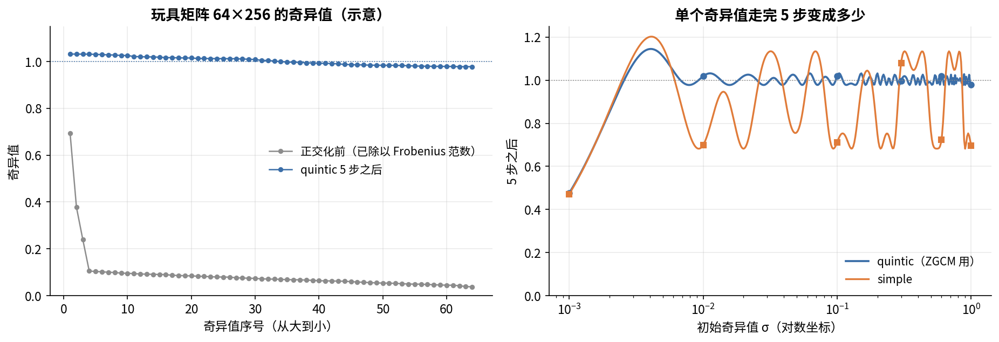
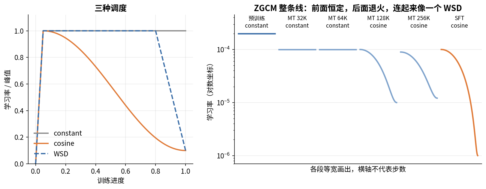

# 第 10 章　优化器与学习率

> 反向传播算出了梯度，但拿梯度怎么改参数是另一件事。这一章讲优化器（optimizer）和学习率（learning rate, LR）。在这两件事上，ZGCM 和大多数开源 7B 都不一样：矩阵参数用 Muon，不用 AdamW；预训练的 LR 全程恒定，不退火。读完这一章，你要能讲清这两个选择是什么、为什么这样选、代价在哪。

## 这一章要回答的问题

读完这一章，你应该能回答下面这些问题。

1. 一次参数更新由哪两部分组成？SGD、动量、Adam、AdamW 各改进了什么？
2. AdamW 每个参数要占多少字节显存？Muon 省在哪？
3. Muon 的"正交化"是什么意思？Newton–Schulz 迭代怎么在不做 SVD 的情况下完成它？
4. ZGCM 的 Muon 一步具体做了哪些运算？哪些参数不走 Muon？
5. 为什么 Muon 不能直接用 ZeRO 那种"把参数打平再切"的分布式优化器？ZGCM 用的 layer-wise 方案是什么？
6. warmup、梯度裁剪、weight decay 各解决什么问题？ZGCM 的取值是多少？
7. constant、cosine、WSD 三种学习率调度的公式是什么？ZGCM 每个阶段用的是哪种？
8. ZGCM 的学习率是怎么定下来的？有哪些实验证据，哪些只是报告的说法？

---

<a id="s10-1" name="s10-1"></a>
## 10.1 一次更新 = 方向 × 步长

训练的每一步都在做同一件事：

$$W \leftarrow W - \eta \cdot \Delta$$

其中 $\Delta$ 是更新方向，由优化器根据梯度算出来；$\eta$ 是学习率，决定沿这个方向走多远。各种优化器的区别全在怎么从梯度 $g$ 算出 $\Delta$，各种学习率调度的区别全在 $\eta$ 随步数怎么变。所以这一章分成两半，前半讲 $\Delta$（10.2–10.6），后半讲 $\eta$（10.7–10.10）。

往下讲之前，先建立一点尺度感。ZGCM 预训练的 $\eta = 2\times10^{-4}$，也就是说，每一步每个参数大约只改动万分之二这个量级（具体多大还要乘上 $\Delta$ 的大小，10.4 会算）。这样的小步子累积 38 万步，参数才从随机初始化走到一个会说话的模型。

<a id="s10-2" name="s10-2"></a>
## 10.2 SGD 和动量

最简单的优化器是 **SGD**（随机梯度下降，stochastic gradient descent）：直接拿这一步的梯度当方向，$\Delta = g$。"随机"指梯度是在一个 batch 上估出来的，没有用全部数据。

SGD 有两个毛病。一是噪声大，一个 batch 的梯度和全部数据上的梯度有偏差，方向会来回抖。二是各方向的尺度不同，loss 曲面在有的方向很陡、有的方向很平，用同一个 $\eta$，陡的方向会来回震荡，平的方向又走得太慢。

动量（momentum）对付的是第一个毛病。它维护一个缓冲区 $m$，存的是历史梯度的指数滑动平均（EMA, exponential moving average）：

$$m \leftarrow \beta\, m + (1-\beta)\, g,\qquad \Delta = m$$

$\beta$ 越大，记得越久。EMA 的有效记忆长度约为 $1/(1-\beta)$ 步，$\beta = 0.9$ 时约 10 步，$\beta = 0.95$ 时约 20 步，$\beta = 0.999$ 时约 1000 步。

手算一下 $\beta=0.9$ 时各步的权重：当前步 0.1，上一步 0.09，再上一步 0.081……第 10 步之前的梯度权重只剩 $0.1\times0.9^{10}\approx0.035$。随机方向上的噪声在平均里互相抵消，一致的方向留了下来。

有的实现写成 $m \leftarrow \beta m + g$，不乘 $1-\beta$。两种写法只差一个常数倍，学习率相应调整就行。ZGCM 用的 Muon 库是前一种写法（`buf.lerp_(grad, 1-momentum)`，见 10.5）。

动量还有一个小变体叫 Nesterov 动量：先按动量往前看一步，再用那里的梯度。实现上就是把 $\Delta = m$ 换成 $\Delta = \beta m + (1-\beta) g$。ZGCM 没开它（10.5）。

<a id="s10-3" name="s10-3"></a>
## 10.3 Adam 和 AdamW

第二个毛病要靠 Adam 来解决。它给每个参数配一个自己的步长，为此要维护两个 EMA：

$$m \leftarrow \beta_1 m + (1-\beta_1) g,\qquad v \leftarrow \beta_2 v + (1-\beta_2) g^2$$

$$\hat m = \frac{m}{1-\beta_1^t},\quad \hat v = \frac{v}{1-\beta_2^t},\qquad \Delta = \frac{\hat m}{\sqrt{\hat v}+\epsilon}$$

式子里的 $m$ 是一阶矩，即梯度的平均方向，和动量一样。$v$ 是二阶矩，即梯度平方的平均，代表这个参数的梯度通常有多大。$\hat m/\sqrt{\hat v}$ 把每个参数的梯度除以它自己的典型大小，于是梯度一直很大的参数，步子不会因此变大；梯度很小的参数，步子也不会太小。所以 Adam 对每个参数做的是逐元素归一化。

$\hat m$ 和 $\hat v$ 的分母叫偏差修正（bias correction）。$m$、$v$ 从 0 开始，前几步会偏小。第 1 步 $m = (1-\beta_1)g = 0.1g$，除以 $1-0.9^1 = 0.1$，正好还原成 $g$。最后的 $\epsilon$ 防止除以 0，Megatron 默认 $10^{-8}$（`arguments.py` L2227）。

把式子放到两种极端情况下看。如果某个参数的梯度方向每步都一样，$|\Delta|\approx1$；如果方向来回翻，$m$ 互相抵消，$|\Delta|$ 就小。拿三个参数手算 4 步看看（示意数字，$\beta_1=0.9$、$\beta_2=0.95$，忽略 $\epsilon$）。参数甲的梯度每步都是 10，参数乙每步都是 0.01，参数丙在 +1 和 −1 之间来回翻。甲的 $\hat m$ 和 $\sqrt{\hat v}$ 都是 10，乙的都是 0.01，相除后两者的 $\Delta$ 都是 1，而在 SGD 下它们的步子要差 1000 倍。丙的 $\sqrt{\hat v}=1$，但第 4 步的 $m=-0.0181$，修正后 $\hat m\approx-0.053$，$\Delta$ 只有 0.05 左右。在 Adam 下，一个参数步子多大，看的是它的梯度方向稳不稳，梯度本身是大是小几乎不起作用。

实测大模型里 AdamW 更新量的均方根（RMS）一般在 0.2–0.4（[Kimi 的 Muon 论文](https://arxiv.org/abs/2502.16982)给的经验值）。10.4 会拿 Muon 和这个数比。

论文里 Adam 的默认 $\beta_2$ 是 0.999，LLM 却普遍用 0.95。$\beta_2 = 0.999$ 时 $v$ 的记忆长度约 1000 步，梯度突然变大时 $v$ 要很久才跟上，这期间分母偏小，更新量被放大，容易引发 loss 尖峰。0.95 的记忆约 20 步，跟得快。LLaMA、OLMo 和 ZGCM 都用 $\beta_1=0.9,\ \beta_2=0.95$（`01_pretrain_1t_sequential.env` L56-L57，`ADAM_BETA1=0.9 ADAM_BETA2=0.95`）。Megatron 的命令行默认是 0.999（L2224），所以这个值必须显式传。

Adam 之外还要加上 weight decay（权重衰减）。它每步把参数往 0 拉一点，防止参数无限变大。写法有两种，区别在于衰减项要不要经过 Adam 的归一化：

| 写法 | 做法 | 问题 |
|---|---|---|
| L2 正则 | 把 $\lambda W$ 加进梯度 $g$，再走 Adam | 这部分也会被 $\sqrt{v}$ 除。梯度大的参数，衰减反而被削弱 |
| 解耦（decoupled，AdamW） | 单独做 $W \leftarrow W - \eta\lambda W$，不进 Adam 的归一化 | 每个参数按同一比例衰减，行为可预期 |

**AdamW** 就是 Adam 加解耦权重衰减。Megatron 的 `decoupled_weight_decay` 默认是 True（`optimizer_config.py` L250），所以在 Megatron 里写 `adam`，实际跑的就是 AdamW。

Megatron 不对一维参数和 bias 做衰减（`optimizer/__init__.py` L113-L118，`wd_mult=0.0`）。ZGCM 的一维参数就是各个 RMSNorm 的缩放系数 $g$，它们本来就该在 1 附近，往 0 拉没有道理。

衰减的时间尺度可以手算。每步参数乘以 $1-\eta\lambda$，ZGCM 预训练 $\eta=2\times10^{-4}$、$\lambda=0.1$，每步缩 $2\times10^{-5}$。衰减到原来的 $1/e$ 需要 $1/(\eta\lambda) = 50{,}000$ 步，而预训练有 38 万步，约 7.6 个时间常数。初始化时的参数早就被"忘掉"了，最终参数的大小由梯度往外推和衰减往里拉之间的平衡决定。

最后算一下 AdamW 的显存。混合精度训练时，每个参数要存下面这些（按 Megatron distributed optimizer 的标准记法）：

| 内容 | 精度 | 字节 |
|---|---|---|
| 模型权重 | bf16 | 2 |
| 梯度（main grad） | fp32 | 4 |
| 主权重（master weight） | fp32 | 4 |
| 一阶矩 $m$ | fp32 | 4 |
| 二阶矩 $v$ | fp32 | 4 |
| 合计 | | 18 |

7.39B 参数 × 18 字节 = 133 GB，这还没算激活。这些状态怎么切到 192 张卡上，是第 12 章的内容。

<a id="s10-4" name="s10-4"></a>
## 10.4 Muon：把更新矩阵"正交化"

### 要解决的问题

Adam 把每个参数当成独立的数来归一化。可是一个线性层的权重是一个矩阵 $W\in\mathbb{R}^{m\times n}$，它把输入向量映射成输出向量，这样的矩阵有自己的结构。描述这种结构要用奇异值分解（SVD, singular value decomposition）

$$M = U\Sigma V^\top$$

它把任何矩阵拆成三部分：$V$ 的列是输入空间里的一组正交方向，$U$ 的列是输出空间里的一组正交方向，$\Sigma$ 对角线上的奇异值 $\sigma_1\ge\sigma_2\ge\dots$ 是每对方向上的放大倍数。

实测发现，线性层的梯度（和动量）矩阵往往头重脚轻：少数几个奇异值很大，其余很小。直接用它更新，参数几乎只在那几个方向上动，其余方向学得很慢。

### Muon 的做法

**Muon**（MomentUm Orthogonalized by Newton–Schulz，[Keller Jordan 2024](https://kellerjordan.github.io/posts/muon/)）针对的就是这个问题。它对每个矩阵参数先算动量 $M$（和 10.2 一样），再把 $M = U\Sigma V^\top$ 里的 $\Sigma$ 全部换成 1，得到 $O = UV^\top$，最后用 $O$ 乘一个缩放系数去更新参数。

中间这一步叫**正交化**（orthogonalization），因为 $UV^\top$ 的所有奇异值都是 1，它是一个半正交矩阵（行或列两两垂直、长度都是 1）。正交化保留了方向，只把每个方向上的步长拉成一样大：原来很小的奇异方向被放大，原来占主导的方向被压下来。

拿一个 2×2 的矩阵算一下（示意数字）。设动量 $M=\begin{pmatrix}3&3\\0.1&-0.1\end{pmatrix}$，它的两行互相垂直，长度分别是 $\sqrt{18}\approx4.24$ 和 $\sqrt{0.02}\approx0.14$，这两个长度就是它的奇异值，相差 30 倍。直接用 $M$ 更新，第一个输出通道那一行的改动是第二行的 30 倍，第二个输出通道几乎学不动。把奇异值都换成 1 以后，$O=UV^\top=\begin{pmatrix}0.707&0.707\\0.707&-0.707\end{pmatrix}$，两行的方向还是 $(1,1)$ 和 $(1,-1)$，长度都变成了 1。

也可以拿它和 Adam 对比着理解。Adam 按每个元素的大小做归一化，Muon 按整个矩阵的谱做归一化。数学上可以证明，在更新矩阵的谱范数（最大奇异值）不超过 1 的约束下，让 loss 一阶下降最多的方向正好是 $UV^\top$，所以 Muon 是谱范数下的最速下降。证明只有一步：把梯度写成 $G=\sum_i\sigma_i u_i v_i^\top$，loss 的一阶下降量是 $\langle G,\Delta\rangle=\sum_i\sigma_i\,u_i^\top\Delta v_i$；谱范数不超过 1 时，每个 $u_i^\top\Delta v_i$ 最多是 1，取 $\Delta=UV^\top$ 正好让每一项都等于 1。

### Newton–Schulz：不做 SVD 也能正交化

对 4096×4096 的矩阵做 SVD 很慢，在 GPU 上并行度也差。Muon 改用一个只含矩阵乘法的多项式迭代来逼近 $UV^\top$。

出发点是下面这个等式。对 $X = U\Sigma V^\top$，

$$X X^\top X = U\Sigma^3 V^\top$$

$X$ 乘 $X^\top$ 再乘 $X$，$U$、$V$ 都不变，只是每个奇异值 $\sigma$ 变成了 $\sigma^3$。推广一下，五次多项式

$$X \leftarrow aX + b\,(XX^\top)X + c\,(XX^\top)^2X$$

把每个奇异值 $\sigma$ 变成 $a\sigma + b\sigma^3 + c\sigma^5$，$U$ 和 $V$ 不动。只要选好 $a,b,c$，让这个标量函数把 $(0,1]$ 里的所有数都推向 1，迭代几次后所有奇异值就都接近 1 了。

ZGCM 通过 Megatron 调用 Emerging-Optimizers 库的 `newton_schulz`。它先把矩阵除以 Frobenius 范数 $\|X\|_F=\sqrt{\sum\sigma_i^2}$，这个范数不小于最大奇异值，除完之后所有奇异值都落在 $(0,1]$。如果行数大于列数，就先转置，让 $A = XX^\top$ 成为两个维度里较小的那个方阵，计算更省。之后每一步算 $A = XX^\top$，再做 $X \leftarrow aX + (bA + cA^2)X$，一共 5 步。ZGCM 用的 `quintic` 系数每一步都不同：

| 步 | $a$ | $b$ | $c$ |
|---|---|---|---|
| 1 | 4.0848 | −6.8946 | 2.9270 |
| 2 | 3.9505 | −6.3029 | 2.6377 |
| 3 | 3.7418 | −5.5913 | 2.3037 |
| 4 | 2.8769 | −3.1427 | 1.2046 |
| 5 | 2.8366 | −3.0525 | 1.2012 |

库里另有一组 `simple` 系数 $(3.4445,-4.7750,2.0315)$，是 Keller Jordan 最早的版本，5 步都用同一组。

两组系数差多少，可以拿单个奇异值试一下。下表看一个奇异值走完 5 步变成多少，数字是本书用 python 逐步代入算出的：

| 初始 $\sigma$ | quintic 5 步后 | simple 5 步后 |
|---|---|---|
| 0.001 | 0.475 | 0.471 |
| 0.01 | 1.018 | 0.699 |
| 0.1 | 1.019 | 0.712 |
| 0.3 | 0.996 | 1.080 |
| 0.6 | 1.019 | 0.723 |
| 1.0 | 0.978 | 0.696 |

quintic 系数在 $\sigma\ge0.01$ 的范围内把奇异值压到了 1 附近，表里这几个点都在 $1\pm0.02$ 以内（把 0.01 到 1 逐点扫一遍，偏差最大约 0.03），simple 系数只到 0.7–1.1。Muon 并不要求严格等于 1，大致相等就够了，但 quintic 更准。极小的奇异值（0.001）5 步推不到 1，不过归一化之后，一个 2048 维矩阵的典型奇异值约是 $1/\sqrt{2048}\approx0.022$，落在能被推到 1 的范围里。

下图左边是一个玩具矩阵在正交化前后的奇异值，看头重脚轻的分布怎么被拉平；右边把上表的六个点连成了曲线，看两组系数离 1 有多远。



再算一下开销。对 $m\times n$ 的矩阵（$m\le n$），每步约 $4m^2n + 2m^3$ 次浮点运算，5 步再乘 5。把 ZGCM 两个 TP 分片上的所有矩阵都加起来（分片形状见 10.5，每个分片约 $2.6\times10^{14}$），每个训练步约 $5.2\times10^{14}$ 次。同一步的前向加反向约 $6\times7.39\times10^9\times12.58\times10^6 = 5.6\times10^{17}$ 次，Newton–Schulz 只占 0.09%，可以忽略。

### 缩放：正交化之后乘多少

正交化之后的 $O = UV^\top$，大小只由形状决定。$m\times n$ 的 $O$ 有 $\min(m,n)$ 个值为 1 的奇异值，所以 $\|O\|_F^2=\min(m,n)$，每个元素的均方根是

$$\text{RMS}(O) = \sqrt{\frac{\min(m,n)}{mn}} = \frac{1}{\sqrt{\max(m,n)}}$$

形状不同，RMS 就不同。要让学习率对所有矩阵一视同仁，需要再乘一个和形状有关的系数。库里有三种（`get_muon_scale_factor`）：

| 模式 | 系数 | 乘完后的 RMS |
|---|---|---|
| `shape_scaling`（Keller Jordan 原版） | $\sqrt{\max(1, m/n)}$ | 随形状变 |
| `spectral`（ZGCM 用这个） | $\sqrt{\max(m,n)}$ | 恒为 1 |
| `unit_rms_norm` | $\sqrt{m/n}$ | 配合 muP 用 |

ZGCM 还设了 `MUON_EXTRA_SCALE_FACTOR=1.0`（`01_pretrain_1t_sequential.env` L66），最终更新的每元素 RMS 约为 1。

这个幅度要和 AdamW 比一比。Kimi 的论文（[Liu et al. 2025](https://arxiv.org/abs/2502.16982)）用的是 $0.2\sqrt{\max(m,n)}$，让 Muon 的更新 RMS 约等于 0.2，和 AdamW 的典型值对齐，这样可以直接沿用 AdamW 的学习率和 weight decay。Emerging-Optimizers 库的默认额外系数也是 0.2，它的注释给的理由是 $\sqrt{(1-\beta_1)/(1+\beta_1)}$，$\beta_1=0.9$ 时等于 0.229。

ZGCM 用 1.0，是 Kimi 做法的 5 倍。所以在 ZGCM 里，LR = $2\times10^{-4}$ 意味着矩阵参数每步每元素约改 $2\times10^{-4}$，而同样 LR 的 AdamW 每元素约改 $0.4\text{–}0.8\times10^{-4}$。换算下来，ZGCM 的矩阵更新幅度大约相当于 AdamW 的 LR 取 $5\times10^{-4}$ 到 $10^{-3}$（本书的推断，按 AdamW RMS 0.2–0.4 估算）。

读别人的 Muon 配置时，这一点很容易漏掉：**Muon 的学习率数字只有在缩放方式相同时才能比较。**

<a id="s10-5" name="s10-5"></a>
## 10.5 ZGCM 的 Muon 一步做了什么

### 配置

前面讲的是一般意义上的 Muon，下面看 ZGCM 具体怎么配。预训练两个 stage 的 Muon 设置相同（`01_pretrain_1t_sequential.env` L51-L67，stage 2 的 env 是 L47-L63）：

```bash
OPTIMIZER=muon  LR=2.0e-4  WEIGHT_DECAY=0.1  CLIP_GRAD=1.0
MUON_MOMENTUM=0.9            MUON_SCALE_MODE=spectral
MUON_FP32_MATMUL_PREC=medium MUON_COEFFIC_TYPE=quintic
MUON_NUM_NS_STEPS=5          MUON_TP_MODE=blockwise
MUON_EXTRA_SCALE_FACTOR=1.0  MUON_SCALAR_OPTIMIZER=adam
```

这和报告 §3.1.3 第 7 页一致："momentum 0.9, spectral scaling, five Newton–Schulz steps, constant learning rate 2×10⁻⁴, weight decay 0.1, gradient clipping 1.0. Scalar parameters use Adam."

env 里没有 Nesterov 开关。Megatron 的 `--muon-nesterov` 是 `store_true`（`arguments.py` L2237），不传就是关。

### 一个矩阵参数的完整一步

把这些配置串起来，一个矩阵参数的一步按下面的顺序走（梯度已经过了全局裁剪，见 10.7）：

1. 做权重衰减，$W \leftarrow W(1-\eta\lambda)$，$\lambda=0.1$，解耦写法。
2. 更新动量，$M \leftarrow 0.9M + 0.1g$。没开 Nesterov，所以直接用 $M$。
3. 如果是 QKV 融合矩阵，按 Q、G（输出门）、K、V 拆开，各自单独正交化（下面解释）。
4. 做 5 步 quintic Newton–Schulz。`medium` 是 PyTorch 的 fp32 矩阵乘精度档位，允许内部用更低精度的乘法加速。
5. 乘缩放系数 $\sqrt{\max(m,n)}\times1.0$。
6. 更新参数，$W \leftarrow W - \eta\,O$。

### 哪些参数走 Muon，哪些走 Adam

并不是所有参数都走 Muon。判断函数只有一行（`emerging_optimizers.py` L128-L130）：embedding 和 lm_head，或者不是二维的参数，走 Adam；其余二维矩阵走 Muon。一维参数用不了 Muon：一个向量只有一个奇异值，就是它的长度，正交化只会把整个向量缩放成单位长度，谈不上在几个方向之间分配步长。放到 ZGCM 上是这样分的：

| 优化器 | 参数 | 数量 |
|---|---|---|
| Muon | 每层的 QKV(+G) 融合矩阵、o_proj、FFN 的 fc1（gate 和 up 融合）、fc2 | 约 6.12B |
| Adam（AdamW 写法） | embed_tokens、lm_head | 1.27B |
| Adam，且不做 weight decay | 所有 RMSNorm 系数（层 norm、q/k norm、最终 norm） | 0.27M |

embedding 和 lm_head 不走 Muon 是业界的通行做法，Keller Jordan 和 Kimi 都这样做。直观的理由是，embedding 每一行是一个 token 自己的向量，按 token 查表使用，它并不是一个把输入向量映射成输出向量的线性变换。对它做正交化，会把高频 token 和罕见 token 的行强行拉成同样的步长。

### 每个 TP 分片上的矩阵形状

Newton–Schulz 作用在多大的矩阵上，要看张量并行怎么切。ZGCM 预训练 TP=2（`01_pretrain_1t_sequential.env` L84）。在 `blockwise` 模式下，每张卡只对自己那一半做正交化，不和另一张卡通信（代码 L222、L271）。8 个 KV 组每卡分到 4 组（`_get_num_query_groups_per_partition`，L156-L160）。每张卡上的形状和缩放系数如下（本书按 Megatron 的切分方式推出）：

| 矩阵 | 每卡形状 | 正交化单位 | 缩放 $\sqrt{\max}$ |
|---|---|---|---|
| QKV（27 个带门的层） | 4 组 ×(512+512+128+128)=5120 行 × 4096 | Q 2048×4096、G 2048×4096、K 512×4096、V 512×4096 各一次 | 64 |
| QKV（5 个全局层） | 4 组 ×(512+128+128)=3072 行 × 4096 | Q、K、V 各一次 | 64 |
| o_proj | 4096 × 2048 | 整块 | 64 |
| fc1（gate+up） | 11008 × 4096 | 整块，不拆 | 104.9 |
| fc2 | 4096 × 5504 | 整块 | 74.2 |

两种 QKV 布局都要支持，所以 `_get_qkv_split_shapes`（L133-L153）在只给滑窗层加门时返回两组拆分方式，再按矩阵的行数挑出对的那组（L292-L302）。

QKV 之所以要拆，是因为 Q、K、V 是三个不同的线性变换，只是为了算得快才拼成一个矩阵。整块正交化会让它们共享同一套奇异方向，拆开后各自归一化，更符合 Muon 的本意。

最后是显存。Muon 只有一个动量缓冲，没有 $v$，矩阵参数每个省 4 字节：

$$6.12\text{B}\times14 + 1.27\text{B}\times18 \approx 108.6\ \text{GB}$$

比全用 AdamW 的 133 GB 少约 24.5 GB（不含 FP8 带来的变化，第 11 章再算）。

<a id="s10-6" name="s10-6"></a>
## 10.6 分布式优化器：为什么 Muon 要按"整个参数"切

Muon 省了显存，却给分布式优化器出了一道难题。先回顾你熟悉的做法。DeepSpeed 的 ZeRO-1 和 Megatron 的 distributed optimizer 思路一样：把所有参数打平成一条长向量，按数据并行（DP）的卡数平均切成几段，每张卡只保存自己那段的优化器状态（$m$、$v$、fp32 主权重）。梯度用 reduce-scatter 汇总，每张卡只拿到自己那段的梯度；每张卡更新完自己那段，再用 all-gather 把新参数发给所有卡。

这对 Adam 完全没问题，因为 Adam 是逐元素的，每个元素的更新只需要它自己的 $g$、$m$、$v$。Muon 就不行了。Newton–Schulz 要算 $XX^\top$，必须拿到整个矩阵，而打平切段时，一段的边界可能落在某个矩阵的中间，这张卡只有半个矩阵，没法正交化。

所以 Megatron 给 Muon 配了 **layer-wise distributed optimizer**（`layer_wise_optimizer.py`）。它按整个参数张量切分，不再按打平后的元素段切。梯度先做完整的 all-reduce，每张卡都有全部梯度；每张卡只对分给自己的那些参数做优化器更新，更新完再 all-gather 参数（`step()`，L278-L287）。

只要同时开了 `--use-distributed-optimizer` 和 Muon 这类新优化器，Megatron 会自动切换到这个实现：把 `use_layer_wise_distributed_optimizer` 设为 True，同时关掉原来的 `use_distributed_optimizer`（`arguments.py` L1485-L1487）。ZGCM 的 env 里 `USE_DISTRIBUTED_OPTIMIZER=1`（`01_pretrain_1t_sequential.env` L75），所以用的就是它。报告 §4.1.3 第 14 页说 SFT 用 "layer-wise Muon"，指的也是这个。

参数怎么分给各卡，由 `shard_params`（L103-L155）决定。它先把所有参数按元素个数从小到大排序，再按乒乓顺序发给各卡，4 张卡时顺序是 0,1,2,3,3,2,1,0,0,1,…，这样大张量不会扎堆落在同一张卡上。

放到 ZGCM 上算一下（本书估算）。参与分片的组是 DP×CP，即 192 卡 ÷ TP 2 = 96 张卡。每个 TP 分片上有 259 个参数张量（第 9 章 9.12 数过：32 层 × 8 + 3），平均每卡不到 3 个；每卡平均负责 $7.39\text{B}/2/96\approx38.5\text{M}$ 个参数。但 embedding 的一个 TP 分片就有 $77{,}440\times4096 = 317\text{M}$ 个参数，是平均值的 8 倍，而且一个张量不能再切。拿到它的那张卡，光 Adam 的 fp32 主权重和两个矩就要 $317\text{M}\times12 = 3.8$ GB。

可见按张量切的粒度很粗，各卡的优化器显存不均衡。7B 模型每张卡的总量不大，这点不均衡能接受；模型更大、卡更多时就要注意。

通信量也会变（本书推算）。ZeRO-1 是 reduce-scatter 加 all-gather，约等于一次 all-reduce 的量。layer-wise 是一次完整 all-reduce 再加一次 all-gather，约是前者的 1.5 倍。第 12 章讲这些通信原语。

<a id="s10-7" name="s10-7"></a>
## 10.7 梯度裁剪

方向讲完了，后半章讲步长。在进入学习率调度之前，先看两个保护训练的手段：梯度裁剪管梯度尖峰，warmup 管训练开头。先说梯度裁剪。

梯度裁剪把所有参数的梯度看成一个大向量，算它的 L2 范数（grad norm）

$$\|g\| = \sqrt{\textstyle\sum_i \|g_i\|^2}$$

如果超过阈值 $c$，所有梯度一起乘以 $c/\|g\|$，方向不变，只缩短长度。打个比方，它像车上的限速器：车速低于上限时完全不管，超过上限就把速度压回上限，方向盘打向哪里并不改变。所以它只能限制这一步走多远，梯度方向本身如果是坏的，它纠正不了。ZGCM 各阶段 $c=1.0$（预训练 env L58，SFT 报告 §4.1.3 第 14 页），Megatron 的默认值也是 1.0（`arguments.py` L2219）。

需要裁剪，是因为个别 batch 的梯度会突然变得极大，比如遇到一批异常数据，或者模型刚切换到新的数据和长度。不裁剪的话，一步就可能把参数推到很差的地方。ZGCM 的实测数字如下（W&B，附录 C [§C.1.2](附录C_W&B与数据配比统计.md#sc-1-2)、[§C.2](附录C_W&B与数据配比统计.md#sc-2)、[§C.6](附录C_W&B与数据配比统计.md#sc-6)）：

| 场景 | grad norm |
|---|---|
| mid-train 32K 段平稳期 | 中位数 0.073 |
| mid-train 64K 段平稳期 | 中位数 0.164 |
| 32K 段第 2 步（刚从预训练切过来） | 74.21 |
| direct-256K run 的最大值 | 152.7 |
| SFT 前 8 步 | 约 30 |

平稳期的 grad norm 远小于 1.0，裁剪根本不触发。它只在尖峰时起作用，比如第 2 步的 74.21 会被缩小 74 倍。

到了 Muon 下，裁剪的作用变小了（本书的分析）。Muon 的更新幅度由正交化决定，和梯度的大小无关：梯度整体乘 0.5，正交化之后的 $O$ 完全一样。所以对 Muon 参数，裁剪只影响这一步在动量 $M$ 里占多少权重。再看上表，平稳期 grad norm 约 0.07，阈值 1.0 是它的十几倍。尖峰被裁到 1.0 后，在动量里仍然比正常步大十几倍，这一步的方向还是会主导接下来约 10 步。限制每步改动幅度的，其实是正交化本身和学习率。

<a id="s10-8" name="s10-8"></a>
## 10.8 Warmup

训练刚开始还有另一个风险。这时参数是随机的，梯度方向变化很快；Adam 的 $v$ 只见过几步梯度，估计很不准。直接用最大学习率，很容易一步走飞。warmup 的办法是让前 $N$ 步的学习率从一个很小的值线性升到最大值。Megatron 的实现（`optimizer_param_scheduler.py` L230-L233）是

$$\eta_t = \eta_{init} + (\eta_{max}-\eta_{init})\cdot\frac{t}{N}$$

其中 `lr_warmup_init` 默认是 0（`training/config/training_config.py` L154）。

读代码时会碰到一个细节：Megatron 的调度器按样本数计步。调度器内部的"步"指已处理的样本数，和 iteration 是两回事。warmup 步数 = `lr_warmup_iters × global_batch_size`（`training.py` L1563），每个 iteration 结束时计数加上这一步的样本数，也就是 GBS（L1917-L1918）。读续训逻辑时别忘了这一点。

ZGCM 预训练设的是 `LR_WARMUP_ITERS=667`（`01_pretrain_1t_sequential.env` L93）。667 × 768 = 512,256 条样本，约 8.39B token，占 stage 1 共 79,473 步的 0.84%。为什么取 667，报告没有说明。

stage 2 不会再 warmup 一次，尽管它的 env 也写了 `LR_WARMUP_ITERS=667`，还开了 `OVERRIDE_OPT_PARAM_SCHEDULER=1`（L88-L89）。override 的意思是，max_lr、warmup 步数、decay 步数这些超参数用命令行的新值，不用 checkpoint 里存的旧值（`optimizer_param_scheduler.py` L328-L330）。但已走过的步数不在 override 范围内，总是从 checkpoint 恢复（L386-L390）。恢复后计数是 61,035,264 条样本，远大于 warmup 的 512,256，所以 warmup 分支不会进入，stage 2 那行 `LR_WARMUP_ITERS` 实际不起作用。10.12 会读这段代码。

mid-train 和 SFT 的 warmup 设置各不相同（W&B，附录 C [§C.1](附录C_W&B与数据配比统计.md#sc-1)、[§C.2](附录C_W&B与数据配比统计.md#sc-2)、[§C.4](附录C_W&B与数据配比统计.md#sc-4)、[§C.6](附录C_W&B与数据配比统计.md#sc-6)）：

| run | warmup |
|---|---|
| C1 正式 mid-train 的每一段 | 9 步，从 peak/10 线性升到 peak |
| direct-256K、TWEO 对比 run | 79 步，从 1.27e-6 起 |
| D 系列消融 | 24 步，从 4.17e-6 起 |
| SFT | 没有 warmup，第 0 步就是 1e-4 |

mid-train 每段都重新 warmup，可能是因为每段都按新任务加载上一段的 checkpoint，调度器从 0 开始计步（推断，第 13 章讲 finetune 式加载）。重新 warmup 是有代价的：C1 的 256K 段 re-warm 到 8.95e-5 后，loss 先从 1.1250 升到约 1.130，跑了 126B token 都没回到 128K 段末的验证集水平（附录 C [§C.1.2](附录C_W&B与数据配比统计.md#sc-1-2)、[§C.8](附录C_W&B与数据配比统计.md#sc-8)）。

SFT 不做 warmup，前 8 步 grad norm 约 30，第 1 步 loss 35.01。第 17 章讨论这个异常。

<a id="s10-9" name="s10-9"></a>
## 10.9 学习率调度：constant、cosine、WSD

warmup 之后学习率怎么变，叫调度（schedule）。Megatron 的 `get_lr`（L218-L282）支持下面几种，其中 $r$ 是 warmup 之后走过的比例：

| 名字 | 公式 | 特点 |
|---|---|---|
| constant | $\eta = \eta_{max}$ | 一直不降 |
| linear | $\eta = \eta_{min} + (\eta_{max}-\eta_{min})(1-r)$ | 匀速降 |
| cosine | $\eta = \eta_{min} + (\eta_{max}-\eta_{min})\cdot\tfrac12(1+\cos\pi r)$ | 开头和结尾降得慢，中间快 |
| WSD | 先恒定，最后一段按 linear/cosine/exponential/$1-\sqrt{r}$ 降到 $\eta_{min}$ | warmup–stable–decay 三段 |

拿 cosine 的中点验证一下公式。$r=0.5$ 时 $\cos(\pi/2)=0$，$\eta = (\eta_{max}+\eta_{min})/2$。ZGCM 的 SFT 从 1e-4 降到 1e-6，中点应是 5.05e-5，W&B 上第 7,733 步（15,467 步的一半）正好是 5.05e-5（附录 C [§C.6](附录C_W&B与数据配比统计.md#sc-6)）。

退火就是把学习率降下来。它为什么有用，可以用一个直观的图景来理解。学习率大时，参数在 loss 谷底附近来回跳，跳的高度和学习率成正比；学习率降下来，跳动变小，参数落到更低的地方。所以几乎所有训练在学习率下降的那一段，loss 都会明显下一个台阶。ZGCM 的 128K 段就是这样：3,201 步里 cosine 从 1e-4 降到 1e-5，loss 从 1.1359 降到 1.1006（附录 C [§C.1.2](附录C_W&B与数据配比统计.md#sc-1-2)）。

cosine 和 WSD 的差别在于能不能随时停。cosine 要事先定好总步数，训完以后想再多训，只能重新 warmup 回到高学习率，前面退火得到的收益会丢一部分。WSD 的恒定段可以随时停：从任何一个恒定段的 checkpoint 出发，接一小段退火，就能得到一个退过火的模型；想继续训，就从退火之前的 checkpoint 接着跑。

两者在高学习率下停留的时间也差很多。cosine 只有约 20% 的步数学习率在峰值的 90% 以上（$\tfrac12(1+\cos\pi r)\ge0.9$ 解出 $r\le0.205$），WSD 的恒定段则一直在峰值。同样的总步数，WSD 在高学习率下探索的时间更长，最后靠一段短退火把 loss 收下来。

### ZGCM 每个阶段用的调度

| 阶段 | 调度 | 数值 | 出处 |
|---|---|---|---|
| 预训练 stage 1、2 | constant | 667 步 warmup 后恒定 2e-4 | env L52-L54，L93 |
| mid-train 32K 段、64K 段 | constant | 9 步 warmup 后恒定 1e-4 | W&B，附录 C [§C.1.1](附录C_W&B与数据配比统计.md#sc-1-1) |
| mid-train 128K 段 | cosine | 1e-4 → 1e-5，3,201 步 | 同上 |
| mid-train 256K 段 | cosine | 从 8.95e-5 起，停在 1.21e-5 | 同上 |
| direct-256K 对比 run | WSD | 恒定 1e-4 到第 16,122 步，再线性降到 1e-5 | 附录 C [§C.2.1](附录C_W&B与数据配比统计.md#sc-2-1) |
| SFT | cosine | 1e-4 → 1e-6，无 warmup | 报告 §4.1.3 第 14 页，W&B |

预训练 env 里还写了 `MIN_LR=2.0e-5`（L53），但 constant 分支直接返回 `max_lr`（`optimizer_param_scheduler.py` L236-L237），根本不读 `min_lr`，所以这一行不起作用。

预训练为什么用恒定学习率、不退火，报告没有专门解释。下面是本书的理解（推断）。ZGCM 的整条训练线是 pretrain → mid-train → SFT，mid-train 的 128K 段和 256K 段在做 cosine 退火，SFT 也在退火。把整条线连起来看，它就是一个 WSD：预训练是"stable"段，mid-train 末尾是"decay"段。预训练不退火，checkpoint 就停在可以接着训的状态，stage 1 结束直接接 stage 2，stage 2 结束直接接 mid-train，中间都不用重新 warmup 回高学习率。代价是预训练末的 loss 偏高，拿 ZGCM 预训练末的 loss 和别人退过火的基座比，会吃亏。第 15 章看基座评测时，要把这一点考虑进去。



左图是三种调度的形状，右图把 ZGCM 六段的学习率按对数坐标接起来画。右图每段画成一样宽，只看形状，不代表步数：预训练那一段实际有 38 万多步，比后面几段加起来还多得多。

还剩一个问题：mid-train 为什么用 1e-4，没有沿用预训练的 2e-4？下一节的 A 系列消融给了答案。

<a id="s10-10" name="s10-10"></a>
## 10.10 学习率是怎么定下来的

### 有实验证据的部分

直接的证据来自 A 系列消融（W&B，附录 C [§C.4](附录C_W&B与数据配比统计.md#sc-4)）。三个 run 都是四段扩长（32K → 64K → 128K → 256K，段起点在第 1、319、796、1,432 步，共 30B token），只有学习率不同：

| run | 学习率 | last-100 loss |
|---|---|---|
| A1 | 每段 peak 2e-5，cosine 降到 2e-6 | 1.2384 |
| A3 | 恒定 1e-4 | 1.1965 |
| A4 | 恒定 2e-4 | 1.2080 |

A3 比 A4 低 0.0115，比 A1 低 0.042。三个 run 的数据和顺序一样，所以这个比较是公平的。A1 退了火还是最差。学习率退火通常能让 loss 下一个台阶，A1 却输给了不退火的 A3，说明 2e-5 对 mid-train 太小，参数几乎没动。更早的 old90b 方案也是 2e-5 cosine，last-100 是 1.2034（在 64K），后来被 1e-4 取代。这也解释了 mid-train 的 env 为什么和实际跑的不一致：仓库 env 写的是 2e-5 cosine（10.13），那是被 A 系列否掉的旧方案。

不过 A 系列只有 30B token，loss 也是训练集 loss。它能说明 1e-4 好于 2e-5 和 2e-4，说明不了 1e-4 是最优，中间的 5e-5、1.5e-4 都没测。

预训练的 2e-4 则没有公开的消融。报告只给了数值（§3.1.3 第 7 页），W&B 公开的预训练 run 只有 bench 指标，没有 loss 和 LR 曲线。

### batch size 和学习率的关系

学习率还和 batch size 绑在一起。batch 越大，梯度的噪声越小，可以走更大的步子。业界常用两条经验规则。一条是线性缩放（[Goyal et al. 2017](https://arxiv.org/abs/1706.02677)，针对 SGD）：batch 扩大 $k$ 倍，学习率也扩大 $k$ 倍。另一条是平方根缩放（[Malladi et al. 2022](https://arxiv.org/abs/2205.10287)，针对 Adam 类）：batch 扩大 $k$ 倍，学习率扩大 $\sqrt k$ 倍。

两条规则都只在 batch 小于**临界 batch size**（critical batch size，[McCandlish et al. 2018](https://arxiv.org/abs/1812.06162)）时成立。超过临界值以后再加大 batch，噪声已经够小，每步能走的距离不会再变大，多出的样本基本是浪费。临界值会随训练推进而变大，因为 loss 越低，梯度信号越弱，需要更多样本才能看清方向。

ZGCM 的办法是让每步 token 数始终不变。预训练 GBS 768 × 16,384 = 12,582,912 token。mid-train 四段 GBS 分别是 384、192、96、48，序列长度对应翻倍，乘积仍是 12,582,912（报告 §3.2.5 第 10 页说的"12.6M tokens/step"）。这样换序列长度时，至少每步看多少 token 这个变量没动，学习率不用因为 batch 而改。

但 token 数相同，梯度噪声未必相同。同一篇文档里相邻 token 高度相关，它们给出的梯度信息有大量重复，序列条数减半，独立样本就少了一半。W&B 上 64K 段 grad norm 中位数 0.164，是 32K 段 0.073 的 2.2 倍（附录 C [§C.1.2](附录C_W&B与数据配比统计.md#sc-1-2)），和噪声变大的说法一致。这是推测，ZGCM 没有做对照实验。

### 只有报告说法的部分

报告 §3.1.3 第 7 页说 Muon 带来约 1.8× 的 step-to-loss 效率，是 4.2× 总加速（1.4 × 1.5 × 1.8 × 1.1，§3.1.3 第 7 页）的一个因子。但报告没有给出 Muon 和 AdamW 的对比曲线、模型尺寸和 token 数。Kimi 的论文报告过 Muon 约 2 倍的算力效率（[Liu et al. 2025](https://arxiv.org/abs/2502.16982)），1.8× 和它在同一量级，可能是参考了这类结果，也可能来自自己的实验。报告没说，本书把它算作"未经验证的说法"。

这里的 step-to-loss 指达到同一个 loss 需要的步数之比，不算每步的耗时。Muon 每步多了 Newton–Schulz 和一次 all-gather（10.4、10.6），按步数算的 1.8× 换成墙钟时间要打一点折扣。

### Muon 学习率不能直接搬

10.4 已经算过，ZGCM 用 `spectral` 缩放加额外系数 1.0，矩阵参数每步每元素的改动约等于 LR 本身。Kimi 的做法乘 0.2，同样写 LR = 2e-4，实际步子只有 ZGCM 的 1/5。所以别人的 Muon 配置写"LR 2e-4"时，要先看缩放模式和额外系数，再决定能不能比。

同样的问题在 ZGCM 内部也有。它的 Adam 部分（embedding、lm_head、norm）用的是同一个 LR 数字 2e-4，而 Adam 的更新 RMS 约 0.2–0.4，所以这些参数的实际步子比矩阵参数小 2.5–5 倍。报告没有说是否有意这样设置。

<a id="s10-11" name="s10-11"></a>
## 10.11 ZGCM 没用的其他做法

ZGCM 的选择只是许多做法中的一种。下面这些它没用，但你读别的项目时常会遇到。

先说省显存的 Adam 变体。Adafactor（[Shazeer & Stern 2018](https://arxiv.org/abs/1804.04235)）对一个 $m\times n$ 矩阵不存完整的 $v$，只存行均值和列均值两个向量，再用外积近似回去，二阶矩从 $mn$ 个数降到 $m+n$ 个，T5 用过它。8-bit Adam（[Dettmers et al. 2021](https://arxiv.org/abs/2110.02861)）把 $m$、$v$ 分块量化成 8 位存，用时再还原，每参数优化器状态从 8 字节降到 2 字节。它在微调时常用，大规模预训练用得少。

Lion（[Chen et al. 2023](https://arxiv.org/abs/2302.06675)）只存一个动量，更新方向取 $\text{sign}(\cdot)$，所以每个元素的更新量都是 $\pm1$。它和 Muon 一样把更新大小归一，只不过是逐元素地归一。因为步子固定是 1，学习率要比 AdamW 小 3–10 倍。

和 Muon 关系最近的是 Shampoo 和 SOAP。Shampoo（[Gupta et al. 2018](https://arxiv.org/abs/1802.09568)）对矩阵参数维护左右两个预条件矩阵 $L = \sum GG^\top$、$R = \sum G^\top G$，更新用 $L^{-1/4}GR^{-1/4}$。如果去掉累积、只用当前这一步，$L^{-1/4}GR^{-1/4}$ 正好等于 $UV^\top$，也就是 Muon 的正交化，所以可以把 Muon 看成不带历史的 Shampoo。SOAP（[Vyas et al. 2024](https://arxiv.org/abs/2409.11321)）在 Shampoo 的特征基里跑 Adam。这一族的问题是要算矩阵的逆根，开销和数值稳定性都比 Muon 难处理。

学习率怎么定，也有 ZGCM 没用的办法。muP（maximal update parametrization，[Yang et al. 2022](https://arxiv.org/abs/2203.03466)）按模型宽度调整初始化和每层学习率，使得在小模型上调到的最优学习率换到大模型上仍然最优，这样就能在 100M 的模型上扫学习率，直接用到 7B 上。10.4 表里的 `unit_rms_norm` 缩放模式就是为配合 muP 准备的。ZGCM 用的是 `spectral`，报告也没提 muP，所以它的 2e-4 不是这样迁移来的。

没有 muP 时，最常见的是学习率扫描：在目标模型的一个缩小版上，按 2 倍或 $\sqrt{10}$ 倍的间隔扫几个学习率，各跑几 B token，选 loss 最低的，再按经验往小调一点（大模型的最优学习率通常更小）。ZGCM 的 A 系列在 1e-4 的两侧各扫了一个点，思路相同，只是直接在 7B 上做。

batch size warmup（rampup）是从 batch 这一侧入手：训练前期临界 batch size 小，大 batch 是浪费，所以先用小 batch，逐步增大到目标值。GPT-3 用过。Megatron 用 `--rampup-batch-size` 开启，但要求按样本数指定训练长度，不能按 iteration 指定（`arguments.py` L1051 有断言）。ZGCM 仓库的预训练 env 用的是 `TRAIN_ITERS`，没开 rampup，可报告附录 A.2 第 30 页又提到了"global-batch-size ramp"，10.13 会讨论这个矛盾。

最后是 z-loss：在 loss 上加 $10^{-4}\cdot(\log\sum e^{z})^2$，防止 logits 越来越大。它属于稳定性手段，第 14 章讲。

<a id="s10-12" name="s10-12"></a>
## 10.12 读代码

### get_lr：学习率怎么算出来

先看学习率本身怎么算。下面是 `pretrain/Megatron-LM/megatron/core/optimizer_param_scheduler.py` L229-L261，删掉了 inverse-square-root 和 WSD 分支：

```python
if self.lr_warmup_steps > 0 and self.num_steps <= self.lr_warmup_steps:
    return self.init_lr + (
        (max_lr - self.init_lr) * float(self.num_steps) / float(self.lr_warmup_steps))
if self.lr_decay_style == 'constant':
    return max_lr
if self.num_steps > self.lr_decay_steps:
    return min_lr
num_steps_ = self.num_steps - self.lr_warmup_steps
decay_steps_ = self.lr_decay_steps - self.lr_warmup_steps
decay_ratio = float(num_steps_) / float(decay_steps_)
delta_lr = max_lr - min_lr
if self.lr_decay_style == 'linear':
    coeff = 1.0 - decay_ratio
elif self.lr_decay_style == 'cosine':
    coeff = 0.5 * (math.cos(math.pi * decay_ratio) + 1.0)
```

判断的顺序是 warmup、constant、超过衰减终点、各种衰减。所以 constant 只在 warmup 之后生效，也永远不会用到 `min_lr`。`num_steps` 和 `lr_warmup_steps` 的单位都是样本数（10.8），ZGCM stage 1 的 `lr_warmup_steps` = 667 × 768 = 512,256。`decay_ratio` 从 warmup 结束时算起，cosine 的 $r$ 量的是衰减段走了多少，和全程走了多少无关。函数最后返回 `min_lr + coeff * delta_lr`（L282），coeff 从 1 降到 0，学习率就从 max_lr 降到 min_lr。

### load_state_dict：续训时哪些值从 checkpoint 来

10.8 说 stage 2 不会重新 warmup，依据在同一文件的 L328-L339 和 L386-L390：

```python
def _check_and_set(self, cls_value, sd_value, name):
    if self.override_opt_param_scheduler:
        return cls_value
    if not self.use_checkpoint_opt_param_scheduler:
        assert cls_value == sd_value, ...
    return sd_value
...
if 'num_iters' in state_dict:
    num_steps = state_dict['num_iters']
else:
    num_steps = state_dict['num_steps']
self.step(increment=num_steps)
```

`_check_and_set` 只用在 max_lr、min_lr、warmup 步数、衰减步数、衰减方式这五个超参数上。开了 override，就用命令行的新值；override 和 `use_checkpoint_opt_param_scheduler` 都没开，两边必须相等，不等就报错；只开了后者，就用 checkpoint 里的值。`num_steps` 不经过 `_check_and_set`，**无论怎么设都从 checkpoint 恢复**。`step(increment=num_steps)` 一次把计数加到恢复值，并立即按新计数重算学习率。

所以 ZGCM stage 2 开 override，改动的只是超参数。计数恢复到 61,035,264，远超 warmup 的 512,256，`get_lr` 第一行的 warmup 判断不成立，直接返回恒定的 2e-4。

如果想在续训时重新 warmup，有两个办法。一是用 finetune 式加载，它不读调度器状态（`training/checkpointing.py` L1892 的条件里有 `not args.finetune`），iteration 也置 0（L1838-L1839），计数从头开始，第 13 章细讲。二是改代码。

### orthogonalize：QKV 怎么拆开正交化

10.5 讲的 QKV 拆分在 `pretrain/Megatron-LM/megatron/core/optimizer/emerging_optimizers.py` L271-L326，节选如下：

```python
partition_dim = None if self.tp_mode == "blockwise" else getattr(p, "partition_dim", None)
if self.split_qkv and self.is_qkv_fn(p):
    for split_shapes in split_shape_options:
        split_width = sum(split_shapes)
        if grad_shape[0] == self.qkv_num_groups_per_partition * split_width:
            selected_split_shapes = split_shapes
            num_query_groups = self.qkv_num_groups_per_partition
            break
    qkv_grads = torch.split(
        grad.view(num_query_groups, sum(selected_split_shapes), -1),
        selected_split_shapes, dim=1)
    qkv_grads = [g.reshape(-1, grad_shape[-1]) for g in qkv_grads]
    qkv_grads = [self.scaled_orthogonalize_fn(g, tp_group, partition_dim)
                 .view(num_query_groups, -1, grad_shape[-1]) for g in qkv_grads]
    grad = torch.cat(qkv_grads, dim=1).view(grad_shape)
else:
    grad = self.scaled_orthogonalize_fn(grad, tp_group, partition_dim)
```

我们用 ZGCM 一个带门层的数字走一遍（TP=2，每卡 4 个 KV 组）。

`blockwise` 时 `partition_dim = None`，表示不管这块矩阵在 TP 里是怎么切的，都当成一个完整矩阵处理，所以每张卡只正交化自己的半块，不通信。

动量矩阵的形状是 5120 × 4096。候选拆法有两组，带门的 [512, 512, 128, 128]（和 1280），不带门的 [512, 128, 128]（和 768）。$4\times1280 = 5120$，所以选中带门那组；5 个全局层的矩阵是 3072 行，$4\times768=3072$，会选中第二组。

接着是 `view(4, 1280, 4096)`。Megatron 的 QKV 是按组交错存的，每组依次是 4 个 Q 头（512 行）、门（512 行）、1 个 K 头（128 行）、1 个 V 头（128 行），所以要先按组排成三维，才能在第 1 维上切。`split(..., dim=1)` 得到四块，形状分别是 (4, 512, 4096)、(4, 512, 4096)、(4, 128, 4096)、(4, 128, 4096)。然后 `reshape(-1, 4096)` 把 4 个组的同类行拼起来，Q 是 2048 × 4096，K 是 512 × 4096，每块单独正交化并乘各自的缩放系数。最后再 `view` 回三维，沿第 1 维拼回去，恢复成 5120 × 4096 的交错布局。

如果两组拆法都对不上，L304-L309 直接报错。这比悄悄整块正交化要好，形状错了马上能发现。

### shard_params：按张量分给各卡

10.6 的乒乓分配在 `pretrain/Megatron-LM/megatron/core/optimizer/layer_wise_optimizer.py` L119、L133、L143-L147：

```python
dp_cp_loop = list(range(dp_cp_size)) + list(range(dp_cp_size))[::-1]
...
param_list.sort(key=lambda x: x[0].numel())
...
if dp_cp_loop[dp_cp_idx] == get_pg_rank(self.pg_collection.dp_cp):
    param_groups_this_rank[group_index].append(p)
self.dp_cp_params_list[dp_cp_loop[dp_cp_idx]].append(p)
dp_cp_idx = (dp_cp_idx + 1) % len(dp_cp_loop)
```

4 张卡时 `dp_cp_loop` 是 [0, 1, 2, 3, 3, 2, 1, 0]，循环使用。参数从小到大排好后，依次发给 loop 里的下一张卡。注释（L106-L107）举了个例子：10 个参数时，卡 0 拿到 p0、p7、p8，卡 3 拿到 p3、p4。

来回走是为了让各卡的总量更平均。从小到大排序后，如果顺着发，最后一张卡总拿到每轮里最大的那个；来回发，大小就交替开了。每张卡把自己的 param group 改成只含分到的参数（L150-L151），优化器只更新这些，更新完 `step()` 再 all-gather（L278-L287），每张卡又有了完整的新参数。

<a id="s10-13" name="s10-13"></a>
## 10.13 坑和对不上的地方

下面这些地方，配置、代码、报告和实测之间对不上，或者容易读错。

1. mid-train 仓库 env 的学习率和实际不符。`midtrain/configs/stages/0*.env` L50-L66 写的是 Muon、LR 2e-5、MIN_LR 2e-6、cosine，报告 §3.2.5 第 10 页却说 mid-train 用 1e-4，W&B 上 C1 的实测曲线也是 1e-4（10.9）。A 系列证明 2e-5 偏小（10.10）。照仓库原样跑 mid-train，得到的是被否掉的旧方案。

2. 预训练 env 里有两行不起作用。`MIN_LR=2.0e-5`（stage 1 L53）不起作用，因为 constant 调度不读 min_lr；stage 2 的 `LR_WARMUP_ITERS=667`（L88）也不起作用，因为计数从 checkpoint 恢复，早就过了 warmup（10.8、10.12）。读配置时，不要以为写了就生效。

3. 同名参数在不同地方的默认值不同。Muon 动量在 Megatron 命令行 `--muon-momentum` 默认 0.9（`arguments.py` L2232），`optimizer_config.py` 的 dataclass 默认却是 0.95，走命令行和直接构造配置对象，结果不一样。Muon 额外缩放在 Megatron 命令行默认 1.0（L2257），Emerging-Optimizers 库默认 0.2，Kimi 论文也是 0.2，差 5 倍（10.4）。Adam 的 $\beta_2$ 在 Megatron 默认 0.999（L2224），LLM 惯例是 0.95，ZGCM 显式传了 0.95。weight decay 在 Megatron 默认 0.01（L2215），ZGCM 预训练传了 0.1，SFT 用 0.01（报告 §4.1.3 第 14 页）。

4. 训练步数对不上。仓库 env 里 stage 1 `TRAIN_ITERS=79473`，stage 2 `TRAIN_ITERS=333787`（L87），合计计划 413,260 步，按每步 12,582,912 token 算是 5.20T。发布的预训练 checkpoint（`zgcagi/ZGCM-1-7B-Pretrain` 的 `checkpoint_info.json`）写的是 387,950 步、4,779.97B token。4,779.97B ÷ 12,582,912 = 379,878 步，比 387,950 少约 8,000 步。如果每步都是 768 条，这两个数不可能同时成立。报告附录 A.2 第 30 页提到 token 位置按"consumed samples × 序列长度"算，"keeps them exact across the global-batch-size ramp"，也就是说实际训练有过 batch size 爬升，前期每步样本少于 768，所以步数比"token 数 ÷ 12.58M"多，这能解释差额（推断）。可仓库 env 没开 rampup，而且 Megatron 在按 iteration 训练时禁止 rampup（`arguments.py` L1051）。所以**实际跑的预训练配置和仓库公开的不完全一样**。

5. 并行配置对不上。报告 Table 6（附录 A.1 第 30 页）写通用预训练是 TP2 / CP1 / DP96、MBS 1；仓库 env 是 CP 2（L86）、MBS 2（L88），DP 就只有 48。第 2 章 2.11 的"每个数据并行组 16 条、分 8 次"是按 env 算的。第 12 章再讨论。

6. 报告说"Scalar parameters use Adam"（§3.1.3 第 7 页），这句话不全。按代码 L128-L130，embedding 和 lm_head 这两个二维矩阵也走 Adam，共 1.27B 参数，占 17%。只读报告，会以为只有 norm 系数走 Adam。

7. Adam 和 Muon 共用一个学习率数字。两者的更新 RMS 差 2.5–5 倍（10.10），同一个 2e-4 对它们意味着不同的步子。报告没有说这是有意为之。

8. SFT 没有 warmup。第 0 步就是 1e-4，前 8 步 grad norm 约 30，第 1 步 loss 35.01（附录 C [§C.6](附录C_W&B与数据配比统计.md#sc-6)），裁剪在这几步一直在起作用。第 17 章讨论 loss 35 的原因。

9. mid-train 每段重新 warmup 有代价。256K 段 re-warm 后跑了 126B token，11 个验证集平均 CE 2.224，仍高于 128K 段末的 2.215（附录 C [§C.3](附录C_W&B与数据配比统计.md#sc-3)）。自己设计多段训练时，要么段间不重新拉满学习率，要么给最后一段留足退火预算。

<a id="s10-14" name="s10-14"></a>
## 10.14 试着讲给别人听

下面是一段讲法。建议你先合上书自己讲一遍，再对照。

> 一次参数更新是方向乘步长。优化器决定方向，学习率调度决定步长。
>
> 先说方向。SGD 直接用梯度，噪声大，各方向的尺度也不一样。动量对历史梯度做滑动平均，把噪声平掉。Adam 再除以梯度平方的滑动平均，给每个参数配自己的步长。AdamW 把 weight decay 从梯度里拿出来单独做，衰减才对所有参数一视同仁。LLM 一般用 β1 0.9、β2 0.95，β2 取小是为了梯度突变时分母跟得上，不至于把更新放大。
>
> ZGCM 的矩阵参数不用 AdamW，用 Muon。线性层的动量矩阵往往只有少数几个奇异值很大，直接拿来更新，等于只在几个方向上学。Muon 把动量做 SVD 分解，再把奇异值全换成 1，得到 U 乘 V 转置，让每个方向的步长一样。实际上它不做 SVD，而是用 Newton–Schulz 五次多项式迭代 5 步，只用矩阵乘法，开销不到训练的千分之一。正交化之后矩阵的大小只跟形状有关，ZGCM 乘根号下长边，让每个元素的更新 RMS 约为 1。Kimi 的做法再乘 0.2，所以两边的学习率数字不能直接比。QKV 融合矩阵要按 Q、门、K、V 拆开分别正交化。embedding、lm_head 和 norm 系数仍然走 Adam。
>
> Muon 每个参数少存一个二阶矩，ZGCM 因此省了大约 24GB 优化器状态。代价是它需要完整的矩阵，没法像 ZeRO 那样把参数打平切段，所以 Megatron 换成了按整个张量分给各卡的 layer-wise 分布式优化器。
>
> 再说步长。开头 667 步线性 warmup，因为初始时梯度和优化器统计量都不可靠。梯度裁剪阈值 1.0，平时 grad norm 只有零点几，只在切换阶段的尖峰时起作用。预训练学习率全程恒定 2e-4，不退火，这样 checkpoint 随时能接着训；退火放到 mid-train 的最后两段做，整条线连起来就像一个 WSD。mid-train 学习率 1e-4，是 A 系列消融里比 2e-5 和 2e-4 都好的那个。SFT 从 1e-4 cosine 降到 1e-6，没有 warmup。
>
> 读配置时有几个坑。续训时 warmup 不会重来，因为步数总是从 checkpoint 恢复。mid-train 仓库写的 2e-5 是被否掉的旧值。仓库的步数和发布 checkpoint 的步数也对不上，报告提到过 batch size 爬升，但仓库里没有。

<a id="s10-15" name="s10-15"></a>
## 10.15 习题

1. 动量 $\beta=0.9$ 和 $\beta=0.95$ 的有效记忆长度各约多少步？
2. Adam 的偏差修正解决什么问题？第 1 步 $\hat m$ 等于多少？
3. 为什么 LLM 的 $\beta_2$ 用 0.95 而不是 0.999？
4. L2 正则和解耦 weight decay 有什么区别？为什么 Megatron 不对 RMSNorm 系数做衰减？
5. ZGCM 预训练 $\eta=2\times10^{-4}$、$\lambda=0.1$，weight decay 的时间常数是多少步？预训练相当于几个时间常数？
6. 混合精度 AdamW 每参数多少字节？逐项列出。Muon 省在哪？
7. 用一两句话说 Muon 对动量矩阵做了什么。为什么叫谱范数下的最速下降？
8. Newton–Schulz 迭代为什么不改变 $U$、$V$？第一步为什么要除以 Frobenius 范数？
9. `spectral` 缩放乘的是什么？乘完后每元素 RMS 是多少？ZGCM 和 Kimi 的做法差几倍？
10. ZGCM 哪些参数走 Muon、哪些走 Adam？为什么 embedding 不走 Muon？
11. 为什么 Muon 不能直接用 ZeRO-1 式的分布式优化器？layer-wise 方案怎么分参数？
12. 平稳期 grad norm 约 0.07，阈值 1.0 的裁剪什么时候才起作用？在 Muon 下它限制的是什么？
13. stage 2 的 env 写了 `LR_WARMUP_ITERS=667` 并开了 override，为什么 stage 2 不会再 warmup？
14. cosine 退火在衰减段中点的学习率是多少？用 SFT 的数字验证一下。
15. 为什么 ZGCM 预训练用恒定学习率？mid-train 的 1e-4 有什么实验依据，这个依据能说明什么、不能说明什么？

<details><summary>参考答案</summary>

1. 约 $1/(1-\beta)$：10 步和 20 步（10.2）。
2. $m$、$v$ 从 0 开始，前几步偏小。第 1 步 $m=0.1g$，除以 $1-0.9=0.1$，$\hat m = g$（10.3）。
3. 0.999 的记忆约 1000 步，梯度突然变大时 $v$ 跟不上，分母偏小，更新被放大，容易出 loss 尖峰。0.95 约 20 步，跟得快（10.3）。
4. L2 正则把 $\lambda W$ 加进梯度，会被 $\sqrt v$ 除，梯度大的参数衰减反而弱；解耦写法单独做 $W\leftarrow W-\eta\lambda W$，比例一致。RMSNorm 系数应在 1 附近，往 0 拉没道理（10.3）。
5. $1/(\eta\lambda)=50{,}000$ 步；38 万步约 7.6 个时间常数（10.3）。
6. 18 字节：bf16 权重 2、fp32 梯度 4、fp32 主权重 4、$m$ 4、$v$ 4。Muon 没有 $v$，每个矩阵参数省 4 字节，ZGCM 合计约 108.6 GB 对 133 GB（10.3、10.5）。
7. 把动量 $M=U\Sigma V^\top$ 的奇异值全换成 1，用 $UV^\top$ 更新。在"更新的谱范数不超过 1"的约束下，使 loss 一阶下降最大的方向就是 $UV^\top$（10.4）。
8. $XX^\top X = U\Sigma^3V^\top$，多项式只作用在奇异值上。除以 $\|X\|_F$ 后所有奇异值落在 $(0,1]$，迭代才能把它们推向 1（10.4）。
9. $\sqrt{\max(m,n)}$，乘完 RMS 恒为 1。ZGCM 额外系数 1.0，Kimi 0.2，差 5 倍（10.4）。
10. 每层的 QKV(+G)、o_proj、fc1、fc2 走 Muon，约 6.12B；embedding、lm_head 走 Adam，1.27B；norm 系数走 Adam 且不衰减。embedding 是按 token 查表的行，不是线性变换，正交化会把高频和罕见 token 的步长拉成一样（10.5）。
11. Newton–Schulz 要算 $XX^\top$，需要完整矩阵；打平切段时边界可能落在矩阵中间。layer-wise 按整个张量分：按元素数从小到大排序，用 0,1,…,n-1,n-1,…,0 的来回顺序发给各卡，更新后 all-gather（10.6、10.12）。
12. 只在尖峰时，比如段首 grad norm 74、152。Muon 的更新大小由正交化决定，裁剪只影响这一步在动量里的权重（10.7）。
13. override 只替换 max_lr、warmup 步数等超参数；`num_steps` 总从 checkpoint 恢复，61,035,264 远大于 warmup 的 512,256，warmup 分支不进入（10.8、10.12）。
14. $(\eta_{max}+\eta_{min})/2$。SFT 从 1e-4 到 1e-6，中点 5.05e-5，W&B 第 7,733 步正是这个值（10.9）。
15. 恒定学习率让 checkpoint 能直接续训，退火交给 mid-train 末段，整体像 WSD（推断）。依据是 A 系列：恒定 1e-4 的 last-100 是 1.1965，好于 2e-4 的 1.2080 和 2e-5 cosine 的 1.2384。它只能说明 1e-4 好于这两个点，不能说明是最优；只有 30B token，而且是训练 loss（10.9、10.10）。
</details>

---

上一章：[第 9 章　模型架构](09_模型架构.md)　下一章：[第 11 章　数值精度](11_数值精度.md)
