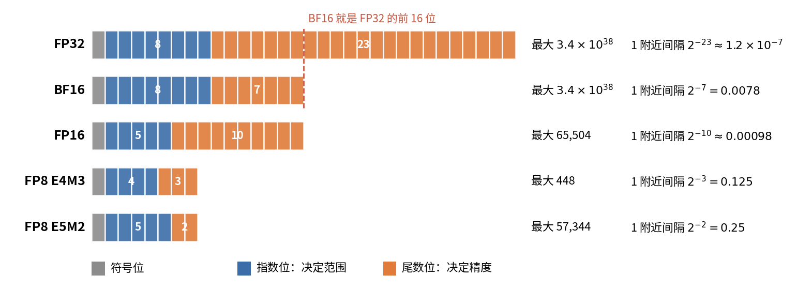
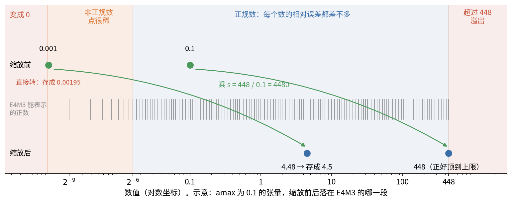
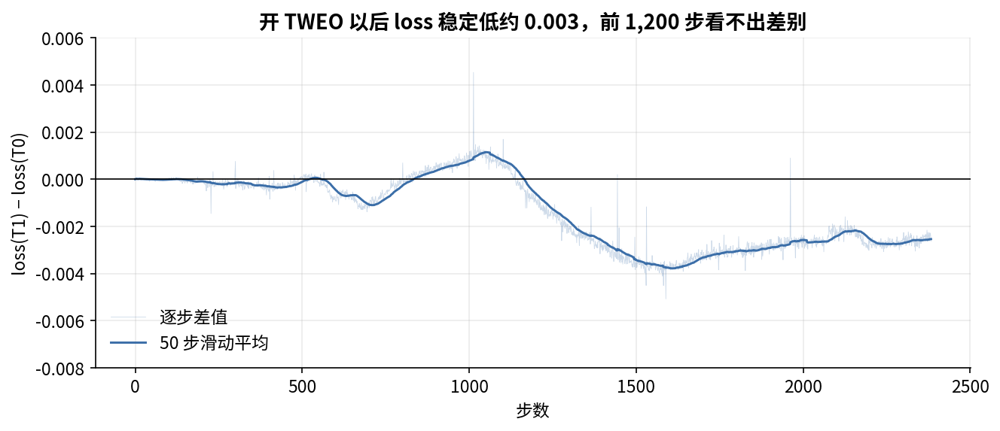

# 第 11 章　数值精度：BF16、FP8 与激活离群值

> 训练一个 7B 模型要做约 $2\times10^{23}$ 次浮点运算（第 1 章）。每个数用几位来存，直接决定了显存、通信量和计算速度。这一章从浮点数怎么存讲起，接着讲混合精度训练、FP8 的缩放机制、离群值为什么会毁掉 FP8，最后看 ZGCM 的 FP8 配置和 TWEO 的实测数据。

## 这一章要回答的问题

读完这一章，你应该能回答下面这些问题。

1. FP32、FP16、BF16、FP8 E4M3、FP8 E5M2 各用几位存指数、几位存尾数？各自最大能表示多大、精度多高？
2. 为什么训练用 BF16 计算，却要留一份 FP32 的主权重？
3. FP16 训练要 loss scaling，BF16 为什么不用？
4. FP8 为什么必须给每个张量配一个缩放因子？"前向 E4M3、反向 E5M2"是什么道理？
5. delayed scaling 和 amax history 是什么？ZGCM 的 1024 条 amax 历史意味着什么？
6. ZGCM 里哪些矩阵乘走 FP8，哪些仍是 BF16？
7. 激活离群值为什么对 FP8 特别致命？TWEO 怎么压它？W&B 上 TWEO 的配对实验说明了什么、没说明什么？
8. 585 TFLOP/s 为什么叫"约 60% 的 BF16 等效 MFU"？FP8 为什么只带来约 1.5 倍，而不是 2 倍？

---

<a id="s11-1" name="s11-1"></a>
## 11.1 为什么要用低精度

每个数少用几位，好处体现在三个地方。显存上，同样的激活和权重占的字节少了，能放更大的 micro-batch 或更长的序列。带宽上，GPU 读写显存、卡间通信时传的字节少，速度就快。计算上，GPU 的矩阵乘单元（Tensor Core）对低精度有更高的峰值：H100 SXM 的稠密峰值，BF16 约 989 TFLOP/s，FP8 约 1,979 TFLOP/s，正好翻倍。

位数少了，精度和范围就会变差。要么能表示的数的范围变窄，太大的数溢出，太小的数变成 0；要么相邻两个可表示数之间的间隔变大，舍入误差跟着变大。

所以数值精度这件事要回答的是：**哪些运算可以用低精度、低到什么程度，而不让训练变坏**。业界现在的答案是分层的：

| 东西 | 常用精度 |
|---|---|
| 大矩阵乘的输入 | BF16，或者 FP8（ZGCM） |
| 矩阵乘内部的累加 | FP32（硬件自动做） |
| softmax、norm、loss | FP32 |
| 主权重、优化器状态、梯度累加 | FP32 |

后面几节逐一解释这张表为什么这样分。

<a id="s11-2" name="s11-2"></a>
## 11.2 浮点数怎么存

要讲清楚哪里能降精度，得先知道浮点数是怎么存的。一个浮点数由三部分组成：符号位（正负）、指数（数量级）和尾数（有效数字，mantissa）。它的值等于

$$(-1)^{s}\times 1.m \times 2^{e-\text{bias}}$$

指数的位数决定范围，也就是能表示多大、多小的数。尾数的位数决定精度，也就是在同一个数量级里相邻两个数隔多远：尾数有 $k$ 位，1 附近的间隔就是 $2^{-k}$。

公式里还有两处要交代。尾数前面那个"1."不占位：正规数的最高位总是 1，干脆不存，等于白得一位精度。指数存成一个不带符号的整数，减去固定的偏置（bias，FP32 是 127）才是实际的指数，这样不用单独的符号位也能表示负指数。指数位全为 0 是例外，这时前面的 1 换成 0，得到一串比最小正规数还小、在 0 和最小正规数之间等间隔排开的数，叫非正规数（subnormal）。它们很稀，越靠近 0，相对误差越大。下表里的"最小正规数"就是正规数和非正规数的分界，后面讲 FP8 时会反复碰到这条线。

先看下图，比较每一行蓝色和橙色的长度：总位数固定时，多给指数一位，就要少给尾数一位。



下表列出五种格式，数值用 PyTorch 的 `torch.finfo` 核对过。

| 格式 | 符号/指数/尾数 | 最大值 | 1 附近的间隔 | 最小正规数 |
|---|---|---|---|---|
| FP32 | 1/8/23 | $3.4\times10^{38}$ | $2^{-23}\approx1.2\times10^{-7}$ | $1.2\times10^{-38}$ |
| FP16 | 1/5/10 | 65,504 | $2^{-10}\approx0.00098$ | $6.1\times10^{-5}$ |
| BF16 | 1/8/7 | $3.4\times10^{38}$ | $2^{-7}=0.0078$ | $1.2\times10^{-38}$ |
| FP8 E4M3 | 1/4/3 | 448 | $2^{-3}=0.125$ | $2^{-6}=0.0156$ |
| FP8 E5M2 | 1/5/2 | 57,344 | $2^{-2}=0.25$ | $6.1\times10^{-5}$ |

这张表有三处值得细看。第一处，BF16 和 FP32 的指数位一样多，都是 8 位，所以范围一样大，只是尾数从 23 位砍到了 7 位。BF16 相当于把 FP32 的后 16 位直接截掉。FP16 正好反过来，尾数多（10 位），指数少（5 位），最大只有 65,504。

第二处是 FP8 的两种分法。E4M3 多一位尾数，精度高一点，范围小，最大 448；E5M2 多一位指数，范围大，最大 57,344，精度更粗。

第三处，E4M3 没有无穷大。训练里用的 E4M3 是 OCP 标准的"fn"变体，它把无穷大的编码让给了更大的有限数，最大值才能到 448。这样一来，一个超过 448 的数如果不做饱和处理就直接转换，会变成 NaN。在 PyTorch 里试一下：`torch.tensor(500.).to(torch.float8_e4m3fn)` 得到 `nan`。

我们手算一个舍入的例子，把 3.3 存成 FP8。$3.3 = 1.65\times2^1$。E4M3 的尾数只有 3 位，$1.m$ 只能取 1.000、1.125、1.250、……、1.875，离 1.65 最近的是 1.625，所以存成 $1.625\times2=3.25$，误差 1.5%。E5M2 的尾数只有 2 位，只能取 1.00、1.25、1.50、1.75，最近的是 1.75，存成 3.5，误差 6%。

FP8 只有 256 个可能的编码，舍入误差在百分之几的量级。矩阵乘是一大堆数做加权求和，误差会互相抵消一部分，这个量级可以接受。有些运算却是一个数决定一切，比如 softmax 里最大的那个打分、loss 本身，这种误差就受不了。

<a id="s11-3" name="s11-3"></a>
## 11.3 混合精度训练：BF16 计算，FP32 保存与累加

低精度有这些毛病，训练里就不能处处都用它。**混合精度训练**（mixed precision training）的做法是，前向和反向的大部分计算用低精度，需要保存和累加的地方保留 FP32。这是 2018 年以来的标准做法（Micikevicius et al., 2018，当时用的是 FP16）。

### 为什么要 FP32 主权重

看一个手算的例子。权重 $w=1.0$，这一步的更新量是 $\eta\cdot\Delta = 10^{-4}$。BF16 在 1 附近的间隔是 $2^{-7}=0.0078$，$1.0 + 0.0001$ 离 1.0 比离下一个数 1.0078 近得多，于是舍入回 1.0，这次更新直接丢了。用 PyTorch 验证，BF16 的 `1.0 + 1e-4` 等于 `1.0`。每一步都这样丢，权重就永远不动。

ZGCM 预训练的 LR 是 $2\times10^{-4}$，Muon 每个元素的更新量也就是这个量级（第 10 章），比 BF16 的间隔小两个数量级。所以必须有一份 **FP32 主权重**（master weights）：优化器在 FP32 副本上做更新，再把结果转成 BF16 给下一步前向用。FP32 在 1 附近的间隔是 $1.2\times10^{-7}$，$10^{-4}$ 的更新能完整保留。

### 为什么梯度累加也用 FP32

梯度累加是同样的道理。ZGCM 一步有 8 个 micro-batch（第 2 章），梯度要累加 8 次，之后还要跨 48 个数据并行组求和。在 BF16 里 $256+1=256$。256 是 $2^8$，尾数只有 7 位，所以这一段的间隔是 $2^{8-7}=2$，256 的下一个数是 258；257 正好在两者中间，按"舍入到偶数"的规则回到 256。拿一个小例子算：在 BF16 里从 0 开始把 1.0 一次次加上去，加 1,000 次，结果停在 256，之后每加一次 1 都被吞掉（PyTorch 实测，同样的加法在 FP32 里得到 1,000）。梯度累加和跨卡求和也是一长串加法，累加器里的数越大，后加进来的小梯度丢得越多，所以累加器要用 FP32。

Megatron 的处理在 `megatron/training/arguments.py` L987-1000。开了 `--bf16` 时，参数用 BF16 存（`params_dtype = torch.bfloat16`）；如果没有显式要求用 BF16 做梯度 reduce，就自动打开 `accumulate_allreduce_grads_in_fp32`，并打印 "accumulate and all-reduce gradients in fp32 for bfloat16 data type"。每个参数旁边有一个 FP32 的 `main_grad` 缓冲区，反向算出的梯度直接加到这里。

### 为什么 FP16 要 loss scaling，BF16 不用

FP16 的最小正规数是 $6.1\times10^{-5}$，很多梯度比这还小，在 FP16 里会变成 0，这叫下溢（underflow）。所以 FP16 训练要先把 loss 乘一个大数（比如 $2^{16}$），让梯度整体变大、落进 FP16 的范围，更新前再除回去，这个办法叫 loss scaling。乘多大要动态调：溢出了就减半，一段时间没溢出就加倍。

BF16 的指数和 FP32 一样有 8 位，最小正规数是 $10^{-38}$，梯度基本不会下溢，所以不需要 loss scaling。ZGCM 的 W&B 里有一个 `loss_scale` 指标，值一直是 1，原因就在这里。

FP16 的范围在另一头也有问题：激活超过 65,504 就溢出成无穷大。大模型的激活里常有几千甚至上万的离群值（[§11.7](#s11-7)），所以支持 BF16 的 A100 出现以后，大模型训练大多换成了 BF16。

### 哪些运算保留 FP32

有些运算对精度要求高，即使输入是 BF16，也会放在 FP32 里算。最基本的是矩阵乘内部的累加：Tensor Core 读进 BF16 或 FP8 的输入，乘积却在 FP32 里累加，最后才转回 BF16 输出，这一步由硬件完成。RMSNorm 要平方再求均值，用 FP32（第 2 章 [§2.7](02_Transformer到能讲的程度.md#s2-7)）。softmax 要先减最大值再取指数，也在 FP32 里做。

交叉熵 loss 的 logits 有 154,880 维，求 log-sum-exp 要用 FP32。ZGCM 开了 `ENABLE_CROSS_ENTROPY_LOSS_FUSION=1`（env L78），用融合的 kernel 一次算完，不把整张 FP32 的 logits 存下来。还有输出门的 sigmoid：ZGCM fork 里的 `_apply_output_gate`（`attention.py` L1241-1247）先把 gate 转成 FP32 再算 sigmoid，乘完再转回原来的类型，[§11.11](#s11-11) 会读这段代码。

### 每个参数占多少字节

把上面这些规则合起来，一个参数在 BF16 混合精度下要占：

| 项目 | 字节 |
|---|---|
| BF16 参数（前向反向用） | 2 |
| FP32 梯度累加缓冲 | 4 |
| FP32 主权重 | 4 |
| 优化器状态：Adam 的 $m$、$v$ 各 4 字节；Muon 只有动量 4 字节 | 8 或 4 |
| 合计 | Adam 18，Muon 14 |

ZGCM 有 7.39B 参数，如果全部放在一张卡上用 Adam，要 $7.39\times18\approx133$ GB，超过 H100 的 80 GB。所以要把主权重和优化器状态切到多张卡上（distributed optimizer，第 12 章）。

<a id="s11-4" name="s11-4"></a>
## 11.4 FP8：每个张量都要配一个缩放因子

BF16 的范围和 FP32 一样，换过去几乎不用操心溢出和下溢。FP8 的情况就不同了。

### 范围太窄，必须先缩放

E4M3 能表示的正数，从最小的非正规数 $2^{-9}\approx0.002$ 到 448，跨度约 $2^{18}$，而 BF16 的跨度是 $2^{260}$ 量级。直接把 BF16 张量转成 E4M3，大小合适的数没问题，太小的数就会丢。

举个例子。一个权重矩阵的元素典型大小在 0.01 到 0.02 之间，最大的绝对值是 0.1。直接转 E4M3（PyTorch 实测），0.01 存成 0.0098，还行；0.001 存成 0.00195，误差 95%，因为它已经掉到 E4M3 最小的非正规数附近了。

办法是先乘一个缩放因子再转。取 $s = 448/\text{amax}$，amax 是这个张量的最大绝对值，这里 $s=448/0.1=4480$。于是 0.001 先变成 4.48，转 E4M3 后存成 4.5，误差 0.4%；最大值 0.1 变成 448，正好顶到上限，不溢出。矩阵乘完以后，输出再除以两个输入各自的缩放因子 $s_A\cdot s_B$，就回到原来的数值。这么做，等于把 FP8 有限的 256 个编码对准这个张量实际用到的数值范围。

打个比方，用一把只刻到毫米的尺子量头发丝，读数是 0；先把头发放大 1,000 倍再量，最后把读数除以 1,000，就量得出来。缩放因子做的就是这件事。这个比方有一处不准：尺子的刻度是均匀的，浮点数的刻度却按比例排，在正规数范围里每个数的相对误差都差不多，所以缩放不会让本来就在中间的数变得更准。它的作用是把整个张量挪离两头，左头是稀疏的非正规数和 0，右头是 448 以上的溢出。下图画的是上面这个例子，看 0.001 缩放前落在哪一段、缩放后挪到了哪里。



这种做法叫 **per-tensor scaling**（按张量缩放）：每个参与 FP8 矩阵乘的张量（权重、激活、梯度）都有自己的缩放因子，存在 FP32 里。

### hybrid：前向 E4M3，反向 E5M2

缩放解决了对准范围的问题，剩下的是选 E4M3 还是 E5M2。一次训练步里，一个 Linear 层有三次矩阵乘（第 1 章）：

| 矩阵乘 | 输入 | ZGCM 用的格式 |
|---|---|---|
| 前向 $Y = XW$ | 激活 $X$、权重 $W$ | E4M3 |
| 反向求输入梯度 $\partial X = \partial Y\, W^\top$ | 输出梯度 $\partial Y$、权重 | $\partial Y$ 用 E5M2 |
| 反向求权重梯度 $\partial W = X^\top \partial Y$ | 激活、输出梯度 | $\partial Y$ 用 E5M2 |

这种组合叫 **hybrid**（`FP8_FORMAT=hybrid`，env L69）。激活和权重的分布比较集中，需要的是精度，所以用多一位尾数的 E4M3。梯度的数值跨好几个数量级，同一个张量里大的和小的差得很远，需要的是范围，所以用多一位指数的 E5M2。E5M2 的跨度约 $2^{32}$，比 E4M3 的 $2^{18}$ 宽得多。

这个分法来自 NVIDIA、Arm、Intel 联合发的 FP8 格式论文（Micikevicius et al., 2022，报告 §3.1.3 第 7 页引的就是它）。另一个选项 `e4m3` 是前向反向都用 E4M3。Megatron 只支持这两种（`transformer_config.py` L504，`fp8_utils.py` L545-550）。

<a id="s11-5" name="s11-5"></a>
## 11.5 delayed scaling 和 amax history

### 缩放因子从哪来

上一节的缩放因子按张量的 amax 算，但 amax 什么时候求，有两种做法。最直接的是每次转换前先扫一遍张量求 amax，再算 $s$，再转换。这叫 current scaling（当前缩放，Megatron 里叫 `tensorwise`）。它要多读一遍张量；在张量并行下，amax 还要跨卡求最大值，多一次同步。

**delayed scaling**（延迟缩放）改用过去的 amax 来决定这一次的缩放因子，步骤是：

1. 每个张量维护一个长度为 $H$ 的 amax history（amax 历史），记录最近 $H$ 次的 amax。
2. 这一次转换时，直接用历史算出的 $s$。
3. 转换的同时顺手统计这一次的实际 amax，写进历史，留给下一次用。

这样求 amax 和转换合在同一个 kernel 里，不用多扫一遍。缩放因子的公式是

$$s = \frac{\text{FP8 最大值}}{\text{amax}_{\text{hist}}}\Big/\,2^{\text{margin}}$$

margin 是安全余量，留出 $2^{\text{margin}}$ 倍的空间防止溢出。Megatron 默认 `fp8_margin=0`（`transformer_config.py` L530），ZGCM 没改。

### ZGCM 的选择：1024 条历史，取最大值

ZGCM 的配置见 env L70-L72 和报告 §3.1.3 第 7 页。它设了 `FP8_RECIPE=delayed`；`FP8_AMAX_HISTORY_LEN=1024`，保留最近 1024 条 amax 记录；`FP8_AMAX_COMPUTE_ALGO=max`，取这 1024 个值里最大的算缩放因子。另一个选项 `most_recent` 只看上一次。

Megatron 的默认历史长度是 1（`transformer_config.py` L538），ZGCM 显式改成了 1024。TE 自己的 `DelayedScaling` 默认就是 1024 和 `max`，所以 ZGCM 等于用回了 TE 的默认值。

这个选择偏保守。只要最近 1024 条记录里出现过一次大值，缩放因子就按它定，再突然来一个同样大的值也不会溢出。反过来，它也很迟钝：如果某一步出现了一个特别大的离群值，接下来 1024 条记录期间缩放因子都偏小，所有正常大小的数都被压到 FP8 范围的低端，精度变差。ZGCM 预训练每步约 5 秒（$5.58\times10^{17}$ FLOPs 除以 $585\times10^{12}\times192$），如果每步记一条，1024 条大约是 1.4 小时。

这个 1.4 小时是按"每步记一条 amax"算的，实际可能短得多。本机装的 TE 1.14 源码里，amax 历史在每次退出 `fp8_autocast` 时前移一格（`fp8.py` 的 `fp8_autocast_exit`），而 Megatron 在 delayed 模式下把每次 TransformerBlock 前向整个包在这个上下文里（`transformer_block.py` L759-769），也就是每个 micro-batch 记一条。ZGCM 预训练一步有 8 个 micro-batch（768 = 2 × 48 × 8，第 12 章），如果它用的 TE 也这样，1024 条记录只覆盖约 128 步，十分钟出头。ZGCM 实际用的 TE 版本本书没有核对，所以两种算法都写在这里。

还有一种情况：这一步的值比历史最大值还大，乘上缩放因子后就超过 448，TE 的转换会把它截到最大值（饱和），这个值本身的误差就很大。

所以 delayed scaling 最怕两件事：激活里有极大的离群值，以及离群值的大小突然跳变。离群值从哪来，[§11.7](#s11-7) 再讲。

### amax 要跨卡同步

同一个权重被切到张量并行的两张卡上，两边必须用同一个缩放因子，否则拼起来的结果不一致。Megatron 进入 FP8 上下文时传了一个 `fp8_group`（`fp8_utils.py` L621-625），默认是"张量并行 × 数据并行 × 上下文并行"的合并组（`parallel_state.py` L1503-1510），PP=1 时就是全部 192 张卡。每步结束时，TE 在这个组里对 amax 求最大值。

<a id="s11-6" name="s11-6"></a>
## 11.6 ZGCM 里哪些运算走 FP8

机制讲完了，回到 ZGCM，看它把哪些运算放进了 FP8。报告的说法是"矩阵乘用 TE hybrid FP8，其他运算保留 BF16 或 FP32"（报告 §3.1.3 第 7 页）。对照代码，更准确的说法是：32 个 Transformer 层里、由 TE 实现的 Linear 层走 FP8。

Megatron 在 delayed scaling 下，把整个 Transformer block 的前向包在一个 FP8 上下文里（`transformer_block.py` L765-770），block 之外的东西不在这个上下文里。下表逐项列出各运算的精度：

| 运算 | 精度 | 依据 |
|---|---|---|
| QKV 投影（连同输出门的 gate 一起，融合成一个 Linear） | FP8 | fork 里 `linear_qkv_out_dim` 在开了输出门时加上 gate 的维度（`attention.py` L1289-1291） |
| 注意力输出投影 $W_O$ | FP8 | TE Linear |
| FFN 的 gate/up 和 down | FP8 | TE Linear |
| 注意力计算（$QK^\top$、softmax、乘 $V$） | BF16 | `fp8_dot_product_attention` 默认 False（`transformer_config.py` L552），launcher 没开 |
| 输出门的 sigmoid 和逐元素乘 | FP32 再转回 | `attention.py` L1245 |
| RMSNorm、QK-norm、RoPE、残差加 | BF16/FP32 | 不是矩阵乘 |
| embedding 查表 | BF16 | 不是矩阵乘 |
| `lm_head`（4096 × 154880） | BF16 | 用的是 Megatron 自己的 `ColumnParallelLinear`（`gpt_model.py` L244），在 block 之外 |
| 交叉熵 | FP32 | 融合 kernel |

表里的"注意力计算"指 $QK^\top$、softmax、乘 $V$ 这一段，下文都这样叫。

按参数量算，FP8 覆盖了 32 层的全部矩阵：注意力 1.80B 加 FFN 4.33B，约 6.1B，占全部参数的 83%（第 2 章 [§2.10](02_Transformer到能讲的程度.md#s2-10)）。剩下的 17% 是两张词表，不走 FP8。

按计算量算，就要扣掉注意力计算。16K 序列下，注意力计算在全模型 FLOPs 里占得不多（ZGCM 有 27 层是 128 窗口的滑窗，第 9 章），影响有限。到了 256K 的 mid-train，5 个全局层的注意力计算会变成大头，这部分享受不到 FP8 加速。

权重梯度也在 FP8 里算。`fp8_wgrad` 默认 True（`transformer_config.py` L548），Megatron 把它传给 TE 的 `override_linear_precision=(False, False, not fp8_wgrad)`（`fp8_utils.py` L559）。三个位置分别对应前向、输入梯度、权重梯度，False 表示不改回高精度，所以三次矩阵乘都是 FP8。

### FP8 参数 all-gather

除了矩阵乘，ZGCM 的配置还让参数通信也走 FP8：env 里设了 `FP8_PARAM_GATHER=1`（env L73），launcher 据此加上 `--fp8-param-gather`（`launch_train.sh` L120），Megatron 再把它映射成 `fp8_param=True`（`arguments.py` L1672）。

这个选项要结合 distributed optimizer 来理解（第 12 章细讲）。每张卡只保存一部分 FP32 主权重，优化器更新完以后，要把更新后的权重 all-gather 给所有卡。不开这个选项时，all-gather 的是 BF16 权重，每个参数 2 字节。开了以后，模型权重本身就以 FP8 存（TE 的 `fp8_model_init`，`fp8_utils.py` L631-645），all-gather 的是 FP8，每个参数 1 字节，通信量减半，显存里的模型权重也减半。估一下量：TP=2 时每张卡负责约 3.7B 参数，BF16 all-gather 每步每卡要收约 7.4 GB，FP8 约 3.7 GB。

放到 ZGCM 上，这个收益要打个折扣。ZGCM 用 Muon，而只要用 Muon，Megatron 就会把 distributed optimizer 换成 layer-wise 版本（第 10 章 [§10.6](10_优化器与学习率.md#s10-6)，`arguments.py` L1485-1487）。"先把更新后的 FP32 主权重量化成 FP8，再 all-gather"的专门代码在 `distrib_optimizer.py` 里（L52 导入 `quantize_param_shard`），`layer_wise_optimizer.py` 里没有对应的处理。所以在 ZGCM 上能确定生效的只有一件事：权重以 FP8 创建和保存。all-gather 时传的到底是 FP8，还是先反量化成 BF16，本书没能核实。上面"通信减半"的结论只适用于标准的 Adam 加 distributed optimizer。

这个选项还有约束：只能和 distributed optimizer 一起用（`arguments.py` L924-926），开优化器 CPU offload 时还必须用 delayed scaling（L1499-1502）。

<a id="s11-7" name="s11-7"></a>
## 11.7 激活离群值：FP8 最大的敌人

[§11.5](#s11-5) 说过，delayed scaling 最怕离群值。这一节看离群值从哪来，又是怎么坏事的。

### 离群值长什么样

训练过的大模型里，激活不是均匀分布的。少数几个隐藏维度、在少数几个 token 上（常见的是序列第一个 token、标点、分隔符），数值会比典型值大几百到几千倍。Dettmers et al. 2022（LLM.int8，[论文](https://arxiv.org/abs/2208.07339)）发现，模型到 6.7B 左右，这种"离群特征"会系统性地出现，并固定在某几个维度上。Sun et al. 2024（[Massive Activations](https://arxiv.org/abs/2402.17762)）把这种值叫 **massive activations**，并发现它们和 attention sink 有关：模型想让某些头"什么都不做"时，会把注意力集中到第一个 token 上，这需要那个位置有极大的激活（第 9 章 [§9.6](09_模型架构.md#s9-6)）。

### SwiGLU 会放大离群值

Fishman et al. 2024（[Scaling FP8 training to trillion-token LLMs](https://arxiv.org/abs/2409.12517)）在 FP8 下把 7B 模型训到万亿 token 量级，发现训练到后期才开始发散。他们追到的原因是 SwiGLU：

$$\text{SwiGLU}(x) = \text{SiLU}(xW_{gate})\odot(xW_{up})$$

两路都是 $x$ 的线性函数，相乘以后对 $x$ 是"二次"的。训练久了，$W_{gate}$ 和 $W_{up}$ 的某些列会对齐，于是在某些输入方向上输出按平方增长，离群值越长越大。他们的结论是，这种不稳定在短训练里看不到，要到几千亿 token 之后才冒出来。他们提的修法叫 Smooth-SwiGLU，在相乘之前对每个通道单独缩放。

ZGCM 用的就是 SwiGLU（第 2 章 [§2.6](02_Transformer到能讲的程度.md#s2-6)），训了 4.78T token，正好落在这个风险区里。

### 离群值怎么毁掉 per-tensor scaling

缩放因子按 amax 定。一个张量里只要有一个值是 10,000，$s=448/10000=0.0448$，其余所有数都被压到 FP8 范围的最底端。用 PyTorch 模拟"乘 $s$、转 E4M3、再除回 $s$"的过程，结果如下：

| 原值 | amax=10000 时还原出的值 | amax=20 时还原出的值 |
|---|---|---|
| 1.0 | 0.959 | 0.982 |
| 0.1 | 0.087 | 0.1004 |
| 0.01 | 0 | 0.00977 |
| 0.001 | 0 | 0.00096 |

amax 是 10,000 时，所有小于约 0.02 的数都变成了 0：它们乘上 0.0448 以后不到 0.001，比 E4M3 最小的非正规数 $2^{-9}$ 的一半还小，只能舍成 0。这些数在矩阵乘里本来是有贡献的，现在整片消失。如果 amax 能压到 20，同样的数都能保留下来，误差在百分之几。

再叠加 delayed scaling 的特点（[§11.5](#s11-5)），情况更糟。离群值突然变大、超过历史最大值时，会被截断；离群值只要出现过一次，之后 1024 条记录期间所有正常值都损失精度。

所以 FP8 训练稳不稳，很大程度上取决于**能不能把离群值控制在一个小的、稳定的范围里**。业界常见的办法有三类。第一类改量化粒度：不按整个张量算一个缩放因子，改成按小块算（[§11.10](#s11-10) 的 blockwise、MXFP8），一个离群值只影响它所在的小块。第二类改结构，比如 Smooth-SwiGLU；输出门也属于这一类（Qiu et al. 2025 报告门能消除 attention sink 和 massive activations，第 9 章 [§9.6](09_模型架构.md#s9-6)）；QK-norm 则防止注意力打分变大。第三类加正则，在 loss 里加一项，直接惩罚过大的激活。TWEO 属于第三类。

<a id="s11-8" name="s11-8"></a>
## 11.8 TWEO：用一个 loss 项压住离群值

### 公开资料里能确认的

TWEO 是 Liang et al. 2025 提出的方法，全名 "Transformers Without Extreme Outliers"（[arXiv 2511.23225](https://arxiv.org/html/2511.23225)）。论文摘要说，用一个很简单的 loss 项，就能把离群值从 10,000 以上降到 20 以下，从而不用额外的工程技巧就能做全模型 FP8 预训练。

据检索到的二手摘要（[emergentmind](https://www.emergentmind.com/topics/tweo-framework)），这个 loss 项加在每个 Transformer block 的输出上，超参数是 $\tau=3$、$p=4$、$\epsilon=10^{-6}$。直观上可以这样理解（推断，论文原文的公式本书没能取到核对）：$\tau$ 是"多大算离群"的尺度，$p=4$ 是惩罚的次数。4 次方让惩罚几乎全落在最大的那些值上：一个 10 倍于 $\tau$ 的值，惩罚是 $10^4$；一个和 $\tau$ 差不多大的值，惩罚约为 1。

### ZGCM 怎么用：报告里只写了一句

报告的原话在 §3.1.3 第 7 页：TWEO 作为激活正则，用来压制极端的中间值，配合 delayed scaling。Finding 2（§3.1.3 第 7 页）说"把 delayed scaling 和 TWEO 正则结合，能防止数值发散，同时保持 60% 的 BF16 等效 MFU"。

除此之外，报告没有给 TWEO 的系数，没有给"不加 TWEO 会怎样"的数字，公开仓库里也没有 TWEO 的代码（[§11.12](#s11-12)）。

### W&B 上能看到的：一组 256K 配对实验

报告之外，能找的证据只剩 W&B。公开的 W&B 里，只有一组实验记录了 TWEO 相关的指标（run 名 `view-ablation-mtcmp-*`）。三个 run 的设置完全一样：256K 序列、GBS 48、2,384 步（约 30B token）、峰值 LR $10^{-4}$。区别在起点和是否加 TWEO：

| run | W&B 显示名 | 起点 | 这段训练加 TWEO |
|---|---|---|---|
| B0 | Base 1T | 一个"1T"基座 | 否 |
| T0 | fastTWEO base, no TWEO | 一个"fastTWEO"基座 | 否 |
| T1 | fastTWEO base, with TWEO | 同 T0 | 是 |

起点的含义只能从名字推断：T0 和 T1 从同一个、预训练时用过某种 TWEO 的基座出发，B0 从另一个基座出发。所以能拿来做配对比较的是 T1 对 T0。

下面先看 loss 和 grad norm，数字是本书从 history.jsonl 重算的：

| run | 最后 100 步平均 loss | grad norm 中位数 | grad norm 最大值 |
|---|---|---|---|
| B0 | 1.2581 | 0.039 | 0.550 |
| T0 | 1.2612 | 0.034 | 0.448 |
| T1 | 1.2586 | 0.033 | 0.449 |

再把 T1 减 T0 的 loss 差按 400 步一段求平均：

| 步数段 | 0–399 | 400–799 | 800–1199 | 1200–1599 | 1600–1999 | 2000–2383 |
|---|---|---|---|---|---|---|
| 差值 | −0.0001 | −0.0005 | +0.0004 | −0.0027 | −0.0031 | −0.0025 |

T0 和 T1 第 1 步的 loss 完全相同（都是 1.639），前 5 步的差值都是 0，说明两者用的是同一份数据、同一个顺序，差值曲线里没有数据不同带来的噪声。逐步差值的标准差只有约 0.0006，而单个 run 逐步 loss 的标准差约 0.029。前 1,200 步两者几乎没区别，之后 T1 稳定地低约 0.003。两个 run 都没有发散，grad norm 也几乎一样。



纵轴是 T1 减 T0。浅色的是逐步差值，深色是 50 步滑动平均，前 1,200 步在 0 附近，之后稳定落在 0 下方。

### TWEO 项本身的记录

T1 每步还多记了几个指标。本书逐步核对了它们之间的关系，2,384 步全部成立，误差在 $10^{-9}$ 量级：

| 指标 | 末步数值 | 和别的量的关系 |
|---|---|---|
| `tweo_raw` | $3.06\times10^{10}$ | 原始的正则值 |
| `tweo_uncapped` | $3.06\times10^{7}$ | $=10^{-3}\times$ `tweo_raw` |
| `tweo_cap_limit` | 0.00131 | $=10^{-3}\times$ `loss` |
| `tweo_weighted` | 0.00131 | $=\min$(uncapped, cap_limit)，2,384 步里每一步都被截断 |
| `tweo_cap_scale` | $4.26\times10^{-11}$ | $=$ weighted / raw |
| `total_objective` | 1.3082 | $=$ `loss` $+$ `tweo_weighted` |

从这张表能确定三件事。

第一，系数是 $10^{-3}$，上限是语言模型 loss 的 0.1%。原始值太大，每一步都顶到了上限，实际效果相当于 TWEO 项永远等于 loss 的千分之一，有效系数约 $4\times10^{-11}$。

第二，W&B 的 `loss` 是纯语言模型 loss，不含 TWEO 项。所以上面 T1 低的 0.003 是语言模型本身的 loss 低了，和统计口径无关。

第三，`tweo_raw` 在这段训练里没有降下来。它在第 1 步约 $1.17\times10^{10}$，第 1,000 步约 $1.55\times10^{10}$，最后约 $3.06\times10^{10}$，涨了约 2.6 倍。256K 训练里，TWEO 并没有把它定义的"离群程度"压低，只是可能让它涨得慢一些。T0 没有记录 `tweo_raw`，所以没法比。

截断设计的用意（推断）是这样的：TWEO 原始值的量级会随训练剧烈变化，固定系数很难调；把它截到 loss 的固定比例，正则项的梯度就不会压过语言模型本身的梯度。截断以后，梯度方向仍然来自 4 次方惩罚，集中在最大的那些激活上。

### 这组实验说明了什么，没说明什么

它能说明的是：在这个 256K、30B token 的设置下，加 TWEO 不伤 loss，后半段还略好约 0.003，grad norm 没有变化。

它说明不了的有三点。第一，它没说明不加 TWEO 就会发散，因为 T0 没加也没发散。Fishman et al. 的经验是 FP8 的问题要训几千亿 token 才出现，30B token 的实验本来就测不到。第二，这是 mid-train 阶段的对比，不是预训练。预训练的 W&B（`view-lite-pretrain-public`、`view-bench-pretrain-*`）里没有任何 TWEO 指标，所以预训练到底有没有开 TWEO、系数是多少，只能信报告那一句。第三，只有一个种子。0.003 的差值在配对比较里很稳定，但换一个随机种子还会不会是这个方向，不知道。

<a id="s11-9" name="s11-9"></a>
## 11.9 吞吐：FP8 到底快了多少

数值上的风险讲完了，再看 FP8 换来了多少速度。

### "60% BF16 等效 MFU"是怎么算的

报告 §3.1.3 第 7 页说，16K 正式训练每卡约 585 model TFLOP/s，相对 H100 的 BF16 稠密峰值 989 TFLOP/s，约 60% 的 "BF16-equivalent MFU"。

$$\frac{585}{989} = 59.2\%$$

MFU（model FLOPs utilization）的定义在第 1 章：分子是按模型结构算出的"理论上必须做的"浮点运算数除以时间，分母是硬件峰值。这里要注意，分母选的是 BF16 峰值。H100 的 FP8 稠密峰值是 1,979 TFLOP/s，如果按 FP8 峰值算：

$$\frac{585}{1979} = 29.6\%$$

两种说法都没错，意思不同。说 BF16 等效 MFU 是 60%，是拿 ZGCM 和一个纯 BF16 训练的系统比，它每秒完成的有效计算相当于 BF16 峰值的六成，和别人的 BF16 训练比较时用这个口径。说相对 FP8 峰值只有 30%，则说明 FP8 硬件的能力远没用满。

### 为什么不是 2 倍

FP8 的矩阵乘峰值是 BF16 的 2 倍，整步时间却不会减半，原因有四个。最直接的一个是只有 TE Linear 变快了，注意力计算、norm、激活函数、残差、交叉熵、`lm_head` 都不走 FP8（[§11.6](#s11-6)）。另外，量化本身有开销：每次矩阵乘前要把 BF16 转成 FP8、统计 amax，还要维护转置后的 FP8 副本给反向用。通信也不变，或者只少一部分：梯度规约（ZGCM 是 all-reduce，第 12 章）还是 FP32/BF16；参数 all-gather 最多因为 `fp8_param_gather` 减半，而 ZGCM 上连这一点也没能核实（[§11.6](#s11-6)）。最后，矩阵乘本身也到不了峰值，矩阵的形状、显存带宽都会限制实际速度。

用 Amdahl 定律估一下。设 BF16 训练里，能换成 FP8 的矩阵乘占整步时间的比例是 $f$，并且这部分正好快 2 倍，其余不变：

$$\text{加速比} = \frac{1}{(1-f) + f/2}$$

报告说"FP8 精度和系统配置"贡献约 1.5 倍（报告 §3.1.3 第 7 页）。解 $1/(1-f/2)=1.5$ 得 $f = 2/3$。要拿到 1.5 倍，BF16 时矩阵乘至少要占三分之二的时间，而且 FP8 矩阵乘要真的快到 2 倍。即使矩阵乘的占比再高一些、到 80%，上限也只有 $1/(1-0.4)\approx1.67$ 倍。FP8 的收益天然到不了 2 倍。

反过来，如果 1.5 倍全部来自 FP8，那么同样系统下的 BF16 吞吐约为 $585/1.5=390$ TFLOP/s，MFU 约 39%（推断）。报告没给 BF16 基线的实测数字，而且它说的是"precision-and-systems configuration"，可能把 FP8 之外的系统优化也算了进去（[§11.12](#s11-12)）。

### 这对总训练时间意味着什么

第 1 章用 585 TFLOP/s 算出纯算力约 22 天。如果没有 FP8、按 390 算，就是约 33 天。对 192 张卡来说，这是约 5 万 GPU 小时的差别（$11\times24\times192\approx5.1\times10^4$）。大家愿意为 FP8 承担数值风险，图的就是省下的这 11 天。

<a id="s11-10" name="s11-10"></a>
## 11.10 ZGCM 没用的其他做法

### 其他缩放方案

ZGCM 选的是 delayed，而 Megatron 一共支持五种 FP8 recipe（`transformer_config.py` L511，`fp8_utils.py` L555-575）：

| recipe | 缩放粒度 | 缩放因子从哪来 | 特点 |
|---|---|---|---|
| `delayed`（ZGCM） | 每个张量一个 | 历史 amax | 开销最小；对离群值的突变最敏感 |
| `tensorwise` | 每个张量一个 | 当前 amax（current scaling） | 更准；要多扫一遍张量 |
| `blockwise` | 小块 | 每块当前 amax | DeepSeek-V3 的做法 |
| `mxfp8` | 每 32 个元素一个 | 每块当前 amax，缩放因子本身是 8 位的 2 的幂 | OCP 的 MX 标准；Blackwell（B200）硬件原生支持 |
| `custom` | 自定义 | — | 研究用 |

其中 DeepSeek-V3 的 FP8（[技术报告](https://arxiv.org/abs/2412.19437)）值得单独记一下，它是公开资料里规模最大、写得最细的 FP8 预训练之一。它的激活按 1×128 的小块、权重按 128×128 的块各算一个缩放因子，一个离群值只影响它所在的 128 个数。前向反向全部用 E4M3，因为细粒度缩放已经解决了范围问题，就不需要 E5M2 的大范围了。另外，H800 上 FP8 矩阵乘内部的累加精度不够，所以每累加 128 个元素，就把部分和搬到 FP32 寄存器里累加一次。

拿它和 ZGCM 对比。ZGCM 用粗粒度的 per-tensor delayed scaling，开销小，但离群值的风险大，所以要靠 TWEO 把离群值本身压下去。DeepSeek 用细粒度缩放，让离群值的影响局部化。两条路解决的是同一个问题。

### 其他可以放进 FP8 或者刻意不放的东西

能放进 FP8 的不只是线性层。`--fp8-dot-product-attention` 让 $QK^\top$ 和乘 $V$ 也走 FP8（`transformer_config.py` L552）。长序列下注意力计算占比大，开了收益明显；但 softmax 前的打分对误差敏感，风险也大。ZGCM 没开。

反方向的选项是让首尾几层保留 BF16。`first_last_layers_bf16`（`transformer_config.py` L561）让第一层和最后几层不走 FP8，因为这几层的激活分布通常最极端。但它和 delayed scaling 不兼容，代码里直接断言禁止（`fp8_utils.py` L647-652），因为 delayed scaling 要求整个 block 在同一个 FP8 上下文里统一做 amax 归约。ZGCM 用 delayed，所以没法用这个选项。

优化器状态和通信也可以压。把 Adam 的 $m$、$v$ 或者梯度通信也压到 FP8 或 BF16，能进一步省显存和带宽，比如 DeepSeek-V3 用 BF16 存 Adam 的矩，COAT 等工作把优化器状态压到 FP8。ZGCM 的优化器状态是 FP32。

再往下还有 FP4。Blackwell 支持 NVFP4（每 16 个元素一个缩放因子），Megatron 里已经有 `fp4` 的分支（`transformer_block.py` L771-774）。目前它主要用于推理，训练还在研究阶段。

最后提一下 z-loss。这是 PaLM 用的一个 loss 项，惩罚 softmax 的归一化因子 $\log Z$ 变大，防止输出 logits 漂移。它和 TWEO 一样，是用 loss 项管数值的思路，只是管的是输出层。第 14 章会讲它。

### 怎么判断 FP8 有没有出问题

如果你自己做 FP8 训练，至少要盯住几样东西。第一是和 BF16 跑一段对照：同样的数据、同样的起点，跑几十亿 token，loss 差应该在千分之几以内。第二是看 amax 和缩放因子。TE 可以导出每层的 amax history，某一层的 amax 持续上涨，就是离群值在长。第三是看 grad norm 的尖峰。FP8 出问题时，常见的表现是 grad norm 的尖峰变多变高，然后 loss 突然跳起来（第 14 章）。还有一条，长训练才算数：按 Fishman et al. 的经验，前几百亿 token 没事，不代表后面没事。

<a id="s11-11" name="s11-11"></a>
## 11.11 读代码

前面几节提到的代码散在几个文件里，这一节把它们串起来读一遍。

### 1. 从 env 到 TE recipe

launcher 把 env 里的四个 FP8 变量原样传给 Megatron（`launch_train.sh` L110-114、L120）：

```bash
  --transformer-impl "${TRANSFORMER_IMPL}"        # transformer_engine
  --fp8-format "${FP8_FORMAT}"                    # hybrid
  --fp8-recipe "${FP8_RECIPE}"                    # delayed
  --fp8-amax-compute-algo "${FP8_AMAX_COMPUTE_ALGO}"   # max
  --fp8-amax-history-len "${FP8_AMAX_HISTORY_LEN}"     # 1024
...
[[ "${FP8_PARAM_GATHER:-0}" == 1 ]] && model+=(--fp8-param-gather)
```

Megatron 在 `fp8_utils.py` L545-560 里把它们变成 TE 的 recipe 对象：

```python
if config.fp8 == "e4m3":
    fp8_format = transformer_engine.common.recipe.Format.E4M3
elif config.fp8 == "hybrid":
    fp8_format = transformer_engine.common.recipe.Format.HYBRID
...
if config.fp8_recipe == Fp8Recipe.delayed:
    fp8_recipe = TEDelayedScaling(
        config=config,
        fp8_format=fp8_format,
        override_linear_precision=(False, False, not config.fp8_wgrad),
    )
```

`Format.HYBRID` 就是 [§11.4](#s11-4) 讲的前向 E4M3、反向 E5M2。`override_linear_precision` 的三个位置对应前向、输入梯度、权重梯度三次矩阵乘；`fp8_wgrad` 默认 True，所以第三个是 False，权重梯度也在 FP8 里算。

`TEDelayedScaling` 是 TE `DelayedScaling` 的一层薄包装（`extensions/transformer_engine.py` L2465-2471）：

```python
super().__init__(
    margin=config.fp8_margin,                       # 0
    fp8_format=fp8_format,
    amax_compute_algo=config.fp8_amax_compute_algo, # "max"
    amax_history_len=config.fp8_amax_history_len,   # 1024
    override_linear_precision=override_linear_precision,
    **extra_kwargs,
)
```

`extra_kwargs` 里还有 `fp8_dpa` 和 `fp8_mha`（L2458-2459），对应 FP8 注意力，ZGCM 都是默认的 False。

### 2. FP8 上下文包在哪

`transformer_block.py` L765-770：

```python
if self.config.fp8:
    use_outer_quantization_context = self.config.fp8_recipe == Fp8Recipe.delayed
    use_inner_quantization_context = self.config.fp8_recipe != Fp8Recipe.delayed
    outer_quantization_context = (
        get_fp8_context(self.config) if use_outer_quantization_context else nullcontext()
    )
```

delayed scaling 时，整个 block（32 层）共用一个外层 FP8 上下文。原因写在 L759-763 的注释里：别的 recipe 进出上下文没有代价，可以逐层控制；delayed 的 amax 归约绑在上下文的进出上，必须整体包起来。这个上下文只包 Transformer block，`lm_head` 在 `gpt_model.py` 里、block 之外，所以是 BF16（[§11.6](#s11-6)）。

`get_fp8_context`（`fp8_utils.py` L612-630）里，训练时用的是 TE 的 `fp8_autocast(enabled=True, fp8_recipe=..., fp8_group=...)`，其中 `fp8_group` 就是 [§11.5](#s11-5) 说的 amax 归约组。初始化模型时（`is_init=True`），如果开了 `fp8_param`，用的是 `fp8_model_init`，让权重直接以 FP8 创建。`fp8_param_gather` 能用 FP8 做 all-gather，前提就是这一步。

### 3. 输出门里的 FP32

`attention.py` L1241-1247：

```python
@jit_fuser
def _apply_output_gate(self, x, gate):
    x_dtype = x.dtype
    gate = gate.contiguous()
    gate = gate.view(*x.shape)
    x = x * torch.sigmoid(gate.float())
    x = x.to(x_dtype)
    return x
```

`gate` 是 QKV 那个 FP8 Linear 输出的一部分（L1289-1291），出来时已经是 BF16。`gate.float()` 先把它转成 FP32 再算 sigmoid。sigmoid 在输入很大或很小时接近 0 或 1，BF16 下 0.999 和 1.0 分不开（略小于 1 的地方间隔是 $2^{-8}\approx0.004$），门的细微差别会丢。`x * ...` 时 `x` 被自动提升到 FP32，乘完再 `.to(x_dtype)` 转回 BF16，交给下一步的 $W_O$。`@jit_fuser` 让这几步融合成一个 kernel，FP32 的中间结果不写回显存。

矩阵乘用低精度、逐元素的非线性用高精度，这段代码是这条规则的一个具体例子。

<a id="s11-12" name="s11-12"></a>
## 11.12 坑和对不上的地方

下面这些地方，要么公开材料之间对不上，要么本书没能核实，引用时要小心。

1. TWEO 不在任何公开代码里。在整个 ZGCM-1 目录下搜 `tweo`（不分大小写），只有 W&B 的 T1 run 和它的元数据里有，pretrain fork、midtrain、SFT 的代码里都没有。报告说用了 TWEO，但没法从代码确认它加在哪、怎么算、系数多少。W&B 只能反推出 mid-train 消融里"系数 $10^{-3}$、上限为 loss 的 0.1%"（[§11.8](#s11-8)）。
2. 预训练是否开了 TWEO，没有直接证据。预训练的 W&B 没有 TWEO 指标。消融里 T0/T1 的起点叫"fastTWEO base"，暗示存在一个用过 TWEO 的基座；B0 的起点叫"Base 1T"。正式发布的基座是哪一个、两者是什么关系，报告没说。
3. Finding 2 没有数字支撑。它说 TWEO 能"防止数值发散"，但公开材料里没有一个不加 TWEO 而发散的 run。唯一的配对实验（T0/T1）两边都没发散，只显示 TWEO 让 loss 低了约 0.003。
4. "60% MFU"有口径问题。这是相对 BF16 峰值的"等效"MFU，相对 FP8 峰值只有约 30%，引用时要说清楚。
5. 1.5 倍没有基线。报告说"FP8 精度和系统配置"贡献约 1.5 倍（§3.1.3 第 7 页），但没给同系统下 BF16 的吞吐，也没说"系统配置"包括哪些。4.2 倍总加速里的这一项无法复核。
6. "矩阵乘用 FP8"这个说法太宽。注意力计算里的两次矩阵乘和 `lm_head` 也是矩阵乘，但都不走 FP8（[§11.6](#s11-6)）。准确的说法是"Transformer 层里的线性层用 FP8"。
7. SFT 的吞吐指标不能用。SFT 的 W&B 里 `throughput_tflops_per_gpu` 最后一步是 1,409.6（全程中位数 1,402.7，附录 C [§C.6](附录C_W&B与数据配比统计.md#sc-6)），这是 BF16 峰值的 1.43 倍、FP8 稠密峰值 1,979 的 71%。SFT 是 256K 序列，注意力计算占了很大比例而且不走 FP8，实际吞吐不可能这么高。第 17 章 [§17.6](17_SFT.md#s17-6) 复算过，这个数是按整条 256K 因果注意力数 FLOPs 得来的，实际约 237。不要拿它和 585 比。
8. 续训时 amax history 的状态要留意。delayed scaling 依赖最近 1024 条 amax 记录，续训后如果这段历史没有被恢复，最初一段的缩放因子只来自很少几条记录。本书没有核对 ZGCM 的 checkpoint 是否保存了 TE 的 FP8 状态（TE 一般把它放在模块的 extra state 里）。自己做 FP8 续训时，这一点要检查（第 13 章）。

<a id="s11-13" name="s11-13"></a>
## 11.13 试着讲给别人听

下面是一段讲稿。建议你先合上书自己讲一遍，再对照。

> 浮点数由符号、指数、尾数组成。指数位决定范围，尾数位决定精度。BF16 和 FP32 一样有 8 位指数，所以范围一样大，但尾数只有 7 位。FP8 有两种：E4M3 最大 448，精度稍好；E5M2 最大五万多，精度更粗。
>
> 混合精度训练的规则是：大矩阵乘用低精度，保存和累加的地方用 FP32。主权重必须是 FP32，因为 2e-4 量级的更新加到 1 上，在 BF16 里会被舍入掉。梯度累加也用 FP32。BF16 的范围和 FP32 一样，梯度不会下溢，所以不需要 FP16 那种 loss scaling。softmax、norm、交叉熵都在 FP32 里算。
>
> FP8 的范围太窄，每个张量要配一个缩放因子，等于 448 除以这个张量的最大绝对值，把 FP8 有限的编码对准实际的数值范围。前向用 E4M3 要精度，反向的梯度用 E5M2 要范围，这叫 hybrid。ZGCM 用 delayed scaling：缩放因子不看当前张量，看的是最近 1024 条 amax 记录里的最大值，这样求 amax 不用多扫一遍。它的毛病是对离群值敏感：一个一万的离群值会把所有小于 0.02 的数压成 0；而且出现一次，之后很长一段都受影响，按每步一条算是一个多小时，按每个 micro-batch 一条算是一百多步。
>
> 大模型里离群值是常态，少数维度在少数 token 上大几千倍，SwiGLU 还会在长训练里把它越放越大。ZGCM 用 TWEO，在 loss 里加一项惩罚过大的激活。从 W&B 能反推出系数是千分之一，而且每步都被截到 loss 的千分之一。256K 的配对实验里，加 TWEO 的 loss 低了约 0.003，两边都没发散。所以这组实验说明 TWEO 不伤效果，但证明不了不加就会发散。
>
> 吞吐上，ZGCM 每卡 585 TFLOP/s，相对 BF16 峰值约 60%，相对 FP8 峰值只有 30%。FP8 只加速线性层，注意力计算、norm、lm_head、通信都不变，所以整体只有约 1.5 倍。对 192 张卡来说，这大约省了 11 天、5 万 GPU 小时。

<a id="s11-14" name="s11-14"></a>
## 11.14 习题

1. 写出 BF16、FP16、E4M3、E5M2 的指数位和尾数位。哪两种格式范围一样大？
2. 为什么 BF16 训练必须保留 FP32 主权重？用一个具体的数说明。
3. FP16 训练为什么要 loss scaling？ZGCM 的 W&B 里 `loss_scale` 一直是 1，为什么？
4. 把 0.001 直接转成 E4M3 会怎样？如果张量的 amax 是 0.1，先乘缩放因子再转，结果如何？
5. "hybrid" 格式前向用什么、反向用什么？为什么这样分？
6. delayed scaling 和 current scaling 的区别是什么？delayed 省掉了什么开销？
7. `amax_history_len=1024` 加 `amax_compute_algo=max` 的好处和坏处各是什么？
8. ZGCM 的 `lm_head` 和注意力计算是不是 FP8？你从哪段代码判断？
9. `--fp8-param-gather` 省的是什么？它依赖哪个优化器设置？
10. 一个张量里有一个 10,000 的离群值，其他数在 0.001 到 1 之间。per-tensor FP8 量化后会发生什么？
11. SwiGLU 为什么会放大离群值？为什么短训练看不出来？
12. 从 T1 的 W&B 指标能推出 TWEO 的哪些设置？`loss` 包不包含 TWEO 项？
13. T0/T1 实验能不能证明"不加 TWEO，FP8 会发散"？为什么？
14. 585 TFLOP/s 相对 BF16 和 FP8 峰值各是多少 MFU？为什么 FP8 整体只带来约 1.5 倍？
15. ZGCM 的 per-tensor delayed scaling 和 DeepSeek-V3 的 FP8 方案，各自怎么应对离群值？

<details><summary>参考答案</summary>

1. BF16 8/7，FP16 5/10，E4M3 4/3，E5M2 5/2。BF16 和 FP32 都是 8 位指数，范围一样大（[§11.2](#s11-2)）。
2. BF16 在 1 附近的间隔是 0.0078。$1.0+10^{-4}$ 会舍入回 1.0，更新丢失。FP32 的间隔是 $1.2\times10^{-7}$，能保留（[§11.3](#s11-3)）。
3. FP16 最小正规数 $6.1\times10^{-5}$，小梯度会下溢成 0，要先把 loss 放大。BF16 的指数位和 FP32 一样，不会下溢，所以不用缩放，`loss_scale` 恒为 1（[§11.3](#s11-3)）。
4. 直接转得到 0.00195，误差 95%。$s=448/0.1=4480$，0.001 变成 4.48，存成 4.5，还原后误差 0.4%（[§11.4](#s11-4)）。
5. 前向的激活和权重用 E4M3，反向的梯度用 E5M2。激活和权重要精度；梯度跨好几个数量级，要范围（[§11.4](#s11-4)）。
6. current scaling 每次先求当前张量的 amax 再转换；delayed 用历史 amax 决定这一次的缩放因子，转换时顺手记录新 amax。省掉了多扫一遍张量和额外的跨卡同步（[§11.5](#s11-5)）。
7. 好处是保守，过去出现过的大值不会再溢出。坏处是一次大离群值会让之后 1024 条记录（每步一条约 1.4 小时；按本机 TE 每个 micro-batch 一条，约 128 步）的缩放因子都偏小，正常值精度变差；比历史更大的值还会被截断（[§11.5](#s11-5)）。
8. 都不是。`transformer_block.py` L765-770 只把 block 包进 FP8 上下文，`lm_head` 是 block 外的 `ColumnParallelLinear`（`gpt_model.py` L244）；注意力计算要 `fp8_dot_product_attention`，默认 False（[§11.6](#s11-6)、[§11.11](#s11-11)）。
9. distributed optimizer 更新后 all-gather 权重时传 FP8 而不是 BF16，通信量和模型权重显存都减半。只能和 distributed optimizer（或 FSDP）一起用。ZGCM 用 Muon，实际走的是 layer-wise 优化器，里面没有 FP8 all-gather 的专门处理，所以在 ZGCM 上只能确定权重以 FP8 存（[§11.6](#s11-6)）。
10. $s=0.0448$，小于约 0.02 的数全部变成 0，1.0 也有约 4% 误差（[§11.7](#s11-7) 的表）。
11. SwiGLU 两路都是输入的线性函数，相乘后是二次的；训练久了两路权重对齐，输出按平方增长。Fishman et al. 发现要几千亿 token 后才出现（[§11.7](#s11-7)）。
12. 系数 $10^{-3}$（uncapped = raw × 1e-3），上限是 loss 的 0.1%，每一步都被截断；`total_objective = loss + tweo_weighted`，所以 `loss` 不含 TWEO 项（[§11.8](#s11-8)）。
13. 不能。T0 不加也没发散；实验只有 30B token、一个种子，而且是 mid-train，不是预训练（[§11.8](#s11-8)、[§11.12](#s11-12)）。
14. 585/989 ≈ 59%，585/1979 ≈ 30%。只有线性层变快，注意力计算、norm、lm_head、通信、量化开销不变；按 Amdahl 定律，矩阵乘占三分之二时上限就是 1.5 倍（[§11.9](#s11-9)）。
15. ZGCM 用粗粒度缩放，靠 TWEO 正则把离群值本身压小。DeepSeek-V3 用 1×128 和 128×128 的细粒度缩放，让离群值只影响自己所在的小块，全部用 E4M3，并定期把累加提升到 FP32（[§11.10](#s11-10)）。
</details>

---

上一章：[第 10 章　优化器与学习率](10_优化器与学习率.md)　下一章：[第 12 章　分布式并行](12_分布式并行.md)
