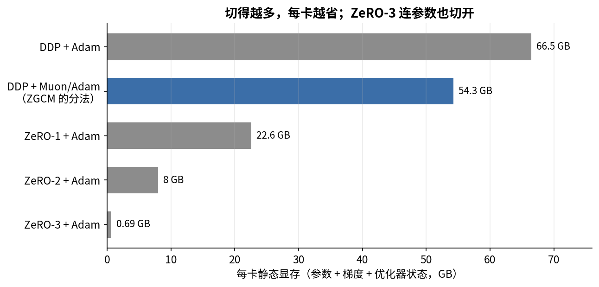
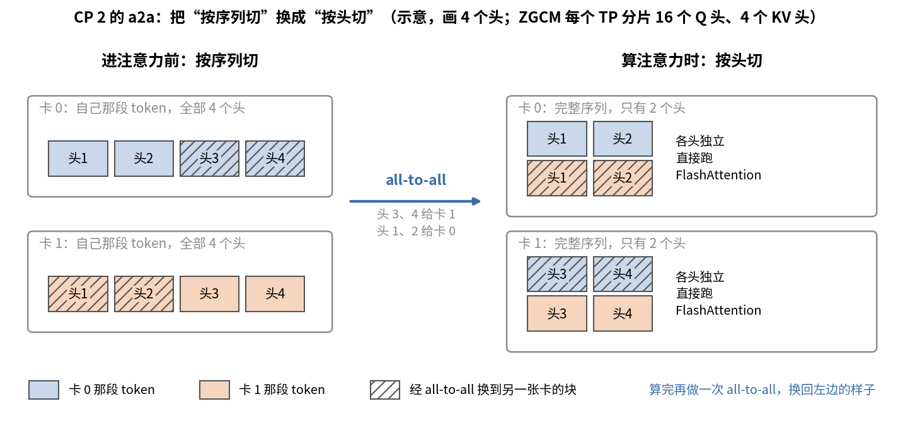
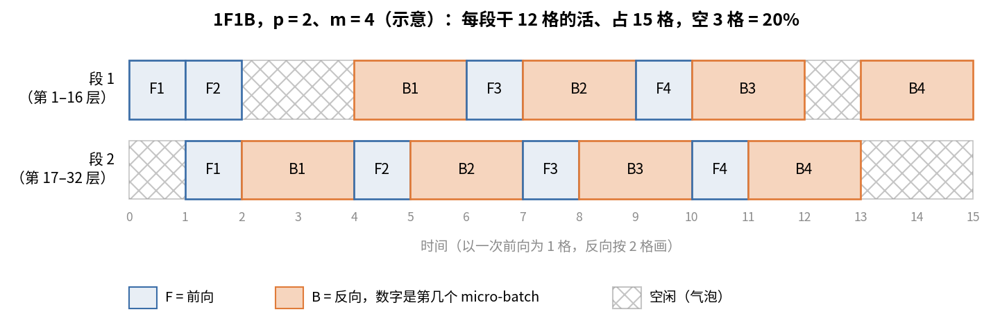
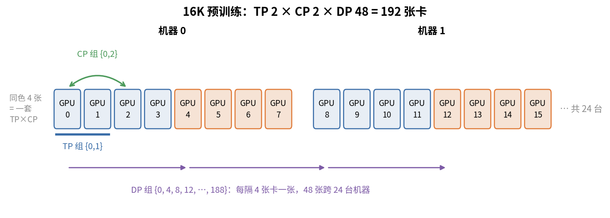

# 第 12 章　分布式并行

> 你用过 DeepSpeed，知道 ZeRO 有几个 stage。这一章从"为什么一张卡放不下"讲起，把数据并行、ZeRO、张量并行、序列并行、上下文并行、流水线并行一个个讲清楚，再用 ZGCM 的真实配置把显存、batch、通信逐项算一遍。读完以后，随便拿一个 Megatron 启动配置给你，你应该能说出每张卡上放了什么、每一步在传什么。

## 这一章要回答的问题

读完这一章，你应该能回答下面这些问题。

1. 训练 7B 模型，一张 80GB 的卡为什么放不下？显存都花在哪？
2. all-reduce、reduce-scatter、all-gather、all-to-all 各做什么？通信量怎么算？
3. 数据并行（DP）和 ZeRO 1/2/3 的区别是什么？Megatron 的 distributed optimizer 对应 ZeRO 哪一级？ZGCM 实际用的是什么？
4. 张量并行（TP）怎么切矩阵？为什么每层要通信，为什么 TP 一般不出机器？
5. 序列并行（SP）和上下文并行（CP）分别切的是什么？ZGCM 为什么选 a2a 型的 CP？
6. 流水线并行（PP）的气泡是怎么来的？ZGCM 为什么只在 256K 才开 PP？
7. MBS、GBS、梯度累积之间是什么关系？768 是怎么拆的？
8. 激活重算（recompute）的 selective 和 full 各省多少显存、多花多少计算？
9. 585 和 203 TFLOP/s 能直接比吗？Megatron 的吞吐计数器是怎么数 FLOPs 的？

---

<a id="s12-1" name="s12-1"></a>
## 12.1 一张卡为什么不够

训练时，显存里要放四类东西：

| 类别 | 是什么 | 大小随什么变 |
|---|---|---|
| 参数 | 模型权重本身 | 参数量 |
| 梯度 | 每个参数一个梯度 | 参数量 |
| 优化器状态 | FP32 主权重、动量、二阶矩 | 参数量 |
| 激活 | 前向时存下来、反向要用的中间结果 | token 数 × 层数 × 隐藏维度 |

前三类只和参数量有关，叫**静态显存**；第四类和这一步处理多少 token 有关，叫**激活显存**。

先算静态显存。第 11 章 [§11.3](11_数值精度.md#s11-3) 讲过每个参数占几个字节：Megatron 用 BF16 训练时，每个参数存 BF16 权重 2 字节、FP32 梯度 4 字节；Adam 再加 FP32 主权重、一阶矩、二阶矩各 4 字节，合计 18 字节。Muon 没有二阶矩，合计 14 字节。ZGCM 有 7.39B 参数，全用 Adam 是 $7.39\times10^9\times18 = 133$ GB；矩阵用 Muon、其余用 Adam，约 108.6 GB（第 10 章 [§10.5](10_优化器与学习率.md#s10-5)）。H100 只有 80 GB，还没开始算激活，静态显存就已经放不下了。

激活也不小。ZGCM 一层一个 token 大约要存 150 KB 的激活，[§12.11](#s12-11) 会细算这个数。预训练每条样本 16,384 个 token，32 层，一条样本就要约 80 GB。

所以这几类东西必须拆到多张卡上。拆法有好几种，各自拆的东西不同：

| 并行方式 | 拆什么 | 每张卡上有什么 |
|---|---|---|
| 数据并行 DP | 拆数据 | 完整模型，不同的样本 |
| ZeRO / distributed optimizer | 在 DP 基础上拆优化器状态（及梯度、参数） | 完整模型，只有一部分优化器状态 |
| 张量并行 TP | 拆每个矩阵 | 每层的一部分权重 |
| 序列并行 SP | 拆 TP 组里 norm、残差那几段的激活 | 配合 TP 用 |
| 上下文并行 CP | 拆一条序列 | 每条样本的一段 token |
| 流水线并行 PP | 拆层 | 连续的若干层 |

ZGCM 预训练的组合是 TP 2、CP 2、DP 48、PP 1，总共 $2\times2\times48 = 192$ 张卡（`pretrain/configs/stages/01_pretrain_1t_sequential.env` L84-L86，L17 的 24 个节点乘每节点 8 卡）。后面各节大体按这张表的顺序讲。

<a id="s12-2" name="s12-2"></a>
## 12.2 通信原语：先讲清楚"传什么"

不管哪种并行方式，最后都落到几种集合通信（collective）上，所以先把这些操作和它们的通信量弄清楚。设一组有 $n$ 张卡，每张卡上有一块大小为 $S$ 字节的数据。

| 原语 | 做什么 | 每张卡发出的数据量（环形算法） |
|---|---|---|
| all-reduce | 每张卡最后都得到 $n$ 块数据的和 | $2\frac{n-1}{n}S$ |
| reduce-scatter | 求和后切成 $n$ 段，每张卡只拿自己那段 | $\frac{n-1}{n}S$ |
| all-gather | 每张卡贡献一段，最后每张卡都拿到全部 | $\frac{n-1}{n}S$（$S$ 是拼好后的大小） |
| all-to-all | 每张卡把自己的数据切成 $n$ 份，第 $j$ 份发给第 $j$ 张卡 | $\frac{n-1}{n}S$ |
| broadcast | 一张卡把数据发给所有卡 | 源卡发 $S$ |
| send/recv（P2P） | 两张卡之间点对点传 | $S$ |

这几个原语之间有一个关系，本章后面会反复用到：**all-reduce = reduce-scatter + all-gather**。环形 all-reduce 就是这么实现的，先 reduce-scatter，每张卡拿到一段的和；再 all-gather，把各段拼回来。所以 all-reduce 的通信量是另外两个的 2 倍。

拿 3 张卡手算一遍（示意数字）。卡 0 上的梯度是 (1, 2, 3)，卡 1 是 (4, 5, 6)，卡 2 是 (7, 8, 9)，all-reduce 要让每张卡都得到 (12, 15, 18)。reduce-scatter 先分工：卡 0 管第 1 个数，卡 1 管第 2 个，卡 2 管第 3 个。每张卡把自己不管的 2 个数发给对应的卡，求和之后卡 0 手里是 12，卡 1 是 15，卡 2 是 18。all-gather 再让每张卡把自己那个和发给另外两张，三张卡就都有了 (12, 15, 18)。环形算法里这些数是沿着环接力、边传边加的，路线不同，但每张卡发出的总量一样：两个阶段里每张卡都只发出 3 个数中的 2 个，也就是 $\frac{n-1}{n}S$，合起来正是表里 all-reduce 的 $2\frac{n-1}{n}S$。

环形 all-reduce 的通信量和卡数几乎无关。每张卡发出 $2\frac{n-1}{n}S$，$n$ 很大时趋近 $2S$。卡多了，每张卡并不会传得更多，只是环更长、延迟更高。数据并行能扩到上千张卡，靠的就是这一点。

光看通信量还不够，还要看带宽，而带宽是分层的。一台 H100 服务器里 8 张卡之间走 NVLink，单方向约 450 GB/s；跨机器走 InfiniBand，常见配置是每张卡配一块 400 Gb/s 的网卡，也就是 50 GB/s，两者差了约 9 倍。报告没写 ZGCM 集群的网络配置，这一章用到网络带宽的地方都按这个常见配置估算，标"推断"。

这 9 倍的差距决定了并行方式怎么摆。通信频繁、又在关键路径上的（TP）放在机器内；通信少、能和计算重叠的（DP）可以跨机器。

<a id="s12-3" name="s12-3"></a>
## 12.3 数据并行（DP）：最朴素的拆法

最直接的办法是拆数据。每张卡放一份完整的模型，一个 global batch 的样本平均分给各卡。每张卡各自做前向和反向，得到自己那批样本的梯度，然后所有卡做一次 all-reduce 求平均。这样每张卡拿到的梯度完全一样，各自用优化器更新后，参数也完全一样。

结果之所以和单卡一样，是因为 loss 是对所有样本求平均的，而梯度是线性的，"各卡算一部分梯度再求平均"就等于"一张卡算全部样本的梯度"。

DP 的毛病是每张卡都要放完整的参数、梯度和优化器状态。它只拆了激活，静态显存一点没省。7B 模型用 Adam 要 133 GB，DP 开多大都放不下。

工程上，DP 有一个常见的优化。如果等反向全部算完再做 all-reduce，这段时间 GPU 就闲着。Megatron 的 DDP 把梯度分成若干桶（bucket）。反向是从最后一层往前算的，一个桶里的梯度全算好了，就立刻发出这个桶的 all-reduce，同时继续算前面层的梯度。这叫梯度规约重叠（overlap grad reduce）。ZGCM 开了它：`ENABLE_OVERLAP_GRAD_REDUCE=1`（env L76），对应 `--overlap-grad-reduce`（`launch_train.sh` L156）。

桶的大小默认是 $\max(4000\text{万}, 100\text{万}\times\text{DP 大小})$ 个参数（`distributed_data_parallel.py` L64-L65）。ZGCM 的 DP 是 48，所以一个桶 4800 万个参数。每个 TP 分片有 36.95 亿个参数，约 77 个桶。不开重叠时，桶大小设成无穷大（L67-L68），也就是反向全部算完再一次性规约。

规约用的精度是 FP32。BF16 训练时，Megatron 默认用 FP32 累加和规约梯度（`arguments.py` L990-L999）。ZGCM 没有加 `--grad-reduce-in-bf16`，所以走的是 FP32。

参与规约的也不只是 DP 组。同一条样本被 CP 切成两段，放在两张卡上，两张卡算出的梯度都只是这条样本的一部分，必须加起来。所以 Megatron 做梯度规约用的组是 DP×CP（`distributed_data_parallel.py` L79 的 `dp_cp_group`，L175 用 $1/|\text{dp\_cp}|$ 缩放）。ZGCM 里这个组有 $48\times2=96$ 张卡。

有了这些，就能估一下 ZGCM 一步的梯度通信（本书推算）。每张卡的梯度缓冲是 $36.95\text{亿}\times4\text{ 字节}=14.78$ GB，环形 all-reduce 每卡发出 $2\times\frac{95}{96}\times14.78\approx29.3$ GB，按每卡 50 GB/s 的网卡（推断）约 0.59 秒。16K 阶段一步约 6 秒（[§12.12](#s12-12)），这 0.59 秒大部分能藏在反向计算后面。

<a id="s12-4" name="s12-4"></a>
## 12.4 ZeRO 和 distributed optimizer：把静态显存也拆掉

DP 的浪费在于，96 张卡上存着 96 份一模一样的优化器状态。**ZeRO**（Zero Redundancy Optimizer，DeepSpeed 提出）的想法是：既然一样，每张卡只存 $1/d$ 就行了，$d$ 是 DP 组的卡数。按拆得多少，ZeRO 分三级：

| 级别 | 拆什么 | 梯度怎么规约 | 每卡静态显存（字节/参数，Adam） |
|---|---|---|---|
| DDP | 不拆 | all-reduce | $2+4+12=18$ |
| ZeRO-1 | 优化器状态 | reduce-scatter，再 all-gather 参数 | $2+4+12/d$ |
| ZeRO-2 | 优化器状态 + 梯度 | reduce-scatter，再 all-gather 参数 | $2+(4+12)/d$ |
| ZeRO-3 | 优化器状态 + 梯度 + 参数 | 前向、反向时临时 all-gather 参数 | $18/d$ |

拿 ZeRO-1 走一遍。每张卡先算出完整的梯度，然后做 reduce-scatter：求和之后，每张卡只拿到自己负责的那 $1/d$ 段梯度。它只有这一段的优化器状态，所以也只更新这一段参数。最后做 all-gather，把更新后的参数段拼回来，每张卡又有了完整参数。reduce-scatter 加 all-gather 正好等于一次 all-reduce（[§12.2](#s12-2)），所以显存省了，通信没变多。

ZeRO-3 连参数也拆。前向算到某一层时，临时把这层的参数 all-gather 过来，用完就扔；反向时再 gather 一次。通信量约是 DDP 的 1.5 倍，因为前向一次 all-gather、反向一次 all-gather、梯度一次 reduce-scatter，一共 3 份 $\frac{n-1}{n}S$，而 DDP 的 all-reduce 是 2 份。这样换来最少的显存。PyTorch 的 FSDP（Fully Sharded Data Parallel）就是 ZeRO-3 的思路。

把这几种方案放到 ZGCM 的一个 TP 分片上算（36.95 亿参数，$d=96$，本书推算）：

| 方案 | 每卡静态显存 |
|---|---|
| DDP + Adam | 66.5 GB |
| DDP + Muon/Adam 混合（ZGCM 的实际分法） | 54.3 GB |
| ZeRO-1 + Adam | 22.6 GB |
| ZeRO-2 + Adam | 8.0 GB |
| ZeRO-3 + Adam | 0.69 GB |



画成条形图看得更清楚。从 DDP 到 ZeRO-1，主要是 Adam 的 12 字节状态被 96 张卡分掉了；ZeRO-2 再分掉梯度，ZeRO-3 连参数也分掉，每卡剩下不到 1 GB。

如果你熟悉 DeepSpeed，可以这样对应：Megatron 的 `--use-distributed-optimizer` 约等于 ZeRO-1，梯度缓冲还是完整的一份，但会 reduce-scatter；Megatron 的 FSDP（`--use-megatron-fsdp` 或 torch FSDP2）约等于 ZeRO-3；DeepSpeed 的 `stage: 2` 在 Megatron 里没有一一对应的开关。

不过 ZGCM 实际用的并不是 ZeRO-1。第 10 章 [§10.6](10_优化器与学习率.md#s10-6) 讲过，Muon 要拿到整个矩阵才能做 Newton–Schulz，所以只要开了 Muon，Megatron 就把 distributed optimizer 换成 **layer-wise distributed optimizer**（`arguments.py` L1485-L1487）。它的一步是这样走的：梯度做完整的 all-reduce，每张卡都有全部梯度，这一步没有 reduce-scatter；然后每张卡只更新分给自己的那几个整张量；最后 all-gather 参数（`layer_wise_optimizer.py` L278-L287）。

因此 ZGCM 每卡的静态显存是 BF16 参数 7.39 GB、FP32 梯度 14.78 GB，再加平均约 0.3–0.5 GB 的优化器状态。拿到 embedding 分片的那张卡多出约 3.8 GB（[§10.6](10_优化器与学习率.md#s10-6)）。通信量是一次 all-reduce 加一次 all-gather，按 [§12.2](#s12-2) 的算法是 3 份 $\frac{n-1}{n}S$，ZeRO-1 的 reduce-scatter 加 all-gather 是 2 份，所以按元素份数约为 ZeRO-1 的 1.5 倍。ZGCM 的梯度是 FP32、参数是 BF16，按字节算是 2×4 + 2 = 10 对 4 + 2 = 6，约 1.7 倍。参数 all-gather 的量是 $36.95\text{亿}\times2$ 字节 ≈ 7.4 GB，按 50 GB/s 约 0.15 秒（推断）。

ZGCM 设了 `ENABLE_OVERLAP_PARAM_GATHER=0`（env L77）。这个开关会传给 layer-wise 优化器的 `async_allgather`（`optimizer/__init__.py` L854），所以 ZGCM 的参数 all-gather 是同步的，在 `step()` 里做完才进下一步。

<a id="s12-5" name="s12-5"></a>
## 12.5 张量并行（TP）：把每个矩阵切开

ZeRO 解决了静态显存，但每张卡算的还是完整的模型，激活也是完整的。**张量并行**（Tensor Parallelism）把每一层的矩阵切开，每张卡只存、只算一部分。Megatron-LM 这个名字就是从这里来的（Shoeybi 等，2019）。

一个线性层是 $Y = XW$，$X$ 是 $[\text{token 数}, h_\text{in}]$，$W$ 是 $[h_\text{in}, h_\text{out}]$。它有两种切法。按列切（ColumnParallelLinear）时 $W = [W_1, W_2]$，卡 $i$ 算 $Y_i = XW_i$。每张卡都要完整的 $X$，输出是 $Y$ 的一部分列，不需要通信。按行切（RowParallelLinear）时 $W = \begin{bmatrix}W_1\\W_2\end{bmatrix}$，$X=[X_1, X_2]$，卡 $i$ 算 $X_iW_i$。因为 $Y = X_1W_1 + X_2W_2$，最后要做 all-reduce 求和。

用一个只有一个 token 的例子算一下（示意数字）。设 $X=[1, 2]$，$W=\begin{bmatrix}1&2\\3&4\end{bmatrix}$，完整结果是 $Y=XW=[7, 10]$。按列切时，卡 1 存第一列 $(1, 3)$，算出 $1\times1+2\times3=7$；卡 2 存第二列 $(2, 4)$，算出 $1\times2+2\times4=10$。两张卡各拿到 $Y$ 里一个算完了的数，拼起来就是答案。按行切时，卡 1 只有 $X$ 的第一个数 1 和 $W$ 的第一行 $(1, 2)$，算出 $(1, 2)$；卡 2 只有 2 和第二行 $(3, 4)$，算出 $(6, 8)$。两张卡的结果形状都对，但都只是部分和，加起来才是 $(7, 10)$，这次加法就是 all-reduce。

TP 的设计就是把这两种切法接起来。先列切再行切，中间不用通信，因为列切的输出 $Y_i$ 正好是行切需要的输入 $X_i$。MLP 里，up 和 gate 投影按列切，每张卡拿到一半的 FFN 中间维度；SwiGLU 是逐元素的，各算各的；down 投影按行切，最后 all-reduce。注意力也是同样的结构：QKV 投影按列切，相当于每张卡分到一部分注意力头；每个头的注意力各算各的；输出投影按行切，最后 all-reduce。所以每层前向有 2 次 all-reduce（注意力一次、MLP 一次），反向也是 2 次。

Megatron 论文里把这两个通信点叫 $f$ 和 $g$ 算子：$f$ 在前向是恒等、反向是 all-reduce，$g$ 正好相反。$f$ 放在列切层的入口：前向时每张卡本来就有完整的 $X$，什么都不用做；反向时每张卡只能用自己的 $W_i$ 算出 $X$ 梯度的一部分 $\frac{\partial L}{\partial Y_i}W_i^\top$，完整的梯度是各卡之和，所以要 all-reduce。$g$ 放在行切层的出口，道理反过来。代码里对应 `copy_to_tensor_model_parallel_region` 和 `reduce_from_tensor_model_parallel_region`（`tensor_parallel/layers.py` L1013、L1318）。

ZGCM 用 TP 2（env L33-L37）。每张卡上有 32 个 Q 头里的 16 个、8 个 KV 头里的 4 个，以及 FFN 中间维度 11008 的一半，即 5504。embedding 和输出层按词表切，每张卡 77,440 行（第 9 章）。

TP 一般不出机器，原因在通信的位置。TP 的通信在每一层的关键路径上，all-reduce 不做完，下一层就没法开始，很难和计算重叠。拿 ZGCM 16K 阶段算一下（本书推算）。每次通信的张量是 MBS 2 × CP 后 8192 个 token × 4096 维 × 2 字节 = 134 MB。开了 SP 之后每层前向 4 次通信（[§12.6](#s12-6)），每次每卡发出 $\frac{1}{2}\times134$ MB，反向同样多。一个 micro-batch 32 层，前向加反向共 17.2 GB；一步 8 个 micro-batch，就是 137 GB。走 NVLink（450 GB/s）约 0.3 秒；如果走 50 GB/s 的 InfiniBand，要 2.7 秒，差不多是一步时间的一半，而且大多藏不住。所以 TP 放在机器内，最多到 8。

TP 也不是越大越好。TP 越大，每张卡上的矩阵越小，GPU 越难跑满，通信占比也越高。7B 模型在 H100 上，TP 2 已经够把静态显存压下来，再大就是浪费。

Muon 和 TP 放在一起还有一个问题。Muon 要对整个矩阵做 Newton–Schulz，TP 却把矩阵切成了两半。ZGCM 设 `MUON_TP_MODE=blockwise`（env L65），每张卡只对自己那一半做正交化，不跨卡通信（`emerging_optimizers.py` L222、L271）。这和对完整矩阵做正交化在数学上不一样，是一种近似。报告没有讨论这个近似对效果的影响。

<a id="s12-6" name="s12-6"></a>
## 12.6 序列并行（SP）：把 TP 漏掉的那段激活也切开

TP 切开了注意力和 MLP 里的激活，但每层还有几段是每张卡都存完整一份的：RMSNorm 的输入和输出、残差相加，以及 dropout（ZGCM 没用）。这些都在 TP 区域外面。按 Korthikanti 等（2022）的估算，它们约占一层激活的四分之一以上，TP 再大也不会变小。

**序列并行**（Sequence Parallelism）的思路是：这几段操作都是逐 token 的，那就按序列维度切开，每张卡只处理 $1/t$ 的 token（$t$ 是 TP 大小）。

通信也跟着变了。原来 TP 区域出口的那一次 all-reduce 拆成两步：出口先做 reduce-scatter，求和的同时按序列切开，每张卡拿 $1/t$ 的 token 进入 norm 和残差；到下一个 TP 区域入口再做 all-gather，把序列拼回来，进入列切的线性层。因为 all-reduce = reduce-scatter + all-gather（[§12.2](#s12-2)），通信总量不变，norm 和残差的激活却省了 $t$ 倍。这几乎是白送的，所以 Megatron 只要 TP > 1 就默认建议开 SP。每层有注意力和 MLP 两个 TP 区域，每个区域入口一次 all-gather、出口一次 reduce-scatter，所以开了 SP 之后每层前向是 4 次通信，[§12.5](#s12-5) 算 TP 通信量时用的就是这个次数。

代码里，RowParallelLinear 开了 SP 就调 `reduce_scatter_to_sequence_parallel_region`，否则调 all-reduce（`layers.py` L1312-L1318）。ColumnParallelLinear 开了 SP 就跳过 `copy_to`（L1005-L1013），改在矩阵乘之前做 all-gather（`LinearWithGradAccumulationAndAsyncCommunication.forward`，L476-L482）。

ZGCM 的启动脚本在 TP ≠ 1 时自动加 `--sequence-parallel`（`launch_train.sh` L179），所以 ZGCM 每个阶段都开着 SP。ZGCM 还开了 Transformer Engine（env L68），实际跑的是 TE 的线性层（`TELayerNormColumnParallelLinear` 等），通信逻辑和上面一样，只是实现换成了 TE 的版本。

SP 和下一节的 CP 容易混。SP 只切 TP 区域外那几段逐 token 的操作，到了注意力里，每张卡看到的还是完整的序列；CP 连注意力也按序列切开。

<a id="s12-7" name="s12-7"></a>
## 12.7 上下文并行（CP）：把一条序列切给几张卡

SP 只管 norm 和残差那几段。激活整体和 token 数成正比，序列从 16K 拉到 256K，一条样本的激活就涨 16 倍。TP 和 SP 只能按 TP 大小切，而 TP 最多到 8。**上下文并行**（Context Parallelism）把一条序列按长度切开，每张卡只处理其中一段，所有层的激活都按 CP 大小缩小。

难点在注意力。MLP、norm、残差都是逐 token 的，切开各算各的就行。注意力不行：第 $i$ 个 token 要看前面所有 token 的 K 和 V，而这些 K、V 可能在别的卡上。CP 的几种实现，区别就在怎么拿到别人的 K、V：

| 类型 | 做法 | 来源 |
|---|---|---|
| `p2p` | 各卡排成环，每次把自己的 K、V 传给下一张卡，边传边算，转一圈 | Ring Attention |
| `all_gather` | 一次 all-gather 拿到全部 K、V，再算自己那段 Q | Llama 3 的做法 |
| `a2a` | all-to-all 把"按序列切"换成"按头切"：每张卡拿到完整序列、但只有一部分头；算完再 all-to-all 换回来 | DeepSpeed Ulysses |
| `a2a+p2p` | 两层组合，机器内 a2a、机器间 p2p | — |

这几种的说明在 `transformer_config.py` L816-L830。

以 CP 2 为例看 a2a 怎么工作。进注意力前，每张卡有自己那段 token 的全部头的 Q、K、V。第一次 all-to-all 把头分成两份，前一半头发给卡 0，后一半头发给卡 1，同时收回别人那段 token 的同一组头。这时每张卡手里是完整序列、一半的头。注意力各头独立，直接用普通的 FlashAttention 算就行。算完再做一次 all-to-all，换回"自己那段 token、全部头"，进输出投影。

下图画的是第一次交换。斜线块是要换到另一张卡上的部分，注意右边每张卡的两行颜色不同，说明它已经拿到了整条序列。



ZGCM 选 a2a 是硬约束决定的，并非性能比较的结果。ZGCM 有 27 层是 128 窗口的滑动窗口注意力（SWA）。Transformer Engine 1.14 规定，开 CP 又用 SWA 时，`cp_comm_type` 只能是 `a2a` 或 `all_gather`（`transformer_engine/pytorch/attention.py` L4435-L4441，代码里直接 assert）。环形的 p2p 不支持滑动窗口。

a2a 自己也有约束：注意力头数必须能被 CP 整除（同文件 L3950-L3952，Q 头和 KV 头都要）。ZGCM 每个 TP 分片有 4 个 KV 头，所以 TP 2 下 CP 最多开到 4。256K 阶段用的正好是 CP 4（`03_seq256k.env` L97）。

切序列时还要照顾负载均衡。因果注意力里，越靠后的 token 要看的历史越多，算得越久。如果把序列简单切成前后两段，拿后一段的卡就累得多。Megatron 把序列切成 $2\times\text{CP}$ 块，卡 $r$ 拿第 $r$ 块和第 $2\text{CP}-r-1$ 块（`core/utils.py` L1982-L2022）。CP 2 时切成 4 块，卡 0 拿第 0、3 块，卡 1 拿第 1、2 块，两张卡的工作量就差不多了。

ZGCM 每个阶段每张卡上的 token 数如下：

| 阶段 | 序列长度 | CP | MBS | 每卡 token 数 |
|---|---|---|---|---|
| 预训练 16K | 16,384 | 2 | 2 | 16,384 |
| mid-train 64K | 65,536 | 4 | 1 | 16,384 |
| mid-train 256K | 262,144 | 4 | 1 | 65,536 |

前两个阶段每卡 token 数一样，激活显存也就一样（[§12.11](#s12-11)）。CP 的作用就是让序列变长时每卡的负担不变。到了 256K，CP 已经到上限 4，每卡 token 数只好涨到 4 倍。

CP 的通信量也可以算一下（本书推算，16K 阶段每层前向）。每卡 16,384 个 token；每 TP 分片 Q 和输出各 2048 维、K 和 V 各 512 维；一共 $16384\times5120\times2$ 字节，all-to-all 发出一半，约 84 MB。这和 TP 的通信是同一个量级，所以 CP 也放在机器内（[§12.9](#s12-9)）。

<a id="s12-8" name="s12-8"></a>
## 12.8 流水线并行（PP）：把层切开

前面几种方式切的都是层内的东西，流水线并行换一个方向，按层切。把 32 层分成 $p$ 段，每段放在一组卡上。第 1 段算完，把激活用 send/recv 传给第 2 段，反向时梯度倒着传回来。每张卡只存 $1/p$ 的层，参数、梯度、优化器状态和激活都按 $p$ 缩小。

PP 的麻烦是气泡（bubble）。如果一次只喂一个 micro-batch，第 2 段在等第 1 段前向时闲着，第 1 段在等第 2 段反向时闲着。解决办法是把一个 batch 切成 $m$ 个 micro-batch 流水着喂。即便这样，开头和结尾还是有一段时间只有部分卡在干活。

常用的 1F1B 调度（one forward one backward）里，每张卡先做几个前向把流水线灌满，然后前向、反向交替，最后把剩下的反向做完。空闲时间占总时间的比例是：

$$\text{气泡比例} = \frac{p-1}{m+p-1}$$

这个式子可以这样数出来。把一个 micro-batch 在一段上的前向加反向记作一份活，每段一共要干 $m$ 份。但第 1 个 micro-batch 的前向要先走完前面 $p-1$ 段，最后一段才能开工；最后一个 micro-batch 的反向也要从最后一段倒着传 $p-1$ 段，第 1 段才能收尾。所以从头到尾要 $m+p-1$ 份的时间，每段有 $p-1$ 份在等。下图用 ZGCM 256K 阶段的 $p=2$、$m=4$ 画了一遍，看灰色交叉线的格子：段 1 的空闲在中间和末尾前，段 2 的在一头一尾，两段空的一样多。



ZGCM 256K 阶段 $p=2$、$m=4$（[§12.10](#s12-10)），气泡是 $\frac{1}{4+1}=20\%$，也就是五分之一的时间卡在等。$m$ 越大气泡越小，但 $m$ 受 GBS 限制。1F1B 还有一个好处：第 1 段同时最多只存 $p$ 个 micro-batch 的激活，而不是 $m$ 个。

ZGCM 只在 256K 开了 PP。报告没解释原因，下面是本书的推断。16K 和 64K 阶段，每卡激活约 41 GB（[§12.11](#s12-11)），加上约 22 GB 静态显存，不开 PP 就放得下，开了只会白白多出气泡。到 256K 阶段，每卡 token 数涨到 65,536，CP 又到了上限 4（[§12.7](#s12-7)）。不开 PP 的话，32 层只存每层输入也要 8.6 GB，算 loss 时 FP32 logits 要 20 GB，再加上静态显存，余量很小。PP 2 把层数和静态显存都减半，而且只有最后一段才有输出层和 logits，压力就分开了，代价是 20% 的气泡。

报告 Table 6 里 256K 只有约 203 TFLOP/s，远低于 16K 的 585。气泡是原因之一，但不是主要原因，主要原因在吞吐计数器的口径（[§12.12](#s12-12)）。

<a id="s12-9" name="s12-9"></a>
## 12.9 卡怎么排：哪些组在机器内

有了 TP、CP、DP、PP 四个维度，192 张卡就要排成一个四维网格，每张卡同时属于一个 TP 组、一个 CP 组、一个 DP 组和一个 PP 组。排法决定了哪些组落在同一台机器里。

Megatron 的默认顺序是 `tp-cp-ep-dp-pp`（`parallel_state.py` L562），越靠前的维度，组内的卡号越连续。ZGCM 没有改这个顺序（`launch_train.sh` 里没有相关参数），EP（专家并行）是 1，可以忽略。

预训练 16K 是 TP 2、CP 2、DP 48。TP 组是卡号相邻的两张，如 {0, 1}；CP 组隔 2 张，如 {0, 2}。所以 TP×CP 一共 4 张卡、卡号连续，一台 8 卡机器里放两套。DP 组隔 4 张，如 {0, 4, 8, …}，跨 24 台机器。



图里画了前两台机器。通信最频繁的 TP 和 CP 都留在一台机器里走 NVLink，只有每步一次的梯度 all-reduce 和参数 all-gather 才跨机器走 InfiniBand。

mid-train 256K 是 TP 2、CP 4、PP 2、DP 12。TP×CP = 8 张卡，正好占满一台机器；DP 组隔 8 张，跨机器；PP 组隔 $2\times4\times12=96$ 张，前 12 台机器是第 1 段，后 12 台是第 2 段。

两种排法都符合 [§12.2](#s12-2) 的原则。TP 和 CP 每层都要通信、在关键路径上，放在 NVLink 里。DP 的梯度规约能和反向重叠，PP 只在段与段之间传一份激活，这两种可以跨机器。

<a id="s12-10" name="s12-10"></a>
## 12.10 MBS、GBS 和梯度累积

卡排好以后，还要决定每张卡一次喂多少数据。这里有三个词要分清。MBS（micro batch size）是一张卡一次前向、反向处理几条样本，它决定激活显存。GBS（global batch size）是优化器更新一次、全局一共用了几条样本，它决定训练的数学，要和学习率一起调（第 10 章）。梯度累积（gradient accumulation）是一张卡连续跑几个 micro-batch，把梯度加起来，再更新一次。三者的关系是：

$$\text{GBS} = \text{MBS} \times \text{DP} \times \text{累积步数}$$

这里的 DP 是纯数据并行的大小，不含 CP。CP 组里的几张卡处理的是同一条样本，只算一份。DP $= \frac{\text{总卡数}}{\text{TP}\times\text{CP}\times\text{PP}}$。

ZGCM 每个阶段的分解如下：

| 阶段 | 卡数 | TP×CP×PP | DP | MBS | 累积步数 | GBS | 每步 token 数 |
|---|---|---|---|---|---|---|---|
| 预训练 16K | 192 | 2×2×1 | 48 | 2 | 8 | 768 | 12,582,912 |
| mid-train 64K | 192 | 2×4×1 | 24 | 1 | 8 | 192 | 12,582,912 |
| mid-train 256K | 192 | 2×4×2 | 12 | 1 | 4 | 48 | 12,582,912 |

（出处：预训练 `01_pretrain_1t_sequential.env` L84-L90；mid-train 三个 env 的 L95-L100。）

三个阶段每步的 token 数完全一样，都是约 1260 万。序列变长时 GBS 按比例缩小，学习率不用跟着重新调。这是一个刻意的选择。

梯度累积时，通信只发生在最后一个 micro-batch。前 7 个 micro-batch 只在本地把梯度加到 FP32 梯度缓冲里，不通信；第 8 个 micro-batch 反向时，桶满一个就发一个 all-reduce（[§12.3](#s12-3)）。所以梯度规约一步只做一次，并不是每个 micro-batch 都做。

你可能会问，为什么不把 MBS 开大、累积步数减小。MBS 大了，激活显存跟着涨，ZGCM 16K 阶段 MBS 2 已经用掉约 41 GB 激活（[§12.11](#s12-11)）。反过来，MBS 太小、累积太多，GPU 每次处理的矩阵小，效率会下降。在 PP 里，累积步数就是 micro-batch 数 $m$，越大气泡越小；256K 只有 4，所以气泡有 20%。

<a id="s12-11" name="s12-11"></a>
## 12.11 激活显存和激活重算

前面好几处用到了"每卡激活约 41 GB"，这一节把它算出来。

先数一层一个 token 存多少激活。本书按 ZGCM 的结构逐项数（BF16，未切分）：注意力前 norm 的输入和输出、Q/K/V、注意力输出、门控、输出投影输入、MLP 前 norm 的输入和输出、gate 和 up 的输出（$2\times11008$）、SwiGLU 输出（11008）等，合计约 78,000 个元素，约 152 KB。这个数和 Korthikanti 等（2022）的公式 $34h$ 字节（$h=4096$ 时 136 KB）是一个量级。FlashAttention 不存 $s\times s$ 的注意力矩阵，所以公式里和 $s^2$ 有关的那一项没有。开了 TP 2 和 SP 之后，每张卡只存一半，约 76 KB/token/层。

| 阶段 | 每卡 token 数 | 每卡层数 | 一层 | 全部层 |
|---|---|---|---|---|
| 预训练 16K | 16,384 | 32 | 1.28 GB | 40.9 GB |
| mid-train 64K | 16,384 | 32 | 1.28 GB | 40.9 GB |
| mid-train 256K | 65,536 | 16 | 5.1 GB | 81.9 GB |

还要加上算 loss 的 logits，大小是每卡 token 数 × 77,440（每 TP 分片的词表）。16K 时 BF16 约 2.5 GB、FP32 约 5.1 GB；256K 时 FP32 约 20 GB。ZGCM 开了交叉熵融合（预训练 env L78；mid-train 64K 和 256K 的 env 还指定用 TE 的实现，L111），融合后不用把整块 logits 的中间结果都存下来。

合起来看，16K 阶段约 22 GB 静态 + 41 GB 激活 + 几 GB logits 和临时缓冲，80 GB 放得下，不用重算。ZGCM 预训练设的就是 `ENABLE_RECOMPUTE=0`（env L100）。256K 阶段光激活就 82 GB，必须重算。

**激活重算**（activation recomputation，也叫 gradient checkpointing）的做法是前向时不存某些激活，反向需要时重新算一遍，用计算换显存。它有两种粒度。

full 重算一层只存输入，反向时把整层前向重算一遍。`uniform` 加 `num_layers 1` 表示每一层单独作为一个重算单元。256K 每卡存的是 16 层输入：$65536\times4096\times2$ 字节 ÷ SP 2 = 268 MB/层，16 层 4.3 GB；PP 1F1B 下第 1 段最多同时有 2 个 micro-batch 在飞，约 8.6 GB。再加上反向时正在重算的那一层的 5.1 GB。代价是多一次完整前向。反向的计算量大约是前向的 2 倍（[§12.12](#s12-12) 的计数器也是按前向加反向共 3 份算的），原来一步是 3 份，现在是 4 份，所以计算量约多 1/3。

selective 重算只重算一部分。Megatron 默认只重算 `core_attn`，即 softmax 注意力那块（`transformer_config.py` L1363-L1364），这是 Korthikanti 等为了省掉 $s^2$ 那项而设计的。

那么 ZGCM 64K 开 selective 到底省了多少？本书的推断是几乎没省。FlashAttention 本来就不存注意力矩阵，反向时也会自己重算，重算 core_attn 能省下的只有 softmax 的统计量这类很小的东西。64K 阶段每卡 token 数和 16K 一样，激活显存也一样，而 16K 不用重算就能跑。开 selective 可能是出于保守，报告没解释这个选择。

ZGCM 三个阶段的重算设置是：预训练和 mid-train 16K 关闭，64K selective，256K full（mid-train env L107-L110）。

<a id="s12-12" name="s12-12"></a>
## 12.12 585 和 203 能直接比吗：吞吐计数器怎么数

报告 Table 6 写 16K 约 585 TFLOP/s、256K 约 203 TFLOP/s（报告附录 A.1 第 30 页）。看起来 256K 的效率只有 16K 的三分之一。要判断这个比较有没有意义，得先知道这个数是怎么来的。

ZGCM 的启动脚本加了 `--log-throughput`（`launch_train.sh` L203），这时 Megatron 每步用一个公式算出这一步"应该"做多少浮点运算，再除以耗时和卡数：

$$\text{TFLOP/s/GPU} = \frac{\text{公式算出的 FLOPs}}{\text{这一步的秒数}\times\text{卡数}}$$

公式在 `training.py` 的 `num_floating_point_operations`（L282 起）。它是按模型结构算的理论值，不是硬件实测。前向加反向固定乘 3（L452），乘加算 2 次（L454）；线性层按矩阵形状算；注意力本身（core attention）那部分按 $q\_\text{size}\times\text{seq\_length}/2\times2$ 算（L524-L544），也就是每一层都按"看完整的因果前缀"算。

问题出在最后这一条。ZGCM 32 层里只有 5 层是全局注意力，27 层是 128 窗口的 SWA。每个 token 在 SWA 层只看 128 个 token，计数器却按完整序列长度算。fork 里只给门控投影单独数了 SWA 层（L612-L636），注意力那一项没有改。

本书按这个公式和"实际该做的运算"分别算了每 token 的 FLOPs：

| 序列长度 | 计数器 | 按 5 全局 + 27 SWA 实算 | 实算/计数器 |
|---|---|---|---|
| 16K | $5.34\times10^{10}$ | $4.27\times10^{10}$ | 0.80 |
| 64K | $9.21\times10^{10}$ | $4.88\times10^{10}$ | 0.53 |
| 256K | $2.47\times10^{11}$ | $7.29\times10^{10}$ | 0.30 |

序列越长，计数器多算得越多。

把计数器的数换算回实际工作量（本书推算）。16K 的 585，对应的实际模型运算约 $585\times0.80\approx468$ TFLOP/s，按 BF16 峰值 989 算约 47%。第 1 章用 585/989 算出约 60% 的 MFU，那是计数器口径。256K 的 203，实际模型运算只有约 $203\times0.30\approx61$ TFLOP/s；再加上 full 重算多出的一次前向（计数器也不算重算），硬件实际做的运算也只有 80 左右。

再看一步要多久。三个阶段每步都是 12,582,912 个 token（[§12.10](#s12-10)）。用计数器口径反推，16K 一步约 $\frac{12582912\times5.34\times10^{10}}{585\times10^{12}\times192}\approx6.0$ 秒，256K 一步约 80 秒。同样多的 token，256K 慢了约 13 倍，而实际运算量只多了 1.7 倍。

由此可以得出三点。第一，585 和 203 衡量的不是同一种工作的速度，不能直接比，更不能说"256K 的效率是 16K 的三分之一"。第二，实际情况比这个数字显示的更差：256K 的实际利用率约 6%（61/989），PP 气泡（20%）、full 重算、a2a 通信、每卡 65,536 个 token 的长序列 kernel 都有份，报告没有拆分这些因素。第三，以上都基于"报告的数字来自 Megatron 日志里的这个计数器"，这一点报告没有明说，是本书的推断。W&B 上 direct256k 的记录里没有吞吐字段，无法核对。

这件事可以推广到所有吞吐数字。看到别人报的 TFLOP/s 或 MFU，先问两件事：FLOPs 是按什么公式算的，分母是哪个峰值（BF16 989 还是 FP8 1979）。口径不同的数字放在一起比，没有意义。

<a id="s12-13" name="s12-13"></a>
## 12.13 ZGCM 没用的其他做法

ZGCM 用到的并行方式到这里就讲完了。还有几种常见做法 ZGCM 没用，你在别的项目里会遇到。

ZeRO-3 / FSDP 把参数也切开，前向、反向时临时 all-gather，适合 TP 不想开大、但模型放不下的场景。ZGCM 用的是 Muon，而 Megatron 规定 layer-wise 优化器不支持 FSDP（`arguments.py` L1475-L1491）。

专家并行（EP）用在 MoE 模型里，把不同专家放在不同卡上，token 用 all-to-all 发给对应专家。ZGCM 是稠密模型，EP 为 1。

虚拟流水线（interleaved PP）让每张卡放几段不连续的小块，而不放连续的层，比如第 1-4 层和第 17-20 层。这样一个 micro-batch 在流水线里转更多圈，气泡缩小到原来的 $1/v$（$v$ 是每卡的块数），代价是更多 P2P 通信。Megatron 用 `--num-layers-per-virtual-pipeline-stage` 开启，ZGCM 没开。

零气泡调度（Zero Bubble PP）把反向拆成"对输入求梯度"和"对权重求梯度"两部分，权重梯度可以挪到气泡里算。DeepSeek-V3 的 DualPipe 更进一步，让前向和反向的计算与通信双向重叠。

TP 的通信也可以重叠。Megatron 和 TE 支持 `--tp-comm-overlap`，把 TP 的 all-gather、reduce-scatter 切成小块，和矩阵乘交错执行。ZGCM 没开，TP 2 时 TP 通信不大，开了收益也有限。

HSDP 在机器内做 FSDP 式切分，机器间做普通 DP 复制。这样切分的通信留在 NVLink 上，跨机器只做梯度规约。

这么多方式放在一起，选的时候有一个常见的思考顺序：

1. 先看 DP + ZeRO-1 能不能放下静态显存；
2. 放不下，或单层激活太大，在机器内开 TP，同时开 SP；
3. 序列很长，再开 CP；
4. 还放不下，或模型大到 TP 8 也不够，再开 PP；
5. 最后用梯度累积凑出想要的 GBS。

ZGCM 基本就是这个顺序：TP 2 + SP 管静态显存，CP 管长序列，只有 256K 才动用 PP。

<a id="s12-14" name="s12-14"></a>
## 12.14 读代码

下面按本章讲的顺序挑几段代码看，从启动脚本开始，到 CP 的切分结束。

### 启动脚本怎么把 env 翻译成并行参数

先看 `pretrain/scripts/launch_train.sh` L155-L157、L174-L180：

```bash
[[ "${USE_DISTRIBUTED_OPTIMIZER:-1}" == 1 ]] && training+=(--use-distributed-optimizer)
[[ "${ENABLE_OVERLAP_GRAD_REDUCE:-1}" == 1 ]] && training+=(--overlap-grad-reduce)
[[ "${ENABLE_OVERLAP_PARAM_GATHER:-0}" == 1 ]] && training+=(--overlap-param-gather)
...
parallel=(
  --tensor-model-parallel-size "${TP_SIZE}"
  --pipeline-model-parallel-size "${PP_SIZE}"
  --context-parallel-size "${CP_SIZE}"
)
[[ "${TP_SIZE}" != 1 ]] && parallel+=(--sequence-parallel)
[[ -n "${CP_COMM_TYPE:-}" ]] && parallel+=(--cp-comm-type "${CP_COMM_TYPE}")
```

前三行开 distributed optimizer（遇到 Muon 会被换成 layer-wise，[§12.4](#s12-4)），开梯度规约重叠，参数 all-gather 重叠默认关。`parallel` 数组只给 TP、PP、CP 三个数，DP 不用写，Megatron 用总卡数除出来。TP 不等于 1 就自动开 SP（[§12.6](#s12-6)）。CP 的通信方式从 env 来，ZGCM 全是 `a2a`。

### layer-wise 优化器怎么分参数

这段在 `megatron/core/optimizer/layer_wise_optimizer.py` L103-L155（摘要）：

```python
if get_pg_size(self.pg_collection.dp_cp) == 1:
    self.dp_cp_params_list = None          # 只有一张卡，不用分
    return
dp_cp_size = get_pg_size(self.pg_collection.dp_cp)
dp_cp_loop = list(range(dp_cp_size)) + list(range(dp_cp_size))[::-1]
...
param_list.sort(key=lambda x: x[0].numel())   # 按元素个数从小到大
for p, group_index in param_list:
    if dp_cp_loop[dp_cp_idx] == get_pg_rank(self.pg_collection.dp_cp):
        param_groups_this_rank[group_index].append(p)   # 归我管
    dp_cp_idx = (dp_cp_idx + 1) % len(dp_cp_loop)
```

分片用的组是 `dp_cp`，即 DP×CP，ZGCM 16K 阶段是 96 张卡。`dp_cp_loop` 是 0→95 再 95→0 的乒乓顺序，长 192。参数按大小排序后依次发牌。ZGCM 每个 TP 分片 259 个张量（第 9 章）：最小的 96 个发给 0→95，中等的 96 个发给 95→0，最大的 67 个发给 0→66。本书推算，embedding 和输出层这两个最大的张量（各 3.17 亿参数）落在第 65、66 号卡上，这就是 [§10.6](10_优化器与学习率.md#s10-6) 说的显存不均衡。

再看 `step()`（L278-L287）：

```python
update_successful, grad_norm, num_zeros_in_grad = super().step()
if not self.async_allgather:
    self.allgather_params()
```

每张卡先更新自己那几个张量，再 all-gather。ZGCM 没开 overlap param gather，`async_allgather` 为 False，所以这里同步做完 all-gather。

### RowParallelLinear 的出口：开不开 SP，通信不同

这段在 `megatron/core/tensor_parallel/layers.py` L1312-L1318：

```python
elif self.sequence_parallel:
    output_ = reduce_scatter_to_sequence_parallel_region(
        output_parallel, group=self.tp_group
    )
else:
    output_ = reduce_from_tensor_model_parallel_region(output_parallel, group=self.tp_group)
```

`output_parallel` 是本卡的部分和 $X_iW_i$。开了 SP 就做 reduce-scatter，求和后每张卡只留 $1/t$ 的 token，进入后面的 norm 和残差；不开 SP 就做 all-reduce，每张卡都留完整结果。

### 为什么 ZGCM 只能用 a2a

这段来自 Transformer Engine 1.14 的 `transformer_engine/pytorch/attention.py` L4435-L4441：

```python
sliding_window_attn = (
    window_size is not None and window_size != (-1, 0) and window_size != (-1, -1)
)
assert not sliding_window_attn or cp_comm_type in [
    "a2a",
    "all_gather",
], "The context parallel running configs cannot support sliding window attetnion!"
```

`(-1, 0)` 是"左边无限、右边 0"，即普通因果注意力。ZGCM 的窗口是 `127,0`（env L43），所以 `sliding_window_attn` 为真。一旦为真，`cp_comm_type` 只能是 `a2a` 或 `all_gather`，否则直接报错。

### CP 的负载均衡切分

最后是 `megatron/core/utils.py` L1982-L2022（摘要）：

```python
val = val.view(*val.shape[0:seq_dim], 2 * cp_size,
               val.shape[seq_dim] // (2 * cp_size), *val.shape[(seq_dim + 1):])
index[0].fill_(cp_rank)
index[1].fill_(2 * cp_size - cp_rank - 1)
val = val.index_select(seq_dim, index)
```

代码先把序列维度变形成 $2\times\text{CP}$ 块，再让第 $r$ 张卡取第 $r$ 块和第 $2\text{CP}-r-1$ 块。一前一后两块凑在一起，因果注意力的计算量就均衡了。

<a id="s12-15" name="s12-15"></a>
## 12.15 坑和对不上的地方

下面这些问题彼此独立，有几条前面各节提到过，这里集中列出来，方便查。

1. 报告 Table 6 和仓库 env 的 16K 配置对不上。报告写 TP/PP/CP/DP = 2/1/1/96、MBS 1（报告附录 A.1 第 30 页）；仓库预训练 env 写 CP 2、MBS 2，DP 因此是 48（env L84-L89）。两种配置 GBS 都是 768，累积步数都是 8，每卡 token 数都是 16,384，显存占用也一样，所以两种都跑得起来，无法从显存上判断实际用的是哪个。本章按仓库 env 讲。
2. 吞吐计数器按完整序列算 SWA 层的注意力。[§12.12](#s12-12) 已经算过，16K 多算约 25%，256K 多算约 3.4 倍。报告把 585 标成"BF16-eq. MFU 约 60%"（附录 A.1 第 30 页），这是计数器口径，按实际运算算约 47%。
3. 计数器也不算重算。256K 开了 full 重算，硬件多做了一次前向，计数器里看不到。这和第 2 条的偏差方向相反，但量小得多。
4. FP8 参数 all-gather 在 layer-wise 优化器下是否生效，没法确认。env 设了 `FP8_PARAM_GATHER=1`（L73），但 FP8 参数的量化和 gather 逻辑只在原版 distributed optimizer 里（`distrib_optimizer.py` L52），layer-wise 优化器里没有对应处理。第 11 章 [§11.6](11_数值精度.md#s11-6) 讲过这个问题。
5. Muon blockwise 是一种近似。TP 2 下每个矩阵被切成两半，各自正交化（[§12.5](#s12-5)）。换一个 TP 大小，优化器的行为就变了，所以同样的超参在 TP 2 和 TP 4 下不完全等价。
6. 优化器显存不均衡。第 65、66 号卡各多出约 3.8 GB（[§12.14](#s12-14)）。看显存监控时，个别卡比别的卡高几 GB 是正常的，不是泄漏。
7. 报告没写网络。节点数、每节点网卡、拓扑都没有。本章所有通信时间都按每卡 50 GB/s 估算，只能当量级看。
8. GBS 有没有 ramp，说法不一致。报告附录 A.2 第 30 页说 token 位置用 consumed samples 乘序列长度来算，"across the global-batch-size ramp"，暗示 GBS 是逐步加大的。但预训练 env 里 GBS 固定 768，`launch_train.sh` 里也没有 `--rampup-batch-size`。第 10 章讨论过这个矛盾。
9. 64K 的 selective 重算可能没省什么（[§12.11](#s12-11)，推断）。selective 默认只重算 core_attn，而 FlashAttention 本来就不存注意力矩阵，能省下的只有很小的统计量。
10. `NUM_NODES` 从 `WORLD_SIZE` 取默认值（env L17）。注释说 `WORLD_SIZE` 由调度器提供，这里假定调度器的 `WORLD_SIZE` 是节点数。有些平台把它设成总进程数，那样 `--nnodes` 就会错成 192。换集群跑之前要先确认这一点。

<a id="s12-16" name="s12-16"></a>
## 12.16 试着讲给别人听

下面是一段讲法。建议你先合上书自己讲一遍，再对照。

> 先说为什么要并行。ZGCM 是 7.39B 的模型，Adam 加 BF16 训练，每个参数 18 字节，光参数、梯度和优化器状态就 133 GB，H100 只有 80 GB。还有激活，一层一个 token 大约 150 KB，一条 16K 的样本 32 层下来大约 80 GB。所以必须拆。
>
> 拆法有几种。最简单的是数据并行：每张卡一份完整模型，分样本，最后梯度 all-reduce 求平均。它只拆了激活，静态显存没省。ZeRO 在这个基础上把优化器状态、梯度、参数也拆开，ZeRO-1 只拆优化器状态，通信量不变。Megatron 的 distributed optimizer 就相当于 ZeRO-1。但 ZGCM 用的是 Muon，Muon 要拿完整矩阵做正交化，所以 Megatron 自动换成了 layer-wise 优化器：梯度完整 all-reduce，每张卡按整个张量分工更新，再 all-gather 参数。
>
> 第二种是张量并行，把每个矩阵切开。先按列切、再按行切，中间不用通信，每层前向两次 all-reduce。因为通信在关键路径上，TP 放在机器内。ZGCM 用 TP 2。配合 TP 还开了序列并行，把 norm 和残差按 token 切开，all-reduce 拆成 reduce-scatter 和 all-gather，通信量不变，激活省一半。
>
> 第三种是上下文并行，把一条序列切给几张卡。难点在注意力，因为要看别的卡上的 K、V。ZGCM 用的是 a2a，也就是 Ulysses 的做法：all-to-all 把"按序列切"换成"按头切"，算完再换回来。选 a2a 是因为 ZGCM 有滑动窗口注意力，Transformer Engine 规定 SWA 加 CP 只能用 a2a 或 all-gather。
>
> 第四种是流水线并行，把层切开。它有气泡，ZGCM 只在 256K 用了 PP 2，四个 micro-batch，气泡约 20%。
>
> 预训练的配置是 TP 2、CP 2、DP 48，192 张卡。MBS 2，DP 48，累积 8 步，GBS 768。mid-train 加长序列时把 GBS 按比例减小，每步 token 数一直是约 1260 万。
>
> 最后提醒一句：报告里 16K 是 585 TFLOP/s，256K 是 203，这两个数不能直接比。Megatron 的计数器把滑动窗口层也按完整序列算注意力，序列越长多算得越多。按实际运算换算，16K 的 MFU 约 47%，256K 只有约 6%。

<a id="s12-17" name="s12-17"></a>
## 12.17 习题

1. 训练时显存里放哪四类东西？哪三类只和参数量有关？

<details><summary>答案</summary>

参数、梯度、优化器状态、激活。前三类是静态显存，只和参数量有关；激活和 token 数、层数、隐藏维度有关。见 [§12.1](#s12-1)。

</details>

2. 环形 all-reduce 每张卡发出多少数据？卡数从 8 增加到 1000，这个量怎么变？

<details><summary>答案</summary>

$2\frac{n-1}{n}S$。$n$ 变大时趋近 $2S$，几乎不变，变的是延迟。见 [§12.2](#s12-2)。

</details>

3. 为什么说 all-reduce = reduce-scatter + all-gather？这个关系在本章哪两处用到？

<details><summary>答案</summary>

环形 all-reduce 就是先 reduce-scatter 再 all-gather。用在 ZeRO-1（通信量和 DDP 一样，[§12.4](#s12-4)）和序列并行（通信总量不变，[§12.6](#s12-6)）。

</details>

4. ZGCM 做梯度规约用的组有多少张卡？为什么不是 DP 的 48？

<details><summary>答案</summary>

96 张，是 DP×CP。CP 组里的卡处理同一条样本的不同段，各自的梯度只是一部分，必须加起来。见 [§12.3](#s12-3)。

</details>

5. （计算）一个 TP 分片有 36.95 亿参数，DP×CP = 96，用 Adam。分别算 DDP、ZeRO-1、ZeRO-3 每卡的静态显存。

<details><summary>答案</summary>

DDP：$36.95\text{亿}\times18\approx66.5$ GB。ZeRO-1：$\times(2+4+12/96)\approx22.6$ GB。ZeRO-3：$\times18/96\approx0.69$ GB。见 [§12.4](#s12-4)。

</details>

6. ZGCM 设了 `USE_DISTRIBUTED_OPTIMIZER=1`，实际用的是 ZeRO-1 吗？一步的通信有什么不同？

<details><summary>答案</summary>

不是。用了 Muon，Megatron 自动换成 layer-wise distributed optimizer（`arguments.py` L1485-L1487）。梯度做完整 all-reduce，不是 reduce-scatter；按整个张量分工更新后再 all-gather 参数。通信量按元素份数约是 ZeRO-1 的 1.5 倍，按字节（FP32 梯度、BF16 参数）约 1.7 倍。见 [§12.4](#s12-4)。

</details>

7. TP 里为什么先列切再行切？每层前向有几次 all-reduce？

<details><summary>答案</summary>

列切的输出正好是行切需要的输入，中间不用通信。注意力一次、MLP 一次，每层前向 2 次。见 [§12.5](#s12-5)。

</details>

8. （判断）有人想把 ZGCM 的 TP 改成 16，跨两台机器。你怎么劝？

<details><summary>答案</summary>

TP 通信每层都有、在关键路径上，很难重叠。16K 阶段一步的 TP 通信约 137 GB，走 NVLink 约 0.3 秒，走 50 GB/s 的 IB 约 2.7 秒，差不多半步。而且矩阵切得太小，GPU 跑不满。7B 模型 TP 2 已经够。见 [§12.5](#s12-5)、[§12.2](#s12-2)。

</details>

9. SP 和 CP 分别切的是什么？SP 为什么几乎是白送的？

<details><summary>答案</summary>

SP 只切 TP 区域外那几段逐 token 的操作（norm、残差），按 TP 大小切；CP 把整条序列切开，注意力也切。SP 把 all-reduce 拆成 reduce-scatter 和 all-gather，通信量不变，激活却省了。见 [§12.6](#s12-6)、[§12.7](#s12-7)。

</details>

10. ZGCM 为什么用 a2a 的 CP？在 TP 2 下 CP 最多能开多大？

<details><summary>答案</summary>

TE 1.14 规定 SWA 加 CP 只能用 a2a 或 all_gather，p2p 不行。a2a 要求头数能被 CP 整除，每个 TP 分片 4 个 KV 头，所以最多 CP 4。见 [§12.7](#s12-7)。

</details>

11. （计算）256K 阶段 PP 2、micro-batch 数 4，1F1B 的气泡占多少？如果 GBS 不变、想把气泡降到 10% 以下，可以怎么做？

<details><summary>答案</summary>

$\frac{1}{4+1}=20\%$。办法：加大 $m$（但 GBS 固定时只能减小 DP，要更多卡给 TP/CP/PP）；或者用虚拟流水线，气泡约缩小到 $1/v$；或者零气泡类调度。见 [§12.8](#s12-8)、[§12.13](#s12-13)。

</details>

12. （计算）写出 ZGCM 三个阶段的 GBS 分解，并算每步 token 数。

<details><summary>答案</summary>

16K：$2\times48\times8=768$，$768\times16384$；64K：$1\times24\times8=192$，$192\times65536$；256K：$1\times12\times4=48$，$48\times262144$。三者都是 12,582,912。见 [§12.10](#s12-10)。

</details>

13. 预训练 16K 不开重算，64K 开 selective，两者每卡 token 数一样。selective 重算在 ZGCM 上能省多少显存？为什么？

<details><summary>答案</summary>

推断：几乎不省。Megatron 默认只重算 core_attn，原本是为了省 $s^2$ 的注意力矩阵；FlashAttention 本来就不存这个矩阵。见 [§12.11](#s12-11)。

</details>

14. 585 和 203 TFLOP/s 能说明 256K 的效率是 16K 的三分之一吗？

<details><summary>答案</summary>

不能。Megatron 计数器把 27 个 SWA 层也按完整序列算注意力，16K 多算约 25%，256K 多算约 3.4 倍；计数器也不算重算。按实际运算换算，16K 约 468、256K 约 61 TFLOP/s。见 [§12.12](#s12-12)。

</details>

15. （判断）你看到第 65、66 号卡显存比别的卡高约 4 GB，是不是有泄漏？

<details><summary>答案</summary>

多半不是。layer-wise 优化器按整个张量分工，按大小排序后乒乓发牌，embedding 和输出层这两个最大的张量落在这两张卡上，各多出约 3.8 GB 的优化器状态。见 [§12.14](#s12-14)、[§10.6](10_优化器与学习率.md#s10-6)。

</details>

---

上一章：[第 11 章　数值精度](11_数值精度.md)　下一章：[第 13 章　启动、检查点与续训](13_启动检查点续训.md)
