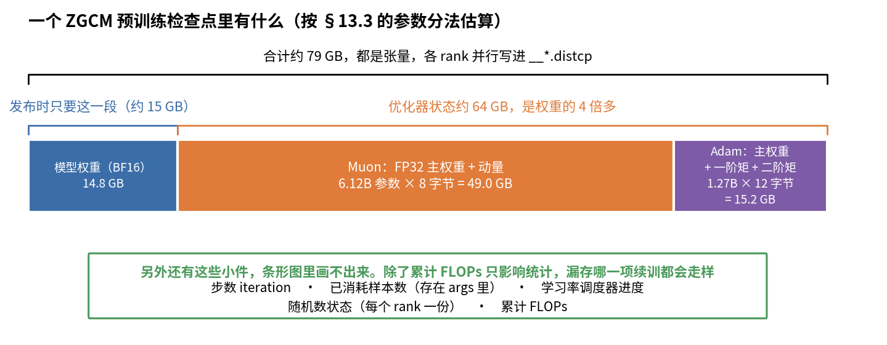
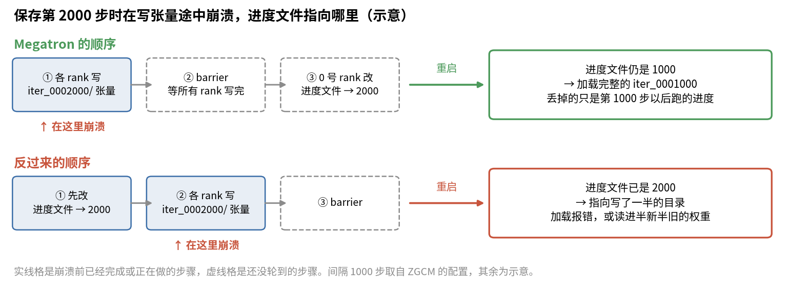

# 第 13 章　启动、检查点与续训

> 预训练要跑几十天，中间一定会停：机器坏了，网络抖了，要换数据，要换阶段。这一章先讲一个训练作业怎么从一行命令变成 192 个进程，再讲检查点里存了什么、怎么存才不会存坏，然后讲停下来以后怎么"接着跑"，而且接得严丝合缝。最后用 ZGCM 报告里的一次吞吐事故，讲续训后性能变差该怎么查。

## 这一章要回答的问题

读完这一章，你应该能回答下面这些问题。

1. `bash launch_train.sh xxx.env` 之后，到 192 张卡开始算第一步，中间发生了什么？
2. 为什么 ZGCM 把所有超参数放在 env 文件里，而不是直接写在命令行？
3. 一个 Megatron 检查点目录里有哪些文件？每部分多大？为什么"进度文件"一定要最后写？
4. torch_dist 格式为什么能让你换一种并行方式加载？它有什么做不到的？
5. "从头训练""续训""微调式加载"三种启动方式，各恢复了哪些东西？ZGCM 的每个阶段分别用的哪一种？
6. stage 2 换了数据又要接着 stage 1 的步数跑，靠哪几个开关保证不出错？
7. 检查点多久存一次合适？怎么算？
8. 续训后吞吐从 585 掉到 554，可能是什么原因？ZGCM 是怎么修的？公开仓库里有这个修复吗？

---

<a id="s13-1" name="s13-1"></a>
## 13.1 从一行命令到 192 个进程

### 四层结构

ZGCM 预训练用 24 台机器，每台 8 张 H100。从敲下命令到开始训练，中间一共经过四层：

| 层 | 谁 | 做什么 |
|---|---|---|
| 1 | 集群调度平台 | 分配 24 台机器，在每台上执行同一条命令，并告诉每台"你是第几台" |
| 2 | `launch_train.sh` | 读 env 文件、检查路径和检查点、拼出几百个命令行参数 |
| 3 | `torchrun` | 在本机拉起 8 个 Python 进程，每个进程管一张卡 |
| 4 | `pretrain_gpt.py` | 建立进程组、切并行组、建模型、读数据、开始训练 |

按 `pretrain/README.md` L23-L35 的说明，启动就是在每台机器上执行：

```bash
bash scripts/launch_train.sh configs/stages/01_pretrain_1t_sequential.env
```

24 台机器跑的是同一条命令，唯一的区别是环境变量 `NODE_RANK`，也就是这是第几台机器。

### torchrun 做了什么

`launch_train.sh` L77-L83 给 torchrun 传了五个参数：

| 参数 | ZGCM 的值 | 含义 |
|---|---|---|
| `--nproc_per_node` | 8 | 本机起几个进程 |
| `--nnodes` | 24 | 一共几台机器 |
| `--node_rank` | 0–23 | 本机是第几台 |
| `--master_addr` | 0 号机的地址 | 大家去哪里"报到" |
| `--master_port` | 6247 | 报到用的端口（`01_...env` L21） |

torchrun 据此在本机起 8 个进程，并给每个进程设三个环境变量。`LOCAL_RANK` 是本机内的编号，取 0–7，决定这个进程用哪张卡；`RANK` 是全局编号，等于 `node_rank × 8 + LOCAL_RANK`，取 0–191；`WORLD_SIZE` 是总进程数，192。举个例子，第 5 台机器上的第 3 个进程，全局编号是 $5\times8+3=43$。

所有进程启动后，先连到 `master_addr:master_port` 报到。这一步叫**集合点**（rendezvous）：192 个进程都到齐了，才能互相知道对方的地址，建立 NCCL 通信。只要有一个没到，其他 191 个就一直等，直到超时。launcher 把这个超时设成了 120 分钟（L205 `--distributed-timeout-minutes 120`）。

报到完成后，`pretrain_gpt.py` 按第 12 章 [§12.9](12_分布式并行.md#s12-9) 的顺序把 192 个进程分成 TP、CP、DP 组，然后建模型、加载检查点、建 dataloader，开始第一步。

### 一个容易混的名字：WORLD_SIZE

上面说 `WORLD_SIZE` 是总进程数，可在 env 文件里它是另一个意思。看 stage 1 env 的 L17 和 L19：

```bash
export NUM_NODES="${NUM_NODES:-${WORLD_SIZE:-24}}"
export NODE_RANK="${NODE_RANK:-${RANK:?set NODE_RANK or RANK}}"
```

这里的 `WORLD_SIZE` 和 `RANK` 由调度平台提供，含义是"几台机器"和"第几台机器"，L15-L16 的注释写明了 "The distributed scheduler supplies WORLD_SIZE, RANK and MASTER_ADDR"。到了 torchrun 起的子进程里，这两个变量的含义变成"几个进程"和"第几个进程"。同一个名字，在 launcher 里和在训练进程里意思不一样。

这种写法在按机器发这两个变量的平台上能用。换一个按进程发的平台，`NUM_NODES` 就会变成 192，torchrun 会一直等 192 台机器来报到。所以换平台时，第一件事就是核对这两个变量的含义。

<a id="s13-2" name="s13-2"></a>
## 13.2 env 文件和 launcher：配置与执行分开

### 为什么不直接写命令行

Megatron 的命令行参数有几百个，ZGCM 一次启动要传一百多个。如果每次都手敲，或者写在一个长脚本里，会碰到三个麻烦。一是记录不住，三个月后你想知道 stage 1 用的学习率，得去翻日志。二是比较不了，想知道两个阶段差在哪，只能逐个参数比。三是容易错，改一个阶段时顺手把另一个阶段改坏了。

ZGCM 把配置拆成两部分。env 文件（`configs/stages/*.env`）只放"值"，一个阶段一个文件，一个文件就是一次实验的完整记录。launcher（`scripts/launch_train.sh`）只管"怎么把值变成参数"，所有阶段共用一份；mid-train 用的 launcher 和预训练的完全相同，两个文件 diff 为空。

这样一来，想知道两个阶段差什么，`diff 01_*.env 02_*.env` 就行。第 10 章、第 12 章里引用的配置值，全都来自这两个 env 文件。

### env 文件的分区

stage 1 的 env（`01_pretrain_1t_sequential.env`，114 行）从上到下分成这几段：

| 行 | 内容 |
|---|---|
| L5-13 | 外部资源路径：共享存储根目录、Megatron 代码、Python 环境、tokenizer、数据 |
| L17-29 | 机器与运行时：几台机器、每台几张卡、主节点、NCCL 和显存分配器设置、离线模式 |
| L31-48 | 模型结构（第 9 章） |
| L50-67 | 优化器（第 10 章） |
| L68-80 | 精度、通信重叠、训练入口（第 11、12 章） |
| L82-100 | 并行、batch、步数、数据读取 |
| L101-107 | 保存间隔、日志、检查点加载方式 |
| L109-114 | 输出目录：检查点、TensorBoard、数据缓存、日志 |

### 两种 bash 写法

env 里几乎每一行都是下面两种写法之一：

```bash
export TOKENIZER_PATH="${TOKENIZER_PATH:-${SHARED_STORAGE_ROOT}/models/glm51-tokenizer}"
export MASTER_ADDR="${MASTER_ADDR:?set MASTER_ADDR}"
```

`${X:-默认值}` 的意思是，如果外面已经设了 X 就用外面的，否则用默认值，这样你不改文件也能覆盖某个路径。`${X:?提示}` 则要求外面必须设 X，没设就立刻报错退出，用在没有合理默认值的地方，比如主节点地址。

模型结构和超参数那几段没有用这两种写法，直接写 `export NUM_LAYERS=32`，意思是这些值不允许从外面覆盖，要改只能改文件。这样安排是有意的：结构和超参数是实验的一部分，应该记录在文件里。

### launcher 的开关写法

launcher 把 env 里的 0/1 开关变成命令行参数，用的都是同一个模式（L116-L120、L155-L157）：

```bash
[[ "${QK_LAYERNORM:-0}" == 1 ]] && model+=(--qk-layernorm)
[[ "${USE_DISTRIBUTED_OPTIMIZER:-1}" == 1 ]] && training+=(--use-distributed-optimizer)
```

留意这里的默认值：`QK_LAYERNORM` 默认 0，不加这个参数；`USE_DISTRIBUTED_OPTIMIZER` 默认 1，加。env 里没写这一行时，行为由 launcher 的默认值决定。所以读别人的配置时，只看 env 不够，还要看 launcher 的默认值。

### 先检查再启动

launcher 在启动 torchrun 之前做了一串检查（L24-L50、L65-L75）。它依次确认 Python 环境在不在，Megatron 代码和 tokenizer 在不在；如果要从预训练权重加载，再确认那个目录在不在；接着确认数据文件 `.idx` 和 `.bin` 在不在；如果要求续训，最后检查检查点的进度文件在不在、步数对不对（[§13.6](#s13-6) 细讲）。任何一项失败都立刻退出，返回码 2、3、4 分别代表用法错、文件缺、检查点不对。

这几秒花得值。192 张卡全部报到、建好模型，通常要几分钟到十几分钟。如果到读数据时才发现路径写错，假设浪费 10 分钟，就是 $192\times10/60=32$ 个 GPU 小时，而在 bash 里先检查一遍只要几秒。**能在启动前发现的错，不要留到 192 张卡都等着的时候再发现。**

### 日志去哪了

launcher 的最后一行（L213-L218）是：

```bash
run_tag="${EXP_NAME}_$(date -u +%Y%m%d_%H%M%S)"
exec "${TORCHRUN_BIN}" ... 2>&1 | tee -a "${LOG_DIR}/${run_tag}.log"
```

每次启动都会生成一个带时间戳的日志文件名，torchrun 的所有输出同时打到屏幕和这个文件。每次重启都是一个新文件，所以一次长训练会留下很多个日志文件，按时间戳排序就是完整的历史。这里藏着一个小坑，放到 [§13.13](#s13-13) 再讲。

<a id="s13-3" name="s13-3"></a>
## 13.3 检查点里存了什么

### 续训需要什么

**检查点**（checkpoint）是训练状态的快照。我们希望从快照恢复后，接下来的每一步都和没停过时一样。要做到这一点，就得存下所有会影响下一步的东西。下表列出这些东西，以及不存会怎样：

| 东西 | 不存会怎样 |
|---|---|
| 模型权重 | 从头开始 |
| 优化器状态（FP32 主权重、Muon 动量、Adam 一阶和二阶矩） | 动量清零，Adam 的二阶矩清零，更新步长突然变大，loss 可能跳一下 |
| 学习率调度器的进度 | warmup 重来一次，或者学习率走到错的位置 |
| 已训练的步数和已消耗的样本数 | 数据从头读，前面的数据被训两遍 |
| 随机数状态 | dropout 等随机操作和原来不一样 |
| 累计 FLOPs | 只影响统计，不影响训练 |

拿"已消耗样本数"设想一下漏存的后果（示意场景，ZGCM 没有发生过）。stage 1 跑到第 50,000 步崩溃，重启时权重、优化器和步数都恢复了，唯独样本计数没恢复，归了零。dataloader 于是又从第 0 条样本读起，GBS 是 768，前 $50{,}000\times768=38{,}400{,}000$ 条样本会被再训一遍。这时程序不报错，训练 loss 反而可能因为见过这些数据而偏低。对 ZGCM 还多一层损失：stage 1 的数据按从易到难排列（[§13.10](#s13-10)），重读等于把课程倒回了开头。

Megatron 的 `generate_state_dict`（`checkpointing.py` L955 起）把下表前七项装进一个字典。最后一行的累计 FLOPs 不在这个函数里，是 `save_checkpoint` 另外加进去的（L623）：

| 键 | 行号 | 内容 |
|---|---|---|
| `args` | L970 | 全部命令行参数。`consumed_train_samples` 就存在这里面 |
| `iteration` | L973 | 已完成的步数 |
| `model` | L991 | 模型权重 |
| `optimizer` | L1016 | 优化器状态 |
| `opt_param_scheduler` | L1019 | 学习率和 WD 调度器 |
| `rerun_state_machine` | L1024 | 重跑检测的状态（ZGCM 关掉了，`RERUN_MODE=disabled`） |
| `rng_state` | L1028 | Python、NumPy、PyTorch、CUDA 的随机数状态，每个 rank 一份 |
| `num_floating_point_operations_so_far` | L623 | 累计 FLOPs |

ZGCM 的 dropout 都是 0（launcher L103-L104），数据顺序由 index 文件决定（第 8 章），所以随机数状态对 ZGCM 影响很小。[§13.4](#s13-4) 会用到这一点。

### 目录长什么样

```
checkpoints/
├── latest_checkpointed_iteration.txt   ← 进度文件，只有一行，比如 "79473"
├── iter_0001000/                        ← 第 1000 步的检查点
│   ├── metadata.json                    ← 格式和版本，最后写
│   ├── common.pt                        ← 不分片的部分（args、iteration、调度器等），0 号 rank 写
│   ├── .metadata                        ← 每个张量的全局形状和各分片的位置
│   └── __0_0.distcp  __1_0.distcp …     ← 张量数据，各 rank 并行写
├── iter_0002000/
└── …
```

目录名是 `iter_` 加 7 位补零的步数（L208 `'iter_{:07d}'`）。进度文件名是 `latest_checkpointed_iteration.txt`（L314-L318），加载时先读它，才知道该去哪个 `iter_` 目录。`common.pt` 和 `metadata.json` 的分工见 `core/dist_checkpointing/serialization.py` L305-L313 的注释；`.distcp` 和 `.metadata` 是 PyTorch 分布式检查点（DCP）的标准文件。

### 一个检查点多大

我们按第 10 章 [§10.5](10_优化器与学习率.md#s10-5) 的参数分法手算一下（推断，按 BF16 权重估）。模型权重是 $7.39\text{B}\times2\text{ B}=14.8$ GB。走 Muon 的矩阵约 6.12B 参数，每个参数存 FP32 主权重和动量，$6.12\times8=49.0$ GB。走 Adam 的 embedding 和输出层约 1.27B 参数，每个参数存主权重、一阶矩、二阶矩，$1.27\times12=15.2$ GB。三项合计约 79 GB。梯度不用存，因为每一步开始前梯度都会清零。

优化器状态占了 64 GB，是权重的 4 倍多。发布给别人用的模型只有 15 GB 左右，原因也在这里：发布时只要权重，不要优化器。下图把这三块按大小画在一起，再把那些体积很小、但续训离不开的东西列在下面。



如果每 1000 步存一个、全部保留，整个预训练约 388 个检查点（387,950 步，HF 记录），需要 $388\times79\approx31$ TB。ZGCM 保留了多少，报告没有说明。HF 上公开了 54 个中间检查点（报告附录 A.2 第 30 页）。

### 为什么进度文件一定要最后写

保存过程（`save_checkpoint`，L489 起）分三步，顺序不能乱：

1. 每个 rank 把自己那份张量写进 `iter_XXXXXXX/`；
2. 所有 rank 做一次 barrier，等大家都写完（L739-L743）；
3. 0 号 rank 才去改 `latest_checkpointed_iteration.txt`（L746-L765）。

设想反过来，先改进度文件再写张量。写到一半机器掉电，进度文件就指向一个残缺的目录。下次启动去加载它，要么直接报错，要么更糟，加载进一半旧一半新的权重。下图对比两种顺序，看崩溃发生在写张量途中时，重启读到的进度文件各指向哪里。



先写数据、再改指针，是所有"要么全成功、要么当没发生"的保存方式的共同做法，数据库的提交日志、git 的 commit 都是这个思路。Megatron 在 torch_dist 格式里还多做了一层：`metadata.json` 也是最后写，所以一个没有 `metadata.json` 的目录就是没写完的（`serialization.py` L313-L319）。

落到操作上，训练中途崩溃时，进度文件里的那一步一定是完整的。你不用自己判断哪个检查点能用，读进度文件就行。

<a id="s13-4" name="s13-4"></a>
## 13.4 torch_dist：换一种切法也能加载

知道了检查点里存什么，再看它用什么格式存。格式决定了加载时能不能换一种并行方式。

### 老格式的问题

Megatron 早期的检查点格式（`--ckpt-format torch`）是每个 TP×PP 分片存一个文件，文件里是"我这一片"的张量。比如 TP 2 时，0 号片存 QKV 矩阵的前一半行，1 号片存后一半。

这样存有一个硬限制：加载时的 TP 和 PP 必须和保存时一样。想从 TP 2 改成 TP 4，就得先写一个转换脚本，把每个矩阵拼回完整的，再切成 4 片。

### torch_dist 怎么解决

ZGCM 用的是 `--ckpt-format torch_dist`（launcher L204）。存的时候，每一片张量都带上两条信息：这个张量完整的形状是多少，以及这一片在完整张量里的起止位置。这种带位置信息的张量叫 **ShardedTensor**，所有分片的位置信息汇总在 `.metadata` 里。

加载时，每个 rank 先按新的并行方式算出自己需要完整张量的哪一段，再去文件里把这一段读出来。保存时是怎么切的，就不再重要了。

拿一个小例子算（示意形状，不是 ZGCM 的）。一个 8 行的矩阵按 TP 2 保存，0 号片存第 0–3 行，1 号片存第 4–7 行，`.metadata` 里记着"全局 8 行；片 0 从第 0 行起，长 4 行；片 1 从第 4 行起，长 4 行"。现在改用 TP 4 加载，新的 1 号 rank 需要第 2–3 行，查 `.metadata` 知道它们在旧片 0 里、偏移 2，就只读这两行；新的 2 号 rank 需要第 4–5 行，去旧片 1 里读开头两行。整个过程没有哪个进程需要先把完整矩阵拼出来。

ZGCM 实际用上了这一点。mid-train 64K 阶段是 PP 1，256K 阶段是 PP 2（第 12 章 [§12.8](12_分布式并行.md#s12-8)）。256K 阶段直接从 64K 的检查点目录加载（`03_seq256k.env` L94），中间没有转换步骤，靠的就是 torch_dist。

### 它做不到的三件事

torch_dist 解决的只是切法的问题，下面三件事它管不了。

第一，模型形状必须一样。`check_checkpoint_args`（L139-L178）要求层数、隐藏维度、注意力头数和检查点一致，不一致直接断言失败。切法可以变，模型本身不能变。

第二，TP 或 PP 变了，随机数状态会被丢掉。每个 rank 的随机数状态属于"这个 rank"，换了切法以后，"这个 rank"已经不是原来那个了。所以 `load_checkpoint` 在 TP、PP 不一致时直接忽略随机数状态（midtrain 版 `checkpointing.py` L1666-L1678，打印 "RNG state will be ignored"）。[§13.3](#s13-3) 说过 ZGCM 的 dropout 是 0，丢了也没影响。

第三，ZGCM 的优化器状态不能换分片方式。第 10 章 [§10.6](10_优化器与学习率.md#s10-6) 讲过，Muon 用的是 layer-wise 优化器，按"整个参数"把优化器状态分给 DP×CP 组里的各张卡（`layer_wise_optimizer.py` L103-L155 用的是 `dp_cp` 组；ZGCM 预训练是 48×2=96 张卡）。它的 `sharded_state_dict`（L306-L325）注释写着 "For fixed DP usage only"，并把所有分片的 DP 副本编号设成 0。

推断：这意味着优化器状态只能在分片方式不变时正确加载。参数先按大小排序，再在 96 张卡之间来回发牌（第 10 章 [§10.6](10_优化器与学习率.md#s10-6)）。组的大小变了，或者每张卡上的参数集合变了（比如 PP 从 1 变成 2，每张卡只剩一半的层），哪个参数归哪张卡就全变了，存下来的分配和新的对不上。ZGCM 预训练两个 stage 的切法完全一样，没有碰到这个问题；mid-train 根本不加载优化器状态（[§13.5](#s13-5)），所以也没问题。

把这三条放在一起，续训时的经验是：模型、DP 和 CP 都别动；想换 TP、PP，模型权重能接上，但随机数状态会被重置，ZGCM 这种 layer-wise 优化器的状态多半也接不上。

<a id="s13-5" name="s13-5"></a>
## 13.5 三种启动方式

格式解决的是能不能读，接下来要看读什么。每次启动时，Megatron 都要决定是从头训练、接着跑，还是只拿权重。

### 判断逻辑

做这个决定的是 `load_checkpoint`（`checkpointing.py` L1586 起），判断集中在这几行（L1601-L1609）：

```python
pretrained_dir = getattr(args, 'pretrained_checkpoint', None)
if pretrained_dir is not None and not checkpoint_exists(load_dir):
    load_dir = pretrained_dir
    ...
    args.finetune = True
```

`checkpoint_exists` 只看一件事：`--load` 目录下有没有 `latest_checkpointed_iteration.txt`（L321-L325）。于是有三种情况：

| 情况 | `--load` 目录有进度文件 | 设了 `--pretrained-checkpoint` | 结果 |
|---|---|---|---|
| 从头训练 | 没有 | 没有 | 随机初始化，从第 0 步开始 |
| 续训（resume） | 有 | 有没有都一样 | 从进度文件指的那一步接着跑 |
| 微调式加载（finetune） | 没有 | 有 | 只加载权重，从第 0 步开始 |

### 每种方式恢复了什么

| 恢复的东西 | 续训 | 微调式加载 | 代码 |
|---|---|---|---|
| 模型权重 | 是 | 是 | |
| 优化器状态 | 是 | 否 | L1686：`not args.finetune` 才加载 |
| 学习率调度器 | 是 | 否 | 同上 |
| 步数 | 从检查点读 | 设成 0 | L1838-L1839 |
| `consumed_train_samples` | 从检查点读 | 0 | L1853-L1856：`not args.finetune` 才读 |
| 随机数状态 | 是（TP、PP 不变时） | 否 | L1667 |

"finetune"这个名字容易让人以为是在做 SFT。在 Megatron 里，它的意思是只拿权重，其余一切重新开始。

### 一条命令，两种用途

stage 1 和 mid-train 的 env 都把加载目录设成了保存目录（`01_...env` L111，`01_seq16k.env` L115）：

```bash
export LOAD_CHECKPOINT_DIR="${..._LOAD_CHECKPOINT_DIR:-${SAVE_CHECKPOINT_DIR}}"
```

这样同一条启动命令就有两种用途。第一次启动时，保存目录还是空的，没有进度文件：stage 1 没设 `PRETRAINED_CHECKPOINT`，所以从头训练；mid-train 设了，所以走微调式加载。崩溃后重启时，保存目录里已经有进度文件了，于是自动变成续训，从最近一次保存的那一步接着跑。

值班的人因此不需要判断这是第一次启动还是重启，崩了就原样再执行一遍同一条命令，容错重启的脚本也可以写得很简单。

### ZGCM 每个阶段用的哪一种

| 阶段 | 首次启动 | 加载自 | 依据 |
|---|---|---|---|
| 预训练 stage 1 | 从头训练 | 无 | `01_...env` L106-L107：不要求加载，不设预训练权重 |
| 预训练 stage 2 | 续训 | stage 1 最后一步（79,473） | `02_...env` L108、L113：要求加载，加载目录指向 stage 1 |
| mid-train 16K | 微调式加载 | 预训练最终权重（`handoff/zgcm7b_pretrain_final`） | `01_seq16k.env` L90、L94 |
| mid-train 64K | 微调式加载 | 16K 段的检查点目录 | `02_seq64k.env` L94 |
| mid-train 256K | 微调式加载 | 64K 段的检查点目录 | `03_seq256k.env` L94 |

预训练两个 stage 是一次连续的训练，只是中途换了数据，所以用续训。mid-train 每一段都是一次新的训练，所以用微调式加载。下面两节分别讲这两种情况。

<a id="s13-6" name="s13-6"></a>
## 13.6 stage 2：换了数据的续训

stage 2 要同时满足两个看起来矛盾的要求。对优化器来说，它要接着跑：步数从 79,473 接着数，动量、二阶矩都保留，学习率保持 2e-4 不变。对数据来说，它要重新开始：换了一份新数据，要从新数据的第 0 条开始读。

ZGCM 用四个开关做到这一点：

| 开关 | 位置 | 作用 | 不设会怎样 |
|---|---|---|---|
| `REQUIRE_LOAD_CHECKPOINT=1` + `RESUME_ITER=79473` | `02_...env` L108、L95 | 启动前检查进度文件必须是 79473 | 加载了错的检查点也不知道 |
| `OVERRIDE_OPT_PARAM_SCHEDULER=1` | L89 | 调度器的超参数用新配置的，进度用检查点的 | 衰减步数从 79,473×768 变成 333,787×768，和检查点不一致，`optimizer_param_scheduler.py` L332-L336 断言失败 |
| `MEGATRON_DATASET_SAMPLE_OFFSET=61035264` | L97 | 把已消耗样本数减去 stage 1 的部分 | 从新数据的第 6100 万条开始读，前 1T token 被跳过 |
| `NO_DATA_SHUFFLE=1` | L92 | 按离线打乱好的顺序读，不再打乱 | 运行时又打乱一遍，偏移量对不上同一批样本 |

后三个开关前面的章节讲过：调度器 override 见第 10 章 [§10.8](10_优化器与学习率.md#s10-8) 和 [§10.12](10_优化器与学习率.md#s10-12)，样本偏移和顺序读取见第 8 章 [§8.8](08_数据五_从文本到训练样本.md#s8-8)。这里只讲第一个。

### 进度文件检查

第一个开关对应 `launch_train.sh` L65-L75：

```bash
if [[ "${REQUIRE_LOAD_CHECKPOINT:-0}" == 1 ]]; then
  marker="${LOAD_CHECKPOINT_DIR}/latest_checkpointed_iteration.txt"
  [[ -f "${marker}" ]] || { echo "checkpoint marker not found: ${marker}" >&2; exit 4; }
  if [[ -n "${RESUME_ITER:-}" ]]; then
    marker_iter="$(tr -dc '0-9' < "${marker}")"
    [[ "${marker_iter}" == "${RESUME_ITER}" ]] || {
      echo "checkpoint iteration ${marker_iter} != expected ${RESUME_ITER}" >&2
      exit 4
    }
  fi
fi
```

第 2 行拼出进度文件的路径。第 3 行在文件不存在时退出；没有这一行，[§13.5](#s13-5) 的逻辑会把 stage 2 当成从头训练，悄悄用随机权重开始，日志里也不会报错。第 5 行用 `tr -dc '0-9'` 删掉除数字以外的所有字符，包括换行。第 6-9 行要求这个数字必须等于 79473，否则退出。

这个检查防的是样本偏移算错。偏移 61,035,264 是按"stage 1 恰好结束在 79,473 步"算的（$79{,}473\times768$）。如果加载目录里的进度文件指向别的步数，比如有人在 stage 1 结束后又多跑了几步，偏移就错了，要么跳过 stage 2 的一部分数据，要么重复读。这种错误不会让训练崩溃，loss 也看不出异常，只有事后对数据才能发现，所以要在启动前拦住。

你可能会问，stage 1 为什么正好存在 79,473 步？stage 1 每 1000 步存一次，79,473 不是 1000 的倍数。但训练结束时，如果最后一步没赶上定期保存，Megatron 会补存一次（`training.py` L1227）。所以 stage 1 目录里最后一个检查点是 `iter_0079473`。

### 这个设计的一个漏洞

stage 2 的保存目录和加载目录不同：保存到 stage 2 自己的目录（`02_...env` L112），加载自 stage 1 的目录（L113）。

第一次启动时这样是对的。但如果 stage 2 跑了几万步后崩溃，有人原样重启，加载目录还是 stage 1 的，进度文件还是 79473，检查照样通过，于是又从 stage 1 的终点重新开始，stage 2 已经跑的部分全部白费。之后的保存还会写进 stage 2 目录里已有的同名 `iter_` 目录，把原来那份盖掉（推断：`checkpointing.py` L626 留着 "TODO Handle non-empty directories"，代码没有处理目录已存在的情况）。

要正确重启，必须同时改两处：把加载目录指向 stage 2 的保存目录，把 `RESUME_ITER` 改成 stage 2 最近一次保存的步数（或者清空它）。只改一处会被 L65-L75 的检查拦下来。stage 1 和 mid-train 没有这个问题，因为它们的加载目录就是保存目录（[§13.5](#s13-5)）。

样本偏移倒是不用改，它在 stage 2 的重启里仍然是对的：检查点里的计数是 stage 1 加 stage 2 的总数，减掉 61,035,264 正好是 stage 2 已经读过的条数。

<a id="s13-7" name="s13-7"></a>
## 13.7 mid-train：只拿权重，重新开始

mid-train 走的是另一条路。每段第一次启动都是微调式加载（[§13.5](#s13-5)），所以每段开始时，步数和已消耗样本数归零，Muon 的动量、Adam 的一阶矩和二阶矩全部清零，学习率调度也按新配置从头走，包括 warmup。

### 为什么这样做

原因有三个。第一个是数据换了，从 0 开始读最省事。mid-train 的数据和预训练完全不同，每段之间长度也不同；样本计数归零，就不需要 stage 2 那种偏移量技巧。

第二个原因是 256K 段的优化器状态本来就接不上。各段的并行配置（第 12 章 [§12.10](12_分布式并行.md#s12-10)）如下：

| 段 | TP / PP / CP | DP | layer-wise 分片组 DP×CP | 每张卡上的层 |
|---|---|---|---|---|
| 预训练 | 2 / 1 / 2 | 48 | 96 | 全部 32 层 |
| mid-train 16K | 2 / 1 / 2 | 48 | 96 | 全部 32 层 |
| mid-train 64K | 2 / 1 / 4 | 24 | 96 | 全部 32 层 |
| mid-train 256K | 2 / 2 / 4 | 12 | 48 | 一半，16 层 |

256K 段的分片组从 96 张卡变成 48 张，每张卡上的参数也只剩一半，按 [§13.4](#s13-4) 的推断，优化器状态接不上。16K 和 64K 段的分片方式和预训练一样，优化器状态其实可以接上，这两段清零优化器是主动的选择。

第三个原因是新阶段要新的学习率曲线。mid-train 要从高学习率衰减下来（第 10 章 [§10.9](10_优化器与学习率.md#s10-9)），和预训练的常数学习率是两条不同的曲线。

### 清零优化器的代价

Adam 的二阶矩 $v$ 清零后，前几步的更新步长会偏大，这来自 Adam 的偏差修正。第 1 步时，偏差修正后的 $\hat m$ 就是这一步的梯度 $g$，$\hat v$ 就是 $g^2$，所以 $\hat m/\sqrt{\hat v}=g/|g|$，每个参数的更新量都是 $\pm\eta$，不管它的梯度本来是大是小（第 10 章 [§10.3](10_优化器与学习率.md#s10-3)）。训练稳定时，大多数参数的 $|\hat m|/\sqrt{\hat v}$ 远小于 1。所以刚清零的那几步，更新会比稳定时大很多。

mid-train 每段都要重新 warmup，这是原因之一。配置里的 warmup 约占每段样本数的 1%：

| 段 | `LR_WARMUP_SAMPLES` | 除以 GBS | 步数 |
|---|---|---|---|
| 16K | 109,824 | ÷ 768 | 143 |
| 64K | 36,672 | ÷ 192 | 191 |
| 256K | 6,864 | ÷ 48 | 143 |

但 W&B 上正式 mid-train 每段的 warmup 只有 9 步（第 10 章 [§10.8](10_优化器与学习率.md#s10-8)）。配置和实际跑的不一致，第 16 章会把 mid-train 的配置和 W&B 逐项对一遍。

Muon 的动量清零，影响要小一些。动量系数是 0.9，大约 10 步后旧梯度的权重就衰减到 $0.9^{10}\approx0.35$，20 步后到 0.12，动量很快就重新建立起来了。

### 交接目录

mid-train 16K 段从 `${TRAIN_ROOT}/handoff/zgcm7b_pretrain_final` 加载（`01_seq16k.env` L94），这是预训练和 mid-train 之间的交接点。它必须是一个完整的 Megatron 检查点目录，里面要有进度文件，否则 [§13.5](#s13-5) 的 `checkpoint_exists` 判断不通过，L1608 直接报 "No checkpoint found"。这个目录是怎么从预训练的最终检查点生成的，仓库里没有说明。

64K 段和 256K 段直接指向上一段的检查点目录（`02_seq64k.env` L94、`03_seq256k.env` L94），读的是那个目录的进度文件指向的最新一步。所以上一段必须完整跑完，否则下一段会从上一段中间的某一步开始。

<a id="s13-8" name="s13-8"></a>
## 13.8 多久存一次检查点

前面几节讲的是怎么存、怎么接，还剩一个问题：多久存一次。存得太勤，训练时间都花在写盘上；存得太少，一次崩溃丢掉很多进度。这个间隔可以算出来。

### 推导

设存一次要停 $C$ 秒，平均 $M$ 秒坏一次（平均无故障时间），每隔 $T$ 秒存一次。每单位时间的损失有两部分。一部分是存检查点的开销：每 $T$ 秒停 $C$ 秒，占比 $C/T$。另一部分是崩溃丢掉的进度：崩溃可能发生在两次保存之间的任意时刻，平均丢 $T/2$，而每单位时间崩溃 $1/M$ 次，所以占比 $T/(2M)$。

总损失 $f(T)=\dfrac{C}{T}+\dfrac{T}{2M}$。对 $T$ 求导，令导数为零：

$$-\frac{C}{T^2}+\frac{1}{2M}=0 \quad\Rightarrow\quad T^*=\sqrt{2CM}$$

这叫 **Young 公式**。最优间隔随存盘开销和故障间隔的平方根增长。

把 $T^*$ 代回两项还能看出一件好记的事：$C/T^*$ 和 $T^*/(2M)$ 都等于 $\sqrt{C/(2M)}$，在最优点上，存盘花掉的时间正好等于崩溃平均丢掉的时间。所以判断一个间隔合不合适，不用记公式，比一比这两部分时间哪边大就行。

### 代入 ZGCM

ZGCM 存一次要多久、平均多久坏一次，报告都没说，下面用假设值演示怎么算。假设存一次 $C=60$ 秒（约 79 GB，[§13.3](#s13-3)），192 张卡的集群平均 24 小时坏一次，$M=86400$ 秒：

$$T^*=\sqrt{2\times60\times86400}\approx3220\text{ 秒}\approx54\text{ 分钟}$$

第 12 章 [§12.12](12_分布式并行.md#s12-12) 估算预训练一步约 6 秒，54 分钟约 540 步。ZGCM 实际是每 1000 步存一次（`01_...env` L101），约 100 分钟，和这个估算在同一个量级，此时存盘开销占 $60/6000=1\%$。

每次崩溃的平均损失是半个间隔加上重启时间。按 50 分钟加 10 分钟重启算，约 $1\times192=192$ 个 GPU 小时。

mid-train 256K 段要单独算。第 12 章估算这一段一步约 80 秒，而配置是每 500 步存一次（`03_seq256k.env` L86），间隔约 11 小时。一次崩溃平均丢 5.5 小时，约 1,000 个 GPU 小时。按上面的公式，这一段应该存得更勤（按步数算）。这是推断，取决于第 12 章的步时估算是否准确。

另外，ZGCM 没开异步保存。launcher 里没有 `--async-save`，所以保存时训练要停下来等。Megatron 支持异步保存（[§13.11](#s13-11)）。

<a id="s13-9" name="s13-9"></a>
## 13.9 续训后吞吐变慢：585 → 554 的排查

### 报告说了什么

报告 §3.3 第 10 页记了一次事故。一次续训后，持续的吞吐监控发现吞吐在逐渐下降：比较长度约 80 步的对应窗口，从 585 降到 554 model TFLOP/s/GPU。释放 overlap buffer（通信和计算重叠时用的缓冲区，下面"第二条线索"细讲）让下降变慢了，但没有消除。再加上每 100 步清一次 CUDA 显存分配器的缓存、做一次垃圾回收，吞吐稳定回到 585。这个修复部署到了正式训练循环里。

这件事有多大，可以算一下。$554/585=0.947$，每步多花约 5.6% 的时间。预训练约 388k 步，按一步 6 秒算约 27 天。如果整段都按 554 跑，要多 1.5 天左右，折合约 6,900 个 GPU 小时。实际下降是逐渐发生的，真实损失会少一些。但从这个数量级看，吞吐掉 5% 就值得停下来查。

### 先懂两个机制

要看懂这次事故，得先懂两个机制。第一个是 PyTorch 的显存缓存分配器。每次向 CUDA 申请和释放显存都很慢，所以 PyTorch 释放张量时，不把显存还给 CUDA，而是留在自己的缓存池里，下次申请时直接从池里拿。

这套机制的毛病是**碎片**（fragmentation）。如果每一步申请的块大小都不一样，池里会留下很多大小不合适的空隙。比如池里有很多 300 MB 的空块，这一步要一个 500 MB 的，就只能再向 CUDA 申请新的，或者先整理缓存。时间一长，分配越来越慢，偶尔还要触发同步。`torch.cuda.empty_cache()` 把池里没在用的块全还给 CUDA，相当于把碎片清空重来。

第二个机制是 Python 的垃圾回收，以及多进程训练里"最慢的那个人"。Python 会在某些时刻自动做一次完整的垃圾回收（gc），这时整个进程停一下。单机训练时这无所谓。可 192 个进程一起训练时，每一步都有好几次集合通信，大家要互相等，只要有一个进程在做 gc，其他 191 个都得等它。每个进程 gc 的时机不一样，结果几乎每一步都有人在等。可以粗算一下（示意数字）：假设每个进程平均每 200 步随机做一次完整 gc，那么某一步 192 个进程都不做 gc 的概率是 $(1-1/200)^{192}\approx0.38$，约 62% 的步里至少有一个进程在 gc，整步都被它拖慢。对单个进程，gc 只碰上 0.5% 的步；192 个进程叠在一起，就成了大多数步。

Megatron 有一个现成的开关专门处理这个问题：`--manual-gc`。它关掉 Python 的自动 gc，改成每隔 `--manual-gc-interval` 步，所有进程在同一时刻一起做一次（`training.py` L2785-L2792 的注释："This is to align the timing of garbage collection across ranks"；执行在 L2496-L2498）。ZGCM 的 launcher 没有传这个参数。

### 结合 ZGCM 的代码看可能的原因

下面是推断，报告没有给出根因。

第一条线索是 layer-wise 优化器每步都临时分配显存。第 10 章 [§10.6](10_优化器与学习率.md#s10-6) 讲过，layer-wise 优化器更新完参数后，要用 all-gather 把各卡更新的参数收齐。收的时候，每一步都新建接收缓冲区（`core/distributed/param_and_grad_buffer.py` L365-L376）：

```python
for i in range(dp_size):
    if i == local_rank:
        gather_list.append(flat_local_params)
    else:
        gather_list.append(
            torch.empty(
                bucket.layerwise_param_flat_sizes[i], ...
```

每张卡分到的参数量不同，所以这 95 块接收缓冲区（分片组 96 张卡，减去自己）大小各不相同，每个 bucket 都来一遍，每一步都来一遍。最容易产生碎片的，就是这种分配模式。

第二条线索是保存检查点本身就是一次大扫除。`save_checkpoint_and_time`（`training.py` L2355 起）在保存之前做了两件事（L2382-L2389）：

```python
for model_chunk in model:
    if hasattr(model_chunk, 'free_overlap_buffers'):
        model_chunk.free_overlap_buffers()
torch.cuda.empty_cache()
```

`free_overlap_buffers` 释放的就是第一条线索里那些 all-gather 缓冲区（`param_and_grad_buffer.py` L706-L719）。按原注释，这是为了给异步保存腾显存，副作用是每存一次检查点，碎片就被清空一次。

两条线索合起来看：每 1000 步存一次检查点，碎片也就每 1000 步清一次；两次保存之间碎片慢慢积累，吞吐慢慢下降。报告说"释放 overlap buffer 有帮助但不够"，和第二条线索对得上；"再加 empty_cache 和 gc 才完全恢复"，说明分配器碎片和 gc 停顿可能都有份。

### 修复在哪

修复的代码只出现在 `sft/` 目录的 Megatron 里（`sft/megatron/training/training.py` L1869-L1938），由三个环境变量控制：

| 环境变量 | 每隔 N 步做什么 |
|---|---|
| `MEGATRON_PERIODIC_EMPTY_CACHE_INTERVAL` | `torch.cuda.empty_cache()` |
| `MEGATRON_PERIODIC_FREE_OVERLAP_BUFFERS_INTERVAL` | 释放 overlap 缓冲区 |
| `MEGATRON_PERIODIC_CHECKPOINT_LIKE_CLEANUP_INTERVAL` | 上面两件事一起做；再设 `MEGATRON_PERIODIC_CHECKPOINT_LIKE_CLEANUP_GC=1` 就加一次 `gc.collect()` |

第三个变量对应的功能叫 "checkpoint-like cleanup"，意思是做一遍保存检查点时会做的清理，正好对上第二条线索。这三个函数在每步调度器更新之后调用（L2119-L2127）。

麻烦在于，`pretrain/` 和 `midtrain/` 的 Megatron 里没有这几个函数，仓库里也没有任何 launcher 或配置设置这几个环境变量。所以报告说的"部署到正式训练循环"，在公开仓库里找不到对应的预训练代码。照仓库原样跑预训练，大概率会遇到同样的下降（推断）。

如果你自己遇到这种情况，不需要那个 fork。Megatron 现成的 `--manual-gc --manual-gc-interval 100` 能解决 gc 停顿不同步的问题。分配器碎片则需要在训练循环里加一行周期性的 `torch.cuda.empty_cache()`，或者调整 `PYTORCH_CUDA_ALLOC_CONF`。ZGCM 已经设了 `expandable_segments:True`（`01_...env` L24），这个选项本来就是为减少碎片设计的，但看来不够。

### 这个案例里的排查方法

这次排查有三个做法可以照着学。一是吞吐要持续看，而且要按固定长度的窗口比较。报告比较的是"对应的约 80 步窗口"，单看某一步的吞吐，噪声太大，看不出 5% 的慢性下降。二是留意"重启后"这个时间点。重启后的头几百步碎片还少，吞吐最好看，拿这个数和几千步之后比，才能发现下降。三是一次只改一个变量。报告先只释放缓冲区，看到有帮助但不够，再加清缓存和 gc；分两步加，才知道各自起了多少作用。

<a id="s13-10" name="s13-10"></a>
## 13.10 保持课程顺序的续训

第 7 章讲过，stage 1 的数据按词汇复杂度从易到难排列。续训时要保住这个顺序，下面三个条件缺一不可。它们在第 8 章 [§8.8](08_数据五_从文本到训练样本.md#s8-8) 都讲过，这里只汇总一下：

| 条件 | 靠什么 | 详见 |
|---|---|---|
| 样本编号到文本的映射不变 | 数据文件、序列长度、种子、样本总数都不改，index 缓存才会和原来一样 | [§8.4](08_数据五_从文本到训练样本.md#s8-4)、[§8.8](08_数据五_从文本到训练样本.md#s8-8) |
| 运行时不再打乱 | `NO_DATA_SHUFFLE=1` → `MEGATRON_GPT_DATASET_SEQUENTIAL=1` | [§8.8](08_数据五_从文本到训练样本.md#s8-8) |
| 计数器指向正确的位置 | 检查点里的 `consumed_train_samples`，换数据时再减偏移量 | [§8.8](08_数据五_从文本到训练样本.md#s8-8)、[§13.6](#s13-6) |

第 8 章 [§8.9](08_数据五_从文本到训练样本.md#s8-9) 算过：`pretrain/` 目录自带的 Megatron 不读第二、三行的两个环境变量。照仓库原样跑，stage 1 的课程顺序会被打乱，stage 2 会跳过约 0.7T–1T token，又重复差不多同样多（按样本编号算约 1T，考虑打乱约 0.69T）。这是本章所有续训设计能否成立的前提。

<a id="s13-11" name="s13-11"></a>
## 13.11 ZGCM 没用的其他做法

下面这些做法 ZGCM 没用，但你应该知道。

先说异步保存（async checkpoint）。Megatron 的 `--async-save` 把保存拆成两步：先把张量从显存拷到内存，这一步很快，拷完训练马上继续；再由后台进程慢慢写盘。这样 [§13.8](#s13-8) 的 $C$ 就从"写完 79 GB"缩短到"拷完 79 GB"，最优间隔也随之变短。代价是要额外占一份内存，而且前一次没写完时不能开始下一次（`checkpointing.py` L512 的检查）。[§13.9](#s13-9) 里保存前释放缓冲区、清缓存，就是为了给后台写盘进程腾显存。

共享存储写 79 GB 很慢，所以还有本地检查点和非持久检查点。Megatron 支持 `--non-persistent-save-interval`：高频地把检查点存到本机 NVMe 或单独目录，只保留最近一份（L530-L539 的 `cleanup_old_non_persistent_checkpoint(..., leave_ckpt_num=1)`），同时低频地存到共享存储长期保留。机器坏了才需要从共享存储恢复，进程挂了可以从本地快速恢复。

大集群上故障是常态，于是有了容错框架和进程内重启。NVIDIA 的 fault tolerance 包（Megatron 里的 `ft_integration`，`checkpointing.py` L40 导入）能监测卡死的进程、自动重启，甚至不退出进程就恢复。ZGCM 报告没提用了什么容错机制。

弹性训练走得更远。`torchrun --nnodes 20:24` 允许机器数在一个范围内变化，坏了一台就用剩下的继续跑。但 DP 一变，GBS、梯度累积次数、数据切分都要跟着变，ZGCM 的 layer-wise 优化器状态也接不上（[§13.4](#s13-4)）。所以大模型预训练一般不用弹性训练，而是换一台好机器、原样重启。

检查点存多了，还要有保留策略。Megatron 有 `--save-retain-interval`（L760-L781）：保存新检查点后，如果上一个检查点的步数不是这个间隔的倍数，就把它删掉，最终只长期保留每隔若干步的检查点。在 31 TB 的量级上（[§13.3](#s13-3)），这是必须规划的事。

训练结束后还要转格式。训练用的 torch_dist 检查点只有 Megatron 能读，发布前要转成 HuggingFace 格式：把 TP、PP 分片合并，把 QKV 等融合矩阵拆开，改参数名。ZGCM 的 HF 检查点里有 `checkpoint_info.json`，记录源张量 259 个、导出张量 382 个、张量往返一致 `exact_tensor_roundtrip: true`，但 `native_megatron_logits_comparison: false`，也就是没有用 Megatron 和 HF 各跑一遍、比较输出。仓库里也没有转换脚本。

最后是续训一致性测试，这是一个严谨的做法。训练到第 N 步存盘，再跑到 N+100 步记下 loss；然后从第 N 步的检查点重启，再跑 100 步，两条 loss 曲线应该逐位相同，或在数值误差内一致。不一致说明有状态没存全，常见的是数据位置、随机数、FP8 的 amax 历史（第 11 章）。ZGCM 没有公开做过这个测试。

<a id="s13-12" name="s13-12"></a>
## 13.12 读代码

[§13.5](#s13-5) 和 [§13.6](#s13-6) 已经读过加载判断和进度文件检查，[§13.9](#s13-9) 读过缓冲区分配和保存前清理。这里再补三段。

### 加载后设置步数和样本数

midtrain 版 `checkpointing.py` L1838-L1858：

```python
if args.finetune or release:
    iteration = 0
else:
    iteration = state_dict['iteration']
...
if 'args' in state_dict and not args.finetune:
    checkpoint_args = state_dict['args']
    check_checkpoint_args(checkpoint_args)
    args.consumed_train_samples = getattr(checkpoint_args,
                                          'consumed_train_samples', 0)
    ...
    update_num_microbatches(consumed_samples=args.consumed_train_samples, verbose=True)
```

第 1-2 行处理微调式加载或 release 检查点，这两种情况步数都从 0 开始。release 是发布用的检查点，进度文件里写的是字符串 `release`，没有数字（L339）。第 4 行对应续训，步数从检查点读。第 6 行限定只有续训才读检查点里的 args，第 8 行检查模型形状一致（[§13.4](#s13-4)）。第 9-10 行恢复已消耗样本数，它存在 `args` 里，没有单独的键。第 12 行按已消耗样本数重算梯度累积次数：如果用了 batch size 逐步增大（rampup），续训后必须知道现在处于哪一档。ZGCM 的 launcher 没有传 `--rampup-batch-size`，这一行对它不起作用。

### 进度文件的写入

`checkpointing.py` L739-L765（精简）：

```python
if not args.async_save:
    if torch.distributed.is_initialized():
        torch.distributed.barrier()
if not torch.distributed.is_initialized() or torch.distributed.get_rank() == 0:
    tracker_filename = get_checkpoint_tracker_filename(save_dir)
    ...
    with open_file(tracker_filename, 'w') as f:
        f.write("release" if release else str(iteration))
```

第 1-3 行是同步保存时的 barrier，所有 rank 在这里等齐。程序能往下走，就说明每个 rank 都写完了自己那份。第 4 行限定只有 0 号 rank 写进度文件，避免 192 个进程同时写一个文件。第 8 行写进文件的只有一个数字，launcher 的 `tr -dc '0-9'` 读的就是它。

异步保存时，写进度文件这一步被包进 `iter_finalize_fn`，等后台写完才执行（L805-L807）。原则没变：数据写完，才改指针。

### SFT 版的周期清理

`sft/megatron/training/training.py` L1920-L1938（精简）：

```python
def _periodic_checkpoint_like_cleanup(iteration, model):
    if not _periodic_checkpoint_like_cleanup_enabled(iteration):
        return
    for model_chunk in model:
        if hasattr(model_chunk, 'free_overlap_buffers'):
            model_chunk.free_overlap_buffers()
    torch.cuda.empty_cache()
    ran_gc = _phase_timing_bool_env("MEGATRON_PERIODIC_CHECKPOINT_LIKE_CLEANUP_GC", False)
    if ran_gc:
        gc.collect()
```

第 2 行的判断只在 `(iteration + 1) % interval == 0` 的那一步放行（L1913-L1917）。所有 rank 的步数一样，所以所有 rank 在同一步清理，不会出现有人在清理、其他人在等的拖尾。第 4-6 行和保存检查点前做的清理一样（[§13.9](#s13-9) 第二条线索）。第 7 行把缓存池里的空块还给 CUDA，第 8-10 行是可选的 Python gc。

对照报告 §3.3 第 10 页 "每 100 步清缓存并 gc"，对应的设置应该是 `MEGATRON_PERIODIC_CHECKPOINT_LIKE_CLEANUP_INTERVAL=100` 加 `..._GC=1`（推断，仓库里没有任何地方这样设）。

<a id="s13-13" name="s13-13"></a>
## 13.13 坑和对不上的地方

下面按"会不会让你白跑"排序，前四条照仓库原样跑就会碰到。

1. 日志文件名里没有机器编号，这是 [§13.2](#s13-2) 留下的小坑。`run_tag` 只有实验名和精确到秒的时间戳（`launch_train.sh` L214），日志目录又在共享存储上（`01_...env` L114，`TRAIN_ROOT` 在 `SHARED_STORAGE_ROOT` 下）。24 台机器各自执行这一行，同一秒启动的机器会算出同一个文件名，`tee -a` 把好几台机器的输出交错追加进同一个文件；不同秒启动的机器各写一个文件，但从文件名看不出哪个文件是哪台机器。平时问题不大，因为 Megatron 的大部分训练日志只由一个 rank 打印。可某台机器报错崩溃时，你最需要知道的恰恰是哪台机器、哪张卡先报错，这时候日志很难查。修法很简单，文件名里加上 `${NODE_RANK}`。

   顺带说一下，L216 的 `exec` 没有起作用。`exec` 本意是让 torchrun 直接替换掉 bash 进程，但它写在管道 `| tee` 的左边，bash 会先为管道的每一段开子进程，`exec` 替换的只是那个子进程，外面的 bash 还在。好在 L2 开了 `set -o pipefail`，torchrun 失败时整条管道的返回码仍然是非零，调度平台能看到失败。

2. stage 2 崩溃后原样重启，会回到 stage 1 的终点。[§13.6](#s13-6) 讲过，stage 2 的加载目录固定指向 stage 1，`RESUME_ITER=79473` 的检查也只认 stage 1，所以重启前必须同时改加载目录和 `RESUME_ITER`。仓库里没有任何文档提醒这件事。

3. 修吞吐的代码不在预训练目录里。报告 §3.3 第 10 页说周期清理"部署到了正式训练循环"，但这段代码只在 `sft/` 的 Megatron 里，`pretrain/` 和 `midtrain/` 都没有，也没有任何配置打开它（[§13.9](#s13-9)）。

4. 续训保持课程顺序的前提不成立。两个环境变量 `MEGATRON_GPT_DATASET_SEQUENTIAL` 和 `MEGATRON_DATASET_SAMPLE_OFFSET` 在 `pretrain/` 的 Megatron 里没有代码读取（第 8 章 [§8.9](08_数据五_从文本到训练样本.md#s8-9)）。launcher 和 env 设得再对，数据也照样被打乱，偏移也照样不生效。这一条还会和第 2 条叠加：就算 stage 2 的重启参数改对了，数据位置也是错的。

5. mid-train 的学习率和 warmup，配置、报告、W&B 三方对不上。

   | 项 | 配置（`midtrain/configs/stages/*.env`） | 报告 | W&B |
   |---|---|---|---|
   | 峰值 LR | 2e-5，cosine 降到 2e-6（L51-L53） | 1e-4 | 1e-4 |
   | warmup | 143 / 191 / 143 步（L105 换算） | 未说明 | 每段 9 步 |

   第 10 章 [§10.10](10_优化器与学习率.md#s10-10) 已经指出，2e-5 cosine 就是 A 系列里被否掉的旧方案。仓库的 mid-train 配置不是正式训练用的那一套（推断），第 16 章逐项核对。

6. 交接目录的来历没有说明。mid-train 16K 段从 `handoff/zgcm7b_pretrain_final` 加载（[§13.7](#s13-7)）。它是 stage 2 最终检查点的拷贝、软链接，还是做过某种处理（比如只留权重），仓库和报告都没说。如果只是软链接，有人之后在 stage 2 目录里多跑几步，mid-train 读到的起点就变了。

7. layer-wise 优化器只支持固定 DP。`layer_wise_optimizer.py` L306-L325 的 `sharded_state_dict` 注释写着 "For fixed DP usage only"，也就是说，分片组（DP×CP）的大小一变，优化器状态就读不回来。[§13.7](#s13-7) 的表里只有 256K 段受影响，ZGCM 用微调式加载绕开了。但这也意味着，预训练中途如果因为坏机器想从 24 台缩到 23 台继续跑，优化器状态是接不上的（推断）。报告没有提到遇到过这种情况。

8. FP8 的 amax 历史有存，但没人验证过续训是否一致。Transformer Engine 把 FP8 的缩放因子和 amax 历史放在每个模块的 `_extra_state` 里，Megatron 生成检查点时把它包成 `ShardedObject` 一起存（`megatron/core/transformer/utils.py` L80-L89）。所以按代码，续训会恢复 amax 历史，mid-train 的微调式加载也会把它随模型一起带过去（推断：微调式加载不跳过模型的任何部分）。但 [§13.11](#s13-11) 的续训一致性测试没有公开做过，"恢复得对不对"没有证据。

9. 256K 段存盘间隔约 11 小时。每 500 步存一次，一步约 80 秒（[§13.8](#s13-8)）。按 env 计划的 14,345 步算（$688{,}560\div48$），整段也只存 28 次；实际跑了 10,000 步，只存了 20 次。一次崩溃平均丢 5.5 小时。长上下文段步时变长，保存间隔应该按时间来设，不能只按步数。

10. 发布前的转换没有可复现的路径。仓库没有 Megatron 转 HF 的脚本，`checkpoint_info.json` 只做了张量往返检查，没有做 logits 对比（[§13.11](#s13-11)）。你拿到 HF 权重后，没法从仓库复现它是怎么来的。

11. 一个名字两个意思。launcher 里的 `WORLD_SIZE`、`RANK` 是机器数和机器编号，训练进程里是进程数和进程编号（[§13.1](#s13-1)）。手动启动时如果照着 torchrun 的含义设 `WORLD_SIZE=192`，`NUM_NODES` 就会变成 192，torchrun 会一直等不齐 192 台机器，直到超时。

把这些条目按类别归一下：

| 类别 | 条目 |
|---|---|
| 照原样跑会出错 | 1（查日志难）、2、3、4 |
| 配置和实际不符 | 5 |
| 没有说明、没法复现 | 6、10 |
| 设计上的限制 | 7、9 |
| 有代码、没验证 | 8 |
| 容易用错 | 11 |

<a id="s13-14" name="s13-14"></a>
## 13.14 试着讲给别人听

下面是一段讲法。建议你先合上书自己讲一遍，再对照。

> 先说启动。ZGCM 预训练用 24 台机器、192 张卡。调度平台在每台机器上执行同一条命令，`bash launch_train.sh` 加一个 env 文件，只是每台机器的编号不同。launcher 读 env、检查路径和检查点，再调 torchrun。torchrun 在每台机器上起 8 个进程，一张卡一个，然后 192 个进程到 0 号机器上报到，报齐了才开始训练。所有超参数都在 env 文件里，每个阶段一个文件，一个阶段的配置就是一个可以比对、可以存档的文件。
>
> 再说检查点里存了什么。目标是恢复以后，每一步都和没停过一样，所以要存权重、优化器状态、学习率调度的进度、步数和已经读过的样本数，还有随机数状态。ZGCM 一个检查点大约 79 GB，大头是 Muon 的动量和 FP32 主权重。目录里有一个进度文件，只写一个数字，指向最新的那一步。它一定是最后写的：所有卡都写完了，0 号卡才改它。这样中途崩了，进度文件还指着上一份完好的检查点。
>
> 格式用的是 torch_dist。每张卡存的是"整个张量里我这一块"，加载时按新的切法去读需要的那块，所以 mid-train 256K 段改了流水线并行，照样能读 64K 段的权重。但它不能改模型形状。ZGCM 的 layer-wise 优化器也只支持固定的分片组，组的大小一变，优化器状态就接不上。
>
> 启动方式有三种。加载目录里没有检查点，就是从头训练；有，就是续训，什么都恢复。还有一种叫微调式加载，只拿权重，步数、优化器、学习率全部重来。ZGCM 的 stage 1 是从头训练，崩了就续训。stage 2 换了数据，但要接着 stage 1 的步数和优化器跑，所以它要做四件事：允许学习率配置被覆盖，启动前检查进度文件是不是 79,473，把样本计数减掉 stage 1 读过的 6,100 万条，再关掉运行时打乱，按离线排好的顺序从新数据的开头读。mid-train 每段都是微调式加载，优化器清零，所以每段都要重新 warmup。
>
> 多久存一次可以算。存一次停 $C$，平均 $M$ 坏一次，最优间隔是 $\sqrt{2CM}$。假设存一次一分钟、一天坏一次，约 54 分钟。ZGCM 每 1000 步存一次，约 100 分钟，开销 1%。
>
> 最后是报告里的一次事故。一次续训后，吞吐从 585 慢慢掉到 554，掉了 5%。原因可能是显存分配器的碎片和 Python 垃圾回收不同步。修法是每 100 步清一次显存缓存、做一次 gc，吞吐回到 585。但这段代码在公开仓库里只出现在 SFT 的目录里，预训练目录里没有。这个案例说明两件事：吞吐要持续地、按固定窗口比较；改动要一次只改一个变量。

<a id="s13-15" name="s13-15"></a>
## 13.15 习题

1. 从调度平台到 `pretrain_gpt.py`，启动分几层？每层做什么？

<details><summary>答案</summary>

四层：调度平台分配机器、在每台上执行同一条命令并给出机器编号；`launch_train.sh` 读 env、做检查、拼参数；torchrun 在本机起 8 个进程；`pretrain_gpt.py` 建进程组、模型和数据，开始训练。见 [§13.1](#s13-1)。

</details>

2. （计算）第 5 号机器（从 0 数）上的第 3 张卡，全局 rank 是多少？

<details><summary>答案</summary>

$5\times8+3=43$。见 [§13.1](#s13-1)。

</details>

3. launcher 在启动 torchrun 之前检查了哪些东西？为什么值得花这几秒？

<details><summary>答案</summary>

虚拟环境、Megatron 和 tokenizer 路径、预训练检查点目录、数据文件，以及要求续训时进度文件和步数。192 张卡等 10 分钟就是 32 个 GPU 小时，能在 bash 里发现的错不要留给训练进程。见 [§13.2](#s13-2)。

</details>

4. 检查点里必须存哪些东西？少存"已消耗样本数"会怎样？

<details><summary>答案</summary>

权重、优化器状态、学习率调度器、步数和已消耗样本数、随机数状态（还有 rerun 状态和 args）。少了样本数，数据从头读，前面的数据被训两遍。见 [§13.3](#s13-3)。

</details>

5. （计算）估算 ZGCM 一个检查点的大小，说出三部分各多少。

<details><summary>答案</summary>

BF16 权重约 14.8 GB；Muon 管的约 6.12B 参数，FP32 主权重加动量每个 8 字节，约 49.0 GB；Adam 管的约 1.27B 参数，FP32 主权重加两个矩每个 12 字节，约 15.2 GB。合计约 79 GB。见 [§13.3](#s13-3)。

</details>

6. 为什么进度文件一定要最后写？写之前为什么要 barrier？

<details><summary>答案</summary>

进度文件是"最新完好检查点"的指针。先写数据、再改指针，中途崩溃时指针仍指向上一份完好的。barrier 保证所有 rank 都写完了，0 号 rank 才改指针。见 [§13.3](#s13-3)、[§13.12](#s13-12)。

</details>

7. torch_dist 格式能做什么、不能做什么？

<details><summary>答案</summary>

能：每张卡按"全局张量里的哪一块"存，换 TP、PP 后按新切法读，例如 256K 段改了 PP 仍能读 64K 段。不能：改模型形状；TP/PP 变了时随机数状态被丢掉；layer-wise 优化器只支持固定分片组，组大小变了优化器状态接不上。见 [§13.4](#s13-4)。

</details>

8. 从头训练、续训、微调式加载，Megatron 怎么判断用哪一种？各恢复了什么？

<details><summary>答案</summary>

加载目录里有进度文件就续训，恢复全部状态；没有、但设了预训练检查点目录，就是微调式加载，只恢复权重，步数、样本数、优化器、调度器重来；都没有就从头训练。见 [§13.5](#s13-5)。

</details>

9. stage 2 的样本偏移为什么是 61,035,264？如果加载目录的进度文件指向 79,000 步，会出什么问题？launcher 怎么防？

<details><summary>答案</summary>

$79{,}473\times768=61{,}035{,}264$，是 stage 1 读过的样本数，减掉它就从新数据的第 0 条读起。进度文件指向别的步数时，偏移算错，会跳过或重复读一部分 stage 2 数据，而且 loss 上看不出来。launcher 在 `REQUIRE_LOAD_CHECKPOINT=1` 时检查进度文件存在，并要求数字等于 `RESUME_ITER`（L65-L75），不对就以返回码 4 退出。见 [§13.6](#s13-6)。

</details>

10. （判断）stage 2 跑了 3 万步后崩溃，同事直接用原来的 env 重启了。会发生什么？该怎么改？

<details><summary>答案</summary>

加载目录仍是 stage 1 的，进度文件仍是 79,473，检查通过，于是从 stage 1 终点重新开始，stage 2 的 3 万步白跑，之后的保存还可能覆盖 stage 2 目录里的旧检查点。要把加载目录改成 stage 2 的保存目录，同时把 `RESUME_ITER` 改成 stage 2 最近的保存步数或清空。见 [§13.6](#s13-6)、[§13.13](#s13-13)。

</details>

11. mid-train 每段为什么用微调式加载？16K 和 64K 段是不是"不得不"这样？

<details><summary>答案</summary>

三个原因：数据换了，样本计数归零最省事；256K 段分片组从 96 变成 48，优化器状态接不上；每段要一条新的学习率曲线。16K 和 64K 的分片组仍是 96 张卡、每卡全部 32 层，优化器状态其实接得上，清零是主动选择。见 [§13.7](#s13-7)。

</details>

12. 优化器清零后为什么要重新 warmup？用 Adam 第 1 步的更新量说明。

<details><summary>答案</summary>

清零后第 1 步，偏差修正使 $\hat m/\sqrt{\hat v}=g/|g|$，每个参数的更新量都是 $\pm\eta$，和梯度大小无关。稳定训练时大多数参数的这个比值远小于 1，所以刚清零时更新偏大，需要先用小学习率过渡。见 [§13.7](#s13-7)。

</details>

13. （计算）推导 Young 公式。若存一次 60 秒、平均 24 小时坏一次，最优间隔是多少？按一步 6 秒是多少步？

<details><summary>答案</summary>

损失率 $f(T)=C/T+T/(2M)$，求导得 $T^*=\sqrt{2CM}=\sqrt{2\times60\times86400}\approx3220$ 秒，约 54 分钟，约 540 步。ZGCM 实际 1000 步，同一量级。见 [§13.8](#s13-8)。

</details>

14. 续训后吞吐从 585 掉到 554，说出两个可能的机制和 ZGCM 的修法。公开仓库的预训练代码里有这个修法吗？如果你自己遇到，用什么现成的办法？

<details><summary>答案</summary>

机制：显存缓存分配器的碎片（layer-wise all-gather 每步分配大小不一的接收缓冲区），以及 192 个进程各自 gc、互相等待。保存检查点前会释放缓冲区、清缓存，所以碎片每 1000 步才清一次。修法是每 100 步清一次缓存并 gc。代码只在 `sft/` 的 Megatron 里，预训练目录没有。现成办法：`--manual-gc --manual-gc-interval 100`，再在训练循环里周期性 `torch.cuda.empty_cache()`。见 [§13.9](#s13-9)。

</details>

15. （判断）怎么验证你的续训是"严丝合缝"的？如果不一致，最常见的漏存是什么？

<details><summary>答案</summary>

跑到第 N 步存盘，继续跑 100 步记 loss；再从第 N 步重启跑 100 步，两条曲线应在数值误差内一致。常见漏存是数据位置、随机数状态、FP8 的 amax 历史。ZGCM 没公开做过这个测试。见 [§13.11](#s13-11)、[§13.13](#s13-13)。

</details>

---

上一章：[第 12 章　分布式并行](12_分布式并行.md)　下一章：[第 14 章　训练监控与稳定性](14_训练监控与稳定性.md)

