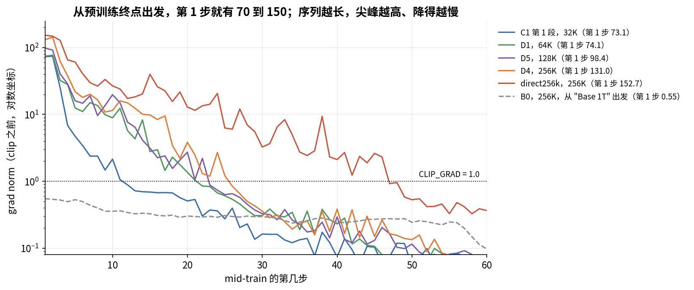
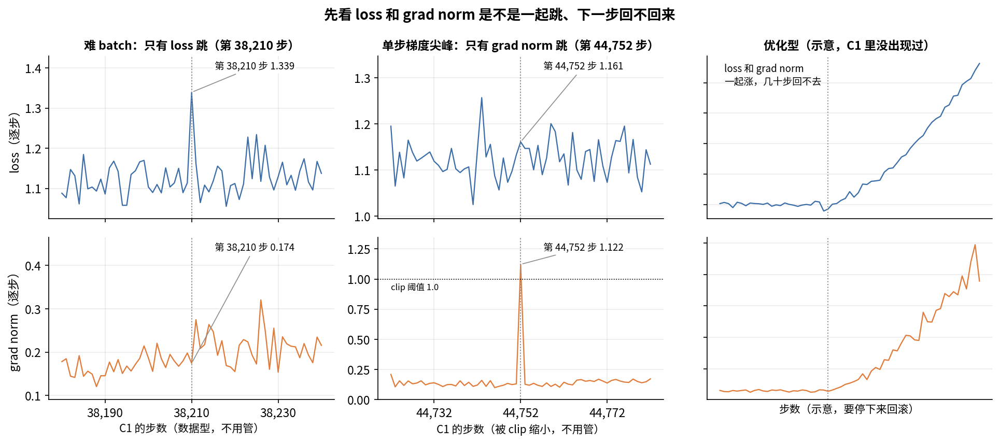

# 第 14 章　训练监控与稳定性

> 训练跑起来以后，每天的工作就是看曲线。看什么、怎么看、看到什么该停下来，是这一章的内容。我们拿 ZGCM 公开的 W&B 逐步记录做真实例子：段首的梯度范数为什么会冲到 70 以上，一步 loss 跳高是不是出事了，为什么 256K 段的 loss 比 32K 段抖得多。接着讲 loss spike 的成因和对策、哪些 loss 之间不能比、评测分数里有多少是噪声，最后给出一张值班检查清单。

## 这一章要回答的问题

读完这一章，你应该能回答下面这些问题。

1. Megatron 每 10 步打印的那一行里有哪些字段？哪个是 10 步平均，哪个只是当前这一步？
2. ZGCM 公开的 W&B 记录里有哪些指标？缺了哪些？
3. 逐步 loss 的抖动有多大？为什么序列越长抖得越厉害？怎么判断"loss 还在降"？
4. 梯度范数（grad norm）正常应该是多少？为什么它会跟着学习率走？
5. ZGCM 每次从预训练终点进入 mid-train，第 1 步梯度范数都在 70 到 150 之间。这说明出事了吗？clip 在这里起了什么作用？
6. loss spike 有哪几类？QK-norm、z-loss、clip、回滚各管哪一类？ZGCM 用了哪些？
7. Megatron 自带的 NaN 检查和"spiky loss"检查分别查什么？ZGCM 开了哪些？
8. 哪些 loss 之间不能直接比？为什么？
9. 一个只有 50 道题的评测集，分数涨 4 分能说明什么？
10. 值班时每天要看哪几样东西？

---

<a id="s14-1" name="s14-1"></a>
## 14.1 监控要回答的三个问题

训练要跑几十天，这期间你随时都想知道三件事：训得对不对，稳不稳，快不快。每件事看哪些信号、坏了是什么样子，列在下表里。

| 问题 | 看什么 | 坏了的样子 |
|---|---|---|
| 训得对不对 | loss、评测分数、学习率、已读样本数 | loss 不降，评测掉分，学习率或数据进度和计划不符 |
| 稳不稳 | 梯度范数、loss 的尖峰、NaN 和跳过的步数 | 梯度范数持续上涨，loss 突然跳高且回不去，出现 NaN |
| 快不快 | 每步耗时、每卡吞吐、显存、慢节点 | 吞吐慢慢往下掉，某台机器比别人慢 |

报告 §3.3（第 10 页）列出了 ZGCM 监控的范围，包括训练动态、数值稳定性、硬件和系统状态、训练效率和资源利用率。具体的信号有 perplexity、BPB、归一化 loss、关键 token 的 logits，以及优化器相关的统计量。除此之外，ZGCM 还把预训练中途存下的基座检查点直接拿去跑一套固定的能力评测，中间不做 SFT。这些信号拿来诊断优化和系统问题、发现能力退步，也用来决定数据配比、课程和阶段切换。

不过报告只列了名字，没有给出这些曲线的阈值或报警规则。"关键 token 的 logits"具体看哪些 token，报告未说明。

<a id="s14-2" name="s14-2"></a>
## 14.2 Megatron 的那一行日志

### 字段逐个看

落到日常操作上，最先看到的是控制台日志。Megatron 每隔 `LOG_INTERVAL` 步打印一行，ZGCM 预训练和 mid-train 都设 `LOG_INTERVAL=10`（pretrain env L104，midtrain 256K env L89）。这一行由 `megatron/training/training.py` 的 `training_log` 拼出来（L2219-L2275），格式大致如下：

```
 [时间] iteration   12340/  79473 | consumed samples:  9476352 |
 elapsed time per iteration (ms): 6050.2 | throughput per GPU (TFLOP/s/GPU): 585.1 |
 learning rate: 2.000000E-04 | global batch size:   768 | lm loss: 1.523456E+00 |
 loss scale: 1.0 | grad norm: 0.152 | number of skipped iterations:   0 |
 number of nan iterations:   0 |
```

上面的数字是示意，不是 ZGCM 的真实日志。各字段的含义如下：

| 字段 | 含义 | 是平均还是当前步 |
|---|---|---|
| iteration | 当前步数 / 总步数 | 当前 |
| consumed samples | 已经读过的序列条数，续训靠它定位数据（[§13.3](13_启动检查点续训.md#s13-3)） | 当前 |
| elapsed time per iteration | 这 10 步的平均每步耗时 | 10 步平均 |
| throughput per GPU | 每卡每秒做了多少万亿次浮点运算 | 10 步平均 |
| learning rate | 当前学习率 | 当前 |
| lm loss | 每个 token 的平均交叉熵 | 10 步平均 |
| loss scale | FP16 训练才有意义；BF16 恒为 1 | 当前 |
| grad norm | 裁剪前的全局梯度范数 | 只是当前这一步 |
| skipped / nan iterations | 这 10 步里被跳过的步数、loss 出现 NaN 的步数 | 10 步累计 |

这张表里最容易看错的是 loss 和 grad norm。loss 是把 10 步加起来再除（L2251-L2257），grad norm 只是打印那一步的值（L2261-L2262），所以控制台上 loss 看起来平滑，grad norm 看起来跳。一次孤立的梯度尖峰，只要不正好落在第 10 的倍数步上，控制台上根本看不到。想看每一步，就得去 TensorBoard 或 W&B，它们按 `tensorboard_log_interval` 记录，默认每步一次（`training_config.py` L244）。

吞吐的算法在 L2205-L2207：

$$\text{throughput}=\frac{\text{一步的理论 FLOPs}}{\text{每步秒数}\times10^{12}\times\text{GPU 数}}$$

分子是用公式算出来的模型 FLOPs，并非硬件计数器的读数。所以它和第 1 章的 MFU 是同一个量，只是还没除以峰值。第 1 章算过，585 TFLOP/s 约是 H100 BF16 峰值 989 TFLOP/s 的 59%。

### 默认没开的那些

`training_log` 能记的东西比 ZGCM 实际记的多。下面这些开关默认都是关的（`megatron/training/config/training_config.py`），ZGCM 的 launcher 也没有打开：

| 开关 | 记什么 | 位置 |
|---|---|---|
| `--log-params-norm` | 全部参数的范数 | L208 |
| `--log-memory-to-tensorboard` | 显存分配、预留、峰值 | L261 |
| `--log-num-zeros-in-grad` | 梯度里 0 的个数 | L276 |
| `--log-max-attention-logit` | 每层注意力 logit 的最大值（要求 TE ≥ 2.9） | `arguments.py` L1258-L1269 |
| `--log-timers-to-tensorboard` | 每步耗时和吞吐写进 TensorBoard | L252 |

按代码推断，ZGCM 预训练的 TensorBoard 里只有学习率、batch size、loss、loss scale、grad norm 这几条曲线，吞吐只出现在控制台日志里。

### ZGCM 公开了什么

公开的 W&B 项目 `zgcagi/zgcm-1-reports` 里有 25 个 run，逐步记录的指标只有这几个：

```
loss  grad_norm  learning_rate  batch_size  consumed_samples
loss_scale  sequence_length  stage_iteration
```

其中 `loss_scale` 每一步都是 1，因为用的是 BF16。SFT 的 run 多记了 `iteration_time_ms`、`throughput_tflops_per_gpu`、`nan_iterations`、`skipped_iterations`、`validation/loss`、`test/loss`。

这里有一个缺口：预训练没有公开逐步记录。和预训练相关的 run 只有按 token 数汇总的评测视图（bench），所以本章的逐步例子全部来自 mid-train、消融和 SFT。用得最多的是 C1，也就是正式发布模型走的四段 mid-train（`view-midtrain-c1-unfinished-v1`）。从 W&B 直接读出的 C1 四段基本情况如下：

| 段 | 序列长度 | 全局 batch（条） | 每步 token | 步数 |
|---|---|---|---|---|
| 1 | 32K | 384 | 12.6M | 14,344 |
| 2 | 64K | 192 | 12.6M | 19,206 |
| 3 | 128K | 96 | 12.6M | 3,201 |
| 4 | 256K | 48 | 12.6M | 10,000（未完） |

四段每步的 token 数都是 $384\times32768=12{,}582{,}912$，序列长度翻倍，条数就减半。下一节会用到这一点。

<a id="s14-3" name="s14-3"></a>
## 14.3 读 loss 曲线

### loss 每一步都在抖

先从 loss 看起。同一个模型、同样的学习率，换一个 batch，loss 就不一样，因为每个 batch 抽到的文档不同，有的好猜，有的难猜。这种抖动叫 **batch 噪声**。

要量它，可以对每一步取前后各 50 步的中位数，当作这一段的水平，再用这一步的 loss 减去这个中位数，得到残差。残差的标准差就是逐步噪声。C1 四段算出来是：

| 段 | 每步条数 | 逐步噪声（标准差） | 相对上一段 |
|---|---|---|---|
| 32K | 384 | 0.0102 | — |
| 64K | 192 | 0.0209 | ×2.05 |
| 128K | 96 | 0.0374 | ×1.79 |
| 256K | 48 | 0.0433 | ×1.16 |

噪声随序列长度增大。每步的 token 数没变，但独立的序列少了一半。同一条序列里的 token 来自同一篇或相邻几篇文档，难度是连在一起的，一条难序列会把它所有 token 的 loss 一起抬高，所以起平均作用的主要是序列条数，token 数只算次要。$B$ 个独立的数取平均，方差缩小到 $1/B$，标准差缩小到 $1/\sqrt B$。因此一个 batch 的平均 loss，波动大致和独立单元数的平方根成反比，条数减半，噪声应该乘以 $\sqrt2\approx1.41$。

实测的倍数并不正好是 1.41：32K 到 64K 大于 1.41，128K 到 256K 小于 1.41。一个可能的原因（推断）是每段的数据配比不同，长文档的来源更少、彼此差异更大；另外，一条 256K 序列里往往拼了好几篇文档（第 8 章讲的 packing），所以独立单元不只是条数。方向是对的，具体倍数要看数据。

### 怎么判断 loss 还在降

逐步噪声是 0.01 到 0.04，而 loss 每千步可能只降 0.005，直接看逐步曲线什么也看不出来，得先平均。

$n$ 步取平均，噪声缩小到 $1/\sqrt n$，所以一个 100 步窗口的均值，噪声是 $\sigma/\sqrt{100}$。两个窗口的噪声互不相关，相减时方差相加，标准差再乘一个 $\sqrt2$。两个相邻的 100 步窗口相减，差值的标准差是

$$\sigma_{\text{差}}=\sigma\sqrt{\frac{2}{100}}\approx0.14\,\sigma$$

拿 C1 的数字验证一下。去掉每段的前 1,000 步，算相邻 100 步窗口均值之差的标准差：

| 段 | 按纯噪声预测 $0.14\sigma$ | 实测 |
|---|---|---|
| 32K | 0.0014 | 0.0014 |
| 64K | 0.0030 | 0.0027 |
| 128K | 0.0053 | 0.0069 |
| 256K | 0.0061 | 0.0061 |

预测和实测基本对上。由此可知，**过了段首以后，100 步窗口之间的差别几乎全是噪声**，在 100 步的尺度上 loss 是平的。要看到它还在降，得用更宽的窗口。比如 32K 段，第 1,000-2,000 步平均 1.210，最后 1,000 步平均 1.169，一万多步才降了 0.04。

如果不去掉前 1,000 步，32K 段窗口之差的标准差是 0.0063，是预测的 4 倍多。多出来的部分来自段首的快速下降：第 1 步 1.483，前 100 步平均 1.333，到第 1,000 步以后才走平。

从这里可以得到一条实用的规则：比较前后两个窗口时，窗口要宽到让差值的噪声 $\sigma\sqrt{2/n}$ 比你想看到的变化小 3 倍左右。这样一个真实的变化相当于 3 个标准差，纯靠噪声凑出这么大的差，机会不到 1%。想看出 0.005 的变化，就要 $\sigma\sqrt{2/n}\le0.0017$。256K 段 $\sigma=0.043$，算出 $n\ge2\times(0.043/0.0017)^2\approx1{,}300$ 步；32K 段 $\sigma=0.010$，只要约 70 步。序列越长，看趋势需要的窗口越宽。

### 单步跳高：先看它回不回来

知道了噪声有多大，就能判断一个点算不算异常。这里用一个稳健的标准：残差除以 $1.4826\times$MAD。MAD 是残差绝对值的中位数，乘上 1.4826 以后可以和正态分布的标准差相比。这个比值叫稳健 z 分数。

为什么不直接用标准差，拿一个小例子算一下（示意数字，不是 ZGCM 的）。设 5 步的残差是 0.01、−0.02、0.01、−0.01、0.20，最后一步明显异常。按普通算法，均值 0.038，标准差约 0.082，最后一步的 z 只有约 2.0，看起来像正常波动，因为这个异常点自己把标准差撑大了。按 MAD 算，5 个绝对值的中位数是 0.01，乘 1.4826 得 0.0148，最后一步的稳健 z 约 13.5。中位数不受一两个极端值影响，所以异常点藏不住。

C1 四段里，稳健 z 分数的最大值都在 4 到 7 左右。具体数取决于 MAD 怎么算：用整段残差算一个 MAD，四段依次是 3.9、5.5、4.5、5.5；用前后各 50 步的局部 MAD，是 5.1、5.4、4.7、6.9。按整段 MAD，256K 段最大的那个在第 38,210 步，前后几步是这样的：

| 步 | 38,207 | 38,208 | 38,209 | **38,210** | 38,211 | 38,212 | 38,213 |
|---|---|---|---|---|---|---|---|
| loss | 1.150 | 1.090 | 1.114 | 1.339 | 1.162 | 1.065 | 1.108 |
| grad norm | 0.168 | 0.180 | 0.198 | 0.174 | 0.275 | 0.209 | 0.218 |

loss 跳高了 0.22，grad norm 却完全正常，下一步 loss 就回去了。这是一个难 batch：这一步抽到的 48 条序列碰巧难猜，模型本身没有变坏。

所以遇到 loss 单步跳高，先看 grad norm 和下一步。grad norm 正常、下一步回落，就是数据造成的，不用管。要担心的是 loss 跳高以后几十步都回不去，或者跳高的同时 grad norm 也暴涨。

### 段首 loss 先涨后降

C1 的 256K 段，前 100 步平均 1.113，第 1,000-2,000 步反而涨到 1.126，最后 1,000 步才降到 1.108。段首 loss 之所以先涨，是因为 mid-train 每段都重新加载权重、清零优化器、重新 warmup（[§13.7](13_启动检查点续训.md#s13-7)）。学习率在 10 步内从 $9\times10^{-6}$ 升到 $9\times10^{-5}$，新的优化器状态还没积累起来，模型被推离了原来的位置。附录 C [§C.3](附录C_W&B与数据配比统计.md#sc-3) 的评测也看到了同样的代价：进入 256K 段的第一个检查点，MMLU4 掉到 0.658，11 个验证集的平均 CE 从 128K 段末的 2.215 升到 2.242，到段末才回到 0.679 和 2.224。

因此每次重新 warmup 以后，前几千步 loss 上涨是预期之内的。要评价这一段训得好不好，得等它降回段首的水平以后再看。

<a id="s14-4" name="s14-4"></a>
## 14.4 读梯度范数

### 它是什么

loss 之外，另一条要天天看的曲线是梯度范数。**梯度范数（grad norm）** 是把所有参数的梯度拼成一个长向量后取的长度：

$$\|g\|=\sqrt{\sum_i g_i^2}$$

Megatron 报告的是 clip 之前的值（第 10 章 [§10.7](10_优化器与学习率.md#s10-7)），它衡量这一步的梯度有多大。

梯度由两部分组成，一部分是真实的下降方向，另一部分是 batch 带来的随机噪声。粗略地说

$$\mathbb E\|g\|^2\approx\|\nabla L\|^2+\frac{\operatorname{tr}\Sigma}{B}$$

其中 $\nabla L$ 是在全部数据上的真实梯度，$\Sigma$ 是单个样本梯度的协方差，$B$ 是 batch 里的独立单元数。batch 越小，梯度范数就越大。C1 的 64K 段每步条数只有 32K 段的一半，梯度范数的中位数也从 0.073 升到 0.164。

### 它跟着学习率走

把 C1 每段按 2,000 步分块（128K 段按 1,000 步），看每块梯度范数的中位数：

| 段 | 学习率 | 梯度范数中位数，从段首到段尾 |
|---|---|---|
| 32K | 恒定 $10^{-4}$ | 0.056 → 0.069 → 0.073 → 0.078 → 0.084 |
| 64K | 恒定 $10^{-4}$ | 0.072 → 0.094 → 0.143 → 0.166 → 0.185 → 0.201 |
| 128K | $9.5\times10^{-5}$ 退火到 $1.0\times10^{-5}$ | 0.170 → 0.143 → 0.098 → 0.079 |
| 256K | $8.8\times10^{-5}$ 退火到 $1.7\times10^{-5}$ | 0.181 → 0.186 → 0.170 → 0.148 → 0.110 |

学习率恒定的两段，梯度范数都在慢慢上涨。64K 段两万步里涨了近 3 倍，但同期 loss 在降，评测也没坏，所以梯度范数在涨这件事本身不是报警信号。学习率退火的两段则相反，梯度范数跟着学习率往下走：128K 段学习率降到 1/10，梯度范数降到不到一半。

一种常见的解释是这样的（推断，报告没有讨论）：学习率大时，参数在一个山谷里来回弹，离谷底有一段距离，所以梯度大；学习率降下来，参数落向谷底，梯度变小，loss 也跟着明显下降。第 10 章 WSD 调度在退火段 loss 下降得快，也是这个道理。至于恒定学习率下梯度范数为什么持续上涨，公开材料里没有解释。

所以梯度范数没有一个绝对的正常值。0.2 在 64K 段是正常的，在 32K 段就偏高。判断时要和同一段、同样学习率下的滚动中位数比。

### 单步梯度尖峰

256K 段第 44,752 步是 C1 在 warmup 之后唯一一次梯度范数超过 1：

| 步 | 44,749 | 44,750 | 44,751 | **44,752** | 44,753 | 44,754 | 44,755 |
|---|---|---|---|---|---|---|---|
| loss | 1.074 | 1.098 | 1.133 | 1.161 | 1.147 | 1.147 | 1.101 |
| grad norm | 0.135 | 0.125 | 0.131 | 1.122 | 0.127 | 0.119 | 0.135 |

梯度范数跳到平时的 8 倍多，loss 只是在正常范围的上沿，下一步梯度范数就回到了 0.127。这一步的梯度被 clip 按 $1.0/1.122\approx0.89$ 缩小了一点。它和上一节的难 batch 正好相反，这次是梯度异常、loss 正常。原因可能是 batch 里有一段特殊的内容（比如大段重复字符），也可能是数值上的偶发问题，公开数据分不清。不过只有一步、马上恢复，就不用处理。

### 段首的大尖峰

比单步尖峰大得多的一次，出现在 C1 32K 段的最开头。前 12 步的梯度范数是这样的：

| 步 | 1 | 2 | 3 | 4 | 5 | 6 | 7 | 8 | 9 | 10 | 11 | 12 |
|---|---|---|---|---|---|---|---|---|---|---|---|---|
| grad norm | 73.1 | 74.2 | 25.1 | 6.86 | 4.71 | 3.42 | 2.38 | 2.38 | 1.47 | 2.14 | 1.06 | 0.885 |

梯度范数到第 12 步才第一次低于 1.0。整个 32K 段超过 1.0 的 11 步全在前 50 步里，第 50 步以后最大只有 0.452。这个尖峰对 loss 没有可见的伤害：第 1 步 1.483，第 10 步 1.475，第 100 步 1.268。

这种现象并非 C1 独有。把所有公开 run 的第 1 步放在一起看：

| run | 起点 | 序列长度 | 第 1 步 grad norm | 第几步降到 1 以下 |
|---|---|---|---|---|
| C1 第 1 段 | 预训练终点 | 32K | 73.1 | 12 |
| D0 | 预训练终点 | 32K | 73.0 | 17 |
| A3 | 预训练终点 | 32K | 68.3 | 12 |
| D1 | 预训练终点 | 64K | 74.1 | 22 |
| D5 | 预训练终点 | 128K | 98.4 | 23 |
| D4 | 预训练终点 | 256K | 131.0 | 26 |
| direct256k | 预训练终点 | 256K | 152.7 | 47 |
| B0 | "Base 1T" | 256K | 0.55 | — |
| T0、T1 | "fastTWEO base" | 256K | 0.39 | — |
| C1 第 2、3、4 段 | 上一段终点 | 64K–256K | 0.245、0.151、0.075 | — |
| A3 后三段 | 上一段终点 | — | 0.34、0.07、0.06 | — |

D 系列和 A 系列是第 16 章要讲的长度消融，这里只看它们的第 1 步。起点一栏是按 run 名和附录 C [§C.4](附录C_W&B与数据配比统计.md#sc-4) 的描述归纳的，其中 A3、D 系列"从预训练终点出发"是推断。

把其中几条曲线的前 60 步画出来，看两件事：从预训练终点出发的几条线，起点高低按序列长度排开；虚线 B0 从一开始就在 clip 阈值下面。



从这张表能读出几件事。尖峰只出现在从预训练终点进入第一段 mid-train 的时候，段与段之间（C1 第 2-4 段、A3 后三段）没有尖峰；B0、T0、T1 同样是 256K、同样清零了优化器，第 1 步也只有 0.4-0.55。序列越长，尖峰越大：32K 约 73，128K 约 98，256K 是 131-153。尖峰几十步就消失，而且序列越长消失得越慢，从 12 步到 47 步不等。

报告没说原因。有一个常见的误解可以先排除：第 1 步的梯度是在任何更新之前算的，只取决于加载进来的权重和这一步的数据，和学习率、优化器有没有清零都无关，所以"清零优化器导致尖峰"的说法对第 1 步不成立。剩下的几种可能都是推断。

第一种可能是长度。预训练用 16K 序列（pretrain env L90），全局注意力层从没见过 16K 以后的位置，一下子拉到 32K-256K，这些层在新位置上的梯度很大。这能解释越长越大，但解释不了 B0 为什么没有尖峰，除非"Base 1T"本身已经见过长序列。第二种是数据分布突变，mid-train 的配比和预训练差别很大。第三种是预训练终点停在恒定学习率 $2\times10^{-4}$ 下，没有退火，参数离谷底远。

要分清它们，有一个很便宜的实验：不训练，只用预训练终点的权重做一次前向和反向，分别算"预训练数据 + 16K""预训练数据 + 32K""mid-train 数据 + 16K"三种组合的梯度范数。只要几分钟，就能知道是长度还是数据造成的。

### clip 在这里做了什么

ZGCM 所有阶段都设 `CLIP_GRAD=1.0`（pretrain env L58，midtrain 256K env L57，SFT conf L61）。第 1 步梯度范数 73.1，clip 系数是 $1.0/73.1\approx0.014$，梯度被缩小到原来的 1.4%。

Muon 和 Adam 的更新幅度本身就和梯度大小关系不大，Muon 做正交化，Adam 除以二阶矩的平方根（第 10 章）。所以 clip 在这里主要是保护动量，不让这几十个巨大的梯度灌进去。让这一步走小一点，并不是它在这里的主要作用。推断一个量级：动量系数 0.9，正常梯度约 0.07。动量每一步把旧值乘 0.9 再加上新梯度，所以第 1 步的梯度过了 $k$ 步还剩 $0.9^k$ 倍。不 clip 的话，第 1 步那个 73 的梯度要衰减 $\ln(0.07/73)/\ln0.9\approx66$ 步才降到正常梯度的大小，clip 到 1.0 以后约 25 步。

学习率 warmup 是另一道保险。线性 warmup 第 1 步的学习率是峰值除以 warmup 步数：C1 是 10 步，从 $10^{-5}$ 起；D 系列 24 步，从 $4.17\times10^{-6}$ 起；direct256k 79 步，从 $1.27\times10^{-6}$ 起（附录 C [§C.2.1](附录C_W&B与数据配比统计.md#sc-2-1)、[§C.4](附录C_W&B与数据配比统计.md#sc-4)）。

<a id="s14-5" name="s14-5"></a>
## 14.5 loss spike：成因和对策

### 三类 spike

前面看到的异常都是一两步就恢复的。下面把 loss 突然升高的各种情况系统地分一下类。**loss spike（损失尖峰）** 指 loss 突然升高，按原因可以分成三类，样子不同，处理也不同：

| 类别 | 典型样子 | 常见原因 | 对策 |
|---|---|---|---|
| 数据型 | loss 单步跳高，grad norm 正常，下一步回落 | 这一步碰到难样本或脏数据（乱码、超长重复） | 不用管；反复出现就回头查数据清洗（第 5 章） |
| 优化型 | loss 和 grad norm 一起涨，几十到几百步回不去，或者越来越大直到发散 | 学习率太大；注意力 logit 或输出 logit 越长越大；Adam 二阶矩过时 | QK-norm、z-loss、clip、降学习率、回滚 |
| 数值型 | 直接出现 NaN 或 Inf | FP8/BF16 溢出、除零、硬件出错 | NaN 检查、换卡重算、FP8 缩放（第 11 章） |

C1 里看到的两个例子（[§14.3](#s14-3) 的第 38,210 步、[§14.4](#s14-4) 的第 44,752 步）都只有一步，都不属于优化型。公开的 C1 记录里，warmup 之后没有出现过一次回不去的 spike。

下图把这两个真实例子和一条优化型的示意曲线并排放着。判断时看上下两行：是只有一行在跳，还是两行一起涨；跳完以后下一步回没回来。



### 优化型 spike 是怎么发生的

优化型 spike 最常被讨论的有两条路径。

一条是注意力 logit 增长。注意力分数是 $q\cdot k/\sqrt d$，训练中 $q$、$k$ 的长度可以不断变大，分数随之变大，softmax 变得极尖，几乎只看一个位置。这时梯度很不稳定，一个小扰动就能让输出大变。第 9 章讲过，ZGCM 用 QK-norm 对付它（pretrain env L45，`QK_LAYERNORM=1`）：先把 $q$ 和 $k$ 各做一次 RMSNorm，再算分数，分数的大小就被归一化层的可学习尺度管住了。

另一条是输出 logit 漂移。softmax 对所有 logit 同时加一个常数，结果不变，所以输出层的 logit 可以整体往上漂，loss 一点都不变。漂得太大，BF16 的精度就不够了，softmax 在数值上开始出错。z-loss 专门管这个。设输出层 logit 为 $z_1,\dots,z_V$，

$$\log Z=\log\sum_{v=1}^{V}e^{z_v},\qquad \mathcal L_z=\alpha\,(\log Z)^2$$

把 $\mathcal L_z$ 加到交叉熵上，就会把 $\log Z$ 拉向 0，logit 不再整体漂移。PaLM 用的是 $\alpha=10^{-4}$。

ZGCM 没用输出 z-loss。它的 Megatron fork 里，z-loss 只有 MoE 路由器用的 `moe_z_loss_coeff`（`transformer_config.py` L742），dense 模型的输出层没有这个选项，launcher 也没有相关开关。ZGCM 是 dense 模型，所以按代码推断它没有用 z-loss。

### clip 能管什么

clip 只管这一步走多远，不管梯度为什么变大。它能挡住单步的梯度尖峰，比如 [§14.4](#s14-4) 段首的 73。但如果注意力 logit 已经在一步步变大，clip 只能让发散来得慢一点。所以 clip 是兜底，治根要靠 QK-norm 和 z-loss。

### 回滚

优化型 spike 回不去的时候，标准做法是回滚。先停下训练，回到 spike 之前的检查点，PaLM 的做法是回到 spike 前约 100 步的那个。然后跳过 spike 附近的数据，PaLM 跳过了约 200 到 500 个 batch。必要时再降低学习率接着训，OPT-175B 的训练日志里多次这样做。

PaLM 的经验是，同一段数据换一个起点重训，spike 往往不再出现。可见 spike 是这个参数状态碰上这一段数据共同造成的，不一定是数据本身坏了。

回滚的代价取决于检查点间隔。ZGCM 每 1,000 步存一次（`SAVE_INTERVAL`），按第 13 章 [§13.8](13_启动检查点续训.md#s13-8) 的算法约 100 分钟。spike 如果在两个检查点中间发生，最多损失约 100 分钟的训练。

<a id="s14-6" name="s14-6"></a>
## 14.6 Megatron 自带的自动检查

上面这些 spike 都要有人去看曲线才能发现，可人不可能盯着每一步。Megatron 内置了几道自动检查，都通过一个叫 **rerun 状态机**（rerun state machine，`megatron/core/rerun_state_machine.py`）的组件执行。

### 有哪几道检查

| 检查 | 查什么 | 默认 | 发现后 | ZGCM |
|---|---|---|---|---|
| loss 的 NaN/Inf | 每张卡本地的 loss 是不是 NaN 或 Inf | 开 | 致命，退出 | 开（默认） |
| 梯度的 NaN/Inf | 每个梯度桶在数据并行通信之前的范数 | 开（和上一项共用一个开关） | 致命，退出 | 开（默认） |
| spiky loss | 当前 loss 是否超过"已见过最大值"的 10 倍 | 关 | 只警告 | 关 |
| 大梯度 | 梯度桶范数是否超过已见最大值的 10 倍 | 关 | 只警告 | 关 |

前两项共用一个开关 `check_for_nan_in_loss_and_grad`，要关掉得显式加 `--no-check-for-nan-in-loss-and-grad`（`arguments.py` L2443）。loss 的检查在 `pretrain_gpt.py` L198-L214；梯度的检查在 `megatron/core/distributed/param_and_grad_buffer.py` L259-L284，由 `training.py` L1480 把开关传进去。后两项分别是 `check_for_spiky_loss`（resilience 配置）和 `--check-for-large-grads`（`arguments.py` L2446）。

名字叫 spiky loss 的那道检查，其实抓不到训练意义上的 spike。它的阈值是 `SPIKY_LOSS_FACTOR = 10`（`pretrain_gpt.py` L166-L167），而且比较的对象是已见过的最大值，最大值由前 100 个样本估计（`rerun_state_machine.py` L698 `is_unexpectedly_large`，`num_samples=100`）。loss 从 1.1 涨到 1.5，远远不到 10 倍。这道检查是为硬件算错设计的：芯片偶发出错时，浮点数的指数位可能被翻转，结果会大上几个数量级。

### rerun 状态机做什么

rerun 状态机要判断的是，这个异常是算错了，还是真的就是这个结果。它的办法是把这一步重新算一遍。先在同一张卡上重算，结果不一样，说明是偶发的硬件错误，重算后的结果可以用。结果一样，就再换一张卡算：还是一样，说明是数据或模型本身的问题；不一样，说明原来那张卡有问题。

它有三种模式（`rerun_state_machine.py` L74-L78）：`disabled`、`validate_results`、`report_determinism_stats`，默认是 `validate_results`（`megatron/training/config/resilience_config.py` L16）。

ZGCM 设的是 `RERUN_MODE=disabled`（pretrain env L79）。这个模式下检查照做，但不重算：致命的直接抛出 RuntimeError，非致命的只打一行警告（L519-L537）。所以 ZGCM 一旦出现 NaN，作业就退出，靠外部重启从上一个检查点续训。

文档里写明了它的一个限制（L177-L180）：只能重算当前这一步。如果异常的根源在更早的步，比如几步前一次错误的梯度更新，它查不出来。

### ZGCM 的设置意味着什么

合起来看，ZGCM 只开了 NaN/Inf 检查，没有自动的 spike 检测，没有重算，也没有自动跳 batch。优化型 spike 要靠人看曲线发现、靠手工回滚处理，这在中等规模的 dense 训练里很常见。报告说的"持续监控数值稳定性"（§3.3 第 10 页）具体怎么做、有没有发生过需要回滚的 spike，报告未说明。

另外，`--qk-clip`（Kimi K2 用的 QK-Clip，第 9 章讲过）和 `--log-max-attention-logit` 在 fork 里都有（`arguments.py` L1258-L1269），ZGCM 都没开。前者在注意力 logit 超过阈值时缩小 $W_q$、$W_k$；后者只记录每层最大的注意力 logit，正好可以用来监控上一节说的注意力 logit 增长。

<a id="s14-7" name="s14-7"></a>
## 14.7 哪些 loss 之间不能比

前面几节一直在拿不同段、不同 run 的数字做比较，这里把能比和不能比的界线讲清楚。训练 loss 是当前这批数据、当前这个设置下的平均交叉熵，数据或设置一变，数字的含义就变了。打个比方，loss 像考试成绩，可每次发的卷子不一样。一个学生拿到的是开卷、题目里给了很多提示的卷子，另一个是闭卷，前者分数高，说明不了谁学得好。要比两个人，得让他们做同一份卷子、按同样的顺序答，只换一个条件。这个比方有一处不贴切：考卷的难度出题人事先知道，loss 里混进来的难度却很难单独量出来，所以只能靠控制变量。下面几种情况，两个 loss 不能直接比大小。

最常见的是序列长度不同。序列越长，后面的 token 能看到的上下文越多，越好猜，平均 loss 就越低。附录 C [§C.4](附录C_W&B与数据配比统计.md#sc-4) 有一个干净的例子：D 系列在第 1,100-1,200 步，已经切到 256K 的 D2 是 1.1800，还停在 64K 的 D3 是 1.2117。差了 0.03，主要来自长度，并不说明谁学得更好。C1 四段的段末 loss 从 1.169（32K）降到 1.108（256K），里面也混着长度的影响和第 3、4 段学习率退火的影响。

数据配比不同也不能比，因为不同来源的数据本来难度就不同：代码比网页好猜，数学推导比小说难猜。D4 用的是另一套"allmix"配比，所以它的 loss 绝对值不能和其他 D run 比（附录 C [§C.4](附录C_W&B与数据配比统计.md#sc-4)）。direct256k 和 C1 的配比也不同，所以附录 C [§C.2.2](附录C_W&B与数据配比统计.md#sc-2-2) 那张同步数对比表只能看趋势。

数据顺序不同同样会影响。ZGCM 预训练 stage 1 按词汇复杂度从易到难排（第 7 章），数据越往后越难，loss 的变化里就混进了数据变难的成分。所以在课程学习下，训练 loss 的曲线不能直接读成学得多快。要看学得怎样，得用一个固定的验证集。

目标函数里加了别的项时，要分清用哪个数。TWEO 实验的 T1 记录了两个量：`loss` 是交叉熵，`total_objective` 是交叉熵加 TWEO 正则（第 11 章 [§11.8](11_数值精度.md#s11-8)）。和不加 TWEO 的 T0 比，要用 `loss`，不能用 `total_objective`。

loss 的平均方式也会改变数字。ZGCM 开了 `--calculate-per-token-loss`（launcher L135），把所有 token 的 loss 加起来，再除以 token 总数，每个 token 权重相同。另一种做法是先在每条序列内平均，再在序列之间平均，这样短序列里的 token 权重更大。两种做法算出的数字不一样。

SFT 的 loss 也不能和预训练的比。SFT 只在助手回复的 token 上算 loss（第 17 章讲 loss mask），数据也完全不同。最后是 tokenizer：一个 token 代表的字节数不同，每 token 的 loss 就没法比，跨 tokenizer 要用第 2 章讲的 BPB（每字节比特数）。

能比的情况是同一个起点、同一份数据、同一个顺序，只改一个设置。第 11 章的 T0 和 T1 就是这样：第 1 步的 loss 完全一样，逐步相减以后，差值的标准差只有约 0.0006，而单个 run 的逐步 loss 标准差约 0.029。噪声小了几十倍，0.003 的差别也能看出来。

还要补充一点：ZGCM 预训练和 mid-train 都设 `EVAL_ITERS=0`（pretrain env L103，midtrain 256K env L88），训练过程中不算验证集 loss。固定验证集上的比较靠另外跑的评测，附录 C [§C.3](附录C_W&B与数据配比统计.md#sc-3) 的 11 个验证集 CE 就是这样来的。

<a id="s14-8" name="s14-8"></a>
## 14.8 评测分数里有多少是噪声

第 15 章专门讲基座评测，这里只讲读数时必须知道的噪声。

### 题目少，分数就抖

每道题答对或答错，相当于抛一次硬币。$n$ 道题、正确率 $p$，分数的标准差是

$$\sigma=\sqrt{\frac{p(1-p)}{n}}$$

报告附录 A.2 第 30 页写明了 ZGCM 训练中评测用的题数，代入算一下（$p$ 取 0.5，是最坏情况）：

| 评测 | 题数 | 一道题占多少分 | 标准差（$p=0.5$） |
|---|---|---|---|
| MMLU | 1,425（每科 25 题） | 0.07 | 1.3 分 |
| HellaSwag | 1,004 | 0.10 | 1.6 分 |
| GSM-Symbolic、Minerva Math、OpenBookQA | 50 | 2 | 7.1 分 |

报告自己也说，这三个 50 题的评测，相邻检查点之间的变化"一半是采样噪声"，只有整体趋势有意义（附录 A.2 第 30 页）。

### 平均多个检查点能去掉什么噪声

报告的 Table 7 每个窗口取 5 个检查点的平均，这能去掉检查点和检查点之间的抖动。但 5 个检查点用的是同一组 50 道题，这 50 道题能不能代表整个评测集，这部分误差一点也没减少。

拿这个去看报告里的一个数字：最后 1.7T token，GSM-Symbolic 涨了 14.80 分（附录 A.2 第 30 页）。50 道题，相当于多对了约 7.4 道。两个窗口用的是同一组题，最保守的估计是把两边当成独立的，差值的标准差约 $\sqrt2\times7.1\approx10$ 分，14.8 分只有约 1.5 个标准差。同一组题做配对比较，噪声会小一些，但具体小多少，要看有多少题从错变对、从对变错，公开数据里没有。报告也承认这个数字"不确定性很大"（附录 A.2 第 30 页）。

MMLU 涨了 2.58 分（附录 A.2 第 30 页）。按同样保守的算法，差值的标准差约 $\sqrt2\times1.3\approx1.9$ 分，2.58 分约 1.4 个标准差。题目多了 28 倍，标准差只小了约 5 倍，因为它和 $\sqrt n$ 成反比。

附录 C [§C.2.3](附录C_W&B与数据配比统计.md#sc-2-3) 的 Avg17（17 个评测的平均）在相邻检查点之间跳 0.01-0.02。比如 C1 32K 段，第 5,000 步 0.7158，第 10,000 步 0.7145，第 14,344 步 0.7314，中间那一次下降是噪声。

所以看评测曲线，要看多个检查点的趋势，不看相邻两点。小评测集的一次涨跌，先算一下它是几个标准差。连续变化的指标（BPB、验证集 CE）噪声小得多，适合天天盯；正确率适合看能力，不适合抓小变化。

<a id="s14-9" name="s14-9"></a>
## 14.9 快不快：吞吐和系统

前面讲的都是训得对不对、稳不稳，最后看快不快。

### 吞吐要按固定窗口比

第 13 章 [§13.9](13_启动检查点续训.md#s13-9) 讲了报告里的那次事故（§3.3 第 10 页）：续训以后，按约 80 步的匹配窗口比较，吞吐从 585 慢慢掉到 554 TFLOP/s/GPU，掉了 5%。每 100 步清一次显存缓存、做一次垃圾回收以后，吞吐回到了 585。

这次事故能被发现，靠的是一直在记吞吐，而且按同样长度的窗口比。吞吐是慢慢掉的，单看某一行日志看不出来。5% 听起来不多，但第 1 章 [§1.7](01_全景与算力估算.md#s1-7) 算过，预训练约 22 天、约 10 万 GPU 小时，5% 就是约 5,000 GPU 小时，相当于 192 张卡多跑一天多。

### 每步耗时的分布

公开记录里只有 SFT 有逐步耗时：中位数 11,527 ms，1% 分位 9,908 ms，99% 分位 13,405 ms。99% 分位只比中位数慢 16%，说明没有严重的卡顿。第 1、2 步分别用了 32.8 秒和 22.8 秒，这是编译和预热，属于正常。整个 SFT 过程中 `nan_iterations` 和 `skipped_iterations` 都是 0。

### 慢节点

同步训练里，每一步都要等所有卡算完才能通信。192 张卡里只要有一张变慢（过热降频、网卡出错、和别人的作业抢资源），所有卡都跟着慢，这种卡叫 **慢节点**（straggler）。Megatron 有一个 `log_straggler` 选项，按 rank 统计每步耗时，找出最慢的那几张卡（`resilience_config.py` L31）。它默认关闭，ZGCM 也没开。

### 挂住比崩溃更费钱

作业崩溃会立刻退出，外部重启就行。更麻烦的是挂住：某张卡卡在一次通信里，其他卡都在等它。launcher 设了 `--distributed-timeout-minutes 120`（L205），要等 120 分钟才会报超时退出。这 2 小时里 192 张卡都在空等，浪费 384 个 GPU 小时。

预训练约 6 秒一步（第 12 章 [§12.12](12_分布式并行.md#s12-12)），每 10 步打一行日志，正常情况下约 1 分钟一行。所以最简单也最有用的一条报警是：**日志超过 5 分钟没有新的一行，就叫人**。这比等 120 分钟的超时早得多。

<a id="s14-10" name="s14-10"></a>
## 14.10 值班检查清单

把前面几节合在一起，就是值班要做的事。下面的频率是建议，不是 ZGCM 的规定；ZGCM 的值班流程报告未说明。

### 每次启动或续训后的前 100 步

刚启动或刚续训时，最容易出的错是加载错了东西，所以前 100 步要逐项核对配置：

| 查什么 | 正常的样子 | 不正常就做什么 |
|---|---|---|
| 第 1 行日志的 iteration、consumed samples | 和计划的起点一致（续训时等于进度文件的步数，[§13.6](13_启动检查点续训.md#s13-6)） | 立刻停，查加载路径和 `RESUME_ITER` |
| 学习率 | 和 env 里的调度一致；mid-train 应该从 warmup 起点开始 | 查 `OVERRIDE_OPT_PARAM_SCHEDULER` 和加载方式（[§13.5](13_启动检查点续训.md#s13-5)、[§13.6](13_启动检查点续训.md#s13-6)） |
| global batch size、序列长度 | 和 env 一致 | 停，查 env |
| 段首 grad norm | 从预训练进 mid-train 时几十到上百，几十步内降到 1 以下 | 100 步还没降下来，或 loss 在涨，就停 |
| 吞吐 | 稳定以后和上一段同配置的数字一致 | 低 5% 以上就查（[§13.9](13_启动检查点续训.md#s13-9)） |

### 每小时

| 查什么 | 报警条件 |
|---|---|
| 日志有没有在更新 | 5 分钟没有新行 |
| loss 的 1,000 步窗口均值 | 比上一个窗口高出 $3\sigma\sqrt{2/1000}$ 以上，并且持续 |
| grad norm 的滚动中位数 | 一小时内涨了一倍以上，而学习率没变 |
| 单步 grad norm | 超过滚动中位数 10 倍：记下来；连续几步都这样：停 |
| skipped / nan iterations | 不为 0（ZGCM 的设置下 NaN 会直接让作业退出） |
| 吞吐的 100 步窗口均值 | 比稳定值低 3% 以上 |

### 每个检查点

| 查什么 | 说明 |
|---|---|
| 检查点是否完整 | 进度文件指向的目录里文件齐全（[§13.3](13_启动检查点续训.md#s13-3)） |
| 固定评测集的 BPB 或 CE | 和前几个检查点比趋势，不比相邻两点 |
| 小评测集的正确率 | 先算一下变化是几个标准差（[§14.8](#s14-8)） |
| 磁盘余量 | 够存下面几个检查点（每个约 79 GB，[§13.3](13_启动检查点续训.md#s13-3)） |

### 每次换阶段

| 查什么 | 说明 |
|---|---|
| 新阶段的 env 和上一阶段的 diff | 每一处不同都要有理由 |
| 新阶段第 1 步的 loss | 和上一阶段末尾差多少；序列长度、配比变了就不能直接比（[§14.7](#s14-7)） |
| 重新 warmup 的代价 | 段首几千步 loss 和评测下降是正常的，等它回来再评价 |

<a id="s14-11" name="s14-11"></a>
## 14.11 ZGCM 没用的其他做法

先说记录参数范数和每层统计。`--log-params-norm` 记全部参数的范数，它长期上涨说明权重衰减不够或者学习率偏大。更细的做法是按层记录每层激活的最大值、注意力 logit 的最大值和每层的梯度范数。spike 发生时，先看是哪一层先出问题，就能缩小原因的范围。OLMo 2 的报告用了很大篇幅讨论 spike 的排查和对策，包括 QK-norm、z-loss、初始化方式、嵌入层不加权重衰减。ZGCM 只公开了全局的 grad norm。

z-loss 在 [§14.5](#s14-5) 讲过。OLMo 2、PaLM、Chameleon 等都用了输出 z-loss，在 dense 模型里它的代价只是一个很小的额外项。

自动回滚和跳 batch 也是 ZGCM 没做的。大型训练会写脚本，检测到 spike 以后自动回到上一个检查点、跳过若干 batch、继续训练，不用人半夜起来处理。Megatron 的 rerun 状态机只能重算当前步，做不到这一点。

再往前一步是确定性重放。如果训练是逐位确定的，也就是同样的输入一定得到同样的输出，就能在出事以后精确重放到出事那一步，看清是哪一层、哪个 token 出了问题。代价是要关掉一些非确定的快速算子，吞吐会下降。Megatron 的 `report_determinism_stats` 模式可以统计一步重算两次的差异有多大。

最后是慢节点检测。除了 `log_straggler`，大集群通常还有独立的硬件监控：GPU 温度、功耗、ECC 错误计数、网卡错误计数。这些不在训练日志里，但慢节点的原因大多在这里。

<a id="s14-12" name="s14-12"></a>
## 14.12 读代码

### loss 函数里的检查

这一节读三段代码，把前面讲到的几个细节落到源码上。先看 loss 函数里的检查，`pretrain/Megatron-LM/pretrain_gpt.py` L191-L214（省略了 ModelOpt 分支）：

```python
losses = output_tensor.view(-1).float()          # 每个 token 的交叉熵
loss_mask = loss_mask.view(-1).float()           # 1 = 算 loss，0 = 不算
loss = torch.sum(losses * loss_mask)             # 注意：是求和，不是平均
num_tokens = loss_mask.sum().clone().detach().to(torch.int)
report = {'lm loss': torch.cat([loss.clone().detach().view(1), num_tokens.view(1)])}

rerun_state_machine = get_rerun_state_machine()
if args.check_for_nan_in_loss_and_grad:          # 默认 True
    rerun_state_machine.validate_result(
        result=loss,
        rejection_func=torch.isnan,              # 是 NaN 就"拒绝"
        message="found NaN in local forward loss calculation",
        tolerance=0.0,
        fatal=True,                              # 致命：disabled 模式下直接抛异常
    )
    # ……同样的写法再查一次 torch.isinf
```

第 3 行算出的是 loss 的总和，还没有除以 token 数。除法放在后面：所有 micro-batch、所有数据并行 rank 的 loss 和与 token 数分别加起来，最后再除。这就是 `--calculate-per-token-loss` 的意思（[§14.7](#s14-7) 讲平均方式的那一段）。第 5 行把 loss 和与 token 数一起交出去，日志里的 `lm loss` 就是用它们算出的每 token 平均。

检查发生在数据并行的 all-reduce 之前，每张卡查自己的。这样出错时，日志能精确到哪台机器、哪张卡（`rerun_state_machine.py` L525-L532 拼出 rank、node、device）。如果等 all-reduce 以后再查，一张卡的 NaN 会传染给所有卡，就不知道是谁了。

### clip 的系数

`megatron/core/optimizer/clip_grads.py` L182-L194：

```python
clip_coeff = max_norm / (total_norm + 1.0e-6)    # max_norm = CLIP_GRAD = 1.0
if isinstance(clip_coeff, torch.Tensor):
    clip_coeff.clamp_max_(1.0)                   # 系数最大是 1：只缩小，不放大
    multi_tensor_applier(multi_tensor_scale_tensor_impl,
                         dummy_overflow_buf, [grads, grads], clip_coeff)
elif clip_coeff < 1.0:
    multi_tensor_applier(...)                    # 同样是把所有梯度乘以 clip_coeff
```

这里的 `total_norm` 是所有参数梯度的全局范数，也就是日志里的 grad norm，它是在 clip 之前算的。所有梯度乘以同一个系数，方向不变，只改长度；`1.0e-6` 用来防止除以零。代入 [§14.4](#s14-4) 段首第 1 步，系数是 $1.0/(73.1+10^{-6})\approx0.0137$。

### 日志里的 loss 为什么平滑

`megatron/training/training.py` L2251-L2262：

```python
for key in total_loss_dict:
    if key not in [advanced_iters_key, skipped_iters_key, nan_iters_key]:
        avg = total_loss_dict[key].item() / float(
            max(1, total_loss_dict[advanced_iters_key]))   # 除以这段时间走了几步
        if avg >= 0.0:
            log_string += ' {}: {:.6E} |'.format(key, avg)
        if should_reset:
            total_loss_dict[key] = torch.tensor([0.0], ...) # 打印完清零
log_string += f' loss scale: {loss_scale:.1f} |'
if grad_norm is not None:
    log_string += f' grad norm: {grad_norm:.3f} |'          # 只有当前这一步
```

`total_loss_dict` 每一步把 loss 累加进去，打印时除以步数，打印完清零，所以控制台上的 loss 是 10 步平均。`grad_norm` 是函数参数，只是当前这一步的值。要看逐步的 grad norm，只能去 TensorBoard 或 W&B。

<a id="s14-13" name="s14-13"></a>
## 14.13 坑和对不上的地方

下面这些问题彼此独立，有几条在前面各节已经提到过，这里集中列出来，方便查。

1. 预训练没有公开逐步记录。报告 §3.3 说持续监控了训练动态和数值稳定性，但公开的 W&B 里预训练只有按 token 汇总的评测视图。预训练有没有出过 spike、有没有回滚过，没法核实。
2. 报告列的几个监控信号在公开代码里找不到。"归一化 loss""关键 token 的 logits""优化器相关统计量"（§3.3 第 10 页）在 fork 和 launcher 里都没有对应的记录代码。它们可能在没公开的脚本里，报告未说明。
3. 控制台的 grad norm 是单步值，loss 却是 10 步平均。只看控制台日志，会漏掉不在第 10 的倍数步上的梯度尖峰（[§14.2](#s14-2)、[§14.12](#s14-12)）。
4. "spiky loss"检查的名字容易误导。它的阈值是已见最大值的 10 倍，抓的是硬件算错，训练意义上的 spike 它抓不到（[§14.6](#s14-6)）。ZGCM 也没开这道检查。
5. SFT 记录的吞吐不可信。`throughput_tflops_per_gpu` 的中位数是 1,403 TFLOP/s/GPU，比 H100 BF16 稠密峰值 989 还高。就算按 FP8 峰值 1,979 算，也是 71%，远高于预训练的水平。可能是 FLOPs 公式对打包的 SFT 样本按整条序列算了注意力（推断）。SFT 的效率要看 `iteration_time_ms`。
6. fork 内部对一个模式名的写法不一致。`RerunMode` 枚举里是 `report_determinism_stats`（`rerun_state_machine.py` L78），`resilience_config.py` L16 的类型声明里写的是 `report_stats`。用到这个模式时要以枚举为准。ZGCM 用的是 `disabled`，不受影响。
7. 段首梯度尖峰的原因没有解释。从预训练终点进入 mid-train 时，第 1 步 grad norm 有 73-153，报告和仓库都没有提（[§14.4](#s14-4)）。它没有造成可见的伤害，但原因不明。
8. 训练中不算验证集 loss。预训练和 mid-train 都是 `EVAL_ITERS=0`，mid-train 的 `EVAL_INTERVAL` 设成了 1,000,000（midtrain 256K env L87）。固定集上的评估全靠单独的评测流程，而仓库里没有评测代码（第 15 章）。
9. NaN 退出依赖外部重启。`RERUN_MODE=disabled` 下 NaN 直接抛异常。外部怎么重启、重启后有没有跳过出错的 batch，仓库里都没有。如果出错的是某个 batch 本身，从上一个检查点续训会在同一步再出错一次。

按性质把这几条归一下类：

| 类别 | 条目 |
|---|---|
| 公开材料不全，没法核实 | 1、2、7、9 |
| 容易读错 | 3、4、5 |
| 代码问题 | 6 |
| 设计取舍 | 8 |

<a id="s14-14" name="s14-14"></a>
## 14.14 试着讲给别人听

下面是一段把这一章串起来的讲法。建议你先合上书自己讲一遍，再对照。

> 训练监控要回答三个问题：训得对不对、稳不稳、快不快。对应的信号是 loss 和评测、梯度范数和 NaN、吞吐和每步耗时。Megatron 每 10 步打一行日志，其中有个细节容易看错：loss 是 10 步的平均，grad norm 只是打印那一步的值。所以看梯度尖峰要看 W&B 的逐步记录。
>
> 先说 loss。它每一步都在抖，因为每个 batch 的文档难度不一样。ZGCM mid-train 四段每步的 token 数一样，序列从 32K 涨到 256K，条数从 384 降到 48，逐步噪声就从 0.010 涨到 0.043。过了段首以后，相邻两个 100 步窗口的差别和纯噪声的预测几乎一样，也就是说在 100 步的尺度上，loss 是平的。要看趋势，窗口要宽到差值的噪声比你想看的变化小几倍，256K 段大约要一千多步。单步的 loss 跳高，如果 grad norm 正常、下一步就回来，那是碰到了难 batch，不用管。
>
> 再说梯度范数。它没有绝对的正常值，batch 越小越大，还跟着学习率走：学习率恒定时慢慢涨，退火时跟着降。所以要和同一段的滚动中位数比。ZGCM 每次从预训练终点进入 mid-train，第 1 步的梯度范数都有 70 到 150，序列越长越大，几十步就降到 1 以下。第 1 步的梯度在任何更新之前就算好了，所以这和清零优化器无关，更可能和没见过的长度或新的数据分布有关。报告没有解释。clip 设在 1.0，第 1 步把梯度缩到 1.4%，主要作用是不让这几十个大梯度灌进动量。
>
> loss spike 分三类。数据型的单步跳高、马上回落。数值型的直接出 NaN，Megatron 默认会查，ZGCM 的设置下查到就退出，从上一个检查点续训。最危险的是优化型：loss 和梯度一起涨、回不去。治根靠 QK-norm 管注意力 logit、z-loss 管输出 logit，clip 只是兜底。ZGCM 用了 QK-norm 和 clip，没用 z-loss。真出了回不去的 spike，就回到之前的检查点，跳过那段数据，必要时降学习率。
>
> 比较 loss 要小心。序列长度、配比、数据顺序、目标函数、平均方式、tokenizer，任何一个不同，两个 loss 就不能比。能比的是同一起点、同一数据顺序、只改一个设置的两个 run，逐步相减能把噪声压低几十倍。
>
> 评测分数也有噪声。50 道题的评测，一道题 2 分，标准差约 7 分。报告说最后 1.7T token 让 GSM-Symbolic 涨了 14.8 分，保守地算只有 1.5 个标准差。平均 5 个检查点去不掉"这 50 道题选得怎样"的误差。
>
> 最后是吞吐。ZGCM 靠持续地按固定窗口比较吞吐，才发现续训后从 585 慢慢掉到 554。还有一个最便宜的报警：日志 5 分钟没更新就叫人，因为一次通信挂住要等 120 分钟才超时，192 张卡要白等 384 个 GPU 小时。

<a id="s14-15" name="s14-15"></a>
## 14.15 习题

1. Megatron 日志一行里的 `lm loss` 和 `grad norm`，哪个是 10 步平均，哪个是当前步？这对排查梯度尖峰有什么影响？

<details><summary>答案</summary>

loss 是 10 步平均（累加后除以步数），grad norm 只是打印那一步的值。不在第 10 的倍数步上的梯度尖峰，控制台上看不到，要看 W&B 或 TensorBoard 的逐步记录。见 [§14.2](#s14-2)、[§14.12](#s14-12)。

</details>

2. （计算）C1 四段每步 token 数相同。32K 段每步 384 条，逐步 loss 噪声 0.0102。如果只考虑条数，256K 段（48 条）的噪声应该是多少？实测 0.0433，和预测差在哪？

<details><summary>答案</summary>

条数降到 1/8，噪声乘 $\sqrt8\approx2.83$，约 0.029。实测更大，可能因为每段配比不同、长文档来源更少更杂，"独立单元"不等于条数（推断）。见 [§14.3](#s14-3)。

</details>

3. （计算）256K 段逐步噪声 $\sigma=0.043$。要比较前后两个窗口，看出 0.005 的变化（差值噪声不超过 0.0017），每个窗口至少多少步？

<details><summary>答案</summary>

$\sigma\sqrt{2/n}\le0.0017$，$n\ge2\times(0.043/0.0017)^2\approx1{,}300$ 步。见 [§14.3](#s14-3)。

</details>

4. 第 38,210 步 loss 从 1.11 跳到 1.34，grad norm 0.174。要不要停下来？为什么？

<details><summary>答案</summary>

不用。grad norm 正常，下一步 loss 回到 1.16，再下一步 1.06，是碰到了难 batch 的数据型 spike。见 [§14.3](#s14-3)。

</details>

5. 64K 段学习率恒定，梯度范数中位数两万步里从 0.072 涨到 0.201。这是报警信号吗？

<details><summary>答案</summary>

单看这个不是。恒定学习率下梯度范数慢慢上涨是 C1 里的正常现象，同期 loss 在降。梯度范数要和同段、同学习率的滚动中位数比，看的是突然的跳变，不是缓慢的漂移。见 [§14.4](#s14-4)。

</details>

6. 为什么说"段首梯度尖峰是因为清零了优化器"这个解释，对第 1 步不成立？

<details><summary>答案</summary>

第 1 步的梯度在任何参数更新之前算出，只取决于加载的权重和这一步的数据，和学习率、优化器状态无关。见 [§14.4](#s14-4)。

</details>

7. （计算）第 1 步 grad norm 73.1，`CLIP_GRAD=1.0`。clip 系数是多少？对 Muon 来说，clip 在这里主要起什么作用？

<details><summary>答案</summary>

$1.0/73.1\approx0.0137$。Muon 的更新幅度由正交化决定，和梯度大小关系不大，所以 clip 主要是不让这些巨大梯度灌进动量、主导后面几十步的方向（推断）。见 [§14.4](#s14-4)、[§14.12](#s14-12)。

</details>

8. 写出 z-loss 的公式，说明它解决什么问题。ZGCM 用了吗？

<details><summary>答案</summary>

$\mathcal L_z=\alpha(\log\sum_v e^{z_v})^2$，PaLM 用 $\alpha=10^{-4}$。softmax 对 logit 整体平移不变，logit 会整体漂移，大到 BF16 精度不够时数值出错；z-loss 把 $\log Z$ 拉向 0。ZGCM 的 fork 只有 MoE 路由器的 z-loss，按代码推断 ZGCM 没用。见 [§14.5](#s14-5)。

</details>

9. 优化型 spike 回不去时，PaLM 的处理办法是什么？

<details><summary>答案</summary>

回到 spike 前约 100 步的检查点，跳过约 200-500 个 batch 再继续。必要时也可以降学习率（OPT-175B 的做法）。见 [§14.5](#s14-5)。

</details>

10. Megatron 的 spiky loss 检查能抓到 loss 从 1.1 涨到 1.5 吗？它是为什么设计的？

<details><summary>答案</summary>

抓不到。它的阈值是已见最大值（由前 100 个样本估计）的 10 倍，是为硬件偶发算错、指数位翻转这类"大几个数量级"的错误设计的。而且 ZGCM 没开。见 [§14.6](#s14-6)。

</details>

11. ZGCM 设 `RERUN_MODE=disabled`。训练中某张卡的 loss 变成 NaN，会发生什么？

<details><summary>答案</summary>

NaN 检查默认开着，在 disabled 模式下检查照做、不重算，致命错误直接抛 RuntimeError，日志里带 rank、node、device，作业退出，靠外部重启从上一个检查点续训。见 [§14.6](#s14-6)。

</details>

12. 举出四种"两个 loss 不能直接比"的情况。什么样的两个 run 可以逐步相减？

<details><summary>答案</summary>

序列长度不同、配比不同、数据顺序不同（如课程学习）、目标函数含额外项（TWEO 的 total_objective）、平均方式不同、SFT 和预训练、tokenizer 不同。同一起点、同一数据和顺序、只改一个设置的两个 run（如 T0/T1）可以逐步相减。见 [§14.7](#s14-7)。

</details>

13. （计算）50 道题的评测，正确率约 50%。分数的标准差是多少？GSM-Symbolic 涨 14.8 分，保守估计是几个标准差？

<details><summary>答案</summary>

$\sqrt{0.25/50}\approx7.1$ 分。两窗口差值按独立算约 $\sqrt2\times7.1\approx10$ 分，14.8 分约 1.5 个标准差。见 [§14.8](#s14-8)。

</details>

14. Table 7 平均了 5 个检查点。这能去掉哪种噪声，去不掉哪种？

<details><summary>答案</summary>

能去掉检查点之间的抖动；去不掉"这一组固定题目能否代表整个评测集"的抽样误差，因为 5 个检查点用的是同一组题。见 [§14.8](#s14-8)。

</details>

15. 为什么"日志 5 分钟没更新就报警"很有用？用 ZGCM 的数字说明。

<details><summary>答案</summary>

正常约 1 分钟一行日志（每步约 6 秒、每 10 步一行）。通信挂住时，`--distributed-timeout-minutes 120` 要等 120 分钟才退出，192 张卡空等 384 个 GPU 小时。5 分钟报警能早得多发现。见 [§14.9](#s14-9)。

</details>

---

上一章：[第 13 章　启动、检查点与续训](13_启动检查点续训.md)　下一章：[第 15 章　基座评测](15_基座评测.md)
