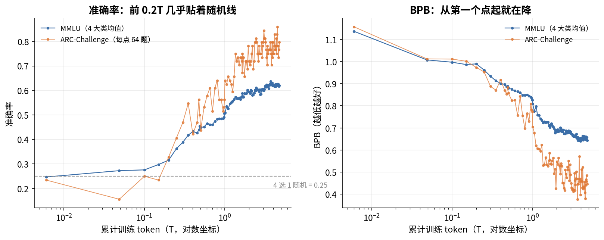
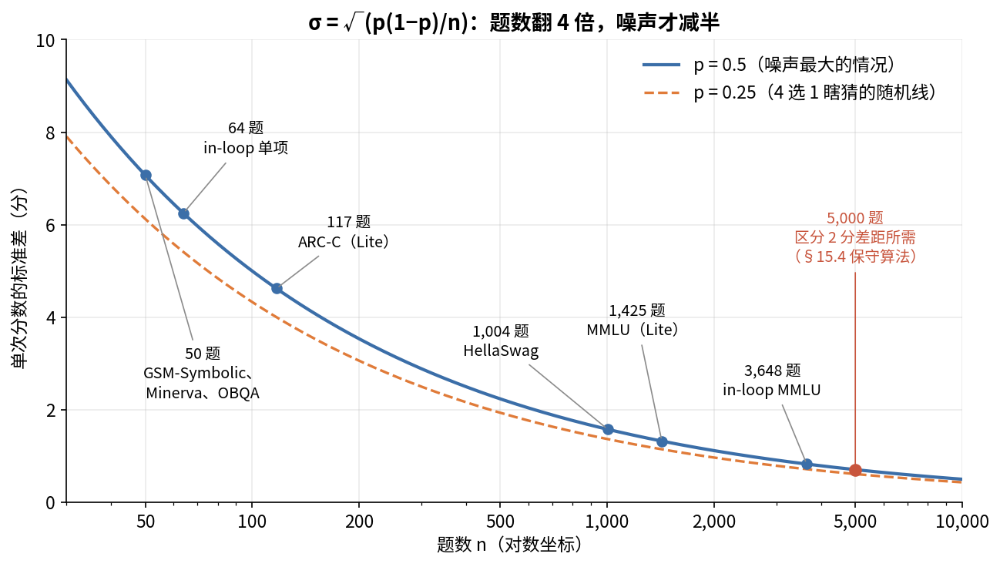

# 第 15 章　基座评测：训练中途怎么知道模型在变好

> 第 14 章讲了训练时盯哪些曲线。可是 loss 只能告诉你模型在拟合数据，没法告诉你模型会不会做题了。这一章讲训练中途怎么评测一个还没对齐过的基座模型：怎么出题，怎么打分，分数里有多少噪声，怎么从一串分数里读出趋势。ZGCM 用了三套中途评测，我会把公开的 W&B 数据和报告逐项对一遍，你会看到，报告里的表格用公开数据复现不出来。

## 这一章要回答的问题

读完这一章，你应该能回答下面这些问题。

1. 训练 loss 已经在降，为什么还要单独评测？
2. 基座模型不会按指令答题，怎么考它？few-shot、MC、RC、BPB 各是什么？
3. BPB 怎么算？为什么训练早期更该看 BPB 而不是准确率？
4. 一个只有 50 道题的评测，单个检查点的分数噪声有多大？怎么算？
5. ZGCM 在预训练和 mid-train 中途分别用了哪几套评测？各有多少题？
6. 报告 Table 7 怎么读？"MMLU 92% 的提升在 2.5T 之前完成"是怎么算出来的？
7. short-SFT probe 测的是什么？它的分数为什么不能和直接测基座的分数比？
8. 公开的 W&B 数据能复现报告里的评测数字吗？

---

<a id="s15-1" name="s15-1"></a>
## 15.1 为什么 loss 不够

训练 loss 在判断"模型有没有变强"这件事上，有三处不够用。

先说它只在训练数据上算。换了配比、换了序列长度，loss 的绝对值就会变（第 14 章 [§14.7](14_训练监控与稳定性.md#s14-7)）。ZGCM 从预训练进入 mid-train 时，数据从网页为主变成数学、代码、推理为主，loss 下降了一截。这一截里有多少是模型变强了，有多少是题变容易了，光看 loss 分不开。

另一个问题是，loss 是所有 token 的平均。一篇文章里绝大部分 token 是常规的语言续写，体现推理和知识的 token 只占很小一部分。这一小部分学会了，平均 loss 可能只降 0.001。

最后，loss 不直接对应能力。模型会不会做数学题、写的代码能不能跑通，得拿题来考才知道。

所以训练中途要定期拿检查点去考试，考出来的结果用来做三类决定。一是配比和课程要不要调：某个领域停涨了，可能要加数据（第 7 章）。二是阶段什么时候切：ZGCM 报告说预训练后期"边际收益越来越不均衡"，这是它转入 mid-train 的理由之一（报告附录 A.2 第 30 页）。三是有没有退化：训练出了问题，比如数据管线坏了、数值出错，评测分数会掉，有时比 loss 更早暴露。

<a id="s15-2" name="s15-2"></a>
## 15.2 怎么考一个基座模型

决定要考以后，接下来的问题是怎么考。基座模型（base model）只会续写，你问它"1+1 等于几"，它可能接着写"2+2 等于几"。所以考基座模型要换个办法：把题目写成一段需要续写的文字，看它续写得对不对。

### few-shot：先给几个例题

在题目前面放 k 道带答案的例题，模型就能从格式里看出这里该填答案，这叫 **k-shot** 提示。ZGCM 的中途评测大多是 5-shot（指标名里的 `5shot`），代码类是 3-shot，Minerva Math 是 0-shot。例题选哪几道、按什么顺序排，都会影响分数，所以同一套评测必须固定例题，不同检查点之间才能比。

### 四种打分方式

题目写好以后，还要决定怎么从模型的输出里打分。常见的有下面四种。

| 方式 | 怎么做 | 例子 | 优点 | 毛病 |
|---|---|---|---|---|
| 生成（generation） | 让模型自由生成，抽出答案和标准答案比 | GSM8K：生成解题过程，抽最后的数字 | 最接近真实使用 | 慢；早期模型格式都写不对，分数全是 0 |
| MC（multiple choice） | 把选项写成 A/B/C/D 列出来，比较模型在"A""B""C""D"这几个字母上的概率 | MMLU 的标准做法 | 一次前向就出结果 | 小模型、早期模型不理解"选字母"这个格式，分数长期在随机水平 |
| RC（rank classification，也叫 cloze） | 不列选项，把每个选项的原文分别接在题目后面，算模型给每个选项的概率，选概率最大的 | HellaSwag、PIQA 常用 | 不要求理解格式，早期就有信号 | 长选项的总概率天然更低，要做长度归一化 |
| BPB | 不选，只算模型给标准答案的概率，换算成"每字节多少比特" | 指标名里的 `bpb`、`gold_bpb` | 连续、平滑，最早有信号 | 不是准确率，不能直接说"会不会" |

表里 RC 那一行提到要做长度归一化，这里展开说一下。RC 里一个选项的总对数概率是它每个 token 对数概率之和，选项越长，加上的负数越多，直接比会偏向短选项。**长度归一化**（length normalization）的常见做法是除以选项的 token 数或字符数，比的是平均每个 token（或字符）的对数概率。ZGCM 的 MMLU 指标叫 `length-normalized accuracy`，就是做过这一步的准确率。

拿一道玩具题把 MC 和 RC 各走一遍，下面的概率都是示意数字，不是 ZGCM 的。题目是"水在标准大气压下的沸点是"，两个选项是"100 摄氏度"和"零度"。MC 把两个选项标成 A、B 列在题后，再接"答案："，只比较下一个 token 是"A"还是"B"的概率。一个早期模型可能给出 0.21 和 0.20，这点差别反映的是它对字母的偏好，和选项内容无关。RC 把两个选项分别接在题目后面算对数概率。假设"100 摄氏度"切成 3 个 token，对数概率是 −0.4、−0.3、−0.2，合计 −0.9；"零度"是 1 个 token，对数概率 −0.8。直接比总和，−0.8 比 −0.9 大，模型会选错；除以 token 数以后，正确选项平均每个 token −0.3，错误选项还是 −0.8，就选对了。

还有一件事要一直放在心上，就是随机水平。4 选 1 的题，瞎猜也有 25%，所以 MMLU 从 25% 涨到 30% 才算开始有信号，而 BPB 从第一个检查点起就在动。下一节用 ZGCM 的数据看这一点。

<a id="s15-3" name="s15-3"></a>
## 15.3 BPB：最早有信号的指标

### 定义

第 2 章 [§2.8](02_Transformer到能讲的程度.md#s2-8) 讲过 BPB（bits per byte，每字节比特数），这里在评测的语境下再算一遍。给定题目（加上例题）作为上下文，标准答案被 tokenize 成 $m$ 个 token，原文共 $B$ 个 UTF-8 字节：

$$\text{BPB}=\frac{-\sum_{i=1}^{m}\ln p(t_i\mid \text{上下文},t_{<i})}{B\cdot\ln 2}$$

分子是答案所有 token 的交叉熵之和（单位是 nat），除以 $\ln 2$ 换成比特，再除以字节数。指标名里的 `gold_bpb` 就是"标准答案（gold）的 BPB"。比如 `codex_humaneval_gold_bpb_3shot`，是在 3 道例题之后，模型对 HumanEval 参考解法的 BPB。

我们手算一个。标准答案是 ` carbon dioxide`，15 个字节，切成 3 个 token，模型给它们的对数概率是 −0.5、−1.2、−0.1：

$$\text{BPB}=\frac{0.5+1.2+0.1}{15\times0.693}=\frac{1.8}{10.4}\approx0.17$$

分母用字节而不用 token，是因为每 token 的交叉熵依赖 tokenizer：同一段话，词表大的切得少，每个 token 的 loss 就高。字节数和 tokenizer 无关，所以 BPB 能在不同 tokenizer 的模型之间比。两者的换算是 $\text{BPB}=\text{CE}_{\text{token}}/(\ln2\times\text{每 token 字节数})$。比如 ZGCM 在 C4 英文验证集上的交叉熵约 2.62 nat/token，按第 3 章 [§3.7](03_Tokenizer.md#s3-7) 的英文约 3.8 字节/token 粗算，约是 $2.62/(0.693\times3.8)\approx1.0$ BPB。

### 早期：准确率还在随机水平，BPB 已经在降

公开 W&B 的 `view-bench-pretrain-curriculum-*` 和 `view-bench-pretrain-*` 两个视图，记录了 103 个预训练检查点上同一套评测的结果。下表挑了几个点：

| 累计训练 token | MMLU 准确率（4 科均值） | MMLU BPB | ARC-Challenge 准确率 | ARC-Challenge BPB |
|---|---|---|---|---|
| 0.006T | 0.247 | 1.137 | 0.234 | 1.157 |
| 0.049T | 0.273 | 1.008 | 0.156 | 1.012 |
| 0.100T | 0.276 | 0.997 | 0.250 | 1.011 |
| 0.200T | 0.315 | 0.990 | 0.328 | 0.974 |
| 0.301T | 0.389 | 0.933 | 0.469 | 0.888 |
| 0.502T | 0.450 | 0.880 | 0.438 | 0.857 |
| 1.006T | 0.509 | 0.810 | 0.641 | 0.705 |
| 4.780T（预训练终点） | 0.621 | 0.644 | 0.797 | 0.446 |

（横轴的换算见 [§15.10](#s15-10) 第 7 条。）

先看前 0.1T。MMLU 准确率一直在 25%–28%，和瞎猜没有区别；同一时间 MMLU BPB 从 1.137 降到 0.997，降了 12%。模型这段时间在学东西，只是只有 BPB 看得出来。准确率要等到 0.2T 以后才明显离开随机水平。

ARC-Challenge 准确率在前三个点是 0.234、0.156、0.250，先跌后涨。这并不说明模型变差了。这个指标每个检查点只考 64 道题（[§15.4](#s15-4)），4 选 1 在 25% 附近单次分数的标准差约 5.4 分，两次分数之差的标准差还要乘 $\sqrt2$，约 7.7 分，跌 7.8 分大约就是 1 个标准差，在噪声以内。换成题数看更直观：0.234、0.156、0.250 分别是答对 15、10、16 道。设想一个完全靠瞎猜的模型，64 道 4 选 1 平均蒙对 16 道，标准差是 $\sqrt{64\times0.25\times0.75}\approx3.5$ 道，蒙对 9 道（14%）到 23 道（36%）都在两个标准差以内。表里 0.2T 的 0.328 是 21 道，也还在这个范围里，到 0.301T 的 0.469（30 道）才明显跳出来。同一时间它的 BPB 是 1.157、1.012、1.011，一直在降。

BPB 也有噪声，只是小一些。后期 ARC-Challenge BPB 在 0.42 和 0.53 之间来回跳，原因同样是只有 64 道题。MMLU 有 57 科、每科 64 道，它的 BPB 在 3T 以后的几个点是 0.662、0.645、0.648、0.655、0.644，平滑得多。



把 103 个点全画出来，横轴用对数坐标，两边的差别一眼就能看到。左图的准确率在 0.2T 之前贴着 25% 的虚线走，ARC-Challenge 那条线上下乱跳；右图的 BPB 从第一个点起就往下走。

所以训练早期、模型还小、或者要用小规模实验比较两个配比时，看 BPB；模型已经明显高于随机水平以后，准确率才有意义。第 7 章 ZGCM 用 BPB 证明课程学习有效（报告 Table 8，附录 A.4 第 32 页），就是因为那只是 10B token 的实验，准确率还看不出差别。

<a id="s15-4" name="s15-4"></a>
## 15.4 噪声：先知道一个分数值几道题

上一节已经两次拿题数去估标准差。第 14 章 [§14.8](14_训练监控与稳定性.md#s14-8) 给过公式：$n$ 道题、正确率 $p$，分数的标准差 $\sigma=\sqrt{p(1-p)/n}$。这一节补四件事：怎么从公开分数反推题数，要多少题才够，配对比较，以及窗口平均。

### 从分数反推题数

报告只写了部分评测的题数（附录 A.2 第 30 页），其余的可以从分数反推。如果一个评测有 $n$ 道题，每个分数都是 $k/n$。找最小的 $n$，让所有检查点的分数乘以 $n$ 都是整数，就得到题数。严格说这是题数的下限，真实题数可能是它的倍数。我对公开 W&B 的两套评测都做了一遍：

| 评测套件 | 评测 | 反推的题数 | 报告写的 | 标准差（取该评测的典型分数） |
|---|---|---|---|---|
| Ability Lite | MMLU | 1,425 | 1,425（每科 25 题） | 1.3 分 |
| | HellaSwag | 1,004 | 1,004 | 1.6 分 |
| | GSM-Symbolic、Minerva Math、OpenBookQA | 50 | 50 | 6.8–7.1 分 |
| | ARC-Challenge 117、CSQA 122、WinoGrande 127、GSM8K 132、HumanEval 164、PIQA 184、SocialIQA 195、BigCodeBench 199、MBPP 200 | 见左 | "50 到 200" | 3–4.5 分 |
| | ARC-Easy 238、BoolQ 327 | 见左 | 未写，且超过 200 | 2.5–3 分 |
| in-loop bench | 每个 `_fast` / `_rc` 准确率评测 | 64 | 未写 | 4–6 分 |
| | MMLU（4 个大类） | 每科 64，共 57 × 64 = 3,648 | 未写 | 0.8 分 |

ZGCM 两套评测的题都很少。in-loop bench 每项只有 64 道，一道题就是 1.6 分。

### 要多少题才够

假如想区分两个检查点差 2 分，按 [§14.8](14_训练监控与稳定性.md#s14-8) 的保守算法，差值的标准差 $\sqrt2\,\sigma$ 至少要小到 1 分，这样 2 分才是 2 个标准差：

$$\sqrt2\sqrt{\frac{p(1-p)}{n}}\le0.01\ \Rightarrow\ n\ge\frac{2p(1-p)}{0.0001}=\frac{2\times0.25}{0.0001}=5{,}000$$

$p=0.5$ 时要 5,000 道题。ZGCM 的 MMLU 只有 1,425 道，能稳定区分的差距约 3.7 分。所以小评测集只能看大趋势，拿它来比两个差不多的方案是不够的。

标准差和 $\sqrt n$ 成反比，题数翻 4 倍，噪声才减半。下图把 ZGCM 用到的几种题数放在同一条曲线上，看各自落在曲线的哪一段：



按 $p=0.5$ 算，从 50 道加到 200 道，标准差从 7 分降到 3.5 分；从 1,425 道加到 5,000 道，只从 1.3 分降到 0.7 分。

### 配对比较：同一组题，只数翻转的

上面的保守算法把两次评测当成独立的。实际上两个检查点答的是同一组题，大部分题两次都对或两次都错，只有少数题会翻转。设 $b$ 道题从对变错、$c$ 道从错变对，分数差就是 $(c-b)/n$，它的标准差约为

$$\sigma_{\text{diff}}\approx\frac{\sqrt{b+c}}{n}$$

这个式子的来历是：两次都对或两次都错的题，对分数差没有贡献，差值完全由翻转的 $b+c$ 道题决定。如果两个检查点其实一样强，每道翻转的题朝哪个方向翻就像抛一次硬币，给 $c-b$ 贡献 +1 或 −1，于是 $c-b$ 的方差约等于 $b+c$，开方再除以 $n$ 就是上式。

举个例子：50 道题，两个检查点之间有 5 道翻转（$b+c=5$），$\sigma_{\text{diff}}\approx\sqrt5/50=4.5$ 分，比独立假设的 10 分小一半多。这种做法叫**配对比较**，它要求保存每道题的对错，只存平均分是做不了的。ZGCM 公开的 W&B 只有平均分，没法做配对检验。

### 窗口平均

报告 Table 7 每个窗口取 5 个检查点的均值。[§14.8](14_训练监控与稳定性.md#s14-8) 讲过，这样去掉的是检查点之间的抖动，去不掉"这组题选得怎么样"的误差。窗口平均还有一个副作用：它会把窗口里的真实变化也抹平。早期能力涨得快，0.04T–0.07T 这个窗口的平均值会比窗口起点高、比终点低。

<a id="s15-5" name="s15-5"></a>
## 15.5 ZGCM 的三套中途评测

有了出题、打分和估噪声这几样工具，就可以看 ZGCM 实际是怎么评的了。先交代一个背景。Megatron 自带训练中评测，隔一段步数在验证集上算 loss，ZGCM 把它关了：预训练 env 里 `EVAL_ITERS=0`（`pretrain/configs/stages/01_pretrain_1t_sequential.env:103`、`02_...env:106`），mid-train 的 `EVAL_INTERVAL=1000000`、`EVAL_ITERS=0`（三个 env 的 L87-88）。所有评测都是另起程序、读保存好的检查点去跑。预训练每 1,000 步存一次检查点（`SAVE_INTERVAL=1000`，同文件 L101、L104），mid-train 每 500 步存一次（L86）。

仓库里没有任何评测代码，下面的信息来自报告和公开 W&B。

| 套件 | 测什么 | 怎么打分 | 检查点 | 公开数据 |
|---|---|---|---|---|
| Ability Lite（报告 A.2 的"固定能力套件"） | 17 个下游评测：MMLU、ARC、HellaSwag、GSM8K、HumanEval 等 | 准确率，多数是生成或选择 | 报告说 54 个，0.04T–4.19T（附录 A.2 第 30 页） | `view-lite-pretrain-*`（32 个检查点）、`view-lite-midtrain-*` |
| in-loop bench | 26 个下游指标（准确率和 BPB）+ 11 个验证集的 LM 交叉熵 | 准确率、BPB、CE、PPL | 预训练 103 个，mid-train 每段首尾若干个 | `view-bench-*` |
| short-SFT probe（报告 A.3） | 每个里程碑检查点先用同一份 SFT 数据快速微调，再考 MATH-500、AIME、HumanEval+、IFEval、MMLU 等 | 微调后模型的生成准确率 | 预训练终点 + mid-train 15%/30%/70%/77%/100% | 没有，只有报告 Figure 16 |

除了这三套，还有第四套 ACE（Atomic Capability Evaluation，2,503 道细粒度探针题），用在后训练的模型上，第 19 章讲。

### Ability Lite

报告附录 A.2 第 30 页描述了 **Ability Lite** 的设置。它直接测基座检查点，不做任何微调（附录 A.2 第 30 页），评测程序和设置在所有检查点上固定（第 30 页）。横轴是"已消耗样本数 × 序列长度"，从训练日志读出来，所以在 batch size 爬坡期间也准确（附录 A.2 第 30 页）。如果改用步数乘一个固定的 batch size 去算，爬坡期间每步的实际样本数比这个固定值少，token 数就会算多。它用的是固定子集，没有用完整测试集（第 30 页），题数见 [§15.4](#s15-4)。

这一套用来看能力：会不会做题，哪个领域在涨，哪个停了。

### in-loop bench

**in-loop bench** 的指标名字本身就说明了它的设置。例如 `arc_challenge_test_mc_5shot_fast/accuracy`，意思是 ARC-Challenge 测试集、MC 格式、5-shot、"fast"子集（64 题）、准确率。

整套指标分三类。准确率类有 ARC-Easy/Challenge（MC）、MMLU 四大类（MC，长度归一化）、6 个 basic_skills（算术、编程、常识、逻辑、模式、字符串操作，RC 格式），还有 copycolors（10 选 1 的格式检查题）。BPB 类覆盖 ARC、HellaSwag、MMLU 四大类、HumanEval、MBPP 和它的 C++/Java/Rust 版本、Minerva Math 500。第三类是 LM 交叉熵和 PPL，用的是 C4、Dolma 的 6 个子集（books、common-crawl、pes2o、reddit、stack、wiki）、ICE、M2D2-S2ORC、Pile、WikiText-103，共 11 个验证集。

这些名字和 AI2 的 OLMo 训练框架里的 in-loop 评测集完全一样（推断：ZGCM 用了 OLMo 的评测代码，或者是照着它搭的，报告没说）。这一套用来看趋势：BPB 和 CE 连续、噪声小，适合判断这一段训练有没有在进步。

报告正文没有提这一套，它只出现在公开 W&B 里。

### short-SFT probe

**short-SFT probe** 的做法见报告附录 A.3 第 32 页：每个检查点用"同一份精心挑选的 SFT 语料"快速微调，再在固定的评测集上测。它回答的问题和前两套不同，问的是这个基座经过微调以后能变成多强的助手。MATH-500、AIME 这种要长推理链的题，直接测基座几乎全是 0，微调以后才能看出差别。

因为每测一个检查点都要先跑一次 SFT，所以只测了 6 个里程碑。

<a id="s15-6" name="s15-6"></a>
## 15.6 读报告 Table 7：预训练中途的能力曲线

三套评测里，报告正文用得最多的是 Ability Lite，它在预训练阶段的结论集中在 Table 7。

### 表是怎么来的

报告 Table 7（附录 A.2 第 31 页）把 Ability Lite 的 54 个检查点分成四个窗口，每个窗口取 5 个检查点的均值（附录 A.2 第 30 页）。Early 是最前面 5 个，约 0.04T–0.07T；~1.0T 是以 1.0T 为中心的 5 个，约 0.91T–1.16T；~2.5T 是以 2.5T 为中心的 5 个，约 2.29T–2.79T；Final 是最后 5 个，约 3.67T–4.18T。

| 评测 | Early | ~1.0T | ~2.5T | Final | 到 2.5T 已完成的比例 | 最后 1.7T 涨了 |
|---|---|---|---|---|---|---|
| MMLU | 26.37 | 48.32 | 56.94 | 59.52 | 92% | 2.58 |
| GSM8K | 11.52 | 38.64 | 57.12 | 59.09 | 96% | 1.97 |
| CSQA | 19.02 | 57.70 | 64.26 | 67.87 | 93% | 3.61 |
| OBQA | 24.80 | 60.80 | 72.40 | 78.80 | 88% | 6.40 |
| ARC-Challenge | 24.96 | 56.07 | 69.74 | 75.90 | 88% | 6.16 |
| HellaSwag | 24.56 | 42.75 | 52.69 | 57.15 | 86% | 4.46 |
| WinoGrande | 50.71 | 65.98 | 66.14 | 68.98 | 84% | 2.84 |
| Minerva Math | 6.80 | 20.40 | 32.80 | 38.40 | 82% | 5.60 |
| HumanEval | 13.66 | 28.29 | 36.46 | 43.54 | 76% | 7.08 |
| GSM-Symbolic | 1.20 | 25.60 | 49.20 | 64.00 | 76% | 14.80 |
| PIQA | 53.80 | 64.78 | 69.78 | 74.89 | 76% | 5.11 |

前四列是报告原文，后两列是我按原文算的。

### "MMLU 92% 的提升在 2.5T 之前完成"怎么算

"总提升"指 Final 减 Early，"到 2.5T 的提升"指 ~2.5T 减 Early，两者相除：

$$\frac{56.94-26.37}{59.52-26.37}=\frac{30.57}{33.15}=0.922$$

ARC-Challenge 是 $(69.74-24.96)/(75.90-24.96)=0.879$，WinoGrande 是 $(66.14-50.71)/(68.98-50.71)=0.845$。这三个就是报告附录 A.2 第 30 页写的 92%、88%、84%。"最后 1.7T"指 2.5T 到 4.19T 这一段，涨幅就是 Final 减 ~2.5T。

### 把噪声放进去再读

报告由此得出结论（附录 A.2 第 30 页）：知识和常识类评测在 2.5T 以后涨得很少，代码和较难的数学还在涨，所以通用预训练的边际收益越来越不均衡，这是转入 mid-train 的理由。

我们用 [§15.4](#s15-4) 的方法，给"最后 1.7T 涨了"这一列配上标准差。把两个窗口当成独立的两次考试，差值的标准差是 $\sqrt2\,\sigma$，$p$ 取两个窗口的平均分：

| 评测 | 题数 | 差值的标准差 | 涨幅 ÷ 标准差 |
|---|---|---|---|
| HellaSwag | 1,004 | 2.2 | 2.0 |
| GSM-Symbolic | 50 | 9.9 | 1.5 |
| MMLU | 1,425 | 1.8 | 1.4 |
| HumanEval | 164 | 5.4 | 1.3 |
| PIQA | 184 | 4.7 | 1.1 |
| ARC-Challenge | 117 | 5.8 | 1.1 |
| OBQA | 50 | 8.6 | 0.7 |
| CSQA | 122 | 6.1 | 0.6 |
| Minerva Math | 50 | 9.6 | 0.6 |
| WinoGrande | 127 | 5.9 | 0.5 |
| GSM8K | 132 | 6.1 | 0.3 |

这个算法偏保守，算出来的是上界。两个窗口答的是同一组题，按 [§15.4](#s15-4) 的配对算法，差值的标准差只取决于翻转的题数，会比表里小；窗口平均也能再去掉一部分检查点之间的抖动。可是做配对检验必须有逐题对错，ZGCM 没公开，所以到底小多少算不出来。在这个前提下读这张表，能看出几件事。

按保守算法，没有一项最后 1.7T 的涨幅超过 2 个标准差，HellaSwag 刚好 2.0。只用公开的平均分，说不出哪项确实还在涨、哪项确实停了。

"代码和难数学还在涨"这个说法，证据也弱。HumanEval 是 1.3 个标准差，GSM-Symbolic 是 1.5 个，和 MMLU 的 1.4 个差不多。报告对 GSM-Symbolic 自己也写了 "wide uncertainty"（附录 A.2 第 30 页）。

分组本身也不干净。PIQA 和 HumanEval 一样不饱和，它到 2.5T 也只完成了 76%，和 HumanEval、GSM-Symbolic 相同，可 PIQA 是物理常识题，和代码、数学都不沾边。反过来，GSM8K 才是最饱和的一项（96%），比报告举例的 MMLU 还高，而 GSM8K 是小学数学应用题，属于报告说"还在涨"的数学那一侧。所以"知识常识饱和、代码数学没饱和"这个分组，在数字上并不干净。

这些并不说明报告的结论错了。曲线整体确实在变平，第 14 章 [§14.8](14_训练监控与稳定性.md#s14-8) 也讲过，多个评测同方向的小涨幅合起来比单项可信。我想说明的是：**用 50–200 道题、只有平均分的评测去判断哪个领域还在涨，Table 7 本身给不出统计上可靠的答案。** 转入 mid-train 是一个合理的判断，但它更多依据的是经验和算力预算，这张表只是佐证。

### 曲线里的另一个信号：课程结束

报告 Figure 15（附录 A.2 第 31 页）在 1.0T 处画了一条虚线，标记按词汇复杂度排序的课程阶段结束（第 7 章）。~1.0T 窗口（0.91T–1.16T）正好跨过这条线。第 7 章 [§7.7](07_数据四_配比与课程.md#s7-7) 算过，1.0T 之后并没有马上进 stage2 新数据，先是同一份课程数据打乱再训到约 1.63T，然后才是 stage2。所以 1.0T 和 1.63T 前后的涨速差别里，混着"数据顺序或内容变了"和"模型变强了"两个因素，分不开。WinoGrande 在 1.0T 到 2.5T 只涨了 0.16 分，可能和这两次切换有关，也可能只是噪声（报告未说明）。

### 横轴只到 4.19T

Figure 15 的横轴"截断在 4.19T"（附录 A.2 第 31 页），Final 窗口是 3.67T–4.18T。可是发布的预训练检查点累计是 4.78T（第 7 章 [§7.7](07_数据四_配比与课程.md#s7-7)）。也就是说，最后约 0.59T 的训练不在 Table 7 里，表中的"Final"并不是预训练终点。4.19T 正好等于报告的数据量 0.99T + 3.20T，截断可能是为了和数据量对齐，报告没解释。

<a id="s15-7" name="s15-7"></a>
## 15.7 mid-train 中途怎么评

预训练之后是 mid-train。mid-train 有 4 段（32K、64K、128K、256K，第 16 章细讲），每段的配比和序列长度都不同，train loss 不能跨段比（第 14 章 [§14.7](14_训练监控与稳定性.md#s14-7)）。所以这几段有没有用，只能靠评测判断。

### in-loop bench：每段首尾各测一次

附录 C [§C.3](附录C_W&B与数据配比统计.md#sc-3) 整理了公开 W&B 里每段首尾检查点的 bench 结果，下表摘了几列：

| 检查点 | MMLU4 准确率 | MMLU BPB | 11 个验证集平均 CE |
|---|---|---|---|
| 预训练终点 | 0.621 | 0.644 | 2.309 |
| 32K 首 / 末 | 0.651 / 0.674 | 0.617 / 0.572 | 2.241 / 2.230 |
| 64K 首 / 末 | 0.676 / 0.676 | 0.571 / 0.584 | 2.230 / 2.237 |
| 128K 首 / 末 | 0.677 / 0.682 | 0.566 / 0.557 | 2.237 / 2.215 |
| 256K 首 / 末 | 0.658 / 0.679 | 0.565 / 0.556 | 2.242 / 2.224 |

MMLU 的提升基本都在 32K 段，从 0.621 到 0.674，涨了 5.3 分。in-loop 的 MMLU 有 3,648 道题，差值的保守标准差约 1.1 分，5.3 分是 4.7 个标准差，这个提升是实打实的。之后三段都在 0.66–0.68 之间。

64K 段的 MMLU BPB 反而升了（0.571 → 0.584），平均 CE 也升了，而同一段里长书（dolma_books）的 CE 降了 0.107。这一段 LR 恒定 1e-4，模型在学长上下文，短文本能力略有退步，到 128K 段退火后才一起降下来。

256K 段开头，MMLU4 掉到 0.658。每段都重新 warmup（LR 从 1e-5 拉回接近 1e-4），LR 刚拉高时模型会被扰动，到段末才回到 0.679。这是 re-warm 付出的代价。

从这几行也能看出 BPB 和 CE 的价值：它们在 3,648 道题、11 个验证集上取平均，噪声小，0.01 的变化就有意义。

### Ability Lite：分段和一步到 256K 的对比

ZGCM 还跑了一条对照路线：从同一个预训练终点直接用 256K 序列训 602.9B token（direct-256K）。两条路线用同一套 Ability Lite 测，可以直接比。附录 C [§C.2.3](附录C_W&B与数据配比统计.md#sc-2-3) 的结果是，取 17 项平均（去掉恒定不变的 BigCodeBench）时，C1 分段路线终点 0.7318，direct-256K 终点 0.7238，差 0.008。可是同一条曲线上相邻检查点就能跳 0.01–0.02（例如 C1 64K 段 0.7344 → 0.7203），所以 0.008 在噪声内。只有 Minerva Math 看起来一直有差距，C1 在 0.38–0.56，direct 在 0.22–0.50；但它只有 50 题，终点差 0.14 也就是 7 道题。

所以，公开数据不能证明分段扩长比一步到 256K 更好。分段能确定的好处是省算力，因为短序列段的注意力便宜（第 16 章）。

### short-SFT probe：基座经过微调能变多强

报告 A.3 Figure 16 和 附录 A.3 第 32 页给了预训练终点和 mid-train 终点的对比：

| 评测 | 预训练终点 | mid-train 终点 |
|---|---|---|
| MATH-500 | 35.83 | 74.12 |
| HumanEval+ | 43.29 | 73.78 |
| IFEval Strict | 29.57 | 72.64 |
| MMLU | 44.17 | 72.63 |

读这张表有四处要小心。

最容易误读的是 MMLU。probe 的 MMLU 比直接测基座还低：直接测基座时，Ability Lite 的 MMLU 在 Table 7 最后一个窗口是 59.52，in-loop bench 在预训练终点是 62.1，做了 short-SFT 之后却只有 44.17。原因报告没说。一个可能的解释是 probe 用生成式、chat 格式答题，两轮 SFT 还没让模型稳定地按格式输出答案（推断）。两者的题目、格式、打分方式都不同，所以 probe 分数和直接测基座的分数不能放在一起比。

第二处是 epoch 数不一致。前 5 个里程碑（预训练终点、mid-train 15%/30%/70%/77%）用 2 个 SFT epoch，mid-train 100% 用 3 个（附录 A.3 第 32 页）。最后一个点多训了一轮 SFT，它的提升里有多少来自 mid-train、多少来自多一轮 SFT，分不开。报告自己也说这是 "diagnostic evidence"，算不上严格对照的消融（附录 A.3 第 32 页）。

第三，分数不是单调上升的。报告写了各评测在每个里程碑上不一定都涨（附录 A.3 第 32 页），但没给中间点的数字，只有图。

最后，SFT 数据本身就在教这些能力。同一份 SFT 数据对所有检查点都一样，所以检查点之间的差别还是能比的；但 74.12 这个绝对值不代表基座本身的数学能力。

<a id="s15-8" name="s15-8"></a>
## 15.8 ZGCM 没用的其他做法

前面几节多次碰到"公开数据不够，没法判断"。下面这些做法 ZGCM 没用，但它们能补上其中一部分缺口。

### 存逐题结果，做配对检验

[§15.4](#s15-4) 讲过，两个检查点答同一组题时，配对比较的标准差只看翻转的题数，往往只有独立假设的一半。前提是每道题的对错（或每道题的 BPB）都要存下来。业界常见的做法是每次评测输出一个逐题文件，比较两个检查点时做配对检验，或者对题目做 bootstrap：从 $n$ 道题里有放回地抽 $n$ 道，重复上千次，看分数差的分布。成本只是多存一个文件，而 ZGCM 公开的只有平均分。

### 用标准化的评测框架

自己写评测脚本，很容易在细节上出错：例题怎么拼，选项前要不要加空格，长度归一化除以 token 数还是字符数。这些细节能让分数差好几分，所以最好用现成的开源框架。最常用的是 EleutherAI 的 lm-evaluation-harness，有几百个任务，MC、RC、生成都支持。AI2 的 OLMES 是一套写死所有细节的评测规范，例题、格式、归一化方式都固定；它对每道选择题同时用 MC 和 RC 两种格式测，取较好的那个，这样小模型（只会 RC）和大模型（会 MC）用的是同一套规则。

ZGCM in-loop bench 的指标名和 OLMo 的一样（[§15.5](#s15-5)），说明它很可能用了 AI2 的这套工具。

### 先查评测集有没有混进训练数据

第 6 章讲过去污染：用 n-gram 重叠把训练数据里和评测题重复的文档删掉。反过来也要查：评测前统计每道评测题和训练数据的重叠程度，把"可能见过的题"单独报分。如果见过的题分数明显高，说明有泄漏。报告没有给出这类统计。

### 只挑信噪比高的评测做决策

FineWeb 的作者在做数据消融前，先用多个随机种子训小模型，只保留满足三个条件的评测：分数随训练单调上升，不同种子之间差得少，早期就离开随机水平。不满足的评测，比如 4 选 1 但模型长期在 25% 的，不拿来做决策。这和 [§15.3](#s15-3) 的结论一致：小规模实验看 BPB，或者只看信噪比高的那几项。

### 用 BPB 预测下游准确率

Llama 3 报告用了两步预测：先用小模型拟合"训练算力 → 标准答案的负对数似然"的 scaling law，再拟合"负对数似然 → 准确率"的 S 形曲线。这样能在大模型训练前，估计它在某个评测上能到多少分。这也说明 BPB 和准确率之间有稳定的对应关系，BPB 并不只在早期才有用。

### 留一份同分布的验证集

最朴素的监控，是从训练数据里切出一小块不训，定期算它的 loss。它和 train loss 不同，不受"这一步刚好抽到难样本"的影响，也能发现过拟合。ZGCM 预训练的 `DATA_SPLIT="100,0,0"` 一点都没留；mid-train 留了万分之一（`"9999,1,0"`），但 `EVAL_ITERS=0`，从来没用过（[§15.9](#s15-9)）。它的 in-loop bench 用 11 个外部验证集顶替了这个作用，但那些集合和训练配比不同分布。

<a id="s15-9" name="s15-9"></a>
## 15.9 读代码

ZGCM 仓库里没有任何评测代码。能读的只有评测怎么被关掉的那几行配置，另外我写了一段 BPB 和 RC 打分的示意代码，放在本节后半。

### Megatron 自带的验证是怎么关掉的

启动脚本 `pretrain/scripts/launch_train.sh` L187 和 L198-204：

```bash
  --split "${DATA_SPLIT:-100,0,0}"           # L187：train,valid,test 三份的比例
...
logging=(
  --log-interval "${LOG_INTERVAL:-10}"       # 每 10 步打一次日志
  --save-interval "${SAVE_INTERVAL:-1000}"   # 每 1000 步存一次检查点
  --eval-interval "${EVAL_INTERVAL:-100000}" # 每多少步做一次验证
  --eval-iters "${EVAL_ITERS:-0}"            # 每次验证跑几个 batch
  --log-throughput
  --ckpt-format torch_dist
```

起作用的是两个参数。`--split 100,0,0` 把数据按 100 : 0 : 0 分给训练、验证、测试，验证集是空的；`--eval-iters 0` 让每次验证跑 0 个 batch。

再看 Megatron 怎么用这两个参数（`pretrain/Megatron-LM/megatron/training/training.py`）：

```python
# L3561：整个训练要准备多少条验证样本
eval_iters = (args.train_iters // args.eval_interval + 1) * args.eval_iters
# L3656：有验证数据，且 eval_iters > 0，才做验证
do_valid = valid_dataloaders is not None and (args.full_validation or args.eval_iters > 0)
# L3153：训练循环里，每 eval_interval 步检查一次
if args.eval_interval and iteration % args.eval_interval == 0 and args.do_valid:
```

`EVAL_ITERS=0` 让 L3561 算出 0 条验证样本，L3656 的 `do_valid` 为假，L3153 的条件永远不成立。所以 `EVAL_INTERVAL` 设成 1,000 还是 1,000,000 都没区别。

mid-train 的三个 env 是 `DATA_SPLIT="9999,1,0"`（L82）、`EVAL_INTERVAL=1000000`（L87）、`EVAL_ITERS=0`（L88）。它切了万分之一当验证集，但同样从不验证。这对训练没有影响，只是配置里留着用不上的设置。

### 示意：gold BPB 和 RC 打分

下面是按 [§15.2](#s15-2)–[§15.3](#s15-3) 的定义写的示意代码，不是 ZGCM 的代码：

```python
def answer_logprob(model, tok, context, answer):
    ctx = tok.encode(context)
    ans = tok.encode(answer)               # answer 一般以空格开头，如 " carbon dioxide"
    logp = log_softmax(model(ctx + ans), dim=-1)   # [长度, 词表]
    total = 0.0
    for j, t in enumerate(ans):
        total += logp[len(ctx) - 1 + j, t] # 位置 i 的输出预测第 i+1 个 token
    return total                           # 单位是 nat，是负数

def gold_bpb(model, tok, context, gold):
    nll = -answer_logprob(model, tok, context, gold)
    return nll / (len(gold.encode("utf-8")) * math.log(2))

def rc_predict(model, tok, context, options):
    scores = [answer_logprob(model, tok, context, o) / len(o) for o in options]
    return argmax(scores)                  # 除以字符数，就是长度归一化
```

最容易写错的是 `logp[len(ctx) - 1 + j, t]` 这一行。语言模型在位置 $i$ 输出的是"下一个 token"的分布，所以答案第 $j$ 个 token 的概率要从它前一个位置取。这里差一位是最常见的 bug，结果会偏得离谱，程序却不报错。

`gold_bpb` 只算标准答案，不看其他选项，所以没有对错之分，只是一个连续值。`rc_predict` 对每个选项都算一次，选平均对数概率最大的那个；除以 `len(o)`，是为了去掉长选项吃亏的问题。

真实实现还要处理两件事。一是上下文和答案分开 tokenize 时，交界处可能和整体 tokenize 切得不一样；二是一个 batch 里放多个选项时，要共享上下文的计算。

<a id="s15-10" name="s15-10"></a>
## 15.10 坑和对不上的地方

下面这些条目彼此独立，前面各节大多已经提过，这里集中列一遍，末尾有一张表按类别归了类。

1. Table 7 用公开 W&B 复现不出来。公开的 Ability Lite（`view-lite-pretrain-public-20260918-v1`）取最前 5 个检查点的均值，和 Table 7 的 Early 列对不上：MMLU 28.87 对 26.37，GSM8K 15.76 对 11.52，Minerva 11.20 对 6.80，WinoGrande 55.59 对 50.71。取最后 5 个去对 Final 列，也对不上：GSM-Symbolic 48.40 对 64.00，HumanEval 38.05 对 43.54，OBQA 74.40 对 78.80。
2. 检查点数和范围也不同。报告说 54 个检查点、0.04T–4.19T（附录 A.2 第 30 页）。公开数据只有 32 个：课程阶段 17 个（iteration 7,000–138,000），之后 15 个（140,000–272,000）。按第 7 章 [§7.7](07_数据四_配比与课程.md#s7-7) 的换算（tokens ≈ (iteration − 8,072) × 12.58M），272,000 步约是 3.32T。所以 Table 7 的 Final 窗口（3.67T–4.18T）根本不在公开数据里，第 1 条对不上并不奇怪。
3. Table 7 不含预训练最后约 0.59T。横轴截断在 4.19T（附录 A.2 第 31 页），发布的预训练终点是 4.78T，表里的"Final"不是终点（[§15.6](#s15-6)）。
4. 有些评测的题数超出了报告写的范围。报告说其余评测 50 到 200 题（附录 A.2 第 30 页），可是从分数反推，ARC-Easy 至少 238 题、BoolQ 至少 327 题（[§15.4](#s15-4)）。
5. BigCodeBench 没有信息量。mid-train 所有检查点都是 0.5528（= 110/199），预训练也只出现过 0.5528 和 0.5477 两个值。要么评测出了问题，要么这个子集对模型不敏感。报告 Table 7 没列它。
6. 报告里没提 in-loop bench。103 个预训练检查点、26 个下游指标加 11 个验证集，只出现在公开 W&B 里。报告 §3.3 提到会监控 perplexity 和 BPB（第 10 页），但没说用的是哪些集合。
7. W&B 横轴要换算。`view-bench-*` 的 `_step` 是 `token_normalized_step`，乘以 $2^{22}$ = 4,194,304 才是 token 数。例如预训练最后一行 `_step` = 1,139,634，换算是 4.780T，和 HF 记录的 4779.97B 一致。还要注意两个视图里"curriculum"的范围不同：bench 的 curriculum 视图到 `_step` 233,784（0.98T，课程顺序过一遍），Ability Lite 的 `pretrain_curriculum` 键到 iteration 138,000（1.63T，含打乱后的第二遍）。
8. short-SFT probe 的 epoch 不一致。前 5 个里程碑 2 个 epoch，最后一个 3 个（附录 A.3 第 32 页），所以最后一个点的提升里混着"多一轮 SFT"。
9. probe 的 MMLU 低于直接测基座。预训练终点 probe 是 44.17；直接测基座，Table 7 最后一个窗口是 59.52，in-loop bench 在预训练终点是 62.1。两套分数不能比，报告没解释原因（[§15.7](#s15-7)）。
10. c4_en 的 CE 在 0.905T 之前是空的。11 个验证集的平均 CE 在早期只能用 10 个算，前后不是同一个口径。画平均 CE 曲线时，要先检查每个集合是否都有值。
11. 仓库里没有评测代码。Megatron 自带验证被关掉了（`EVAL_ITERS=0`），mid-train 切了万分之一的验证集，但从来不用（[§15.9](#s15-9)）。三套评测的程序、prompt 模板、例题都没有公开，没法复现。
12. HF 检查点没有和 Megatron 对过 logits。所有 `checkpoint_info.json` 的 `native_megatron_logits_comparison` 都是 false，只检查了权重往返一致、能加载并做短生成。评测是用 Megatron 权重还是 HF 权重跑的，报告没说。如果是 HF 权重，转换误差会混进评测分数（推断，目前没有证据表明有误差）。
13. "知识饱和、代码数学不饱和"的分组不干净。PIQA 到 2.5T 只完成了 76%，和 HumanEval 一样；GSM8K 完成了 96%，是最饱和的一项（[§15.6](#s15-6)）。

| 类别 | 条目 |
|---|---|
| 报告和公开数据对不上 | 1、2、4、6 |
| 报告自身的口径问题 | 3、8、9、13 |
| 读数据时要注意的 | 5、7、10 |
| 缺失的代码和验证 | 11、12 |

<a id="s15-11" name="s15-11"></a>
## 15.11 试着讲给别人听

下面是一段示范讲法。建议你先合上书自己讲一遍，再对照。

> 训练 loss 在降，不代表模型会做题了。loss 是所有 token 的平均，换了数据配比绝对值就变，它也不直接对应能力。所以训练中途要定期拿检查点去考试。
>
> 基座模型只会续写，所以考它要把题目写成一段续写。前面放几道带答案的例题，这叫 few-shot。打分有四种方式。生成式让模型自己写答案，最真实，但早期模型连格式都写不对。MC 把选项列成 ABCD，比较字母的概率，早期模型不懂这个格式。RC 把每个选项原文接在题目后面，比较平均对数概率，早期就有信号。BPB 不做选择，只算标准答案每字节要多少比特，是连续值，最早能看出变化。ZGCM 的数据里，前 0.1T token 的 MMLU 准确率一直在 25% 到 28%，等于瞎猜，同一时间 MMLU 的 BPB 已经降了 12%。
>
> 第二件事是噪声。n 道题、正确率 p，分数的标准差是根号 p(1−p)/n。50 道题、50% 正确率，标准差 7 分，一道题就是 2 分。要稳定区分 2 分的差距，按保守算法要 5,000 道题。两个检查点答同一组题时，可以只数翻转的题做配对检验，标准差小很多，但前提是存了逐题结果。
>
> ZGCM 用了三套中途评测。Ability Lite 直接测基座，17 个评测，每个 50 到 1,425 道题。in-loop bench 用 64 题的小子集，再加 BPB 和 11 个验证集的交叉熵，用来看趋势。short-SFT probe 先用同一份 SFT 数据快速微调再考，看基座能变成多强的助手，所以它的分数不能和直接测基座的比。
>
> 报告用 Table 7 说 MMLU 92% 的提升在 2.5T 之前完成，代码和难数学还在涨，以此作为转入 mid-train 的理由。92% 是 2.5T 窗口减起点、除以终点减起点。但把噪声算进去，最后 1.7T 的涨幅没有一项超过 2 个标准差。PIQA 和 HumanEval 一样没饱和，GSM8K 反而是最饱和的。另外，这张表用公开 W&B 复现不出来：公开的只有 32 个检查点，到 3.32T 就停了；表的横轴也截断在 4.19T，而预训练实际训到 4.78T。
>
> 我的结论是：早期和小实验看 BPB；准确率明显高于随机水平以后才看；小评测集只看大趋势；做决策的评测要存逐题结果。

<a id="s15-12" name="s15-12"></a>
## 15.12 习题

1. 训练 loss 已经在降，为什么还要单独评测？说出 loss 的三个局限。

<details><summary>答案</summary>

只在训练数据上算，换配比或长度绝对值就变；是所有 token 的平均，体现推理和知识的少数 token 学会了，平均值几乎不动；不直接对应"会不会做题"。见 [§15.1](#s15-1)。

</details>

2. MC 和 RC 有什么区别？为什么早期模型更适合用 RC？

<details><summary>答案</summary>

MC 把选项写成 A/B/C/D，比较字母的概率；RC 把每个选项原文分别接在题目后，比较（长度归一化后的）对数概率。早期模型不理解"选字母"这个格式，MC 分数长期在随机水平；RC 不需要理解格式。见 [§15.2](#s15-2)。

</details>

3. RC 为什么要做长度归一化？不做会偏向哪种选项？

<details><summary>答案</summary>

选项的总对数概率是每个 token 对数概率之和，都是负数，选项越长加得越多，总分越低。不归一化会偏向短选项。常用做法是除以 token 数或字符数。见 [§15.2](#s15-2)。

</details>

4. 标准答案是 12 个字节、切成 2 个 token，对数概率是 −0.8 和 −0.4。它的 BPB 是多少？

<details><summary>答案</summary>

$(0.8+0.4)/(12\times0.693)=1.2/8.32\approx0.144$。见 [§15.3](#s15-3)。

</details>

5. 为什么 BPB 用字节而不用 token 做分母？

<details><summary>答案</summary>

每 token 的交叉熵依赖 tokenizer，词表大的切得少，每 token loss 就高。字节数和 tokenizer 无关，所以 BPB 能在不同 tokenizer 的模型之间比。见 [§15.3](#s15-3)。

</details>

6. ZGCM 前 0.1T token，MMLU 准确率和 MMLU BPB 各是什么表现？这说明什么？

<details><summary>答案</summary>

准确率一直在 25%–28%，等于瞎猜；BPB 从 1.137 降到 0.997，降了约 12%。说明模型在学，但只有 BPB 看得出来。早期和小规模实验应看 BPB。见 [§15.3](#s15-3)。

</details>

7. ARC-Challenge 准确率前三个点是 0.234、0.156、0.250。模型在 0.049T 变差了吗？

<details><summary>答案</summary>

不能这么说。这个指标只有 64 道题，25% 附近单次分数标准差约 5.4 分，两次之差的标准差约 $\sqrt2\times5.4\approx7.7$ 分，跌 7.8 分约 1 个标准差，在噪声内。同一时间 BPB 1.157 → 1.012 → 1.011，一直在降。见 [§15.3](#s15-3)、[§15.4](#s15-4)。

</details>

8. 如何从一组公开分数反推评测有多少道题？反推出来的是准确题数吗？

<details><summary>答案</summary>

每个分数都是 $k/n$，找最小的 $n$ 使所有分数乘 $n$ 都是整数。得到的是题数的下限，真实题数可能是它的倍数。见 [§15.4](#s15-4)。

</details>

9. 50 道题的评测，两个检查点之间有 8 道题翻转。配对比较的标准差约多少？如果按两次独立考试算（p=0.5）又是多少？

<details><summary>答案</summary>

配对：$\sqrt8/50\approx5.7$ 分。独立：$\sqrt2\times\sqrt{0.25/50}\approx10$ 分。配对的前提是存了逐题结果。见 [§15.4](#s15-4)。

</details>

10. "MMLU 92% 的提升在 2.5T 之前完成"是怎么算的？写出算式。

<details><summary>答案</summary>

$(56.94-26.37)/(59.52-26.37)=30.57/33.15=0.922$，即（~2.5T 窗口 − Early）÷（Final − Early）。见 [§15.6](#s15-6)。

</details>

11. 报告说最后 1.7T 代码和难数学还在涨、知识类停了。从噪声和数字上，你会怎么质疑？

<details><summary>答案</summary>

按保守算法，HumanEval 涨幅 1.3 个标准差、GSM-Symbolic 1.5 个、MMLU 1.4 个，差不多，都没到 2 个。PIQA（常识）到 2.5T 也只完成 76%，和 HumanEval 一样；GSM8K（数学）完成 96%，最饱和。分组不干净。另外表的 Final 窗口截在 4.19T，不是 4.78T 的终点。见 [§15.6](#s15-6)。

</details>

12. short-SFT probe 测的是什么？预训练终点 probe 的 MMLU 是 44.17，直接测基座是 59–62，为什么不能说"SFT 让 MMLU 掉了"？

<details><summary>答案</summary>

probe 测的是"同一份 SFT 数据快速微调后能变多强"。两套分数的题目、格式、打分方式都不同（probe 可能是 chat 格式生成，推断），不能放在一起比。只能在 probe 内部比不同检查点。见 [§15.5](#s15-5)、[§15.7](#s15-7)。

</details>

13. mid-train 终点 probe 的 MATH-500 是 74.12，比预训练终点高 38 分。这全是 mid-train 的功劳吗？

<details><summary>答案</summary>

不全是。最后这个点用了 3 个 SFT epoch，之前的点用 2 个，多一轮 SFT 的贡献分不开。报告自己也说这不是严格对照的消融。见 [§15.7](#s15-7)。

</details>

14. 公开 W&B 能复现 Table 7 吗？给出两条理由。

<details><summary>答案</summary>

不能。公开 Ability Lite 只有 32 个检查点（报告说 54 个），到 iteration 272,000（约 3.32T）就停了，Final 窗口 3.67T–4.18T 不在里面；前 5 个点的均值也和 Early 列对不上（如 MMLU 28.87 对 26.37）。见 [§15.10](#s15-10) 第 1、2 条。

</details>

15. ZGCM 的 mid-train 配置切了万分之一的验证集，Megatron 会在训练中验证吗？为什么？

<details><summary>答案</summary>

不会。`EVAL_ITERS=0` 让验证样本数为 0，`do_valid` 为假，训练循环里的验证条件永远不成立，`EVAL_INTERVAL` 设多大都没区别。见 [§15.9](#s15-9)。

</details>

---

上一章：[第 14 章　训练监控与稳定性](14_训练监控与稳定性.md)　下一章：[第 16 章　Mid-Train 与长上下文](16_MidTrain与长上下文.md)
