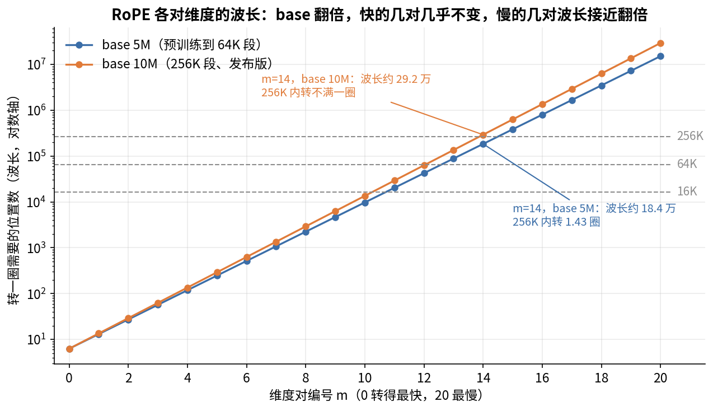
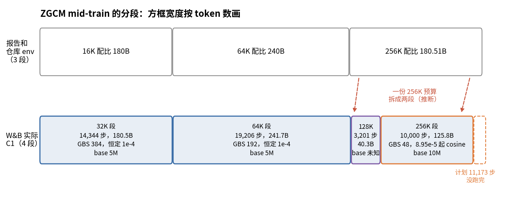
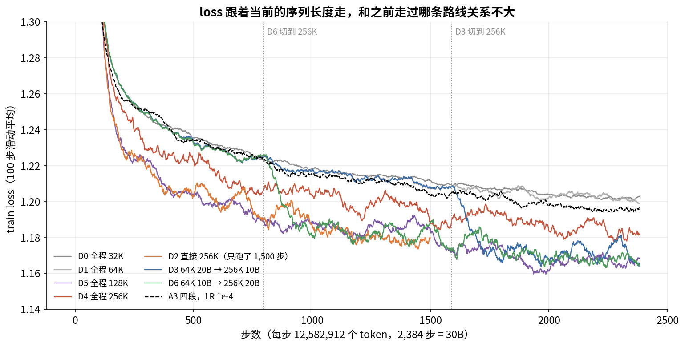
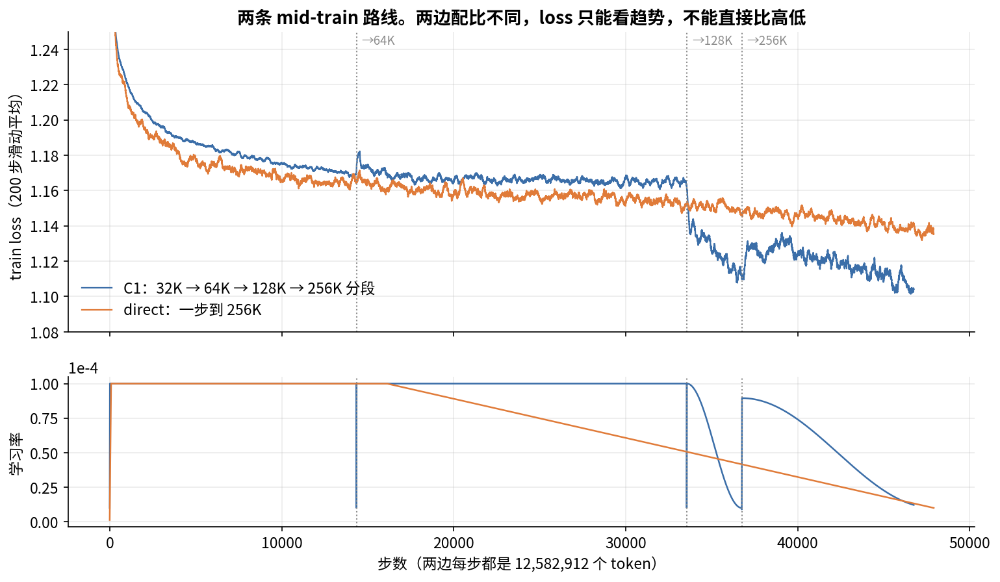

# 第 16 章　Mid-Train 与长上下文

> 预训练结束时，ZGCM 只见过 16K 长的序列，而发布的模型要能吃 256K。中间这一段叫 mid-train：换一套更偏能力的数据，同时把上下文一步步拉长。这一章讲三件事：为什么要有这一段，长上下文难在哪，以及 ZGCM 实际跑了什么。第三件要多花些篇幅，因为仓库、报告、W&B 三方的说法不一样。

## 这一章要回答的问题

读完这一章，你应该能回答下面这些问题。

1. mid-train 和预训练有什么区别？为什么不把这些数据直接放进预训练？
2. 把上下文从 16K 拉到 256K，要解决哪四类问题？
3. RoPE 扩长有哪几种做法？ZGCM 用的是哪种，为什么够用？
4. 每步 token 数不变时，GBS、并行方式、每步耗时怎么跟着长度变？
5. ZGCM 实际跑了几段？每段多少步、学习率怎么走？和仓库配置差在哪？
6. "分段扩长比一步到 256K 好"这个结论，公开数据能支持到什么程度？
7. 每段重新 warmup 的代价有多大？怎么避免？
8. ZGCM 没做哪些业界常见的长上下文工作？

---

<a id="s16-1" name="s16-1"></a>
## 16.1 为什么要有 mid-train

### 预训练之后还缺什么

ZGCM 预训练吃了约 4.78T token（第 7 章 [§7.7](07_数据四_配比与课程.md#s7-7)）。这个阶段求的是广：网页占一半以上，什么都学一点。训完以后还留着两个缺口。一是能力密度不够，数学、代码、推理、agent 轨迹这些高价值数据，在预训练里占比不高。二是上下文太短，预训练的序列长度是 16,384，发布模型要支持 256K，长了 16 倍。

**mid-train**（中期训练）就是补这两个缺口的阶段。它仍然是**继续预训练**（continued pretraining），目标函数和预训练一样，每个 token 都算 loss，不区分是谁说的话。SFT 则只在 assistant 的回答上算 loss（报告 §3.2.5 第 10 页，第 17 章细讲），两者的区别就在这里。

### 为什么不把这些数据直接放进预训练

mid-train 的高质量长数据没有从一开始就放进预训练，原因有三个。

第一，长序列贵。同样多的 token，256K 序列每 token 的计算量是 32K 的 1.6 倍（[§16.2](#s16-2) 会算）。预训练的 4.78T 如果全用长序列，成本受不了。

第二，高质量数据少。ZGCM mid-train 的候选池是 2.86T token，做过全池去重（报告 §3.2.1 第 7 页），最后采出来训的是 600.51B，只占候选池的 21%，相当于预训练量的 12.6%。数据这么少，放在后面集中训，每个 token 起的作用更大。

第三，训练末尾的数据影响最大。学习率退火那一段，模型对当前数据最敏感（第 10 章 [§10.9](10_优化器与学习率.md#s10-9)），把最想要的能力放在退火前后，效果最好。Llama 3 在预训练最后做"annealing"，OLMo 2 专门设了一个 mid-training 阶段，用的都是这个思路。

### ZGCM 的 mid-train 规模

报告对 mid-train 的描述集中在 §3.2.1 第 7 页和 §3.2.5 第 10 页，整理如下：

| 项目 | 数值 |
|---|---|
| 候选池 | 2.86T token，全池去重 |
| 采样总量 | 600.51B token |
| 分段 | 16K、64K、256K 三段，分别 180B、240B、180.51B |
| 目标 | 全序列因果 LM，每个 token 算 loss |
| 每步 token | 约 12.6M，三段相同 |
| 学习率 | 1e-4 |
| 256K 段 | RoPE base 10M，完整激活重算 |

后面会看到，W&B 上实际跑的是四段，比报告多一段（[§16.6](#s16-6)）。

<a id="s16-2" name="s16-2"></a>
## 16.2 长上下文难在哪：四类问题

把序列从 16K 拉到 256K，会同时碰到四类问题：位置编码、计算量、显存和数据。

### 问题一：位置编码没见过这么远

预训练时模型只见过 0 到 16,383 的位置。RoPE 用旋转角度表示位置（第 9 章 [§9.8](09_模型架构.md#s9-8)），到了 200,000 这个位置，旋转角度是模型从来没见过的，直接喂进去，注意力打分会乱。严格说，RoPE 的打分只取决于两个 token 的位置差，所以模型缺的是"相距超过 16K"时的角度差；绝对位置本身不进入打分。[§16.3](#s16-3) 专门讲这个问题。

### 问题二：计算量随长度涨

第 9 章 [§9.2](09_模型架构.md#s9-2) 按 ZGCM 的混合注意力算过每 token 前向的 FLOPs：

| 长度 | 32K | 64K | 128K | 256K |
|---|---|---|---|---|
| ZGCM 混合，GFLOPs/token | 14.9 | 16.3 | 18.9 | 24.3 |
| 相对 32K | 1.00 | 1.09 | 1.27 | 1.63 |

32 层里有 27 层是 128 的滑窗，每个 token 最多看 128 个位置，这部分计算和长度无关。只有 5 个全局层的注意力按 $S/2$ 增长，因为因果注意力里每个 token 平均要看前面一半的位置。所以长度翻 8 倍，每 token 只贵 1.63 倍。换成全注意力，这个比例是 81.3/21.2 = 3.8 倍。ZGCM 在架构上用滑窗，主要就是为了这一步。

### 问题三：显存放不下

一条 256K 序列的激活值，单卡放不下，要靠上下文并行（CP）把序列切到几张卡上，再加上激活重算（第 12 章 [§12.7](12_分布式并行.md#s12-7)、[§12.11](12_分布式并行.md#s12-11)）。这些手段都会拖慢每步的速度。第 12 章 [§12.12](12_分布式并行.md#s12-12) 推算过，16K 一步约 6 秒，256K 一步约 80 秒，token 数一样，墙钟时间差 13 倍。

### 问题四：长数据本来就少

超过 64K 的自然文档很少。HF 上 256K 配比的统计如下（附录 C [§C.7.4](附录C_W&B与数据配比统计.md#sc-7-4)）：

| 长度档 | token 占比（不含 replay） |
|---|---|
| ≤16K | 67.9% |
| 16K–64K | 13.2% |
| >64K | 18.9% |

即使在 256K 段，也有七成 token 来自 16K 以内的短文档，靠打包拼成 256K 的序列。这样拼出来的序列里，前后文档互不相关，模型在上面学不到"去看 20 万个 token 之前的内容"，这件事只有本身就很长的文档能教。

四类问题各有对付的办法：位置编码靠调 RoPE，计算量靠架构，显存靠并行和重算，数据靠找长文档。下面先讲第一件。

<a id="s16-3" name="s16-3"></a>
## 16.3 RoPE 怎么扩长

### 先把问题说清楚

回顾第 9 章 [§9.8](09_模型架构.md#s9-8)：RoPE 把参与旋转的 $d$ 维分成 $d/2$ 对，第 $m$ 对在位置 $p$ 的旋转角是

$$\phi_m(p) = p\cdot\theta_m,\qquad \theta_m=\text{base}^{-2m/d}$$

ZGCM 的 $d=42$，共 21 对。$m=0$ 那对每个 token 转 1 弧度，转得最快；$m=20$ 那对在 base 5M 下每个 token 只转 $4.2\times10^{-7}$ 弧度。一对维度转满一整圈需要的位置数 $2\pi/\theta_m$ 叫它的波长，下面会反复用到。

打个比方，这 21 对像一面钟上转速各不相同的 21 根指针。$m=0$ 那根约 6.3 个 token 走一圈，像秒针；最慢那根在 base 5M 下要约 1,500 万个 token 才走一圈。模型读两个 token 各自的指针读数，从夹角判断它们隔多远。秒针在 16K 里转了两千多圈，什么读数都见过；慢针在 16K 里只扫过一小段弧，到了 256K 就会指向训练时从没出现过的刻度。这个比方有一处不贴切：钟面读的是绝对时刻，RoPE 打分只用两个 token 的夹角，也就是位置差。

模型只在 16K 长度上训过。快的那几对在 16K 里早就转过很多圈，所有角度都见过，到了 256K 也只是重复。慢的那几对在 16K 里连一圈都没转完。base 5M 时，21 对里只有 11 对的波长在 16K 以内（本书计算）。剩下 10 对到了 256K，角度会比训练时见过的大 16 倍，模型没见过这些角度，注意力打分就会出错。

所以各种扩长方法回答的都是同一个问题：怎么让慢的那几对不跑出训练时见过的范围。下面从最简单的做法看起。

### 做法一：直接外推

最省事的是什么都不改，直接在长序列上用原来的位置。这样慢的几对会跑到没见过的角度。早期实验里，不改 RoPE 直接外推，超过训练长度不远 perplexity 就会爆。

### 做法二：位置插值（PI）

Position Interpolation（Chen et al. 2023）的办法是把位置按比例压回去，$p' = p\cdot L/L'$。扩 16 倍，就把所有位置除以 16，所有角度都回到见过的范围。

它的毛病是快的那几对也被压了。$m=0$ 那对原来相邻两个 token 差 1 弧度，压完只差 0.0625 弧度，相邻 token 的位置差就变得很难分辨。所以 PI 需要在新长度上再训一段，让模型适应这种变密的位置。

### 做法三：NTK-aware 和调大 base

另一个思路是位置不动，改 base。base 变大，所有 $\theta_m$ 都变小，慢的那几对转得更慢。各对变慢的幅度不一样：base 乘 2，$\theta_m$ 变成原来的 $2^{-2m/d}$，$m=0$ 那对完全不变，$m=20$ 那对慢到原来的约 1/1.94。放回钟的比方，就是秒针不动，越慢的针调得越慢。同样走 256K 个位置，慢针扫过的弧变短，离训练时见过的范围近了一些，快针分辨近处距离的能力保持原样。

NTK-aware（社区方法，2023）给了一个公式：要扩 $s$ 倍，就把 base 换成

$$\text{base}' = \text{base}\cdot s^{d/(d-2)}$$

代进 $\theta_m$ 的公式，第 $m$ 对的转速变成原来的 $s^{-2m/(d-2)}$。$m=0$ 时这个系数是 1，最慢那对 $m=d/2-1$ 时正好是 $1/s$。所以最慢那对正好被压 $s$ 倍，等价于 PI；最快那对几乎不变；中间的平滑过渡。

ABF（Adjusted Base Frequency，Xiong et al. 2023，Llama 2 Long）做得更直接：把 base 调大，然后在新长度上继续训，让模型自己去适应。Llama 2 Long 把 base 从 10,000 调到 500,000。

### 做法四：YaRN 和分频段缩放

YaRN（Peng et al. 2023）按每对的波长分开处理。波长远小于训练长度的快频段不改，波长超过训练长度的慢频段按 PI 压 $s$ 倍，夹在中间的做线性过渡。另外，它给注意力打分乘一个温度系数，补偿插值后分数分布变平的问题，这个系数随 $s$ 对数增长。DeepSeek-V3 用 YaRN 从 4K 扩到 128K。Llama 3.1 的"llama3"缩放也是分频段的做法，Megatron 里有实现（`rotary_pos_embedding.py` L92-L98 的 `_apply_scaling`，默认 factor 8、原始长度 8192）。

LongRoPE（Ding et al. 2024）更进一步，每一对的缩放系数都单独搜出来。

### ZGCM 的做法：只调 base

有了这些做法作参照，再看 ZGCM 各阶段的 RoPE 设置：

| 阶段 | 长度 | RoPE base | 出处 |
|---|---|---|---|
| 预训练 | 16K | 5M | 两个预训练 checkpoint 的 `checkpoint_info.json` |
| mid-train 第 1 段 | 32K（env 写 16K） | 5M | 16K checkpoint 的 `checkpoint_info.json` |
| mid-train 第 2 段 | 64K | 5M | 64K checkpoint |
| mid-train 第 3 段 | 128K | 未知 | 没有公开 checkpoint |
| mid-train 第 4 段 | 256K | 10M | 256K checkpoint；env `03_seq256k.env` L103；报告 §3.2.5 第 10 页 |
| 发布版 | 256K | 10M | `config.json` L20，没有 `rope_scaling` 字段 |

ZGCM 从 64K 到 256K 只把 base 翻了一倍，PI、NTK、YaRN 哪一种插值都没用。Megatron 其实支持 PI（`arguments.py` L2053 的 `--rotary-seq-len-interpolation-factor`）和 llama3 缩放（L2055-L2058），但 launcher 只传了 base 和旋转比例（`launch_train.sh` L97-L98）。发布版的 `config.json` 里也没有 `rope_scaling`，推理时同样不做外推。

### 为什么只调 base 就够用

只调 base 看上去很粗糙，但放在 ZGCM 的条件下够用。理由有三个，前两个分量更重。

第一，ZGCM 在目标长度上实打实地训过。插值方法最有用的场景，是几乎不训、又想用到更长的长度。ZGCM 在 256K 上训了 125.8B token（[§16.6](#s16-6)），256K 以内的每个角度模型都见过很多次，用不着靠插值去"骗"模型。

第二，base 本来就很大。预训练用的 5M 已经是 Llama 3 的 10 倍（第 9 章 [§9.8](09_模型架构.md#s9-8)）。在训练长度里能转满一圈的对，长度以内的所有角度都见过；转不满的那些才有"没见过的角度"这个问题。我们数一数每种设置下有多少对能在训练长度里转满一圈（本书计算）：

| 设置 | 能转满一圈的对数（共 21 对） |
|---|---|
| 16K，base 5M | 11 |
| 64K，base 5M | 13 |
| 256K，base 5M | 15 |
| 256K，base 10M | 14 |

从 64K/5M 换到 256K/10M，转满一圈的对数只从 13 变到 14，位置结构变化不大。

拿 $m=14$ 这一对算一下，看表里 256K 那两行为什么差一对。base 5M 时它的波长是 $2\pi\times(5\times10^6)^{28/42}\approx18.4$ 万个位置，256K 里能转 1.43 圈；base 换成 10M，波长变成约 29.2 万，256K 里就转不满一圈了。base 翻倍少掉的正是这一对。下图把 21 对在两种 base 下的波长都画了出来，看三条虚线各切到第几对，就是表里的对数。



左边的快频段两条线几乎重合，base 翻倍只把右边慢频段的波长往上抬，最右端约抬到 1.94 倍。

再算最慢那对的最大角度。64K、base 5M 时是 0.027 弧度；256K、base 10M 时是 0.056 弧度，大了 2.07 倍。最快那对大了 4 倍，不过快频段早就转过很多圈，大几倍没关系。作为对照，如果按 NTK-aware 公式从 64K 扩 4 倍，base 应该取 $5\text{M}\times4^{42/40}\approx21.4\text{M}$，这时最慢那对正好不变。ZGCM 的 10M 介于"不改"和"NTK 完全补偿"之间，剩下的差距靠训练来补。

顺便一提，$5\text{M}\times2^{42/40}\approx10.35\text{M}$，正好是"扩 2 倍"的 NTK 值。10M 是凑的整数还是按这个公式算的，报告没说。

第三，partial RoPE 降低了风险。128 维里只有 42 维旋转，另外 86 维根本不带位置（第 9 章 [§9.8](09_模型架构.md#s9-8)）。base 改了，这 86 维的打分完全不变。

### 从 W&B 看位置变化的冲击

上面是从角度上推的，W&B 上也能直接看到位置变化给模型带来的冲击。D 系列消融（[§16.7](#s16-7) 细讲）的每个 run 都从同一个预训练模型出发，只是第一段的长度不同。第 1 步还没更新参数，这时的 loss 反映的是预训练模型直接看这种长度时的表现（W&B，本书统计）：

| run | 第 1 步长度 | 第 1 步 loss | 第 1 步 grad norm |
|---|---|---|---|
| D0 | 32K | 1.500 | 73.0 |
| D1、D3、D6 | 64K | 1.583 | 约 73.5 |
| D5 | 128K | 1.526 | 98.4 |
| D2、D4 | 256K | 1.767 | 约 131 |

256K 的第 1 步 loss 明显更高，grad norm 也大了将近一倍。D 系列 256K 段用的 base 没有公开，如果按 256K 用 10M 推断，这里同时叠着"没见过的位置"和"base 刚改"两种冲击。32K 到 128K 之间 loss 不单调，可能是数据不同造成的，这组数分不开。

再看 D3 和 D6 中途从 64K 切到 256K 的那一步：

| run | 切换步 | 切换前 50 步均值 | 切换后第 1 步 | 切换后 20 步 grad norm 最大 |
|---|---|---|---|---|
| D6 | 796 | 1.2250 | 1.266 | 0.18 |
| D3 | 1,590 | 1.2075 | 1.250 | 0.22 |

模型先在 64K 上训过，再切到 256K，loss 只跳了约 0.04，grad norm 没有尖峰；从预训练模型直接跳 256K，grad norm 是 131。**这是分段扩长在公开数据里最清楚的一个好处：每一跳更小，过渡更平稳。** 不过它说的只是过渡过程，最终效果要到 [§16.7](#s16-7) 再看。

<a id="s16-4" name="s16-4"></a>
## 16.4 数据怎么跟着长度变

配比的细节第 7 章 [§7.10](07_数据四_配比与课程.md#s7-10) 已经讲过，这里只说和长度有关的三点。

第一点，长阶段也保留短数据。64K 段里有 180.89B 是 16K 以内的数据，256K 段有 127.81B（报告 §3.2.1 第 8 页，表 9）。只训长文档会损害短任务能力，报告的说法是"为了保留常规长度任务的覆盖"（§3.2.1 第 8 页）。第 7 章 [§7.10](07_数据四_配比与课程.md#s7-10) 读过 `prefix_sample_mix` 的代码：长阶段可以用短文档，短阶段不能用长文档，三份配比互不重叠。

第二点，能力配比随长度变化不大。代码、数学一直约 20%；知识从 10.5% 升到 14.2%，agentic 从 1.5% 升到 3.3%，replay 从 13% 降到 9%（报告 §3.2.1 第 8 页）。长阶段多出来的主要是长文档和 agent 轨迹。

第三点是长文档从哪来。HF 上的统计见下表（附录 C [§C.7.5](附录C_W&B与数据配比统计.md#sc-7-5)）：

| 长度档 | 主要类别 | 主要来源 |
|---|---|---|
| >64K（30.92B，平均 11.9 万 token/篇） | 知识 59%、网页 32% | 高质量网页长文、论文 LaTeX、开放教材、PDF OCR、代码仓库上下文 |
| 16K–64K（21.54B，平均 2.4 万 token/篇） | 推理 32%、知识 23%、agentic 22% | 长推理链、agent 编程轨迹、开发上下文 |

16K–64K 这一档的"长"主要是人造的，来自推理链和 agent 轨迹。自然的长文集中在 >64K 档，以书、论文、长网页为主。

<a id="s16-5" name="s16-5"></a>
## 16.5 每步 token 不变：GBS、并行和耗时怎么跟着变

### 固定每步 token 数

ZGCM 所有阶段每步都是 12,582,912 个 token，也就是报告 §3.2.5 第 10 页说的"约 12.6M"。长度翻倍，GBS 就减半：

$$16384\times768 = 32768\times384 = 65536\times192 = 131072\times96 = 262144\times48 = 12{,}582{,}912$$

这样换长度时，每步看的 token 数不变，学习率不用因为 batch 变了而重调（第 10 章 [§10.10](10_优化器与学习率.md#s10-10)）。但序列条数少了，梯度噪声会变大。W&B 上 C1 各段 grad norm 的中位数是：32K 0.073，64K 0.164，128K 0.136，256K 0.161（本书统计）。64K 以后比 32K 高一倍多，和"条数少、噪声大"的预期一致，不过没有对照实验（推断）。

### 并行方式和每卡负担

长度变了，每张卡要放的东西也跟着变。仓库 env（L95-L111）和报告 Table 6（附录 A.1 第 30 页）给出了三段的配置，都用 192 张卡：

| 段 | 长度 | MBS / GBS | TP / PP / CP / DP | 梯度累积 | 每卡每个 micro-batch 的 token | 重算 |
|---|---|---|---|---|---|---|
| 16K（env） | 16,384 | 2 / 768 | 2 / 1 / 2 / 48 | 8 | 16,384 | 无 |
| 64K | 65,536 | 1 / 192 | 2 / 1 / 4 / 24 | 8 | 16,384 | selective |
| 256K | 262,144 | 1 / 48 | 2 / 2 / 4 / 12 | 4 | 65,536 | full |

表里有两列可以手算。梯度累积等于 GBS ÷（MBS × DP），256K 段是 48 ÷（1 × 12）= 4。每卡 token 等于 MBS × 长度 ÷ CP：16K 段是 2 × 16,384 ÷ 2 = 16,384，64K 段是 65,536 ÷ 4 = 16,384，256K 段是 262,144 ÷ 4 = 65,536。

前两段每卡的激活规模一样，所以 64K 只需要 selective 重算。selective 只重算注意力里 softmax 那一块，full 则把整层前向都重算一遍，比 selective 省的显存多，多花的计算也多（第 12 章 [§12.11](12_分布式并行.md#s12-11)）。256K 段每卡的 token 是前面的 4 倍，这时 CP 没有再加大，改成加 PP2（每卡只放 16 层）和 full 重算来压显存。为什么不用 CP16，报告没说。一个可能的原因是 CP 组跨机器后 all-to-all 通信很慢（推断，第 12 章 [§12.9](12_分布式并行.md#s12-9)）。

W&B 上实际跑的 32K 段（GBS 384）和 128K 段（GBS 96），仓库里没有对应的 env，并行配置未知。

### 算力

按第 9 章 [§9.2](09_模型架构.md#s9-2) 的每 token FLOPs，训练按前向的 3 倍算（本书推算，不含重算），四段的训练量如下：

| 段 | token | 训练 FLOPs |
|---|---|---|
| 32K | 180.5B | $8.1\times10^{21}$ |
| 64K | 241.7B | $1.18\times10^{22}$ |
| 128K | 40.3B | $2.3\times10^{21}$ |
| 256K | 125.8B | $9.2\times10^{21}$ |
| 合计 | 588.3B | $3.1\times10^{22}$ |

合起来，mid-train 约是预训练（4.78T token × 16K，约 $2.0\times10^{23}$）的 15%。256K 段只占 21% 的 token，却占了 29% 的 FLOPs。墙钟时间的差距比 FLOPs 大得多：第 12 章 [§12.12](12_分布式并行.md#s12-12) 推算 256K 一步约 80 秒，10,000 步约 9.3 天，而 16K 长度下同样的 token 只要约 6 秒一步。

一步到 256K 的 direct 路线训了 602.9B（[§16.7](#s16-7)），按同样算法约 $4.4\times10^{22}$ FLOPs，比 C1 多约 40%。分段扩长能确定的好处就是这一条：短段便宜，大部分 token 在短段里就训完了。

<a id="s16-6" name="s16-6"></a>
## 16.6 实际跑了什么：W&B 上的四段

前面讲的大多是设计。这一节看 W&B 记录下来的实际训练，它和仓库、报告都有出入。

### 四段的数字

W&B run `view-midtrain-c1-unfinished-v1` 有 46,751 步，带 `phase` 字段区分四段。本书逐段核对过（另见附录 C [§C.1](附录C_W&B与数据配比统计.md#sc-1)）。表里的 last-100 loss 是每段最后 100 步 train loss 的平均：

| 段 | iteration | 步数 | token | GBS | 学习率 | last-100 loss |
|---|---|---|---|---|---|---|
| 32K | 1–14,344 | 14,344 | 180.5B | 384 | 9 步 warmup 后恒定 1e-4 | 1.1687 |
| 64K | 14,345–33,550 | 19,206 | 241.7B | 192 | 9 步 warmup 后恒定 1e-4 | 1.1615 |
| 128K | 33,551–36,751 | 3,201 | 40.3B | 96 | warmup 到 1e-4，cosine 降到 1e-5 | 1.1089 |
| 256K | 36,752–46,751 | 10,000 | 125.8B | 48 | warmup 到 8.95e-5，cosine，停在 1.21e-5 | 1.1063 |

每段的 warmup 都一样：第 1 步是 peak/10，之后每步加 peak/10，第 10 步到 peak。以 32K 段为例，第 1 步 1e-5，第 9 步 9e-5，第 10 步 1e-4。

前两段的 token 数正好对上报告的 16K 配比 180B 和 64K 配比 240B。HF 上 checkpoint 的 `training_tokens_B` 也对得上：16K checkpoint 是 180.489，64K checkpoint 累计 422.157，256K checkpoint 累计 588.264，都和 W&B 吻合。

### 128K 段从哪来：一个从数字倒推的解释

报告和仓库都只说了三段，W&B 上却多出一个 128K 段。仓库里没有 128K 的配置，HF 数据集里也没有 128K 配比，HF 的 checkpoint 从 `midtrain-c1-s2` 直接跳到 `midtrain-c1-s4`，中间没有 s3。

附录 C [§C.1.3](附录C_W&B与数据配比统计.md#sc-1-3) 从 LR 曲线倒推出一个解释，本书复核过。它靠的是三处数字吻合。

第一处，256K 段的 LR 是一条新的 cosine：从 8.95e-5 起，周期 11,163 步，加上 9 步 warmup 共 11,172 步。HF 256K checkpoint 的 `planned_stage_steps` 写的是 11,173，两者差 1 步，可能是计数口径不同。

第二处，128K 和 256K 两段的预算加起来正好是 256K 配比。$(3201+11173)\times12{,}582{,}912\approx180.87\text{B}$，和报告的 256K 配比 180.51B 只差 0.2%。

第三处，8.95e-5 这个奇怪的峰值也能对上。把 14,373 步当成一条从 1e-4 到 1e-5 的 cosine，扣掉开头 9 步 warmup 后衰减段长 14,364 步，128K 段结束时走到衰减段的第 3,192 步，LR 是 $8.947\times10^{-5}$（不扣 warmup 直接算是 $8.943\times10^{-5}$，两种算法都和 8.95e-5 对得上）。

三处合起来，最可能的过程是这样的：原计划用 256K 配比跑一条完整的 cosine，后来把前 22% 改成 128K 长度，并让它单独做完一次完整退火；剩下的 256K 段从"原计划在这个位置的 LR"起，重新走一条 cosine，跑完剩余步数。

这个过程是从数字倒推出来的，报告没写。128K 段用的数据和 RoPE base 都没有公开。

把报告的三段和 W&B 的四段按 token 数对齐画在一起，倒推的关系就直观了。看右边：128K 段加上 256K 段，再补上没跑完的那一截虚线，宽度和上面那一份 256K 配比基本一样（差 0.2%）。



### 256K 段没跑完

run 名里的 "unfinished" 指的就是这件事。256K 段停在 10,000 步，计划是 11,173 步，HF 256K checkpoint 上写着 `stage_completed: False`。停下时 LR 是 1.21e-5，离终点 1e-5 已经很近，剩下 1,173 步对 loss 的影响应该很小（推断）。

报告 Figure 9 的横轴画到 600B（§3.3 第 11 页），只标了 16K、64K、256K 三段（第 11 页）。实际 C1 只跑到 588.3B，从图上既看不出 128K 段，也看不出没跑完。

### 仓库配置和实际跑的对照

把仓库、报告和 W&B 三方的说法放进一张表：

| 项目 | 仓库 env | 报告 | W&B 实际 |
|---|---|---|---|
| 段数 | 3 | 3 | 4 |
| 第 1 段长度 | 16,384（L101） | 16K | 32,768 |
| 第 1 段 GBS | 768（L100） | 768（§3.2.5 第 10 页） | 384 |
| 学习率 | cosine 2e-5 → 2e-6（L51-L53） | 1e-4（§3.2.5 第 10 页） | 前两段恒定 1e-4，后两段 cosine |
| warmup | 143 / 191 / 143 步（L105） | 未说 | 每段 9 步 |
| 128K 段 | 无 | 无 | 3,201 步 |
| 256K 段 | 14,345 步（L104） | 180.51B | 10,000 步，计划 11,173 |

第 1 段的命名值得多说一句。env 名叫 seq16k，HF checkpoint 也叫 "Staged-16K"，可它的 `training_context_length` 是 32,768。这里的"16K"指的是数据配比，即 16K 配比只含 ≤16K 的文档，和训练序列长度无关。这些 16K 以内的文档被打包进 32K 的序列里训。

仓库配置为什么和实际不一样？第 10 章 [§10.10](10_优化器与学习率.md#s10-10) 指出，2e-5 cosine 是 A 系列消融里被否掉的旧方案（A1 和 old90b）。本书的判断是，仓库发布的是早期版本的配置，正式训练改过之后没有同步回来（推断）。所以**照仓库原样跑，得到的不是 ZGCM 的 mid-train。**

<a id="s16-7" name="s16-7"></a>
## 16.7 分段扩长还是一步到 256K

### 报告的结论

报告说比较过两条路线（§3.2.5 第 10 页、附录 A.1 第 30 页）。direct 路线直接在 256K 上训 30B；staged 路线先在 64K 上训 10B，再在 256K 上训 20B。staged 的最终 loss 更低，1.16 对 1.19，报告据此选了分段。

这个结论站不站得住，要拿 W&B 上的数据来验。公开的证据有两组。

### 证据一：D 系列（30B 消融）

W&B 上有一组 D 系列，每个 run 30B、2,384 步，学习率 24 步 warmup 后恒定 1e-4，到结尾都没有退火（附录 C [§C.4](附录C_W&B与数据配比统计.md#sc-4)）：

| run | 路线 | last-100 loss |
|---|---|---|
| D0 | 全程 32K | 1.2027 |
| D1 | 全程 64K | 1.1990 |
| D5 | 全程 128K | 1.1682 |
| D4 | 全程 256K，另一套 allmix 配比 | 1.1817 |
| D2-partial | 全程 256K，只跑了 1,500 步 | 1.1797（第 1,400–1,500 步） |
| D3 | 64K 20B → 256K 10B | 1.1645 |
| D6 | 64K 10B → 256K 20B | 1.1644 |

D6 就是报告说的 staged 路线，1.1644 四舍五入是 1.16，对得上。direct 的 1.19 却对不上任何一个 run：D4 是 1.1817，D2-partial 是 1.1797，况且 D4 用了不同的配比，D2 没跑完。报告没说 1.19 是哪个 run、怎么取的值。

换成同一个窗口来比，结论就变了。last-100 比的是各自最后 100 步，而各 run 的长度、步数、数据都不一样。改成同一个步数窗口，并且只比同长度的 run：

| 窗口 | D2（direct 256K） | D6（staged，已切到 256K） | 其他 |
|---|---|---|---|
| 第 1,100–1,200 步 | 1.1800 | 1.1804 | D5（128K）1.1809 |
| 第 1,400–1,500 步 | 1.1797 | 1.1885 | |

在第 1,400–1,500 步，两者都已经在 256K 上，direct 反而低 0.009。D6 的 last-100 之所以更低，是因为它多跑了约 900 步，而恒定学习率下 loss 一直在慢慢降。

比较时还要记得第 14 章 [§14.7](14_训练监控与稳定性.md#s14-7) 讲过的规律：train loss 跟着当前长度走，长度越长，loss 越低，因为后面的 token 有更多上文可用。D 系列里 D0 → D1 → D5 依次降低，就是这个现象。所以不同长度的 run 不能直接比 loss。



把整条曲线画出来更容易看清。D3 和 D6 切到 256K 的那一刻，loss 往下掉一截，很快贴上一直在 256K 上训的那几条线。图里黑色虚线是 A3，它是 A 系列（第 10 章 [§10.10](10_优化器与学习率.md#s10-10)）里四段扩长、LR 1e-4 的那一条，放进来作参照。D4 的配比和别的 run 不同，它的高低不能直接和别人比。

### 证据二：C1 和 direct-256K 的全程对比

W&B 上还有一个 direct-256K 的完整 run（`view-midtrain-direct256k-public-20260922-v1`）。它从第 1 步就是 256K、GBS 48，跑了 47,912 步，约 602.9B，比 C1 的 588.3B 还多。学习率是 WSD：79 步 warmup，恒定 1e-4 到第 16,122 步，然后线性降到 1e-5（附录 C [§C.2.1](附录C_W&B与数据配比统计.md#sc-2-1)）。

要注意，这个 run 和报告里那个"30B direct"是两回事，规模大得多。报告没有提到它，它用的是哪套配比也不知道。

同一步数下两者的 train loss 如下（附录 C [§C.2.2](附录C_W&B与数据配比统计.md#sc-2-2)，节选）：

| step | direct-256K | C1 | C1 所处段 |
|---|---|---|---|
| 10,000 | 1.1636 | 1.1755 | 32K |
| 33,550 | 1.1551 | 1.1615 | 64K 末 |
| 36,751 | 1.1463 | 1.1089 | 128K 退火末 |
| 46,751 | 1.1387 | 1.1063 | 256K 停止 |

前 33K 步 direct 低 0.005–0.013；C1 在 128K 退火后反超约 0.037。可是两边的数据、学习率曲线、长度都不同，这些 loss 差说明不了哪条路线更好。



上图是两条线的 loss，下图是学习率。C1 在 128K 段退火时 loss 掉下去一大截，进 256K 段重新升到 8.95e-5 后又抬了一点；direct 从头到尾都在 256K，学习率到第 16,122 步才开始线性下降。

能横向比的是同一套下游评测。Ability Lite 17 项均值（去掉恒为 0.553 的 bigcodebench），C1 终点 0.7318，direct 终点 0.7238，差 0.008。同一条曲线上相邻的 checkpoint 就能跳 0.01–0.02（第 15 章 [§15.7](15_基座评测.md#s15-7)），这个差在噪声内。唯一看起来稳定的差距是 minerva_math（C1 0.56 对 direct 0.42），但这项的分数都是 0.02 的倍数，说明只有约 50 题（推断，见附录 C [§C.2.3](附录C_W&B与数据配比统计.md#sc-2-3)），0.14 的差约等于 7 道题。

### 结论

把两组证据放在一起，"分段更好"可以拆成三种说法，证据强度各不相同：

| 说法 | 证据强度 |
|---|---|
| 分段扩长更省算力 | 确定。短段每 token 便宜，墙钟时间差得更多（[§16.5](#s16-5)） |
| 分段扩长的过渡更平稳 | 较强。中途切 256K 的 grad norm 约 0.2，直接从预训练跳 256K 是 131（[§16.3](#s16-3)） |
| 分段扩长的最终效果更好 | 没有可靠证据。D 系列同窗口比 direct 反而略低；C1 对 direct 的下游分差在噪声内 |

ZGCM 选分段是对的，但理由应该是"同样效果下更便宜、更稳"。"loss 更低"这条理由，公开数据撑不起来。

<a id="s16-8" name="s16-8"></a>
## 16.8 每段重新 warmup 的代价

分段还带来一个和学习率有关的副作用。

### 为什么每段都会 re-warm

第 13 章 [§13.7](13_启动检查点续训.md#s13-7) 讲过，mid-train 每段都按微调的方式加载上一段的 checkpoint：步数归零，优化器状态清零，学习率调度从头走。所以每段开头都有一次 warmup，学习率重新升回峰值。这个动作叫 **re-warm**。

前两段是恒定 1e-4，re-warm 只是"降到 1e-5 再升回来"，影响不大。麻烦出在后两段：128K 段已经 cosine 退火到 1e-5，256K 段又升回 8.95e-5，退火得到的收益要先吐出一部分。

### 从 loss 看

每段开头的 loss 如下（W&B，本书统计）：

| 段 | 上一段 last-100 | 本段前 100 步 | 本段第 100–200 步 | 本段 last-100 |
|---|---|---|---|---|
| 64K | 1.1687 | 1.1913 | 1.1731 | 1.1615 |
| 128K | 1.1615 | 1.1330 | 1.1388 | 1.1089 |
| 256K | 1.1089 | 1.1133 | 1.1304 | 1.1063 |

128K 段一开始 loss 就比 64K 末低，这是"长度越长 loss 越低"的效应（[§16.7](#s16-7)），模型并没有因此变好。128K 和 256K 段的第 100–200 步都比前 100 步高，这是学习率升到峰值之后，参数被推离原来位置的结果。256K 段的 loss 在第 2,000–2,500 步升到约 1.130，之后随学习率下降，最后才回到 1.1063（附录 C [§C.1.2](附录C_W&B与数据配比统计.md#sc-1-2)）。

### 从下游评测看

`view-bench-*` 在每段首尾的 checkpoint 上跑了同一套评测（附录 C [§C.3](附录C_W&B与数据配比统计.md#sc-3)）：

| checkpoint | MMLU4 | 11 个验证集平均 CE | 长书 CE |
|---|---|---|---|
| 128K 末 | 0.682 | 2.215 | 2.229 |
| 256K 首 | 0.658 | 2.242 | — |
| 256K 末 | 0.679 | 2.224 | 2.241 |

256K 段 re-warm 之后，MMLU4 掉了 2.4 个点。跑完 125.8B token，MMLU4 回到 0.679，平均 CE 回到 2.224，都没回到 128K 末的水平，连长书 CE 都比 128K 末高。按这三个指标看，256K 段这 9 天多的训练，主要是在把 re-warm 的损失补回来。256K 段的收益只能从更长的上下文能力里找，而 ZGCM 没有公开任何 128K 以上的长上下文评测（[§16.9](#s16-9)）。

### 长短能力的拉扯

64K 段是恒定学习率，没有退火。在这一段里，长书 CE 从 32K 段末的 2.358 降到 64K 段末的 2.251，降了 0.107；与此同时，11 个验证集的平均 CE 从 64K 段首的 2.230 升到段末的 2.237，mmlu BPB 从 0.571 升到 0.584。

长上下文能力在涨，短领域在退。到了 128K 退火段，所有领域一起降，平均 CE 到了全程最低的 2.215。这说明两件事：恒定学习率段里，新数据会挤掉一部分旧能力；退火能把它们一起收回来（附录 C [§C.3](附录C_W&B与数据配比统计.md#sc-3)、[§C.8](附录C_W&B与数据配比统计.md#sc-8)）。

### 怎么避免

最直接的办法是能接上优化器状态就接上，不做 re-warm。16K 和 64K 段的分片方式和预训练一样，优化器状态其实接得上（第 13 章 [§13.7](13_启动检查点续训.md#s13-7)）。

第二个办法是中间段不要退火。128K 段退火到 1e-5，紧接着又升回 8.95e-5，这次退火的收益基本白费，退火应该只留给最后一段。再往前走一步，可以让整个 mid-train 共用一条学习率曲线，比如 WSD：所有段用同一个恒定学习率，到最后一段才衰减。direct-256K 那个 run 用的就是 WSD。

如果非 re-warm 不可，就把峰值放低一点、warmup 放长一点。ZGCM 256K 段的峰值是 8.95e-5，已经比 1e-4 低，但 warmup 只有 9 步。

这几条里，接上优化器状态和"峰值低一点、warmup 长一点"是业界常见建议；中间段不退火、全程一条曲线，是本书根据这组数据做的判断。ZGCM 没有做过"不 re-warm"的对照，所以代价到底能省多少，没有直接证据。

<a id="s16-9" name="s16-9"></a>
## 16.9 ZGCM 没用的其他做法

这一节讲几类业界常见、ZGCM 却没做的长上下文工作。

### 长上下文评测

训了 256K，怎么知道模型真会用 256K？最常见的评测是大海捞针（Needle in a Haystack，NIAH）：在很长的无关文本里藏进一个句子，问模型这个句子说了什么，再按"上下文长度 × 针的位置"画一张热力图。它简单直观，但太容易，很多模型都能满分。

RULER（Hsieh et al. 2024）在 NIAH 的基础上加了多针、多跳追踪、聚合统计等任务。它的主要发现是，很多模型声称支持 128K，但在 RULER 上能保持水准的**有效长度**短得多。

LongBench 和 HELMET（Yen et al. 2024）用的是真实任务，比如长文问答、摘要、带大量示例的 in-context learning、RAG。HELMET 的结论是，合成任务的分数和真实任务相关性不高，要看多种任务。

ZGCM 报告里没有这些评测。附录 D 的 ACE 评测有一个 "Long Context" 类别，只有 3 个能力、45 道题（附录 D.2 第 41 页），没说测到多长。Finding 7（§4.1.3 第 14 页）说 mid-train 打下的长上下文基础让模型在 256K 上表现可靠，但没有给出长上下文专项分数。所以 ZGCM 的 256K 能力，在公开材料里没有直接量过。

### 文档内注意力掩码

第 8 章讲过，ZGCM 打包时，同一条序列里的不同文档之间注意力不隔断，位置也不重置。256K 段有七成 token 来自短文档（[§16.2](#s16-2)），一条 256K 序列里可能拼了几十篇互不相关的文档，全局层会去看这些无关的上文。

**文档内掩码**（intra-document mask）让每个 token 只看本文档内的位置。Llama 3 在长上下文训练里用了这种掩码。Megatron 有现成的开关（`arguments.py` L2896-L2898 的 `--reset-attention-mask`、`--reset-position-ids`），ZGCM 的 launcher 没用。用不用各有道理：不隔断，模型能练习在一堆无关内容里找相关的；隔断，长度信号更干净。ZGCM 没做对比。

### 长数据怎么配

Fu et al. 2024（Data Engineering for Scaling to 128K）发现，只要 1–5B token 的继续预训练，就能让 7B 模型在 128K 上做好检索。他们的做法是保持原来的领域比例，在每个领域内部上采样长文档，而不是只往里加书。ZGCM 256K 配比有 180B，量远大于此。

ProLong（Gao et al. 2024）也是长短数据混合训练，长数据来源以代码仓库和书为主，短数据的质量同样重要。它还提醒，评测要在 SFT 之后做，基座上的长上下文分数会误导（本书转述）。

另一条路是合成长任务。Qwen2.5-1M 用合成数据训练长距离能力，比如在长文里检索关键词、给打乱的段落排序、填补中间缺失的内容（本书转述）。

### 其他模型怎么扩长

| 模型 | 做法（转述各自报告） |
|---|---|
| Llama 3 | 8K 起分 6 段扩到 128K，约 800B token；每段要等短任务恢复、NIAH 通过再进下一段 |
| Qwen2.5-1M | 4K → 32K → 64K → 128K → 256K 分段，同时逐段调大 base；推理时再用 DCA 和 YaRN 外推到 1M |
| DeepSeek-V3 | 4K → 32K → 128K 两段，用 YaRN |
| ZGCM | 16K → 32K → 64K → 128K → 256K，只在 256K 调 base（128K 未知），不做推理外推 |

这几家里，Llama 3"每段设一个过关标准再进下一段"的做法值得学。ZGCM 的分段边界是按预算定的，每个配比跑一遍，没有按能力设门槛。

### 推理时外推

DCA（Dual Chunk Attention）把长序列切块，块内用原始位置，跨块时把相对位置重新映射到训练见过的范围。它不需要训练，可以把模型用到比训练更长的长度。ZGCM 的发布版没有 `rope_scaling`，最大位置是 262,144（`config.json` L22），超过这个长度就没有任何外推手段。

<a id="s16-10" name="s16-10"></a>
## 16.10 读代码

### 三份 stage env 的差异

`midtrain/configs/stages/` 下有三份 env：`01_seq16k.env`、`02_seq64k.env`、`03_seq256k.env`。前 92 行几乎一样，包括模型结构、优化器和数据路径，三段的差别集中在 L93-L111。下面是 `03_seq256k.env` 的这一段：

```bash
export EXP_NAME=zgcm7b_midtrain_seq256k_tp2pp2cp4_gbs48_180p51b          # L93
export PRETRAINED_CHECKPOINT="${MIDTRAIN_SEQ64K_CHECKPOINT:-.../seq64k.../checkpoints}"  # L94
export TP_SIZE=2                     # L95
export PP_SIZE=2                     # L96  前两段是 1
export CP_SIZE=4                     # L97  16K 段是 2
export CP_COMM_TYPE=a2a              # L98
export MICRO_BATCH_SIZE=1            # L99  16K 段是 2
export GLOBAL_BATCH_SIZE=48          # L100
export SEQ_LENGTH=262144             # L101
export MAX_POSITION_EMBEDDINGS=262144  # L102
export ROTARY_BASE=10000000          # L103 前两段是 5000000
export TRAIN_SAMPLES=688560          # L104
export LR_WARMUP_SAMPLES=6864        # L105
export LR_DECAY_SAMPLES=688560       # L106
export ENABLE_RECOMPUTE=1            # L107 16K 段是 0
export RECOMPUTE_GRANULARITY="full"  # L108 64K 段是 selective
export RECOMPUTE_METHOD="uniform"    # L109
export RECOMPUTE_NUM_LAYERS="1"      # L110
export CROSS_ENTROPY_FUSION_IMPL="te"  # L111
```

从上往下读。L93 的 EXP_NAME 把这一段的配置都写进了名字，包括长度、并行方式、GBS 和 token 预算，`180p51b` 就是 180.51B。

L94 的 PRETRAINED_CHECKPOINT 把三段串成一条链：01 读预训练终点，02 读 01 的输出，03 读 02 的输出。它写成 `${VAR:-默认值}` 的形式，启动时可以用环境变量换掉。这条链上没有 128K 这一环。

L95-L98 是并行设置。TP 一直是 2，CP 一直用 a2a 通信，256K 段多出的 PP2，原因 [§16.5](#s16-5) 算过。L101-L102 改长度，`MAX_POSITION_EMBEDDINGS` 和 `SEQ_LENGTH` 要一起改。RoPE 不需要位置表，这个值在 RoPE 下主要用作上限检查。L103 的 ROTARY_BASE 是整个 mid-train 唯一的位置编码改动，只出现在这一份 env 里。

L104-L106 是样本数，Megatron 在这里按样本条数计数，不按步数。L107-L110 管重算：16K 不重算，64K 用 selective，256K 用 full。`uniform` 加 `1` 的意思是每一层都单独做 checkpoint，反向时整层重算一遍前向。

### 手算 L104-L106

把样本数换算成步数和 token：

| env | TRAIN_SAMPLES | ÷ GBS = 步数 | × 长度 = token | WARMUP_SAMPLES ÷ GBS |
|---|---|---|---|---|
| 01 | 10,986,240 | ÷ 768 = 14,305 | × 16,384 = 180.0B | 109,824 ÷ 768 = 143 |
| 02 | 3,662,016 | ÷ 192 = 19,073 | × 65,536 = 240.0B | 36,672 ÷ 192 = 191 |
| 03 | 688,560 | ÷ 48 = 14,345 | × 262,144 = 180.5B | 6,864 ÷ 48 = 143 |

三段的 warmup 都是总样本的 1%，token 预算和报告的 180B、240B、180.51B 一一对上。

再拿它和 W&B 实际跑的比（[§16.6](#s16-6)）：

| 段 | env 步数 | W&B 步数 | W&B token |
|---|---|---|---|
| 第 1 段 | 14,305（16K，GBS 768） | 14,344（32K，GBS 384） | 180.5B |
| 第 2 段 | 19,073 | 19,206 | 241.7B |
| 128K | 无 | 3,201 | 40.3B |
| 256K | 14,345 | 10,000（计划 11,173） | 125.8B |

第 1、2 段实际的 token 比 env 多 0.3%～0.7%，原因报告没说（推断：实际作业按另一套样本数算预算）。256K 这一行最有意思。env 计划的 14,345 步，恰好等于实际 128K 段的 3,201 步加 256K 段计划的 11,173 步再减 29 步。按 token 算，3,201 × 96 × 131,072 + 11,173 × 48 × 262,144 ≈ 180.9B，和 env 的 180.5B 差 0.2%。这和 [§16.6](#s16-6) 从 LR 倒推出的结论一致：原本一整段 256K 的预算，被拆成了 128K 和 256K 两段。

### launcher 里的 RoPE 和重算

env 里的变量由 `midtrain/scripts/launch_train.sh` 翻译成 Megatron 参数：

```bash
  --seq-length "${SEQ_LENGTH}"                           # L94
  --max-position-embeddings "${MAX_POSITION_EMBEDDINGS}" # L95
  --position-embedding-type "${POSITION_EMBEDDING_TYPE}" # L96  rope
  --rotary-base "${ROTARY_BASE}"                         # L97
  --rotary-percent "${ROTARY_PERCENT}"                   # L98  partial RoPE 的比例
...
if [[ "${ENABLE_RECOMPUTE:-0}" == 1 ]]; then             # L164
  if [[ "${RECOMPUTE_GRANULARITY:-selective}" == selective ]]; then
    training+=(--recompute-activations --recompute-granularity selective)   # L166
  else
    training+=(--recompute-granularity "${RECOMPUTE_GRANULARITY}")         # L168
    [[ -n "${RECOMPUTE_METHOD:-}" ]] && training+=(--recompute-method "${RECOMPUTE_METHOD}")
    [[ -n "${RECOMPUTE_NUM_LAYERS:-}" ]] && training+=(--recompute-num-layers "${RECOMPUTE_NUM_LAYERS}")
  fi
fi
```

和 RoPE 相关的参数只有 L97、L98 两个。Megatron 里有、launcher 却没传的参数如下：

| 参数 | 位置 | 作用 | ZGCM |
|---|---|---|---|
| `--rotary-seq-len-interpolation-factor` | `arguments.py` L2053 | PI，位置除以这个系数 | 没用 |
| `--use-rope-scaling`、`--rope-scaling-factor` | `arguments.py` L2055-L2058 | Llama 3.1 式分频段缩放 | 没用 |
| `--reset-position-ids` | `arguments.py` L2896-L2898 | 每篇文档的位置从 0 重新数 | 没用 |
| `--reset-attention-mask` | 同上 | 注意力不跨文档 | 没用 |

这样，[§16.3](#s16-3) 和 [§16.9](#s16-9) 的两个结论在代码上都能确认：只调 base，不做插值；打包时注意力跨文档，位置也不重置。

### 数据参数：三段读同一份

三份 env 的 L15 是同一行：

```bash
export DATA_ARGS_PATH="${DATA_ARGS_PATH:-${TRAIN_ROOT}/configs/midtrain_data_args.txt}"
```

这个文件由 `build_midtrain_data_args.sh` 生成（第 7 章 [§7.11](07_数据四_配比与课程.md#s7-11) 读过这段代码）：512 个 mix64_v3 分片各写权重 2，256 个 mix16_v4 分片各写权重 1，合起来是 80/20。三段默认读的都是它，里面没有 256K 配比。这和报告说的"每段各用自己的配比"对不上，实际作业多半在启动时覆盖了这个变量（推断）。

<a id="s16-11" name="s16-11"></a>
## 16.11 坑和对不上的地方

1. 学习率三方说法不一致。仓库 env 写的是 cosine 2e-5 → 2e-6（L51-L53），报告写 1e-4（§3.2.5 第 10 页），W&B 上前两段恒定 1e-4、后两段 cosine。2e-5 cosine 是 A 系列消融里被否掉的方案（第 10 章 [§10.10](10_优化器与学习率.md#s10-10)）。
2. warmup 也对不上。env 按每段总样本的 1% 设，即 143、191、143 步（L105），W&B 上每段都只有 9 步。
3. 第 1 段的长度和 GBS 不一样。env 写 16,384 和 768，W&B 和 HF checkpoint 都是 32,768 和 384。名字里的"16K"指的是数据配比，和序列长度无关（[§16.6](#s16-6)）。
4. 多出一个 128K 段。报告、仓库、HF 数据集都只有三段，W&B 上却有 3,201 步的 128K 段。HF 上没有 s3 checkpoint，这一段的数据和 RoPE base 都没有公开。
5. 256K 段没跑完。它停在 10,000 步，计划是 11,173 步，`stage_completed: False`。按 LR 曲线拟合出的总步数是 11,172，差的 1 步来源不明。
6. 三段默认读同一份数据。三份 env 的 L15 都指向同一个 `midtrain_data_args.txt`，内容是 mix64_v3 加 mix16_v4 按 80/20 混合，没有 256K 配比（[§16.10](#s16-10)）。
7. 报告的 direct 1.19 找不到出处。D 系列里没有哪个 run 的 last-100 是 1.19，最接近的 D4 是 1.1817，而且用的是另一套配比（[§16.7](#s16-7)）。
8. 报告里 staged 胜出，靠的是不同的比较窗口。用同一步数窗口比，direct 反而略低（[§16.7](#s16-7)）。
9. 还有一个 602.9B 的 direct-256K run，报告没提。它和 C1 的下游评测只差 0.008，在噪声内。
10. Figure 9 的横轴画到 600B，只标了三段。实际 C1 停在 588.3B，图上看不出 128K 段，也看不出没跑完（§3.3 第 11 页）。
11. 中间段做了退火又 re-warm。128K 段退火到 1e-5，256K 段又升回 8.95e-5。跑完 256K 段，MMLU4 和平均 CE 都没回到 128K 末的水平（[§16.8](#s16-8)）。
12. 没有长上下文评测。NIAH、RULER、LongBench、HELMET 一个都没有。ACE 的 "Long Context" 只有 45 道题，没说测到多长（附录 D.2 第 41 页）。
13. 照仓库原样跑，得到的不是 ZGCM 的 mid-train。第 1–6 条叠在一起，段数、长度、学习率、warmup、数据都不同。

这些条目按性质可以归成四类：

| 类别 | 条目 |
|---|---|
| 仓库 env 和实际不一致 | 1、2、3、6、13 |
| 公开材料缺失 | 4、5、12 |
| 报告结论站不住或说不清 | 7、8、9、10 |
| 训练设计可改进 | 11 |

<a id="s16-12" name="s16-12"></a>
## 16.12 试着讲给别人听

下面是一段示范讲法。建议你先合上书自己讲一遍，再对照。

> 预训练结束时，ZGCM 只在 16K 长的序列上训过，数据也以网页为主。mid-train 补两件事：一是换成数学、代码、推理、agent 这类高价值数据，二是把上下文拉到 256K。它仍然是继续预训练，每个 token 都算 loss。报告说从 2.86T 的去重候选池里采了 600B，按 16K、64K、256K 三个配比训。

> 拉长上下文有四个难点。第一是位置编码。RoPE 里转得慢的那几对频率，在 16K 里连一圈都没转完，到了 256K，角度会超出训练时见过的范围。业界有 PI、NTK、YaRN 这些插值方法，ZGCM 只做了最简单的一件事：256K 段把 base 从 5M 调到 10M，然后直接在 256K 上训。这样够用，因为它在目标长度上真训了 125B token，base 本来就大，而且 128 维里只有 42 维带旋转。第二是计算量。ZGCM 大部分层是 128 的滑窗，只有 5 个全局层的注意力随长度涨，所以从 32K 到 256K，每 token 只贵 1.6 倍。第三是显存，靠 CP 把序列切到 4 张卡，256K 段再加 PP2 和整层重算。第四是长数据少，256K 段里七成 token 其实来自 16K 以内的短文档，只能拼起来训。

> 每步 token 固定在 12.6M。长度翻倍，GBS 就减半，768、384、192、96、48，所以学习率不用跟着 batch 改。

> 实际跑的和仓库、报告都不一样。W&B 上是四段：32K、64K、128K、256K。第一段名字叫 16K，指的是只含 16K 以内文档的配比，序列其实是 32K。128K 段是从原来 256K 预算里切出来的，单独做了一次 cosine 退火。256K 段停在 10,000 步，计划是 11,173 步。仓库 env 写的学习率是 2e-5 cosine，那是消融里被否掉的旧方案，实际用的是 1e-4。

> 分段好在哪？能确定的是省钱：短段每 token 便宜，大部分 token 在短段里训完。证据比较强的是过渡更稳：预训练模型直接跳 256K，第一步 grad norm 是 131；先训过 64K 再跳，grad norm 只有 0.2。至于最终效果，报告说 staged 1.16 比 direct 1.19 低，但用同一步数窗口比，direct 反而略低；大规模的 C1 和 direct-256K 下游分差 0.008，在噪声内。所以选分段的理由应该是同样效果下更便宜、更稳。

> 最后一个教训是 re-warm。每段按微调方式加载，学习率重新从 warmup 走起。128K 段刚退火到 1e-5，256K 段又升回 9e-5，MMLU4 掉了 2.4 个点，训完 125B token 都没回到 128K 末的水平。更好的做法是整个 mid-train 用一条学习率曲线，只在最后一段退火。另外，ZGCM 没有公开任何 128K 以上的长上下文评测，它的 256K 能力在公开材料里没有直接量过。

<a id="s16-13" name="s16-13"></a>
## 16.13 习题

1. mid-train 和 SFT 的目标函数有什么区别？

<details><summary>答案</summary>

mid-train 是继续预训练，每个 token 都算 loss；SFT 只在 assistant 的回答上算 loss。见 [§16.1](#s16-1)。

</details>

2. 为什么不把 mid-train 的高质量长数据直接放进预训练？给出三个原因。

<details><summary>答案</summary>

长序列每 token 更贵；高质量数据少，集中在后面训作用更大；训练末尾、学习率退火时的数据影响最大。见 [§16.1](#s16-1)。

</details>

3. 从 32K 到 256K，ZGCM 每 token 的前向 FLOPs 涨多少？全注意力会涨多少？为什么差这么多？

<details><summary>答案</summary>

ZGCM 约 1.63 倍，全注意力约 3.8 倍。ZGCM 大部分层是 128 的滑窗，计算量和长度无关，只有 5 个全局层随长度涨。见 [§16.2](#s16-2)。

</details>

4. RoPE 扩长时，为什么问题出在"慢"的那几对频率，而不是快的？

<details><summary>答案</summary>

快的那几对在训练长度里已经转过很多圈，所有角度都见过。慢的那几对在训练长度里连一圈都没转完，长度变长后角度会超出见过的范围。见 [§16.3](#s16-3)。

</details>

5. PI 和 NTK-aware 各怎么处理这个问题？PI 的毛病是什么？

<details><summary>答案</summary>

PI 把所有位置按比例压缩；NTK-aware 调大 base，使最慢那对被压 $s$ 倍、最快那对几乎不变。PI 的毛病是快频段也被压了，相邻 token 的角度差变小、难分辨，需要再训来适应。见 [§16.3](#s16-3)。

</details>

6. 计算题：从 64K、base 5M 扩到 256K，按 NTK-aware 公式 base 应取多少？ZGCM 实际取了多少？（$d=42$）

<details><summary>答案</summary>

$5\text{M}\times4^{42/40}\approx21.4\text{M}$。ZGCM 取 10M，介于不改和完全补偿之间，剩下的靠在 256K 上训练补。见 [§16.3](#s16-3)。

</details>

7. 给出 ZGCM 只调 base 就够用的三个理由。

<details><summary>答案</summary>

在目标长度上真训了 125.8B token；base 本来就大（5M），转满一圈的对数从 13 只变到 14；partial RoPE 只有 42 维旋转，另外 86 维不受 base 影响。见 [§16.3](#s16-3)。

</details>

8. 计算题：每步 12,582,912 token 不变，128K 段的 GBS 是多少？256K 段 TP2、PP2、CP4、MBS 1、GBS 48、共 192 卡，DP 和梯度累积各是多少？

<details><summary>答案</summary>

GBS = 12,582,912 ÷ 131,072 = 96。DP = 192 ÷ (2×2×4) = 12，梯度累积 = 48 ÷ (1×12) = 4。见 [§16.5](#s16-5)。

</details>

9. HF 上叫 "Staged-16K" 的 checkpoint，训练序列长度是多少？"16K"指什么？

<details><summary>答案</summary>

序列长度 32,768。"16K"指数据配比只含 ≤16K 的文档，这些文档被打包进 32K 的序列里训。见 [§16.6](#s16-6)。

</details>

10. W&B 上的 128K 段是怎么来的？给出两条数字证据。

<details><summary>答案</summary>

推断是从原来 256K 预算里切出来的前 22%。证据：128K 段 3,201 步加 256K 段计划 11,173 步，乘每步 token 约 180.87B，和 256K 配比 180.51B 差 0.2%；把 14,373 步当成一条 1e-4 到 1e-5 的 cosine，第 3,201 步的 LR 是 8.947e-5，正好是 256K 段的峰值。见 [§16.6](#s16-6)、[§16.10](#s16-10)。

</details>

11. 报告说 staged 1.16 优于 direct 1.19。这个结论为什么站不住？分段扩长真正确定的好处是什么？

<details><summary>答案</summary>

1.19 对不上任何 W&B run；last-100 比的是各自最后 100 步，步数、长度不同；同一步数窗口比，direct 反而低 0.009；不同长度的 loss 本来就不能直接比。确定的好处是省算力（direct 多约 40% FLOPs），较强的好处是过渡更稳（grad norm 0.2 对 131）。见 [§16.7](#s16-7)。

</details>

12. 为什么不能拿 128K 段开头的 loss 比 64K 段末尾低，就说模型变好了？

<details><summary>答案</summary>

train loss 跟着当前长度走，序列越长，后面的 token 上文越多，loss 自然更低。这是长度效应，不是能力提升。见 [§16.7](#s16-7)、[§16.8](#s16-8)。

</details>

13. 256K 段的 re-warm 付出了什么代价？给两种避免的办法。

<details><summary>答案</summary>

MMLU4 从 0.682 掉到 0.658，跑完 125.8B token 只回到 0.679；平均 CE 也没回到 128K 末的 2.215。办法：整个 mid-train 用一条 WSD 曲线，只在最后一段退火；能接优化器状态就接上；必须 re-warm 时峰值低一点、warmup 长一点。见 [§16.8](#s16-8)。

</details>

14. 文档内注意力掩码在 Megatron 里由哪两个参数控制？ZGCM 用了吗？不用有什么利弊？

<details><summary>答案</summary>

`--reset-attention-mask` 和 `--reset-position-ids`，ZGCM 没用。不隔断能练习在无关内容里找相关信息，但长度信号不干净，256K 序列里可能拼着几十篇无关文档。见 [§16.9](#s16-9)、[§16.10](#s16-10)。

</details>

15. 如果照仓库的三份 env 原样跑，会和 ZGCM 实际的 mid-train 差在哪？至少说四点。

<details><summary>答案</summary>

三段而不是四段；第 1 段是 16K、GBS 768，而不是 32K、GBS 384；学习率 2e-5 cosine 而不是 1e-4；warmup 143/191/143 步而不是 9 步；三段读同一份 80/20 数据，没有 256K 配比；256K 段跑 14,345 步而不是 10,000 步。见 [§16.6](#s16-6)、[§16.11](#s16-11)。

</details>

---

上一章：[第 15 章　基座评测](15_基座评测.md)　下一章：[第 17 章　SFT](17_SFT.md)

