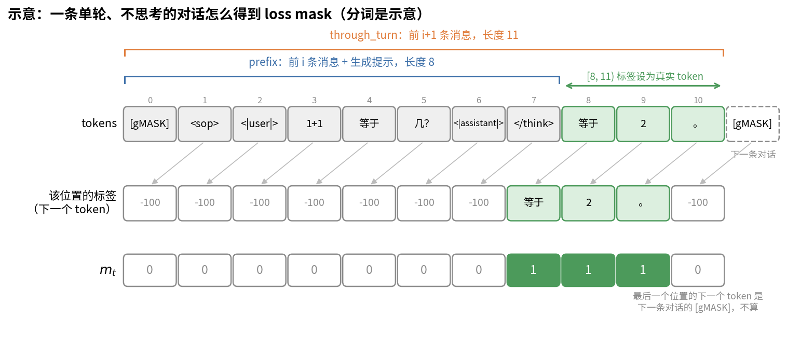
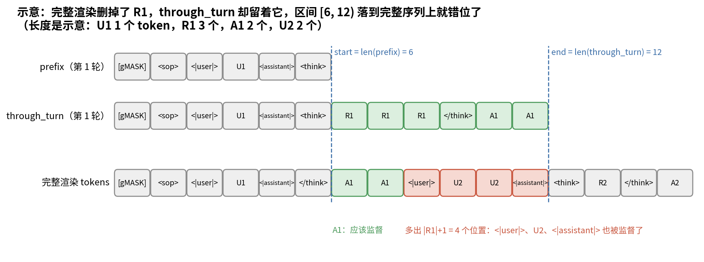
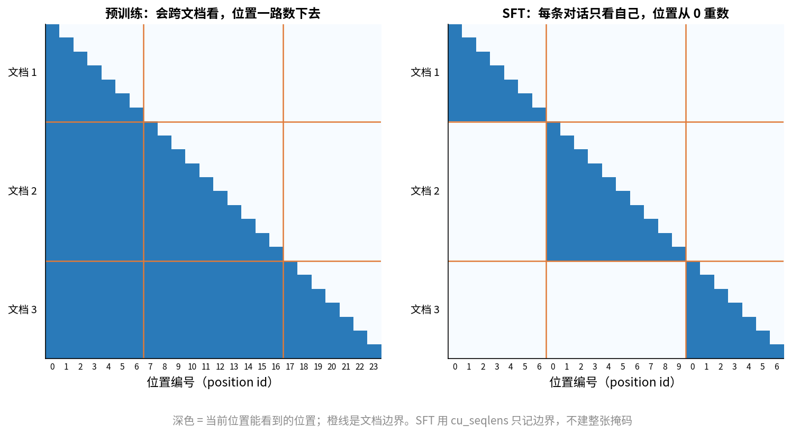
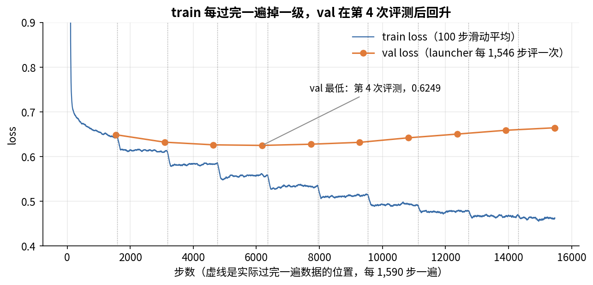

# 第 17 章　SFT

> mid-train 结束后，模型已经很会续写，但还算不上一个助手：你问它问题，它可能接着编出下一个问题。SFT（supervised fine-tuning，监督微调）用几百万条"问题 → 标准回答"的对话，教它按助手的方式回答。这一章先讲 SFT 和预训练的区别，归结起来只有两处：哪些 token 算 loss，样本怎么打包。接着讲 ZGCM 的数据怎么筛、超参怎么定、W&B 曲线怎么读，最后看代码里两处要小心的地方。

## 这一章要回答的问题

读完这一章，你应该能回答下面这些问题。

1. SFT 的目标函数和预训练有什么不同？为什么只在助手的回答上算 loss？
2. 一段对话怎么变成 token 和 loss mask？ZGCM 的代码怎么找"助手回答"的边界？
3. SFT 的打包和预训练的打包差在哪？`cu_seqlens` 和 THD 格式是做什么的？
4. ZGCM 的 SFT 数据有多少、怎么筛、怎么去污染？think 和 no-think 怎么混？
5. GBS 48、256K、10 个 epoch，算出来多少步？实际过了几遍数据？
6. 第 1 步 loss 为什么是 35？验证 loss 在第 4 个 epoch 就开始涨，算不算训坏了？
7. "256K SFT"是不是指用 256K 长的对话训练？
8. 照仓库代码跑，有哪些地方可能悄悄训错？

---

<a id="s17-1" name="s17-1"></a>
## 17.1 SFT 到底改了什么

### 从续写到回答

预训练和 mid-train 只教会模型一件事：给一段文字，预测下一个 token。它学到的是互联网上的文字通常怎么接下去。问它"中国的首都是哪里？"，网页上这句话后面常常跟着选项、另一道题或者广告，不一定是答案。

SFT 要教的是一种固定的接法：用户说完，轮到助手，助手给出有用的回答，然后停下。这里面有三样东西要学。第一是格式，模型要认得 `<|user|>`、`<|assistant|>` 这些角色标记（第 3 章 [§3.10](03_Tokenizer.md#s3-10)），知道什么时候轮到自己说话。第二是行为，回答要切题、完整、遵守指令，需要思考时先写思考过程再写答案，需要工具时输出合法的工具调用。第三是停止，回答完了就结束，不要替用户接着说。

知识基本不靠 SFT 来教。SFT 数据只有约 194.6B 个 token 位置（[§17.5](#s17-5) 会算），不到预训练的 5%。业界普遍认为，模型的知识和能力主要来自预训练和 mid-train，SFT 做的主要是把这些能力"引出来"，并把输出格式固定下来。

### 目标函数：同一个交叉熵，只是挑了位置

SFT 的 loss 仍然是第 2 章讲的 next-token 交叉熵（CE），唯一的区别是多了一个 **loss mask**（loss 掩码）：每个位置一个 0 或 1，只有标 1 的位置算 loss。

$$
\mathcal{L} = \frac{\sum_t m_t \cdot \big(-\ln p_\theta(x_{t+1}\mid x_{\le t})\big)}{\sum_t m_t}
$$

$m_t=1$ 表示位置 $t$ 要预测的下一个 token 是助手说的话。预训练时所有 $m_t$ 都是 1（padding 除外），mid-train 也一样（第 16 章 [§16.1](16_MidTrain与长上下文.md#s16-1)）。

### 为什么只在助手的话上算 loss

设想一条数据：用户问了一道 300 token 的数学题，助手写了 50 token 的答案。如果每个 token 都算 loss，就有 86% 的梯度在教模型怎么出数学题。

这样做有三个坏处。最直接的是学错了角色：模型会模仿用户的说话方式，推理时可能替用户继续提问。它还浪费信号，因为用户的问题大多是普通文本，预训练已经学过，新东西都在回答里。第三个坏处出在 agent 轨迹上：工具返回的网页、报错信息是环境产生的，模型如果学着生成它们，推理时就会"编造"工具结果。

所以 ZGCM 的规定是（报告 §4.1.3 第 14 页）：助手的思考、回答、工具调用算 loss；系统提示、用户消息、工具返回（observation）都只当上下文，不算 loss。业界把这种做法叫 **assistant-only loss**。

### 手算一个例子

一条两轮对话，按 token 数大致是这样：

| 片段 | token 数 | 算 loss？ |
|---|---|---|
| `[gMASK]<sop><|system|>` + 系统提示 | 30 | 否 |
| `<|user|>` + 问题 1 | 120 | 否 |
| `<|assistant|><think>` | 2 | 否 |
| 思考 + `</think>` + 回答 1 | 400 | 是 |
| `<|user|>` + 问题 2 | 60 | 否 |
| `<|assistant|></think>`（第 2 轮不思考） | 2 | 否 |
| 回答 2 | 79 | 是 |

总长 693 token，其中算 loss 的有 479 个，约占 69%。分母只数这 479 个位置，所以一条回答短、提问长的数据，loss 不会被大量 0 稀释。

`<|assistant|>` 本身不算 loss。它是模板塞进去的，推理时也由程序塞进去，模型不需要学会生成它。回答到底从哪个 token 开始算，代码里有一套精确的规则，下一节就来看。

<a id="s17-2" name="s17-2"></a>
## 17.2 对话模板与 loss mask

### 回顾：模板长什么样

第 3 章 [§3.10](03_Tokenizer.md#s3-10) 拆过 ZGCM 的对话模板（`zgcagi/ZGCM-1-7B` 的 `chat_template.jinja`），这里只回顾和 loss mask 有关的几处。对话开头是 `[gMASK]<sop>`，每条消息前面是一个角色标记：`<|system|>`、`<|user|>`、`<|assistant|>` 或 `<|observation|>`。消息之间没有"本轮结束"的标记，下一个角色标记一出现，就意味着上一条结束了。拿一条最短的对话看：用户问"1+1 等于几？"，助手不思考，直接答"等于 2。"我用 `_web/hf_model/chat_template.jinja` 按 SFT 代码的调用方式（`enable_thinking=False`）渲染，得到的是 `[gMASK]<sop><|user|>1+1 等于几？<|assistant|></think>等于 2。`，助手的话后面什么都没有。

助手的思考写成 `<think>思考</think>回答`。模板会把历史轮次的思考删掉，只留一个 `</think>`（模板 L75-L79），这一条后面会惹出麻烦。生成提示有两种：要思考时是 `<|assistant|><think>`；`enable_thinking=False` 时是 `<|assistant|></think>`，直接回答（模板 L116）。

### 怎么找到"助手说的那一段"

loss mask 要标出每条助手消息在 token 序列里的起止位置。最笨的办法是在 token 序列里搜 `<|assistant|>`，但工具调用和思考标记会让边界很难写对。ZGCM 用了一个更干净的办法：渲染两次，取长度差。代码在 `sft/megatron/core/tokenizers/text/libraries/sft_tokenizer.py:175-211`。

假设第 $i$ 条消息是助手消息。代码先渲染 `prefix`：前 $i$ 条消息加上生成提示，相当于推理时轮到助手说话那一刻模型看到的输入。这条助手消息带思考的话，生成提示是 `<think>`，否则是 `</think>`。然后渲染 `through_turn`：前 $i+1$ 条消息，不加生成提示。区间 `[len(prefix), len(through_turn))` 就是助手要说的话。这些位置的标签设为真实 token，其余位置的标签是 `IGNORE_INDEX = -100`（L24）。

下图用上面那条"1+1 等于几？"走一遍。上面两条括号是两次渲染的长度，长度之差就是绿色的三个 token；下面两行是 [§17.3](#s17-3) 要讲的左移一位，看最后一行 $m_t$ 哪几格是 1。



注意 $m_t=1$ 的位置是 `</think>`、`等于`、`2`，比绿色的 token 早一格。位置 $t$ 的标签是第 $t+1$ 个 token，所以"轮到助手说第一个字"的那个位置 `</think>` 要算 loss，而助手的最后一个字 `。` 那里不算，打包以后它要预测的是下一条对话的 `[gMASK]`（[§17.3](#s17-3)）。

这个办法有一个前提：前缀的渲染结果，必须恰好是完整渲染结果的前缀。模板只要满足这一点，起止位置就天然对齐，不用手写任何边界规则。

我用 jinja2 把模板渲染了几种情况，看看实际被监督的是哪些 token：

| 场景 | 被监督的部分 | 对不对 |
|---|---|---|
| 单轮，带思考 R1、回答 A1 | `R1</think>A1` | 对：`<think>` 在生成提示里，不用学 |
| 单轮，不思考 | `A1` | 对：`</think>` 在生成提示里 |
| 工具轨迹：思考 + 工具调用，工具返回，再思考 + 最终回答 | ① `R</think><tool_call>search<arg_key>q</arg_key><arg_value>x</arg_value></tool_call>`　② `R2</think>FINAL` | 对：工具返回没有被监督 |
| 两轮，两轮都带思考 | 第 2 轮 `R2</think>A2` 对；第 1 轮错位 | 错，见下 |

### 多轮带思考时的错位

问题出在"历史思考被删掉"这一条。两轮都带思考的对话，完整渲染出来是：

```
[gMASK]<sop><|user|>U1<|assistant|></think>A1<|user|>U2<|assistant|><think>R2</think>A2
```

第 1 轮的思考 R1 已经没了。可是算第 1 轮的 `through_turn` 时只渲染了前 2 条消息，这时第 1 轮是"最后一轮"，思考被保留了下来：

```
[gMASK]<sop><|user|>U1<|assistant|><think>R1</think>A1
```

这段渲染结果就不再是完整渲染的前缀了。按 token 数一下：`prefix` 到 `<think>` 为止，起点正好落在完整序列里 A1 的第一个 token 上（`<think>` 和 `</think>` 各占一个位置，刚好对齐）。终点是 `len(through_turn)`，比完整序列里 A1 的终点多出 $|R1|+1$ 个 token。于是第 1 轮的监督区间变成了：

> A1 全部 + 后面多出的 $|R1|+1$ 个 token，也就是 `<|user|>`、用户第二个问题 U2，如果 R1 很长，还会一直伸进后面的内容。

把三次渲染按位置对齐画出来就清楚了。图里的长度是示意，R1 取 3 个 token，起点 6 在两边对得上，终点 12 却多出 4 格，落进了第二轮的 `<|user|>`、U2 和 `<|assistant|>`。



这样一来，模型被训练成"回答完以后接着替用户说话"，恰好是 [§17.1](#s17-1) 说要避免的情况。R1 越长，错得越多。代码 L207 只检查了 `start > end` 和越界，没有检查前缀关系，所以不会报错。

这件事对发布模型有没有影响，目前查不清。正式训练读的是上游预先渲染、打包好的 indexed 数据（`.bin` 存 token、`.idx` 存索引，第 8 章 [§8.3](08_数据五_从文本到训练样本.md#s8-3)；`training_launchers/stable_candidate/README.md` 写的是 "packed indexed SFT data root"），`tokens` 和 `targets` 在上游已经算好，`sft_dataset.py:51-57` 的注释写着 "Chat template and special-token handling are already applied upstream"。上游的打包脚本不在仓库里，不知道它有没有调用这段代码。另一方面，报告 B.3（附录 B.3 第 37 页）说打包前有一道 "tools-aware chat-template and loss-mask preflight"，会检查 "assistant supervision boundaries"，这道检查如果做得严格，就会发现这个错位。还有一种情况：如果多轮数据里只有最后一轮带思考，这个问题根本不会触发。

所以结论是：**按仓库代码自己重跑，会遇到这个问题；发布模型受没受影响，待查。** 修起来很简单：渲染 `through_turn` 时，让历史思考的处理方式和完整渲染保持一致（例如两边都传 `clear_thinking=False`，或者直接在完整 token 序列里定位），再加一条断言 `tokens[:len(through_turn)] == through_turn`。

### 模型学没学"停"

第 3 章 [§3.10](03_Tokenizer.md#s3-10) 留了一个问题。助手回答之后，模板里没有结束符，下一个 token 是 `<|user|>`；而推理时 `generation_config.json` 只把 154820（`<|endoftext|>`）当停止符。那么 SFT 里有没有哪个位置在教模型"回答完输出 154820"？

按上面的区间规则，监督到回答的最后一个 token 为止，回答之后的 token 不在区间里。仓库里有两条打包路径，在这一点上结论不一样。

在线打包路径读原始对话 JSONL（`sft_dataset.py:251-361`）。它在 L334 把所有标签等于 pad 的位置屏蔽，而 pad 就是 154820（`sft_tokenizer.py:112-127` 取 pad 或 eos），所以即使在对话末尾加了 154820，也学不到。

预打包路径是正式训练用的（L184-249）。它只屏蔽 `IGNORE_INDEX` 和末尾 padding（L229-L232），不按 pad 值屏蔽。上游如果在每条对话后放了一个带标签的 154820，模型就能学会停。上游脚本不在仓库里，待查。

第 3 章 [§3.10](03_Tokenizer.md#s3-10) 的说法是按在线路径读的，这里补充一句：正式训练走的是预打包路径，所以"SFT 完全没学停止符"这个结论还下不了。

<a id="s17-3" name="s17-3"></a>
## 17.3 打包：多条对话塞进一条 256K 序列

loss mask 决定了哪些位置算 loss。SFT 和预训练的第二处区别，在于样本怎么排进训练序列。

### 为什么要打包

ZGCM 的 SFT 训练序列长 262,144（256K），而一条 SFT 对话平均只有约 4K token（下面会算）。一条对话占一条序列的话，剩下 98% 都是 padding，算力几乎全浪费了。所以要**打包**（packing），把很多条对话首尾相接，塞满一条序列。

预训练也打包（第 8 章 [§8.5](08_数据五_从文本到训练样本.md#s8-5)），但做法不同：

| | 预训练（第 8 章） | SFT（本章） |
|---|---|---|
| 注意力 | 一条序列内全部因果注意力，会跨文档 | 每条对话只看自己，不跨对话 |
| 位置编号 | 0 到 16383 一直数下去，不在文档边界归零 | 每条对话从 0 重新数 |
| 文档切断 | 文档可以被切到两条序列里 | 不切，放不下就报错或分流 |
| loss | 每个 token 都算 | 只算助手部分 |



图里把三篇长短不一的文档拼成一条序列。左边是预训练，下三角整块都是深色，后面的文档能看到前面的，位置编号从 0 一直数到 23。右边是 SFT，深色只在对角线上的三个小三角里，每段的位置都从 0 重新数。

SFT 讲究得多，原因在样本的性质。预训练里两篇无关网页挨在一起，模型看到前一篇顶多多一点噪声，数据量又大，影响被平均掉了。SFT 里每条对话都是一组完整的问和答。如果第 2 条对话的回答能看到第 1 条对话，模型会学到"答案可以参考上文里另一个人的问题"，而推理时根本没有这种情况。位置编号也一样：推理时每段对话都从位置 0 开始，训练时第 50 条对话如果从位置 200,000 开始，训练和推理就对不上了。

### cu_seqlens 和 THD 格式

"每条对话只看自己"怎么实现？最直接的办法是给每条序列建一个 $256\text{K}\times256\text{K}$ 的注意力掩码矩阵，块对角为 1、其余为 0。这个矩阵有 $2^{36}\approx 6.9\times10^{10}$ 个元素，按 1 字节一个也要 64 GiB，根本放不下。

实际做法是只记边界。**cu_seqlens**（cumulative sequence lengths，累计长度）是一个整数数组，记录每条对话在打包序列里的起点。比如三条长度 100、250、80 的对话打包在一起：

```
cu_seqlens = [0, 100, 350, 430]
```

FlashAttention 的 varlen 接口拿到这个数组，就知道第 $k$ 段是 `[cu[k], cu[k+1])`，只在段内做因果注意力。这种把多条变长序列首尾相接、只靠边界数组区分的排布叫 **THD 格式**（Total tokens × Heads × Dim），和普通的 BSHD（Batch × Seq × Heads × Dim）相对。

ZGCM 的代码是这样把它串起来的。数据集返回 `cu_seqlens`（`sft_dataset.py:236-249`）。`pretrain_gpt.py:163-164` 调用 `get_thd_batch_on_this_cp_rank`，把它装进 `qkv_format='thd'` 的 `PackedSeqParams` 交给注意力层（L150-L157 是流水线中间段用的同一个结构）。`pretrain_gpt.py:136-146` 要求打包时 micro batch size 必须是 1，一条 256K 序列就是一个 micro batch。启动参数带 `--no-create-attention-mask-in-dataloader`（runner L563），因为根本用不着那个大矩阵。位置编号按段重新从 0 开始（`sft_dataset.py:204-208`），RoPE 就按这个编号旋转。

ZGCM 的 32 层里有 27 层是 128 窗口的滑动窗口注意力（第 9 章）。段边界对这些层同样生效，窗口不会伸到上一条对话里去。

### 手算：一条 256K 序列里装了多少条对话

`zgcm.conf` L6-L7 和报告 §4.1.1 第 11 页、§4.1.3 第 14 页给了三个数：

| 量 | 数值 |
|---|---|
| 训练 token 总数（打包后，一遍） | 19,462,049,882 |
| 打包后的记录数（一条记录 = 一条 256K 序列） | 76,325 |
| 原始对话数 | 4,921,933 |

由这三个数可以算出几件事。每条打包序列平均有 $19{,}462{,}049{,}882 / 76{,}325 \approx 254{,}989$ 个 token，占 262,144 的 97.3%，打包填得很满，只有 2.7% 是 padding。每条打包序列平均装 $4{,}921{,}933 / 76{,}325 \approx 64.5$ 条对话。每条对话平均 $19.46\text{B} / 4.92\text{M} \approx 3{,}954$ 个 token。后两个数假设 4.92M 条对话全部进了这 19.46B token；报告把两个数分开写，没明说是同一份，所以这里是推断。

最后这个数回答了开头的第 7 个问题：**"256K SFT"指的是打包长度 256K，对话本身并没有 256K 长**，绝大多数对话只有几千 token。报告的 Finding 7（§4.1.3 第 14 页）说的就是这件事。长上下文能力在 mid-train 里已经打好了，SFT 用中等长度的数据就足以把推理和 agent 行为"引出来"，不需要专门造 256K 长的推理轨迹。

### 不截断，放不下就分流

在线打包路径会把超长对话从右边截断（`sft_dataset.py:304-314`）。截断 SFT 数据很危险，被砍掉的往往是回答的结尾，模型学到的是"回答到一半就停"，或者丢了工具调用的闭合标签。

预打包路径直接拒绝截断：记录长度超过 `seq_length+1` 就抛错（L192-L196，原文 "refusing to truncate"）。报告 B.3 也说，超长和渲染出错的记录会被分流到单独的输出，"rather than being silently truncated or discarded"。这样做是对的，宁可报错，也不要悄悄截断。

### 标签错一位，段边界怎么办

next-token 预测要把标签左移一位：`labels = targets[1:]`，`input_ids = tokens[:-1]`（L225-L227）。所以每条记录存 `seq_length+1` 个 token。

左移以后，段边界上会出现一个特殊位置：第 $k$ 段最后一个 token 的"下一个 token"，是第 $k+1$ 段的第一个 token `[gMASK]`。`[gMASK]` 属于模板，标签是 `-100`，不算 loss。所以跨段的那一个位置自然被屏蔽了，不会教模型"对话结束后接 `[gMASK]`"。[§17.2](#s17-2) 那张 loss mask 图的最后一格画的就是这个位置。

### Context Parallel 下的额外对齐

在线路径里还有一个细节。开了 Context Parallel（CP，第 12 章）的话，每条对话的长度要补齐到 $2\times\text{CP}$ 的整数倍（L291-L296），因为 CP 的负载均衡把每段切成 $2\times\text{CP}$ 块，首尾配对分给各卡。ZGCM 正式 SFT 用的是 CP=1、TP=8（[§17.5](#s17-5)），这条不生效。

<a id="s17-4" name="s17-4"></a>
## 17.4 SFT 数据：从哪来、怎么筛

训练机制讲完了，再来看喂进去的数据。

### 规模和构成

报告 §4.1.1 第 11 页和 Table 1（第 12 页）给出的构成如下：

| 部分 | 行数占比 | 内容 |
|---|---|---|
| 通用数据 | 96.46% | 指令遵循、知识、数学、科学、代码、对话、推理 |
| agent 数据 | 3.54% | 深度研究、软件工程、终端交互，都用结构化工具 |
| 合计 | 4,921,933 条 | 开源数据集 + 内部蒸馏 |

按比例算，agent 数据约 $4{,}921{,}933\times3.54\%\approx 174{,}000$ 条。

来源是"开源数据集 + 内部蒸馏"（internally distilled）。蒸馏在这里指用更强的模型生成回答或轨迹，再拿来教小模型，报告 B.2.3 写明终端轨迹来自 Claude Opus 4.6 Thinking 和 GLM-5.2（附录 B.2.3 第 37 页）。这是今天开源小模型 SFT 数据的主要来源。报告没有列出具体用了哪些开源数据集，也没说蒸馏用的提示从哪来。

### 流水线：五步

报告 Fig.10（§4.1 第 11 页）把流程画成五步。第一步统一格式（schema formatting）：各来源的对话格式不一样，先转成同一种结构，角色、思考、工具调用分字段存。第二步是过滤与验证，规则过滤加模型打分，下面细讲。第三步选配比，用候选模型跑消融，定各类数据的比例。第四步去污染，去掉和评测集重复的样本。第五步打包，渲染模板、生成 assistant-only 的 loss mask、按长度分流，具体做法见 [§17.2](#s17-2)、[§17.3](#s17-3)。

### 过滤：规则 + 模型打分 + 分档

思路和预训练的清洗（第 5 章）一样，先规则后模型，只是规则检查的是对话结构（§4.1.1 第 11 页）：有没有缺轮次、角色是否非法（例如两条 assistant 连着），有没有重复生成（模型把同一段话说了几遍），有没有模板泄漏（回答里出现 `<|user|>` 之类的标记），思考格式是否坏了（`<think>` 没闭合等）。

然后用一个打分模型给每条样本打分，维度是教学价值、逻辑是否成立、步骤是否连贯、事实是否正确、是否安全（§4.1.1 第 11–12 页）。打分器先用人工标注的小样本校准过。分数出来后按档处理：高分的优先用，边界样本再走一遍辅助验证，噪声大、没信息量、有风险的直接扔掉。拒答样本单独处理，既去掉"过度拒答"，又保留必要的安全行为。

ZGCM 在 SFT 上得出的第一个结论是质量比数量重要。报告 Table 10（附录 B.1.1 第 35 页）做了三档过滤强度的对照，用的是同一个基座、同一套快速 SFT、同样的评测：

| 处理方式 | 样本数 | IFEval | MATH-500 | BBH | MMLU | HumanEval+ | MBPP+ | 6 项平均 |
|---|---|---|---|---|---|---|---|---|
| 只做格式和结构检查 | ≈2.08M | 72.64 | 74.12 | 58.49 | 72.63 | 73.78 | 55.03 | 67.78 |
| 去掉"待复查"和"删除"档 | ≈1.833M | 71.20 | 77.63 | 65.08 | 70.60 | 65.00 | 58.36 | 67.98 |
| 只留最严格档 | ≈1.145M | 71.94 | 75.43 | 68.59 | 71.50 | 67.56 | 57.94 | 68.83 |

最严格档的样本数比第一档少 44.9%，平均分高 1.05。涨分主要来自 BBH（+10.10），HumanEval+ 反而降了 6.22。

这张表要用第 15 章 [§15.4](15_基座评测.md#s15-4) 和第 14 章 [§14.8](14_训练监控与稳定性.md#s14-8) 的眼光来读。6 项平均差 1 分，放在单次 run 的噪声范围里很难说清，报告也没给多种子的误差。HumanEval+ 只有 164 题，一题约 0.61 分，掉 6.22 分相当于少做对约 10 题，这个变化比平均分的提升更显眼。报告自己也承认 "individual benchmarks do not all move in the same direction"（§4.1.1 第 12 页）。

所以比较稳妥的说法是：砍掉一半低质量数据，整体不吃亏，推理类明显受益，代码类可能受损。这已经是一个有用的结论，因为数据少了一半，训练也便宜了一半。

还要注意，这张表的"消融池"不是最终语料（附录 B.1.1 第 35 页明说）。最终语料里，推理部分从 2,268,178 条候选中留下 1,307,175 条（附录 B.1 第 35 页），留存率 57.6%。

### 去污染：8-gram，超过 50% 就删

去污染的做法见 §4.1.1 第 12 页：把全部候选 SFT 数据和所有下游评测集、验证集比对，用 8-gram 滑动窗口。一条训练样本如果有超过 50% 的 8-gram 出现在某个评测题目或参考答案里，就删除。

和预训练的去污染（第 6 章）相比，SFT 的去污染更要紧。SFT 数据很多是蒸馏出来的"题目 + 解答"，形式上和评测题几乎一样，一道 AIME 原题混进 SFT，模型就直接背下了答案。

50% 这个阈值偏宽松。一条长样本里如果只有一小段抄了评测题，比如一个 4,000 token 的对话里引用了一道 200 token 的题，重叠比例很低，就删不掉。更严格的做法是任何一个 13-gram 命中就删（GPT-3 的做法），或者对题目部分单独比对。ZGCM 为什么选 50%，报告没解释。

### 长思考不能太多

§4.1.1 第 12–13 页和 Finding 5（第 13 页）报告了一个消融结果：长思维链（long CoT）数据加得太多，模型会变啰嗦，指令遵循变差。比如用户要求"只回答一个数字"，模型还是写一大段推理。所以要在长推理、直接回答、严格格式指令三类数据之间反复调比例。最终比例报告没给。

### think 和 no-think 混着训

同一套权重要支持两种模式：think 模式先写 `<think>…</think>` 再回答，no-think 模式直接回答。开关就是生成提示末尾是 `<think>` 还是 `</think>`（[§17.2](#s17-2)）。训练时两种样本交错混在一起（§4.1.1 第 13 页）。

混着训有一个好处，推理数据能提高直接回答的质量。报告 Table 12（附录 B.4 第 38 页）比较了两个 checkpoint，都在 no-think 模式下评测：

| 评测 | 混训前 | 混训后 | 变化 |
|---|---|---|---|
| AIME 2025 | 10.00 | 43.33 | +33.33 |
| AIME 2024 | 6.67 | 33.33 | +26.66 |
| MBPP+ | 55.03 | 75.93 | +20.90 |
| BBH | 58.49 | 69.48 | +10.99 |
| LiveCodeBench v3 | 28.00 | 34.31 | +6.31 |
| IFEval | 72.64 | 78.00 | +5.36 |
| MMLU | 72.63 | 70.03 | −2.60 |
| HumanEval+ | 73.78 | 66.46 | −7.32 |

提升看起来很大，但有三处要留意。

第一，报告自己说这不是对照实验（附录 B.4 第 38 页）：两个 checkpoint 的训练 token 数、数据构成、训练历史、优化设置都可能不同，所以不能把差值全算在"加了推理数据"头上。

第二，AIME 只有 30 题。10.00 → 43.33 是从 3 题到 13 题，一题 3.33 分，单次采样的波动就能有好几分。

第三，"混训前"那一列和 Table 10 第一行一模一样。IFEval 72.64、BBH 58.49、MMLU 72.63、HumanEval+ 73.78、MBPP+ 55.03，五个数逐位相同。可能两张表用的是同一个 checkpoint（用"只做基本处理的数据"训出来的模型，正好也是"只用直接回答数据"的模型），也可能是复制错了，报告没说明。同一个数出现在两个不同实验里，读报告时要自己留意。

### agent 数据：格式对齐比数量重要

agent 数据分三支（§4.1.2 第 13–14 页）：

| 分支 | 条数 | 说明 |
|---|---|---|
| 深度研究 | 20,217 条轨迹 | 统一成 `search` / `visit` 两个工具；每条都有 think 和 no-think 两个版本 |
| 软件工程（有执行环境） | 30,014 条 | 在可执行仓库里交互；B.2.2：34,269 → 去私有路径、密钥等后 30,914 → 长度 8K–64K 过滤后 30,014 |
| 软件工程（无执行环境） | 30,000 条 | 仓库理解、定位文件、规划补丁；318,115 条候选打分后取前 30,000，每个仓库最多 800 条 |
| 终端交互 | 主训练用的数量报告未给 | 22,309 条（其中验证通过 15,748 条）是另一个消融用的，不是主训练的数据（§4.1.2 第 14 页） |

报告从这部分数据里总结了几条经验。最要紧的一条是训练格式必须和推理环境一致（§4.1.2 第 13 页）：系统提示、消息角色、工具定义、调用格式、工具结果放在哪、最终答案怎么写，任何一处不一致，agent 的表现都会明显变差。这是 agent SFT 最常见的坑。

第二条是工具协议校验（§4.1.2 第 13 页），检查参数结构对不对、每个调用有没有对应的结果、调用 ID 是否唯一、助手是否正常结束。只有调用和结果能明确对上的才自动修，修不了的扔掉。

第三条是通用数据和 agent 数据要一起训（Finding 6，§4.1.2 第 13 页）。先训通用、再训 agent 的顺序训，效果不如两者从头到尾交错的联合训。只训 agent 数据的话，模型的推理和遵循约束的能力会退化，agent 表现反而更差。

### 配置文件里的配比

`zgcm.conf` L10-L21 写的是正式 256K 运行的数据配比，按 token 数加权：

| 数据集 | 记录数 | token 数 | 权重 |
|---|---|---|---|
| qcore | 75,242 | 19,195,928,782 | 0.98633 |
| think | 1,083 | 266,121,100 | 0.01367 |
| tool | 0 | 0 | 0 |

权重就是 token 占比：$19{,}195{,}928{,}782 / 19{,}462{,}049{,}882 = 0.98633$。两个记录数加起来正好 76,325。

奇怪的是 tool 数据集是空的，而报告说有 3.54% 是 agent 数据。合理的推测是 agent 轨迹已经混在 qcore 里（"q"可能是 quality），单独的 tool 通道没用上。仓库里没有 qcore 的构成说明，待查。run 名里的 "thinkmix-v1-locate" 也说明这是一个特定版本的混合数据，"locate"可能对应软件工程里的文件定位数据（推断）。

<a id="s17-5" name="s17-5"></a>
## 17.5 超参数与步数

### 超参数一览

下表是报告 §4.1.3 第 14 页和 `zgcm.conf`、runner 能对上的部分：

| 项 | 值 | 出处 |
|---|---|---|
| 起点 | mid-train 最后的 256K checkpoint | runner L37-L38、L549-L551 |
| 序列长度 / 最大位置 | 262,144 / 262,144，RoPE base 1e7 | conf L31-L33 |
| 并行 | 24 机 × 8 卡 = 192 卡，TP8、PP1、CP1 | conf L41-L47 |
| MBS / GBS | 1 / 48 | conf L48-L49 |
| 优化器 | 矩阵参数 Muon，标量参数 Adam | conf L52、L69 |
| 学习率 | cosine，1e-4 → 1e-6，无 warmup | conf L53-L56 |
| 权重衰减 / 裁剪 | 0.01 / 1.0 | conf L57、L61 |
| Adam | β = (0.9, 0.95)，eps 1e-8 | conf L58-L60 |
| 精度 | BF16 + FP8 hybrid（delayed scaling，amax history 1024） | runner L517-L521、L542 |
| loss | 按 token 求平均（`--calculate-per-token-loss`） | runner L543 |
| 重算 | full，每层都重算 | conf L72-L85 |
| epoch | 10 | conf L8 |

报告还提到一个 64K 版本（训 8 个 epoch，也是 GBS 48），配置不在仓库里。发布的是 256K 版本。

### finetune 式加载

runner 用 `--finetune --no-load-optim --no-load-rng` 加载 mid-train 的 checkpoint（L549-L551）。这组参数的意思是只拿模型权重：迭代计数从 0 开始，优化器状态（Muon 动量、Adam 的一阶二阶矩）全部从零开始，随机数状态也重新初始化。第 13 章 [§13.5](13_启动检查点续训.md#s13-5)、[§13.7](13_启动检查点续训.md#s13-7) 讲过 finetune 和 resume 的区别。SFT 是新任务，用 finetune 是对的。

### 每步多少 token，一共多少步

每步处理 $48 \times 262{,}144 = 12{,}582{,}912$ 个 token 位置，约 12.6M，和 mid-train 每步的 token 数一样（第 16 章 [§16.1](16_MidTrain与长上下文.md#s16-1)）。

192 张卡、TP8，所以数据并行度 DP = 192 / 8 = 24。GBS 48 = 24 × MBS 1 × 2，即每张卡每步做 2 次梯度累积。

步数由 `launch.sh:108-114` 按 token 数算出：

$$
\text{EPOCH\_ITERS} = \left\lfloor \frac{19{,}462{,}049{,}882}{262{,}144 \times 48} \right\rfloor = 1{,}546
$$

$$
\text{TRAIN\_ITERS} = \left\lfloor \frac{19{,}462{,}049{,}882 \times 10}{262{,}144 \times 48} \right\rfloor = 15{,}467
$$

L117-L122 再算一遍"有效 epoch 数" $15{,}467 \times 262{,}144 \times 48 / 19{,}462{,}049{,}882 = 9.99997$，并断言它和 10 的差小于 0.01。每 1,546 步存一次 checkpoint、评一次验证集（L114-L115），cosine 衰减的总长就是 15,467 步（L126）。

### 实际过了几遍数据：9.73，不是 10

上面的算法隐含了一个假设：每条打包记录都正好装满 262,144 个 token。但 [§17.3](#s17-3) 算过，记录平均只有 254,989 个 token，填充率 97.3%。

dataloader 每步取的是 48 条记录，并不是 12.6M 个真实 token。过完一遍 76,325 条记录需要 $76{,}325 / 48 \approx 1{,}590.1$ 步，比 1,546 步多。15,467 步一共取了 $15{,}467 \times 48 = 742{,}416$ 条记录，W&B 最后一行的 `consumed_samples` 正是 742,416。折算下来是 $742{,}416 / 76{,}325 \approx 9.727$ 遍。

所以实际训的是约 9.73 个 epoch，真实 token 约 $9.727 \times 19.46\text{B} \approx 189.3\text{B}$，而 194.6B 是含 padding 的 token 位置数。每 1,546 步存的"第 $k$ 个 epoch 的 checkpoint"，其实在第 $0.972k$ 遍的位置，不在 epoch 边界上。[§17.6](#s17-6) 会在 W&B 曲线上看到，epoch 边界实际落在 1,590 的倍数处。

这不是大问题，但很典型：**用 token 数推步数，用样本数取数据，两者之间差了一个填充率。** 自己写启动脚本时，要么按记录数算步数，要么在断言里把填充率算进去。

### 为什么 256K 用 TP8 而不是 CP

mid-train 的 256K 段用的是 TP2、CP4、PP2（第 16 章 [§16.5](16_MidTrain与长上下文.md#s16-5)），SFT 换成了 TP8、CP1、PP1。报告和仓库都没解释原因，下面几条可能的考虑都是推断。

一是 THD 打包和 CP 不好配合。CP 要把每一条子序列都切成 $2\times\text{CP}$ 块分给各卡（[§17.3](#s17-3) 末尾），64 条长短不一的对话各自切块、各自补齐，实现和负载均衡都更麻烦。TP 不切序列维度，没有这个问题。

二是 TP8 正好占一台机器。8 张卡在同一台机器上，TP 的通信走 NVLink，开销可以接受。

三是 SFT 里注意力很便宜。每条对话只有几千 token，注意力的计算量不随 256K 平方增长，而 CP 主要解决的就是注意力随长度变大的问题，这里用不上。

显存靠两样东西压下来：sequence parallel 把 LayerNorm、dropout 这些区域的激活按序列切成 8 份；每层都做完整重算（第 12 章 [§12.11](12_分布式并行.md#s12-11)）。

### 为什么可以不做 warmup

第 10 章 [§10.8](10_优化器与学习率.md#s10-8) 讲过，warmup 主要防两件事：一是 Adam 的二阶矩在前几步估计不准，步子会过大；二是随机初始化的模型梯度很乱。SFT 从训好的模型出发，第二个理由不成立。Muon 的更新是先正交化、再按固定尺度缩放的（第 10 章 [§10.4](10_优化器与学习率.md#s10-4)），步子大小不受梯度大小影响，所以第一个理由对矩阵参数也弱很多。剩下的标量参数（RMSNorm 的增益等）走 Adam，靠梯度裁剪兜底。

ZGCM 的实际情况是，不做 warmup 也没有训崩，但前 10 步 loss 从 35 掉到 5，梯度范数一直在 30 左右被裁剪（[§17.6](#s17-6)）。这算不上平稳，只能说没出事。加 1% 左右的 warmup（约 150 步）成本很低，更稳妥。

<a id="s17-6" name="s17-6"></a>
## 17.6 读 W&B：SFT 的曲线说了什么

前面算出的步数和遍数，可以拿 W&B 记录来核对。公开的 SFT run 是 `view-sft-public-20260922-v1`，一共 15,467 行，每步一行，和 TRAIN_ITERS 对得上。下面的数都是我从 `history.jsonl` 里直接算的。

### 开头 10 步：loss 从 35 掉到 5

| 步 | 1 | 2 | 3 | 4 | 5 | 6 | 7 | 8 | 9 | 10 |
|---|---|---|---|---|---|---|---|---|---|---|
| loss | 35.01 | 34.46 | 31.75 | 28.91 | 25.19 | 20.84 | 16.78 | 12.11 | 7.83 | 4.91 |

之后 loss 继续往下走：第 20 步 1.336，第 30 步 0.945，第 50 步 0.802，第 100 步 0.721，第 200 步 0.679。前 8 步的梯度范数都在 30 左右（第 1 步 29.6），裁剪阈值是 1.0，所以每一步的梯度都被缩到约 1/30。学习率从第 1 步起就是 1e-4。

报告 Fig.11（§4.1.3 第 14 页）的曲线从第 50 步开始画，还用了 160 步的滑动平均，所以报告里看不到这一段。

### 35 这个数为什么不正常

第 3 章 [§3.10](03_Tokenizer.md#s3-10) 算过，一个完全随机的模型，每个 token 的 loss 约是 $\ln V = \ln 154{,}880 \approx 11.95$。loss 35 意味着平均每个被监督的位置上，正确 token 的概率只有 $e^{-35}\approx 6\times10^{-16}$。模型在这里是很有把握地猜错了，这和"不会"是两回事。拿一个只有 4 个词的小词表算一下（示意数字）：完全不会的模型给每个词 0.25，正确词的 loss 是 $\ln 4\approx1.39$；要让 loss 高过这个数，模型只能把概率从正确的词挪走，比如给某个错词 0.999、给正确词只剩 0.0001，loss 就是 $\ln 10^4\approx9.21$。平均 loss 高过随机水平，说明模型在大多数位置都把概率押在了错的 token 上。

一个刚做完 mid-train 的模型，在普通文本上的 CE 约 2 左右（第 16 章）。SFT 的回答大多是普通的中英文、代码、数学推导，就算格式没见过，也不该比随机猜还差三倍。所以第 1 步 loss 35 说明起点有某种系统性的错位，并不是任务太难。

可能的原因有三种，都是推断，公开材料无法区分。

第一种是加载有问题。例如词表填充大小不一致：SFT 这边 TP8 时按 $128\times8=1{,}024$ 对齐，填充后是 155,648（第 3 章 [§3.9](03_Tokenizer.md#s3-9)），而 mid-train 的 checkpoint 是另一个大小。如果某一层权重在加载时被截断或错位，前几步就要靠训练把它"掰回来"。

第二种是 FP8 的缩放因子从零开始。delayed scaling 用过去若干步的 amax 估计当前的缩放因子（第 11 章），这些统计量如果没随 checkpoint 加载，第 1 步的缩放可能不合适。不过这种问题一般 1–2 步就恢复，和这里 20 步左右的缓慢下降不太像。

第三种是对话模板相关的 token 在预训练里几乎没出现过，`<|assistant|>`、`</think>` 后面的预测可能严重偏离。但这些位置只占被监督 token 的很小一部分，很难把平均值拉到 35。

loss 在 10–20 步内回到正常水平，说明模型本身没坏，问题在很少几步更新里就被修掉了。但修掉它本身要花梯度，而且是在没有 warmup、梯度被大幅裁剪的情况下发生的。

从这里可以学到一个做法：SFT 正式开跑前，先用同一套数据管线、同一份起点 checkpoint，在几个 batch 上只做前向、不更新，算一下 loss。正常应该在 1–2 左右。如果看到 35，先停下来查加载和数据，不要指望训练自己把它修好。

### 每个"epoch"的训练和验证 loss

下表按 launcher 的 1,546 步一个"epoch"切开（实际是 0.972 遍，[§17.5](#s17-5)）：

| epoch | 训练 loss 均值 | 该段起点 LR | 段末验证 loss |
|---|---|---|---|
| 1 | 0.8132 | 1.00e-4 | 0.6488 |
| 2 | 0.6144 | 9.76e-5 | 0.6321 |
| 3 | 0.5837 | 9.05e-5 | 0.6262 |
| 4 | 0.5584 | 7.96e-5 | 0.6249（最低） |
| 5 | 0.5354 | 6.58e-5 | 0.6276 |
| 6 | 0.5138 | 5.05e-5 | 0.6318 |
| 7 | 0.4958 | 3.52e-5 | 0.6419 |
| 8 | 0.4793 | 2.14e-5 | 0.6503 |
| 9 | 0.4691 | 1.05e-5 | 0.6588 |
| 10 | 0.4627 | 3.44e-6 | 0.6644 |

第 15,467 步训练结束时又评了一次：验证 loss 0.6642，测试 loss 0.6624，最后 100 步训练 loss 均值 0.4622，学习率停在 1e-6。

训练 loss 一路下降，验证 loss 在第 4 个 epoch 到底，之后一路上升，两者的差从第 4 个 epoch 的 0.07 拉大到最后的 0.20。这是教科书式的**过拟合**：模型越来越记得训练集里的具体回答，对没见过的回答越来越"不认同"。



虚线画在 1,590 的倍数上，也就是下一小节会说到的、实际过完一遍数据的位置。蓝线正好在每条虚线处往下掉一级。橙色的验证 loss 是 launcher 按 1,546 步一个 epoch 评的，所以橙点和虚线错开一点，越往后错得越多；它在第 4 次评测到底以后就往回走。

### 台阶：epoch 边界实际在哪

报告说 loss 曲线是 "stepwise convergence"，即一级一级往下掉。我在 W&B 上找了这些台阶的位置，办法是取边界前 30 步和后 30 步的训练 loss 均值做比较：

| 第几遍结束 | 1 | 2 | 3 | 4 | 5 | 6 | 7 | 8 | 9 |
|---|---|---|---|---|---|---|---|---|---|
| 在 1,590 的倍数处，前 → 后 | 0.645 → 0.614 | 0.609 → 0.580 | 0.585 → 0.555 | 0.557 → 0.526 | 0.536 → 0.501 | 0.510 → 0.491 | 0.490 → 0.467 | 0.479 → 0.469 | 0.462 → 0.459 |

在 launcher 的 1,546 倍数处做同样的比较，前后差都在 0.008 以内，没有台阶。台阶落在 $76{,}325/48\approx1{,}590$ 的倍数上，正是所有记录过完一遍的位置。这从数据上证实了 [§17.5](#s17-5) 的推算：一遍是 1,590 步，不是 1,546 步。

台阶本身也说明了一些事。每进入新的一遍，模型看到的全是上一遍见过的样本，loss 马上掉一截，前五遍每次约 0.03，掉的这一截就是记住了的部分。台阶越高，说明记忆越多。第 6、7 遍降到约 0.02，第 8、9 遍只剩 0.010 和 0.003，是因为学习率已经很低，模型改不动了。

### 验证 loss 在涨，为什么还要训满 10 遍

ZGCM 发布的是第 10 个 epoch 末的模型，也就是验证 loss 最高的那个 checkpoint。这不一定是错的，有几条理由可以支持它。

验证 loss 量的是模型给参考答案打多少分，量不出它自己生成的答案好不好。多 epoch 训练会让模型的输出分布变尖：它更确信自己的说法，对和自己说法不同的参考答案给低概率，CE 就上升。但贪心或低温采样出来的回答，质量可能反而更好。设想验证集里有一道题，"答案是 2。"和"1+1=2。"两种写法同样合格，参考答案用的是后一种（示意数字）。第 4 个 epoch 时模型给两种写法各 0.5，这道题的 loss 是 $\ln 2\approx0.69$；再多训几遍，模型偏向训练集里更常见的前一种，给它 0.9、后一种 0.1，loss 涨到 $\ln 10\approx2.30$，可它贪心输出的"答案是 2。"仍然是对的。反过来，如果模型偏向的是错误答案，验证 loss 同样会涨，单看 loss 分不出是哪一种。InstructGPT（Ouyang et al., 2022）报告过同样的现象：SFT 训 1 个 epoch 后验证 loss 就开始过拟合，但继续训到 16 个 epoch，奖励模型打分和人工偏好都更好。另外，SFT 之后还有 RL（第 18 章），RL 需要一个格式稳定、会按模板输出的起点，输出分布尖一点反而让采样更可控。

不过这些都是一般经验。ZGCM 的报告没有给出第 4 个 epoch 和第 10 个 epoch 在下游评测上的对比，也没解释为什么选 10。验证集是什么数据、和训练集是不是同分布，仓库里也没写。所以对这条曲线能说的只有：**过拟合在 loss 上是确定的；它对下游能力是好是坏，公开材料不能回答。** 自己做 SFT 时，每个 epoch 存的 checkpoint 都要跑一遍下游评测，按评测选，不按验证 loss 选。

### 速度：11.5 秒一步，约 50 小时

每步耗时的中位数是 11.5 秒。第 1、2 步分别是 32.8 秒和 22.8 秒，花在编译和预热上（第 14 章 [§14.9](14_训练监控与稳定性.md#s14-9)）。15,467 步总共约 49.6 小时，192 张卡，约 9,500 GPU 小时。整个过程 `nan_iterations` 和 `skipped_iterations` 都是 0。前 100 步之后，梯度范数中位数 0.18，最大 0.99，没有一次超过裁剪阈值。

W&B 记录的 `throughput_tflops_per_gpu` 中位数是 1,402.7，比 H100 的 BF16 稠密峰值 989 还高。第 14 章 [§14.13](14_训练监控与稳定性.md#s14-13) 猜过原因，这里复算确认了。SFT 分支的 FLOPs 公式（`sft/megatron/training/training.py:531-554`）把每一层注意力本身（core attention，即算 $QK^\top$ 注意力分数和对 $V$ 加权求和的那部分，不含 QKV 和输出投影）都按 `seq_length / 2` 算，等于假设 32 层都在整条 262,144 长的序列上做因果注意力。它不知道序列是打包的，每条对话只看自己，平均只有约 4K 长；也不知道 32 层里有 27 层是 128 窗口的滑动窗口注意力。

我按这个公式代入 ZGCM 的配置复算，得到每卡 1,405.6 TFLOP/s，和 W&B 的 1,402.7 只差 0.2%。如果按每段约 4K、27 层滑窗、5 层全局来算实际的计算量，约 237 TFLOP/s/GPU，是 BF16 峰值的 24%。这比预训练低很多（第 1 章算过预训练约 585 TFLOP/s）。原因可能有 TP8 的通信、每层都做完整重算（多一次前向，这部分不算有效 FLOPs），以及很多短段落让注意力 kernel 吃不满（推断）。

<a id="s17-7" name="s17-7"></a>
## 17.7 ZGCM 没用的其他做法

下面这些做法和取舍，ZGCM 要么没用，要么只选了其中一种，你自己做 SFT 时多半会碰到。

先说停止。ChatML 格式（Qwen 等在用）每条消息以 `<|im_end|>` 结尾，Llama 3 用 `<|eot_id|>`。这类模板有显式的"本轮结束"token，助手消息结尾的这个 token 算进 loss，推理时把它设为停止符，模型就明确学会了什么时候停。GLM 风格的模板靠下一个角色标记隐式结束，所以停止要靠推理端把 `<|user|>`、`<|observation|>` 也设成停止符，或者在训练里监督它们。[§17.2](#s17-2) 讲过，ZGCM 在这一点上的做法查不清。

参数高效微调是另一条路。LoRA（Hu et al., 2021）冻结原权重，只训一个低秩增量 $\Delta W = BA$，显存省很多，适合单卡、多任务、频繁迭代的场景。但它的容量有限，几百万条、几十 B token 的大规模 SFT，业界一般还是全参数训。ZGCM 是全参数 SFT。

loss 的平均方式也有讲究。ZGCM 用 `--calculate-per-token-loss`，把整个 global batch 里所有被监督 token 的 loss 加起来，除以 token 总数。这样每个 token 权重相同，一条 8,000 token 的长推理回答，对梯度的贡献是一条 200 token 短回答的 40 倍。另一种做法是 per-sample：先在每条样本内平均，再在样本间平均，每条样本权重相同。前者偏向长回答，后者偏向短回答。报告 Finding 5 说长 CoT 太多会变啰嗦，loss 的平均方式会放大或减弱这个效应，调配比时要一起考虑。

SFT 只告诉模型"这样答是对的"，不告诉它"那样答更差"，偏好优化补的就是这一块。DPO（Rafailov et al., 2023）用成对的"好回答 / 差回答"直接优化，不需要在线采样和奖励模型。很多开源模型在 SFT 和 RL 之间加一步 DPO，ZGCM 是 SFT 之后直接做 RL（第 18 章）。

拒绝采样微调（rejection sampling fine-tuning）介于 SFT 和 RL 之间：用当前模型对每道题采样多次，用奖励模型或答案校验挑出最好的，再拿来做 SFT，循环几轮。Llama 2 和 Llama 3 的后训练都用了这种做法，它比 RL 简单稳定。

NEFTune（Jain et al., 2023）在训练时给 embedding 加一点均匀噪声，在一些对话评测上有提升。这是个便宜的小技巧，效果因任务而异。

挑 checkpoint 也有更可靠的办法。多 epoch SFT 每个 epoch 都存一份，按下游评测挑最好的，比按验证 loss 挑可靠（[§17.6](#s17-6)）。也可以把最后几个 checkpoint 的权重平均，常常比单个 checkpoint 稳。

最后是学习率的量级。用 AdamW 全参数 SFT 一个 7B 模型，常见的峰值学习率在 1e-5 到 2e-5（Alpaca、Tulu 2 都用 2e-5），远低于预训练。ZGCM 用的 1e-4 不能直接和这些比，因为 Muon 的更新是按谱范数缩放的，同一个学习率数字对应的步长和 Adam 不同（第 10 章 [§10.13](10_优化器与学习率.md#s10-13) 第 7 条）。

<a id="s17-8" name="s17-8"></a>
## 17.8 读代码

下面看四段代码。前三段分别对应 [§17.2](#s17-2) 的助手区间、[§17.3](#s17-3) 的打包和 [§17.7](#s17-7) 的 loss 平均方式，第四段是 [§17.5](#s17-5) 的步数推导。

### 一、找助手区间：`sft_tokenizer.py:184-209`

```python
target = np.full_like(tokens, IGNORE_INDEX)                 # 184
for turn_idx, turn in enumerate(conversation):              # 185
    if turn["role"].lower() != "assistant":                 # 186
        continue
    if turn_idx == 0 or conversation[turn_idx - 1]["role"].lower() not in ("user", "tool"):
        raise ValueError(...)                               # 188-189
    content = turn.get("content", "")
    has_reasoning = (isinstance(turn.get("reasoning_content", None), str)
                     or (isinstance(content, str) and "</think>" in content))   # 191-194
    prefix = self._apply_chat_template_tokens(
        conversation[:turn_idx], add_generation_prompt=True, enable_thinking=has_reasoning)   # 195-199
    through_turn = self._apply_chat_template_tokens(
        conversation[: turn_idx + 1], add_generation_prompt=False, enable_thinking=False)    # 200-204
    start = len(prefix)                                     # 205
    end = len(through_turn)                                 # 206
    if end > len(tokens) or start > end:                    # 207
        raise ValueError(...)
    target[start:end] = tokens[start:end]                   # 209
```

按行号往下读。184 行先把所有位置的标签设成 -100。PyTorch 的交叉熵默认忽略 -100，后面 loss mask 也按它屏蔽。186 行只处理助手消息，其他角色保持 -100。188-189 行要求助手消息前面必须是用户或工具，两条助手消息连着，或者对话以助手开头，都直接报错。这是一条结构检查，对应报告里的 "invalid role assignments"。

191-194 行判断这条回答带不带思考，由此决定生成提示是 `<think>` 还是 `</think>`。195-206 行就是 [§17.2](#s17-2) 讲的渲染两次取长度差。

问题在 207 行。它只检查越界和起止颠倒，缺一条前缀检查：`tokens[:end]` 应该等于 `through_turn`。加上这条，[§17.2](#s17-2) 的多轮错位会立刻报错。

209 行把区间内的标签设成真实 token。注意这里 `target` 和 `tokens` 是对齐的，还没有左移一位，左移在数据集里做。

### 二、预打包记录变成训练张量：`sft_dataset.py:204-232`

```python
pack_positions = [0] * len(pack_tokens)
for start, end in zip(cu_seqlens_list[:-1], cu_seqlens_list[1:]):
    pack_positions[start:end] = range(end - start)          # 204-208：每段位置从 0 数
if len(pack_tokens) < pack_length + 1:
    pad_len = pack_length + 1 - len(pack_tokens)
    next_pos = (pack_positions[-1] + 1) if pack_positions else 0
    pack_tokens.extend([pad] * pad_len)
    pack_targets.extend([pad] * pad_len)
    pack_positions.extend(range(next_pos, next_pos + pad_len))   # 210-215：补到 seq+1
cu_seqlens_list[-1] = pack_length                           # 223：padding 并进最后一段
input_ids    = torch.tensor(pack_tokens[:-1])
labels       = torch.tensor(pack_targets[1:])
position_ids = torch.tensor(pack_positions[:-1])            # 225-227：左移一位
loss_mask = torch.ones(pack_length)
if original_pack_length <= pack_length:
    loss_mask[original_pack_length - 1 :] = 0.0             # 230-231：padding 不算
loss_mask[labels == IGNORE_INDEX] = 0.0                     # 232：非助手不算
```

204-208 行按 `cu_seqlens` 给每段重新编号，位置不跨对话就是这样实现的。210-215 行在长度不够时用 pad 补齐，补的部分位置编号接着最后一段往下数，所以 padding 被当成最后一段的延续。223 行把 `cu_seqlens` 的最后一个边界改成 `pack_length`，让 padding 归入最后一段，注释说是为了让 TE 的形状假设保持稳定。padding 在最后一段里，能看到最后一条对话，但它的 loss 被屏蔽，不影响训练。225-227 行做 next-token 预测的左移：第 $t$ 个输入对应第 $t+1$ 个 token 作为标签。

230-232 行是两层屏蔽。这里没有 `labels == pad` 这一条，在线路径的 L334 有。所以在预打包数据里，只要上游在 `targets` 里给了 154820，它就会被监督。

### 三、loss 怎么累计：`pretrain_gpt.py:196-201`

```python
losses = output_tensor.view(-1).float()        # 每个位置的 CE
loss_mask = loss_mask.view(-1).float()
loss = torch.sum(losses * loss_mask)           # 只加被监督的位置
num_tokens = loss_mask.sum().clone().detach().to(torch.int)
report = {'lm loss': torch.cat([loss.clone().detach().view(1), num_tokens.view(1)])}
```

这段返回的是和与个数，没有求平均。开了 `--calculate-per-token-loss` 后，Megatron 把一个 global batch 里所有 micro batch、所有数据并行副本的 `loss` 和 `num_tokens` 分别加起来，最后再相除，这就是 [§17.7](#s17-7) 说的整个 batch 按 token 平均。如果在每个 micro batch 里先除再平均，被监督 token 少的 micro batch 会被放大，结果就和 per-token 不同。

### 四、步数推导：`launch.sh:108-122`

这段 [§17.5](#s17-5) 已经逐行讲过，这里只提醒它的隐含假设：每条记录填满 `SEQ_LENGTH`。断言 L120-L122 检查的是 token 意义上的 epoch 数接近 10，检查不出记录意义上只过了 9.73 遍。

<a id="s17-9" name="s17-9"></a>
## 17.9 坑和对不上的地方

下面这些问题彼此独立，大多在前面各节讲过，这里集中列出来，方便查。

1. 多轮带思考时，监督区间会错位。历史轮次的思考在完整渲染里被删掉，算 `through_turn` 时却被保留，于是第 1 轮的监督区间会伸进 `<|user|>` 和下一个问题（[§17.2](#s17-2)）。代码 L207 没有前缀断言，不会报错。正式训练用的预打包数据是否受影响，待查。
2. 停止符有没有被监督，查不清。模板里助手消息没有结束符。在线路径按 pad 值屏蔽了 154820，预打包路径没有屏蔽，上游怎么放的不知道（[§17.2](#s17-2)、[§17.8](#s17-8)）。
3. 第 1 步 loss 是 35，比随机猜的 11.95 高三倍，说明起点有系统性错位。原因公开材料分不清，而且它发生在没有 warmup、梯度被裁到约 1/30 的情况下（[§17.6](#s17-6)）。
4. 说是 10 个 epoch，实际只过了 9.73 遍。步数按 token 算、数据按记录取，中间差了 97.3% 的填充率。每 1,546 步存的"epoch checkpoint"不在 epoch 边界上，W&B 的台阶在 1,590 的倍数处（[§17.5](#s17-5)、[§17.6](#s17-6)）。
5. 发布的是验证 loss 最高的 checkpoint。验证 loss 在第 4 个 epoch 最低（0.6249），最后是 0.6644。报告没给各 epoch 的下游评测，也没解释为什么选 10 个 epoch（[§17.6](#s17-6)）。
6. 吞吐计数虚高约 6 倍。W&B 的 1,402.7 TFLOP/s 超过了 H100 峰值 989，因为 FLOPs 公式按整条 256K 因果注意力算每一层，不知道打包和滑窗。实际约 237（[§17.6](#s17-6)）。
7. 词表填充大小可能不一致。TP8 按 1,024 对齐得到 155,648，mid-train 用的是另一个填充大小（第 3 章 [§3.9](03_Tokenizer.md#s3-9)）。加载时怎么处理多出来的行，仓库没说明。这是第 3 条的候选原因之一（推断）。
8. tool 数据的权重是 0。conf 里 tool 通道 0 条，报告却说 3.54% 是 agent 数据。推测已经混进 qcore，待查（[§17.4](#s17-4)）。
9. 4.92M 条对话和 76,325 条记录的关系没写明。报告分开给这两个数，没说 19.46B token 是否就是这 4.92M 条对话打包的结果（[§17.3](#s17-3)）。
10. Table 12 的"混训前"一列和 Table 10 第一行的五个数逐位相同。可能是同一个 checkpoint，也可能是复制错误，报告没说明（[§17.4](#s17-4)）。
11. Table 12 不是对照实验。报告自己承认两个 checkpoint 的训练 token、数据、历史都可能不同（附录 B.4 第 38 页），正文却用它支撑"推理数据提升直接回答"。
12. 64K 版本的配置不在仓库里。报告说 64K 训 8 个 epoch，仓库只有 256K 的 `zgcm.conf`。
13. Fig.11 从第 50 步开始画，还做了 160 步滑动平均。35 → 5 的开头完全看不见，每遍之间的台阶也被抹平了一部分（§4.1.3 第 14 页）。
14. 去污染阈值偏松。规则是"超过 50% 的 8-gram 重叠才删"，长对话里引用一小段评测题就删不掉（[§17.4](#s17-4)）。
15. 验证集是什么，没写。仓库和报告都没说验证集的来源，也没说它和训练集是不是同分布，所以 [§17.6](#s17-6) 对过拟合的判断只能停在 loss 层面。
16. 仓库里没有上游打包脚本。tokens 和 targets 是在仓库外算好的，第 1、2、8、9 条都卡在这里。

按性质分，这些条目可以归成下面几类：

| 类别 | 条目 |
|---|---|
| 代码 bug 或缺少检查 | 1、4、6 |
| 公开材料缺失，结论待查 | 2、7、8、9、12、15、16 |
| 训练现象没有解释 | 3、5 |
| 报告的表格和图要小心读 | 10、11、13 |
| 设计可改进 | 14 |

<a id="s17-10" name="s17-10"></a>
## 17.10 试着讲给别人听

下面是一段示范讲法。建议你先合上书自己讲一遍，再对照。

> mid-train 之后的模型很会续写，但不会当助手。SFT 用几百万条对话教它三件事：认得角色标记，按要求回答，答完就停。知识基本不靠 SFT，它的 token 量不到预训练的 5%。

> SFT 和预训练只差两处。第一处是 loss mask。目标函数还是 next-token 交叉熵，但只在助手说的话上算，系统提示、用户问题、工具返回都只当上下文，否则模型会学着替用户提问，或者编造工具结果。ZGCM 找助手区间的办法是把对话渲染两次：一次到"轮到助手说话"为止，一次到这条助手消息说完为止，两个长度之差就是要监督的部分。这个办法要求前一次渲染恰好是完整渲染的前缀。ZGCM 的模板会删掉历史轮次的思考，两轮都带思考时这个前提就不成立，第一轮的监督区间会伸进下一轮用户的话里。代码没有前缀断言，不会报错。

> 第二处是打包。训练序列 256K 长，一条对话平均只有约 4K token，所以一条序列里要拼约 64 条对话。预训练打包时注意力可以跨文档、位置一直往下数；SFT 不行，每条对话只能看自己，位置从 0 重新数。实现靠 cu_seqlens 这个边界数组，FlashAttention 按它分段算，不用建 256K 乘 256K 的掩码。放不下的对话直接报错分流，不截断。所以"256K SFT"说的是打包长度，对话本身没有 256K 长。

> 数据方面，ZGCM 有 492 万条，96% 是通用数据，3.5% 是 agent 轨迹，很多是用更强的模型蒸馏的。先按结构规则筛，再用打分模型分档。最严格的一档只留下 55% 的样本，平均分反而高了 1 分左右；不过 HumanEval+ 掉了 6 分，单次 run 的 1 分差也在噪声附近。去污染用 8-gram，重叠超过一半才删，偏松。think 和 no-think 两种样本混着训，同一套权重靠生成提示末尾是 `<think>` 还是 `</think>` 切换。

> 超参数是 192 卡、TP8、GBS 48，每步 1,260 万个 token 位置。学习率 1e-4 cosine 降到 1e-6，没有 warmup，按 token 数算出 15,467 步、10 个 epoch。但每条记录平均只填了 97.3%，dataloader 按记录取数据，实际只过了 9.73 遍。W&B 上一级一级的台阶落在 1,590 步的倍数上，那才是每过完一遍的位置。

> 曲线有两件事要讲。第 1 步 loss 是 35，比随机猜的 12 还高三倍，说明起点有错位，可能是加载或词表填充的问题，十几步之后才恢复。正确的做法是开跑前先做一次只前向的检查。另一件是过拟合：验证 loss 在第 4 个 epoch 最低，之后一路涨，发布的却是第 10 个 epoch。验证 loss 衡量的是给参考答案打多少分，不等于生成质量，InstructGPT 也是训过拟合了效果反而更好。但 ZGCM 没给各 epoch 的下游评测，所以选 10 个 epoch 对不对，公开材料回答不了。

<a id="s17-11" name="s17-11"></a>
## 17.11 习题

1. SFT 的 loss 和预训练的 loss 公式差在哪？分母是什么？

<details><summary>答案</summary>

都是 next-token 交叉熵。SFT 多了 loss mask $m_t$，只在助手说的位置算；分母是被监督的位置数 $\sum_t m_t$，不是序列长度。见 [§17.1](#s17-1)。

</details>

2. 为什么不在用户消息和工具返回上算 loss？各说一个后果。

<details><summary>答案</summary>

学用户的话，模型会在推理时替用户接着提问；学工具返回，模型会编造工具结果。另外用户的话大多是普通文本，预训练已经学过，信号浪费。见 [§17.1](#s17-1)。

</details>

3. 计算题：一条对话共 693 token，其中被监督的 479 个。如果改成每个 token 都算 loss，用于"学回答"的梯度占多少？

<details><summary>答案</summary>

479 / 693 ≈ 69%，其余约 31% 的梯度在学系统提示、用户问题和模板标记。见 [§17.1](#s17-1)。

</details>

4. ZGCM 用"渲染两次取长度差"找助手区间。这个方法成立的前提是什么？什么情况下会被破坏，后果是什么？

<details><summary>答案</summary>

前提是前缀渲染的结果恰好是完整渲染的前缀。模板会删掉历史轮次的思考，两轮都带思考时，第 1 轮的 `through_turn` 保留了思考、完整渲染里却没有，前提被破坏。第 1 轮的监督区间会多出 $|R1|+1$ 个 token，伸进 `<|user|>` 和下一个问题，模型被教成"答完接着替用户说话"。见 [§17.2](#s17-2)。

</details>

5. "SFT 没有学会输出停止符"这个结论为什么不能下？

<details><summary>答案</summary>

在线打包路径按 pad 值（154820）屏蔽标签，确实学不到；但正式训练走预打包路径，它不按 pad 值屏蔽。上游如果在每条对话后放了带标签的 154820，模型就能学会停。上游脚本不在仓库里。见 [§17.2](#s17-2)、[§17.8](#s17-8)。

</details>

6. SFT 打包和预训练打包在注意力、位置编号、文档切断三方面各有什么不同？为什么 SFT 要更讲究？

<details><summary>答案</summary>

预训练：注意力跨文档，位置一直往下数，文档可以切到两条序列。SFT：每条对话只看自己，位置每段从 0 数，不切断、放不下就报错分流。SFT 每条是完整的问答，跨对话可见、位置对不上都会造成训练和推理不一致；预训练数据量大，这点噪声被平均掉了。见 [§17.3](#s17-3)。

</details>

7. 为什么不直接给每条 256K 序列建一个块对角注意力掩码？`cu_seqlens = [0, 100, 350, 430]` 表示什么？

<details><summary>答案</summary>

$256\text{K}\times256\text{K}$ 约 $6.9\times10^{10}$ 个元素，1 字节一个也要 64 GiB。这个 `cu_seqlens` 表示三条对话，长度 100、250、80，分别占 `[0,100)`、`[100,350)`、`[350,430)`。FlashAttention 的 varlen 接口按它分段做因果注意力。见 [§17.3](#s17-3)。

</details>

8. 计算题：19,462,049,882 token、76,325 条记录、4,921,933 条对话。算每条记录的平均 token 数和填充率、每条记录装几条对话、每条对话多长。"256K SFT"是什么意思？

<details><summary>答案</summary>

约 254,989 token，填充率 97.3%；约 64.5 条对话；每条约 3,954 token。"256K"是打包长度，对话本身只有几千 token。见 [§17.3](#s17-3)。

</details>

9. 为什么预打包路径遇到超长记录要报错，而不是截断？

<details><summary>答案</summary>

截断砍掉的往往是回答结尾，模型会学到"答到一半就停"，工具调用的闭合标签也可能丢。宁可报错分流，不要悄悄截断。见 [§17.3](#s17-3)。

</details>

10. Table 10 里最严格档比"只做格式检查"平均高 1.05 分。你会怎么向别人转述这个结果？

<details><summary>答案</summary>

样本少了 44.9%，整体不吃亏；推理类（BBH +10.10）明显受益，代码类（HumanEval+ −6.22，约 10 题）可能受损。1 分的平均差在单次 run 的噪声附近，报告没给多种子误差。见 [§17.4](#s17-4)。

</details>

11. 计算题：192 卡、TP8、MBS 1、GBS 48，DP 和梯度累积各是多少？按 `launch.sh` 的公式，EPOCH_ITERS 和 TRAIN_ITERS 是多少？

<details><summary>答案</summary>

DP = 192 / 8 = 24，梯度累积 = 48 / (1 × 24) = 2。EPOCH_ITERS = ⌊19,462,049,882 / (262,144 × 48)⌋ = 1,546，TRAIN_ITERS = ⌊19,462,049,882 × 10 / (262,144 × 48)⌋ = 15,467。见 [§17.5](#s17-5)。

</details>

12. 为什么说实际只训了 9.73 个 epoch？W&B 上怎么验证？

<details><summary>答案</summary>

步数按"每条记录填满 262,144"算，但 dataloader 每步取 48 条记录，记录平均只填 97.3%。一遍要 76,325 / 48 ≈ 1,590 步；15,467 × 48 = 742,416 条，÷ 76,325 ≈ 9.727 遍。W&B 的 `consumed_samples` 最后是 742,416，loss 的台阶落在 1,590 的倍数上，1,546 的倍数处没有台阶。见 [§17.5](#s17-5)、[§17.6](#s17-6)。

</details>

13. 第 1 步 loss 35 为什么说明出了问题？你自己做 SFT 时怎么提前发现？

<details><summary>答案</summary>

随机猜的 loss 约 $\ln 154{,}880\approx11.95$，35 是随机的三倍，说明模型很有把握地猜错，是起点的系统性错位，不是任务太难。开跑前用同一份 checkpoint 和数据管线做几个 batch 的只前向检查，正常应在 1–2 左右。见 [§17.6](#s17-6)。

</details>

14. 验证 loss 在第 4 个 epoch 最低，ZGCM 发布第 10 个 epoch。给出支持和质疑这个选择的理由。你会怎么选 checkpoint？

<details><summary>答案</summary>

支持：验证 loss 衡量的是给参考答案的概率，不等于生成质量；InstructGPT 过拟合后人工偏好反而更好；RL 需要格式稳定的起点。质疑：报告没给各 epoch 的下游对比，也没说验证集是什么。做法是每个 epoch 的 checkpoint 都跑下游评测，按评测选，或者平均最后几个。见 [§17.6](#s17-6)、[§17.7](#s17-7)。

</details>

15. W&B 显示每卡 1,402.7 TFLOP/s，超过 H100 峰值 989。原因是什么？真实值大约多少？

<details><summary>答案</summary>

SFT 分支的 FLOPs 公式按每层都在整条 262,144 序列上做因果注意力来算，不知道打包后每段约 4K，也不知道 27 层是 128 窗口的滑窗。复算得 1,405.6，和 W&B 差 0.2%。按真实计算量约 237 TFLOP/s，峰值的 24%。见 [§17.6](#s17-6)。

</details>

---

上一章：[第 16 章　Mid-Train 与长上下文](16_MidTrain与长上下文.md)　下一章：[第 18 章　RL](18_RL.md)
