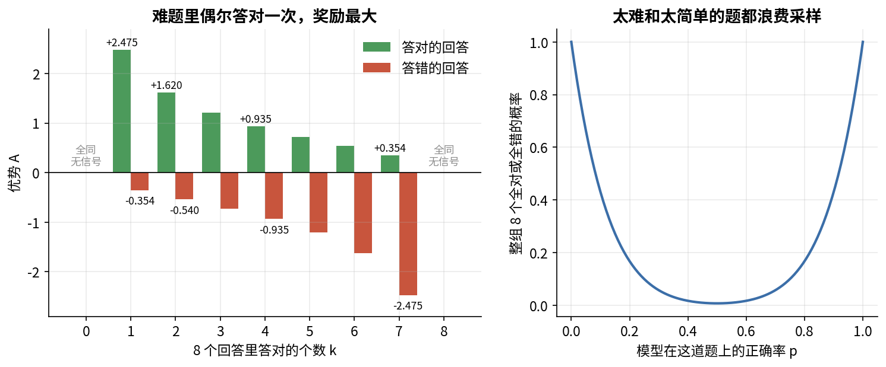
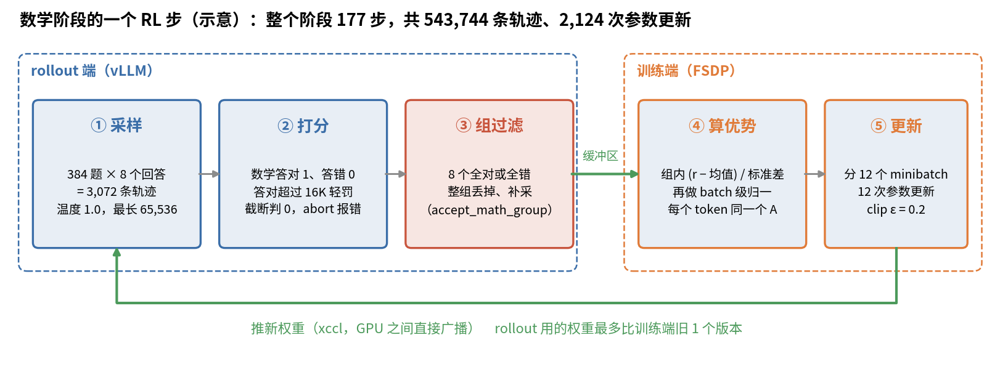

# 第 18 章　RL

> SFT 让模型模仿别人写好的回答。模仿有上限：答案是老师写的，模型只学到"老师会怎么写"，学不到"自己哪种写法更容易做对"。RL（reinforcement learning，强化学习）换了一种教法：让模型自己答题，用程序判对错，答对的写法概率调高，答错的调低。这一章从最朴素的策略梯度讲起，一步步讲到 PPO 和 ZGCM 用的 GRPO，再讲奖励怎么设计、异步训练怎么做。最后要把一件公开材料里互相矛盾的事说清楚：发布的 ZGCM-1-7B 到底有没有经过 RL。

## 这一章要回答的问题

读完这一章，你应该能回答下面这些问题。

1. RL 和 SFT 的根本区别是什么？为什么数学和代码最适合做 RL？
2. 策略梯度的公式怎么来的？为什么要减一个 baseline？
3. PPO 的 ratio 和 clip 在防什么？critic 是干什么的，为什么 GRPO 不要它？
4. GRPO 的组内归一化怎么算？8 个回答全对或全错时会发生什么？
5. ZGCM 的数学、代码、指令遵循三种奖励分别怎么判？长度惩罚的公式是什么，实际作用有多大？
6. 每步 384 题 × 8 个回答、12 个 minibatch、177 步，算下来是多少训练量？
7. 异步 RL 为什么会 off-policy？AReaL 的 decoupled loss 怎么处理？
8. 报告评测用的是 SFT checkpoint 还是 RL checkpoint？仓库、报告、模型卡怎么说？

---

<a id="s18-1" name="s18-1"></a>
## 18.1 RL 要解决什么问题

### 模仿的上限

SFT 的数据是"题目 + 一份参考回答"（第 17 章），模型学的是：给定题目，参考回答里每个 token 的概率要高。这种学法有三个限制。

第一，参考回答不一定适合这个模型。蒸馏数据来自更强的模型，它的推理步骤里可能有 7B 模型想不到的跳步，模型硬背下来，换一道题就用不上。第二，模型只见过对的，没见过错的。SFT 从不告诉模型"这样写会错"，所以模型自己推理时走偏了，不知道怎么拉回来。第三，一道题只有一种写法。同一道题其实有很多种对的解法，SFT 只奖励数据里那一种。

RL 让模型自己生成回答，再给每个回答打一个分（奖励，reward），然后调参数，让高分回答的概率变大、低分回答的概率变小。这样模型学到的是"我自己的哪种写法更容易拿高分"。

### 为什么先做数学和代码

RL 难在打分。分数有三种来源：

| 来源 | 例子 | 优点 | 毛病 |
|---|---|---|---|
| 人工打分 | 标注员给回答排序 | 什么任务都能打 | 贵、慢，标注员之间不一致 |
| 奖励模型 | 用人工排序数据训一个打分模型（RLHF） | 便宜、能大规模用 | 打分模型会被"钻空子"（下面讲） |
| 程序验证 | 数学比对答案，代码跑单元测试 | 准、便宜、几乎钻不了空子 | 只适用于有标准答案的任务 |

最后一种叫 **RLVR**（RL with verifiable rewards，可验证奖励的 RL）。DeepSeek-R1、Tulu 3、Olmo 3 的推理能力主要靠它。ZGCM 仓库发布的三个 RL 阶段都属于这一种：数学比答案，代码跑测试，指令遵循用规则检查（报告 §4.2.2 第 15 页）。报告提到的通用任务打分器是内部服务，没有发布（[§18.5](#s18-5)）。

表里说的钻空子，英文叫 **reward hacking**，是 RL 最常见的失败：模型找到一种能拿高分、但不是你想要的写法。例如奖励模型偏爱长回答，模型就越写越长。程序验证不会被"写得好听"骗到，但也有漏洞。比如代码题只跑了 8 个测试，模型可能只写对这 8 个测试覆盖的情况（[§18.5](#s18-5)）。

### 在全流程里的位置

ZGCM 报告把后训练写成"SFT，然后 mixed RL"（§4 第 11 页）：SFT 建立回答格式，RL 在数学、代码这类单一领域上提升能力。RL 从 SFT 后的模型起步，因为 RL 需要模型已经能偶尔答对。一个从没答对过的模型，所有回答都是 0 分，没有信号可学，[§18.4](#s18-4) 会把这件事算清楚。

<a id="s18-2" name="s18-2"></a>
## 18.2 从策略梯度讲起

知道了 RL 想做什么，接下来看它在数学上怎么写。

### 把语言模型看成策略

在 RL 的术语里，模型叫策略（policy），记作 $\pi_\theta$。给一个题目 $x$，策略生成一个回答 $y = (y_1, \dots, y_T)$，概率是每个 token 概率的乘积：

$$
\pi_\theta(y\mid x) = \prod_{t=1}^{T} \pi_\theta(y_t \mid x, y_{<t})
$$

每生成一个 token 是一个动作（action），已有的题目和前文是状态（state）。整段回答生成完，验证器给一个奖励 $R(x, y)$：数学题答对是 1，答错是 0。我们的目标是让期望奖励最大：

$$
J(\theta) = \mathbb{E}_{x}\, \mathbb{E}_{y\sim\pi_\theta(\cdot\mid x)} \big[ R(x,y) \big]
$$

### 策略梯度：REINFORCE

麻烦在于 $y$ 是采样出来的，采样这一步没法直接求导。策略梯度定理给了一个绕过去的办法：

$$
\nabla_\theta J = \mathbb{E}_{y\sim\pi_\theta} \big[ R(x,y)\, \nabla_\theta \ln \pi_\theta(y\mid x) \big]
$$

推导只用一步：$\nabla \pi = \pi \nabla \ln \pi$。把它代进 $\nabla \sum_y \pi(y) R(y)$，得到 $\sum_y \pi(y)\, R(y)\, \nabla \ln \pi(y)$，这个按 $\pi$ 加权的求和就是对 $\pi$ 采样求期望，于是得到上式。好处是梯度落在了 $\ln \pi$ 上，采样本身不用求导，采到什么回答就在什么回答上算。

这个公式的意思很直白。采样一个回答，算它的对数概率的梯度（和 SFT 里算交叉熵梯度完全一样），再乘上它的奖励。奖励为正，就往"让这个回答更可能"的方向走；奖励越大，走得越多。这个方法叫 REINFORCE（Williams, 1992）。

拿它和 SFT 比一下。SFT 的梯度是 $\nabla \ln \pi_\theta(y^{\text{参考}}\mid x)$，每条参考回答的权重都是 1。REINFORCE 是 $R \cdot \nabla \ln \pi_\theta(y^{\text{自己}}\mid x)$，回答是自己生成的，权重是奖励。所以可以把 RL 理解成在自己的回答上做加权 SFT。

### 为什么要减 baseline

只用 0/1 奖励有个大问题。答错的回答 $R=0$，梯度是 0，什么都没学到。答对的回答都被推高，可如果这道题本来就有 90% 的概率答对，再推高它意义不大。

解决办法是减一个基线（baseline）$b$：

$$
\nabla_\theta J = \mathbb{E}\big[ (R - b)\, \nabla_\theta \ln \pi_\theta(y\mid x) \big]
$$

可以证明，只要 $b$ 不依赖于 $y$，减掉它不改变梯度的期望，只降低方差。证明只有一行：多出来的那项是 $b \sum_y \nabla \pi(y) = b\, \nabla \sum_y \pi(y) = b\, \nabla 1 = 0$（习题 2）。$A = R - b$ 叫 **优势**（advantage），表示这个回答比"平均水平"好多少。

手算一个例子。一道题，模型答对的概率是 25%，取 $b = 0.25$：

| 回答 | $R$ | $A = R - 0.25$ | 效果 |
|---|---|---|---|
| 答对 | 1 | +0.75 | 概率推高 |
| 答错 | 0 | −0.25 | 概率压低 |

现在错的回答也有信号了。而且 $b$ 恰好等于正确率时，正负两边的"推力"刚好平衡：$0.25 \times 0.75 = 0.75 \times 0.25$。

最好的 baseline 是"这道题在当前策略下的期望奖励" $V(x)$。可 $V(x)$ 是未知的，只能估计。PPO 用一个神经网络去估，GRPO 用同一道题的多个回答的平均值去估，两者的根本区别就在这里。

### 一个回答，所有 token 同一个优势

奖励要等整段回答结束后才给。ZGCM 这类做法把同一个优势 $A$ 分给回答里的每个 token：

$$
\nabla_\theta J \approx \frac{1}{\sum_i |y_i|} \sum_i \sum_{t} A_i\, \nabla_\theta \ln \pi_\theta(y_{i,t}\mid x, y_{i,<t})
$$

上式是常见的"按 token 平均"写法。ZGCM 用的 AReaL 具体怎么归一，配置里没有写，[§18.9](#s18-9) 会讲不同归一方式的偏差。

这样分配有个明显的毛病。一条答对的 30,000 token 推理，里面 30,000 个 token 都被推高，包括走了弯路的那几千个。到底是哪一步导致了答对，结果奖励说不清，这叫 **信用分配**（credit assignment）问题。这个问题只能靠大量样本平均掉：走弯路的写法在别的错误回答里也常出现，平均下来它得不到正优势。

<a id="s18-3" name="s18-3"></a>
## 18.3 PPO：一批数据多用几次，但别走太远

### 为什么不能一直用 REINFORCE

REINFORCE 实际用起来有两个问题。一是样本只能用一次。公式里的期望是对当前策略 $\pi_\theta$ 采样求的，更新一步之后策略变了，旧样本就不再是当前策略的样本。而生成一个 30K token 的推理回答，比在它上面算一次梯度贵得多，只用一次太浪费。二是步子太大会崩。一次更新如果把某个回答的概率改得太多，策略可能掉进一个坏区域，之后生成的全是垃圾，再也采不到好样本。

PPO（Proximal Policy Optimization，Schulman et al., 2017）同时解决这两个问题。

### 重要性比值

想用旧策略 $\pi_{\text{old}}$ 采的样本来估计新策略的梯度，要乘一个 **重要性比值**（importance ratio）。道理是换算频率：某个 token 在旧策略下出现的概率是 $\pi_{\text{old}}$，在新策略下是 $\pi_\theta$，每个旧样本乘上两者之比，旧样本里各种写法出现的频率就被折算成新策略下应有的频率。对每个 token：

$$
r_t(\theta) = \frac{\pi_\theta(y_t\mid \cdot)}{\pi_{\text{old}}(y_t\mid \cdot)}
$$

刚采完样时 $\theta = \theta_{\text{old}}$，$r_t = 1$。更新几步之后，某个 token 的概率被调高了，$r_t > 1$；被调低了，$r_t < 1$。目标函数变成 $r_t A_t$。因为 $\nabla r_t = r_t \nabla \ln \pi_\theta(y_t\mid\cdot)$，在 $r_t=1$ 处它的梯度正好是 $A_t \nabla \ln \pi_\theta$，和 REINFORCE 一样。

### clip：只在信任区域里优化

有了 ratio，旧样本可以重复用，但步子大了照样会崩。PPO 的办法是把 $r_t$ 限制在 $[1-\varepsilon, 1+\varepsilon]$ 里：

$$
L^{\text{clip}} = \mathbb{E}_t \Big[ \min\big( r_t A_t,\ \operatorname{clip}(r_t, 1-\varepsilon, 1+\varepsilon)\, A_t \big) \Big]
$$

ZGCM 用 $\varepsilon = 0.2$（配置 `eps_clip: 0.2`）。下表把各种情况逐个手算一遍：

| 情况 | $A_t$ | $r_t$ | $r_t A_t$ | clip 后 $\times A_t$ | min 取到 | 梯度 |
|---|---|---|---|---|---|---|
| 好 token，还没推够 | +1 | 1.1 | 1.1 | 1.1 | 1.1 | 有，继续推高 |
| 好 token，已经推过头 | +1 | 1.3 | 1.3 | 1.2 | 1.2（常数） | 0，停止 |
| 坏 token，还没压够 | −1 | 0.9 | −0.9 | −0.9 | −0.9 | 有，继续压低 |
| 坏 token，已经压过头 | −1 | 0.7 | −0.7 | −0.8 | −0.8（常数） | 0，停止 |
| 好 token，反而被压低了 | +1 | 0.7 | 0.7 | 0.8 | 0.7 | 有，拉回来 |
| 坏 token，反而被推高了 | −1 | 1.3 | −1.3 | −1.2 | −1.3 | 有，拉回来 |

从表里能看出规律：往该去的方向走超过 20% 就不再给梯度；往错的方向走了，不管走多远都给梯度拉回来。有了这个限制，一批样本可以分成几个 minibatch 连续更新好几次，策略也不会离采样时的策略太远。

### critic 和 GAE

经典 PPO 的 baseline 来自一个价值网络（value network，也叫 critic）$V_\phi$。它和策略一样大，输入状态（题目 + 已生成的前文），输出"从这里往后预计能拿多少奖励"。有了每个位置的 $V$，就可以给每个 token 算不同的优势，常用的方法是 GAE（generalized advantage estimation，Schulman et al., 2016）：

$$
\delta_t = r_t^{\text{env}} + \gamma V(s_{t+1}) - V(s_t), \qquad A_t = \sum_{l\ge0} (\gamma\lambda)^l \delta_{t+l}
$$

式中 $r_t^{\text{env}}$ 是第 $t$ 步拿到的即时奖励，在 RLVR 里只有最后一个 token 处不为 0；$\gamma$ 是折扣系数；$\lambda$ 在 0 到 1 之间取，越小越依赖 critic 的估计（方差小、偏差大），越大越依赖真实奖励。$\delta_t$ 是"走了这一步之后，critic 对前景的估计变好了多少"，$A_t$ 是往后这些变化的加权和。这能缓解 [§18.2](#s18-2) 说的信用分配问题：critic 如果学会了"写到这一步，答对的希望就很大"，那一步的 token 就会拿到更大的优势。

可是 critic 也要训练、也要占显存，而且在长推理任务上很难训准。一个 30K token 的推理，中间某个位置"预计能不能答对"本身就很难预测。critic 估不准，优势就成了噪声。

### RLHF 里的 PPO 要放四个模型

InstructGPT 式的 RLHF 用 PPO 时，显存里要同时放四个模型：

| 模型 | 作用 | 是否训练 |
|---|---|---|
| actor（策略） | 生成回答，被优化 | 训练 |
| critic | 估价值，给 baseline | 训练 |
| reference（参考策略） | SFT 后的模型，算 KL 惩罚，防止策略跑太远 | 冻结 |
| reward model | 给回答打分 | 冻结 |

一个 7B 模型 BF16 权重约 14.8 GB。按第 12 章的显存估算，训练一个 7B（权重 + 梯度 + Adam 状态）约要 16 字节/参数，也就是约 118 GB。四个模型加起来，光静态显存就要两个训练中的 7B 加两个冻结的 7B，约 266 GB，这还没算生成时的 KV cache 和激活。GRPO 能流行起来，这是一个现实原因。

表里 reference 的用处是算 KL 惩罚，也就是在奖励里减一项 $\beta \cdot \mathrm{KL}(\pi_\theta \| \pi_{\text{ref}})$，让策略不要离 SFT 模型太远。它防两件事：一是语言能力退化，越训越不像人话；二是钻奖励模型的空子。

<a id="s18-4" name="s18-4"></a>
## 18.4 GRPO：用同一道题的几个回答当 baseline

### 做法

critic 又贵又难训，GRPO 干脆不要它。GRPO（Group Relative Policy Optimization，组相对策略优化）出自 DeepSeekMath（Shao et al., 2024, arXiv 2402.03300），它保留 PPO 的 ratio 和 clip，只换掉 baseline 的来源。

具体做法是，每道题采样 $G$ 个回答（ZGCM 取 $G=8$，配置 `n_samples: 8`，L54），这 8 个回答叫一个组（group）。验证器给每个回答打分，得到 $r_1, \dots, r_8$，然后在组内归一化：

$$
A_i = \frac{r_i - \operatorname{mean}(r_1..r_G)}{\operatorname{std}(r_1..r_G)}
$$

回答 $i$ 的每个 token 都用这个 $A_i$，代进 [§18.3](#s18-3) 的 clip 目标。

组内平均值就是 $V(x)$ 的估计：8 个回答里答对了几个，就说明这道题对当前模型大概有多难。这样就不需要 critic，显存里少了一个训练中的 7B 模型。

打个比方。要判断一个学生某次考了 80 分算好还是算差，PPO 的办法是另外培养一位老师，专门预估"这个学生做这套题一般能考几分"，老师本身要花钱培养，也可能估错。GRPO 的办法是让学生把同一套题独立做 8 遍，拿这 8 遍的平均分当标准，高于平均就算发挥得好。这个比方有一处不成立：critic 能对回答写到一半的每个位置给出估计，GRPO 的平均分只针对整道题，所以 GRPO 只能给整个回答一个优势（[§18.2](#s18-2) 的信用分配问题它解决不了）。

### 手算：8 个回答里答对 k 个

奖励是 0/1。下表用样本标准差（除以 $G-1$），`rl/README.md:100` 写的就是 unbiased。用总体标准差（除以 $G$）也只差一个常数倍 $\sqrt{8/7}\approx1.07$，而且后面 batch 级归一会把这个常数消掉。

| 答对个数 k | 组均值 | 标准差 | 答对的优势 | 答错的优势 |
|---|---|---|---|---|
| 1 | 0.125 | 0.354 | +2.475 | −0.354 |
| 2 | 0.25 | 0.463 | +1.620 | −0.540 |
| 4 | 0.5 | 0.535 | +0.935 | −0.935 |
| 7 | 0.875 | 0.354 | +0.354 | −2.475 |

先看表的两头。难题里唯一答对的那个回答拿到最大的正优势 +2.475：8 个里只有它对，说明这个写法少见又有用，要大力推高。简单题里唯一答错的那个拿到最大的负优势 −2.475：7 个都对，偏偏它错，说明它走了一条明显不好的路。另外，除以标准差之后，难题和简单题的优势尺度一样。这有好有坏，[§18.9](#s18-9) 会讲 Dr. GRPO 对这一点的批评。

表里没列的 k=3 可以自己算一遍，数是示意的，不是 ZGCM 的。8 个奖励是 1,1,1,0,0,0,0,0，均值 0.375；样本方差是 $(3\times0.625^2 + 5\times0.375^2)/7 \approx 0.268$，标准差约 0.518。3 个答对的回答各得 $0.625/0.518 \approx +1.21$，5 个答错的各得 $-0.375/0.518 \approx -0.72$。把 8 个优势加起来，$3\times1.21 \approx 5\times0.72 \approx 3.6$，正负刚好抵消。减掉组均值之后，一组优势的和总是 0，这和 [§18.2](#s18-2) 里 $b$ 取正确率时"推力平衡"是同一件事：组里答对的少，每个答对的就推得重，总推力和压低答错的那一边相等。

### 全对或全错：没有信号

k=0 或 k=8 时，8 个奖励完全一样，减掉均值后全是 0，标准差也是 0。优势按 0 处理，这组 8 个回答就白生成了。

这种组有多常见？设模型对某题的单次正确率是 $p$，全错的概率是 $(1-p)^8$，全对是 $p^8$：

| $p$ | 全错 | 全对 | 有信号的比例 |
|---|---|---|---|
| 0.1 | 43.0% | 0.0% | 57% |
| 0.5 | 0.4% | 0.4% | 99.2% |
| 0.9 | 0.0% | 43.0% | 57% |

太难和太简单的题都浪费 rollout。[§18.1](#s18-1) 说 RL 需要模型已经能偶尔答对，这张表就是那句话的定量版本。



左图把 k 从 0 到 8 的优势都画了出来，两头的 k=0 和 k=8 是零。右图是 $p^8+(1-p)^8$ 随正确率的变化，是一条 U 形曲线，两端接近 1，中间 $p=0.5$ 时最低。

### 动态采样：把没信号的组扔掉

DAPO（Yu et al., 2025）提出了动态采样（dynamic sampling）：生成完一组就检查方差，方差为 0 的组直接丢弃，继续采新题，直到凑满一个 batch 的有效组。这样每一步的有效样本数是固定的，不会因为某一步碰上很多简单题就只剩一半梯度。

ZGCM 报告说用了 GRPO 加动态采样（§4.2.3 第 15 页）。仓库里对应的是 `accept_math_group`（`rl/train/length_shaped_math_grpo.py:241-289`），作为 `dynamic_filter_fn` 传给 AReaL。它判断方差时用的是 `raw_correct = (reward > 0)`，没有用加了长度惩罚之后的奖励（L259、L269）。原因在于，8 个回答全对但长度不同时，长度惩罚后的奖励各不相同，方差不为 0。如果按惩罚后的奖励判断，这组会被留下，而它唯一的信号是"短一点更好"。ZGCM 不想用这种组训练，所以按原始对错判断。

报告还说，RL 数据会先删掉初始策略已经经常能做对的题（§4.2.1 第 15 页），等于在 rollout 之前就省掉了那 43% 的全对组。

### ZGCM 的两层归一

配置里写了两层归一（L106-112）：

| 层 | 配置 | 做什么 |
|---|---|---|
| 奖励归一 | `reward_norm: mean_level group, std_level group, group_size 8` | 就是上面的组内 $(r-\text{mean})/\text{std}$ |
| 优势归一 | `adv_norm: mean_level batch, std_level batch` | 对整个 batch 的优势再减均值、除标准差 |

组内归一之后每组均值已经是 0，batch 级这一层主要把整体尺度拉到 1。如果按 token 统计，长回答 token 多、权重大，batch 均值就不再严格为 0，这一层会再把它拉回来（推断，AReaL 的具体统计方式待查）。

### 和原版 GRPO 的差别

DeepSeekMath 的原版 GRPO 在 loss 里加了一项对 reference 模型的 KL。ZGCM 的配置是 `kl_ctl: 0.0`、`ref: null`（L96、L117），完全不用 KL，也就不用在显存里放 reference 模型。RLVR 的奖励由程序判定，没有奖励模型可钻，所以很多工作（DAPO 等）都去掉了 KL。报告 §4.2.2 第 15 页说"进一步探索"（further explore）过 reference KL，但仓库发布的配置里没有（[§18.8](#s18-8)）。

<a id="s18-5" name="s18-5"></a>
## 18.5 奖励怎么判

前面一直假设验证器会给出一个分数，这一节看 ZGCM 具体怎么判。报告的原则是"奖励跟着各领域的评测语义走"（§4.2.2 第 15 页）：数学只看答案对不对，代码看通过了几成测试，指令遵循看满足了几成约束。无效或被截断的回答拿不到正奖励。仓库 `rl/rewards/rewards.py:20-32` 按每条数据的 `domain` 字段分发到三个函数，遇到不认识的 domain 直接报错。

### 第一步：先取出"可见答案"

三种奖励共用 `visible_answer`（`rl/rewards/completion.py:11-24`），它按下面三步取答案：

1. 回答里没有 `</think>`，返回 None，记 0 分。
2. 取最后一个 `</think>` 之后的文字。
3. 去掉 `<answer>`、`</answer>` 标签，去掉首尾空白。剩下空串也返回 None。

ZGCM 的 chat template 在生成前就已经写好了 `<think>`（第 17 章），所以模型生成的内容里正常只有一个闭合的 `</think>`。没有它，说明思考没写完就被截断了，这时即使思考里出现过正确答案也不给分。代码注释给的理由是不给被截断的思维链打分（L14-18）。这条规则顺带还挡住了一种钻空子的写法：模型在思考里把几个候选答案都写一遍，碰巧哪个被验证器抓到就得分（这一点是推断，注释没写）。

### 数学：math-verify，0 或 1

`math_reward_fn`（`rl/rewards/math_reward.py:54-72`）把可见答案依次和每个标准答案比，任何一个等价就给 1，否则给 0。比较用的是 AReaL 封装的 `MathVerifyWorker`（L29-32），参数是 `try_extract_without_anchor=True`（答案不在 `\boxed{}` 里也尝试抽取）、`precision=6`（数值比到 6 位）、`timeout=8.0` 秒。

math-verify 会做符号等价判断，$\frac{1}{2}$、$0.5$、`1/2` 都算同一个答案。如果只做字符串比较，模型会因为格式不同被判错，奖励里就混进了和推理能力无关的噪声。

### 代码：沙箱里跑测试，按通过比例给分

`code_reward_fn`（`rl/rewards/sandbox_client.py:242-295`）先取可见答案里最后一个 python 代码块（`completion.py:27-31`），再从这道题的测试集里挑最多 8 个测试（环境变量 `ZGCM_CODE_MAX_TESTS`，默认 8）。挑哪 8 个由 `prompt_hash` 决定，所以同一道题每次挑到的是同一批。每个测试限时 2 秒（`ZGCM_CODE_TEST_TIMEOUT_SECONDS`），奖励等于通过个数除以测试个数（`_score_response`，L219-239）。

模型写的代码不可信，必须隔离运行。`sandbox_server.py:95-132` 拼出来的命令一层套一层：`timeout` 负责强杀；`setpriv` 换成无特权用户并禁止提权；`unshare --net --pid` 切断网络、隔离进程号；`prlimit` 限制 CPU 时间、内存、进程数、输出文件大小和打开文件数，并禁止 core dump；最后 `chroot` 进一个最小的根文件系统。rollout 每步要跑几千段陌生代码，这一块在 RL 工程里容易被忽视。

代码奖励是一个分数，不只有 0 和 1 两种取值，所以代码阶段的组过滤直接看分数的方差（`code_grpo.py:260-299`）。

### 指令遵循：IFEval 式规则检查

`ifeval_reward_fn`（`rl/rewards/ifeval_reward.py:99-141`）用的是 Open-Instruct 的 IFEvalG 检查器。每条数据带一个 `ifeval_spec`，列出要满足的约束，例如"不超过 200 词""全部小写""包含 3 个列表项"。奖励等于满足的约束数除以约束总数。检查器返回 None 按不满足算（L131-133）；检查器本身抛异常，则当作基础设施故障，整组丢弃，不算模型答错。

报告说通用任务还用了"正确性"标准（§4.2.2 第 15 页），仓库说明通用领域的打分模型是内部的，没有发布。

### 截断和故障要分开

`_compute_rewards`（`length_shaped_math_grpo.py:117-177`）把三种"没正常结束"的情况分开处理：

| 情况 | 判断 | 处理 | 理由 |
|---|---|---|---|
| 写满 65,536 token 被截断 | `stop_reason == "length"` | 奖励 0，正常参与训练 | 这是模型的错，要让它学会别写太长 |
| vLLM 中止生成 | `stop_reason == "abort"` | 抛异常 | 这是机器的错，不能当成模型答错 |
| 输出超过 65,536 | 长度检查 | 抛异常 | 不该发生，说明配置不一致 |

模型的错和机器的错一定要分开。如果网络抖动导致的失败被记成 0 分，模型就会因为不相干的原因受罚，奖励里多了噪声。

### 长度惩罚

数学阶段还对答对的回答加了一个轻微的长度惩罚（L153-158，常数在 L44-60）：

$$
\text{penalty} = 0.05 \times \operatorname{clip}\Big(\frac{L - 16384}{65536 - 16384},\ 0,\ 1\Big), \qquad R = \text{correct} \times (1 - \text{penalty})
$$

$L$ 是生成的 token 数。只罚答对的，因为答错的本来就是 0。

| 回答长度 $L$ | 答对时的奖励 |
|---|---|
| ≤ 16,384 | 1.0 |
| 30,000 | 0.9861 |
| 40,960 | 0.975 |
| 50,000 | 0.9658 |
| 65,536 | 0.95 |

这个惩罚能起多大作用？看一组 4 对 4 错的例子。不加惩罚时，答对的 4 个优势都是 +0.935。加上惩罚，4 个答对的回答从短到长分别拿到奖励 1、0.9861、0.9658、0.9505，优势变成：

| 回答 | 奖励 | 优势 |
|---|---|---|
| 最短的对 | 1.0 | +0.982 |
| 较短的对 | 0.9861 | +0.955 |
| 较长的对 | 0.9658 | +0.916 |
| 最长的对 | 0.9505 | +0.887 |
| 4 个错 | 0 | −0.935 |

最短和最长两个答对的回答之间，优势只差 0.095；对和错之间差约 1.8。**长度信号大约只有对错信号的 5%。** 它不会让模型为了短而放弃做对，只会在都做对的回答之间轻轻偏向短的。报告也说这个惩罚是"mild"（§4.2.2 第 15 页），目的是减少超长回答带来的奖励噪声，并不打算压缩长度。

评测时长度惩罚是关掉的（`main` 里给 eval workflow 设 `apply_length_penalty=False`，L543），这样验证集分数就是纯正确率。

<a id="s18-6" name="s18-6"></a>
## 18.6 ZGCM 的 RL 配置和训练量

讲完算法和奖励，再来看 ZGCM 实际怎么配置、训了多少。

### 三个单领域阶段

仓库所说的 "mixed RL" 并没有把数学、代码、指令题混在一个 batch 里，它是三个单领域阶段，各有一个配置（`rl/configs/`）：

| 阶段 | 配置 | 总步数 | epoch | 每 epoch 题数（推算） | 验证 |
|---|---|---|---|---|---|
| 数学 | `math_grpo_length_shaped.yaml` | 177 | 3 | 22,656 | 每 10 步，每题 8 个样本 |
| 代码 | `code_grpo.yaml` | 153 | 3 | 19,584 | 每 51 步，每题 1 个样本 |
| 指令遵循 | `if_grpo.yaml` | 219 | 3 | 28,032 | 每 10 步，每题 8 个样本 |

"每 epoch 题数"是按 步数 ÷ 3 × 384 算的，例如 177 ÷ 3 × 384 = 22,656。前提是被动态采样丢掉的组不额外消耗数据（推断，AReaL 的实现待查）。仓库没写三个阶段的顺序，也没给训练集的实际条数。

措辞上还有一个细节。`rl/README.md:5-9` 说数学配置是"发布模型的最终数学 GRPO 阶段"（the final math GRPO stage of the released model），代码和指令遵循配置是"mixed-RL 实验"（the mixed-RL experiments）用的。照这个说法，仓库只声称数学阶段进了发布模型。[§18.8](#s18-8) 还要拿这一点和报告对质。

### 数学阶段的超参数

下表的行号指 `rl/configs/math_grpo_length_shaped.yaml`。

| 类别 | 参数 | 值 | 行 |
|---|---|---|---|
| 采样 | 每步题数 | 384 | L134 |
| 采样 | 每题回答数 $G$ | 8 | L54 |
| 采样 | 温度 / top-p / top-k | 1.0 / 1.0 / 1e8（等于不截断） | L59-61 |
| 长度 | prompt 上限 | 4,096 | L142 |
| 长度 | 新生成上限 | 65,536 | L56 |
| 长度 | 总上下文 | 98,304 | L57、L128 |
| 长度 | 训练 micro-batch token 上限 | 69,632 | L80 |
| 优化 | 优化器 | Adam，β=(0.9, 0.999)，eps 1e-8，WD 0.01 | L82-88 |
| 优化 | 学习率 | 1e-6，constant，warmup 3% | L84、L89、L91 |
| 优化 | 梯度裁剪 | 1.0 | L90 |
| 损失 | clip ε | 0.2 | L92 |
| 损失 | KL 系数 | 0 | L96 |
| 损失 | minibatch 数 | 12 | L98 |
| 损失 | decoupled loss | 开 | L100 |
| 损失 | token 级拒绝 | ratio > 5 的 token 被 mask | L101-105 |
| 模型 | critic / ref | 都没有 | L117-118 |
| 系统 | 训练后端 / 推理后端 | FSDP / vLLM | L67、L35 |

表里有几个选择需要解释。采样温度是 1.0，也不做 top-p/top-k 截断，训练端算 log-prob 时用同一个温度（`actor.temperature: ${gconfig.temperature}`，L93）。如果推理端截断了分布、训练端没截断，两边对同一个 token 算出的概率就对不上，ratio 从一开始就不等于 1。

学习率是 1e-6，比 SFT 的 1e-4 小两个数量级（第 17 章）。RL 的梯度噪声大，策略又容易崩，步子必须小。

训练 micro-batch 的 token 上限 69,632 = 4,096 + 65,536，一条最长的轨迹（满 prompt 加满生成）刚好放进一个 micro-batch。98,304 是推理端的总上下文上限，因为 prompt 和生成各自有上限，实际用不到 98,304。

最后，vLLM 保留了滑动窗口（`disable_sliding_window: false`，L130）。ZGCM 是 SWA 加全局层的混合架构（第 9 章），推理端必须和训练端一样用滑动窗口，否则生成时看到的上下文和训练时不同。

### 每一步的训练量

把这些参数串起来，一个 RL 步是这样的。先采样，384 题 × 8 个回答 = 3,072 条轨迹。全对或全错的组丢掉再补采，直到凑够（[§18.4](#s18-4)）。然后给每条轨迹打一个奖励，做组内归一和 batch 归一。最后把 3,072 条轨迹分成 12 个 minibatch，每个约 256 条，每个 minibatch 做一次优化器更新，所以一个 RL 步包含 12 次参数更新。

整个数学阶段算下来是 177 × 3,072 = 543,744 条轨迹，177 × 12 = 2,124 次参数更新。

下图把一步里的五件事串成一个回路。注意虚线框把它们分成了两半：采样、打分、过滤在 rollout 端，算优势和更新在训练端，两半之间隔着一个缓冲区，[§18.7](#s18-7) 讲的就是这两半为什么要分开跑。



12 个 minibatch 是依次更新的，到第 12 个时，策略已经比采样时多走了 11 步。[§18.3](#s18-3) 说的"一批数据多用几次"指的就是这个，clip 在这里起作用。

warmup 3% 按 177 步算约 5 步（单位是 RL 步还是参数更新次数，配置没写，待查）。

### 和报告对不上的地方

仓库的配置和报告有几处对不上：

| 项 | 报告 | 仓库 |
|---|---|---|
| actor 学习率 | 2×10⁻⁶（§4.2.3 第 15 页） | 1e-6（L84，且 `assert_contract` 强制检查） |
| 采样规模 | 两种都试过：24×16=384 条、384×8=3,072 条（§4.2.3 第 15 页） | 只有 384×8 |
| reference KL | 说"进一步探索"过（§4.2.2 第 15 页） | `kl_ctl: 0`，`ref: null` |
| micro-batch token 预算 | 和总上下文一样，98,304（§4.2.3 第 15 页） | 69,632（L80） |

仓库的 `rl/README.md:132-134` 对此有解释：mixed RL 的早期变体用过 lr 2e-6 加更大的组规模，也试过带 reference KL 的变体，发布的配置用的是上表"仓库"一列的值。所以报告描述的是探索过的所有设置，仓库给的是最终用的那一套。这个解释能对上学习率和 KL，micro-batch 预算的差别仍然没有说明。

<a id="s18-7" name="s18-7"></a>
## 18.7 异步 RL：AReaL 和 decoupled loss

训练量算清楚了，实际跑起来还有一个效率问题：生成和训练怎么排。

### 同步 RL 的浪费

最直接的做法是同步的：所有 GPU 一起生成 3,072 条回答，全部生成完再一起训练，训练完把新权重发给推理引擎，进入下一步。

问题出在长度分布上。数学推理的回答从几千 token 到 65,536 token 都有，同步做法下，一步的生成时间由最长的那条决定。举个示意的例子：大多数回答 10K token 就结束了，有一条写到 65K，那么在后面约 85% 的时间里，大部分推理槽位都在等它。这叫长尾（long tail）问题。

### 异步：生成和训练各干各的

AReaL（Fu et al., 2025, [arXiv 2505.24298](https://arxiv.org/abs/2505.24298)）把这两件事拆开了，对应 [§18.6](#s18-6) 图里的左右两个虚线框。rollout worker（这里是 vLLM，配置 L35）不停地生成，生成完一组就打分、过滤，放进缓冲区。trainer（这里是 FSDP，L67）从缓冲区凑够一个 batch 就训练一步，然后把新权重推给 rollout worker。推权重用 `weight_update_mode: xccl`（L113），即通过 NCCL 这类集合通信直接在 GPU 之间广播，不经过磁盘。

这样 GPU 不再空等，但数据会变旧：trainer 训练第 $n$ 步时，用的回答可能是第 $n-1$ 版甚至更早的权重生成的。用旧策略的数据训练新策略，叫 **off-policy**。

### 限制旧的程度

`max_head_offpolicyness: 1`（L39）规定 rollout 用的权重最多比 trainer 当前的权重旧 1 个版本。值为 0 就退化成同步 RL；值越大，GPU 利用率越高，数据也越旧。ZGCM 选了 1，是最保守的异步。

### decoupled loss：把纠偏和信任区域分开

数据变旧以后，PPO 的 ratio 也要重新考虑。普通 PPO 的 ratio 是 $\pi_\theta / \pi_{\text{old}}$，这里的 $\pi_{\text{old}}$ 既是生成数据的策略，又是信任区域的中心。异步之后这两个不再是同一个东西，所以 AReaL 引入了三个策略：

| 记号 | 是什么 | 从哪来 |
|---|---|---|
| $\pi_{\text{behav}}$ | 实际生成这条回答的策略（行为策略） | vLLM 生成时记下每个 token 的 log-prob |
| $\pi_{\text{prox}}$ | 本次训练开始时的策略（近端策略） | trainer 用当前权重重新算一遍 log-prob，即 `recompute_logprob: true`（L99） |
| $\pi_\theta$ | 正在被更新的策略 | 前向计算 |

目标函数按 AReaL 论文的写法是：

$$
L = \mathbb{E}_t\Big[\underbrace{\frac{\pi_{\text{prox}}(y_t)}{\pi_{\text{behav}}(y_t)}}_{\text{off-policy 纠偏}} \cdot \min\big(u_t A_t,\ \operatorname{clip}(u_t, 1-\varepsilon, 1+\varepsilon) A_t\big)\Big], \qquad u_t = \frac{\pi_\theta(y_t)}{\pi_{\text{prox}}(y_t)}
$$

前面那个比值是重要性权重，纠正"数据是旧策略生成的"这个偏差。clip 套在 $u_t$ 上，中心是 $\pi_{\text{prox}}$，所以信任区域以训练开始时的策略为准，不以生成数据的那个旧策略为准。

这样分开是有原因的。如果直接用 $\pi_\theta/\pi_{\text{behav}}$ 做 clip，数据越旧，ratio 一开始就越偏离 1，很多 token 一上来就被 clip 掉，梯度变少。分开之后，clip 只管这一步别走太远，纠偏交给前面的权重。A-3PO（[arXiv 2512.06547](https://arxiv.org/abs/2512.06547)）对 decoupled loss 的概括也是这个意思：用近端策略把 off-policy 纠偏和信任区域解耦。

`use_decoupled_loss: true`（L100）就是这个开关。打开它以后，trainer 要多做一次前向来算 $\pi_{\text{prox}}$。

### 重要性权重太大怎么办

重要性权重可能很大。某个 token 在旧策略下概率 0.001，在新策略下 0.1，权重就是 100，一个 token 就能把整个梯度带偏。配置 L101-105 设了 token 级拒绝：`metric: ratio, upper: 5.0, action: mask`，ratio 超过 5 的 token 直接从 loss 里去掉。从配置名推断，这里的 ratio 指的是上面的重要性权重 $\pi_{\text{prox}}/\pi_{\text{behav}}$（推断，AReaL 源码待查）。

还有一个 off-policy 来源和异步无关。vLLM 和 FSDP 是两套实现，对同一个权重算出的 log-prob 本来就有数值差（kernel 不同、bf16 累加顺序不同）。所以即使 `max_head_offpolicyness` 为 0，$\pi_{\text{behav}}$ 和 $\pi_{\text{prox}}$ 也不完全相等。重新计算 $\pi_{\text{prox}}$ 再加上 ratio 上限，把这种差别也一并处理了。

### 按版本号评测

异步训练里，"第 10 步的模型"这个说法不精确，因为 rollout 端和 trainer 端的权重版本可能差 1。ZGCM 的训练入口为此专门做了版本对齐。`EVAL_VERSIONS`（`length_shaped_math_grpo.py:56`）是 {0, 10, 20, …, 170, 177}，共 19 个版本。`ExactVersionPPOTrainer`（L460 起）只在模型版本号正好落在这个集合里时评测，并检查版本号和期望一致（`run_explicit_eval`，L366-367），不一致就报错。每次评测会写一个 marker 文件，续训时 marker 已存在就跳过，不会重复评测。

开训前还有一道 `run_initial_weight_sync_gate`（L399-457）：先把版本 0 的权重完整推一遍给 rollout 端，确认版本号没被改动，再开始训练。权重同步链路如果有问题，在第一步之前就能发现。

<a id="s18-8" name="s18-8"></a>
## 18.8 发布的模型到底有没有经过 RL

现在回到这一章开头留下的问题。我们先把三方的原话摆出来，再做判断。

### 三方怎么说

| 来源 | 位置 | 原话（大意） |
|---|---|---|
| 报告 | §4 第 11 页 | 后训练是 SFT，然后 mixed RL；RL 在数学、代码等单一领域带来提升 |
| 报告 | §5.1 第 15 页 | 报告的结果使用发布的 256K SFT checkpoint（the released 256K SFT checkpoint） |
| 报告 | §7.1 第 21 页 | 结论：SFT "辅以"（complemented by）一个在单领域任务上有提升的 mixed RL 阶段 |
| 模型卡 | `zgcagi/ZGCM-1-7B` 的 README | 下面的结果来自技术报告，使用 256K SFT checkpoint、thinking 模式 |
| 模型卡 | 同上 | SFT 那一条最后加一句：报告还探索了（also explores）数学和代码的 mixed RL |
| 仓库 | `rl/README.md:5-9` | 本目录是发布模型的最终数学 GRPO 阶段所用的确切配置、奖励和训练入口 |

### 旁证

除了这些原话，还有几条旁证。HF 上作者发布了 6 个模型：ZGCM-1-7B，以及 Pretrain、Pretrain-Curriculum、Midtrain-Staged-16K / 64K / 256K，没有任何一个名字里带 RL 或 SFT，ZGCM-1-7B 的仓库也只有一个 main 分支。公开的 W&B 项目 `zgcagi/zgcm-1-reports` 有 25 个 run，覆盖消融、预训练、mid-train 和 SFT，没有一个是 RL。

报告本身也没有给出任何 RL 前后的对比数字，"yields gains"（§4 第 11 页、§7.1 第 21 页）没有表格支撑。Table 2 里出现的 "RL" 是对比模型 MiMo-7B RL 的名字（§5.1 第 16 页），和 ZGCM 自己的 RL 无关。另外，`rl/RUNNING.md` 里 RL 的起点写成 `ZGCM_MODEL_PATH=/path/to/zgcm1_checkpoint`，没说是哪个 checkpoint。

### 两种解释

这些材料有两种解释。

解释一：发布的 ZGCM-1-7B 就是 256K SFT checkpoint，没有经过 RL。RL 是在它之上做的实验，结果没有发布。支持这种解释的有：报告 §5.1 第 15 页和模型卡两处独立文字都明确写了 SFT checkpoint；模型卡的用词是"also explores"；HF 和 W&B 都没有 RL 产物。仓库 README 的"of the released model"可以读成"在发布模型基础上做的最终数学阶段"。

解释二：发布的模型是 SFT 再加数学 GRPO，报告和模型卡写错了。支持它的只有 `rl/README.md:5-9` 这一句，不过这句的用词很具体（"exact configuration ... used for the final math GRPO stage of the released model"）。

本书的判断是解释一更可能，这是推断。评测协议这种事，报告和模型卡两处都明确写了 SFT，而 RL 一侧没有任何权重、曲线或数字。要彻底定下来，只能等作者澄清，或者等作者公开 RL 后的权重，拿它和 ZGCM-1-7B 比一下参数是否相同。

### 这件事对你的意义

读报告时要把"pipeline 里有什么"和"发布的模型经过了什么"分开看。很多报告把探索过的东西都写进方法章节，但评测用的 checkpoint 可能只走了其中一部分。读的时候要找到评测设置那一节，看它明确写的是哪个 checkpoint。

落到这本书上，**第 19 章的所有评测数字都按"SFT checkpoint 的成绩"来读。** RL 能带来多少提升，ZGCM 的公开材料回答不了。

即便如此，仓库里的 RL 代码仍然值得学。它是一套完整、可运行的 RLVR 配方，奖励、过滤、异步、版本对齐都写得很仔细。它的价值在工程上，并不在于复现了发布的模型。

### 其他还没说清的点

除了这个大问题，还有几处公开材料没说清：

| 问题 | 现状 |
|---|---|
| RL 从哪个 checkpoint 起步 | 报告说"initial policy"（§4.2.1 第 15 页），没说是哪个；按顺序推断是 256K SFT |
| 三个领域的训练集有多大 | 没给；数据也没发布（`rl/RUNNING.md:28`） |
| 三个阶段的先后顺序 | 没给 |
| 通用任务怎么打分 | 内部服务，没发布（`rl/README.md:57-60`） |
| loss 在 token 之间怎么归一 | AReaL 的默认行为，配置没写 |
| 学习率 2e-6 还是 1e-6、有没有 KL | 报告写的是探索过的设置，仓库是最终版（[§18.6](#s18-6)） |

<a id="s18-9" name="s18-9"></a>
## 18.9 ZGCM 没用的其他做法

前面讲的都是 ZGCM 用了什么。下面这些做法 ZGCM 没用，或者用没用还待查，但读别的 RL 论文时会经常碰到。

### loss 怎么在 token 之间平均：长度偏差

GRPO 原版的 loss 先在每个回答内部按 token 平均，再在回答之间平均：

$$
L_{\text{seq}} = \frac{1}{G}\sum_{i=1}^{G} \frac{1}{|y_i|} \sum_t \ell_{i,t}
$$

这样每个 token 的权重是 $A_i / |y_i|$，回答越长，单个 token 分到的权重越小。手算一下：两个答错的回答，$A=-0.935$，一个 1,000 token，一个 30,000 token。前者每个 token 的权重是 $-9.35\times10^{-4}$，后者是 $-3.1\times10^{-5}$，差 30 倍。于是长的错误回答每个 token 受的惩罚更轻，模型会慢慢学会"错的时候写长一点"。答对的回答正好反过来，短的每个 token 推得更多。

Dr. GRPO（Liu et al., 2025）指出了这个偏差，改成所有 token 统一除以一个常数。DAPO 用的是 token 级平均：

$$
L_{\text{tok}} = \frac{1}{\sum_i |y_i|} \sum_i \sum_t \ell_{i,t}
$$

这样每个 token 权重相同，长回答因为 token 多，总影响也大，这是合理的。[§18.2](#s18-2) 写的就是这种形式。ZGCM 用的是 AReaL 的默认归一方式，配置没写，待查。

Dr. GRPO 还批评了除以标准差这一步：k=1 和 k=7 的组标准差小，优势被放大（[§18.4](#s18-4) 的表），几乎全对或几乎全错的题权重偏大。它的做法是只减均值、不除标准差。ZGCM 是除的（`std_level: group`）。

### DAPO 的其他做法

DAPO（Yu et al., 2025, [arXiv 2503.14476](https://arxiv.org/abs/2503.14476)）一共四招，ZGCM 用了其中两招的思路：

| 做法 | 内容 | ZGCM |
|---|---|---|
| 动态采样 | 丢掉零方差组并补采 | 用了（[§18.4](#s18-4)） |
| token 级 loss | 上面的 $L_{\text{tok}}$ | 待查 |
| clip-higher | clip 上下界分开，$\varepsilon_{\text{low}}=0.2$，$\varepsilon_{\text{high}}=0.28$ | 没用，上下都是 0.2 |
| overlong reward shaping | 快到长度上限时逐渐扣分，而不是一过线就判 0 | 思路相近，但 ZGCM 只罚答对的，截断仍直接判 0 |

clip-higher 防的是 **熵塌缩**（entropy collapse）。概率低的 token 要被推高，ratio 很快碰到 $1+\varepsilon$ 的上限；概率高的 token 没有这个问题。久而久之分布越来越尖，模型只会一种写法，采 8 个回答几乎一样，组内方差变成 0，训练就停了。把上界放宽到 0.28，就给了低概率 token 更多上升空间。

### GSPO：在序列级算 ratio

GSPO（Qwen 团队，2025）认为，奖励是给整段回答的，ratio 也应该按整段算：用整段回答的对数概率差，按长度取几何平均，再 clip。这对 MoE 模型尤其有用，因为 MoE 的路由变化会让单个 token 的 ratio 噪声很大。ZGCM 是稠密模型，用的是 token 级 ratio。

### DPO：不采样的偏好优化

DPO（Rafailov et al., 2023, [arXiv 2305.18290](https://arxiv.org/abs/2305.18290)）直接用成对数据训练，每对是同一题的一个好回答 $y_w$ 和一个差回答 $y_l$：

$$
L_{\text{DPO}} = -\ln \sigma\Big(\beta \ln\frac{\pi_\theta(y_w)}{\pi_{\text{ref}}(y_w)} - \beta \ln\frac{\pi_\theta(y_l)}{\pi_{\text{ref}}(y_l)}\Big)
$$

它不需要在线生成，也不需要奖励模型，训练起来和 SFT 一样简单。缺点是数据是离线的，并非当前模型自己生成，所以它学不到"自己哪种写法更容易对"，而这恰好是 [§18.1](#s18-1) 说的 RL 的长处。很多团队用 DPO 做对齐（语气、安全），用 RLVR 做推理。

### 过程奖励

ZGCM 的奖励只看最终答案（outcome reward）。另一种做法是过程奖励模型（process reward model，PRM），给推理的每一步打分，直接缓解 [§18.2](#s18-2) 的信用分配问题。但这要标注或自动构造每一步的对错，而且 PRM 本身也会被钻空子。DeepSeek-R1 报告把 PRM 列在"尝试过但没成功"的方案里。

### RL 训练该盯哪些指标

第 14 章讲了预训练的监控，RL 还要多看下面这些。ZGCM 的入口代码已经把其中几项记进了 `stats_tracker`（`length_shaped_math_grpo.py:161-169`、`L274-280`）：

| 指标 | ZGCM 记录的名字 | 怎么读 |
|---|---|---|
| 训练奖励 / 正确率 | `raw_correct`、`reward_after_length_penalty` | 应缓慢上升；突然跳升要查是否钻了空子 |
| 验证集正确率 | eval marker（每 10 步） | 最终要看的目标；训练奖励涨而验证不涨就是过拟合或钻空子 |
| 回答长度 | `response_output_tokens` | 推理 RL 中通常会变长；暴涨要警惕 |
| 截断率 | `response_truncated` | 升高说明模型越写越长、撞上 65,536 的墙 |
| 零方差组比例 | `update_group_zero_variance` | 升高说明题变得太简单或熵塌缩了 |
| 超长被拒比例 | `update_group_over_cap` | 应接近 0 |
| 熵 | 框架通常会记（AReaL 默认是否记录待查） | 持续下降到很低是熵塌缩的信号 |
| clip 比例、ratio 分布 | 同上 | clip 比例过高说明步子太大或数据太旧 |

<a id="s18-10" name="s18-10"></a>
## 18.10 读代码

### 一条回答怎么变成一个奖励

下面是 `rl/train/length_shaped_math_grpo.py:124-158`，略去了日志部分：

```python
output_len = len(resp.output_tokens)                         # ①
if output_len > MAX_NEW_TOKENS:
    raise RuntimeError(...)
stop_reason = normalize_stop_reason(resp)
if stop_reason == "abort":                                   # ②
    raise RuntimeError("vLLM aborted generation; refusing to score infra failure")

completion = self.tokenizer.decode(resp.output_tokens)
capped = stop_reason == "length"
if capped:                                                   # ③
    raw_reward = 0.0
else:
    raw_reward = await self.async_reward_fn(prompt_str, completion, ...)
if raw_reward not in {0.0, 1.0}:                             # ④
    raise ValueError(...)

raw_correct = float(raw_reward == 1.0)
penalty = 0.0
if self._apply_length_penalty and raw_correct:               # ⑤
    length_fraction = (output_len - LENGTH_PENALTY_START) / (
        LENGTH_PENALTY_END - LENGTH_PENALTY_START)
    penalty = LENGTH_PENALTY_MAX * min(1.0, max(0.0, length_fraction))
reward = raw_correct * (1.0 - penalty)                       # ⑥
```

按圆圈编号来读。① 处长度用的是 token 数，不是字符数，超过 65,536 说明 vLLM 和配置不一致，直接报错。② 处的 `abort` 是机器的问题，这里报错而不判 0，避免把基础设施故障当作模型答错。③ 处被长度截断（`length`）的回答判 0，而且不调用验证器，即使截断前已经写出了正确答案也不给分。

④ 处要求数学奖励严格是 0 或 1。验证器如果返回 0.5 这类值，说明奖励函数被换错了，直接报错。⑤ 处的长度惩罚只在训练时、只对答对的回答生效，`min(1, max(0, ·))` 就是公式里的 clip。到了 ⑥，最终奖励要么在 [0.95, 1] 之间，要么是 0。

### 判断一组要不要

下面是 `accept_math_group`，`length_shaped_math_grpo.py:257-270`：

```python
lengths = attention_mask.sum(-1).reshape(-1)          # 每条轨迹的 token 数（prompt + 回答）
reward_values = rewards.float().reshape(-1)
raw_correct = (reward_values > 0.0).float()           # 惩罚后 >0 就是答对
max_seen = _as_int(lengths.max())
if reward_values.numel() != GROUP_SIZE:               # 必须正好 8 条
    reason = "bad_group_size"
elif not bool(torch.isfinite(reward_values).all().item()):
    reason = "nonfinite_reward"
elif max_seen > UPDATE_MAX_SEQLEN:                    # 最长那条超过 69,632
    reason = "over_update_cap"
elif bool(((reward_values < 0.0) | (reward_values > 1.0)).any().item()):
    reason = "reward_out_of_range"
elif float(raw_correct.std(unbiased=False).item()) < 1e-6:
    reason = "zero_variance_group"                    # 全对或全错
```

这段代码有几处要留意。`raw_correct = reward > 0` 用到了一个事实：答对的最低奖励是 0.95，大于 0，答错是 0，所以"大于 0"就把惩罚后的奖励还原成了对错。`lengths` 来自 attention mask，算的是 prompt 加回答。69,632 = 4,096 + 65,536，正常情况下不会超，这一条只是保险。判方差用的是总体标准差（`unbiased=False`），只要不是全 0 或全 1，就大于阈值，所以这里用哪种标准差不影响结果。每个被拒的组都会打印一行 `ZGCM_GROUP_REJECT` 和原因（L283-288），排查时直接 grep 日志就行。

### 启动前先对一遍配置

`assert_contract`（`length_shaped_math_grpo.py:292-331`）把十几个关键值写死在代码里，和 yaml 逐项比对：

```python
checks = {
    "train_batch": (config.train_dataset.batch_size, TRAIN_BATCH),     # 384
    "group_size": (config.gconfig.n_samples, GROUP_SIZE),              # 8
    "max_tokens_per_mb": (config.actor.mb_spec.max_tokens_per_mb, UPDATE_MAX_SEQLEN),
    "ppo_n_minibatches": (config.actor.ppo_n_minibatches, 12),
    "lr": (config.actor.optimizer.lr, 1.0e-6),
    "kl_ctl": (config.actor.kl_ctl, 0.0),
    ...
}
if config.critic is not None or config.ref is not None or config.teacher is not None:
    mismatches["GRPO_roles"] = ...
```

只要有一项不一致，训练就不启动。这种"配置契约"在 RL 里很有用。RL 的超参数多，彼此又耦合（比如 micro-batch 上限必须不小于 prompt 加生成上限），改错一个往往要跑几十步才看得出来。它也说明，仓库发布的数学配方就是 lr 1e-6、KL 0，想用报告里的 2e-6，必须改代码，光改 yaml 不够。

<a id="s18-11" name="s18-11"></a>
## 18.11 坑和对不上的地方

下面这些条目彼此独立，按编号列出，最后有一张按类别归并的索引。

1. 发布的模型有没有经过 RL，三方说法冲突。`rl/README.md:5-9` 说数学配置用于"发布模型的最终数学 GRPO 阶段"，报告 §5.1 第 15 页和模型卡说评测用的是 256K SFT checkpoint，HF 和 W&B 上都没有 RL 产物（[§18.8](#s18-8)）。
2. RL 的效果没有数字。报告两处说 RL "yields gains"（§4 第 11 页、§7.1 第 21 页），但没有任何表格给出 RL 前后的对比。
3. 学习率对不上。报告写 2×10⁻⁶（§4.2.3 第 15 页），仓库是 1e-6，并且 `assert_contract` 写死了 1e-6。仓库 README L132-134 解释说 2e-6 属于早期变体。
4. KL 对不上。报告说探索过 reference KL（§4.2.2 第 15 页），仓库是 `kl_ctl: 0`、`ref: null`，同样被归为早期变体。
5. micro-batch 的 token 预算对不上。报告说它和总上下文相同（§4.2.3 第 15 页，即 98,304），仓库是 69,632。仓库的值等于 prompt 上限加生成上限，更说得通，但这个差别没有解释。
6. 采样规模对不上。报告列了 24×16 和 384×8 两种（§4.2.3 第 15 页），仓库只有 384×8。
7. "mixed RL" 并没有把各领域混在一个 batch 里。报告标题叫 Mixed Reinforcement Learning，仓库说明实际是三个单领域阶段（`rl/README.md:14-17`），三个阶段的顺序没写。
8. 通用领域的打分器没有发布（`rl/README.md:57-60`），报告 §4.2.2 第 15 页说的"correctness criteria"无法复现。
9. RL 训练数据没有发布（`rl/RUNNING.md:28`），只给了 JSONL 格式，每 epoch 的题数只能从步数反推。
10. 代码奖励只跑 8 个测试（`sandbox_client.py` 里 `ZGCM_CODE_MAX_TESTS` 默认 8），而验证用的是最多 64 个测试的 all-pass@1。训练信号比评测标准松，模型可能学到只覆盖部分情况的代码。
11. loss 在 token 之间的归一方式没写。用的是 AReaL v2.0.0 的默认值，[§18.9](#s18-9) 说的长度偏差是否存在，要看 AReaL 源码。
12. ratio 上限 5.0 指的是哪个 ratio，配置没写。这一章按重要性权重 $\pi_{\text{prox}}/\pi_{\text{behav}}$ 理解，属于推断。
13. 两处标准差不一样。奖励归一用样本标准差（README L100 写 unbiased），组过滤用总体标准差（`unbiased=False`）。两者都不影响结果，但读代码时容易困惑。
14. 长度惩罚很小。对错之间的优势差约 1.8，长度造成的差最多约 0.1（[§18.5](#s18-5)）。它对回答长度的影响很小，如果你想用它控制长度，要加大系数。

| 类别 | 条目 |
|---|---|
| 报告 vs 仓库 | 1、3、4、5、6、7 |
| 报告自身缺数据 | 2、8 |
| 未发布的东西 | 8、9、RL checkpoint、RL W&B |
| 需要读框架源码才能确定 | 11、12 |
| 设计上的取舍 | 10、13、14 |

<a id="s18-12" name="s18-12"></a>
## 18.12 试着讲给别人听

下面是一段示范讲法。建议你先合上书自己讲一遍，再对照。

> SFT 是照着别人写好的答案模仿，RL 是让模型自己答题，用程序判对错，答对的写法概率调高，答错的调低。数学比对答案、代码跑测试，奖励几乎钻不了空子，所以推理 RL 先从这两类开始。

> 最朴素的做法是 REINFORCE：采一个回答，算它的对数概率梯度，乘上奖励，相当于在自己的回答上做加权 SFT。只用 0/1 奖励的话，答错的回答没有梯度，所以要减一个 baseline，让优势等于"比平均好多少"。PPO 用一个和策略一样大的 critic 估 baseline，再用 ratio 和 clip 让一批数据能更新好几次而不走太远。

> GRPO 不要 critic。它对每道题采 8 个回答，用这 8 个奖励的均值做 baseline、标准差做缩放。8 个里只对 1 个时，那个对的优势是 +2.5；对 7 个时，那个错的是 −2.5。全对或全错时优势全是 0，没有信号，所以要用动态采样把这些组丢掉补采。ZGCM 判断时用原始对错，不用加了长度惩罚的奖励，免得留下只有长度信号的组。

> ZGCM 仓库的数学阶段每步 384 题、每题 8 个回答，共 3,072 条轨迹，分 12 个 minibatch 更新，177 步、3 个 epoch，学习率 1e-6，没有 KL，没有 critic。回答最长 65,536 token，被截断判 0。答对的回答超过 16K token 后线性扣分，最多扣 5%，相对于对错之间的差距，这只是很小的修正。

> 训练用 AReaL 异步跑：vLLM 不停生成，FSDP 不停训练，数据最多旧 1 个版本。为了处理旧数据，它用 decoupled loss：用近端策略和行为策略的比值纠偏，用当前策略和近端策略的比值做 clip，ratio 超过 5 的 token 直接 mask 掉。

> 最后要提醒一点。报告和模型卡都说评测用的是 256K SFT checkpoint，只有仓库 README 说数学 GRPO 是发布模型的最后阶段，HF 和 W&B 上也没有 RL 产物。所以我把发布的 ZGCM-1-7B 当作 SFT 模型来看，RL 部分当作一套写得很仔细、但效果没有公开的配方来学。

<a id="s18-13" name="s18-13"></a>
## 18.13 习题

1. SFT 的梯度和 REINFORCE 的梯度各是什么？两者是什么关系？

<details><summary>答案</summary>

SFT 是 $\nabla \ln \pi_\theta(y^{\text{参考}}\mid x)$，权重恒为 1；REINFORCE 是 $R\cdot\nabla \ln \pi_\theta(y^{\text{自己}}\mid x)$。RL 可以看成在自己生成的回答上、按奖励加权的 SFT。见 [§18.2](#s18-2)。

</details>

2. 为什么只用 0/1 奖励的 REINFORCE 学得慢？baseline 为什么不改变梯度期望？

<details><summary>答案</summary>

答错的回答 $R=0$，梯度为 0，没有"别这样写"的信号；答对的不管多容易都一样被推高。只要 $b$ 不依赖 $y$，$\mathbb{E}[b\nabla\ln\pi]=b\nabla\sum_y\pi(y)=b\nabla 1=0$，所以期望不变，只降方差。见 [§18.2](#s18-2)。

</details>

3. PPO clip 中，$A=+1$、$r=1.3$、$\varepsilon=0.2$，梯度是多少？$A=+1$、$r=0.7$ 呢？

<details><summary>答案</summary>

前者 min 取到常数 1.2，梯度为 0，停止推高；后者 min 取到 $0.7$（$rA$），有梯度，把被压低的好 token 拉回来。见 [§18.3](#s18-3) 的表。

</details>

4. InstructGPT 式 PPO 要放哪四个模型？GRPO + RLVR + KL=0 的 ZGCM 还剩几个？

<details><summary>答案</summary>

actor、critic、reference、reward model。ZGCM 只剩 actor（训练端 FSDP 和推理端 vLLM 各一份权重），奖励由程序给出，没有 critic 和 reference。见 [§18.3](#s18-3)、[§18.4](#s18-4)。

</details>

5. 8 个回答答对 2 个，用样本标准差算 GRPO 优势。

<details><summary>答案</summary>

均值 0.25，样本标准差 $\sqrt{\frac{8}{7}\times0.25\times0.75}\approx0.463$。答对 $0.75/0.463\approx+1.62$，答错 $-0.25/0.463\approx-0.54$。见 [§18.4](#s18-4)。

</details>

6. 单次正确率 $p=0.9$ 时，8 个回答全对的概率是多少？这对训练意味着什么？ZGCM 用了哪两招应对？

<details><summary>答案</summary>

$0.9^8\approx43\%$，近一半的组没有信号。ZGCM 一是在数据阶段删掉初始策略常能做对的题（报告 §4.2.1 第 15 页），二是动态采样丢弃零方差组并补采（`accept_math_group`）。见 [§18.4](#s18-4)。

</details>

7. `accept_math_group` 判断方差时为什么用 `reward > 0`，而不是用奖励本身？

<details><summary>答案</summary>

加了长度惩罚后，8 个全对但长度不同的回答奖励各不相同，方差不为 0。按奖励判断会留下这种只有"短一点更好"信号的组。用 `reward > 0` 还原成原始对错，全对的组照样丢掉。见 [§18.4](#s18-4)、[§18.10](#s18-10)。

</details>

8. 一个答对的回答长 40,960 token，奖励是多少？写出公式。

<details><summary>答案</summary>

penalty $=0.05\times\frac{40960-16384}{65536-16384}=0.05\times0.5=0.025$，奖励 $=1-0.025=0.975$。见 [§18.5](#s18-5)。

</details>

9. 回答写到 65,536 token 被截断、但思考中已经写出了正确答案，奖励是多少？vLLM 返回 abort 呢？为什么区别对待？

<details><summary>答案</summary>

截断判 0，不调用验证器（且没有 `</think>`，`visible_answer` 也会返回 None）。abort 直接抛异常。截断是模型的问题，应当惩罚；abort 是基础设施故障，记 0 分会给模型错误的信号。见 [§18.5](#s18-5)。

</details>

10. 数学阶段一个 RL 步有多少条轨迹、多少次参数更新？整个阶段呢？

<details><summary>答案</summary>

每步 384×8=3,072 条轨迹，12 个 minibatch 即 12 次更新。全阶段 177×3,072=543,744 条轨迹，177×12=2,124 次更新。见 [§18.6](#s18-6)。

</details>

11. 为什么 `max_tokens_per_mb` 是 69,632，而不是 98,304？

<details><summary>答案</summary>

prompt 最多 4,096、生成最多 65,536，一条轨迹最长 69,632，正好放进一个 micro-batch。98,304 是 vLLM 的总上下文上限，实际到不了。报告说 micro-batch 预算等于 98,304（§4.2.3 第 15 页），和仓库不一致。见 [§18.6](#s18-6)。

</details>

12. decoupled loss 里的三个策略分别是什么？clip 以谁为中心？为什么不直接用 $\pi_\theta/\pi_{\text{behav}}$ 做 clip？

<details><summary>答案</summary>

行为策略 $\pi_{\text{behav}}$（生成数据的）、近端策略 $\pi_{\text{prox}}$（本次训练开始时的，重算 log-prob 得到）、当前策略 $\pi_\theta$。clip 以 $\pi_{\text{prox}}$ 为中心。数据越旧，$\pi_\theta/\pi_{\text{behav}}$ 一开始就偏离 1，大量 token 会被 clip，梯度变少；分开后纠偏由 $\pi_{\text{prox}}/\pi_{\text{behav}}$ 负责。见 [§18.7](#s18-7)。

</details>

13. `max_head_offpolicyness` 设成 0 和设成 4 分别意味着什么？

<details><summary>答案</summary>

0 是同步 RL，数据全来自当前权重，GPU 要等长尾。4 允许数据最多旧 4 个版本，利用率更高但 off-policy 更严重。ZGCM 设 1。见 [§18.7](#s18-7)。

</details>

14. GRPO 原版"先在回答内按 token 平均"的 loss 会带来什么偏差？怎么改？

<details><summary>答案</summary>

每个 token 权重是 $A_i/|y_i|$，长的错误回答每个 token 受的惩罚轻，模型会倾向于错的时候写长。改成整个 batch 统一按总 token 数平均（DAPO），或除以常数（Dr. GRPO）。见 [§18.9](#s18-9)。

</details>

15. 有人说"ZGCM-1-7B 是 GRPO 训出来的，报告分数就是 RL 的效果"。你怎么回应？

<details><summary>答案</summary>

报告 §5.1 第 15 页和模型卡都说评测用的是 256K SFT checkpoint；HF 没有 RL 权重，W&B 没有 RL run，报告也没有 RL 前后对比数字。只有 `rl/README.md` 说数学 GRPO 是发布模型的最终阶段。较可能的解释是发布模型是 SFT checkpoint，RL 是探索，这是推断，需要作者澄清。见 [§18.8](#s18-8)。

</details>

---

上一章：[第 17 章　SFT](17_SFT.md)　下一章：[第 19 章　最终评测与读报告](19_最终评测与读报告.md)
