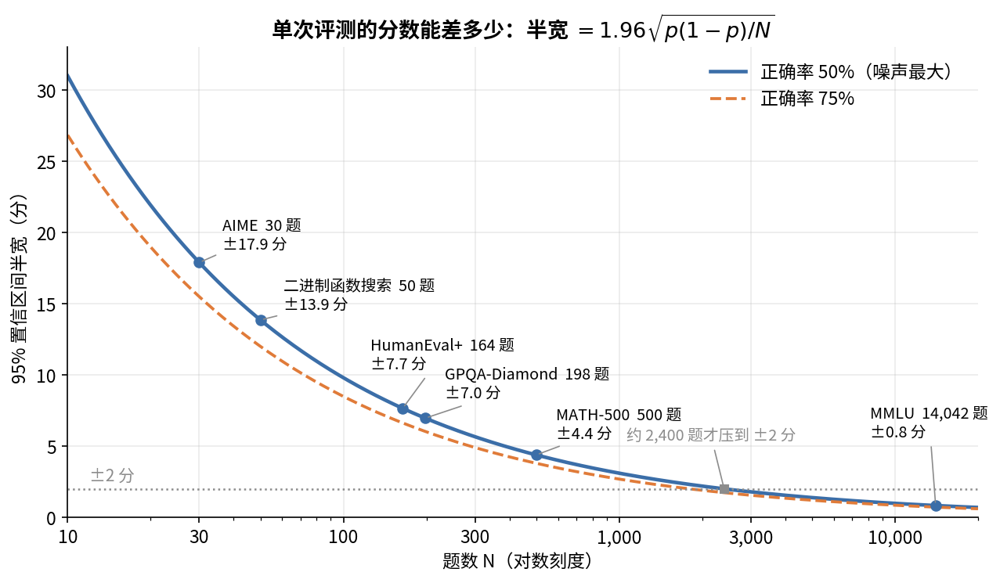

# 第 19 章　最终评测与读报告

> 模型训完，最后一步是给它打分、写进报告。第 15 章讲的是训练途中怎么评基座，这一章讲对外发布的那套成绩：推理模型为什么要采样很多次取平均，ZGCM 的评测协议是什么，20 个基准各考什么，Table 2 到 Table 4 和 Table 16 怎么读。最后把全书找到的不一致收拢起来，总结一套读技术报告的方法。有两个前提要先交代：报告里的分数都来自 256K SFT checkpoint，不是 RL 之后的模型（[§18.8](18_RL.md#s18-8)）；仓库里没有任何评测代码，下面的协议全部来自报告和模型卡的文字描述。

## 这一章要回答的问题

读完这一章，你应该能回答下面这些问题。

1. 评一个会"思考"的推理模型，分数的随机性从哪来？为什么要采样 32 次取平均？
2. pass@1、pass@k、maj@k 分别是什么？pass@k 的无偏估计怎么算？
3. AIME 只有 30 道题，一道题值多少分？32 次平均之后，噪声还剩多少？
4. ZGCM 的 think 模式评测用什么解码参数、多大的生成预算？和 RL、模型卡示例的预算差多少？
5. Table 2 里 ZGCM 哪些项领先、哪些项落后？哪些差距在噪声范围内？
6. 网页深度研究和二进制函数搜索这两类 agentic 评测怎么打分？结果受哪些外部因素影响？
7. 同一个模型 think 和 no-think 两种模式的分数差多少？哪一项反常？
8. 读一份技术报告，怎么系统地找出它和代码、日志、模型卡之间的不一致？

---

<a id="s19-1" name="s19-1"></a>
## 19.1 推理模型的评测难在哪

### 分数的两个随机来源

一个基准的分数，就是模型在这套题上的正确率。这个数有两层随机性。

第一层是**题目的随机性**。基准只是从所有同类题里抽出来的一小份，换一套同样难度的 30 道题，分数就会变。第 15 章 [§15.4](15_基座评测.md#s15-4) 讲过这一层：题越少，分数越不稳。

第二层是**采样的随机性**。推理模型通常用温度采样（temperature sampling）生成，同一道题问两次，可能一次对一次错。基座模型的选择题评测（第 15 章）只比较几个选项的概率，没有这一层。推理模型要先写几千到几十万 token 的思考过程再给答案，这一层就很大。生成的每个 token 都是一次随机抽取，几千次抽取里只要有一次走岔，比如中间一步算错一个符号，后面的推导就可能全部跟着偏掉。

### 为什么不用贪心解码

要去掉采样的随机性，最直接的办法是贪心解码（greedy decoding）：每步取概率最大的 token，相当于温度为 0。这样同一道题每次的输出都相同。

问题在于，长思考的推理模型在贪心解码下容易陷进重复循环，同一段话反复写，直到撞上长度上限。所以业界的推理模型（例如 DeepSeek-R1 系列）一般建议用温度采样评测。ZGCM 的 think 模式用的是温度 1.0、top-p 1.0（报告 §5.1 第 15 页），完全按模型的原始分布采样，不做截断。no-think 模式输出短，才用温度 0（报告附录 F 第 48 页）。

用了采样，单次评测的分数就带了运气成分。办法是多跑几次取平均。

### pass@1 取 k 次平均

记基准有 $N$ 道题，每道题独立采样 $k$ 次，第 $i$ 道题答对 $c_i$ 次。**pass@1 取 k 次平均**（mean pass@1 over k runs，也常写作 avg@k）是

$$
\text{pass@1} = \frac{1}{N}\sum_{i=1}^{N} \frac{c_i}{k}.
$$

它估计的是：随机采一个回答，这个回答答对的概率。$k$ 越大，第二层随机性越小。ZGCM 的非 agentic 基准取 $k=32$（报告 §5.1 第 15 页）。

### 手算：AIME 的一道题值多少

光说噪声大还不够具体，我们拿 AIME 算一遍。AIME 每届 30 道题，一道题等于 $100/30 = 3.33$ 分，所以单次评测的分数只能是 3.33 的整数倍。

先算单次评测的噪声。假设模型真实正确率 $p=0.75$，30 道题各自对错，标准误（standard error，SE）是

$$
\text{SE} = \sqrt{\frac{p(1-p)}{N}} = \sqrt{\frac{0.75 \times 0.25}{30}} \approx 7.9 \text{ 分}.
$$

单次跑一遍 AIME，结果上下浮动 8 分是很正常的事。

32 次平均能把噪声降到多少，要把两层分开算。设第 $i$ 道题的真实答对概率是 $p_i$。采样那一层，每道题平均 32 次，方差是 $\sum_i p_i(1-p_i)/(32 N^2)$：单道题 32 次的平均方差是 $p_i(1-p_i)/32$，总分又是 $N$ 道题的平均，所以再除以 $N^2$。题目那一层来自 $p_i$ 在题与题之间的差别，这个差别很大，方差是 $\text{Var}(p_i)/N$，和 $k$ 无关。就算每道题采样无穷多次，得到的也只是这 30 道题各自 $p_i$ 的平均，换一套题，这个平均就会变。

举一个具体分布：30 道题里 20 道几乎必对（$p_i=1$），4 道一半对（$p_i=0.5$），6 道必错（$p_i=0$），平均正确率 $22/30 = 73.3\%$。采样层 $\sum p_i(1-p_i) = 4 \times 0.25 = 1$，SE $= \sqrt{1/(32 \times 900)} \approx 0.59$ 分。题目层 $\text{Var}(p_i) = 21/30 - 0.733^2 \approx 0.162$，SE $= \sqrt{0.162/30} \approx 7.4$ 分。

所以 32 次平均几乎消掉了采样噪声，只剩约 0.6 分。可是"这 30 道题碰巧难还是碰巧容易"带来的噪声仍有约 7 分，平均多少次都消不掉。多次平均能让"在这套题上"的比较变得可靠，却没法让"30 道题代表了数学能力"这件事变得可靠。

两个模型在同一套题上比较时，可以用配对比较（第 15 章 [§15.4](15_基座评测.md#s15-4)），只看两者答对情况不同的题，噪声会小于 7 分。原因是题目层的噪声两个模型共用：这套题碰巧偏难，两个模型的分数会一起往下掉，相减时就抵消了。拿 10 道题算一下（示意数字，不是 ZGCM 的数）：模型 A 对 7 道，B 对 6 道，其中 6 道两者都对，3 道两者都错，只有 1 道 A 对 B 错。那 9 道对错相同的题不管难易，对两者的影响一样，分数差全部来自剩下的 1 道。按 [§15.4](15_基座评测.md#s15-4) 的公式，配对的标准差约 $\sqrt{1}/10 = 10$ 分；如果当成两次独立考试，标准差是 $\sqrt{0.7 \times 0.3/10 + 0.6 \times 0.4/10} \approx 21$ 分。但报告没有给逐题结果，读者没法做配对比较。

### pass@k 和 maj@k

ZGCM 报的是 pass@1，但读别的报告时你还会碰到另外两个指标。**pass@k** 是采 $k$ 个回答，只要有一个对就算对，它衡量模型能不能做出来，常用于代码。**maj@k**（majority voting，也叫 cons@k）是采 $k$ 个回答，取出现最多的那个最终答案再判对错，它衡量多数意见对不对。

直接采 $k$ 次来估 pass@k，方差很大，因为每道题只得到一个"有没有对的"0/1 结果。标准做法是采 $n \ge k$ 次，数出对了 $c$ 次，用无偏估计

$$
\text{pass@}k = 1 - \frac{\binom{n-c}{k}}{\binom{n}{k}}.
$$

意思是从 $n$ 个回答里随机挑 $k$ 个，全挑到错的概率是 $\binom{n-c}{k}/\binom{n}{k}$，用 1 减去它。

手算一例：$n=32$，$c=8$。pass@1 $= 8/32 = 25\%$。pass@8 $= 1 - \binom{24}{8}/\binom{32}{8} = 1 - 735{,}471/10{,}518{,}300 \approx 93.0\%$。同一道题，pass@1 只有 25%，pass@8 却有 93%，所以比较分数之前要先确认双方用的是同一个指标。ZGCM 报告的是 pass@1（报告 §5.1 第 15 页），本章后面说的"分数"都指它。

<a id="s19-2" name="s19-2"></a>
## 19.2 ZGCM 的评测协议

### 报告原文怎么写

有了这些概念，再来看 ZGCM 具体怎么评。报告 §5.1（第 15 页）只有一段，逐句拆开如下：

| 原文说了什么 | 行号 | 含义 |
|---|---|---|
| 在 think 模式下评测 | §5.1 第 15 页 | 回答前先写思考过程，见下文"模式开关" |
| 结果用发布的 256K SFT checkpoint | §5.1 第 15 页 | 不是 RL 之后的模型（[§18.8](18_RL.md#s18-8)） |
| 非 agentic 和网页研究：温度 1.0、top-p 1.0 | §5.1 第 15 页 | 按原始分布采样 |
| 总上下文 262,144：prompt 最多 4,096，生成最多 258,048 | §5.1 第 15 页 | $4{,}096 + 258{,}048 = 262{,}144$ |
| 非 agentic 基准报告 32 次 pass@1 平均，除非基准另有规定 | §5.1 第 15 页 | 见 [§19.1](#s19-1) |
| DeepSeek-R1-0528-Qwen3-8B、MiniCPM4.1-8B 的 GPQA、HumanEval+、MBPP+、LCB v6 是 4 次平均；MMLU 跑 1 次 | §5.1 第 15 页 | 基线的跑法和 ZGCM 不同 |
| IFEval 用 Prompt Strict | §5.1 第 15 页 | 一条 prompt 的所有指令都满足才算对 |

交代外部模型分数来源的那句话不在报告 §5.1，而在附录 F（第 48 页）："External comparison values are taken from the cited releases rather than a unified rerun"。意思是外部模型的分数大多取自它们各自发布的报告，ZGCM 没有用同一套协议重跑。Table 3 的说明（§5.1 第 16 页）也说，网页研究的基线除 WebDancer 外都取自公开报告；WebDancer 和二进制函数搜索的基线，是 ZGCM 自己在同一套 harness 下跑的。

### 生成预算：258,048 token

think 模式的回答带着很长的思考，预算给多少会直接影响分数。预算不够，思考被截断，答案写不出来，就判错。下表把全流程里各处的生成长度放在一起：

| 场景 | 最大生成长度 | 出处 |
|---|---|---|
| 最终评测（think） | 258,048 | 报告 §5.1 第 15 页 |
| RL 训练 | 65,536 | `rl/configs/math_grpo_length_shaped.yaml:56` |
| 模型卡示例代码 | 4,096 | `zgcagi/ZGCM-1-7B` 的 README |

评测预算是 RL 训练预算的 $258{,}048 / 65{,}536 \approx 3.9$ 倍。如果你照模型卡示例的 `max_new_tokens=4096` 去跑 AIME，大部分思考会被截断，分数会远低于报告。模型卡并没有写错，示例只是演示怎么调用，但复现时要记得把这个数改掉。

### 模式开关：`enable_thinking`

think 和 no-think 是同一个模型，靠 chat template 切换（第 17 章讲过 chat template）。生成提示的最后一行在 `chat_template.jinja` 第 116 行：

```jinja
<|assistant|>{{- '</think>' if (enable_thinking is defined and not enable_thinking) else '<think>' -}}
```

没传 `enable_thinking`，或者传了 `True`，提示就以 `<|assistant|><think>` 结尾，模型接着写思考。传 `False` 时，提示以 `<|assistant|></think>` 结尾，思考段直接关闭，模型马上写答案。所以默认就是 think 模式。评测脚本必须把这个开关写进记录，否则别人无法确认分数是在哪种模式下测的。

### 解码参数没有写进模型目录

除了模式开关，解码参数也要对上。`zgcagi/ZGCM-1-7B` 的 `generation_config.json` 只有两项：

```json
{"eos_token_id": 154820, "pad_token_id": 154820}
```

里面没有温度、top-p、最大长度。HuggingFace 的 `generate()` 在没有这些配置时默认 `do_sample=False`，即贪心解码。模型卡示例显式传了 `do_sample=True, temperature=1.0, top_p=1.0`（README L72-74）。如果有人省掉这几个参数，跑出来的就是贪心结果，和报告 think 模式的协议对不上。（HF 的默认行为是业界知识；generation_config 内容是事实。）

<a id="s19-3" name="s19-3"></a>
## 19.3 20 个基准各考什么

协议清楚了，接下来看考的是什么题。报告 §5.1 第 15 页列出 20 个非 agentic 基准，分四类。下表的"考什么"和"题量"是业界对这些基准公开版本的通常描述，报告本身没有写题量。标"推断"的是本书从 Table 2 分数的小数粒度反推的：例如某基准的分数都是 $100/244$ 的整数倍，就推断它有 244 道题。

| 类别 | 基准 | 考什么 | 题量 | 一题约几分 |
|---|---|---|---|---|
| 数学 | MATH-500 | MATH 竞赛题的 500 题子集，填最终答案 | 500 | 0.2 |
| 数学 | AIME 2024/2025/2026 | 美国数学邀请赛，答案是 0–999 的整数 | 每届 30 | 3.33 |
| 数学 | HMMT 2025/2026 | 哈佛-MIT 数学竞赛二月赛 | 2025 为 30；2026 的分数是 $100/33$ 的倍数，推断 33 | 3.0–3.3 |
| 数学 | AGIEval SAT Math | 美国高考数学选择题 | 220 | 0.45 |
| 数学 | AQuA-RAT | 代数文字题，五选一 | 官方测试集 254；分数粒度与 244 吻合（推断用了子集） | 0.41 |
| 数学 | HARDMath-mini | 应用数学：渐近展开、近似计算 | 报告未写 | — |
| 数学 | IMO-AnswerBench | IMO 难度、有确定答案的题 | 400 | 0.25 |
| 数学 | MATH-P-Hard | MATH 题经"难扰动"改写，换掉解法关键 | 279 | 0.36 |
| 数学 | OlympiadBench（纯文本数学） | 奥赛题 | 报告未写 | — |
| 推理 | miniF2F | 形式化定理证明，要写出能被证明器验证的证明 | 测试集 244 | 0.41 |
| 推理 | ARC-AGI-1 | 网格图案的抽象推理 | 公开评测集 400 | 0.25 |
| 代码 | HumanEval+ | 补全 Python 函数，测试用例比原版 HumanEval 多 | 164 | 0.61 |
| 代码 | MBPP+ | 短 Python 编程题，加强测试 | 378 | 0.26 |
| 代码 | LiveCodeBench v6 | 按发布时间收集的竞赛题，可按时间窗口防污染 | 随版本和时间窗口变化，报告未写 | — |
| 知识 | MMLU | 57 个学科的四选一 | 14,042 | 0.007 |
| 知识 | GPQA-Diamond | 研究生难度的物理、化学、生物四选一 | 198 | 0.51 |
| 指令 | IFEval | 带可验证约束的指令（字数、格式、关键词） | 541 | 0.18 |

表的最后一列只说一道题值几分，换算成噪声更好比较。下图用 [§19.1](#s19-1) 的二项公式，算单次评测 95% 区间的半宽 $1.96\sqrt{p(1-p)/N}$，题数取自上表和 [§19.5](#s19-5)。看图时注意曲线在几百题以内有多陡，以及要把半宽压到 2 分得走到多远。



正确率 50% 时，半宽要降到 2 分需要约 2,400 道题，表里只有 MMLU 超过这个数。GPQA-Diamond、MATH-500 这类几百题的基准，单次评测的区间是 ±4 到 ±7 分，两个模型差 2 分说明不了谁强。这条曲线是单次评测的总噪声，多次平均只能去掉其中采样那一部分。[§19.1](#s19-1) 的 AIME 例子里，平均正确率 73.3%，单次的标准误约 8.1 分，32 次平均之后还有 7.4 分。

### 三种基准：饱和、地板、有区分度

按 Table 2 里 7 个模型的分数分布，这些基准可以分成三种。

第一种是**饱和**的，大家都接近满分。MATH-500 在 88–97 之间，前 6 名差不到 2.1 分，也就是 10 道题左右；SAT Math 有 4 个模型在 98.98–99.09。这类基准已经区分不出强弱。

第二种是**地板**，大家都接近零分。ARC-AGI-1 是 0.50–3.50，即 400 题里对 2–14 道。miniF2F 是 0–5.12，ZGCM 的 2.87 是 $7/244$。这说明这个规模的模型基本不会做这类题，排名没有意义。

剩下的是有区分度的，分数分布在 20–85 之间，差距明显大于一题的分值。AIME、HMMT、IMO-AnswerBench、LCB、GPQA、MMLU、IFEval 属于这类，读 Table 2 时应该主要看它们。

这个分类本身就是一条读报告的方法：看到"第一名"，先看那一项是不是饱和或地板。ZGCM 在 Table 2 里排第一（含并列）的有 7 项，其中 4 项的领先很小。MATH-500 领先 0.81 分，约 4 道题，而且已经饱和；SAT Math 和 Qwen3-8B 并列，同样已饱和；ARC-AGI-1 领先 0.25 分，只是 1 道题，又处在地板；HumanEval+ 领先 0.34 分，不到 1 道题。

<a id="s19-4" name="s19-4"></a>
## 19.4 读 Table 2：7B 推理模型的横向比较

Table 2（报告 §5.1 第 16 页起）是 think 模式下 ZGCM-1-7B 和 6 个 7B–8B 推理模型的比较，这 6 个模型是 DeepSeek-R1-0528-Qwen3-8B、MiniCPM4.1-8B、Qwen3-8B、Olmo-3-7B-Think、MiMo-7B-RL、OpenThinker3-7B。

### ZGCM 的位置

我按表中数字统计了 ZGCM 在 20 项里的名次（含并列）：第 1 名 7 项，第 2 名 1 项，第 3 名 5 项，第 4 名 2 项，第 6 名 3 项，第 7 名（最后）2 项。

领先明显的 3 项都是最新的竞赛题：

| 基准 | ZGCM | 其他模型最高 | 差 | 折合题数 |
|---|---|---|---|---|
| HMMT 2025 | 70.42 | 61.50 | +8.92 | 约 2.7 / 30 |
| HMMT 2026 | 59.48 | 51.52 | +7.96 | 约 2.6 / 33（题数为推断） |
| AIME 2026 | 75.00 | 71.67 | +3.33 | 1 / 30 |

落后明显的有 5 项：

| 基准 | ZGCM | 其他模型最高 | 差 | 名次 |
|---|---|---|---|---|
| MMLU | 73.88 | 85.40（Qwen3-8B） | −11.52 | 7 |
| GPQA-Diamond | 47.87 | 60.10（DS-R1-Qwen3-8B） | −12.23 | 7 |
| IFEval | 75.42 | 88.20（Olmo-3） | −12.78 | 3 |
| LCB v6 | 46.86 | 53.57（DS-R1-Qwen3-8B） | −6.71 | 6 |
| MBPP+ | 63.23 | 69.10（Qwen3-8B） | −5.87 | 6 |

### 怎么解释这个形状

ZGCM 强在竞赛数学，弱在知识和代码，这和它的训练配方对得上。它的预训练只有约 4.78T token（第 1 章），而 Qwen3 系列公开说预训练用了约 36T token。MMLU 和 GPQA 主要考知识储备，知识量和见过的数据量关系很大。这是业界常见的解释，报告没有做归因实验。另一方面，ZGCM 的 SFT 和 RL 都以数学推理为重点（第 17、18 章）。

读这几个数时还要注意一个细节。单看 HMMT 2025 的 +8.92，折合不到 3 道题，噪声里放得下（[§19.1](#s19-1) 算过，30 道题的题目层噪声约 7 分）。但 HMMT 2025、HMMT 2026、AIME 2026 三项方向一致，合起来就比单项可信。三套题的题目噪声互不相关，三项都靠运气偏向 ZGCM 的机会，比单项靠运气领先小得多。判断谁强时，看一类基准是否同向，比看单项排第几更可靠。

### 基线是怎么来的

比较能不能成立，取决于基线和 ZGCM 是不是在同样的条件下测的。报告在三处给了信息。附录 F（第 48 页）说外部模型的分数取自各自的发布，没有统一重跑。§5.1（第 15 页）说 DS-R1-Qwen3-8B 和 MiniCPM4.1-8B 的 4 个基准是 4 次平均，MMLU 跑 1 次，可见至少这两个模型的部分分数是有人用特定次数跑出来的。Table 3 说明（§5.1 第 16 页）则只针对网页研究和二进制函数搜索。

从表里的数字还能看出三点，下面说的都是推断。

先看跑的次数。Qwen3-8B、MiMo-7B-RL、OpenThinker3-7B 在 AIME 2024/2025/2026、HMMT 2025/2026 这 5 项上的分数全是 $100/30$ 或 $100/33$ 的整数倍，例如 Qwen3-8B 的 AIME 2025 是 63.33（19/30），HMMT 2026 是 45.45（15/33）。如果是 32 次平均，5 项全落在整数倍上的可能性极小。32 次平均的分数是 $100/(32N)$ 的整数倍，只有总答对次数碰巧是 32 的倍数，才会落在 $100/N$ 上。单项碰上一次不奇怪，ZGCM 自己 32 次平均的 AIME 2025 是 73.33，正好是 22/30；5 项同时碰上就很难了。所以这些分数更像单次评测的结果，噪声约 8 分，而 ZGCM 自己是 32 次平均。

再看小数位。一部分基线的分数第二位小数是 0，例如 Qwen3-8B 的 MMLU 85.40、IFEval 87.40，Olmo-3 的 MATH-500 95.10、AIME 2024 71.60、IFEval 88.20。这像是从只保留一位小数的报告里抄来的。同一列里其他格子有两位小数，说明同一个模型的分数可能来自不同出处。

最后看时间。AIME 2026 和 HMMT 2026 是 2026 年 2 月的比赛，Qwen3-8B 等模型在 2025 年就已发布，它们的原始发布不可能有这两项分数。所以"取自各自发布"不可能适用于这两列，这两列的基线一定是有人（ZGCM 或第三方）后来测的。是谁测的、用什么协议，报告没有说明。

这三点并不说明 ZGCM 的分数有问题，只说明 Table 2 是一张拼起来的表，各列的测量条件不同。差距小于 5 分左右的比较不宜当真。

### 模型卡只挑了一部分

除了报告，很多人只看 HF 上的模型卡。模型卡的 Evaluation Results 一节只列了 Table 2 的 6 行：MATH-500、AIME 2024/2025/2026、HMMT 2025/2026，正好是 ZGCM 排名靠前的几项。列也只留了 5 个模型，没有 MiMo-7B-RL 和 OpenThinker3-7B。表下注明了"Selected rows and models from Table 2"，并说完整评测有 20 项。这样写没有错，但只看模型卡的读者会以为 ZGCM 全面领先。看完模型卡，要回到报告里看完整的表。

<a id="s19-5" name="s19-5"></a>
## 19.5 agentic 评测

前面的基准都是一问一答。agentic 评测让模型在一个环境里多步行动：调用工具，看结果，再决定下一步，最后交答案。这样一来，分数不只取决于模型，还取决于工具、环境和打分器。报告把这些叫 harness（评测框架），在附录 C 里描述。

### 网页深度研究

网页研究的跑法写在报告 §5.1 第 15 页和附录 C.1（第 38 页）。模型用带思考的 ReAct 策略（Reason + Act，先想再调用工具，循环往复），最多走 64 步"搜索加阅读"。搜索用 Serper，失败时退到 Jina Search，网页正文用 Jina Reader 抽取。网页内容的摘要由 ZGCM-1 自己在 no-think 模式下生成。64 步用完时，要求模型根据已收集的证据直接作答。最终答案由 Qwen3-30B-A3B-Instruct-2507 判对错，这种做法叫 LLM-as-judge，即用另一个模型当裁判。

结果在 Table 3（§5.3 第 17 页）：

| 模型 | WebWalkerQA | BrowseComp | GAIA 纯文本 |
|---|---|---|---|
| ZGCM-1-7B | 63.09 | 19.43 | 42.52 |
| WebDancer-32B | 38.40 | 2.50 | 40.70 |
| Qwen3-235B-A22B | 59.60 | 2.30 | 45.60 |
| Kimi-K2 | 63.00 | 14.10 | 57.30 |
| DeepSeek-R1 | 10.00 | 2.00 | 31.10 |
| QwQ-32B | 4.30 | 0.50 | 22.30 |
| GPT-4o | 33.80 | 1.90 | 34.60 |
| GPT-5 | – | 54.90 | 76.40 |
| Claude 4 Sonnet | 61.70 | 12.20 | 68.30 |

这张表要结合来源读。只有 ZGCM 和 WebDancer 是在 ZGCM 的 harness 下跑的，其他都取自公开报告（§5.1 第 16 页），而这些公开报告用的搜索引擎、步数上限、裁判模型各不相同。报告自己也承认（附录 C.1 第 38 页），结果依赖搜索日期和可用性、服务商行为、网页抽取、摘要、裁判设置和重试策略。网页每天在变，同一道题隔一个月再搜，可能就从搜得到变成搜不到，或者反过来。

所以这张表能说明的是：7B 的 ZGCM 在 ZGCM 的 harness 下，BrowseComp 能做到 19.43，量级上不输于一些大得多的模型在它们各自 harness 下的分数。它不能说明 ZGCM 比 Kimi-K2 或 Claude 4 Sonnet 强。

### 二进制函数搜索

二进制函数搜索是 ZGCM 团队自建的基准（报告 §5.3 第 16–17 页、附录 C.2 第 38 页起）。

任务是这样的：给模型一个去掉符号表的 ELF 二进制文件（stripped ELF，函数名都没了），再给一段对某个函数行为的描述，例如控制流、调用了谁、用了哪些常量、怎么处理错误。模型要通过 Ghidra（美国国家安全局开源的逆向工具）的接口去列函数、搜字符串、反编译、追引用、看汇编，最后提交这个函数入口的虚拟地址。

打分时，用没去符号的原始二进制构造一个隐藏的标准答案（oracle），提交的地址和函数入口地址完全相等才算对，格式错或没交都算错。这是精确匹配，不需要裁判模型，比网页研究的打分可靠。

数据池有 11,000 多个任务。评测从 10 个项目（tmux、tree、GNU Wget2、XZ Utils、YAJL、zlib、libuv、libgit2、nm、Lua）各随机抽 5 个，共 50 个，这 10 个项目不在训练数据里（§5.3 第 17 页）。数据集"计划"公开（第 17 页），目前还没有公开。

结果在 Table 4（§5.3 第 18 页）：

| 模型 | 有效提交 | 正确 | 准确率 |
|---|---|---|---|
| DeepSeek-V4 Flash | 50/50 | 38/50 | 76% |
| Qwen3.5-397B-A17B | 50/50 | 38/50 | 76% |
| GLM-5.1 | 50/50 | 33/50 | 66% |
| ZGCM-1-7B | 50/50 | 31/50 | 62% |
| Kimi-K2 | 50/50 | 31/50 | 62% |
| DeepSeek-R1 | 46/50 | 18/50 | 36% |
| GPT-4o | 50/50 | 9/50 | 18% |
| Qwen3-8B | 50/50 | 6/50 | 12% |

50 道题的样本很小，我们手算一下置信区间。50 题、62% 的二项标准误是 $\sqrt{0.62 \times 0.38 / 50} \approx 6.9$ 分，95% 区间大约是 $62 \pm 13.5$，即 48% 到 76%。ZGCM 和 GLM-5.1 只差 2 道题，区间完全重叠。ZGCM 比 Qwen3-8B 多 25 道题，这个差距远大于噪声，是可信的。

正文和表之间还有一处小矛盾。正文 §5.3 第 17 页说同规模基线"Qwen3-8B 12%，其余为 0%"，但 Table 4 的"同规模"一栏只列了 ZGCM 和 Qwen3-8B，没有那些 0% 的模型，读者无法知道"其余"是哪几个。

更大的问题是训练数据从哪来没说清。§5.3 第 17 页说这 10 个项目"不出现在任何 training split 里"，言下之意，数据池里其余的任务被用来训练过。可是 SFT 的 agentic 数据（§4.1.2，第 13 页）只列了深度研究、软件工程、终端交互三类，没有二进制分析；`rl/` 仓库也只有数学、代码、IFEval 三种奖励（第 18 章）。二进制分析的训练数据在哪个阶段、有多少，报告没有说明（待查）。如果 ZGCM 确实学过这套 Ghidra 接口而基线没有，这张表比的就是"学过这个任务的 7B"和"没专门学过的通用模型"。说 ZGCM 在这类任务上训练有效是成立的，说它"二进制分析能力接近 GLM-5.1"就要加限定。

### SWE-bench 和 Terminal-Bench：附录里的低分

附录 C.3、C.4 还报告了两个代码 agent 基准，正文没有放进表里：

| 基准 | 设置 | 结果 | 出处 |
|---|---|---|---|
| SWE-bench Verified Mini50 | 内部固定的 50 题子集，mini-SWE-agent v2，温度 0，每题 250 步，每轮最多输出 1,024 token | 2/50 = 4.0% | 附录 C.3 第 40–41 页 |
| Terminal-Bench 2.0 | 89 题，Harbor 执行，最多 64 步，每轮 4,096 token，温度 0、top-p 0.95，128K 上下文 | 2/89 = 2.25% | 附录 C.4 第 41 页 |

两处都写着"the best fully audited ZGCM-family evaluation"，即"ZGCM 系列里审核过的最好一次"。按字面有两层意思：一是评测不止跑了一次，报的是最好的一次；二是"ZGCM-family"不一定是发布的那个 checkpoint。报告没有说明是哪个。

SFT 里其实有软件工程和终端交互数据（§4.1.2 第 13 页），这两项分数仍然很低。报告结论（§7.2 第 21 页）也把它列为局限：ZGCM 在网页研究、二进制分析这类结构化环境里表现好，仓库级软件工程和开放的终端操作还很弱。报告把这两项放在附录里如实给出，这是诚实的做法；读报告时，你要主动去附录找这类结果。

<a id="s19-6" name="s19-6"></a>
## 19.6 ACE：细粒度的能力诊断

Table 2 到 Table 4 是对外比较用的。报告里还有一套给自己诊断用的评测，叫 ACE（Atomic Capability Evaluation，原子能力评测），也是 ZGCM 团队自建的（报告 §6.1 第 18–19 页，附录 D 第 41 页起）。它把能力拆得很细：18 个大类、183 个原子能力、2,503 道探针题（probe）。探针分三个难度，L1 有 835 道，L2 有 835 道，L3 有 833 道。完整跑一遍约 2–3 分钟（§6.1 第 18 页）。

打分有两种方式。能用规则判的（格式、精确答案）用确定性程序判；不能用规则判的，由另一个模型按预先写好的评分细则（rubric）判。

ACE 不拿来对外比排名，它的用途是在开发中快速回答"这次改动让哪项能力变好、哪项变差"。这和第 15 章的 Ability Lite 是同一类思路：小、快、可以频繁跑。

附录 D.4（第 42 页起）给出了按类别的通过率热力图（Figure 17），文字结论在第 43 页。ZGCM 最强的几类是数学 98.18%、规划 97.78%、逻辑 96.08%、因果 96.00%、阅读 95.04%；最弱的几类是指令遵循 49.74%、真实性 68.91%、代码 72.24%、语言 79.75%。和 Qwen3-8B-256K 比，长上下文高 31.11 个百分点，算术高 20.74，规划高 14.45，世界建模高 10.00。

这些结果和 Table 2 能互相印证。ACE 说代码和指令遵循弱，Table 2 里 LCB、MBPP+、IFEval 也落后；ACE 说数学强，Table 2 的竞赛数学也领先。两套独立的评测方向一致，结论更可信。

不过同名的项不能直接比。ACE 的"指令遵循"是 49.74%，IFEval 是 75.42%，但 ACE 的探针是团队自己写的，难度分布、评分规则都和 IFEval 不同。

ACE 还有几处没交代。附录 D 没有说明 ACE 用的是哪个 checkpoint、think 还是 no-think、什么解码参数。参照模型里有 Claude Opus 4.8、Kimi K3 等，这些模型的分数是怎么测的也没写。ACE 的探针和评分器也不在仓库里，没有公开。报告自己在 D.5（第 43 页起）做了限定：ACE 测的是结构化的原子能力，不是端到端应用表现，依赖探针覆盖面和评分质量，模型裁判可能有偏差，只作为补充诊断。

<a id="s19-7" name="s19-7"></a>
## 19.7 no-think 模式：Table 16

到这里为止的分数都是 think 模式下测的。附录 F 末尾的 Table 16（报告附录 F 第 48 页）给的是 no-think 模式的结果，协议是温度 0、top-p 1.0、只跑 1 次（附录 F 第 48 页）。对比模型换成了非推理版本：Olmo-3-7B-Instruct、Qwen3-8B 的 non-thinking 模式、Qwen2.5-7B。表名是"Selected no-think benchmark results"，也是挑选过的。三个基线的分数全是一位小数，推断取自各自的发布。

no-think 下，ZGCM 在 MATH-500（89.40）、AIME 2025（43.33）、MBPP+（75.93）上排第一，GPQA（42.42）排第二；HumanEval+（66.46）、LCB v3（34.31）、MMLU（70.03）、IFEval（78.00）都落后于 Qwen3-8B 的 non-thinking 模式。

### 同一个模型，两种模式

拿同一个模型的两种模式对比，能大致看出思考帮了多少。下表把 Table 2 和 Table 16 共有的基准放在一起（LCB 的版本不同，Table 2 是 v6，Table 16 是 v3，不能比）：

| 基准 | think（32 次平均，T=1.0） | no-think（1 次，T=0） | 差 |
|---|---|---|---|
| MATH-500 | 97.13 | 89.40 | +7.73 |
| AIME 2024 | 80.62 | 33.33 | +47.29 |
| AIME 2025 | 73.33 | 43.33 | +30.00 |
| HumanEval+ | 90.24 | 66.46 | +23.78 |
| MBPP+ | 63.23 | 75.93 | **−12.70** |
| MMLU | 73.88 | 70.03 | +3.85 |
| GPQA-Diamond | 47.87 | 42.42 | +5.45 |
| IFEval | 75.42 | 78.00 | −2.58 |

思考在难题上收益最大。AIME 提升 30–47 分；MATH-500 已接近饱和，只提升 7.7 分；MMLU 只提升 3.9 分，因为知识题不知道就是不知道，想再久也没用。

no-think 这一列是单次结果，噪声大。no-think 的 AIME 2024 是 33.33，即 10/30，只跑了 1 次，按 [§19.1](#s19-1) 的算法噪声约 8–9 分。no-think 下 AIME 2025 比 2024 高 10 分，think 下却是 2024 比 2025 高。这种顺序翻转在小样本的单次结果里很常见，不必解读。

表里反常的是 MBPP+。思考之后它反而低了 12.70 分，而同为 Python 题的 HumanEval+ 思考后高了 23.78 分。报告没有解释。可能的原因有几个，全部是推断：MBPP+ 的题面短而含糊，思考时模型可能改了函数名或签名，测试找不到函数；think 模式下的代码提取规则和 no-think 不同；温度 1.0 的采样比温度 0 更容易出格式错误。要定位原因，需要逐题对比两种模式的输出，报告和仓库都没有提供。

IFEval 也是 no-think 稍高。思考对格式约束帮助小，甚至可能有干扰，报告结论（§7.2 第 21 页）也承认严格的指令遵循是弱项。

最后要提醒，这两列的条件本来就不同：think 列是温度 1.0、32 次平均，no-think 列是温度 0、1 次，差值里混着模式和解码两种因素。严格地说"思考带来多少提升"，应该在同样的解码设置下比。

<a id="s19-8" name="s19-8"></a>
## 19.8 怎么读技术报告、怎么找不一致

前 18 章里，本书一共标出了几十处报告、仓库、W&B、模型卡之间对不上的地方。这一节把找它们的方法归纳出来。

### 先认清一个结果要绑定哪几样东西

附录 F（第 48 页）说得很清楚：一个数字要能复现，必须同时绑定四层。第一层是模型制品，即哪个 checkpoint、哈希值。第二层是评测数据，包括官方地址、不可变版本、哪个 split。第三层是调用约定，包括 prompt 包装、few-shot 例子、system prompt、chat template、模式开关。第四层是打分实现，包括答案抽取、指标实现、随机种子、超时、推理引擎及版本、硬件、原始输出存放位置。

这是一份很好的清单。拿它对照 ZGCM 自己公开的东西：

| 层 | ZGCM 公开了什么 | 缺什么 |
|---|---|---|
| 模型 | 256K SFT checkpoint（HF） | 没有哈希对照；SWE、TB 用的是"ZGCM-family"里哪个不明 |
| 数据 | 基准名称 | 版本、题量、AQuA 和 HMMT 2026 用的是哪个集合 |
| 调用 | 温度、top-p、上下文、think 模式 | prompt 包装、答案格式要求 |
| 打分 | Prompt Strict、精确匹配、裁判模型名 | 答案抽取代码、逐题输出 |

报告开头（§1 第 3 页）和结论（§7.1 第 21 页）都说发布了 evaluation suites / harnesses，但仓库里没有任何评测代码（第 15 章也提到过）。这是全书最大的一处"声称公开而实际没有"。

### 方法一：四方对照

只读报告，只能发现报告内部的矛盾。把报告、代码配置、训练日志（W&B）、发布页（HF 模型卡和 checkpoint 元数据）放在一起比，才能发现大部分问题。这和查账相似：只看报销单，最多能发现单子上的数加错了；把合同、银行流水、发票摆在旁边，才看得出哪笔对不上。这个类比有一处不成立：账目对不上通常说明有人记错了，报告和代码对不上，也可能只是两者对应的版本不同，所以找到差异后还要再查是哪种情况。下表是本书找到的典型例子：

| 现象 | 对照的两方 | 出处章节 |
|---|---|---|
| 预训练 token 数：报告 4.19T，HF 记录 4.78T | 报告 vs HF 元数据 | 第 1 章 |
| 词表 154,880，padding 后 155,136 | tokenizer vs 模型配置 | 第 3 章 |
| 续训后吞吐从 585 掉到 554 TFLOP/s | W&B vs 报告 §3.3 第 10 页 | 第 13 章 |
| mid-train 学习率：仓库 env 写 2e-5 cosine，报告写 1e-4 | 仓库配置 vs 报告 vs W&B | 第 16 章 |
| SFT 的 Table 12"混训前"一列和 Table 10 第一行逐位相同 | 报告内部 | 第 17 章 |
| 发布模型是否经过 RL：仓库说是，报告和模型卡说评测用 SFT checkpoint | 仓库 README vs 报告 §5.1 第 15 页 | 第 18 章 |
| 声称公开评测框架，仓库里没有 | 报告 §1 第 3 页 vs 仓库 | 本章 |

### 方法二：从数字反推

报告里的数字往往能反推出没写的信息。分数是 $100/N$ 的整数倍，题数就是 $N$ 的约数之一；把多个模型的分数放在一起看，就能确定 $N$。分数落在整数倍上，还说明更可能是单次评测（[§19.4](#s19-4)）。乘法也能拿来核对：步数 × 每步 token 数应该等于总 token 数，第 1 章就是用 387,950 步 × 12.58M 核对出和 HF 记录差约 0.1T。加法同理，$4{,}096 + 258{,}048 = 262{,}144$ 对得上，说明这三个数是一致的。

### 方法三：读限定词和表注

表注里的一个词，常常会改变结论的范围：

| 原文 | 出处 | 意思 |
|---|---|---|
| unless the benchmark specifies another aggregation rule | §5.1 第 15 页 | 不是每项都是 32 次平均 |
| taken from the cited releases rather than a unified rerun | 附录 F 第 48 页 | 基线不是统一重跑的 |
| Selected rows and models | 模型卡 | 只挑了部分行和列 |
| Selected no-think benchmark results | 附录 F 第 48 页 | 同上 |
| the best fully audited ZGCM-family evaluation | 附录 C.3 第 40 页、附录 C.4 第 41 页 | 最好的一次，不一定是发布的 checkpoint |
| We plan to publicly release | §5.3 第 17 页 | 还没公开 |

### 方法四：查时间线

每个基准、每个模型都有发布日期。2025 年发布的模型，原始报告里不可能有 2026 年比赛的分数（[§19.4](#s19-4)）。把训练数据的截止日期和基准的发布日期一比，也能判断污染风险：比训练数据截止更晚出的题，模型不可能见过。

### 方法五：翻附录

正文放好看的结果，附录放完整的结果和低分，这是常见的写法。ZGCM 的 SWE-bench 4.0%、Terminal-Bench 2.25%、no-think 全表、ACE 的弱项，都只在附录里。

### 方法六：每句话分三档

读完一段，把每个结论归到三档之一。有数字、有出处，而且能在代码或日志里对上的，是事实。报告写了，但没有代码、日志或数据可以核对的，是作者声称。你自己从数字、时间线里推出来的，是推断。

讲给别人听时，三档要分开说。本书全程用"推断""报告未说明""待查"做标记，就是这个习惯。

<a id="s19-9" name="s19-9"></a>
## 19.9 ZGCM 没用的其他做法

上面找到的缺口，业界大多有现成的补法。ZGCM 没有用，但你自己做评测时应该知道。

### 统一重跑所有基线

最可靠的比较是让所有模型用同一套 prompt、同样的解码参数、同样的次数、同一个打分器重跑。这要部署每个基线模型、跑几十万 token 的长思考，算力开销大。ZGCM 只对 WebDancer 和二进制函数搜索的基线这样做了。

### 报告置信区间

报分数时附上标准误或 95% 区间，读者就能自己判断差距是否超出了噪声。对推理模型，可以用自助法（bootstrap）：从题目里有放回地重抽 $N$ 道，重新算平均，重复几千次，取分位数。两个模型比较时，对两者的逐题结果做配对 bootstrap，区间会窄很多。

### 公开逐题输出

公开每道题、每次采样的原始输出和判分结果，别人就能复核答案抽取对不对，找出像 MBPP+ 那样的反常原因，还能做配对检验。附录 F 自己把"raw-output location"列为应当保存的项，但没有公开。

### 用标准化的评测框架

业界常用的开源评测框架有 lm-evaluation-harness（EleutherAI）、OpenCompass（上海 AI Lab）、lighteval（HuggingFace）、evalchemy 等。用它们并公开配置，别人一条命令就能复现。ZGCM 没有说明用了哪个框架。

### 防污染

ZGCM 对 SFT 数据做了 8-gram 去污染：和任何评测 prompt 或参考答案的 8-gram 重叠超过 50% 的样本删掉（§4.1.1 第 12 页）。预训练和 mid-train 有没有去污染，报告没说，data-process 仓库里也找不到去污染的实现（第 6 章）。

更彻底的办法是**时间切分**，只用训练数据截止之后才出现的题。LiveCodeBench 就是按题目发布日期切分的；AIME 2026、HMMT 2026 对于 2025 年训练的模型天然是干净的。ZGCM 领先明显的三项里有两项是 2026 年的比赛（[§19.4](#s19-4)）。如果它的训练数据截止早于 2026 年 2 月，这两项的领先就不可能来自泄题，这是比较有力的证据。可惜报告没有写数据截止日期（待查）。

### 报告思考长度

think 模式的分数和思考长度强相关。如果报告给出平均每题生成多少 token、有多少比例被 258,048 的预算截断，读者就能比较同样分数下谁更省。ZGCM 没有报告这些数字。

<a id="s19-10" name="s19-10"></a>
## 19.10 读代码

ZGCM 仓库没有评测代码。和评测直接相关、能读的代码有两处：chat template 里的思考开关和历史思考的处理，以及 RL 奖励里的答案抽取。最后给一段本书写的示意代码，演示 pass@k 和 bootstrap 怎么算。

### chat template：历史轮次的思考会被删掉

`chat_template.jinja` 第 49-79 行（节选，去掉了无关分支）：

```jinja


    
        
    
        
            
        
    

...

    

    
    
...

{{ '<think>' + reasoning_content +  '</think>'}}

{{ '</think>' }}

```

这段模板做了三件事。第一个循环先把对话扫一遍，记下最后一条 user 消息的位置 `last_user_index`，同时记下哪些 user 轮次后面的回答带了思考。

接着渲染每条 assistant 消息。思考内容有两个来源：单独的 `reasoning_content` 字段，或者正文里 `</think>` 之前的部分。如果是后一种，正文会被切成"思考"和"答案"两段。

最后的判断决定思考写不写回去。只有两种情况保留 `<think>…</think>`：一是调用方显式传了 `clear_thinking=False`，二是这条 assistant 消息在最后一条 user 消息之后，属于当前这一轮。其余情况，也就是历史轮次的回答，只输出一个 `</think>`，思考内容被删掉。

这对评测有两个影响。先说多轮评测：默认情况下，模型看不到自己前几轮的思考，只看到答案。SFT 数据也是用同一个模板渲染的（第 17 章 [§17.2](17_SFT.md#s17-2)），评测时保持默认，输入格式才和训练时一致。

agent 评测的情况不同。一次任务里，模型在同一条 user 消息之后连续多步调用工具。工具返回是 `tool` 角色（模板 L91-93，渲染成 `<|observation|>`），不会更新 `last_user_index`，所以这些 assistant 消息都在最后一条 user 消息之后，思考全部保留。上下文因此会随步数快速增长，这是 agent 评测要给 128K 或 256K 上下文的原因之一。

### 答案抽取：没写完思考就算错

RL 奖励用的抽取函数在 `rl/rewards/completion.py:11-24`：

```python
def visible_answer(completion: str) -> str | None:
    if not isinstance(completion, str) or "</think>" not in completion:
        return None
    answer = completion.rsplit("</think>", 1)[-1]
    answer = answer.replace("<answer>", "").replace("</answer>", "").strip()
    return answer or None
```

没有 `</think>` 的回答，也就是思考被长度上限截断的回答，直接返回 `None`，判错。即使思考里已经算出了正确答案，也不给分。有多个 `</think>` 时，取最后一个之后的内容（`rsplit(..., 1)`）。去掉 `<answer>` 标签后如果为空，也判错。

报告没有说评测用的答案抽取是否和这里一样。如果一样，258,048 的预算下截断的回答全部算错；如果评测允许从思考里找答案，分数会更高。两种做法差多少取决于截断比例，而报告没有给截断比例（[§19.9](#s19-9)）。这是"打分实现"那一层没公开带来的不确定性。

### 示意：pass@k 和 bootstrap

下面是本书写的示意代码，不是 ZGCM 的代码。输入是每道题采样 $n$ 次的对错矩阵。

```python
import numpy as np
from math import comb

def pass_at_k(n, c, k):
    """n 次采样里对了 c 次，无偏估计 pass@k。"""
    if n - c < k:
        return 1.0
    return 1.0 - comb(n - c, k) / comb(n, k)

def score(correct, k=1):
    """correct: 形状 [题数, n] 的 0/1 矩阵。"""
    n = correct.shape[1]
    return np.mean([pass_at_k(n, int(row.sum()), k) for row in correct])

def bootstrap_ci(correct, k=1, iters=2000, seed=0):
    rng = np.random.default_rng(seed)
    N = correct.shape[0]
    stats = [score(correct[rng.integers(0, N, N)], k) for _ in range(iters)]
    return np.percentile(stats, [2.5, 97.5])
```

`pass_at_k` 就是 [§19.1](#s19-1) 的公式。`n - c < k` 时，任挑 $k$ 个必然挑到对的，直接返回 1。`score` 对每道题算 pass@k，再对题目平均；$k=1$ 时就是 $c/n$ 的平均，即 ZGCM 报告的 32 次 pass@1。

`bootstrap_ci` 有放回地重抽题目。注意抽的是题，不是采样，所以它反映的是 [§19.1](#s19-1) 里那层题目随机性。按 [§19.1](#s19-1) 的那个分布（20 道必对、4 道一半、6 道必错）模拟 30×32 的对错矩阵，跑出来的 95% 区间约为 58% 到 87%，大约是 ±14 分。

<a id="s19-11" name="s19-11"></a>
## 19.11 坑和对不上的地方

下面这些问题彼此独立，大多在前面各节提到过，这里集中列出来，方便查。

1. 所有分数都来自 SFT checkpoint。报告 §5.1 第 15 页、模型卡都这么写，仓库 `rl/README.md` 却说数学 GRPO 是发布模型的最终阶段。所以报告里的分数不能当作 RL 的效果（[§18.8](18_RL.md#s18-8)）。
2. 报告声称公开了评测框架，仓库里却没有。报告 §1 第 3 页、§7.1 第 21 页说公开了 evaluation suites/harnesses，但仓库里没有任何评测代码，二进制函数搜索数据集也只是"计划"公开（[§19.8](#s19-8)）。
3. 基线不是统一重跑的。附录 F（第 48 页）明说外部值取自各自发布，报告 §5.1 又给了两个基线的具体跑法。两句话放在一起，读者无法逐格判断每个基线数字的来源（[§19.4](#s19-4)）。
4. 基线跑的次数和 ZGCM 不同。Qwen3-8B、MiMo-7B-RL、OpenThinker3-7B 在 AIME 和 HMMT 上的分数全是题数的整数倍，推断是单次结果，噪声约 8 分；ZGCM 是 32 次平均（[§19.4](#s19-4)）。
5. 2026 年基准的基线来源不明。2025 年发布的模型不可能在原始发布里有 AIME 2026、HMMT 2026 的分数，这两列不符合"取自各自发布"（[§19.4](#s19-4)）。
6. 题量没写，而且有两处和官方版本对不上。AQuA-RAT 的分数粒度对应 244 题，官方测试集是 254 题；HMMT 2026 的粒度对应 33 题（[§19.3](#s19-3)，推断）。
7. 模型卡只挑了领先的行和列。模型卡只列了 6 行数学题、5 个模型（[§19.4](#s19-4)）。
8. 评测预算是模型卡示例的 63 倍。评测的生成预算是 258,048，模型卡示例是 4,096，而 `generation_config.json` 里没有采样参数，默认是贪心（[§19.2](#s19-2)）。
9. SWE-bench 和 Terminal-Bench 报的是"最好的一次"，用的 checkpoint 不明。原文是"the best fully audited ZGCM-family evaluation"（附录 C.3 第 40 页、附录 C.4 第 41 页）（[§19.5](#s19-5)）。
10. 二进制函数搜索的训练数据来源不明。§5.3 第 17 页暗示数据池用于训练，但 SFT 和 RL 的数据描述里都没有二进制分析（[§19.5](#s19-5)）。
11. 正文说"其余同规模基线为 0%"，Table 4 里却没有这些模型。§5.3 第 17 页和 Table 4 对不上（[§19.5](#s19-5)）。
12. 网页研究的结果依赖搜索日期和裁判模型。报告附录 C.1 第 38 页自己承认了这一点，而且基线大多来自不同的 harness（[§19.5](#s19-5)）。
13. ACE 没写评测条件。用的哪个 checkpoint、哪种模式、什么解码参数都没写；ACE 的"指令遵循"49.74% 和 IFEval 75.42% 也不是一回事（[§19.6](#s19-6)）。
14. MBPP+ 思考后反而低 12.70 分，报告没解释。而且 think 和 no-think 两列的解码条件本身就不同（[§19.7](#s19-7)）。
15. 截断的回答怎么判没写。RL 奖励里截断即判错，评测用不用同样的规则不知道（[§19.10](#s19-10)）。

按性质，这些条目可以这样归类：

| 类别 | 条目 |
|---|---|
| 报告 vs 仓库 | 1、2、10 |
| 报告内部 | 3、5、11 |
| 从数字推断出的问题 | 4、6 |
| 报告 vs 模型卡 / HF 配置 | 7、8 |
| 协议没写清 | 9、12、13、15 |
| 结果反常、无解释 | 14 |

<a id="s19-12" name="s19-12"></a>
## 19.12 试着讲给别人听

下面是一段讲法。建议你先合上书自己讲一遍，再对照。

> 评推理模型和评基座不一样。基座考选择题，比几个选项的概率就行；推理模型要先写很长的思考再给答案，而且用温度采样，同一道题问两次结果可能不同。所以分数有两层随机性：采样的随机性和题目的随机性。ZGCM 的做法是 think 模式、温度 1.0、top-p 1.0，生成预算给到 258,048 token，每个基准跑 32 次取 pass@1 的平均。
>
> 32 次平均能把采样噪声压到一分以内，但压不住题目噪声。AIME 只有 30 道题，一道题 3.33 分，按一个典型的分布算，题目层的标准误还有 7 分左右。所以 AIME 上差两三分不说明问题，要看一类基准是不是同向。
>
> 看 Table 2，ZGCM 在 HMMT 2025、HMMT 2026、AIME 2026 上领先比较明显，三项同向。MATH-500、SAT Math 已经饱和，ARC-AGI 和 miniF2F 大家都接近零，这几项的第一名没什么意义。它明显落后的是 MMLU、GPQA 这类知识题，以及 LCB、MBPP+ 这类代码题，这和它只训了约 4.8T token、后训练偏数学的配方一致。
>
> 读这张表要注意基线是怎么来的。报告附录说外部模型的值取自各自的发布，没有统一重跑。从数字也看得出来：有几个基线在 AIME、HMMT 上的分数全是题数的整数倍，像是单次结果；2026 年的比赛，2025 年发布的模型原始报告里不可能有。所以这是一张拼起来的表，五分以内的差距别当真。
>
> agent 评测有两类。网页研究用 ReAct，最多 64 步，答案由 Qwen3-30B 当裁判，结果受搜索日期影响，基线大多来自别的 harness。二进制函数搜索是精确匹配函数地址，打分可靠，但只有 50 题，62% 的 95% 区间是 48% 到 76%，和 GLM-5.1 的 66% 分不出高下。附录里还有 SWE-bench 4% 和 Terminal-Bench 2.25%，说明它的 agent 能力集中在训练过的环境里。
>
> 最后是怎么读报告。我的办法是：把报告、代码、日志、模型卡四方放在一起对；用乘法和分数粒度反推没写的信息；盯住表注里的 selected、best、taken from 这类词；查时间线；翻附录；每个结论分成事实、作者声称、推断三档。ZGCM 最大的一处问题是：报告说公开了评测框架，仓库里一行评测代码都没有。另外，所有分数都来自 SFT checkpoint，不是 RL 之后的模型。

<a id="s19-13" name="s19-13"></a>
## 19.13 习题

1. 推理模型的分数有哪两层随机性？32 次平均能消掉哪一层？

<details><summary>答案</summary>

采样的随机性（同一道题每次采样结果不同）和题目的随机性（基准只是同类题里抽出的一小份）。32 次平均能把采样噪声压得很小，题目噪声和采样次数无关，消不掉。见 [§19.1](#s19-1)。

</details>

2. 为什么 think 模式不用贪心解码？ZGCM 的 think 和 no-think 分别用什么温度？

<details><summary>答案</summary>

长思考在贪心解码下容易陷入重复循环，一直写到长度上限。ZGCM 的 think 模式用温度 1.0、top-p 1.0（§5.1 第 15 页）；no-think 输出短，用温度 0、只跑 1 次（附录 F 第 48 页）。见 [§19.1](#s19-1)、[§19.7](#s19-7)。

</details>

3. AIME 有 30 道题，真实正确率 75%，单次评测的标准误是多少？

<details><summary>答案</summary>

$\sqrt{0.75 \times 0.25 / 30} \approx 7.9$ 分。一道题本身就值 3.33 分。见 [§19.1](#s19-1)。

</details>

4. 一道题采样 32 次，对了 8 次。pass@1 和 pass@8 分别是多少？

<details><summary>答案</summary>

pass@1 $= 8/32 = 25\%$。pass@8 $= 1 - \binom{24}{8}/\binom{32}{8} = 1 - 735{,}471/10{,}518{,}300 \approx 93.0\%$。见 [§19.1](#s19-1)。

</details>

5. ZGCM 的评测上下文是怎么分配的？和 RL 训练的生成预算相比是多少倍？

<details><summary>答案</summary>

总共 262,144，其中 prompt 最多 4,096，生成最多 258,048（§5.1 第 15 页）。RL 训练的 `max_new_tokens` 是 65,536，评测是它的约 3.9 倍。见 [§19.2](#s19-2)。

</details>

6. 用 HF 的 `generate()` 跑 ZGCM，不传任何采样参数，会得到什么？为什么？

<details><summary>答案</summary>

贪心解码。`generation_config.json` 只有 eos 和 pad 两项，没有温度和 `do_sample`，HF 默认 `do_sample=False`。这和报告 think 模式的协议（温度 1.0）不符。另外默认会进入 think 模式，因为模板在没传 `enable_thinking` 时以 `<think>` 结尾。见 [§19.2](#s19-2)。

</details>

7. 什么叫饱和基准和地板基准？各举 Table 2 里的一个例子。

<details><summary>答案</summary>

饱和是大家都接近满分，例如 MATH-500（前 6 名差不到 2.1 分）、SAT Math。地板是大家都接近零，例如 ARC-AGI-1（0.50–3.50）、miniF2F（0–5.12）。这两类区分不出强弱，排第一也没有意义。见 [§19.3](#s19-3)。

</details>

8. Qwen3-8B 的 AIME 2025 是 63.33，HMMT 2026 是 45.45。从这两个数能推出什么？

<details><summary>答案</summary>

63.33 = 19/30，45.45 = 15/33，都是题数的整数倍。如果是 32 次平均，几项分数全落在整数倍上的可能性极小，所以更像是单次评测的结果，噪声约 8 分，和 ZGCM 的 32 次平均不是同一种测法。也推断出 HMMT 2026 有 33 道题。这些都是推断。见 [§19.4](#s19-4)。

</details>

9. 为什么说 AIME 2026 这一列的基线值不可能"取自各自发布"？

<details><summary>答案</summary>

AIME 2026 是 2026 年 2 月的比赛，Qwen3-8B 等基线在 2025 年就发布了，原始发布里不可能有这项分数，一定是后来有人测的。报告没有说明是谁测的、用什么协议。见 [§19.4](#s19-4)。

</details>

10. ZGCM 在 Table 2 里最弱的是哪几项？怎么解释？

<details><summary>答案</summary>

MMLU（73.88，最后一名）、GPQA-Diamond（47.87，最后一名），以及 IFEval、LCB v6、MBPP+。知识题和见过的数据量关系大，ZGCM 预训练约 4.78T token，Qwen3 系列公开说约 36T；后训练又偏向数学。这是常见解释，报告没有做归因实验。见 [§19.4](#s19-4)。

</details>

11. 二进制函数搜索 ZGCM 31/50，GLM-5.1 33/50。能说 GLM-5.1 更强吗？

<details><summary>答案</summary>

不能。50 题、62% 的标准误约 6.9 分，95% 区间约 48% 到 76%，两者只差 2 道题，区间完全重叠。和 Qwen3-8B 的 6/50 相比，差 25 道题，才是可信的差距。见 [§19.5](#s19-5)。

</details>

12. 网页深度研究的分数受哪些评测之外的因素影响？

<details><summary>答案</summary>

搜索日期和可用性、搜索服务商的行为、网页抽取、摘要（由 ZGCM 自己在 no-think 下做）、裁判模型（Qwen3-30B-A3B-Instruct-2507）的设置、重试策略（附录 C.1 第 38 页）。此外除 WebDancer 外的基线都来自公开报告，harness 不同。见 [§19.5](#s19-5)。

</details>

13. SWE-bench Mini50 和 Terminal-Bench 2.0 的结果原文怎么描述？这个描述有什么需要警惕的？

<details><summary>答案</summary>

"the best fully audited ZGCM-family evaluation"，分别是 2/50 和 2/89。"best"说明报的是多次里最好的一次，"ZGCM-family"说明不一定是发布的 checkpoint，报告没说是哪个。见 [§19.5](#s19-5)。

</details>

14. think 和 no-think 比，哪一项反常？列举两个可能原因，并说明为什么这些只能是推断。

<details><summary>答案</summary>

MBPP+：think 63.23，no-think 75.93，思考后低了 12.70 分，而 HumanEval+ 思考后高 23.78 分。可能原因：思考时改了函数名或签名；think 模式的代码提取规则不同；温度 1.0 比温度 0 更容易出格式错误。报告没解释，也没公开逐题输出，所以无法验证。见 [§19.7](#s19-7)。

</details>

15. 附录 F 说复现一个数字要绑定哪四层？ZGCM 自己在哪一层缺得最多？

<details><summary>答案</summary>

模型制品、评测数据、调用约定、打分实现（附录 F 第 48 页）。缺得最多的是打分实现：答案抽取代码、逐题输出、推理引擎版本都没公开，仓库里没有评测代码。见 [§19.8](#s19-8)。

</details>

---

上一章：[第 18 章　RL](18_RL.md)　下一章：[第 20 章　总复习与讲出来](20_总复习与讲出来.md)

