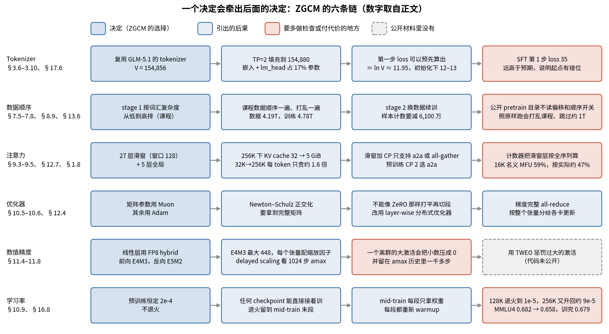

# 第 20 章　总复习与讲出来

> 前 19 章是沿着流水线一格一格讲下来的，这一章把它们重新串起来，做三件事。第一件是列出"如果你自己从零训一个 7B 模型"要做的全部决定，每个决定都写清业界的默认做法、ZGCM 的选择、怎么验证、回看哪一章。第二件是 10 道综合大题，每题附答题骨架和示范讲稿，用来练习把东西讲出来。第三件是把全书仍然没有答案的问题收拢成一张表。这一章不引入新概念，所有内容都能在前面的章节找到出处。

## 这一章要回答的问题

读完这一章，你应该能回答下面这些问题。

1. 从零训一个 7B 模型，从定目标到发布，一共要做哪些决定？每个决定的默认答案是什么？
2. 开跑之前，哪些检查最便宜、又最能防止白跑几天？
3. 全书最该记住的数字有哪些？哪些可以当场手算出来？
4. 别人让你"讲一讲大模型是怎么从零训出来的"，你怎么组织一段 5 分钟的回答？
5. 被追问细节时，哪些地方最容易答错？
6. ZGCM-1 的公开材料里，哪些问题至今没有答案？

---

<a id="s20-1" name="s20-1"></a>
## 20.1 怎么用这一章

这一章建议分三遍用。

第一遍对照清单查漏。读 [§20.3](#s20-3) 的决策清单时，每一行先遮住"ZGCM 的选择"那一列，自己说出来；说不出的，按"回看"一列回到对应章节。

第二遍先讲后看。[§20.6](#s20-6) 的每道大题，先只看答题骨架，对着空气或者录音讲 3 到 5 分钟，讲完再读示范讲稿。对照时记下三类差距：漏掉的内容、说错的数字、讲不清的因果。漏掉和说错的，回看对应章节；因果讲不清的，回看那一章讲概念的部分。

第三遍模拟追问。[§20.7](#s20-7) 列了常见的追问，可以请别人随机挑几条问你，也可以自己抽签。追问也答得上来，才说明你懂的是机制，而不只是记住了结论。

讲的时候有一个顺序很好用：先说要解决什么问题，再说最朴素的做法和它的毛病，最后说实际的做法和代价。前面每章的概念部分都是按这个顺序写的。照这个顺序讲，听的人跟得上，你自己也不容易漏。

<a id="s20-2" name="s20-2"></a>
## 20.2 全书一张图

```
定目标、估算力（1）
   │
   ▼
Tokenizer（3） ──► 每 token 约多少字，决定数据量和序列长的换算
   │
   ▼
数据：来源（4）→ 清洗（5）→ 去重/质量/去污染（6）→ 配比与课程（7）→ 变成样本（8）
   │
   ▼
模型：架构（9）  优化器与学习率（10）  数值精度（11）  分布式并行（12）
   │
   ▼
跑起来：启动、检查点、续训（13）  监控与稳定性（14）  基座评测（15）
   │
   ▼
Mid-train 与长上下文（16）→ SFT（17）→ RL（18）→ 最终评测与读报告（19）
```

第 2 章是全书的地基。后面算参数量、FLOPs、显存、KV cache，用的都是第 2 章那套算式。

下表把每一章最该带走的结论压成一行，复习时可以先扫一遍，哪一行看着陌生，就回那一章。

| 章 | 主要结论 |
|---|---|
| 1 | 训练算力约 $6ND$；ZGCM 每步 token 从头到尾固定在 12,582,912；数字以实际记录为准。 |
| 2 | 一层 = Pre-LN 的注意力 + SwiGLU FFN；7.39B 能逐项数出来；loss 是 next-token 交叉熵。 |
| 3 | 字节级 BPE 没有未登录词；ZGCM 直接用 GLM-5.1 的 tokenizer，154,856 个 token；第一步 loss 应接近 $\ln V$。 |
| 4 | ZGCM 站在 Ultra-FineWeb、FinePDFs 等已清洗的公开数据集上做二次筛选；约 21% 记录只能 index_only 发布。 |
| 5 | 清洗是对每篇文档独立做 keep/review/drop 判决；规整步骤删掉了代码缩进，计数却全正常。 |
| 6 | 精确去重用哈希，近似去重用 SimHash 或 MinHash-LSH；ZGCM 的跨阶段去重和预训练去污染代码没公开。 |
| 7 | 配比靠 0.3B 代理模型试；stage 1 按词汇复杂度做课程，stage 2 全局打乱；数据量 4.19T，训练量 4.78T。 |
| 8 | 文档首尾相接切成 16,385 token 的样本；续训靠 consumed_samples；照仓库原样跑会悄悄打乱课程。 |
| 9 | 27 层 128 窗口滑窗 + 5 层全局；输出门、QK-Norm、partial RoPE；256K 下 KV cache 从 32 GiB 降到 5 GiB。 |
| 10 | 矩阵参数用 Muon，其余用 Adam；预训练 LR 恒定 2e-4，不退火；warmup 667 步，clip 1.0。 |
| 11 | BF16 计算、FP32 保存与累加；FP8 每个张量配缩放因子；TWEO 压激活离群值。 |
| 12 | 预训练 TP2 × CP2 × DP48 = 192 卡；MBS 2 × DP 48 × 累积 8 = GBS 768；Muon 用 layer-wise 分布式优化器。 |
| 13 | 检查点要存到"恢复后每一步都和没停过一样"；stage 2 续训要减 6,100 万样本偏移；吞吐 585 掉到 554 的事故。 |
| 14 | 盯三件事：对不对（loss、评测）、稳不稳（grad norm、NaN）、快不快（吞吐）；loss 有噪声，比较要同条件。 |
| 15 | 早期看 BPB，准确率高于随机才看准确率；50 道题的评测一道题就是 2 分。 |
| 16 | mid-train 换高价值数据、扩到 256K；实际跑了 32K、64K、128K、256K 四段；每段重新 warmup 有代价。 |
| 17 | SFT 只对助手回复算 loss；打包时注意力不跨对话、位置重置；第 1 步 loss 35 和过拟合到第 10 个 epoch。 |
| 18 | GRPO 用同题 8 个回答的均值做 baseline；数学奖励几乎钻不了空子；发布模型很可能没经过 RL。 |
| 19 | 推理模型的分数有采样和题目两层噪声；Table 2 的基线是拼起来的；读报告要四方对照。 |

<a id="s20-3" name="s20-3"></a>
## 20.3 从零训一个 7B：决策清单

下面按时间顺序列出要做的决定，每一类一张表。"业界常见做法"一列是没有特殊理由时的默认答案。"ZGCM 的选择"一列带数字，出处见"回看"那一章。"怎么验证"一列写的是做完这个决定以后，用什么最便宜的办法确认它没错。"回看"一列给出讲这个决定的章节。

表格按类别分开，但决定之间是连着的：前面选了什么，后面某一步就只能那样做，或者得多做一项检查。下图挑了六条这样的链，每行从最左边的决定出发，向右是它引出的后果，红框是要多做检查或付代价的地方。讲大题时顺着一条链讲，因果自然就出来了，比逐行背表格好讲。



### A. 目标和算力

| 决定 | 业界常见做法 | ZGCM 的选择 | 怎么验证 | 回看 |
|---|---|---|---|---|
| 模型多大、训多少 token | Chinchilla 算力最优是每参数约 20 token；现在为了推理便宜，普遍训到几百倍 | 7.39B dense，实际训 4.78T，每参数 647 token | 用 $6ND$ 估总 FLOPs，再除以"卡数 × 实测单卡吞吐"得天数 | [§1.6](01_全景与算力估算.md#s1-6)–1.7、[§7.8](07_数据四_配比与课程.md#s7-8) |
| 要多少卡、多少天 | 预留 10%–30% 给故障、存盘、评测 | 192 张 H100；按 585 TFLOP/s 算纯计算约 22 天、约 10 万 GPU 小时 | 正式开跑前先跑几百步，测真实吞吐 | [§1.7](01_全景与算力估算.md#s1-7) |
| 系统效率目标 | dense 模型 MFU 40%–55% 算不错 | 16K 下 585/989 ≈ 59%（BF16 等效） | 注意计数器是否把滑窗层按全序列算 | [§1.8](01_全景与算力估算.md#s1-8)、[§12.12](12_分布式并行.md#s12-12) |
| 显存能不能放下 | Adam + 混合精度每参数 16–18 字节 | Muon 没有二阶矩，每个矩阵参数省 4 字节 | 手算静态显存，再加激活 | [§1.9](01_全景与算力估算.md#s1-9)、[§10.5](10_优化器与学习率.md#s10-5)、[§12.4](12_分布式并行.md#s12-4) |

### B. Tokenizer

| 决定 | 业界常见做法 | ZGCM 的选择 | 怎么验证 | 回看 |
|---|---|---|---|---|
| 自己训还是复用 | 复用一个在目标语言上压缩率好的成熟 tokenizer | 直接用 GLM-5.1 的，BPE 154,820 + 特殊 token 36 = 154,856 | 在自己的语料上测每 token 多少字符 | [§3.6](03_Tokenizer.md#s3-6)–3.7 |
| 词表大小 | 32K 到 256K；多语言和中文倾向大词表 | 约 155K；嵌入表和 lm_head 合计占 17% 参数 | 算嵌入参数占比和 lm_head 每 token 的 FLOPs | [§3.8](03_Tokenizer.md#s3-8) |
| 词表填充 | 补到 128 × TP 的倍数 | 训练时 154,880（TP=2）；发布版 155,136，来源不明 | 加载权重时核对嵌入表行数 | [§3.9](03_Tokenizer.md#s3-9) |
| 特殊 token | 至少要有文档结束符；对话模板另配 | 预训练只在文档末尾加 `<\|endoftext\|>`；think 开关靠 `<think>` | 解码几条样本，看结束符在不在 | [§3.10](03_Tokenizer.md#s3-10)、[§8.2](08_数据五_从文本到训练样本.md#s8-2) |

### C. 数据

| 决定 | 业界常见做法 | ZGCM 的选择 | 怎么验证 | 回看 |
|---|---|---|---|---|
| 从原始网页做，还是用公开数据集 | 大厂从 Common Crawl 自己做；小团队多用 FineWeb 一类 | 用 Ultra-FineWeb、FinePDFs、olmOCR、Nemotron 等已清洗数据，自己二次筛选 | 抽样读，确认上游的过滤偏好你能接受 | [§4.3](04_数据一_来源与获取.md#s4-3)、[§4.5](04_数据一_来源与获取.md#s4-5) |
| 每条记录带什么元数据 | 来源、版本、许可证、类别、token 数 | 都有；不能再发布原文的只发 index_only 记录 | 能按任一字段统计和回溯 | [§4.7](04_数据一_来源与获取.md#s4-7)–4.8 |
| 清洗规则 | Gopher、C4、FineWeb 的启发式规则 + 质量分阈值 | 主要用上游的分设阈值，如 FinePDFs 的语言置信度 0.85、质量分 0.8；olmOCR 用压缩率 0.08 | 每条规则看丢弃量，再抽样看丢掉的和留下的；上线前抽样看最终输出 | [§5.5](05_数据二_清洗流水线.md#s5-5)–5.7、[§5.10](05_数据二_清洗流水线.md#s5-10) |
| 精确去重 | 规整后算哈希，见过就丢；大规模按哈希前缀分桶 | 单次运行内 SHA-256 精确去重 | 统计重复率 | [§6.2](06_数据三_去重质量去污染.md#s6-2) |
| 近似去重 | MinHash-LSH，如 FineWeb 的 14 段 × 8 行，阈值约 0.72 | 可选 SimHash，汉明距离阈值 3，按空白切词 | 抽几对被判重复的文档读一读；中文要单独检查 | [§6.3](06_数据三_去重质量去污染.md#s6-3)–6.4 |
| 跨阶段去重 | 后一阶段排除前一阶段见过的内容 | 报告说做了，代码没公开 | 抽样查后一阶段数据在前一阶段的命中率 | [§6.6](06_数据三_去重质量去污染.md#s6-6) |
| 质量分 | FineWeb-Edu 式：大模型打分 → 蒸馏小分类器 → 定阈值 | 预训练用上游的分；mid-train 网页分三档全保留，交给配比 | 不同阈值各训一个小模型，比评测 | [§6.7](06_数据三_去重质量去污染.md#s6-7) |
| 去污染 | 和评测集做 n-gram 重合检查 | SFT 用 8-gram、重合超 50% 删；预训练报告未说明 | 对每个评测集统计命中条数 | [§6.8](06_数据三_去重质量去污染.md#s6-8) |
| 配比 | 小模型上试：温度采样、DoReMi、RegMix | 0.3B 代理模型、30B token，看 loss 和知识、代码、数学评测，人工迭代；一次代理约是正式训练的四千分之一 | 代理模型上的排序在大模型上是否保持，要抽查 | [§7.3](07_数据四_配比与课程.md#s7-3)–7.4 |
| 顺序 | 大多数全局打乱 | stage 1 通用文本按词汇复杂度从低到高排，代码和数学打乱穿插；stage 2 全局打乱 | 同起点小规模对照，比各类 BPB | [§7.5](07_数据四_配比与课程.md#s7-5)–7.6 |
| 重复几遍 | 高质量数据重复 4 遍以内和新数据差不多 | 课程数据实际过了两遍（顺序一遍、打乱一遍） | 记录每个来源的实际 epoch 数 | [§7.7](07_数据四_配比与课程.md#s7-7)–7.8 |
| 打包方式 | 首尾相接切块；Llama 3 用文档内注意力 | 首尾相接、注意力跨文档、位置不重置 | 解码一条样本，看边界和位置编号 | [§8.4](08_数据五_从文本到训练样本.md#s8-4)–8.5 |
| 多来源怎么混 | 按权重混合 | Megatron 按"实际占比落后目标最多"的来源取，确定性贪心 | 统计一个 batch 里各来源的 token 比例 | [§8.6](08_数据五_从文本到训练样本.md#s8-6) |

### D. 模型

| 决定 | 业界常见做法 | ZGCM 的选择 | 怎么验证 | 回看 |
|---|---|---|---|---|
| 骨架 | LLaMA 式：Pre-LN RMSNorm、SwiGLU、RoPE、GQA、无偏置 | 32 层、隐藏 4096、FFN 11008、32 个 Q 头配 8 组 KV、输入输出不共享 | 逐项数参数，对上 7.39B | [§2.10](02_Transformer到能讲的程度.md#s2-10)、[§9.1](09_模型架构.md#s9-1)、[§9.9](09_模型架构.md#s9-9) |
| 注意力类型 | 全注意力；长上下文模型越来越多用滑窗混合、线性注意力混合 | 层号能被 6 整除的 5 层全局，其余 27 层只看最近 128 个 token | 小规模比 loss 和吞吐；长上下文要专门评测 | [§9.3](09_模型架构.md#s9-3)–9.5 |
| 注意力上的小零件 | 视需要加 | 27 个滑窗层加 sigmoid 输出门；全部层加 QK-Norm | 没有单独消融，只能靠别人的论文 | [§9.6](09_模型架构.md#s9-6)–9.7 |
| 位置编码 | RoPE，base 1 万到 50 万 | partial RoPE（128 维里转 42 维），base 5M，256K 段改 10M | 算最慢频率在训练长度内转了几圈 | [§9.8](09_模型架构.md#s9-8)、[§16.3](16_MidTrain与长上下文.md#s16-3) |
| 初始化 | $N(0, 0.02^2)$，残差输出层再除以 $\sqrt{2L}$ | Megatron 默认：0.02，o_proj 和 FFN down 是 0.0025 | 第一步 loss 应在 12 到 13 之间（$\ln V \approx 11.95$） | [§9.10](09_模型架构.md#s9-10) |
| 稳定性 | QK-Norm 管注意力 logit，z-loss 管输出 logit | 有 QK-Norm，没有 z-loss | 盯最大注意力 logit 和 grad norm | [§9.7](09_模型架构.md#s9-7)、[§14.5](14_训练监控与稳定性.md#s14-5) |

### E. 优化器和学习率

| 决定 | 业界常见做法 | ZGCM 的选择 | 怎么验证 | 回看 |
|---|---|---|---|---|
| 优化器 | AdamW，β1 0.9，β2 0.95 | 矩阵参数用 Muon（动量 0.9，Newton–Schulz 5 步，按 $\sqrt{\text{长边}}$ 缩放）；嵌入、lm_head、norm 系数用 Adam | 同设置下和 AdamW 比 step-to-loss | [§10.3](10_优化器与学习率.md#s10-3)–10.5 |
| 学习率与调度 | 小规模扫 LR；cosine 或 WSD | 恒定 2e-4，预训练不退火，退火放到 mid-train 末段，整体像 WSD | 预训练中途的 checkpoint 能直接接着训 | [§10.9](10_优化器与学习率.md#s10-9)–10.10 |
| warmup、clip、WD | warmup 几百到几千步；clip 1.0；WD 0.1 | warmup 667 步；clip 1.0；WD 0.1 | grad norm 平时应远低于 clip 阈值 | [§10.7](10_优化器与学习率.md#s10-7)–10.8 |
| 每步多少 token | 几百万到一千多万 token | 固定 12,582,912；序列变长时 GBS 按比例减 | 换长度时不用重调 LR | [§1.4](01_全景与算力估算.md#s1-4)、[§12.10](12_分布式并行.md#s12-10) |

### F. 数值精度

| 决定 | 业界常见做法 | ZGCM 的选择 | 怎么验证 | 回看 |
|---|---|---|---|---|
| BF16 还是 FP8 | BF16 最稳；FP8 能快约 1.3–1.5 倍 | FP8 hybrid（前向 E4M3、反向 E5M2），delayed scaling，amax 历史 1024 条 | 和 BF16 跑同一段，比 loss 差 | [§11.4](11_数值精度.md#s11-4)–11.6、[§11.9](11_数值精度.md#s11-9) |
| 哪些地方必须高精度 | 主权重、梯度累加、softmax、norm、交叉熵用 FP32 | 同左 | 看混合精度配置 | [§11.3](11_数值精度.md#s11-3) |
| 激活离群值 | 监控最大激活；必要时改结构或加正则 | TWEO，W&B 反推系数 $10^{-3}$、截到 loss 的 0.1%；代码未公开 | 配对实验比 loss 和最大激活 | [§11.7](11_数值精度.md#s11-7)–11.8 |

### G. 分布式并行

| 决定 | 业界常见做法 | ZGCM 的选择 | 怎么验证 | 回看 |
|---|---|---|---|---|
| 静态显存怎么拆 | ZeRO-1 或 distributed optimizer；放不下再上 ZeRO-3/FSDP | Muon 要完整矩阵，用 layer-wise 分布式优化器：梯度完整 all-reduce，按整个张量分工更新 | 每卡静态显存手算 | [§12.4](12_分布式并行.md#s12-4)、[§10.6](10_优化器与学习率.md#s10-6) |
| TP 多大 | 放在机器内，一般 ≤ 8 | 预训练 TP 2，配序列并行；SFT 用 TP 8 | 单层前向的通信时间占比 | [§12.5](12_分布式并行.md#s12-5)–12.6 |
| 长序列怎么放 | CP（ring 或 all-to-all） | 预训练 CP 2，mid-train 到 CP 4；用 a2a，因为 SWA 加 CP 只支持 a2a 或 all-gather | 看注意力时间和通信时间 | [§12.7](12_分布式并行.md#s12-7) |
| PP 要不要 | 能不用就不用，有气泡 | 预训练不用；只在 256K 段用 PP 2，气泡约 20% | 算气泡比例 | [§12.8](12_分布式并行.md#s12-8) |
| batch 怎么拼 | GBS = MBS × DP × 累积步数 | 2 × 48 × 8 = 768 | 打印每步样本数 | [§12.10](12_分布式并行.md#s12-10) |
| 激活放不下 | 选择性重算或整层重算 | 256K 段整层重算 | 显存峰值和吞吐一起看 | [§12.11](12_分布式并行.md#s12-11) |

### H. 跑起来

| 决定 | 业界常见做法 | ZGCM 的选择 | 怎么验证 | 回看 |
|---|---|---|---|---|
| 配置怎么管 | 一个阶段一份配置文件，入库 | 每阶段一个 env 文件，launcher 读 env 再调 torchrun | 开跑前把实际生效的参数打印出来比对 | [§13.1](13_启动检查点续训.md#s13-1)–13.2 |
| 检查点存什么 | 权重、优化器、调度器、步数、样本数、随机数状态 | 都存，约 79 GB；进度文件最后写 | 存完立刻试着加载一次 | [§13.3](13_启动检查点续训.md#s13-3)–13.4 |
| 多久存一次 | 最优间隔约 $\sqrt{2CM}$ | 每 1000 步，约 100 分钟，开销约 1% | 按存盘耗时和故障间隔算 | [§13.8](13_启动检查点续训.md#s13-8) |
| 换数据续训 | 接上优化器和步数，样本计数减偏移 | stage 2 检查进度是 79,473，样本计数减 6,100 万 | 打印第一个 batch 来自哪个文件的哪个位置 | [§13.6](13_启动检查点续训.md#s13-6)、[§8.8](08_数据五_从文本到训练样本.md#s8-8) |
| 换阶段重开 | 只拿权重，优化器和 LR 重来 | mid-train 每段都这样加载，每段都重新 warmup | 看段首 loss 和评测有没有掉 | [§13.7](13_启动检查点续训.md#s13-7)、[§16.8](16_MidTrain与长上下文.md#s16-8) |
| 监控 | loss、grad norm、吞吐、NaN、日志停更 | W&B 逐步记录；靠固定窗口比吞吐发现 585 → 554 | 值班清单逐条过 | [§14.10](14_训练监控与稳定性.md#s14-10)、[§13.9](13_启动检查点续训.md#s13-9) |
| 中途评测 | 固定子集 + BPB | Ability Lite、in-loop bench、short-SFT probe 三套 | 先算每个评测的噪声 | [§15.4](15_基座评测.md#s15-4)–15.5 |

### I. 后训练与发布

| 决定 | 业界常见做法 | ZGCM 的选择 | 怎么验证 | 回看 |
|---|---|---|---|---|
| 要不要 mid-train | 现在几乎都做：换高价值数据、扩长度、末段退火 | 约 590B token，四段 32K/64K/128K/256K，LR 1e-4，replay 9%–13% 预训练数据 | 每段结束测基座评测和长上下文评测 | [§16.1](16_MidTrain与长上下文.md#s16-1)、[§16.6](16_MidTrain与长上下文.md#s16-6)、[§7.9](07_数据四_配比与课程.md#s7-9) |
| 怎么扩长 | PI、NTK、YaRN 插值，或直接改 base 在目标长度上训 | 只改 base（5M → 10M），在 256K 上训约 125B token | 必须做长上下文评测；ZGCM 没公开 | [§16.3](16_MidTrain与长上下文.md#s16-3)、[§16.9](16_MidTrain与长上下文.md#s16-9) |
| SFT 怎么训 | 只对助手回复算 loss；打包时注意力不跨样本；2–3 个 epoch 常见 | loss mask + cu_seqlens 打包；LR 1e-4 → 1e-6 cosine，无 warmup；10 个 epoch | 开跑前做一次只前向的检查；每个 epoch 测下游 | [§17.2](17_SFT.md#s17-2)–17.6 |
| 要不要 RL | 推理模型普遍做；数学和代码奖励最可靠 | 仓库有 GRPO 配方（组 8、KL 0、LR 1e-6、177 步），发布模型很可能没用 | 看 RL 前后同一套评测 | [§18.6](18_RL.md#s18-6)、[§18.8](18_RL.md#s18-8) |
| 最终怎么评 | 采样多次取平均，公开协议和代码 | 温度 1.0、32 次 pass@1 平均、生成预算 258,048；评测代码没公开 | 报置信区间，存逐题输出 | [§19.1](19_最终评测与读报告.md#s19-1)–19.2 |

<a id="s20-4" name="s20-4"></a>
## 20.4 开跑前的最便宜检查

前面各章"坑和对不上的地方"里讲过的错误，最贵的那些有一个共同点：**跑起来不报错，数字也看着正常**。下面这些检查每条只要几分钟，能防住其中的大部分。

1. 解码一条训练样本，用眼睛读一遍。这能查出缩进被删（[§5.11](05_数据二_清洗流水线.md#s5-11)）、文档边界和结束符不对（[§8.2](08_数据五_从文本到训练样本.md#s8-2)）、对话模板错位（[§17.2](17_SFT.md#s17-2)）。
2. 开跑前先算出第一步 loss 的预期值。预训练从随机初始化开始，第一步应接近 $\ln V$，ZGCM 约 12–13（[§9.10](09_模型架构.md#s9-10)）。SFT 从 mid-train 权重开始，第一步应该和 mid-train 末尾差不多；ZGCM 第 1 步是 35，说明起点有错位（[§17.6](17_SFT.md#s17-6)）。
3. 对每个配置开关，都去代码里 grep 一下有没有人读它。ZGCM 的 sample offset 和顺序读取开关，在公开的 pretrain 目录里没人读，照原样跑会悄悄打乱课程、跳过约 0.7T–1T token 的数据（[§8.9](08_数据五_从文本到训练样本.md#s8-9)）。
4. 续训前核对步数、consumed_samples 和 LR 这三个数。stage 2 的 launcher 专门检查了进度文件是否为 79,473（[§13.6](13_启动检查点续训.md#s13-6)）。
5. 存一次检查点，然后立刻加载一次，确认能恢复，而且恢复后第一步的 loss 和存盘前接得上（[§13.3](13_启动检查点续训.md#s13-3)）。
6. 先跑几百步，量出真实吞吐和显存峰值，再用 $6ND$ 重算总天数（[§1.7](01_全景与算力估算.md#s1-7)）。
7. 给每个评测先算噪声。用 $\sqrt{p(1-p)/n}$ 算出一道题值几分，再决定看哪些评测（[§15.4](15_基座评测.md#s15-4)）。
8. 设一个日志停更报警，5 分钟没有新日志就叫人，因为通信挂住时默认要等很久才超时（[§14.10](14_训练监控与稳定性.md#s14-10)）。
9. 每次改动只改一个变量，这样吞吐变慢、loss 变化都能归因（[§13.9](13_启动检查点续训.md#s13-9)）。

<a id="s20-5" name="s20-5"></a>
## 20.5 必须能当场算出来的数

讲的时候能随手算出一个数，比背出十个数更有说服力。下面这些都只要一两行算式，完整的数字表见[附录 B](附录B_数字速查.md)。

| 量 | 算式 | 结果 | 回看 |
|---|---|---|---|
| 参数量 | 嵌入 $154880\times4096\approx0.634$B，两张表 1.27B；每层 QKV $4096\times6144$ + o_proj $4096^2$ + FFN $3\times4096\times11008$ ≈ 177M，32 层 5.67B；27 个门各 $4096^2$，共 0.45B | ≈ 7.39B | [§2.10](02_Transformer到能讲的程度.md#s2-10) |
| 训练算力 | $6ND = 6\times7.39\times10^9\times4.78\times10^{12}$ | ≈ $2.1\times10^{23}$ FLOPs | [§1.6](01_全景与算力估算.md#s1-6)–1.7 |
| 纯计算天数 | $2.12\times10^{23} / (585\times10^{12}\times192)$ | ≈ 21.8 天 | [§1.7](01_全景与算力估算.md#s1-7) |
| MFU | $585/989$ | ≈ 59% | [§1.8](01_全景与算力估算.md#s1-8) |
| 每步 token | $768\times16384 = 48\times262144$ | 12,582,912 | [§1.4](01_全景与算力估算.md#s1-4) |
| GBS 分解 | MBS × DP × 累积 $= 2\times48\times8$ | 768 | [§12.10](12_分布式并行.md#s12-10) |
| 静态显存（Adam） | $7.39\text{B}\times18$ 字节 | ≈ 133 GB | [§10.3](10_优化器与学习率.md#s10-3)、[§12.4](12_分布式并行.md#s12-4) |
| 每 token 每层 KV | $2\times8\text{ 头}\times128\text{ 维}\times2\text{ 字节}$ | 4 KiB；全注意力 32 层 128 KiB，ZGCM 5 个全局层 20 KiB | [§9.2](09_模型架构.md#s9-2) |
| 均匀瞎猜的 loss | $\ln 154880$ | ≈ 11.95；ZGCM 初始化下预期 12–13 | [§2.8](02_Transformer到能讲的程度.md#s2-8)、[§3.10](03_Tokenizer.md#s3-10)、[§9.10](09_模型架构.md#s9-10) |
| 每参数 token | $4.78\text{T}/7.39\text{B}$ | ≈ 647，Chinchilla 的 32 倍 | [§7.8](07_数据四_配比与课程.md#s7-8) |
| 评测噪声 | $\sqrt{p(1-p)/n}$，$p=0.5$、$n=50$ | ≈ 7 分 | [§15.4](15_基座评测.md#s15-4) |
| 检查点间隔 | $\sqrt{2CM}$，$C=60$ 秒、$M=1$ 天 | ≈ 54 分钟 | [§13.8](13_启动检查点续训.md#s13-8) |
| GRPO 优势 | 8 个回答 1 对 7 错，均值 0.125，样本标准差 0.354 | 对的那个 ≈ +2.5 | [§18.4](18_RL.md#s18-4) |

<a id="s20-6" name="s20-6"></a>
## 20.6 十道综合大题

每道题先给答题骨架，也就是讲之前先在脑子里排好的顺序；再给一段约 3 到 5 分钟的示范讲稿；最后写明讲不出来时去哪一章补。讲稿只用前 19 章讲过的概念。

### 大题 1　从零训一个 7B 模型，从头到尾讲一遍

可以按这个骨架来讲：

1. 先列出五个阶段：数据、预训练、mid-train、SFT、RL，中间穿插评测，并说清每段的输入、目标和输出。
2. 接着估算算力，包括 $6ND$、卡数、MFU 和天数。
3. 讲每步 token 固定、序列变长时 GBS 按比例减的设计。
4. 用各阶段 token 量的比例，说明为什么底子在预训练。
5. 收尾时提醒一句：读开源项目要分清设计和实际。

示范讲稿如下。

> 从零训一个大模型，可以分成五个阶段。第一是数据：收集网页、PDF、代码、数学这些文本，清洗、去重、定配比，再切成训练样本。第二是预训练：模型在几万亿 token 上做下一个 token 预测，每个 token 都算 loss。第三是 mid-train：目标不变，但换成推理、代码、agent 这类高价值数据，并把上下文拉长。第四是 SFT：用对话数据教它当助手，只在助手的回答上算 loss。第五是 RL：让它自己答题，用程序判对错，答对的写法概率调高。中间每个阶段都要评测。
>
> 拿 ZGCM-1 举例。它是 7.39B 的 dense 模型，预训练在 192 张 H100 上训了约 4.78T token。算力用 $6ND$ 估：每个 token 前向约 $2N$ 次运算，反向约 $4N$，合起来约 $2\times10^{23}$ 次。每卡实际跑到 585 TFLOP/s，是 BF16 峰值的 59%，纯计算约 22 天。实际墙钟还要加上故障和存盘。
>
> 有个设计很值得讲：从预训练到 SFT，每一步的 token 数都固定在约 1,258 万。16K 序列时一步 768 条，256K 时一步 48 条。每步的信息量不变，学习率就不用跟着长度重调。学习率取多大，跟一步的梯度由多少 token 平均出来有关，这个数没变，原来的学习率大体可以沿用；只是条数少了，每步梯度的噪声会大一些。
>
> 算力几乎全花在预训练：预训练 4.78T，mid-train 约 0.59T，SFT 约 0.19T。所以模型的知识和底子由预训练的数据决定，后训练主要是教格式、教推理习惯。
>
> 最后，ZGCM 什么都开源了，但报告、代码、W&B、模型卡之间有不少对不上的地方，比如报告说 mid-train 三段，实际跑了四段。所以我读的时候以实际日志为准，然后看代码，最后才看报告文字。

讲不出来时回看：第 1 章；第 7 章 [§7.7](07_数据四_配比与课程.md#s7-7)；第 16 章 [§16.6](16_MidTrain与长上下文.md#s16-6)。

### 大题 2　预训练数据从网页到训练样本，经过哪些步骤

可以按这个骨架来讲：

1. 先说来源分六类，每类的难点不同。
2. 再说两条路线：从 Common Crawl 自己做，还是站在公开数据集上。
3. 清洗是对每篇文档独立判 keep/review/drop，每条规则都可以计数。
4. 接着讲需要和别的文档比的三件事：去重、质量分、去污染。
5. 然后讲配比和顺序。
6. 再讲怎么变成样本：tokenize、加 EOD、`.bin/.idx`、切样本、混合、分发。
7. 用一个教训收尾：不报错的 bug 最危险。

示范讲稿如下。

> 预训练数据是不带标注的纯文本，工作量在四件事：找到文本、挑出好的、决定各类放多少、决定按什么顺序喂。
>
> 来源有网页、PDF、代码、数学、LaTeX 论文、合成推理数据几类。每类难点不同：网页要抽正文去模板，PDF 要处理版面和 OCR 错误，代码要去掉第三方库和自动生成的文件。如果从 Common Crawl 自己做，要走抽正文、语言识别、启发式规则、去重、质量分类器这一整套。ZGCM 没走这条路，直接用 Ultra-FineWeb、FinePDFs 这些清洗过的数据集，自己做二次筛选。省了很多算力，代价是继承上游的偏好。
>
> 清洗是对每篇文档独立判断。ZGCM 把每条记录包成一个 Sample，判决分 keep、review、drop 三档，只能往严的方向走，每次判决都写原因、每步自动计数，跑完就知道每条规则丢了多少。
>
> 接着是要和别的文档比的三件事。去重：完全相同用哈希，几乎相同用 SimHash 或 MinHash-LSH。质量：现在主流是让大模型打分、蒸馏成小分类器、按阈值留。去污染：和评测集做 n-gram 重合检查。
>
> 然后定配比和顺序。ZGCM 在 0.3B 的小模型上试配比；第一阶段做了课程学习，通用文本从易到难排，第二阶段全局打乱。
>
> 最后变成样本：每篇文档 tokenize 后末尾加一个结束符，首尾相接写进一个大数组，按 16,385 个 token 一刀刀切。多个来源按目标比例确定性地混合，再分给各张卡。续训时靠"已经消费了多少条样本"接着读。
>
> 这一路上最要警惕的是不报错的 bug。ZGCM 的规整步骤把代码缩进删光了，所有计数都正常；它的 pretrain 目录也不认样本偏移和顺序读取开关，照原样跑会悄悄打乱课程。所以每条流水线都要抽样读最终输出，每个开关都要去代码里确认有人在读。

讲不出来时回看：第 4 章；第 5 章 [§5.2](05_数据二_清洗流水线.md#s5-2)、[§5.11](05_数据二_清洗流水线.md#s5-11)；第 6 章；第 7 章 [§7.4](07_数据四_配比与课程.md#s7-4)–7.6；第 8 章 [§8.2](08_数据五_从文本到训练样本.md#s8-2)–8.9。

### 大题 3　去重、质量打分、去污染：怎么做，阈值怎么定

可以按这个骨架来讲：

1. 先讲重复的三个坏处，以及三种重复各用什么方法。
2. 精确去重靠哈希和分桶。
3. 近似去重讲 SimHash 的鸽笼保证，以及 MinHash-LSH 的 S 曲线和 b、r 的取法。
4. 质量分讲 FineWeb-Edu 的"大模型打分 → 小分类器"。
5. 去污染讲 n-gram，以及它查不到的东西。
6. 最后分清 ZGCM 做了什么、代码里有什么、没公开什么。

示范讲稿如下。

> 重复数据有三个坏处：浪费算力，模型会逐字背书，评测会虚高。有研究发现 C4 里同一个句子重复了六万多次，去重以后模型逐字背出训练文本的情况降到十分之一。
>
> 重复分三种。完全相同的，对规整后的文本算哈希，见过就丢；数据太多一台机器放不下哈希表，就按哈希前缀分桶，每桶单独做。几乎相同的，用 SimHash 或 MinHash。共享长片段的，用后缀数组。
>
> SimHash 把文档的每个 5-gram 哈希成 64 位，每一位按多数投票，得到一个 64 位指纹。ZGCM 认为汉明距离不超过 3 就算重复。它把指纹切成 4 段各 16 位建索引：差 3 位最多弄坏 3 段，总有一段完全一样，所以不会漏。缺点是阈值 3 很严，只抓近乎一字不差的副本；它按空白切词，对中文几乎没用。
>
> 业界主流是 MinHash-LSH。随机哈希下，两个集合最小哈希相等的概率正好是它们的 Jaccard 相似度。把签名切成 $b$ 段、每段 $r$ 个。一段里 $r$ 个值全相等的概率是 $s^r$，只要有一段全相等就算候选，所以两篇文档成为候选的概率是 $1-(1-s^r)^b$，这是一条 S 形曲线，拐点大约在 $(1/b)^{1/r}$。FineWeb 用 14 段乘 8，阈值约 0.72。FineWeb 还发现按快照分别去重比全局去重效果好，去得太狠也会伤数据。
>
> 质量打分现在主流是分类器。FineWeb-Edu 让一个 70B 模型给 45 万篇网页打 0 到 5 分的教育价值，再训一个小分类器给全部网页打分，留 3 分以上。阈值不能拍脑袋，要用不同阈值各训一个小模型，比评测来定。
>
> 去污染是删掉和评测题重合太多的训练样本。ZGCM 的 SFT 用 8-gram，重合超过一半就删。它有三个漏洞：没写分母，如果分母是训练样本，长文档里夹着一整道原题会漏掉；改写和翻译查不出来；不到 8 个词的短题切不出 8-gram。
>
> 最后说 ZGCM 实际公开了什么。仓库里有单次运行内的精确去重和可选的 SimHash。报告说 stage 2 排除了 stage 1 的内容、mid-train 做了全池去重，但这部分代码没放出来；预训练和 mid-train 有没有去污染，报告也没说。所以我把这些当作"作者声称"，不是可复现的事实。

讲不出来时回看：第 6 章 [§6.1](06_数据三_去重质量去污染.md#s6-1)–6.8、[§6.10](06_数据三_去重质量去污染.md#s6-10)。

### 大题 4　配比和顺序怎么定，ZGCM 的证据有多强

可以按这个骨架来讲：

1. 先说三个独立的旋钮：各类放多少、按什么顺序、看几遍。
2. 解释为什么配比算不出来，再讲三种常见做法。
3. 讲 ZGCM 的代理模型和最终配比。
4. 课程学习要讲怎么排、为什么不排代码和数学、证据有多强。
5. 分清数据量和训练量，再讲重复的经验。
6. 最后讲 mid-train 的配比和 replay。

示范讲稿如下。

> 数据洗干净以后，还有三个旋钮：每类放多少，按什么顺序放，同一份看几遍。
>
> 配比没法用公式算。类别之间有交互，目标又是多维的，在 7B 上也试不起，所以大家都在小模型上试。简单的是温度采样，按存量的 α 次方分配；DoReMi 用代理模型的 loss 在线调权重；RegMix 训几百个小模型，拟合"配比到 loss"的回归再搜最优。ZGCM 用的是 0.3B、30B token 的代理模型，看 loss 和知识、代码、数学评测，人工迭代。一次代理实验的算力约是正式训练的四千分之一。最终网页约 54%，代码 21% 到 24%，学术 OCR 11% 到 14%，数学 8% 到 9%。
>
> 顺序上，ZGCM 在第一阶段约 1T token 上做了课程学习：通用文本按词汇复杂度从低到高排，代码和数学不排，打乱后按比例穿插。不排代码和数学，是因为词汇统计只看表面，两行 import 会被判成最难。10B token 的对照里，课程让代码和数学的 BPB 降了，通用评测的 BPB 反而升了 0.03 到 0.09，而且代码那组的评测样本没对齐。所以证据只能说明方向，说明不了课程一定划算。第二阶段回到全局打乱。
>
> 数据量和训练量要分开。报告说数据 4.19T，实际训了 4.78T，因为课程数据又打乱训了一遍。每参数 647 个 token，是 Chinchilla 比例的 32 倍，高质量数据一定不够，就得重复。经验上重复 4 遍以内和新数据差不多。
>
> mid-train 的配比按能力组织：代码和数学各约 20%，网页降到 16% 左右，再混 9% 到 13% 的预训练数据做 replay 防止遗忘。即使在 256K 阶段，七成 token 仍来自 16K 以内的短文档，因为长文档本来就少。

讲不出来时回看：第 7 章全章；第 4 章 [§4.4](04_数据一_来源与获取.md#s4-4)。

### 大题 5　给你一个预算，怎么估时间、怎么切并行

可以按这个骨架来讲：

1. 先算总 FLOPs，再除以实际吞吐。
2. 显存分两笔算：静态部分（参数、梯度、优化器）和激活。
3. 按"能不能放下、通信在不在关键路径"依次选 DP/ZeRO、TP、SP、CP、PP。
4. 用 MBS、DP 和累积步数拼出 GBS。
5. 最后讲吞吐数字的口径问题。

示范讲稿如下。

> 第一步估算算力。训练总运算量约 $6ND$。比如 13B 模型训 2T token，就是 $1.56\times10^{23}$ 次。用 256 张卡、每卡实际 400 TFLOP/s，总吞吐约 $10^{17}$，算下来约 17.6 天，再加 10% 到 30% 的故障和存盘。这里"每卡实际吞吐"一定要先跑几百步实测，不能拿峰值算。
>
> 第二步看显存。静态部分：BF16 权重 2 字节、FP32 梯度 4 字节，Adam 再加 FP32 主权重和两个动量共 12 字节，每个参数 18 字节。7.39B 就是 133 GB，一张 80 GB 的 H100 放不下。激活部分：ZGCM 一层一个 token 约 150 KB，一条 16K 样本 32 层约 80 GB。
>
> 第三步选拆法。数据并行只拆激活，静态显存不省；ZeRO 把优化器状态、梯度、参数依次拆开，ZeRO-1 只拆优化器状态，通信量和 DP 一样。ZGCM 用 Muon，正交化要完整矩阵，所以 Megatron 换成 layer-wise 的分布式优化器，按整个张量分给各卡更新。张量并行把每个矩阵切开，每层前向两次 all-reduce，通信在关键路径上，必须放在机器内；ZGCM 用 TP 2，配合序列并行把 norm 和残差的激活也按 token 切开。序列太长就上上下文并行，ZGCM 用 CP 2，选 all-to-all 是因为它的滑窗注意力加 CP 只支持这种方式。流水线并行有气泡，能不用就不用，ZGCM 只在 256K 段用了 PP 2。
>
> 第四步拼 batch：GBS 等于 MBS 乘 DP 乘梯度累积步数。ZGCM 是 2 乘 48 乘 8，等于 768，每步约 1,258 万 token。
>
> 最后提醒一个口径问题。报告说 16K 时每卡 585 TFLOP/s、256K 时 203，这两个数不能直接比。Megatron 的计数器把滑窗层也按完整序列算注意力，序列越长多算得越多。按实际运算换算，16K 的 MFU 约 47%，256K 只有约 6%。

讲不出来时回看：第 1 章 [§1.6](01_全景与算力估算.md#s1-6)–1.9；第 12 章全章。

### 大题 6　ZGCM 的架构为什么这样设计，证据如何

可以按这个骨架来讲：

1. 骨架和 LLaMA 一样，改动都在注意力上。
2. 注意力贵在两处：计算随长度涨，KV cache 也随长度涨。
3. 滑窗加全局的组合便宜，远处的信息靠全局层去看。
4. 再讲输出门、QK-Norm、partial RoPE 各解决什么问题。
5. 证据要分级：哪些做过消融，哪些只是引用别人。

示范讲稿如下。

> ZGCM-1 的骨架是标准的 LLaMA 式：32 层，隐藏维 4096，Pre-LN 的 RMSNorm，SwiGLU，GQA 是 32 个 Q 头共享 8 组 KV，输入输出词表不共享。它的改动都在注意力上。
>
> 要改注意力，是因为它的成本随长度涨。16K 时注意力约占前向计算的四分之一，256K 时占到 85%。推理时还要存 KV cache：一层一个 token 是 4 KiB，全注意力 32 层、256K 长度就是 32 GiB，比 bf16 权重还大一倍多。
>
> ZGCM 的办法是 5 个全局层加 27 个只看最近 128 个 token 的滑窗层。滑窗层每个 token 最多看 128 个位置，每 token 的计算不随长度涨，KV cache 也只要留最近 128 个 token，所以 256K 时 KV cache 降到约 5 GiB，训练吞吐在 16K 快 1.4 倍、256K 快将近 4 倍。远处的信息靠那 5 个全局层直接取。
>
> 另外三个零件。输出门：在滑窗层的注意力输出上逐元素乘一个 sigmoid 门，给注意力补一段非线性，也让一个头不想取信息时能直接关掉，代价是多 4.5 亿参数。QK-Norm：对每个头的 q 和 k 先做 RMSNorm，注意力打分就有了上界，softmax 不会越训越尖；它放在 RoPE 之前，因为逐维缩放会破坏旋转；用 Muon 时打分更容易变大，所以更需要它。Partial RoPE：每个头 128 维只转 42 维，其余做纯内容匹配，base 用 5M。
>
> 证据要分开讲。注意力类型做过小规模对比：4K 长度、10B token，5:1 混合的 loss 和全注意力差不多、吞吐最高。但窗口大小、输出门、QK-Norm、partial RoPE 都没有单独消融，依据主要来自别人的论文。所以我会说"ZGCM 证明了这种混合结构在小规模上不掉点、能提速"，不会说"每个零件都被证明有用"。

讲不出来时回看：第 9 章全章；第 2 章 [§2.3](02_Transformer到能讲的程度.md#s2-3)、[§2.10](02_Transformer到能讲的程度.md#s2-10)。

### 大题 7　Muon、学习率、FP8：报告说的 4.2 倍提速从哪来

可以按这个骨架来讲：

1. 提速有两条路：每秒处理更多 token（吞吐），以及让每个 token 更值钱（样本效率）。
2. 把四个因子分到这两条路上。
3. 讲 Muon 的机制和代价。
4. 学习率调度是怎么选的。
5. 讲 FP8 的机制、风险和实际收益。
6. 最后说明为什么 4.2 要打折扣听。

示范讲稿如下。

> 提升训练效率有两条路。一条是让每秒处理更多 token，靠系统和结构；另一条是让每个 token 带来更多的 loss 下降，靠算法。ZGCM 报告说相对一个 OLMo 3 式的 BF16、AdamW 基线快 4.2 倍，拆成四个因子：滑窗混合 1.4 倍、FP8 约 1.5 倍，这两个是吞吐；Muon 约 1.8 倍、Pre-LN 约 1.1 倍，这两个是样本效率。乘起来约 4.16。
>
> 先说 Muon。线性层的动量矩阵往往只有少数几个奇异值很大，直接拿它更新，等于只在几个方向上学。Muon 把动量矩阵的奇异值全换成 1，让每个方向步长一样。实际不做 SVD，而是用 Newton–Schulz 迭代 5 步，只用矩阵乘法，开销很小。正交化后乘 $\sqrt{\text{长边}}$，让每个元素的更新幅度约为 1。嵌入、lm_head 和 norm 系数仍然用 Adam。Muon 不存二阶矩，省了约 24 GB 优化器状态；代价是它要完整矩阵，分布式优化器只能按整个张量切。
>
> 学习率方面，预训练 warmup 667 步，然后恒定 2e-4，不退火。好处是任何一个 checkpoint 都能直接接着训，退火放到 mid-train 的最后两段做，整体就像一条 WSD 曲线。
>
> 再说 FP8。FP8 的 E4M3 最大只能表示 448，所以每个张量要配一个缩放因子，把实际数值范围对到 FP8 能表示的范围上。前向用 E4M3 要精度，反向梯度用 E5M2 要范围。ZGCM 用 delayed scaling，缩放因子看最近 1024 条记录里的最大绝对值，不用每次转换前先把当前张量扫一遍求最大值。风险是激活离群值：一个特别大的值会把缩放因子压小，让其余的小数变成 0，而且它会在 1024 条的历史里一直占着最大值，影响后面很长一段。ZGCM 用 TWEO 在 loss 里惩罚过大的激活。FP8 只加速线性层，所以整体约 1.5 倍，不是 2 倍。
>
> 最后，4.2 是四个因子分别估计再相乘，没有端到端验证它们互相独立；Pre-LN 和 Muon 的两个因子报告也没有给实验细节。合理的说法是"估计快 4 倍左右，主要来自注意力结构、FP8 和 Muon"。

讲不出来时回看：第 1 章 [§1.10](01_全景与算力估算.md#s1-10)；第 10 章 [§10.4](10_优化器与学习率.md#s10-4)–10.10；第 11 章 [§11.4](11_数值精度.md#s11-4)–11.9。

### 大题 8　训练过程中你怎么盯，出了问题怎么办，续训要注意什么

可以按这个骨架来讲：

1. 监控回答三个问题：对不对、稳不稳、快不快，各看什么信号。
2. loss 的噪声怎么看，grad norm 怎么看。
3. loss spike 分三类，各有对策。
4. 讲检查点存什么、怎么保证完整、多久存一次。
5. 讲续训和换阶段的三种加载方式，再讲 ZGCM 的两个真实事故。

示范讲稿如下。

> 训练监控回答三个问题：训得对不对、稳不稳、快不快。对应看 loss 和评测、梯度范数和 NaN、吞吐和每步耗时。这里有个日志细节要知道：Megatron 每 10 步打一行，loss 是 10 步平均，grad norm 只是那一步的值，所以看梯度尖峰要看逐步记录。
>
> loss 每步都在抖，因为每个 batch 难度不同。每步条数越少，抖得越厉害：ZGCM mid-train 从 32K 到 256K，逐步噪声从 0.010 涨到 0.043。要看趋势，比较窗口要宽到噪声比你想看的变化小几倍。梯度范数没有绝对的正常值，要和同一段的滚动中位数比。ZGCM 每次进入新的 mid-train 段，第 1 步 grad norm 有 70 到 150，几十步内降到 1 以下，clip 1.0 的作用就是不让这些大梯度灌进动量。
>
> loss spike 分三类。数据型：单步跳高、马上回落，不用管。数值型：直接出 NaN，退出并从上一个检查点续训。优化型最危险：loss 和梯度一起涨、回不去。治根靠 QK-Norm 管注意力打分、z-loss 管输出 logit，clip 只是兜底；真出了就回滚到之前的检查点，跳过那段数据，必要时降学习率。
>
> 检查点要存到"恢复后每一步都和没停过一样"：权重、优化器状态、学习率进度、步数、已读样本数、随机数状态。ZGCM 一个约 79 GB。进度文件一定最后写，这样中途崩了还指着上一份完好的。存盘间隔可以算：最优约 $\sqrt{2CM}$。
>
> 加载有三种：没有检查点就从头训；有就全部恢复续训；还有只拿权重、其余重来的微调式加载。ZGCM 的 stage 2 换了数据但要接着优化器和步数，所以启动前检查步数是 79,473，再把样本计数减掉 6,100 万，从新数据开头读。mid-train 每段都是微调式加载，每段都重新 warmup。
>
> 两个真实事故值得讲。一是续训后吞吐从 585 慢慢掉到 554，修法是每 100 步清显存缓存、做一次 gc，靠的是持续按固定窗口比吞吐才发现。二是公开 pretrain 目录不认样本偏移和顺序读取开关，照原样跑不报错，但课程会被打乱，stage 2 会跳过约 0.7T 到 1T token。所以每个开关都要确认有代码在读。

讲不出来时回看：第 13 章全章；第 14 章全章；第 8 章 [§8.8](08_数据五_从文本到训练样本.md#s8-8)–8.9。

### 大题 9　mid-train 和长上下文怎么做

可以按这个骨架来讲：

1. mid-train 补两件事：数据换成高价值的，长度拉到 256K。
2. 长上下文有四个难点：位置编码、计算、显存、长数据少。
3. 每步 token 固定，GBS 跟着长度减。
4. 对照实际跑的四段，说出它和仓库、报告的出入。
5. 分段还是一步到位：哪些证据强、哪些弱。
6. 最后讲每段重新 warmup 的代价。

示范讲稿如下。

> 预训练结束时，ZGCM 只在 16K 序列上训过，数据以网页为主。mid-train 补两件事：换成数学、代码、推理、agent 这类数据，以及把上下文拉到 256K。它仍然是继续预训练，每个 token 都算 loss。
>
> 拉长有四个难点。第一是位置编码：RoPE 里转得慢的那几对频率，在 16K 里一圈都没转完，到 256K 角度会超出训练时见过的范围。业界有 PI、NTK、YaRN 这些插值办法；ZGCM 只把 base 从 5M 调到 10M，然后直接在 256K 上训。这样够用，是因为它在目标长度上真训了约 125B token，base 本来就大，128 维里也只有 42 维在转。第二是计算：ZGCM 只有 5 个全局层随长度变贵，从 32K 到 256K 每 token 只贵约 1.6 倍。第三是显存：CP 切到 4 张卡，256K 段再加 PP 2 和整层重算。第四是长数据少：256K 段七成 token 来自 16K 以内的短文档，只能拼起来训。
>
> 每步 token 固定在约 1,258 万，序列翻倍 GBS 就减半，学习率不用跟着改。
>
> 实际跑的和报告、仓库都不一样。W&B 上是四段：32K、64K、128K、256K。第一段名字叫 16K，指的是配比里只用 16K 以内的文档，序列其实是 32K。128K 段从原来 256K 的预算里切出来，单独做了一次 cosine 退火。256K 段计划 11,173 步，停在 10,000 步。仓库 env 写的学习率 2e-5 cosine 是消融里被否掉的旧方案，实际是 1e-4。
>
> 分段的好处里，确定的是省钱，大部分 token 在便宜的短段里训完。比较强的证据是过渡更稳：预训练模型直接跳到 256K，第一步 grad norm 是 131；先训过 64K 再跳，只有 0.2。最终效果的证据弱：同一步数窗口比，direct 反而略低；大规模下游分差 0.008，在噪声内。所以理由应该是"同样效果下更便宜、更稳"。
>
> 最后是一个教训。每段按微调方式加载，学习率重新 warmup。128K 段刚退火到 1e-5，256K 段又升回 9e-5，in-loop 的 MMLU4 指标从 0.682 掉到 0.658，训完也只回到 0.679，没回到 128K 末的水平。更好的做法是整个 mid-train 用一条学习率曲线，只在最后退火。另外，ZGCM 没有公开任何 128K 以上的长上下文评测。

讲不出来时回看：第 16 章全章；第 9 章 [§9.8](09_模型架构.md#s9-8)；第 7 章 [§7.10](07_数据四_配比与课程.md#s7-10)。

### 大题 10　SFT 和 RL 各做了什么，最终分数可不可信

可以按这个骨架来讲：

1. SFT 和预训练只差两处：loss mask 和打包方式。
2. 讲 SFT 的数据、超参数，以及两条曲线上的问题。
3. RL 从 REINFORCE 讲到 PPO 再到 GRPO，然后讲奖励和异步。
4. 判断发布模型有没有经过 RL。
5. 评测部分讲两层噪声、32 次平均、基线来源，以及怎么判断差距可不可信。

示范讲稿如下。

> mid-train 之后的模型很会续写，但不会当助手。SFT 教它三件事：认得角色标记，按要求回答，答完就停。它和预训练只差两处。一是 loss mask：只在助手说的话上算 loss，系统提示、用户问题、工具返回只当上下文。二是打包：256K 序列里拼约 64 条对话，但每条只能看自己，位置从 0 重新数，靠 cu_seqlens 让 FlashAttention 分段算。所以"256K SFT"指的是打包长度，不是对话有 256K 长。
>
> ZGCM 用约 492 万条对话，LR 从 1e-4 cosine 降到 1e-6，没有 warmup，名义上 10 个 epoch。曲线上有两个问题。第 1 步 loss 是 35，比瞎猜的 12 还高很多，说明起点有错位，正确做法是开跑前做一次只前向的检查。另一个是验证 loss 在第 4 个 epoch 最低，之后一路涨，发布的却是第 10 个 epoch。验证 loss 不等于生成质量，过拟合不一定变差，但 ZGCM 没给各 epoch 的下游评测，这个选择对不对回答不了。
>
> RL 让模型自己答题，用程序判对错。最朴素的 REINFORCE 是在自己的回答上做按奖励加权的 SFT；要减一个 baseline，让优势变成"比平均好多少"。PPO 用一个和策略一样大的 critic 估 baseline，再用 ratio 和 clip 让一批数据能多用几次。GRPO 不要 critic：每道题采 8 个回答，用组内均值做 baseline、标准差做缩放；全对或全错的组没信号，要丢掉重采。ZGCM 的数学阶段每步 384 题乘 8 个回答，学习率 1e-6，不加 KL，用 AReaL 异步跑，数据最多旧一个版本，用 decoupled loss 纠偏。
>
> 但报告和模型卡都说评测用的是 256K SFT checkpoint，HF 和 W&B 上也没有 RL 产物。所以我把发布模型当 SFT 模型看，RL 当作一份没公开效果的配方。
>
> 最后看分数可不可信。推理模型用温度 1.0 采样，分数有两层噪声：采样的和题目的。ZGCM 每个基准跑 32 次取平均，能压住采样噪声，压不住题目噪声：AIME 只有 30 题，标准误还有约 7 分。而且 Table 2 的基线取自各自的发布，有些分数全是题数的整数倍，像单次结果，所以是拼起来的表。我的看法是：五分以内的差距不当真，看一类基准是否同向；ZGCM 在 HMMT、AIME 2026 上领先比较可信，MMLU、GPQA 这类知识题落后，和它只训了约 4.8T token 一致。

讲不出来时回看：第 17 章全章；第 18 章全章；第 19 章 [§19.1](19_最终评测与读报告.md#s19-1)–19.4。

<a id="s20-7" name="s20-7"></a>
## 20.7 常见追问

讲完一段，对方最可能追问的是"为什么"。下表每条给出答的方向，展开时回到对应章节。

| 追问 | 怎么答 | 回看 |
|---|---|---|
| SwiGLU 的中间维为什么是 11008，不是 16384？ | SwiGLU 有三个矩阵，中间维取约 $\frac{8}{3}d$，参数量才和两个矩阵、中间维 $4d$ 的传统 FFN 持平 | [§2.6](02_Transformer到能讲的程度.md#s2-6) |
| GQA 省了什么，没省什么？ | 省 KV 投影参数和 KV cache（ZGCM 小 4 倍）；注意力打分的计算量不变，因为 Q 头数没变 | [§2.3](02_Transformer到能讲的程度.md#s2-3)、[§9.2](09_模型架构.md#s9-2) |
| 为什么用 Pre-LN？ | 只归一化子层的输入，残差流是一条干净的加法通路，梯度能直接传回底层；Post-LN 每层都归一化残差流，深了以后梯度不稳，要很小心的 warmup | [§2.7](02_Transformer到能讲的程度.md#s2-7) |
| β2 为什么取 0.95 而不是 0.999？ | 梯度突变时二阶矩跟得快，分母不会滞后，更新不会被放大 | [§10.3](10_优化器与学习率.md#s10-3) |
| 主权重为什么必须是 FP32？ | 2e-4 量级的更新加到 1 附近的权重上，在 BF16 的 7 位尾数下会被舍掉 | [§11.3](11_数值精度.md#s11-3) |
| BF16 为什么不用 loss scaling？ | BF16 的指数位和 FP32 一样是 8 位，范围一样大，小梯度不会下溢 | [§11.3](11_数值精度.md#s11-3) |
| ZeRO-3 和 TP 有什么不同？ | ZeRO-3 切的是存储，算的时候把整层参数 gather 回来；TP 切的是计算本身，每张卡只算矩阵的一部分 | [§12.4](12_分布式并行.md#s12-4)–12.5 |
| 预训练 packing 让注意力跨文档，有害吗？ | 后一篇能看到无关的前一篇，是一种噪声；Llama 3 用文档内注意力避免；ZGCM 预训练没避免，SFT 避免了 | [§8.5](08_数据五_从文本到训练样本.md#s8-5)、[§17.3](17_SFT.md#s17-3) |
| 为什么预训练不退火？ | 恒定 LR 下任何 checkpoint 都能直接接着训；最后接一小段退火就能把 loss 收下来（WSD 的思路）；恒定段一直在峰值学习率 | [§10.9](10_优化器与学习率.md#s10-9) |
| 去重是不是越狠越好？ | 不是。FineWeb 比较过：96 个快照合起来全局去重，训出的模型反而更差。老快照里留下的多是只出现一次的页面，平均质量更低；反复出现的往往是好页面 | [§6.4](06_数据三_去重质量去污染.md#s6-4) |
| 为什么早期评测看 BPB？ | BPB 是连续值，模型还不会做题时就能看出变化；按字节归一化，不同 tokenizer 也能比 | [§2.8](02_Transformer到能讲的程度.md#s2-8)、[§15.3](15_基座评测.md#s15-3) |
| GRPO 为什么不需要 critic？ | 同一道题的 8 个回答互为参照，组内均值就是 baseline | [§18.4](18_RL.md#s18-4) |
| RL 不加 KL 不怕跑偏吗？ | 可验证奖励没有奖励模型可钻；学习率 1e-6、clip、177 步都限制了走多远；DAPO 等工作也去掉了 KL | [§18.4](18_RL.md#s18-4)、[§18.6](18_RL.md#s18-6) |
| 一个基准高 3 分算不算赢？ | 先算标准误：AIME 30 题单次约 8 分，3 分在噪声里；要看一类基准是否同向，或做配对检验 | [§15.4](15_基座评测.md#s15-4)、[§19.1](19_最终评测与读报告.md#s19-1) |
| 续训为什么记 consumed_samples 而不是 epoch？ | 样本顺序离线定死，记住读到第几条就能精确接上；换数据时要减偏移 | [§8.8](08_数据五_从文本到训练样本.md#s8-8)、[§13.6](13_启动检查点续训.md#s13-6) |

<a id="s20-8" name="s20-8"></a>
## 20.8 仍然没有答案的问题

下面这些问题，公开的报告、代码、W&B、HF 元数据都给不出确定答案。讲的时候遇到它们，就直接说"公开材料没说明"，再说出你看到的矛盾。

| 问题 | 能看到的矛盾或缺口 | 回看 |
|---|---|---|
| 预训练到底训了多少 token | 报告 4.19T（数据量，评测横轴也截在 4.19T），HF 元数据 4.78T；batch size ramp 的安排没公开 | [§1.5](01_全景与算力估算.md#s1-5)、[§7.7](07_数据四_配比与课程.md#s7-7) |
| 发布版嵌入表为什么是 155,136 | 对应 TP=4 的填充，但公开配置里没有 TP=4；HF 转换脚本没公开 | [§3.9](03_Tokenizer.md#s3-9) |
| 跨阶段去重和预训练去污染做没做 | 报告说做了跨阶段和全池去重，代码没公开；预训练去污染报告未说明 | [§6.6](06_数据三_去重质量去污染.md#s6-6)、[§6.8](06_数据三_去重质量去污染.md#s6-8) |
| TWEO 在预训练里开没开、怎么实现 | 只有 mid-train 消融的 W&B 有 TWEO 指标；任何公开代码里都没有 | [§11.8](11_数值精度.md#s11-8)、[§11.12](11_数值精度.md#s11-12) |
| gc 修复在不在预训练代码里 | 报告说修了，公开代码只在 SFT 目录里有 | [§13.9](13_启动检查点续训.md#s13-9) |
| 128K 段用了什么数据 | 报告没提这一段；W&B 和 HF 元数据显示它存在 | [§16.6](16_MidTrain与长上下文.md#s16-6) |
| mid-train 进入每段时第 1 步 grad norm 为什么有 70 到 150 | 发生在任何更新之前，和清零优化器无关；报告没解释 | [§14.4](14_训练监控与稳定性.md#s14-4) |
| SFT 第 1 步 loss 为什么是 35 | 远高于瞎猜的 11.95；W&B 没说明归一化口径 | [§3.10](03_Tokenizer.md#s3-10)、[§17.6](17_SFT.md#s17-6) |
| SFT 多轮思考的监督区间错位影响多大 | 两轮都带思考时第一轮的区间会伸进下一轮用户的话；代码没有前缀断言 | [§17.2](17_SFT.md#s17-2)、[§17.9](17_SFT.md#s17-9) |
| 为什么发布第 10 个 epoch | 验证 loss 第 4 个 epoch 最低；没有各 epoch 的下游评测 | [§17.6](17_SFT.md#s17-6) |
| 发布模型有没有经过 RL | 报告和模型卡说评测用 256K SFT checkpoint；只有仓库 README 说 GRPO 是最后阶段；没有 RL 的 checkpoint 和 W&B | [§18.8](18_RL.md#s18-8) |
| 报告和仓库的 RL 超参数为什么不同 | 报告 LR 2e-6、提到 reference KL，仓库 1e-6、KL 0；micro-batch 预算的差别没有解释 | [§18.11](18_RL.md#s18-11) |
| 评测怎么复现 | 报告说公开了评测框架，仓库里没有评测代码，也没有逐题输出 | [§19.8](19_最终评测与读报告.md#s19-8) |
| 基线分数从哪来、跑了几次 | 附录说取自各自发布，但 2026 年的比赛不可能出现在 2025 年的发布里；部分分数像单次结果 | [§19.4](19_最终评测与读报告.md#s19-4) |
| agentic 结果对应哪个 checkpoint | SWE-bench、Terminal-Bench 写的是"best fully audited ZGCM-family"；二进制函数搜索的训练数据来源不清 | [§19.5](19_最终评测与读报告.md#s19-5) |
| MBPP+ 为什么 think 比 no-think 低 12.70 分 | 报告没解释，没有逐题输出可查 | [§19.7](19_最终评测与读报告.md#s19-7) |
| 256K 能力到底多强 | 没有任何 128K 以上的长上下文评测 | [§16.8](16_MidTrain与长上下文.md#s16-8) |

<a id="s20-9" name="s20-9"></a>
## 20.9 习题

这一组题跨章节，答案里注明了回看哪一节。

1. 预训练、mid-train、SFT、RL 四个阶段，loss 分别算在哪些 token 上？

<details><summary>答案</summary>

预训练和 mid-train：所有 token 都算 next-token 交叉熵。SFT：只算助手回复的 token，系统提示、用户问题、工具返回都 mask 掉。RL：只在模型自己生成的 token 上算策略梯度，每个 token 的权重是该回答的优势。见 [§1.2](01_全景与算力估算.md#s1-2)、[§17.2](17_SFT.md#s17-2)、[§18.2](18_RL.md#s18-2)。

</details>

2. 一个 3B 模型训 1T token，64 张卡，每卡实测 400 TFLOP/s，纯计算要多少天？

<details><summary>答案</summary>

$6\times3\times10^9\times10^{12}=1.8\times10^{22}$；总吞吐 $64\times4\times10^{14}=2.56\times10^{16}$；约 $7.0\times10^5$ 秒，约 8.1 天，实际再加 10%–30%。见 [§1.6](01_全景与算力估算.md#s1-6)–1.7。

</details>

3. 7.39B 模型用 Adam，DP=8，开 ZeRO-1（或 Megatron 的 distributed optimizer），每卡静态显存约多少？

<details><summary>答案</summary>

BF16 权重 2 字节和 FP32 梯度 4 字节不切；FP32 主权重和两个动量共 12 字节切成 8 份，每卡 1.5 字节。合计每参数 7.5 字节，约 55 GB。见 [§12.4](12_分布式并行.md#s12-4)。

</details>

4. 词表 20 万、隐藏维 4096、输入输出不共享，嵌入相关参数有多少？

<details><summary>答案</summary>

$2\times200000\times4096\approx1.64$B。对 7B 模型来说占两成以上，这就是大词表的代价。见 [§3.8](03_Tokenizer.md#s3-8)、[§2.10](02_Transformer到能讲的程度.md#s2-10)。

</details>

5. 换了一条清洗规则后，训练 loss 降了。能说明数据变好了吗？应该怎么验证？

<details><summary>答案</summary>

不能。数据变了，loss 的绝对值就不可比，删掉难的文本 loss 自然会降。应该用新旧数据各训一个小模型，在同一组固定的验证集和评测上比 BPB 和准确率。见 [§14.7](14_训练监控与稳定性.md#s14-7)、[§5.10](05_数据二_清洗流水线.md#s5-10)、[§6.7](06_数据三_去重质量去污染.md#s6-7)。

</details>

6. MinHash-LSH 取 $b=20$、$r=5$，相似度阈值大约是多少？Jaccard 为 0.55 的一对文档，成为候选的概率是多少？

<details><summary>答案</summary>

阈值约 $(1/20)^{1/5}\approx0.55$。在阈值处，$1-(1-0.55^5)^{20}\approx0.64$。S 曲线的拐点就在阈值附近。见 [§6.4](06_数据三_去重质量去污染.md#s6-4)。

</details>

7. stage 2 换数据续训时，如果忘了把 consumed_samples 减掉 stage 1 的 6,100 万，会发生什么？会报错吗？

<details><summary>答案</summary>

sampler 会从新数据的第 6,100 万条开始读，跳过新数据的开头。6,100 万条是 stage 1 的 79,473 步按 GBS 768 算出来的，每条 16,384 token，合约 1T，和 stage 1 的 0.99T 数据量相当，这么多新数据会被跳过；数据读完后还可能绕回重复。不会报错。见 [§8.8](08_数据五_从文本到训练样本.md#s8-8)–8.9、[§13.6](13_启动检查点续训.md#s13-6)。

</details>

8. 128K 长度下，全注意力和 ZGCM 混合结构的 KV cache 各是多少？

<details><summary>答案</summary>

全注意力：$32\times4\text{ KiB}\times131072=16$ GiB。ZGCM：$5\times4\text{ KiB}\times131072=2.5$ GiB，加滑窗层固定的 13.5 MiB。见 [§9.2](09_模型架构.md#s9-2)。

</details>

9. 新阶段第 1 步 grad norm 是 120，你会立刻停掉训练吗？

<details><summary>答案</summary>

不会立刻停。先看接下来几十步是否降到同段的正常水平，再看 loss 有没有跟着涨、有没有 NaN。ZGCM 每次进入 mid-train 新段都是这样，几十步内降到 1 以下；clip 1.0 会把它缩小，防止灌进动量。如果 loss 和 grad norm 一起涨、回不去，才回滚。见 [§14.4](14_训练监控与稳定性.md#s14-4)–14.5。

</details>

10. 两个 checkpoint 在 50 道题的评测上差 4 分，能说后一个更好吗？怎样才能说？

<details><summary>答案</summary>

不能。50 题、50% 左右正确率，单次标准误约 7 分。如果存了逐题结果，可以只数两边结果不同的题做配对检验；或者换更大的评测集、看一组评测是否同向。见 [§15.4](15_基座评测.md#s15-4)、[§14.8](14_训练监控与稳定性.md#s14-8)。

</details>

11. GRPO 一组 8 个回答 7 对 1 错，错的那个优势是多少？8 个全对呢？

<details><summary>答案</summary>

均值 0.875，样本标准差约 0.354，错的那个约 $-2.5$。全对时标准差为 0，优势全是 0，没有学习信号，动态采样会丢掉这组。见 [§18.4](18_RL.md#s18-4)。

</details>

12. 为什么 SFT 打包时注意力不跨对话、位置重新从 0 数，而 ZGCM 预训练不这样做？

<details><summary>答案</summary>

SFT 的每条对话是独立的任务，看到另一条对话会学到错误的上下文依赖，而且对话的开头位置要和推理时一致。预训练文档多、每条样本 16K，跨文档的影响相对小，首尾相接实现最简单；但 Llama 3 等也会在预训练用文档内注意力。见 [§8.5](08_数据五_从文本到训练样本.md#s8-5)、[§17.3](17_SFT.md#s17-3)。

</details>

13. 分段扩长和一步到 256K，哪些证据强，哪些弱？

<details><summary>答案</summary>

强：分段省钱，大部分 token 在便宜的短段里；过渡更稳，直接跳 256K 第一步 grad norm 131，先训过 64K 只有 0.2。弱：最终效果，报告的 1.16 对 1.19（staged 和 direct 的最终 loss）换成同步数窗口比就反过来，大规模下游差 0.008 在噪声内。见 [§16.7](16_MidTrain与长上下文.md#s16-7)。

</details>

14. 为什么说 ZGCM 的 mid-train 学习率安排有改进空间？怎么改？

<details><summary>答案</summary>

每段按微调方式加载，学习率重新 warmup。128K 段退火到 1e-5 后，256K 段又升回约 9e-5，MMLU4 从 0.682 掉到 0.658，训完只回到 0.679。改法：整个 mid-train 用一条学习率曲线，只在最后一段退火；能接优化器状态就接上。见 [§16.8](16_MidTrain与长上下文.md#s16-8)。

</details>

15. 读到一张"我们的模型在多数基准排第一"的表，你会依次查哪些事？

<details><summary>答案</summary>

基线是统一重跑还是取自各自发布、各跑了几次；采样协议和次数；每个基准有多少题、一道题值几分、差距是否超过标准误；有没有饱和或地板基准；表注里有没有 selected、best 这类限定词；分数对应哪个 checkpoint；评测代码和逐题输出是否公开。见 [§19.4](19_最终评测与读报告.md#s19-4)、[§19.8](19_最终评测与读报告.md#s19-8)。

</details>

---

上一章：[第 19 章　最终评测与读报告](19_最终评测与读报告.md)　下一章：[附录 A　术语表](附录A_术语表.md)
