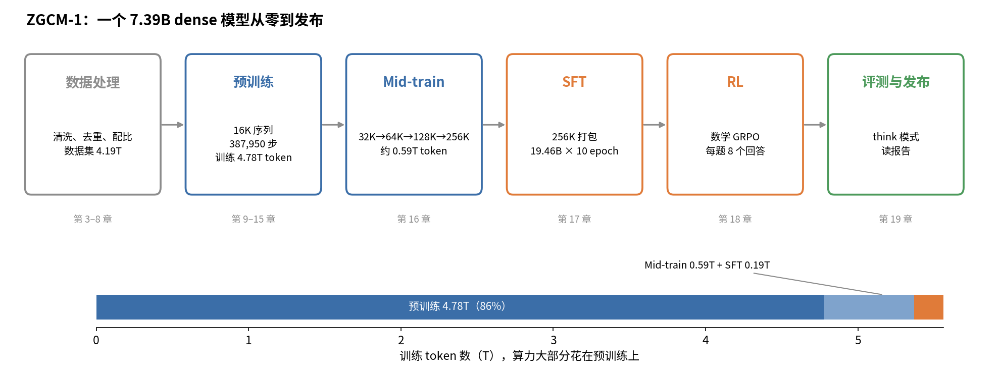

# 从零训练大模型：以 ZGCM-1 为例

这本书拿一个真实开源的 7B 模型 ZGCM-1 当案例，把从零训练大语言模型的过程从头讲到尾：原始网页和 PDF 怎么洗成训练数据，数据怎么配比、排序、切成一条条 16K 的样本，模型和优化器为什么这样选，192 张卡怎么分工，训练中途怎么盯曲线、怎么续训，然后是 mid-train、SFT、RL 和最后的评测。

ZGCM-1 的中间权重、训练代码、数据配方、W&B 曲线和技术报告都公开了，所以书里的数字基本都能查到出处。报告、代码和曲线对不上的地方，书里也照实写出来，并说明该信哪一个。

书是写给"懂一点深度学习、但讲不清大模型训练"的人看的。不用动手跑代码，读文字、表格和算式就行。每章末尾有一段示范讲稿和十来道习题，读完可以合上书试着讲一遍。

建议从 [第 0 章　导读](00_导读.md) 开始，那里交代了全书结构、出处的写法，以及数字对不上时按什么顺序取信。

> 本书不是 ZGCM-1 官方文档，与 ZGCM-1 的作者团队没有关系。书中凡是标"推断"的地方，都是作者自己的解释，没有官方证实。
