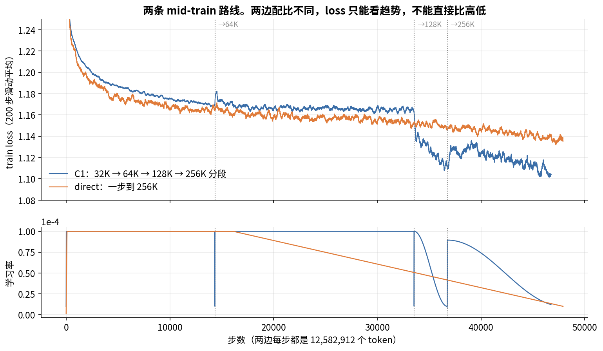
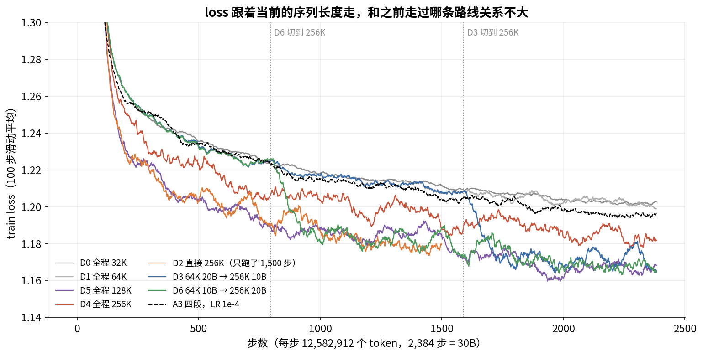
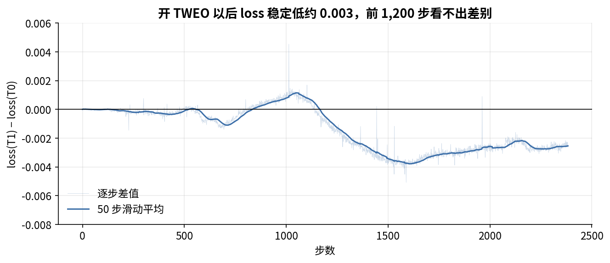
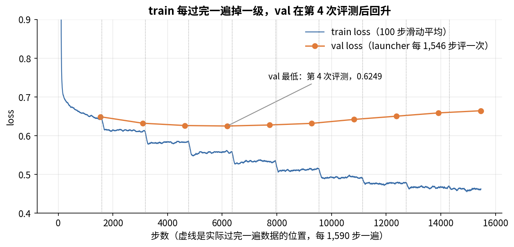

# 附录 C　W&B 全量曲线与数据配比统计

> 正文里有不少数字不是从报告里抄的，是我从 ZGCM 公开的 W&B 记录和 HF 数据集里统计出来的。这个附录把这些统计放在一起，说明它们是怎么来的，正文引用时写作"附录 C §C.x"。

这些统计用到两类公开材料。第一类是 W&B 公开项目 `zgcagi/zgcm-1-reports` 里的 25 个 run。我用 W&B 的 API 把每个 run 的逐步 history 全部拉了下来，没有用网页上默认的降采样曲线，所以下面"第几步是多少"的数字都是原始记录。第二类是 HF 数据集 `zgcagi/ZGCM-1-Data` 中 mid-train 和 SFT 的全部 552 个 parquet 文件。文本列太大，我没有下载，只用 HTTP Range 请求读了 6 个轻量的列：source、source_group、category、length_class、token_count、release_mode。按这些列就能统计每个配比的来源、类别和长度分布。

读下面的数字前，先交代几个约定。所有 mid-train run 每步都是 12,582,912 个 token（约 12.58M），因为 GBS 和序列长度的乘积恒定：32K×384 = 64K×192 = 128K×96 = 256K×48。表里的"last-100"指某一段最后 100 步 train loss 的均值，用它比单看最后一步稳定。另外，数据配比不同的 run，train loss 只能比趋势，不能比绝对值，能横向比较的只有同一套 bench 或同一个验证集。

## C.1 正式 mid-train：C1（`view-midtrain-c1-unfinished-v1`，46,751 步）

### C.1.1 分段

| 段 | iteration | 步数 | tokens | GBS | LR | last-100 loss |
|---|---|---|---|---|---|---|
| 32K | 1–14,344 | 14,344 | 180.5B | 384 | 9 步 warmup，之后恒定 1e-4 | 1.1687 |
| 64K | 14,345–33,550 | 19,206 | 241.7B | 192 | 9 步 warmup，之后恒定 1e-4 | 1.1615 |
| 128K | 33,551–36,751 | 3,201 | 40.3B | 96 | 9 步 warmup 到 1e-4，cosine 降到 1e-5 | 1.1089 |
| 256K | 36,752–46,751 | 10,000（计划约 11,172） | 125.8B | 48 | 9 步 warmup 到 8.95e-5，cosine，停时 1.21e-5 | 1.1063 |

32K 段的 180.5B 和 64K 段的 241.7B，分别对应报告里 16k 配比的 180B 和 64k 配比的 240B。由此看，32K 段用的是 `midtrain-16k` 配比，每个配比基本只过了一遍。

每段的 warmup 都从 peak/10 起，用 9 步线性升到 peak，比如 128K 段是 1e-5, 2e-5 … 1e-4。段与段之间 LR 不衔接，每段都重新 warmup。run 名里的 "unfinished" 是说 256K 段停在了 10,000 步，没跑完计划的约 11,172 步。11,172 是按 LR 曲线拟合出来的（[§C.1.3](#sc-1-3)）；HF 上 256K checkpoint 的 `planned_stage_steps` 写的是 11,173，差的 1 步来源不明（第 16 章）。

### C.1.2 每段曲线

32K 段按 1000 步分箱，loss 从 1.2448 降到 1.1688。grad norm 的中位数是 0.073，但开头很猛：第 2 步 74.21，前 10 步均值 19.6，整段有 28 步超过中位数的 3 倍。这时模型刚从 pretrain 的 checkpoint 切到新长度和新配比，前几步梯度很大，靠 9 步 warmup 压住了。

64K 段从 1.1743 降到 1.1629，19K 步只降了 0.011，基本是平台。grad norm 中位数 0.164，是 32K 段的 2.2 倍，最大 0.43，没有尖峰。每步 token 数没变，序列条数却减半了，一个可能的解释是梯度噪声随之变大（推测，没有做对照实验）。

128K 段从 1.1359 降到 1.1006，下降主要来自退火。按实测 LR 反推，cosine 周期 T = 3,191，加上 9 步 warmup 正好 3,200 步，所以 128K 段是一次完整跑完的短退火。

256K 段起点是 1.1250。LR re-warm 到 8.95e-5 后，loss 在 2,000–2,500 步升到约 1.130，之后随 LR 下降，降到 1.1045。grad norm 中位数 0.161，最大 1.12。

图中灰色虚线是 14,344、33,550、36,751 三个切换点。

### C.1.3 128K 段和 256K 段共用 256K 配比的预算

256K 段的 LR 可以用"从 8.95e-5 起、T = 11,163 的新 cosine"拟合，在第 100、1,000、5,000、9,000、9,999 步和实测值逐位一致，例如第 5,000 步都是 5.6325e-5。加上 9 步 warmup，计划长度是 11,172 步，约 140.6B。

把两段加起来，128K 的 3,201 步加 256K 的 11,172 步是 14,373 步，约 180.9B，和报告的 256K 配比总量 180.51B 只差 0.2%。数据集里也没有单独的 128K 配比。8.95e-5 这个峰值也对得上：如果把这 14,373 步看成一条 1e-4 → 1e-5 的 cosine，第 3,201 步的 LR 是 8.943e-5，和 8.95e-5 差 0.08%。

我推测的经过是：原计划用 256K 配比跑一条 14,373 步的 cosine；后来把前约 22% 改成 128K，并单独做了一次完整退火；剩下的 256K 段从"原计划在这个位置的 LR"重新起一条 cosine，跑完剩余步数。这些都是从数字倒推出来的，报告里没写，ZGCM 也没公开 128K 段用的数据。

## C.2 C1 分段和一步到 256K 的对比（`view-midtrain-direct256k-public-20260922-v1`）

### C.2.1 direct-256K 是一个独立的 602.9B run

光看 run 名，容易以为 direct-256K 是在 64K 段之后接着跑的。全量 history 显示，它从 iteration 1 起就是 256K、GBS 48，共 47,912 步，约 602.9B，比 C1 已经跑完的 588.3B 还多。

从 pretrain 的 checkpoint 直接跳到 256K，开头的冲击比 C1 跳到 32K 大得多。direct 第 1 步 loss 1.765，grad norm 第 0 步最大 152.7，前 10 步均值 71；C1 的 32K 段开头最大是 74，前 10 步均值 19.6。

它的 LR 用的是 WSD：79 步 warmup（从 1.27e-6 起），恒定 1e-4 到第 16,122 步，然后线性降到第 47,912 步的 1e-5，线性拟合的残差是 4e-12。衰减段占了全程的 2/3，比常见 WSD 的 10–20% 长得多。它用的是哪个配比，W&B 没有记，报告也没说清楚，列在 [§C.9](#sc-9) 待查。

### C.2.2 同步数下的 train loss（数据不同，只看趋势）

| step | direct-256K | C1 | C1 所处段 |
|---|---|---|---|
| 1,000 | 1.2073 | 1.2205 | 32K |
| 5,000 | 1.176 | 1.187 | 32K |
| 10,000 | 1.1636 | 1.1755 | 32K |
| 14,344 | 1.1644 | 1.1687 | 32K 末 |
| 20,000 | 1.1621 | 1.1635 | 64K |
| 33,550 | 1.1551 | 1.1615 | 64K 末 |
| 36,751 | 1.1463 | 1.1089 | 128K 退火末 |
| 40,000 | 1.144 | 1.125 | 256K re-warm 后 |
| 46,751 | 1.1387 | 1.1063 | 256K 停止 |
| 47,912 | 1.1363 | — | |

前 33K 步，direct 一直比 C1 低 0.005–0.013。原因可能是配比不同，也可能是 256K 下文档内的上下文更长、更好预测，这份数据分不开这两个因素。C1 在 128K 退火之后反超了约 0.037，这段差距主要来自 LR：C1 已经退到 1e-5，direct 还在 ~6e-5。等 direct 也退到 1e-5 时，它的 loss 是 1.1363，仍比 C1 高 0.03。但两边数据不同，不能据此说分段更好。

### C.2.3 Ability Lite（同一套评测，可以横向比）

train loss 不能直接比，同一套下游评测可以。下表是 17 个 benchmark 的平均分，去掉了 bigcodebench，因为它在所有 checkpoint 上都是 0.553，没有信息量。

| 来源 | ckpt（iteration）→ Avg17 |
|---|---|
| C1 32K | 1000: 0.6940 · 5000: 0.7158 · 10000: 0.7145 · 14344: 0.7314 |
| C1 64K | 15344: 0.7334 · 20344: 0.7277 · 25344: 0.7234 · 30344: 0.7344 · 33550: 0.7203 |
| C1 128K | 34550: 0.7247 · 36751: 0.7279 |
| C1 256K | 40751: 0.7130 · 44751: 0.7317 · 46751: 0.7318 |
| direct | 1000: 0.6707 · 5000: 0.7162 · 8000: 0.7023 · 10000: 0.6949 · 15000: 0.7192 · 20000: 0.7187 |
| direct | 25000: 0.7113 · 30000: 0.7104 · 35000: 0.7017 · 39000: 0.7158 · 40000: 0.7268 · 45000: 0.7238 |

先看噪声有多大。同一条曲线上相邻的 checkpoint 能来回跳 0.01–0.02，比如 C1 64K 段从 0.7344 掉到 0.7203。两边的终点是 0.7318 和 0.7238，差 0.008，落在噪声范围内。

唯一看起来稳定的差距在 minerva_math：direct 在 0.22–0.50 之间（终点 0.42），C1 在 0.38–0.56 之间（终点 0.56）。但这个指标的取值都是 0.02 的倍数，说明题目很少（约 50 题），单点差 0.14 也就是 7 道题。终点的 mmlu 是 0.634 和 0.643，humaneval 是 0.549 和 0.591。

在这份公开数据里，"分段比一步到 256K 好"没有可靠证据。分段确定的好处在算力上：短序列段的注意力便宜，相同 token 数下吞吐更高。

## C.3 各阶段 bench 与分领域 LM CE（`view-bench-*`）

`view-bench-pretrain` 和 `view-bench-midtrain-1..4` 这几个 run，在 pretrain 和每个 mid-train 段首尾的 checkpoint 上跑了同一套下游评测，共 48 个指标。MMLU4 是 4 个多选子集的均值；BPB 是 bits-per-byte，越低越好。

| ckpt | MMLU4 | mmlu BPB | math BPB | humaneval BPB |
|---|---|---|---|---|
| pretrain 25% | 0.589 | 0.698 | 0.407 | 0.276 |
| pretrain 50% | 0.602 | 0.680 | 0.407 | 0.274 |
| pretrain 末 | 0.621 | 0.644 | 0.389 | 0.258 |
| 32K 首 | 0.651 | 0.617 | 0.371 | 0.255 |
| 32K 末 | 0.674 | 0.572 | 0.357 | 0.249 |
| 64K 首 | 0.676 | 0.571 | 0.356 | 0.247 |
| 64K 末 | 0.676 | 0.584 | 0.363 | 0.252 |
| 128K 首 | 0.677 | 0.566 | 0.366 | 0.255 |
| 128K 末 | 0.682 | 0.557 | 0.357 | 0.256 |
| 256K 首 | 0.658 | 0.565 | 0.360 | 0.266 |
| 256K 末 | 0.679 | 0.556 | 0.363 | 0.249 |

11 个验证集的 LM CE 均值依次是：pretrain 25% 2.333 → pretrain 末 2.309 → 32K 首 2.241 → 32K 末 2.230 → 64K 首 2.230 → 64K 末 2.237 → 128K 首 2.237 → 128K 末 2.215 → 256K 首 2.242 → 256K 末 2.224。单看长书（dolma_books）：pretrain 末 2.385 → 32K 末 2.358 → 64K 末 2.251 → 128K 末 2.229 → 256K 末 2.241。

两组数对照着看，MMLU 这类短任务能力主要是在 32K 段拿到的，从 0.621 涨到 0.674，之后各段基本持平。64K 是恒定 LR 段，长书 CE 降了 0.107，均值 CE 和 mmlu BPB 却略有上升（2.230 → 2.237，0.571 → 0.584），长上下文在涨，短领域在退。128K 退火段所有领域都在降，均值降到全程最低的 2.215。

re-warm 会把已经降下来的指标推回去。256K 首个 checkpoint 的 MMLU4 掉到 0.658，均值 CE 升到 2.242，到段末才回到 0.679 和 2.224。256K 段停止时，长书 CE（2.241）还没回到 128K 段末的水平（2.229）。

## C.4 D 系列和 A 系列：长度消融（各 30B）

ZGCM 在定 mid-train 方案前做过两组小消融。每个 run 都是 2,384 步，约 30B（D2-partial 只有 1,500 步）。LR 用 24 步 warmup，从 4.17e-6 起。

| run | 路线 | last-100 loss |
|---|---|---|
| D0 | 32K | 1.2027 |
| D1 | 64K | 1.1990 |
| D5 | 128K | 1.1682 |
| D4 | 256K（allmix 配比） | 1.1817 |
| D2-partial | 256K（第 1,400–1,500 步） | 1.1797 |
| D3 | 64K 20B → 256K 10B（第 1,590 步切） | 1.1645 |
| D6 | 64K 10B → 256K 20B（第 796 步切） | 1.1644 |

图中虚线 796 和 1,590 是 D6、D3 的切换点。

last-100 不在同一个时间窗口，所以还要在同一窗口里比。第 1,100–1,200 步，D2 是 1.1800，D6 是 1.1804，D5 是 1.1809，三者几乎一样；D3 当时还在 64K，是 1.2117；D4 是 1.1934。第 1,400–1,500 步，D2 是 1.1797，D6 是 1.1885。

从这些数看，train loss 跟着当前的序列长度走，长度越长 loss 越低；同一窗口里同长度的 run 差别在 0.01 以内。第 1,400–1,500 步 D6 比 D2 高 0.009，方向还和"分段更好"相反。D 系列的 LR 到结尾仍是恒定 1e-4，没有退火，D3 和 D6 的 last-100 低，只是因为它们结尾在 256K，而且在 256K 上多训了 800–1,600 步。D4 用的是另一套 allmix 配比，绝对值不能和其他 D run 比。单凭这组 train loss，证明不了分段更好。

A 系列走的是 4 段 32K → 64K → 128K → 256K，各段起点在第 1、319、796、1,432 步，约 4 : 6 : 8 : 12B，每段重新 warmup。三个 run 只差 LR：

| run | LR | last-100 |
|---|---|---|
| A1 | peak 2e-5，每段 cosine 降到 2e-6 | 1.2384 |
| A3 | 恒定 1e-4 | 1.1965 |
| A4 | 恒定 2e-4 | 1.2080 |

A3 最好，C1 前两段用恒定 1e-4 的依据就是它。A1 虽然退了火，仍然最差，说明 2e-5 对 mid-train 来说太小。还有一个更早的方案 old90b：32K 跑 2,384 步后接 64K，共 7,152 步（约 90B），每段 2e-5 → 2e-6 cosine，last-100 是 1.2034（在 64K）。它和 A1 用的是同一个偏小的 LR，后来被 1e-4 取代了。

## C.5 TWEO 的配对对比（`view-ablation-mtcmp-{b0,t0,t1}`）

这三条 run 都是 256K、GBS 48、2,384 步（30B），79 步 warmup，从 1.27e-6 起。

| run | 起点 | TWEO | last-100 | grad norm 中位数 |
|---|---|---|---|---|
| B0 | base 1T | — | 1.2581 | 0.039 |
| T0 | fastTWEO base | 关 | 1.2612 | 0.034 |
| T1 | fastTWEO base | 开 | 1.2586 | 0.033 |

T0 和 T1 的起点和数据顺序都相同，第 1 步 loss 完全一样，所以逐步相减就能把数据带来的噪声去掉。下表是 T1 − T0 在每个 400 步窗口里的均值：

| 窗口 | 均值差 |
|---|---|
| [0, 400) | −0.0001 |
| [400, 800) | −0.0005 |
| [800, 1200) | +0.0004 |
| [1200, 1600) | −0.0027（窗口内每一步都为负） |
| [1600, 2000) | −0.0031 |
| [2000, 2400) | −0.0025 |

前 1,200 步看不出差别，之后开了 TWEO 的 T1 稳定低约 0.003。差值很小，但符号一直没变，不像是噪声。`tweo_cap_scale` ≈ 4.26e-11，正则项被封顶在很小的量级，约为 loss 的 0.1%（第 11 章）。这组对比里两边都没有发散，所以它只能说明开 TWEO 不伤 loss、还略好一点，不能说明不开就会炸。报告的 Finding 2 依然没有数字支撑。

## C.6 SFT（`view-sft-public-20260922-v1`）

SFT 共 15,467 步，GBS 48，每 epoch 1,546 步，共 10 个 epoch。consumed_samples 最后是 742,416，即每个 epoch 约 74K 条样本。报告写的是 19.46B packed tokens、打包到 256K：1,546 × 48 × 262,144 = 19.45B，对得上。所以一条样本是一条 256K 的打包序列，里面平均装了约 60 条对话（457 万行 / 74K）。

LR 没有 warmup，第 0 步就是 1e-4，然后 cosine 降到 1e-6，中点第 7,733 步是 5.05e-5。整个过程没有 NaN，也没有 skipped iteration，每步 11.5 秒。`throughput_tflops_per_gpu` 最后一步记的是 1,409.6（全程中位数 1,402.7），已经超过 BF16 峰值。它是按整条 256K 因果注意力数 FLOPs 得来的，没考虑打包和滑窗，实际约 237（第 17 章 [§17.6](17_SFT.md#s17-6)），不要直接引用它。

前 12 步的 loss 是 35.01, 34.46, 31.75, 28.91, 25.19, 20.84, 16.78, 12.11, 7.83, 4.91, 2.99, 1.99，前 8 步 grad norm 约 30。第 1 步还没更新参数，loss 就是 35，远高于 mid-train 末的 1.1，而一个正常 7B 模型的 per-token CE 不会到 35。可能的原因有两个：新加的 chat 特殊 token 的 embedding 没训过，或者 loss 的归一化口径不同。W&B 和报告都没有说明，列在 [§C.9](#sc-9)。

| epoch | train 均值 | val | grad norm 中位数 |
|---|---|---|---|
| 1 | 0.8132 | 0.6488 | 0.378 |
| 2 | 0.6144 | 0.6321 | |
| 3 | 0.5837 | 0.6262 | |
| 4 | 0.5584 | **0.6249** | |
| 5 | 0.5354 | 0.6276 | |
| 6 | 0.5138 | 0.6318 | |
| 7 | 0.4958 | 0.6419 | |
| 8 | 0.4793 | 0.6503 | |
| 9 | 0.4691 | 0.6588 | |
| 10 | 0.4627 | 0.6644 | 0.057 |

val 在第 4 个 epoch 最低，之后连涨 6 个 epoch，最终 val 0.6642、test 0.6624，train 却一直在降，这是典型的过拟合。报告说发布的是第 10 个 epoch，没说为什么不用 val 最低的第 4 个。我推测是按下游评测选的，但这里没有对应的下游曲线可以核对。val 和 test 集是从 SFT 数据里切出来的还是独立的集合，也不知道。

## C.7 数据配比（`zgcagi/ZGCM-1-Data`）

### C.7.1 总览（来自 `dataset_manifest.json`）

| config | 文件 | 行数 | 大小 |
|---|---|---|---|
| midtrain-16k | 168 | 525.3M | 244.1GB |
| midtrain-64k | 215 | 645.5M | 302.1GB |
| midtrain-256k | 159 | 472.3M | 221.9GB |
| pretrain-stage1 | 895 | 972.8M | 1.30TB |
| pretrain-stage2 | 2,539 | 2.82B | 3.65TB |
| sft | 10 | 4.57M | 14.2GB |
| 合计 | 3,986 | 5.44B | 5.74TB |

其中有 1.148B 行是 `index_only`，只给来源和定位信息。这些行的正文因为许可证原因不发布，要自己按 `locator_json` 去上游取。

### C.7.2 mid-train 的 token 数为什么和报告对不上

| 配比 | 统计到的 tokens | 报告 | 差额 |
|---|---|---|---|
| 16k | 155.75B | 180B | 24.3B |
| 64k | 210.51B | 240B | 29.5B |
| 256k | 163.49B | 180.51B | 17.0B |

差额来自 `pretrain_replay` 行，它们的 token_count 字段是 0：16k 有 2,160 万行，64k 有 2,750 万行，256k 有 1,500 万行。replay 是混进来防遗忘的 pretrain 数据，实际 token 数没有记录。按差额算，replay 约占每个配比的 9–14%。另外，每个配比约 38–41% 的 tokens 是 index_only，所以只靠公开的正文复现不了完整配比。

### C.7.3 类别（256k 配比，按 tokens，不含 replay）

math 21.9%、code 21.7%、web 17.5%、knowledge 15.7%、qa 10.9%、reasoning 6.5%、agentic 3.6%、instruction 2.2%。16k 和 64k 的类别比例和它接近。

qa 类要单独说一下。按行数它占 64–70%，但平均每条只有 54 tokens，主要来自 ultrafineweb zh20 sample 160b qa，按 token 只占约 11%。只看行数会严重高估它。

### C.7.4 长度分布

| 配比 | ≤16K | 16K–64K | >64K |
|---|---|---|---|
| 256k（统计） | 111.02B（67.9%） | 21.54B（13.2%） | 30.92B（18.9%） |
| 256k（报告） | 127.81B | 21.72B | 30.98B |
| 64k（统计） | 151.47B（72.0%） | 59.04B（28.0%） | — |
| 16k（统计） | 96.34B 标为 mix_16k，59.41B 无长度标签 | — | — |

256k 配比的 >64K 和 16K–64K 两档跟报告基本一致；≤16K 差的 16.8B 正好是 replay 的量级。所以在 256K 阶段，超过 64K 的文档只占约 17–19% 的 tokens，大部分训练 token 仍然来自短文档，只是被打包进了 256K 的序列。

### C.7.5 长文档从哪来

256k 配比的 >64K 档共 30.92B，259,959 篇，平均每篇 118,960 tokens。按类别是 knowledge 59%、web 32%、code 7%、agentic 3%。主要来源是 nemotron_cc_v2_hq ge4 6.32B、papers_latex ge4 5.59B、books_oer ge4 4.14B、pdf_ocr ge4 3.98B、nemotron_cc ge3 2.12B、davinci_dev_ctx_pr 1.62B、pdf_ocr ge3 1.53B、gair_davinci_dev_env 0.80B。也就是论文 LaTeX、开放教材、PDF OCR 和高质量网页长文，再加少量代码仓库的上下文。

16K–64K 档的构成很不一样。256k 配比这一档共 21.54B，906,669 篇，平均 23,753 tokens，类别是 reasoning 32%、knowledge 23%、agentic 22%、code 12%。主要来源是 reasoning_pool_v1 6.82B、agent_coding_trace64k 2.95B、davinci_dev_ctx 2.62B、domain_reference 1.49B、agenttrove 1.35B。这一档以长推理链和 agent 轨迹为主，自然长文反而不多。64k 配比的 16K–64K 档共 59.04B，221 万篇，平均 26,663 tokens，类别是 knowledge 46%、web 26%、code 14%、reasoning 8%、agentic 4%。

### C.7.6 SFT 数据

SFT 数据共 4,567,887 行，其中 full_text 3,867,907 行（84.7%），index_only 699,980 行（15.3%），来自 50 个来源。它的 token_count 全是空的，所以只能按行数统计。

按行数排的前 10 个来源是：UltraData-SFT-2605 Knowledge no-think 500,000（10.9%）、OpenCodeReasoning 427,257（9.4%）、saumyamalik correct-python 421,332（9.2%）、rStar-Coder 396,321（8.7%）、nvidia math proofs cot 272,821（6.0%）、nvidia math proofs tir 258,963（5.7%）、Verifiable Reasoning 215,219（4.7%）、UltraData IF 199,980（4.4%）、allenai persona-precise-if 196,327（4.3%）、Wildchat 156,080（3.4%）。

category 字段全是 `sft`，没法直接用，所以我按来源名手工归了类（按行数）：代码约 31%、数学约 19%、指令遵循约 12%、知识问答约 11%、通用对话约 10%（wildchat、aya、中文合成、nemotron 子集）、科学和可验证推理约 8%、工具调用和 agent 轨迹约 5%（含 nvidia swe hero 和 zero openhands 各约 3 万条）、安全类约 3%（wildguardmix、wildjailbreak、coconot）。

每行的字段有：id、sample_key、source、source_group、category、length_class、token_count、release_mode、release_policy_rule、licenses、database_license、license_status、upstream_repos、upstream_revision、upstream_snapshots、content_withheld_reason、text、messages、tools_json、locator_json、metadata_json。

## C.8 从这些数据里能得出什么

把上面的统计合起来，对自己做 mid-train 和长上下文训练有下面这些参考。

跨长度的 train loss 不能拿来比。D 系列里 loss 只跟当前的序列长度有关，所以比较不同的长度方案时，要用固定长度的同一个验证集，或者固定的下游评测。

每次 re-warm 都要付代价，而且恢复得很慢。C1 的 256K 段 re-warm 之后跑了 126B，11 个验证集的平均 CE（2.224）还没回到 128K 段末的 2.215，长书 CE 也没回去。如果你打算分段扩长，要么段与段之间不把 LR 重新拉满，要么给最后一段留足退火的预算。

mid-train 的 LR 在 1e-4 这个量级比较合适。A 系列里 2e-5 最差，2e-4 也不如 1e-4。

ZGCM 全程每步固定 12.58M tokens，GBS 随序列长度反比缩小。序列条数变少后 grad norm 中位数翻了一倍，所以长序列段要留意梯度噪声。从 pretrain 的 checkpoint 直接跳到 256K 时，开头的梯度很猛（grad norm 最大 152.7，前 10 步均值 71），warmup 不能省。

256K 阶段里超过 64K 的文档只占约 17–19% 的 tokens。长文集中在论文 LaTeX、开放教材、PDF OCR、高质量网页长文和代码仓库上下文；16K–64K 档主要是长推理链和 agent 轨迹。配长上下文数据时，这个比例和这些来源可以作参考。

小评测集的噪声很大。Ability Lite 的平均分在相邻 checkpoint 之间能跳 0.01–0.02，minerva_math 一道题就是 0.02。做消融时要看曲线趋势或多个 checkpoint 的均值，不要只看单点。

最后，长上下文能力和短任务能力会互相拉扯。64K 恒定 LR 段里，长书 CE 降了 0.107，短领域的 CE 和 mmlu BPB 却略有上升，退火以后两者才一起降下来。

## C.9 还没搞清楚的问题

- 128K 段用的数据和 RoPE 设置。数据集里没有 128K 配比，按 [§C.1.3](#sc-1-3) 推测，用的是 256K 配比的前一部分。
- direct-256K 用的是哪个配比。
- SFT 第 1 步 loss 为 35 的原因；val 和 test 集的来源；为什么发布第 10 个 epoch，而不是 val 最低的第 4 个。
- TWEO 的公式和封顶规则。
- 发布的模型是否还经过了 RL。

---

上一章：[附录 B　数字速查](附录B_数字速查.md)　下一章：[第 0 章　导读](00_导读.md)
